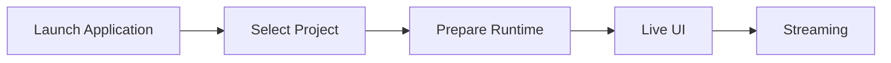

# 1. System Overview

## 1.1 Purpose

The purpose of this system is to integrate functions such as 3D avatars, real-time tracking, voice conversion, stages, BGM/SE, video generation, live streaming, and voice model creation, and to provide **an integrated environment in which all operations required for VTuber streaming can be performed from a single application**.

In a typical VTuber streaming environment,

- 3D avatar display
- face / body tracking
- voice conversion
- audio mixing
- streaming
- recording
- voice model training
- external tools

may each be provided by separate applications or scripts.

In that case, the user must launch and configure multiple applications and manage device routing, windows, external processes, and so on.

This system integrates these as far as possible and consolidates what the user operates into **a single VTuber application (Virtual Vessel Studio)**.

The purpose is also not simply to pack multiple functions into one application, but to

- separate responsibilities by function
- limit dependencies on external OSS
- separate the streaming runtime from setup / training
- remain adaptable to future technology changes in tracking, voice, streaming, etc.
- keep a structure that can be continuously developed and maintained as OSS

### Rationale

VTuber streaming involves many technologies and devices. If each function is provided as a separate application, the user has to understand and operate the internal structure.

The fundamental value of this system is to

**absorb the complex internal structure on the application side and provide the user with an integrated operating environment.**

---

## 1.2 Scope

This system mainly covers the following functions.

### 3D Avatar

- VRM 1.0 and later (VRM 0.x is accepted by converting it to 1.0 at load)
- FBX
- avatar registration
- avatar switching
- pose control
- expression control
- extension bone control
- extension elements such as cat ears and tails

### Tracking

- camera-based tracking
- face tracking
- body tracking
- hand tracking
- MediaPipe
- future tracking providers such as mocopi

### Voice Conversion

- microphone input
- real-time voice conversion with RVC
- post-processing such as pitch
- voice model selection
- output to virtual microphones, etc.

### Voice Lab

- voice generation
- voice clone
- dataset creation
- voice analysis
- RVC training
- training history
- model evaluation
- registering voice models for runtime

### Stage

- 3D stages
- stage switching
- camera points
- avatar spawn points
- lighting
- stage effects
- screen surfaces that display capture textures

### Audio

- voice
- BGM
- SE
- game / capture audio
- audio mixing
- monitor output
- stream audio

### Capture

- capture-board video and audio input via GameCapture
- sub-monitor video input via SubScreenCapture
- preview and on/off of capture sources
- supplying video to screen surfaces on the stage

### Camera / Video

- main camera
- camera point switching
- streaming render target
- diagnostic camera
- video encoding
- recording

### Streaming

- YouTube Live
- audio / video synchronization
- streaming via RTMPS, etc.
- streaming state management

### Project / Data

- project
- profile
- asset
- Data Root
- backup
- import / export
- migration
- credential management

### Developer / Diagnostics

- logging
- runtime diagnostics
- performance monitoring
- external process monitoring
- diagnostic camera
- diagnostics export

---

Items outside the scope of this system, or not required for the initial implementation, are treated as future extensions.

Examples:

- simultaneous multi-person streaming
- a complete plugin SDK
- simultaneous support for many streaming services
- support for every 3D model format
- support for every motion capture device

### Rationale

Implementing every future function from the start would make the system excessively complex relative to the functions currently needed.

Therefore, the implementation focuses on currently needed functions while providing extensible boundaries where future changes are expected.

---

## 1.3 Basic Policies

The basic policies of this system are as follows.

### Provide a Single Application

From a normal user's point of view, the system is provided as one Unity application.

Even when Python services or external OSS are used internally, normal users are not made aware of

- the command prompt
- Python
- venv
- ports
- Git
- the internal structure of external OSS

---

### Unity at the Center of the Runtime

The main functions required during streaming run centered on Unity.

Examples:

- avatar
- tracking
- voice conversion
- audio
- camera
- stage
- streaming
- UI

In particular, real-time voice conversion with RVC runs inside the Unity runtime, and no Python service is required during streaming.

---

### Python Mainly for Setup, Training, and Analysis

Python is mainly used for:

- voice generation
- voice clone
- RVC training
- voice analysis
- model conversion
- external OSS setup

These are started only when needed.

---

### Separate Setup and Runtime

For each function,

- registration
- analysis
- training
- mapping
- detailed configuration

and similar work are performed on the setup side.

The streaming runtime loads assets and profiles that have already been set up and performs processing that is as lightweight as possible.

---

### Do Not Expose External OSS Directly in the Application Design

External OSS such as RVC and VoxCPM2 is used through boundaries such as adapters / wrappers.

Modifying external OSS itself is avoided as far as possible.

---

### Separate Responsibilities by Module

The whole application is not consolidated into a giant manager.

Avatar, Tracking, Voice, Streaming, etc. are treated as independent modules that cooperate through clear interfaces and data contracts.

---

### Separate Information for Normal Users and Developers

Normal users see only the necessary state and operations.

Developers can sufficiently observe

- detailed logs
- performance
- internal state
- external processes
- versions
- exceptions

and similar information.

---

### Consider Future Extensions

Without making the initial implementation excessively complex, the structure remains extensible to

- new tracking providers
- new voice converters
- new avatar formats
- new streaming services
- new locales
- multiple avatars

and so on.

---

### Maintainable as OSS

This system is intended to be published as OSS on GitHub or similar.

Therefore,

- module boundaries
- documentation
- tests
- logging
- external dependencies
- version management
- migration

and similar concerns are considered from the design stage.

---

## 1.4 Expected Usage Patterns

This system broadly assumes the following usage patterns.

### Normal Streaming

The user loads already registered

- avatar
- tracking profile
- voice model
- stage
- streaming profile

and so on from a project and starts streaming.

The basic flow is as follows.



During normal streaming, there is no need to start Python or the Voice Lab environment.

---

### Pre-stream Setup

Avatar, Tracking, Voice, Stage, Streaming, etc. are configured.

Example:

```text
Avatar Import
Tracking Setup
Voice Setup
Stage Setup
Camera Setup
Audio Setup
Streaming Setup
Project Save
```

Each setup screen provides previews and tests where practical.

---

### Voice Lab

Used when creating a new voice model.

The basic flow is as follows.

```text
Generate
   ↓
Clone
   ↓
Dataset
   ↓
Train RVC
   ↓
Evaluate
   ↓
Register for Runtime
```

Only while Voice Lab is in use are external services / processes such as VoxCPM2, voice analysis, and RVC training started as needed.

---

### Developer / Diagnostics

In Developer Mode, the following can be checked:

- runtime state
- logging
- diagnostic camera
- tracking information
- audio information
- streaming information
- external service state

Normal users are not required to understand this internal structure.
