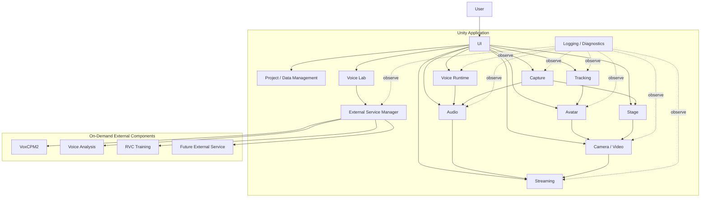
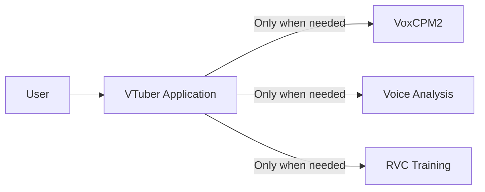

# 2. Overall System Architecture

## 2.1 Overall Architecture

This system is built around a Unity application.

The main streaming runtime functions are placed inside Unity, and local external services / processes are used as needed for training, generation, analysis, etc.

The conceptual overall structure is shown below.



The arrows in the diagram mainly indicate

- control requests
- data transfer
- state references

and do not necessarily mean direct references between classes.

### Rationale

Placing Unity at the center of the application allows functions that cooperate during streaming, such as

- 3D rendering
- tracking
- audio
- UI
- streaming

to be handled on the same runtime.

At the same time, separating heavy setup processing such as training into external services avoids bringing unnecessary Python dependencies into the streaming runtime.

---

## 2.2 Division of Roles Between Unity and External Services

The responsibilities of Unity and external services are clearly separated.

### Unity Side

Mainly responsible for:

- application lifecycle
- UI
- project management
- avatar
- tracking
- runtime voice conversion
- audio mixing
- video input such as GameCapture / SubScreenCapture
- stage
- camera
- rendering
- streaming
- recording
- diagnostics
- external service lifecycle management

### External Service / Process Side

Mainly responsible for:

- voice generation
- voice clone
- voice analysis
- RVC training
- dataset processing
- model conversion
- other setup / analysis processing

### Basic Principle

Except for processing that can only be performed by an external service, the main streaming runtime does not depend on external services.

### Rationale

Separating the streaming runtime from the training environment limits the impact on normal streaming with registered assets even when

- Python environment failures
- external service failures
- dependency errors

occur.

---

## 2.3 Single-application UX with Internal Multi-service Structure

From the user's point of view, the system is a single application.

Internally, multiple processes such as

- the Unity runtime
- the VoxCPM2 service
- the voice analysis service
- the RVC training process

may exist.

However, normal users do not need to start or stop them individually.



The normal UI does not display

- ports
- PIDs
- venv
- Python commands

and similar details.

For example, when voice generation is started, it is displayed as user-facing states such as

```text
Preparing the voice generation service
        ↓
Available
        ↓
Generating voice
```

### Rationale

Even if the internal structure is complex, the way the application is used does not have to be complex.

Maintaining a single-application UX reduces the user's burden of environment setup and operation.

---

## 2.4 Module Division Policy

The inside of the system is divided into modules by responsibility.

The main modules are assumed to be:

```text
Application
Project / Data
Avatar
Tracking
Voice
Audio
Capture
Stage
Video
Streaming
VoiceLab
ExternalServices
Diagnostics
UI
```

Each module manages the internal implementation required for its responsibility.

For example, the Avatar module internally has

- avatar loading
- avatar runtime
- skeleton
- pose
- expression
- extension motion

The Tracking module manages

- providers
- normalization
- filtering
- calibration

The Capture module manages

- capture sources
- the GameCapture adapter
- the SubScreenCapture adapter
- capture state
- passing capture textures / audio

### Module Division Principles

The basics are:

1. One module does not directly manage the internal implementation of multiple functions.
2. A module does not freely depend on the internal classes of other modules.
3. The externally exposed interface is limited.
4. Internal changes in a module do not propagate to other modules.
5. No giant global manager is created.

### Rationale

Consolidating everything into a single application manager or similar

- makes responsibilities unclear
- makes unit testing difficult
- widens the impact of changes
- makes it harder for Claude Code to determine the scope of a change

---

## 2.5 Inter-module Cooperation

Inter-module cooperation uses the following according to purpose:

- interface
- data contract
- command
- event
- service
- runtime state

Directly referencing concrete classes inside a module is not the default.

---

### Interface

Used as a stable boundary for using functions from other modules.

Examples:

```text
IAvatarLoader
ITrackingProvider
IVoiceConverter
IVideoCaptureSource
IAudioCaptureSource
IVideoEncoder
IStreamPublisher
```

### Data Contract

Used when passing data between modules.

Examples:

```text
TrackingFrame
AvatarPose
ExpressionSignal
CaptureSourceInfo
CaptureFrameInfo
FinalStreamAudio
```

### Command

Passes operation requests from user operations or external input to the runtime.

Examples:

```text
SwitchAvatarCommand
SwitchCameraCommand
PlaySeCommand
ToggleMuteCommand
```

### Event

Used when state changes and similar need to be notified to multiple modules.

Examples:

```text
ProjectChanged
AvatarChanged
StageChanged
StreamingStateChanged
```

### Runtime State

Used to expose the current state to the UI and diagnostics.

The UI does not directly reference internal variables of modules.

---

### Suppressing Direct Dependencies

For example, the UI does not directly call a concrete implementation, as in

```text
Button
  ↓
VrmAvatarLoader
```

Instead, it uses

```text
Button
  ↓
Command
  ↓
Avatar Module
  ↓
Internal implementation
```

### Rationale

This allows the same processing to be reused from different input sources such as the UI, external devices, and automation.

Reducing dependencies on concrete classes also limits the impact of internal implementation changes.

---

## 2.6 Common Data Formats and Abstraction Policy

Data used between modules avoids, as far as possible, directly using formats specific to a particular library or external OSS.

Data is converted into system-wide data contracts before use.

### Tracking

For example, MediaPipe-specific landmark information is not passed directly to the Avatar module.

```text
MediaPipe Data
      ↓
Tracking Provider
      ↓
TrackingFrame
      ↓
Avatar Module
```

### Avatar

VRM- or FBX-specific bone structures are not exposed to the Tracking module.

```text
VRM / FBX
   ↓
Skeleton Mapping
   ↓
Common Avatar Bone
```

### Expression

VRM expressions and FBX blend shapes are not handled directly on the face tracking side.

```text
Face Tracking
      ↓
Expression Signal
      ↓
Expression Mapping
      ↓
VRM / FBX
```

### Voice

RVC-specific processing is not exposed to the audio mixer, etc.

```text
Audio Input
    ↓
IVoiceConverter
    ↓
Converted Audio
    ↓
Audio Processing
```

### Capture

Concrete capture implementations such as GameCaptureUnityPlugin and DXGI Desktop Duplication are not exposed directly to the Stage or Video modules.

```text
Capture Board / DXGI Desktop Duplication
      ↓
Capture Adapter
      ↓
IVideoCaptureSource / IAudioCaptureSource
      ↓
Capture Texture / Capture Audio
      ↓
Stage / Audio Module
```

GameCapture is treated as a capture source that can provide both video and audio, and SubScreenCapture provides only video in the initial implementation.

A capture source is responsible only for acquiring video. Where on the stage the acquired video is displayed is the responsibility of the Stage module, and how the final video is streamed or recorded is the responsibility of the Video / Streaming modules.

### Streaming

Streaming-service-specific processing is not exposed to rendering.

```text
Render / Audio
      ↓
Encoder
      ↓
Encoded Stream
      ↓
IStreamPublisher
```

---

### Principles of Common Data Formats

Common data contracts are kept as independent as possible from specific technologies such as

- model format
- tracking library
- voice engine
- capture backend
- streaming service

They also include, as needed,

- timestamp
- confidence
- state
- version

### Rationale

If external library types are used directly at module boundaries, changing that library requires changing many modules.

Converting from specific technologies into a common representation once limits the scope of changes.
