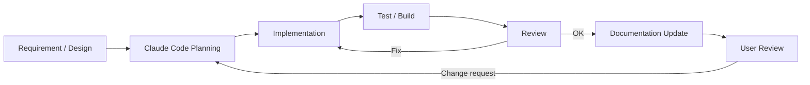

# 3. Development and Operations

## 3.1 Basic Development Policy

This system is developed on the assumption of long-term feature additions and publication as OSS.

Development continuously performs

- design
- implementation
- testing
- review
- documentation
- refactoring

The emphasis is not only on adding features but also on maintaining module boundaries and design rules.

Development agents such as Claude Code are also actively used.

### Basic Principles

1. Implement based on the system design.
2. Respect module responsibilities.
3. Minimize changes to external OSS.
4. Add tests together with the implementation.
5. Treat logging / diagnostics as part of feature implementation.
6. Update documentation when specifications change.
7. Consider performance regressions.
8. Include security / privacy in reviews.
9. Avoid concentration in giant classes or global singletons.
10. Delegate automatable work to development agents.

### Rationale

In a system with many functions, repeated ad hoc implementation tends to break the design.

Building implementation rules and design documents into the development process prevents quality from declining as features are added.

---

## 3.2 Development Automation with Claude Code

Claude Code is used as the main development agent for this system.

Claude Code is responsible not only for simple code generation but also for the following work:

- checking existing designs
- creating implementation plans
- code implementation
- refactoring
- unit tests
- integration tests
- build verification
- code review
- performance verification
- logging / diagnostics verification
- documentation updates
- UI design
- UI implementation
- visual review
- bug fixes

The conceptual development cycle is as follows.



### Rationale

This system spans many technical domains, such as

- Unity
- C#
- Python
- external OSS
- voice models
- UI
- streaming

Sharing the design rules with a development agent and having it consistently carry out implementation, testing, review, and documentation makes development more efficient.

However, results generated by Claude Code are not adopted unconditionally.

The user also checks the architecture, major specifications, UI, perceived quality, and so on.

---

## 3.3 Repository Structure

The repository is structured so that functional responsibilities and the boundaries between the runtime and external services are easy to understand.

A conceptual example is shown below.

```text
virtual-vessel-studio/
├─ CLAUDE.md
├─ README.md
│
├─ docs/
│  ├─ ja/
│  │  ├─ architecture/
│  │  ├─ detailed-design/
│  │  ├─ development/
│  │  ├─ decisions/
│  │  └─ ui/
│  │     ├─ design-system.md
│  │     ├─ ui-guidelines.md
│  │     ├─ components.md
│  │     └─ screens/
│  │
│  └─ en/
│     └─ (same structure as ja)
│
├─ unity/
│  └─ VirtualVesselStudio/
│     ├─ Assets/
│     │  └─ VirtualVessel/
│     │     ├─ Core/
│     │     ├─ Application/
│     │     ├─ ProjectData/
│     │     ├─ Avatar/
│     │     ├─ Tracking/
│     │     ├─ Voice/
│     │     ├─ Audio/
│     │     ├─ Capture/
│     │     ├─ Stage/
│     │     ├─ Video/
│     │     ├─ Streaming/
│     │     ├─ VoiceLab/
│     │     ├─ ExternalServices/
│     │     ├─ Diagnostics/
│     │     └─ UI/
│     ├─ Packages/
│     └─ ProjectSettings/
│
├─ native/
│
├─ services/
│  ├─ voxcpm/
│  ├─ voice-analysis/
│  └─ adapters/
│
├─ tests/
│  ├─ unit/
│  ├─ integration/
│  ├─ system/
│  └─ performance/
│
└─ tools/
```

The actual Unity project structure, etc. will be adjusted during implementation.

What matters is not the directories themselves but that responsibility boundaries can be understood from the repository structure.

---

### docs

Holds designs, specifications, rationale for decisions, etc.

The Japanese version is placed in `docs/ja/` and the English version in `docs/en/`, and the same document uses the same relative path.

### unity

Holds the main body of the Unity application.

The Unity project root is `unity/VirtualVesselStudio/`.

Responsibilities are separated by functional module.

### native

Holds project-owned native Windows code and native plugins.

### services

Holds project-managed wrappers, adapters, launchers, etc. for external services.

External OSS itself is not mixed with project-owned code.

### tests

Manages unit, integration, and system tests by purpose.

For product performance measurements such as RVC latency, capture performance, and long-run operation, the performance tests that run in Unity are placed in each module's `Tests/Performance/`, and `tests/performance/` holds the scripts for hardware CI, baselines for comparison, and result history.

Historical benchmark / prototype implementations are reference snapshots outside the repository and are not copied into this repository.

### tools

Manages auxiliary tools for build, setup, conversion, development support, etc.

### Rationale

Bringing the repository structure close to the architecture structure makes it easier for developers and Claude Code to determine what to change.

---

## 3.4 CLAUDE.md

A `CLAUDE.md` is placed at the repository root to define common rules that Claude Code always follows during development.

`CLAUDE.md` describes at least the following.

### Architecture Rule

- the application is Unity-centered
- separate setup and runtime
- respect module boundaries
- use external OSS through adapters / wrappers
- other modules do not depend directly on a module's internal implementation

### Code Rule

- do not create giant managers
- do not create unnecessary singletons
- prefer interfaces / data contracts
- keep the public API to the necessary minimum
- add comments that explain the design intent of non-obvious processing

### External OSS Rule

- do not change external OSS itself as far as possible
- place required custom processing on the application side
- pin and manage versions
- if a custom patch is required, record the reason in the documentation

### Test Rule

- add the required tests for new features
- add regression tests for bug fixes where practical
- prefer module-level tests
- check for performance degradation in performance-critical processing

### Diagnostics Rule

- leave sufficient developer context on errors
- separate user notifications from developer logs
- do not output secrets to logs
- do not output excessive logs in high-frequency processing

### UI Rule

- follow the design system
- prefer existing components
- use the project localization mechanism (string tables)
- check in Japanese / English
- do not specify fonts individually
- perform visual review with screenshots

### Documentation Rule

- update related documents when the architecture changes
- add new design patterns to the documentation when introduced
- do not leave mismatches between implementation and documentation

### Rationale

Explaining architecture rules to Claude Code in each individual prompt tends to cause missed instructions and inconsistent decisions.

Placing them in the repository as persistent development rules increases consistency when making changes.

---

## 3.5 Testing, Review, and Documentation Updates

The condition for completing a feature implementation is not only that the code works.

As a rule, one development cycle runs through

```text
Implementation
      ↓
Build
      ↓
Test
      ↓
Review
      ↓
Documentation
      ↓
User confirmation
```

---

### Unit Test

Verifies individual classes and algorithms.

Examples:

- data conversion
- profile validation
- mapping
- state transitions
- commands

---

### Integration Test

Verifies cooperation between modules.

Examples:

```text
Tracking → Avatar
Voice → Audio
GameCapture → Capture / Audio
SubScreenCapture → Capture / Stage
Audio → Streaming
Project → Runtime
Voice Lab → External Service
```

---

### System Test

Verifies the Unity application as a whole.

Examples:

- application startup
- project load
- avatar display
- tracking
- voice conversion
- stage
- streaming
- recording

---

### Performance Test

For real-time processing, performance is also verified as needed.

Examples:

- RVC latency
- tracking processing time
- frame time
- encoding time

---

### Review

Self review by Claude Code checks at least the following:

- architecture compliance
- module boundaries
- code quality
- error handling
- diagnostics
- security
- privacy
- performance
- test coverage
- documentation

---

### UI Review

For the UI, the actual screens are checked with screenshots, etc., and Claude Code itself also reviews

- spacing
- alignment
- visual hierarchy
- Japanese
- English
- fonts
- design system compliance

and so on.

Ultimately, the user also checks the UI.

---

### Documentation Updates

When any of the following changes, related documents are also updated.

- interfaces
- data formats
- directory structure
- setup approach
- UI
- external components
- project format
- architecture

### Rationale

If only the implementation is updated and the documentation becomes stale, later developers and Claude Code may make changes based on incorrect assumptions.

Documentation is also treated as a component of the system.

---

## 3.6 Development Policy as OSS

This system assumes a structure that can be published as OSS.

Therefore, states that only a specific development environment or developer can understand are avoided as far as possible.

---

### Making External Dependencies Explicit

For the external libraries, OSS, and tools used,

- name
- version
- license
- purpose of use

can be identified.

---

### Separation from External OSS

External OSS itself, such as RVC and VoxCPM2, is clearly separated from this system's own implementation.

Project-specific functions are, as a rule, implemented as

- adapters
- wrappers
- launchers
- application-side processing

### Rationale

Heavily modifying external OSS directly makes it difficult to follow upstream versions.

---

### Reproducible Development and Distribution Environments

For external components that use Python, the **development environment** and the **distribution environment for normal users** are managed separately.

In the development environment, for each component,

- external OSS version / commit
- Python version
- dependency definition / lock
- venv
- build procedure
- test procedure

are made explicit, and excessive dependence on each developer's global Python environment is avoided.

For normal users, a portable runtime package or standalone executable generated from the development environment by the build pipeline is provided, in which

- runtime package version
- Python runtime version
- dependency versions
- external OSS version / commit
- adapter version
- build ID
- package hash

and so on can be identified.

Normal users are not required to install or operate Python itself, venv, pip, etc.

venv is mainly an environment for development, testing, and builds, and is kept separate from how the distribution for normal users runs.

Docker is also not a required dependency of the standard development and distribution approach.

---

### Investigability of Issues

To respond to failure reports from users,

- application version
- external component versions
- logs
- diagnostics
- environment

and so on can be checked.

A diagnostics export that does not contain secrets can be provided.

---

### Structure Easy for Contributors to Understand

The goal is that, within the repository, one can check

- architecture
- module responsibilities
- setup
- build
- test
- coding rules
- external dependencies

---

### Preventing Secrets from Entering the Repository

The following are not committed to the repository.

- stream keys
- OAuth tokens
- passwords
- API keys
- personal credentials

The application runtime also does not store secrets in normal configuration files or logs.

---

### Patch Management

If a custom patch to external OSS becomes necessary,

- the patch content
- the reason for the patch
- the target version
- the difference from upstream
- whether it can be removed in the future

are recorded in the documentation.

### Rationale

This makes it possible to determine, when updating external OSS in the future, whether the custom changes are still needed.

---

### Recording Development Decisions

For important architecture changes, design decisions are recorded as needed in

```text
docs/<lang>/decisions/
```

or similar.

Examples:

- why RVC runs in the Unity runtime
- why the streaming runtime does not depend on Python
- why external OSS is not modified
- why UI Toolkit was adopted

### Rationale

Over time, "why this structure exists" tends to be lost.

Recording not only the final structure but also the main reasons for decisions makes future change decisions easier.

---

### Basic Principles of OSS Development

This system adopts the following basic principles for development as OSS.

1. Document the architecture and module responsibilities.
2. Clearly separate external OSS from project-owned implementation.
3. Minimize direct modification of external OSS.
4. Manage the versions of external dependencies.
5. Reduce dependence on global development environments.
6. Maintain a testable module structure.
7. Provide sufficient logging / diagnostics.
8. Do not include secrets in the repository, logs, or diagnostics.
9. Update documentation when the architecture changes.
10. Make changes by Claude Code follow the same development rules.
11. Besides automated review by Claude Code, have the user check the results as needed.
12. Maintain a structure that future contributors can understand and change.
