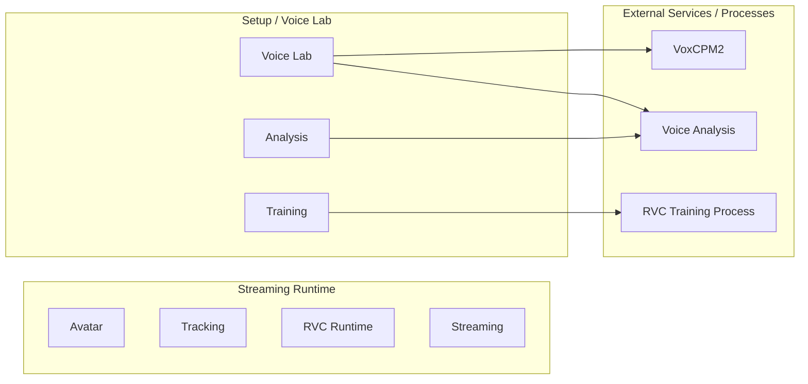
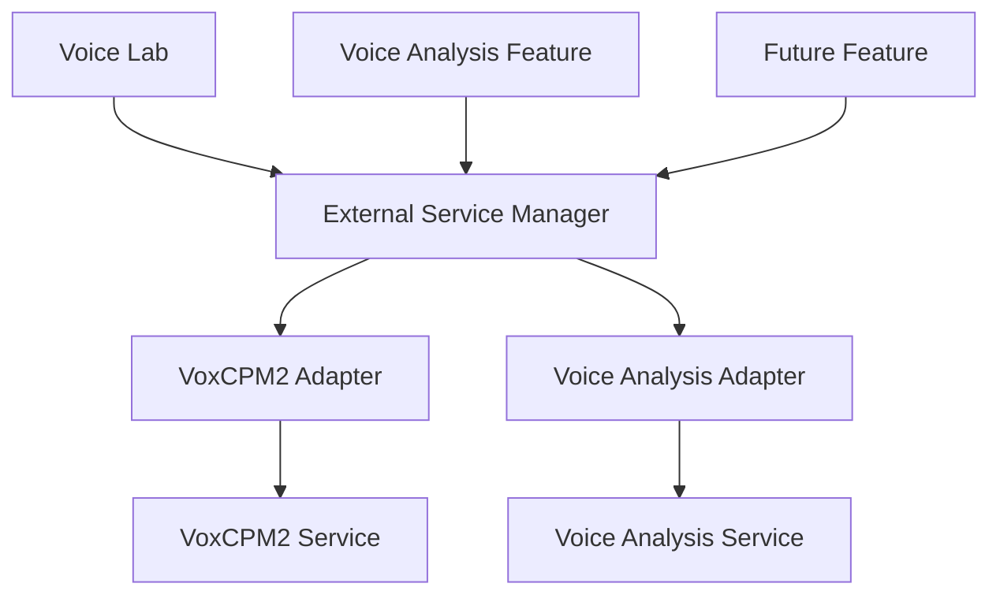
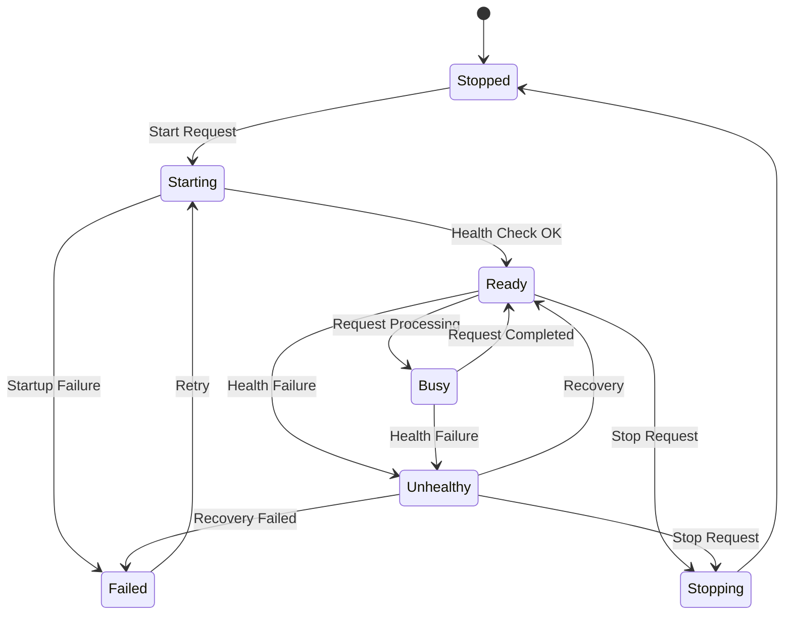
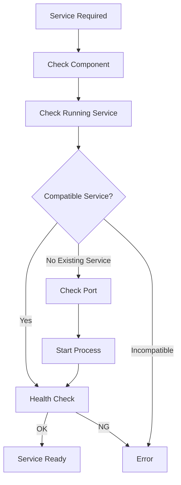

# 4. External Service Management

## 4.1 Basic Policy

This system uses local services or external processes implemented in Python, etc. for some processing that the Unity application does not perform by itself.

The following are assumed as examples:

- VoxCPM2
- voice analysis
- RVC training
- audio analysis processing
- model conversion processing
- other external tools added in the future

However, normal users are not made aware of

- installing Python
- starting Python
- creating / activating a venv
- installing dependency packages with pip, etc.
- typing commands
- port numbers
- process IDs
- the directory structure of external OSS

and similar matters.

Components that use Python are built on normal users' PCs at activation (13.4).

When the Unity application requests a required operation, it checks the built environment and automatically prepares and starts the required external service or external process so that it can be used.

Developers can run and test each component directly from a native Python + venv environment using the same source and dependency definition / lock.

External services that are not needed by the streaming runtime are not kept running at all times.

### Rationale

This system aims to behave as a single application from the user's point of view.

Even if Python and external OSS are used internally, exposing that structure to users

- complicates startup procedures
- requires knowledge of Python environments
- causes forgotten startups or wrong startup order
- requires port and process management

and greatly increases the burden of use.

Therefore, the lifecycle of external services is managed by the application.

---

## 4.2 Classification of External Processing

External processing is broadly classified into the following two types.

### Managed Local Service

A local service that stays running for a certain period and accepts multiple requests from Unity.

Examples:

- VoxCPM2 service
- voice analysis service
- analysis services added in the future

Mainly uses local IPC such as HTTP.

### Managed External Process

An external process started to perform specific processing and terminated after the processing completes.

Examples:

- RVC training
- dataset preprocessing
- model conversion
- setup scripts
- other batch processing

### Rationale

Long-running services and processes that finish after a single job have different lifecycles.

Instead of forcing both into the same approach,

- service lifecycle
- process execution

are handled separately.

---

## 4.3 Separation from the Streaming Runtime

Python local services are not required for the normal streaming runtime.

During normal streaming, only functions needed on the Unity runtime, such as

- avatar
- tracking
- RVC runtime
- audio
- stage
- camera
- streaming

are used.

In particular, real-time voice conversion with RVC runs in the Unity-side runtime and does not depend on a Python service.

On the other hand, the required services or processes are started only when using

- Voice Lab
- RVC training
- voice clone
- voice analysis
- external OSS setup

and so on.



### Rationale

This allows normal streaming with already registered models to continue even if problems occur in Voice Lab or the training environment.

---

## 4.4 External Service Manager

An `External Service Manager` is provided as a common function that manages the lifecycle of external services.

The External Service Manager is mainly responsible for:

- managing service registration information
- requesting startup of required services
- detecting already-running services
- reusing services
- checking ports
- starting processes
- health checks
- waiting for readiness
- managing service state
- stopping services
- detecting failures

Feature modules do not start Python processes directly.



### Rationale

If each module individually implements

- process startup
- port checks
- health checks
- shutdown

the same processing is duplicated and different lifecycle management approaches are mixed.

Consolidating them into a common manager unifies the service management approach.

---

## 4.5 Service Adapter Approach

The External Service Manager is structured so that it does not need to know too much about each external service's specific API or internal specifications.

Service-specific processing is separated into adapters.

Conceptually, the following interface is assumed.

```text
IExternalServiceAdapter

- GetServiceInfo()
- StartAsync()
- CheckHealthAsync()
- StopAsync()
- GetStatusAsync()
```

Concrete implementations such as

- VoxCpmServiceAdapter
- VoiceAnalysisServiceAdapter
- FutureServiceAdapter

are provided.

### Rationale

Each external service differs in

- how it is started
- health checks
- API specifications
- how its version is obtained
- how it is shut down

and so on.

If these are written directly into the External Service Manager, the manager has to be modified every time a service is added.

Confining service-specific processing to adapters limits the impact of adding external services.

---

## 4.6 Service Descriptor

For each external service, the information needed for management is held as a service descriptor.

The assumed information is as follows.

| Item | Content |
|---|---|
| ServiceId | Service identifier |
| DisplayName | Display name |
| ComponentId | Corresponding external component |
| SupportedVersion | Supported version |
| AdapterVersion | Adapter version |
| Executable | Startup target |
| WorkingDirectory | Working directory |
| DefaultPort | Default port |
| HealthEndpoint | Health check target |
| InfoEndpoint | Service information endpoint |
| StartupTimeout | Maximum startup wait |
| ShutdownPolicy | Shutdown method |

The concrete storage format is decided in the detailed design.

### Rationale

If service information is scattered throughout C# code, changes to versions or startup methods require modifying many places.

Holding service management information as a clear unit makes management and diagnostics easier.

---

## 4.7 Service Lifecycle

A managed local service conceptually has the following states.



The UI displays these internal states in a simplified form as needed.

### Rationale

Simple running / stopped states cannot distinguish

- the process is starting
- the API is being prepared
- processing is in progress
- the process exists but does not respond

and so on.

Making the service lifecycle explicit makes state management and failure diagnosis easier.

---

## 4.8 Service Startup Flow

When a startup request is received from a function that requires a service, processing conceptually proceeds in the following order.



The main steps are:

1. Check whether the required external component is available.
2. Check whether the target service is already running.
3. Check whether an already-running service is compatible.
4. Check whether the required port is available.
5. Start the service process.
6. Repeat health checks.
7. Confirm that the service has reached the Ready state.
8. Return the available state to the caller.

### Rationale

If a request is sent immediately after the process starts, model loading, etc. inside the service may not have completed.

Instead of simply starting the process, startup is confirmed until the service can actually process requests.

---

## 4.9 Reusing Already-running Services

If the target service is already running, a new process is not started immediately.

First,

- service identity
- version
- API compatibility
- health
- target port

and so on are checked.

If the service is compatible, it can be reused.

### Rationale

Starting multiple instances of the same service causes

- port conflicts
- duplicate GPU memory usage
- duplicate model loading
- unnecessary memory consumption

and so on.

Safely reusing existing services reduces resource consumption.

---

## 4.10 Service Identity Verification

The target service is not judged to be running merely because the port is in use.

Where possible, the service is queried to check

- ServiceId
- version
- API version
- health

and so on.

For example, endpoints such as

```text
/health
/info
```

are used through the service adapter.

### Rationale

Another application may be using the target port.

Judging "port is open = target service exists" risks sending requests to the wrong service.

---

## 4.11 Port Management

A default port can be assigned to each service.

The current configuration uses, for example:

| Service | Default port |
|---|---:|
| VoxCPM2 Reference Service | 8765 |
| Voice Analysis Service | 8766 |

However, normal users are not normally expected to configure port numbers directly.

Port numbers are managed as service descriptors or application settings.

### Rationale

Port numbers are necessary for the internal implementation but are not meaningful settings for normal users.

They are managed as internal structure and can be checked from developer diagnostics only when needed.

---

## 4.12 Port Conflicts

If the intended port is used by another process, it is checked whether that process is a compatible service.

If it is not a compatible service, the application does not terminate the process or operate on the other application without permission.

Normal users are shown, for example:

> The voice generation service could not be started.  
> A required communication port is being used by another application.

Developer diagnostics record

- ServiceId
- port
- target process information
- health check results
- service identity determination

and so on.

### Rationale

Terminating unrelated processes to resolve a port conflict may affect other applications.

The application errs on the safe side and notifies the user of the conflict.

---

## 4.13 Process Ownership

The External Service Manager distinguishes between

**processes it started itself**

and

**processes that were already running and were reused**

When starting a process, it records as needed

- PID
- application session
- ServiceId
- start time

and so on.

### Rationale

When an existing service is reused, that process may have been started by another application or another session.

Such a service must not be stopped without permission when this application exits.

---

## 4.14 Service Shutdown

Services started by the application can be stopped when their use ends or when the application exits.

When stopping, where possible, the following order is used:

1. graceful shutdown request
2. wait for process exit
3. forced termination if necessary

However, when an already-running service was merely reused, it is, as a rule, not stopped.

### Rationale

This avoids affecting processes this system does not own.

Also, using forced termination from the start may corrupt data that the service is saving.

---

## 4.15 On-demand Startup

External services are not all started when the application starts.

They are started when needed.

Examples:

- using the voice clone screen → start VoxCPM2
- starting voice analysis → start voice analysis
- starting RVC training → start the training process

### Rationale

Keeping everything running at all times leads to

- longer startup time
- memory consumption
- GPU memory consumption
- an increase in unnecessary processes

In particular, many services are not used during normal streaming, so they are started only when needed.

---

## 4.16 Delayed Service Shutdown

Instead of always terminating a service immediately after use ends, an approach that keeps it reusable for a certain period is also permitted as needed.

For example, in Voice Lab, when repeating

- voice generation
- preview listening
- regeneration
- generation with a different prompt

VoxCPM2 is not restarted each time.

The concrete shutdown timing is decided in the detailed design, considering the characteristics of each service.

### Rationale

For services whose model loading takes time, starting and stopping each time greatly reduces usability.

On-demand startup and reuse are combined.

---

## 4.17 External Process Execution

Temporary processing such as RVC training is executed as a managed external process.

Process execution manages at least the following:

- process ID
- command
- working directory
- environment
- start time
- end time
- exit code
- stdout
- stderr
- cancellation state

External processes are not started directly from the UI but through the adapter or manager of the relevant function.

### Rationale

External process execution also needs to be state-managed as part of the application's processing.

Simply starting a process does not allow the application to track progress or reasons for failure.

---

## 4.18 Python Execution Environment

External services / processes that use Python are started by explicitly specifying the execution environment managed as described in Chapter 13.

They do not depend on the OS global Python or the environment currently activated in the shell.

In normal users' environments, the executable indicated by `manifest.json` is started (see 13.6 and 13.7).

```text
External/VoiceLab/<ComponentsVersion>/manifest.json
        ↓
Launcher / Executable
```

In the development environment, the Python of the per-component, per-version development venv can be explicitly specified for startup.

```text
<ExternalComponent>/<Version>/.venv/Scripts/python.exe
```

In both cases, the path and version of the execution environment used for startup can be checked from diagnostics.

### Rationale

Depending on the global Python causes

- Python version
- package versions
- CUDA support
- dependencies

to vary by user environment, and reproducibility is lost.

The environment managed by the application is used explicitly.

---

## 4.19 Separation of Responsibilities from External Component Management

The External Service Manager is basically responsible for **the execution lifecycle of installed components**.

The following are the responsibilities of external component management in Chapter 13:

- external OSS / source version management
- dependency definition / lock management
- developer venv setup procedures
- manifest management
- obtaining the environment
- package hash / integrity verification
- building and registering the environment
- update
- rollback
- capability / dependency verification

Setup for normal users builds the environment from a manifest and lock with pinned hashes.

If the External Service Manager cannot find a component, it guides processing to the setup function.


### Rationale

Separating "the responsibility to build the environment" from "the responsibility to start the built environment" simplifies management.

---

## 4.20 Version Compatibility

Before using an external service, it is checked whether the version is supported by this application and the adapter.

At least the compatibility of

- external component version
- API version
- adapter version

and so on can be checked.

If an unsupported version is detected, it is not used unconditionally.

### Rationale

Even if a process starts normally, it may not work correctly if the API specification or output format has changed.

"Being able to start" and "being compatible" are separated.

---

## 4.21 Service Health Check

A health check mechanism is provided for managed local services.

Health checks verify the following as needed:

- process existence
- API response
- service identity
- service version
- internal initialization state
- load state of required models

Health check results are converted into common states such as

- Ready
- Busy
- Unhealthy
- Failed

### Rationale

Even if a process exists, it may be unable to process requests due to

- model load failure
- GPU initialization failure
- dependency errors

and so on.

Therefore, not only process existence but also availability as a service is verified.

---

## 4.22 Startup Timeout

A timeout is set for service startup processing.

For services whose model loading, etc. takes time, an appropriate startup timeout can be set per service.

When a timeout occurs,

- process state
- health check results
- stdout
- stderr

and so on are recorded in the diagnostic information.

### Rationale

This prevents the Unity side from waiting indefinitely when an external service does not respond.

---

## 4.23 Detecting Abnormal Termination

If an external service / process started by the application terminates unexpectedly, that state is detected.

For example, the following are recorded:

- process ID
- exit time
- exit code
- last stdout
- last stderr
- the processing that was in progress

### Rationale

If an external process terminates abnormally, simply treating it as a communication error on the Unity side makes the cause hard to identify.

The process lifecycle and communication state are managed in association.

---

## 4.24 Automatic Recovery

For temporary failures, restart can be attempted for services that support automatic recovery.

However,

- unlimited restarts
- repeated restarts in a short time

are not performed.

The retry count and conditions are managed per service.

For external processes whose results are affected by restarting, such as training, automatic re-execution is, as a rule, not performed.

### Rationale

Service-type processing may automatically recover from temporary failures, while re-executing training, etc. without permission may cause duplicate processing or artifact inconsistencies.

The recovery policy is separated according to the processing characteristics.

---

## 4.25 Concurrent Request Control

External services do not necessarily support processing multiple requests concurrently.

For each service, execution characteristics such as

- Concurrent
- Serialized
- Single Job

can be defined.

The application manages a request queue as needed.

### Rationale

In particular, for services that use GPU models, running multiple jobs simultaneously may cause

- insufficient GPU memory
- reduced processing speed
- service crashes

and so on.

The degree of parallelism is controlled according to the service's capability.

---

## 4.26 Request Cancellation

For long-running requests, cancellation can be handled if the target service supports it.

For external processing that cannot be cancelled, this is made clear in the UI.

Treating forced process termination as cancellation is decided case by case, considering the possibility of data corruption.

### Rationale

Even if the Unity side receives a cancellation request, the external service cannot necessarily stop safely.

The meaning of cancellation is made clear per service.

---

## 4.27 Not Exposing Internal Structure to the UI

The normal UI, as a rule, does not display

- port numbers
- PIDs
- environment paths / developer venv paths
- Python commands
- health endpoints

and so on.

The normal UI converts these into user-facing states such as

- preparing
- available
- processing
- setup required
- error

Developer Mode can display detailed information.

### Rationale

What normal users need is not the internal service structure but "whether the function can be used."

Internal information is separated into the developer diagnostics defined in Chapter 5.

---

## 4.28 Service Setup Guidance

If a required external component has not been set up, normal users are not required to operate Python or Git manually.

For example,

> Initial setup is required for the voice generation function.

is displayed, and environment setup can be started from the setup UI.

### Rationale

Emphasis is placed on being able to start using a function without understanding internal dependencies.

---

## 4.29 Security

Managed local services, as a rule, listen only on localhost.

Being accessible from external networks is not the default.

Necessary validation is also performed on paths, parameters, etc. passed to external services.

### Rationale

There is normally no need to expose services for Voice Lab, etc. to external networks.

The attack surface is not increased unnecessarily.

---

## 4.30 Secrets

If secrets need to be passed to an external service / process, approaches that do not output them in plain text on the command line or in logs are preferred.

Secrets follow the credential management approach defined in Chapter 6.

Developer logs defined in Chapter 5 also do not record secrets.

### Rationale

Process commands and logs may be shared externally for failure investigation, etc.

---

## 4.31 Integration with Logging and Diagnostics

The External Service Manager and external process management functions use the common logging / diagnostics approach defined in Chapter 5.

The main diagnostic information handled is:

- ServiceId
- component version
- adapter version
- Python version
- venv
- process ID
- port
- process state
- service health
- start / stop time
- exit code
- stdout
- stderr
- health check results
- exception

The display for normal users shows only the necessary information concisely.

### Rationale

For external process failures, information inside Unity alone cannot identify the cause, so the external environment is also made observable.

---

## 4.32 Processing at Application Exit

When the application exits, the external services owned by this application session are stopped.

Services that were merely reused are, as a rule, not stopped.

If an external process is in progress, depending on the nature of the process, one of

- wait for normal completion
- cancel
- ask for exit confirmation

and so on is chosen.

### Rationale

The purpose is to avoid stopping unrelated processes when the application exits and to prevent corruption of data being processed.

---

## 4.33 Services After Abnormal Application Termination

If the application terminates abnormally, external services alone may remain.

At the next startup,

- target port
- service identity
- health
- version

and so on are checked, and the service can be reused if it is compatible.

However, a reused service is not automatically considered owned by the current session.

### Rationale

There is no need to forcibly terminate healthy services left after an abnormal termination every time.

On the other hand, misidentifying ownership may cause another session's process to be terminated, so ownership is separated in the lifecycle.

---

## 4.34 Adding External Services

When adding a new external service, the following are added as a rule:

1. external component definition
2. service descriptor
3. service adapter
4. health check
5. version compatibility definition
6. setup information
7. diagnostics information

The goal is a structure in which services can be added without changing the main logic of the existing External Service Manager.

### Rationale

Changing the common lifecycle processing every time an external service is added tends to cause regressions in existing services.

---

## 4.35 Separation of Setup and Runtime Responsibilities

Setup and runtime are also separated for external-service-related processing.

### Setup

Setup for normal users mainly performs:

- checking the external component manifest
- version selection
- obtaining the environment
- package hash / integrity verification
- building and registering the environment
- obtaining required models / assets
- capability / environment verification
- service startup test
- health check test

Separately, the developer environment allows running and testing directly from source using native Python + venv.

### Runtime / When Using Voice Lab

- detecting required services
- startup
- reusing already-running services
- health checks
- requests
- state monitoring
- stopping as needed

### Rationale

Running environment setup processing during normal use complicates the processing needed before a function can start.

Environment setup and actual service use are separated.

---

## 4.36 Internal Division of Responsibilities

Conceptually, the following structure is assumed.

```text
ExternalServices/
├─ Core/
│  ├─ ServiceDescriptor
│  ├─ ServiceState
│  ├─ ServiceInstance
│  └─ ServiceId
│
├─ Management/
│  ├─ ExternalServiceManager
│  ├─ ServiceRegistry
│  ├─ ServiceLifecycleManager
│  └─ ServiceRequestCoordinator
│
├─ Process/
│  ├─ ExternalProcessRunner
│  ├─ ProcessOwnership
│  └─ ProcessResult
│
├─ Network/
│  ├─ PortChecker
│  └─ ServiceIdentityChecker
│
├─ Health/
│  ├─ HealthChecker
│  └─ ServiceHealth
│
├─ Adapters/
│  ├─ VoxCpmServiceAdapter
│  ├─ VoiceAnalysisServiceAdapter
│  └─ FutureServiceAdapter
│
└─ Diagnostics/
   └─ ExternalServiceDiagnostics
```

External OSS source, venv, versions, updates, etc. are separated into the external component management function in Chapter 13.

### Rationale

Concentrating process startup, port management, health checks, service-specific APIs, version management, etc. in one giant manager makes responsibilities unclear.

Separating the common lifecycle from service-specific processing ensures maintainability.

---

## 4.37 Basic Principles of External Service Management

This system adopts the following basic principles for external service management.

1. Do not make normal users aware of internal structures such as Python and ports.
2. The streaming runtime does not depend on Python local services.
3. External services are started on demand only when needed.
4. Distinguish services from temporary external processes.
5. Service lifecycles are managed in common by the External Service Manager.
6. Service-specific processing is separated into adapters.
7. Startup includes completing health checks, not just starting the process.
8. Reuse already-running services if they are compatible.
9. Do not judge a service to be the target merely because its port is in use.
10. Verify service identity and version.
11. As a rule, do not expose port numbers to normal users.
12. Do not terminate other applications without permission on port conflicts.
13. Distinguish processes started by the application from reused processes.
14. Do not stop processes that are not owned without permission.
15. Run Python by explicitly specifying the execution environment managed by the application (the built environment on a user's PC, the development venv in development).
16. Separate obtaining / updating external components from the service lifecycle.
17. Verify compatibility between service versions and adapter versions.
18. Distinguish process existence from service health.
19. Set a timeout for service startup.
20. Obtain stdout / stderr / exit codes of external processes.
21. Separate recovery approaches for service-type processing and batch processing.
22. Control the number of concurrent requests according to service capability.
23. Managed local services are, as a rule, exposed only on localhost.
24. Do not carelessly output secrets to commands or logs.
25. Detailed information about external services can be checked from developer diagnostics.
26. New services are added basically by adding a descriptor and an adapter.
27. Separate setup from the actual service usage lifecycle.
