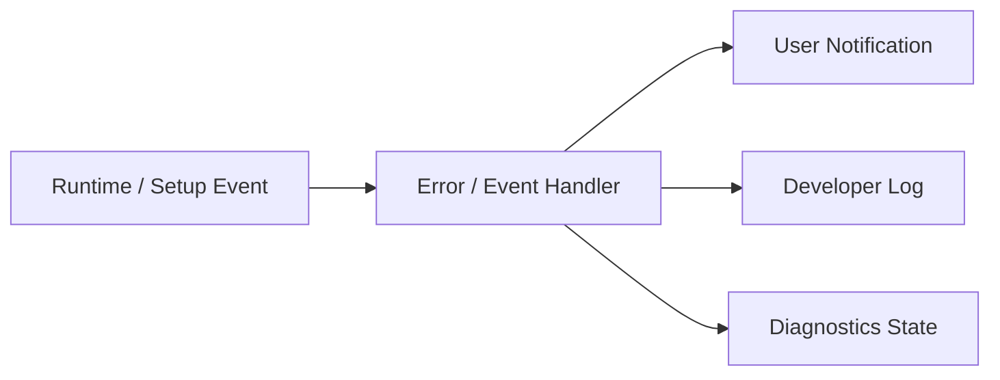
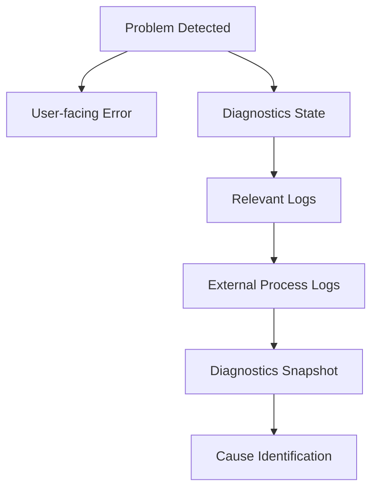

# 5. Logging and Diagnostics

## 5.1 Basic Policy

This system separates state display and error notification for normal users from detailed logs and diagnostic information for developers.

The basic policy is:

**Do not make normal users aware of the internal structure, while allowing developers to sufficiently observe internal state.**

For normal users, the display focuses on

- what is currently happening
- which functions are affected
- what to check or do

For developers, on the other hand,

- module
- processing stage
- configuration values
- version
- timing
- process
- external component
- exception
- stack trace

and so on are recorded in detail.

### Rationale

Showing general users internal information such as

```text
NullReferenceException
CUDA error
HTTP 500
Port 8765 bind failed
```

as-is rarely helps solve the problem.

On the other hand, when developing and maintaining the system as OSS, information such as "it failed" alone cannot identify the cause.

Therefore, user-facing information and developer-facing information are treated as separate responsibilities.

---

## 5.2 Separating Logs from User Notifications

For a single internal event, the system can generate

- a user notification
- a developer log

separately.

Conceptually:



For example, if microphone initialization fails, the normal UI shows

> The microphone could not be used.  
> Check that the selected input device is connected.

and so on.

For developers, on the other hand,

- device name
- device ID
- sample rate
- buffer size
- audio backend
- exception
- stack trace

and so on are recorded.

### Rationale

If the internal log structure is reused as-is in the UI, changes to the internal implementation tend to change the user-facing display as well.

Separating notifications from logs allows each to be designed in a form suited to its purpose.

---

## 5.3 Log Levels

Logs have at least the following levels.

| Level | Purpose |
|---|---|
| Trace | Very detailed processing traces |
| Debug | Internal state needed for development / debugging |
| Information | Records of normal major processing |
| Warning | Processing can continue but attention is needed |
| Error | A specific operation or function has failed |
| Critical | A serious impact on the entire application |

In normal operation, unnecessary trace / debug logs are not output in large volumes.

The level of detail can be changed as needed through Developer Mode or diagnostic settings.

### Rationale

Always recording all internal information causes

- increased log size
- increased file I/O
- important information being buried

and so on.

On the other hand, detailed logs are needed when reproducing failures, so the log level can be switched.

---

## 5.4 Structured Logging

For major logs, structured information is attached where practical, rather than only simple free text.

Conceptual example:

```text
Timestamp
Level
Module
Category
EventId
SessionId
ProjectId
AvatarId
RunId
Message
Properties
Exception
```

This does not mean that every field is required; the necessary context is attached according to the processing.

For example, Voice Lab training processing can record

```text
Module      = VoiceLab
Category    = RvcTraining
RunId       = ...
DatasetId   = ...
RvcVersion  = ...
State       = Training
```

and so on.

### Rationale

With free-text-only logs, it is hard to search later for logs of a specific run, avatar, project, etc.

Attaching context information makes it easier to identify the scope of a failure.

---

## 5.5 Per-module Logs

Each major module uses the common logging mechanism while attaching a module name or category.

Examples:

- Application
- Project
- Avatar
- Tracking
- Voice
- Audio
- Capture
- Video
- Streaming
- Stage
- VoiceLab
- ExternalComponent
- UI
- Diagnostics

Conceptual example:

```text
[Information][Avatar] Avatar loaded.
[Warning][Tracking] Tracking confidence dropped.
[Error][Streaming] Connection failed.
```

### Rationale

In a system where multiple functions run simultaneously, it is hard to tell from the time sequence alone which function a log belongs to.

Classifying by module allows narrowing down to only the target function.

---

## 5.6 Session Identification

Sessions can be identified per application launch as needed.

For example, a SessionId is generated so that

- application start
- project load
- runtime start
- streaming start
- application exit

and so on can be tracked as the same session.

### Rationale

If logs from multiple launches exist in the same file, it may become unclear during which launch a problem occurred.

Identifying sessions makes time-series analysis easier.

---

## 5.7 Correlation per Operation

Long-running operations and operations spanning multiple components can be tracked using a common ID as needed.

Examples:

- project load
- avatar import
- voice model registration
- training run
- external component setup
- streaming session

For example, a training run uses the `RunId` defined in Chapter 13 directly as the diagnostic context.

### Rationale

Even when one operation passes through multiple layers such as

```text
UI
 ↓
Manager
 ↓
Adapter
 ↓
Python Process
 ↓
Artifact Collection
```

its logs can be tracked as the same operation.

---

## 5.8 Log Output Location

Logs are saved in the Logs area within the Data Root defined in Chapter 6 or the application-managed area.

Conceptual example:

```text
DataRoot/
└─ Logs/
   ├─ Application/
   ├─ VoiceLab/
   ├─ ExternalServices/
   └─ Diagnostics/
```

The actual layout is aligned with the overall Data Root structure.

Normal runtime logs and logs belonging to a specific training run, etc. are separated as needed.

For example, logs specific to a training run can be kept in

```text
VoiceLab/
└─ TrainingRuns/
   └─ <RunId>/
      └─ logs/
```

### Rationale

Consolidating all logs into one huge file makes investigation per function or per operation difficult.

Storage locations are separated by purpose.

---

## 5.9 External Process Logs

For external processes such as Python services and external OSS,

- stdout
- stderr
- process start
- process exit
- exit code

can be obtained and saved.

Examples:

- RVC
- VoxCPM2
- voice analysis
- other future external components

stdout / stderr are not shown directly in the normal user UI.

They can be checked from developer diagnostics as needed.

### Rationale

Failures that occur inside an external process may not be identifiable from Unity-side exceptions alone.

Keeping the standard output and standard error of external processes makes problems in external OSS investigable as well.

---

## 5.10 External Process Startup Information

When an external process starts, the following are recorded as needed:

- component name
- component version
- source version / commit
- adapter version
- execution mode (portable runtime / developer venv)
- environment version
- Python version
- environment path / venv path
- process ID
- start time
- port
- working directory
- command
- health check results

However, if secrets are included in the command line, they are masked.

### Rationale

For external OSS failures, "which version and which Python environment it ran in" is important for investigating the cause.

---

## 5.11 Service State Diagnostics

For external services, it can be checked not only whether the process exists but also whether the service is in a usable state.

Example states:

```text
Not Installed
Stopped
Starting
Ready
Busy
Unhealthy
Failed
```

If a health check API exists, its results are used.

### Rationale

Even if a process is running, it may not actually be able to process requests due to initialization failure, etc.

Process state and service health are handled separately.

---

## 5.12 Runtime Diagnostic Information

Developer diagnostics can show the state of the main runtime modules.

Examples:

### Avatar

- AvatarId
- model format
- loaded state
- missing bones
- missing expressions
- extension motion state

### Tracking

- provider
- tracking state
- tracking FPS
- confidence
- lost parts
- filtering state

### Voice

- input device
- sample rate
- buffer size
- voice model
- backend
- voice conversion state
- latency
- underrun / overrun

### Capture

- capture source type
- capture device / monitor
- capture state
- input resolution
- input frame rate
- capture frame time
- dropped / missed frames
- GameCapture audio state
- SubScreenCapture backend
- native plugin / adapter state

### Video

- render resolution
- target FPS
- actual FPS
- frame time
- encoder
- encode time
- dropped frames

### Streaming

- connection state
- bitrate
- reconnect state
- queue
- A/V offset

### Audio

- output device
- mixer state
- peak
- clipping
- routing

### Rationale

In real-time systems, problems do not necessarily appear as exceptions.

Making internal state observable makes it easier to identify performance degradation and temporary abnormal states.

---

## 5.13 Performance Diagnostics

For performance information, the following can be measured as needed:

- main thread frame time
- render frame time
- tracking processing time
- voice processing time
- RVC inference time
- pitch estimation time
- video encoding time
- memory usage
- GPU memory usage
- CPU usage
- GPU usage

Not only simple averages but also, as needed,

- current value
- average
- maximum
- drop count

and so on are handled.

### Rationale

Even if the average processing time is normal, temporary spikes may cause audio dropouts or frame drops.

Therefore, the structure allows momentary performance anomalies to be diagnosed as well.

---

## 5.14 Audio Pipeline Diagnostics

For voice conversion, processing time can be checked per pipeline stage defined in Chapter 9.

Example:

```text
Audio Input
   ↓
Input Buffer
   ↓
Feature Extraction
   ↓
Pitch Estimation
   ↓
RVC Inference
   ↓
Post Processing
   ↓
Audio Output
```

The processing time of each stage is recorded as needed.

### Rationale

End-to-end latency alone cannot show which processing is the bottleneck.

Making timing obtainable per processing stage makes it easier to identify where to improve performance.

---

## 5.15 Streaming Diagnostics

For streaming, the following can be checked as needed:

- publisher state
- connection state
- reconnect count
- encoder state
- actual bitrate
- dropped frames
- encoding queue
- network errors
- A/V offset
- stream start time

### Rationale

Streaming failures can be caused in multiple places, such as

- rendering
- encoder
- network
- the streaming service

The state of each stage is made separately observable.

---

## 5.16 Developer Mode

The Developer Mode defined in Chapter 14 is used to display diagnostic functions that are not needed in normal use.

In Developer Mode, for example, the following can be used:

- detailed log viewer
- runtime state viewer
- performance metrics
- diagnostic camera
- tracking visualization
- external service state
- version information
- developer actions

Even with Developer Mode off, the required logging itself is performed; Developer Mode mainly changes the scope of what the UI displays.

### Rationale

Displaying large amounts of internal information in the normal UI makes it hard to use.

On the other hand, during development and failure investigation, internal state must be checkable immediately.

---

## 5.17 Diagnostic Camera

The diagnostic camera defined in Chapters 10 and 14 is treated as part of developer diagnostics.

Examples of what can be displayed:

- camera input
- tracking landmarks
- skeleton
- face landmarks
- avatar
- tracking confidence
- debug text

The input video and the avatar can be checked simultaneously as needed.

The diagnostic camera is not connected to the streaming pipeline.

### Rationale

For example, when the avatar's arm looks unnatural, this makes it easier to visually isolate whether

- the camera input is correct
- the tracking result is correct
- normalization is correct
- retargeting is correct
- avatar bone mapping is correct

It also structurally prevents real camera video from being streamed by mistake.

---

## 5.18 Diagnostic Overlay

As needed, a diagnostic overlay can be displayed on the avatar view, etc. only while in Developer Mode.

Examples:

- bone names
- joint positions
- tracking confidence
- extension bones
- FPS
- frame time

As a rule, the diagnostic overlay is not included in the normal streaming render target.

### Rationale

This prevents diagnostic displays from unintentionally appearing in the streamed video.

---

## 5.19 Log Viewer

Application logs can be checked from the developer / diagnostics UI.

The following filters are provided as needed:

- log level
- module
- category
- session
- keyword
- context such as RunId

### Rationale

Basic failure checks can be done within the application without opening log files in an external editor each time.

---

## 5.20 Diagnostics Snapshot

A **diagnostics snapshot** summarizing the state at the time of a failure can be generated.

The snapshot includes the following as needed:

- application version
- OS
- Unity / runtime information
- basic project information
- module states
- avatar format
- tracking provider
- voice model information
- encoder information
- external component versions
- Python version
- performance metrics
- recent logs
- exception information

### Rationale

This avoids asking users to manually check a large amount of information when reporting a problem.

---

## 5.21 Diagnostics Export

Information needed for failure reports can be exported together from developer diagnostics.

Conceptual example:

```text
diagnostics-<timestamp>/
├─ system-info.json
├─ runtime-state.json
├─ versions.json
├─ recent-logs/
└─ errors.json
```

As needed, these are combined into a single package such as a ZIP.

### Rationale

This makes it easy to share the required diagnostic information when reporting problems via GitHub issues, etc.

---

## 5.22 Privacy of Diagnostics Export

Secrets and unnecessary personal data are not included in the diagnostics export.

At least the following are excluded or masked:

- stream keys
- OAuth tokens
- API keys
- passwords
- credentials
- microphone audio
- voice dataset contents
- camera images / video
- other secrets

If paths contain user names, etc., they are masked as needed.

### Rationale

Diagnostic packages may be published on GitHub issues, etc.

The structure makes them easy to share safely even if users do not check the contents in detail.

---

## 5.23 Prohibiting Secrets in Logs

Secrets are not output to logs, including at the debug level.

In particular, the following are prohibited:

```text
Stream Key = xxxx
OAuth Token = xxxx
Authorization: Bearer xxxx
Password = xxxx
```

Even when needed, only masked information such as

```text
Stream Key = ********
```

is displayed.

### Rationale

Log files may be shared externally for failure investigation or issue reports.

"It is a developer log, so secrets may be output" is not accepted.

---

## 5.24 Handling File Paths

Developer logs may need file paths for failure investigation.

However, for

- diagnostics exports
- logs for external sharing

paths containing personally identifiable information can be normalized / masked as needed.

For example, handling

```text
C:\Users\UserName\...
```

as

```text
%USERPROFILE%\...
```

is considered.

### Rationale

File paths themselves may contain personal information such as user names.

---

## 5.25 Log Rotation

Log files are prevented from growing without limit.

At least one of the following, or a combination, is used:

- rotation by file size
- rotation by date
- number of retained generations
- retention period
- automatic deletion of old logs

### Rationale

In an application used over a long period, logs alone may exhaust storage.

---

## 5.26 Controlling High-frequency Logs

High-frequency processing such as per-frame or per-audio-buffer processing does not log every time during normal operation.

For example, tracking confidence, etc. is recorded

- only on state changes
- at fixed intervals
- only during developer trace

and so on.

### Rationale

Generating file I/O every frame not only affects performance but also buries important logs in large amounts of information.

---

## 5.27 Suppressing Repeated Errors

When the same error occurs in large numbers in a short time, duplicate logs are suppressed as needed.

For example, instead of recording

```text
Camera frame unavailable.
Camera frame unavailable.
Camera frame unavailable.
...
```

without limit, a structure that handles it as

```text
Camera frame unavailable. repeated 128 times.
```

is considered.

### Rationale

This prevents the first error, which is the root cause, from being buried by a large number of duplicate logs.

---

## 5.28 Startup and Exit Logs

At least the following are recorded for the application lifecycle.

### At Startup

- application version
- build information
- OS
- graphics device
- audio device
- Data Root
- Developer Mode
- start time

### At Exit

- normal exit
- exit time
- resource cleanup results as needed

For abnormal termination, an approach that allows identifying at the next startup that the previous session did not exit normally is considered.

### Rationale

This makes environment information and the application lifecycle checkable when a failure occurs.

---

## 5.29 Version Information

The versions of the main components that make up the system can be checked from diagnostics.

Examples:

- application version
- Unity version
- avatar library
- MediaPipe-related versions
- RVC version / commit
- VoxCPM2 version / commit
- voice analysis version
- adapter version
- Python version
- PyTorch version
- CUDA version

### Rationale

Even code that looks the same may behave differently due to differences in external component versions.

Version information is important for reproducing failures.

---

## 5.30 Configuration Diagnostics

As needed, an overview of the settings currently in use can be checked from diagnostics.

However, secrets are excluded.

Examples:

- ProjectId
- ProfileId
- AvatarId
- tracking provider
- voice model
- stage
- encoder
- resolution
- sample rate

### Rationale

"Under which settings the problem occurred" can be checked not only from logs but also from the current state.

---

## 5.31 Integration with Startup Validation

Problems detected at startup or project load, such as

- missing assets
- invalid profiles
- unsupported versions
- missing external components
- invalid credential references

are recorded in diagnostics.

Normal users are notified concisely of only what is needed for use.

### Rationale

Validation errors are important diagnostic information before they become actual runtime errors.

---

## 5.32 Error Recovery Logs

The results of automatic recovery processing are also recorded.

For example, for streaming,

```text
Connection lost.
Reconnect attempt 1 started.
Reconnect attempt 1 failed.
Reconnect attempt 2 started.
Connection restored.
```

and so on can be tracked.

Examples:

- streaming reconnect
- device reinitialization
- tracking provider restart
- external service restart
- voice model reload

### Rationale

Even if recovery eventually succeeds, what happened just before can be checked afterward.

---

## 5.33 User Action Logs

Major operations needed for failure analysis are recorded at the information level as needed.

Examples:

- project switching
- avatar switching
- stage switching
- voice model switching
- streaming start / stop
- recording start / stop
- external service startup

However, keyboard input, text input contents, etc. are not recorded indiscriminately.

### Rationale

Knowing which operations were performed just before a failure makes it easier to identify reproduction conditions.

On the other hand, not recording unnecessary user input protects privacy.

---

## 5.34 Developer Diagnostic Operations

Developer Mode can provide diagnostic operations as needed.

Examples:

- reinitialize the tracking provider
- restart an external service
- reload the voice model
- take a diagnostics snapshot
- open the log directory
- reset performance counters

However, these are limited to the developer UI so that normal users do not operate them by mistake.

### Rationale

This reduces the need to restart the entire application for every failure investigation.

---

## 5.35 Limiting the Runtime Impact of Diagnostics

The diagnostic functions themselves must not significantly change runtime performance.

In particular,

- high-frequency trace logs
- tracking overlays
- performance sampling
- diagnostic camera

and so on are enabled only when needed.

### Rationale

This avoids, as far as possible, situations where enabling diagnostics makes the symptom disappear or, conversely, causes performance problems.

---

## 5.36 Failure Investigation Flow

The basic investigation flow when a failure occurs is as follows.



This order is not required for every failure, but the investigation path is kept consistent.

### Rationale

If each module uses a different investigation method, OSS developers find it hard to understand how to investigate failures.

A common diagnostic path is provided.

---

## 5.37 Logging and Diagnostics Implemented by Claude Code

When Claude Code implements a new function, logging and diagnostics are also part of the implementation, not only normal-path processing.

At least the following are checked:

- whether logs are output with the appropriate module / category
- whether there is sufficient context on errors
- whether user notifications and developer logs are separated
- whether secrets are output
- for external processes, whether stdout / stderr are obtained
- whether runtime state is observable from diagnostics
- whether excessive logs are output in high-frequency processing

These rules are written in `CLAUDE.md`, etc.

### Rationale

If diagnostics are postponed when adding new functions, it is easy to notice only after a failure occurs that the means of investigation are insufficient.

Logging / diagnostics are treated as part of feature implementation.

---

## 5.38 Internal Division of Responsibilities

Conceptually, the following structure is assumed.

```text
Diagnostics/
├─ Logging/
│  ├─ Logger
│  ├─ LogEntry
│  ├─ LogContext
│  ├─ LogWriter
│  └─ LogRotation
│
├─ Runtime/
│  ├─ RuntimeDiagnostics
│  ├─ ModuleDiagnostics
│  └─ PerformanceMetrics
│
├─ External/
│  ├─ ProcessLogCollector
│  ├─ ServiceHealthMonitor
│  └─ VersionCollector
│
├─ Snapshot/
│  ├─ DiagnosticsSnapshot
│  └─ DiagnosticsExporter
│
├─ Privacy/
│  ├─ SecretMasker
│  └─ DiagnosticsSanitizer
│
└─ UI/
   └─ DiagnosticsController
```

### Rationale

Separating logging, runtime monitoring, external processes, export, and privacy processing prevents responsibilities from concentrating in a single giant diagnostics manager.

---

## 5.39 Basic Principles of Logging and Diagnostics

This system adopts the following basic principles for logging and diagnostics.

1. Separate notifications for normal users from developer logs.
2. Show users the impact and how to respond, not the internal implementation.
3. Leave sufficient context for failure analysis for developers.
4. Use log levels according to purpose.
5. Make logs identifiable per module / category.
6. Attach correlation information such as session and run as needed.
7. Make stdout / stderr of external processes obtainable.
8. Make the versions and execution environments of external components recordable.
9. Distinguish process state from service health.
10. Make runtime state and performance observable from developer diagnostics.
11. Structurally separate the diagnostic camera from the streaming pipeline.
12. Do not include diagnostic overlays in the normal streamed video.
13. Make it possible to generate a diagnostics export for failure reports.
14. Do not output secrets to logs or diagnostics exports.
15. Mask paths containing personal information as needed.
16. Do not store logs without limit.
17. Avoid excessive log output in high-frequency processing.
18. Suppress large volumes of the same error as needed.
19. Make application versions and external component versions checkable.
20. Keep a history of recovery processing as well.
21. Limit the impact of diagnostic functions themselves on runtime performance.
22. Treat logging / diagnostics as part of each feature implementation.
23. Include logging and diagnostics in reviews even when Claude Code implements.
