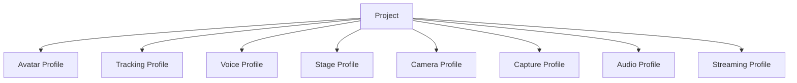

# 6. Project, Configuration, and Data Management

## 6.1 Basic Policy

This system not only manages the multiple settings required for streaming individually but also provides a unit called a **project** that groups related settings.

A project holds together the information needed to reproduce a specific streaming configuration.

For example, it associates:

- avatar
- tracking settings
- voice model
- voice settings
- stage
- camera settings
- capture settings
- BGM / SE settings
- streaming settings
- audio routing
- other stream-specific settings

Conceptually, the structure is as follows.

```text
Project
├─ Avatar
├─ Tracking Profile
├─ Voice Profile
├─ Stage
├─ Camera Profile
├─ Capture Profile
├─ Audio Profile
└─ Streaming Profile
```

### Rationale

If the settings of each function are managed completely independently, every time streaming starts the user would need to

- select the avatar
- select the voice model
- select the stage
- configure the camera
- adjust volumes
- select the streaming settings

and so on.

Managing them together as a project makes it easy to reproduce past streaming configurations.

---

## 6.2 Separating Projects and Profiles

A project does not hold every setting value of each function directly; as a rule, it references profiles managed by each function.

Conceptually, the relationship is as follows.



### Rationale

If all setting values are copied into each project, duplication occurs when the same settings are used by multiple projects.

For example, if the same tracking profile is used by multiple projects, every change to the tracking settings would require updating multiple projects.

Therefore,

**reusable function-specific settings are profiles**

**a combination of profiles is a project**

---

## 6.3 Profile Management

Each function can manage its own settings as profiles.

The following are assumed initially.

| Profile | Main settings |
|---|---|
| Avatar Profile | Bones, expressions, body proportion correction, etc. |
| Tracking Profile | Provider, camera, smoothing, calibration, etc. |
| Voice Profile | Voice model, pitch, post-processing, etc. |
| Camera Profile | Camera points, FOV, switching settings, etc. |
| Capture Profile | GameCapture device, sub-screen monitor, capture source settings, etc. |
| Audio Profile | Bus volumes, routing, effects, etc. |
| Streaming Profile | Resolution, FPS, encoder, bitrate, etc. |

A stage may hold information equivalent to a stage profile itself.

### Rationale

The lifecycle of settings differs by function.

For example, the structure avoids having to recreate the entire project just to change the tracking settings.

---

## 6.4 Project Data Structure

A project holds at least the following information.

```text
Project
├─ ProjectId
├─ DisplayName
├─ CreatedAt
├─ UpdatedAt
├─ AvatarId
├─ TrackingProfileId
├─ VoiceProfileId
├─ StageId
├─ CameraProfileId
├─ CaptureProfileId
├─ AudioProfileId
├─ StreamingProfileId
└─ Project-specific Settings
```

Settings needed only for a specific project can be held in the project itself.

### Rationale

Separating everything into profiles would require managing even settings meaningful only to a project as profiles, which would instead complicate the management structure.

Therefore, settings are divided as:

- settings to reuse → profile
- settings meaningful only to that project → project

---

## 6.5 Configuration Data Storage Format

Configuration data such as projects and profiles uses, as a rule, a text format that humans and developers can easily inspect.

The initial implementation uses JSON as the basic format.

SQLite is used for data where search and history management are important, such as the training run history in Chapter 13.

### Rationale

Storing all settings in SQLite makes it difficult for users and developers to check the settings directly.

On the other hand, a database is suited to searching history and large numbers of records.

Therefore, the roles are divided as:

**settings and configuration information in files such as JSON**

**information where history and searchability matter in SQLite**

---

## 6.6 Referencing by ID

Associations between projects and profiles use unique IDs, not display names or file paths.

Example:

```text
Project
  AvatarId = avatar_001
  VoiceProfileId = voice_profile_003
  StageId = stage_room_001
```

Display names are kept separately as user-facing information.

### Rationale

Display names may be changed by the user.

Also, referencing file paths directly may break settings when storage locations change.

Therefore, stable IDs are used for internal references.

---

## 6.7 Basic Policy for Data Storage Areas

This system's data is broadly divided into the following three types by purpose.

1. **basic application settings**
2. **user data, projects, and assets**
3. **secrets**

Each has a separate storage location.

### Rationale

Settings, user data, and secrets differ in

- update frequency
- size
- portability
- security requirements
- backup method

Rather than handling all of them in the same folder or file format, they are separated by role.

---

## 6.8 Storage of Basic Application Settings

Small settings needed to start the application are stored in the OS-standard user data area.

With Windows as the main target, the following initial location is assumed.

```text
%LOCALAPPDATA%/
└─ VirtualVesselStudio/
   ├─ bootstrap.json
   └─ Config/
      ├─ app-settings.json
      └─ ui-settings.json
```

Examples:

- location of the Data Root
- UI settings
- Developer Mode
- default devices
- application-wide settings

### Rationale

Saving user settings in the same location as the application executable or under `Program Files` makes them susceptible to

- write permissions
- application updates
- reinstallation
- version replacement

and so on.

Therefore, the OS-standard user data area is used.

---

## 6.9 Data Root

User data such as projects, avatars, stages, voice models, and datasets is stored in a dedicated managed area called the **Data Root**.

The initial value is, for example:

```text
%LOCALAPPDATA%\VirtualVesselStudio\Data
```

However, the Data Root can be changed by the user.

Example:

```text
D:\VirtualVesselStudioData
```

The actual location of the Data Root is referenced from `bootstrap.json`, etc. placed in the OS-standard area.

Conceptually:

```text
%LOCALAPPDATA%\VirtualVesselStudio\
        ↓
bootstrap.json
        ↓
Data Root
        ↓
D:\VirtualVesselStudioData
```

### Rationale

Avatars, stages, voice models, datasets, training runs, recordings, etc. may become large.

Always storing them in `%LOCALAPPDATA%` may exhaust space on the system drive.

Therefore, only small startup settings remain in the OS-standard area, and the storage location for large data can be changed.

---

## 6.10 Internal Structure of the Data Root

The Data Root is conceptually structured as follows.

```text
DataRoot/
├─ Projects/
│  └─ <ProjectId>/
│     └─ project.json
│
├─ Profiles/
│  ├─ Tracking/
│  ├─ Voice/
│  ├─ Camera/
│  ├─ Capture/
│  ├─ Audio/
│  └─ Streaming/
│
├─ Avatars/
│  └─ <AvatarId>/
│     ├─ model.vrm
│     ├─ avatar-profile.json
│     └─ thumbnail.png
│
├─ Stages/
│
├─ VoiceModels/
│
├─ Audio/
│  ├─ BGM/
│  └─ SE/
│
├─ VoiceLab/
│  ├─ voice-lab.db
│  ├─ Datasets/
│  ├─ TrainingRuns/
│  └─ Models/
│
├─ Cache/
└─ Logs/
```

External OSS such as RVC and VoxCPM2 is managed separately as the external management area defined in Chapter 13.

### Rationale

Separating directories by purpose makes

- backup
- failure investigation
- data deletion
- import / export
- checking capacity

easier.

---

## 6.11 Placement of Assets and Profiles

Profiles strongly tied to a specific asset can be placed in the same managed area as that asset.

For example, an avatar profile is stored as

```text
Avatars/
└─ <AvatarId>/
   ├─ model.vrm
   ├─ avatar-profile.json
   └─ thumbnail.png
```

On the other hand, profiles reused by multiple assets or projects are stored in common areas such as

```text
Profiles/
├─ Tracking/
├─ Voice/
├─ Camera/
├─ Audio/
└─ Streaming/
```

### Rationale

Placing all profiles uniformly in the same location makes it hard to distinguish asset-specific settings from reusable settings.

Therefore:

**asset-specific settings go in the same place as the asset**

**reusable settings go in the common profile area**

---

## 6.12 Importing into the Application-managed Area

Assets registered in this system are, as a rule, copied under the Data Root and managed there.

Examples:

- avatar models
- stages
- voice models
- BGM
- SE
- datasets
- training run artifacts

The path to the original file may be kept as metadata as needed, but it is not a required reference at runtime.

### Rationale

Saving only references to external files may make it impossible to reproduce a project if the original file is moved, renamed, or deleted.

Importing into the system-managed area allows data to be managed entirely within this system after registration.

---

## 6.13 Secret Management

Secrets such as the following are not stored directly in normal project or profile JSON.

- YouTube stream key
- OAuth tokens
- API keys
- other authentication information

Secrets use a secure storage method such as the credential store provided by the OS.

Projects and streaming profiles reference a credential ID as needed.

```text
Streaming Profile
        ↓
CredentialId
        ↓
OS Credential Store
```

### Rationale

Projects and profiles may be taken outside through

- backups
- import / export
- GitHub issues
- sharing between users

and so on.

Storing secrets in the same files risks unintended external leakage.

---

## 6.14 Configuration Schema Versioning

Projects and profiles have a schema version for their configuration format.

Example:

```json
{
  "schemaVersion": 3,
  "projectId": "project_001"
}
```

When the configuration structure changes due to an application update, old settings can be converted into the new settings.

### Rationale

When the system is continuously updated as OSS, configuration items and data structures are likely to change.

Making the schema version explicit allows the format of old data to be determined.

---

## 6.15 Migration

When the configuration schema changes, migration processing from the old format to the new format is provided.

Conceptually, the flow is:

```text
Load Data
    ↓
Check Schema Version
    ↓
Old Version?
    ├─ No → Load
    │
    └─ Yes
         ↓
      Migration
         ↓
      Validation
         ↓
        Load
```

Migration is performed step by step as far as possible.

```text
v1 → v2 → v3
```

### Rationale

Providing a dedicated conversion from every old version directly to the latest one makes migration processing grow as versions increase.

Step-by-step migration simplifies management.

---

## 6.16 Data Validation

When loading projects and profiles, setting values and reference targets are validated.

Examples:

- whether the AvatarId exists
- whether the StageId exists
- whether the voice model exists
- whether the profile format is correct
- whether required fields exist
- whether the schema version is supported
- whether credential references are valid

Invalid settings are not passed to the runtime as-is.

### Rationale

Configuration files may become inconsistent due to

- application updates
- manual editing
- file corruption
- import
- asset deletion

and so on.

Detecting problems at the loading stage presents the cause more clearly than failing after the runtime has started.

---

## 6.17 Project Loading

When loading a project, related profiles and assets are resolved and applied to the runtime.

```text
Project Load
    ↓
Project Validation
    ↓
Profile Resolution
    ↓
Asset Validation
    ↓
Runtime Configuration
    ↓
Avatar / Tracking / Voice / Stage / Camera / Audio
```

Applying individual settings is delegated to each module.

### Rationale

If the project manager directly operates on the internal implementation of Avatar, Tracking, Voice, etc., the project management function becomes strongly dependent on all modules.

The project manager is responsible up to

**resolving what to use**

and leaves

**how to apply it**

to each module.

---

## 6.18 Project Switching

Switching projects during streaming does not unconditionally reinitialize everything at once.

The settings that make up a project are classified into

- those that can be safely changed during runtime
- those that require reinitialization

and the required processing is applied in order.

Examples:

- avatar switching
- stage switching
- voice model switching
- camera setting changes
- audio setting changes

### Rationale

Carelessly reinitializing even the streaming encoder, etc. due to a project change could stop the stream.

Therefore, the safe runtime change methods defined by each module are used.

---

## 6.19 Auto-save

When settings are changed on setup screens, etc., auto-save can be used as needed.

However, instead of saving every edit operation immediately as committed data,

- editing state
- committed state

can be separated.

### Rationale

Saving everything immediately may persist even trial settings and mistaken operations.

On the other hand, explicit saving alone may lose changes on abnormal termination.

Therefore, auto-save and committed save are used appropriately depending on the function.

---

## 6.20 Backup

Important data such as projects, profiles, and SQLite databases can be backed up.

The main protected targets are:

- projects
- profiles
- avatar profiles
- voice model information
- the Voice Lab SQLite database
- other settings that are costly to recreate

The structure allows generational backups as needed.

### Rationale

Project settings and training history contain information that takes time to recreate.

This prevents losing everything due to file corruption or migration failure.

---

## 6.21 Import / Export

Projects and related data can be imported and exported.

Export can bundle the following as needed:

- project
- profiles
- avatar
- voice model
- stage
- audio materials

Secrets are excluded from export.

Excluded examples:

- YouTube stream key
- OAuth tokens
- API keys

### Rationale

Demand for migrating projects to another PC or backing them up is expected.

On the other hand, bundling authentication information may unintentionally share secrets.

Therefore, portable data and secrets are separated.

---

## 6.22 Project Deletion

As a rule, deleting a project does not automatically delete the avatars, voice models, stages, etc. it references.

### Rationale

The same asset or profile may be referenced by multiple projects.

Deleting assets when deleting a project may make other projects unusable.

---

## 6.23 Asset Deletion

When deleting an avatar, voice model, stage, etc., the projects and profiles that reference that asset are checked.

If it is referenced, the user is notified of the scope of impact.

### Rationale

Deleting assets without checking references leaves existing projects incomplete.

---

## 6.24 Cache Management

Temporary data that can be regenerated is stored in the cache area.

Examples:

- temporary thumbnail data
- temporary conversion files
- preview data
- temporary analysis results

The cache can be deleted and regenerated as needed.

### Rationale

Mixing persistent and temporary data makes backup targets and deletability unclear.

Separating regenerable data into the cache makes capacity management easier.

---

## 6.25 Log Management

Application logs are stored in a Logs area separate from user data.

The detailed logging approach is defined in the chapter on logging and diagnostics.

### Rationale

This avoids including large amounts of logs when backing up projects and assets.

It also makes it easier to obtain logs from one place during failure investigation.

---

## 6.26 Changing the Data Root

Users can change the Data Root.

When changing it, a structure that allows choosing whether to migrate existing data to the new Data Root or use it as an empty Data Root is considered.

When migrating, the new Data Root is activated after confirming that copying has completed and the data is consistent.

### Rationale

Simply changing the Data Root setting may make existing projects and assets unfindable.

Therefore, changing the storage location and migrating data are clearly distinguished so that switching can be done safely.

---

## 6.27 Separating Setup and Runtime

### Setup

Handles:

- project creation
- project editing
- profile creation / editing
- asset registration
- Data Root settings
- import / export
- backup
- migration
- data management

### Runtime

Handles:

- project loading
- profile resolution
- applying settings to the runtime
- safe setting switching
- holding runtime state

### Rationale

Processing such as file operations, migration, and data migration is separated from the real-time runtime so that it does not affect streaming.

---

## 6.28 Error Handling and Diagnostics

Normal users are shown, for example:

- The project cannot be loaded
- The required avatar cannot be found
- The voice model cannot be found
- The Data Root cannot be accessed
- The settings data is old and will be updated
- The settings file is corrupted
- Data migration failed

Developer diagnostics record the following as needed:

- ProjectId
- ProfileId
- AssetId
- schema version
- migration version
- Data Root
- data path
- missing references
- validation results
- migration results
- exception
- stack trace

Secrets are not output.

### Rationale

Errors in project loading and data migration may arise from reference relationships across multiple modules, profiles, assets, the file system, etc.

Normal users are given the information needed for recovery, and developers are given information that allows tracking which processing caused the problem.

---

## 6.29 Internal Division of Responsibilities

Conceptually, the following structure is assumed.

```text
DataManagement/
├─ Bootstrap/
│  ├─ BootstrapSettings
│  └─ DataRootResolver
│
├─ Project/
│  ├─ ProjectProfile
│  ├─ ProjectManager
│  └─ ProjectValidator
│
├─ Profiles/
│  ├─ ProfileRepository
│  └─ ProfileResolver
│
├─ Assets/
│  ├─ AssetManager
│  └─ AssetRegistry
│
├─ Serialization/
│  └─ JsonSerializer
│
├─ Migration/
│  └─ DataMigrationManager
│
├─ Backup/
│  └─ BackupManager
│
├─ Transfer/
│  ├─ ImportManager
│  └─ ExportManager
│
├─ Credentials/
│  └─ CredentialStore
│
├─ Cache/
│  └─ CacheManager
│
└─ Runtime/
   └─ ProjectRuntimeLoader
```

### Rationale

Consolidating project management, profile management, asset management, the Data Root, migration, import / export, etc. into a single class widens the impact of data structure changes.

Separating them by responsibility makes it easier to independently

- add profiles
- add new assets
- change schemas
- change the Data Root
- add migrations
- extend import / export

and so on.

---

## 6.30 Basic Principles of Data Management

This system adopts the following basic principles for project, configuration, and data management.

1. Manage streaming configurations per project.
2. Separate reusable function settings from projects as profiles.
3. Use unique IDs, not display names or file paths, for internal references.
4. Registered assets are, as a rule, imported into the system-managed area.
5. Store basic application settings in the OS-standard user data area.
6. Store large user data in a changeable Data Root.
7. Resolve the location of the Data Root from the bootstrap settings.
8. Separate secrets from projects and profiles and store them in the OS credential store, etc.
9. Give configuration data a schema version.
10. Make old data convertible to the new format through migration.
11. Validate settings and reference targets before applying them to the runtime.
12. Do not store large assets in SQLite.
13. Use SQLite for information suited to a database, such as history management.
14. Treat project deletion and asset deletion as separate operations.
15. Do not include secrets in import / export.
16. Separate the cache from persistent data.
17. Project changes during streaming use each module's safe change method.
18. When changing the Data Root, switch only after confirming the consistency of existing data.

---

## 6.31 Reading and Writing Records (CRUD)

Operations that create, read, update, and delete records (CRUD) follow the same rules in every module (the user's decision, 2026-11-07).

They cover the parts that keep records (repositories) and the faces that hand them to screens and others. The work itself, such as making a voice or capturing video, is not covered.

1. Results come in one type. Every operation returns `CrudResult` (`CrudResult<T>` when it returns a value): whether it succeeded, the kind of failure, and an explanation for developers.
2. The kinds of failure:

| Kind | Meaning |
|---|---|
| `NotFound` | The record is not there |
| `Invalid` | It breaks a rule (an empty or too long name, and so on) |
| `Busy` | Not now (being made, in use, and so on) |
| `StorageFailed` | It could not be read or written (files, permissions, and so on) |

3. The CRUD side only reports a failure. It turns the exceptions it meets into the result and returns it; it does not log, retry, show anything, or decide how to recover.
4. The caller handles it. A screen shows the user a line for the kind of failure and logs the explanation; another part handles it by its own rules.
5. Exceptions are for bugs only. Misuse such as passing null still throws.
6. Deleting a record that is not there succeeds: it is gone either way.
7. How records are stored (JSON files, SQLite, and so on) stays behind the repositories. Changing it changes neither the callers nor these rules.

`CrudResult` is in ProjectData, so every module can use it.

### Rationale

How to handle a failure depends on the caller: a screen tells the user, and a build ends as failed. Deciding it on the CRUD side would not fit each caller. One shape of result lets every caller handle failures the same way, and changing how records are stored does not spread.
