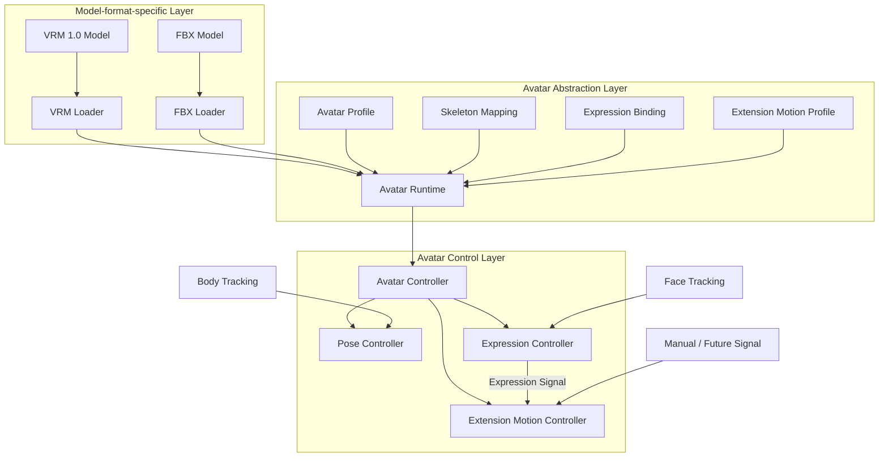
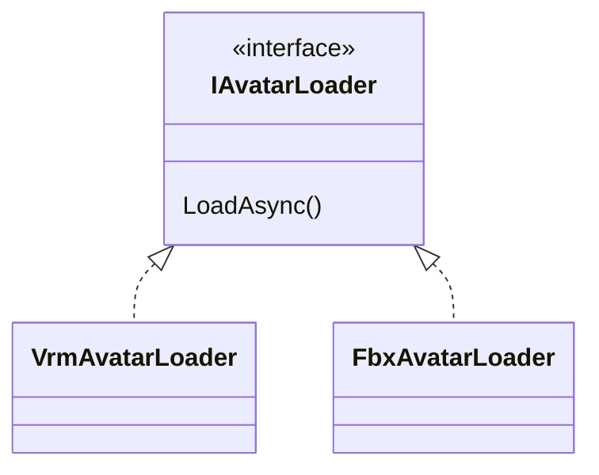
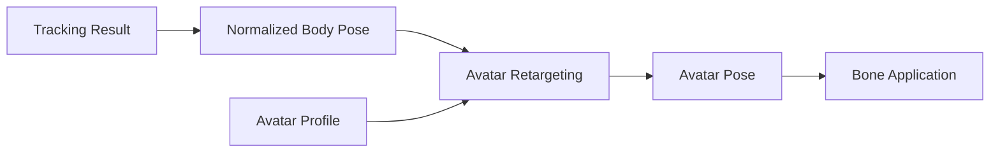
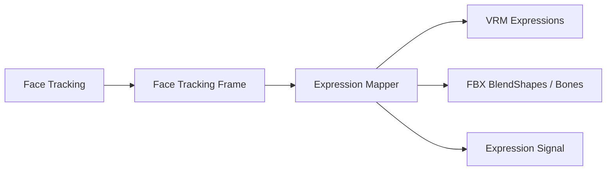
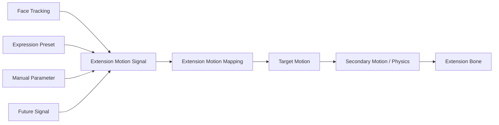
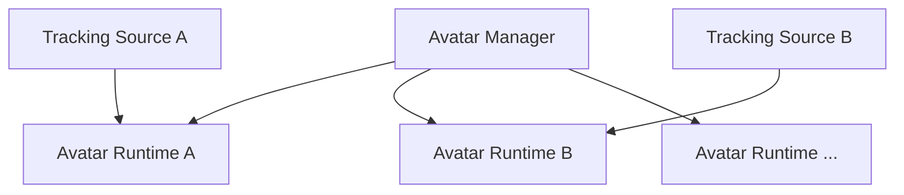

# 7. 3D Avatar Control

## 7.1 Purpose

The 3D avatar control function loads, registers, and switches the 3D models used as a VTuber, and manages pose control, expression control, extension bone control, and model-specific settings.

This function is structured so that model-format-specific information such as VRM and FBX is not handled directly by the tracking function or other functions of the application.

An **avatar abstraction layer** is placed between model formats and avatar control processing so that VRM, FBX, and model formats added in the future can be handled by higher-level functions in the same way as far as possible.

Elements not included in the standard humanoid skeleton, such as cat ears and tails, are also handled as extension bones independently of the model format.

As an initial function, expression-linked motion of cat ears and tails is provided, and the motion can be changed by the user.

Furthermore, the structure allows any other extension element besides cat ears and tails to be added by the user registering the target bones and motion conditions.

### Rationale

Each 3D model format differs in how bones are obtained, how expressions are controlled, metadata structure, and so on.

Exposing these differences to the Tracking module, the UI, etc. would require modifying multiple functions every time a model format is added.

Therefore, model-format-specific processing is confined to a limited area, and a common avatar representation is provided on top of it.

Also, implementing cat ears, tails, etc. as dedicated code per model would require program changes every time a new model or extension element is added.

Therefore, a common control approach is also provided for extension bones.

This reduces the scope of changes caused by differences in model formats, the standard human skeleton, and extension elements, ensuring the maintainability and extensibility of the entire system.

---

## 7.2 Avatar Control Architecture

3D avatar control is broadly divided into the following three layers.



The arrows in the diagram do not represent class inheritance itself but mainly represent:

- data conversion
- passing of information
- flow of control requests

### Model-format-specific Layer

Loads model files such as VRM and FBX and interprets model-format-specific information.

VRM-specific APIs and FBX-specific APIs are, as a rule, confined to this layer.

### Avatar Abstraction Layer

Absorbs differences between model formats so that higher-level control processing can treat them as the same avatar.

Provides standard human bones, extension bones, expressions, extension bone motion settings, model settings, etc. in a format common to this system.

### Avatar Control Layer

Receives tracking results, etc. and applies poses, expressions, and extension bone motion to the abstracted avatar.

It is not aware of the concrete internal structure of VRM or FBX.

### Rationale

Directly connecting model loading to avatar control would require separate control processing for VRM and FBX, and processing would grow with the number of model formats.

Therefore, the boundary

**format-specific processing → common representation → control**

is established.

This limits the impact on other avatar control processing even when changes such as

- changing the VRM library
- changing how FBX is supported
- adding a new 3D model format
- adding new extension bone control

occur.

Clarifying the responsibility of each layer also makes it easier, when a failure occurs, to isolate whether the problem occurred in "loading," "mapping," "pose control," "expression control," or "extension bone control."

---

### Avatar Runtime

The `Avatar Runtime` is the runtime avatar representation used to actually control a loaded 3D model in this system.

It does not mean only the GameObject generated in Unity; it handles together

- the loaded model
- references to standard bones
- references to extension bones
- references to expressions
- the avatar profile
- extension motion settings
- the current avatar state

and so on.

Basically, one Avatar Runtime is created for each loaded avatar.

### Rationale

If only Unity GameObjects are treated as avatars, bone mapping, expression settings, extension bone settings, model-specific settings, etc. tend to be managed in separate places.

Grouping them into a single runtime unit allows

**"the information needed to control this avatar right now"**

to be obtained from one place.

Also, if multiple avatars are handled simultaneously in the future, this can be supported by creating multiple Avatar Runtimes, so the system does not need to assume a single avatar.

---

### Avatar Profile

The `Avatar Profile` is not the model file itself but persistent settings that represent

**how the model is used in this system**

For example, it holds:

- supplementary settings for bone mapping
- extension bone registration information
- expression mapping
- a reference to the extension motion profile
- model scale
- initial position
- initial rotation
- correction information for applying tracking
- model-specific control settings

### Rationale

Writing system-specific information into the model file itself would require modifying the original model.

Also, VRM and FBX differ in what information can be stored inside the model and how.

Therefore, the model file and system-specific settings are separated.

This makes it possible to:

- not modify the original model
- apply different settings to the same model
- change extension bone motion independently of the model file
- update the settings format on the application side alone
- use the same settings management approach regardless of model format

---

### Avatar Controller

The `Avatar Controller` is the high-level control entry point for operating an Avatar Runtime.

Other modules avoid directly operating on Transforms, BlendShapes, VRM APIs, etc. and pass control requests through the Avatar Controller.

Internally, it dispatches processing to the Pose Controller, Expression Controller, Extension Motion Controller, etc.

The Avatar Controller is not designed as a singleton that exists only once in the entire system.

### Rationale

If external modules can freely operate on Unity Transforms, etc., multiple processes may rewrite the same bones, and the processing order and dependencies may become unclear.

Providing a control entry point creates a structure that:

- limits the paths for changing the avatar
- makes control processing traceable
- makes it easy to add control processing in the future
- can support multiple avatars

---

## 7.3 3D Model Loading

Model loading processing is separated by model format.

A common model loading interface is provided, and format-specific loaders are placed as its implementations.



The initially supported formats are as follows.

| Format | Support policy |
|---|---|
| VRM | VRM 1.0 and later are targeted. VRM 0.x models are also accepted by converting them to VRM 1.0 at load (user's decision, 2026-10-18, because 0.x models are still widely used) |
| FBX | Supported |

The runtime loading method for FBX, including the library used, is decided in the detailed design.

Loaders load not only standard human bones but also extension bones present in the model, in a state that subsequent processing can reference.

### Rationale

Writing loading processing for each model format directly into common processing would require changing existing code every time a format is added.

Making loaders independent per format allows a new format to be supported, as a rule, simply by adding a loader.

Limiting external dependencies such as the VRM library to the inside of loaders also limits the impact of external library updates.

---

## 7.4 Avatar Profile Management

Model files and system-specific settings are managed separately.

In this system design, these settings are called the **Avatar Profile**.

The name candidates were as follows.

| Name | Meaning / characteristics |
|---|---|
| Avatar Definition | Strongly implies defining the avatar itself and is easily taken to include the model data |
| Avatar Configuration | Clearly settings, but the scope is broad |
| Avatar Descriptor | Means information describing the avatar, but somewhat abstract |
| Avatar Mapping Profile | Expresses bone / expression mapping well, but makes it hard to include other settings |
| **Avatar Profile** | Expresses the full set of per-avatar usage settings well and is easy to distinguish from the model file |

This system adopts **Avatar Profile**.

### Rationale

The name `Definition` strongly suggests "data that defines what the avatar is," that is, including the model itself.

The information to be saved here is

**not the model itself but how the model is used in this system**

Therefore, `Profile`, which readily conveys the meaning of a set of settings, is adopted.

---

## 7.5 Bone Abstraction

Internal Transform structures of VRM, FBX, etc. are not referenced directly from the Tracking module, etc.

The basic human skeleton is based on the humanoid structure and converted into bone identifiers common to this system.

Examples:

- Head
- Neck
- Chest
- Spine
- Hips
- Shoulder
- UpperArm
- LowerArm
- Hand
- UpperLeg
- LowerLeg
- Foot
- each finger joint

On the other hand, the structure can also handle bones not included in the humanoid structure, such as:

- cat ears
- fox ears
- rabbit ears
- tails
- wings
- hair
- clothing
- accessories
- other model-specific bones

Therefore, bones are broadly managed as

- standard human bones
- extension bones

### Initially Supported Extension Bones

As an initial function, the following, which are frequently used in VTuber models, are supported as standard:

- cat ears
- tails

However, the internal implementation is not dedicated to cat ears and tails.

Cat ears and tails also use the common extension motion mechanism described later and are provided as its standard settings.

### User-defined Extension Bones

Any bone present in the model can be additionally registered by the user as an extension bone.

For example,

- fox ears
- rabbit ears
- wings
- ahoge (a single stray strand of hair)
- ribbons
- antennae
- special tails
- other unique accessories

and so on can be registered.

### Rationale

Defining common names for the body parts targeted by human tracking allows control without being aware of the internal structure of VRM or FBX.

On the other hand, forcing cat ears or tails into human bones mixes the meanings of the human skeleton and additional structures.

Therefore, the humanoid structure is made common as standard human bones, and everything else is handled separately as extension bones.

Furthermore, by allowing arbitrary bones to be registered instead of hardcoding only cat ears and tails, the structure can support model-specific features.

---

## 7.6 Pose Application and Absorbing Body Proportion Differences

The human pose obtained from the Tracking module is not applied directly to the model's Transforms.

Tracking results are treated as model-independent pose information and then retargeted to the target avatar.



Each model differs in

- height
- arm length
- leg length
- shoulder width
- initial bone pose
- bone rotation axes
- overall model scale

and so on.

These differences are absorbed using model-specific information such as the avatar profile.

### Rationale

The proportions of the actual person and the avatar cannot be expected to match exactly.

Applying tracking values directly to the model may cause

- hands not reaching the correct position
- shoulders deforming unnaturally
- feet floating off the floor
- motion results differing per model

and so on.

Therefore,

**the observed human pose**

and

**the pose applied to the avatar**

are separated.

The concrete algorithm for proportion correction is decided in the detailed design.

Calibration processing, which was independent in an earlier proposal, is also treated as part of this retargeting processing.

---

## 7.7 Expression Control

Expression control is based not mainly on switching expression presets such as smiling or anger but on **continuous expression control through face tracking**.

For example,

- open/close amount of the left and right eyes
- blinking
- open/close amount of the mouth
- mouth shape
- eyebrow movement
- movement of cheeks, etc.

are obtained as continuous values.



Differences in expression implementation between VRM and FBX are absorbed by expression mapping.

Also, expression presets such as

- Smile
- Angry
- Sad
- Surprised
- user-registered expressions

can be used as an auxiliary function.

The expression control function not only applies expressions to the avatar's face but also provides an **Expression Signal** that other avatar control functions can use.

The Expression Signal represents, for example, expression states such as Smile and Sad and continuous face tracking values for the eyes, mouth, etc. as input values independent of the model format.

### Rationale

For VTuber use, changing expressions continuously to follow actual face movements gives a more natural representation than switching expressions as simple on/off states.

On the other hand, for streaming performances, etc., one may want to switch immediately to a specific expression.

Therefore,

**face tracking is the basis**

while

**preset expressions are an auxiliary function**

and both can be used together.

Also, making it available to other control as an Expression Signal allows cat ears, tails, etc. to move in conjunction with expressions.

---

## 7.8 Extension Bone and Extension Motion Control

An **Extension Motion** mechanism is provided that allows setting motion for extension bones other than standard human bones in response to expressions and other inputs.

Extension motion separates

**what to move**

from

**what to react to and how to move**

```text
Extension Bone
  = what to move

Extension Motion Profile
  = what to react to and how to move
```

### Overall Structure of Extension Motion

Conceptually, the structure is as follows.



The Extension Motion Controller generates the motion of target extension bones based on input signals and the configured mappings.

---

### Linking with the Expression Signal

The initial function provides expression linking for cat ears and tails.

For example, the following can be used as input:

- Smile
- Angry
- Sad
- Surprised
- Eye Open
- Mouth Open
- other face tracking values
- expression presets
- manual parameters

Input values are handled as normalized signals, such as 0.0 to 1.0, where practical.

### Rationale

Hardcoding specific expression names inside the Extension Motion Controller makes it hard to add new expressions or input signals.

Handling input as common signals allows expression presets, continuous face tracking values, future external input, etc. to be handled by the same mechanism.

---

### Standard Cat Ear Motion

For cat ears, a standard motion profile linked to expressions is provided.

As initial settings, for example,

```text
Smile
 → raise the ears slightly

Sad
 → lay the ears down

Surprised
 → raise the ears strongly

Angry
 → turn the ears slightly backward
```

and so on are assumed.

However, these motions are not fixed specifications.

The user can change at least:

- target bones
- motion axes
- rotation amount
- position change amount
- initial offset
- left/right differences
- response speed
- smoothing
- which signals to react to
- motion amount relative to the signal

### Rationale

Even for the same cat ears, models differ in

- bone axes
- initial pose
- ear size
- preferred motion

The structure provides standard settings while allowing changes according to the model and the user's preference.

---

### Standard Tail Motion

For tails, a standard expression-linked motion profile is also provided.

As initial settings, for example,

```text
Smile
 → wag slowly from side to side

Sad
 → droop downward

Surprised
 → change toward standing up

Angry
 → move more strongly than usual
```

and so on are assumed.

For tails, the structure does not simply convert expressions into fixed angles but allows swaying and physical behavior to be added on top of the base pose and motion amount according to the expression, as in

```text
Expression Signal
      ↓
Base Pose / Motion Parameter
      ↓
Secondary Motion / Physics
      ↓
Final Tail Motion
```

### Rationale

Tails are often composed of multiple bones, and fixed rotations alone make natural motion hard to express.

Changing the base pose and wagging style according to the expression and applying secondary motion on top makes natural motion easier to achieve.

---

### Extension Motion Mapping

Extension motion settings are held as mappings.

Conceptual example:

```text
Extension Motion Mapping
├─ MappingId
├─ Target Extension Element
├─ Input Signal
├─ Input Range
├─ Response Curve
├─ Rotation
├─ Position
├─ Scale
├─ Response Speed
├─ Smoothing
└─ Secondary Motion Settings
```

The detailed data structure is decided in the detailed design.

The structure allows multiple mappings to be set for one extension element.

When multiple signals act on the same element simultaneously,

- blend
- priority
- weight

and so on are also defined in the detailed design.

---

### Extension Motion Profile

A set of extension motion mappings is managed as an **Extension Motion Profile**.

For example, it is held as

```text
Extension Motion Profile
├─ Cat Ear Settings
├─ Tail Settings
└─ User-defined Extension Settings
```

The extension motion profile can be referenced from the avatar profile.

The structure can be extended as needed to duplicate motion profiles, turn them into presets, import / export them, etc.

### Rationale

Separating the extension bones themselves from the motion settings makes it easier to apply different motions to the same model or to change and compare settings.

It also makes future sharing of motion profiles easier to support.

---

### User-defined Extension Elements

Extension elements other than cat ears and tails can also be added by the user from the setup UI.

Conceptually, the following information is set.

```text
Extension Element

Name:
  Fox Tail

Target Bones:
  Tail_01
  Tail_02
  Tail_03

Input:
  Smile

Motion:
  Rotation / Position / Secondary Motion

Response:
  User-defined Settings
```

Targeting bones in the model, the user can register

- extension element name
- target bone or bone chain
- input signal
- motion mapping

This allows

- fox ears
- rabbit ears
- wings
- ahoge
- antennae
- ribbons
- unique accessories

and so on to be added without changing the main code.

### Rationale

3D avatars have additional structures specific to each model.

It is not realistic to predefine every kind in the main application.

Therefore, standard settings are provided for frequently used cat ears and tails, and everything else can be added by the user using the common extension motion mechanism.

---

### Handling Extension Bone Control Failures

Even if a configured extension bone does not exist or there is a problem with a mapping, pose control of standard human bones and expression control are not stopped.

Only the problematic extension element is disabled, and the user is notified.

### Rationale

This prevents abnormal settings of an auxiliary extension element from making the entire avatar unusable.

---

## 7.9 Avatar Management and Switching

Avatars can be switched even during streaming.

The initial implementation mainly targets single-person use, but the internal design does not assume that only one avatar can exist.



The initial version may limit the number of simultaneously used avatars to one.

### Rationale

Considering only currently needed functions, an implementation that holds a single `CurrentAvatar` is the simplest.

However, if the entire system depends on that structure, supporting multi-person streaming in the future would require a large-scale design change.

Therefore,

**using only one person as an initial function**

and

**the internal structure being dedicated to one person**

are considered separately.

The structure keeps future extensibility while not making the initial implementation more complex than necessary.

---

## 7.10 Scene Structure

Unity scenes are divided into the following two types.

### Persistent Scene

A scene that, as a rule, stays loaded while the application is running.

It mainly contains:

- application management functions
- Avatar Manager
- Avatar Runtime
- tracking-related functions
- audio-related functions
- camera
- UI
- other resident systems

### Stage Scene

Holds stage-specific objects such as backgrounds and 3D spaces.

Stage scenes are switched by additive load / unload.

### Rationale

If avatars, tracking, etc. are placed in the stage scene, they are destroyed and recreated every time the stage changes.

In that case,

- avatar reloading
- tracking reinitialization
- audio processing reinitialization
- loss of UI state
- loss of camera state

and so on may occur.

Therefore,

**systems that should continue regardless of the stage**

and

**the 3D environment replaced when the stage changes**

are separated per scene.

The persistent scene is treated as "the VTuber system itself," and the stage scene as "the stage."

The term `Persistent Scene` is defined within this system design and does not require prior knowledge of past documents.

---

## 7.11 Avatar Data Storage

Models registered by the user are not saved only as references to the original files but are copied into and managed in the system-managed area.

Using the Data Root defined in Chapter 6, they are conceptually stored as follows.

```text
DataRoot/
└─ Avatars/
    └─ <AvatarId>/
        ├─ model.vrm
        ├─ avatar-profile.json
        ├─ extension-motion-profile.json
        └─ thumbnail.png
```

For FBX, required related files are managed in the same way.

Whether the extension motion profile is saved directly inside the avatar profile or managed as a separate file is decided in the detailed design.

### Rationale

Saving only the path to the original file may make a registered avatar unusable due to

- moving the original file
- deletion
- renaming
- an external drive not being connected

and so on.

Copying into the integrated environment allows models to be managed entirely within this system after registration.

It also makes

- backup
- project migration
- export
- diagnostics
- reusing motion profiles
- future sharing functions

easier to implement.

The import source path may be saved as metadata, but it is not depended on at runtime.

---

## 7.12 Separating Setup and Runtime

Processing during avatar registration and configuration is separated from processing during streaming.

### Setup

- model import
- model format detection
- standard bone recognition
- standard bone assignment
- extension bone recognition
- checking cat ear / tail candidates
- registering user-defined extension bones
- expression recognition
- expression mapping
- extension motion mapping settings
- extension motion preview
- model-specific correction
- thumbnail settings
- saving the avatar profile
- saving the extension motion profile

### Runtime

- model loading
- loading the avatar profile
- loading the extension motion profile
- creating the Avatar Runtime
- connecting tracking
- applying poses
- applying expressions
- generating the Expression Signal
- applying extension motion

### Rationale

If bone analysis and extension motion configuration were performed every time during streaming, startup time would increase and user operation would become complex.

By completing analysis and configuration at setup time and saving them, the runtime can use the avatar simply by loading existing settings.

The purpose is to:

- simplify the procedure for starting a stream
- make runtime processing lightweight
- check extension motion in advance
- detect configuration mistakes in advance

---

## 7.13 Error Handling and Diagnostics

Error display for normal users and diagnostic logs for developers are separated.

For example, if model loading fails, the user is shown an easy-to-understand message such as

> Failed to load the avatar.

If there is a problem with the extension bone settings, the scope of impact is made clear, for example:

> The tail motion settings could not be applied. The avatar itself continues to work.

On the other hand, developer logs record the following as needed:

- AvatarId
- model format
- loader
- target file
- missing bones
- missing expressions
- extension element
- extension bone
- extension motion mapping
- input signal
- extension motion application result
- exception
- stack trace

### Rationale

Normal users and developers need different information.

For example, the information

```text
NullReferenceException at VrmAvatarLoader.cs:183
```

is useful to developers but does not help general users solve the problem and gives an unnecessarily complex impression.

Conversely, the information

> Failed to load the model

alone is insufficient for OSS developers to investigate the cause from GitHub issues, etc.

Therefore, the roles are divided:

**the user UI shows "what happened" and "what the user should do"**

while

**developer logs record "what happened internally" in detail**

This ensures both clarity in normal use and failure analysis capability as OSS.

Separating the user-facing display from internal logs also makes it less likely that user messages are dragged along by the internal structure when the internal implementation changes in the future.

---

## 7.14 Internal Division of Responsibilities

The 3D avatar control function does not consolidate processing into a single giant controller but is divided by responsibility.

Conceptually, the following structure is assumed.

```text
Avatar/
├─ Core/
│  ├─ AvatarProfile
│  ├─ AvatarRuntime
│  ├─ AvatarState
│  └─ AvatarBone
│
├─ Loading/
│  ├─ IAvatarLoader
│  ├─ VrmAvatarLoader
│  └─ FbxAvatarLoader
│
├─ Skeleton/
│  ├─ SkeletonMapping
│  └─ ExtensionBone
│
├─ Pose/
│  ├─ AvatarPose
│  ├─ PoseRetargeting
│  └─ PoseController
│
├─ Expression/
│  ├─ FaceTrackingFrame
│  ├─ ExpressionSignal
│  ├─ ExpressionMapping
│  └─ ExpressionController
│
├─ Extension/
│  ├─ ExtensionElement
│  ├─ ExtensionMotionProfile
│  ├─ ExtensionMotionMapping
│  ├─ ExtensionMotionSignal
│  ├─ SecondaryMotionProcessor
│  └─ ExtensionMotionController
│
├─ Runtime/
│  ├─ AvatarController
│  └─ AvatarManager
│
└─ Setup/
   └─ AvatarSetupController
```

### Rationale

Consolidating all processing into one controller makes

- model loading
- pose processing
- expression control
- extension motion
- saving settings
- avatar management

and so on depend on each other, so a change in one place tends to affect other functions.

Separating by responsibility aims to:

- clarify the role of each function
- limit test targets
- reduce the scope of change impact
- make the causes of defects easier to track
- make it easier to add new model formats
- make it easier to add new extension bones
- make it easier to add new extension motion approaches

The directory structure and class names shown here illustrate the approach to dividing responsibilities, and details are adjusted during implementation.
