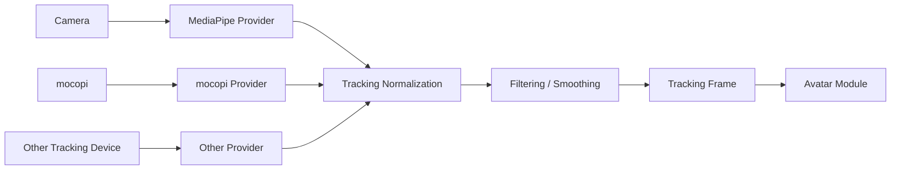
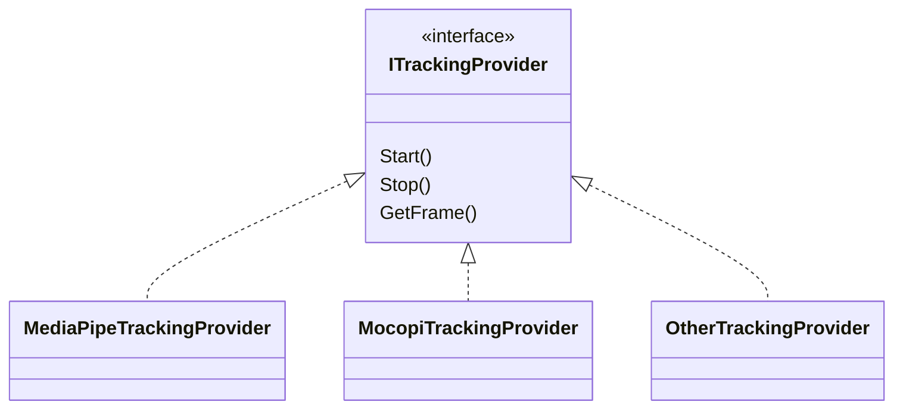

# 8. Tracking

## 8.1 Basic Policy

The tracking function obtains body, face, and hand/finger movements from cameras, external tracking devices, etc. and converts them into tracking information that can be used in common within this system.

The initial implementation targets camera-based tracking using MediaPipe.

The structure allows external tracking devices such as mocopi and other tracking libraries to be added in the future.

The tracking function does not depend on a specific 3D model format or avatar structure.

### Rationale

If the data format output by tracking libraries such as MediaPipe is passed directly to the Avatar module, the avatar control side depends on MediaPipe-specific landmark structures and coordinate systems.

In that state, switching to mocopi, etc. in the future would require changing the avatar control side as well.

Therefore, a tracking representation common to this system is placed between

**the tracking input method**

and

**the avatar control method**

---

## 8.2 Overall Tracking Structure

Tracking processing conceptually consists of the following flow.



The arrows in the diagram mainly indicate the flow of obtaining, converting, and passing data.

### Rationale

Confining input-device- and library-specific processing inside providers and making subsequent processing common limits the impact of adding or changing input methods.

Separating normalization, smoothing, etc. as common processing also avoids implementing the same processing repeatedly in each provider.

---

## 8.3 Tracking Input Methods

Tracking input is separated into providers by input method.

Conceptually, the structure is as follows.



The initial implementation uses MediaPipe.

In the future,

- mocopi
- other camera-based tracking
- motion capture devices
- tracking input over a network

and so on can be added.

### Rationale

Making tracking input a common interface removes the need for higher-level processing to be aware of the library used.

Also, considering the possibility of using multiple input methods simultaneously, providers are not treated as singletons that exist only once in the entire system.

---

## 8.4 Common Tracking Data Format

Information obtained from each provider is converted into `TrackingFrame`, which is common to this system.

TrackingFrame conceptually has the following information:

- body tracking
- hand tracking
- face tracking
- timestamp
- tracking confidence
- tracking source
- tracking status

Body, hand, and face can each be held as independent data structures.

Conceptual example:

```text
TrackingFrame
├─ Timestamp
├─ Body
├─ LeftHand
├─ RightHand
├─ Face
└─ Status
```

### Rationale

Body, hands/fingers, and face may differ in how they are obtained, update frequency, and conditions under which data is missing.

Fixing everything into one giant structure makes it hard to support input methods that use only some tracking.

Therefore, TrackingFrame is a common container that holds the various kinds of tracking information separately inside it.

---

## 8.5 Body Tracking

Body tracking obtains pose information for the head, torso, arms, legs, etc.

The tracking side does not convert this into the specific skeleton structure of an avatar but holds the pose information as observed for a human body.

For example,

- Head
- Neck
- Shoulder
- Elbow
- Wrist
- Hips
- Knee
- Ankle

and so on are treated as human body parts common to this system.

### Rationale

The responsibility of the Tracking module is

**to obtain what pose the person is in**

and not

**how to apply that pose to a specific avatar's skeleton**

Absorbing differences in proportions and bone lengths is done by retargeting on the 3D avatar control side.

This clearly separates the responsibilities of the Tracking module and the Avatar module.

---

## 8.6 Hand and Finger Tracking

Hand and finger tracking obtains the pose of the left and right hands and each finger joint.

When available, joint information for

- wrist
- thumb
- index finger
- middle finger
- ring finger
- little finger

is held.

For input methods where hand/finger tracking is not available, the system can work with body tracking alone.

### Rationale

The amount of information available differs by input method, so making hand/finger tracking a requirement would limit the supported providers.

Therefore, body, hand, and face are treated as independent capabilities, and the structure uses only the information that is available.

---

## 8.7 Face Tracking

Face tracking obtains not only the face direction but also movements of the eyes, mouth, eyebrows, etc.

Basically, as continuous values,

- open/close amount of the left and right eyes
- open/close amount of the mouth
- mouth shape
- eyebrow movement
- face direction
- other available facial features

are held.

The Tracking module outputs these as model-independent face information, and conversion into VRM expressions, FBX blend shapes, etc. is done on the Avatar module side.

### Rationale

Converting face tracking information directly into VRM expression names, etc. would make the Tracking module depend on the model format.

Therefore, the Tracking module represents only "how the person's face is moving," and how to express that movement on the model is left to the Avatar module.

---

## 8.8 Coordinate Systems and Pose Representation

Coordinate systems obtained from each provider are not passed as-is to higher-level processing but are converted into the coordinate system common to this system.

Because each provider may differ in

- right-handed / left-handed systems
- axis directions
- origin position
- units
- quaternion definitions

and so on, these are unified within the provider or normalization processing.

### Rationale

Leaving coordinate system conversion to the Avatar module side would require individual processing for each combination of provider and avatar.

Unifying the coordinate system at the point of tracking output allows the Avatar module to process data without being aware of the input source.

---

## 8.9 Handling Confidence and Missing Data

Tracking data can hold confidence and tracking state for each body part.

For example, states such as

- Tracked
- LowConfidence
- Lost
- NotSupported

can be represented.

When the tracking target is temporarily lost, invalid values are not forcibly applied; holding the previous value, fading, stopping control, etc. can be chosen.

### Rationale

In camera-based tracking, some landmarks may become unavailable due to occlusion or moving out of the field of view.

If missing data is not distinguished from normal values, the avatar may suddenly move into an unnatural pose.

Therefore, not only position and rotation values but also whether those values are reliable are handled as common data.

---

## 8.10 Filtering and Smoothing

Smoothing is performed as needed to suppress small jitter and noise in tracking values.

Smoothing is separated from provider-specific processing and placed as tracking processing common to this system.

Targets assumed include

- position
- rotation
- facial expression values
- hand/finger pose

and so on.

### Rationale

Reflecting tracking results directly on the avatar may make the model constantly tremble slightly due to tiny fluctuations in detected values.

On the other hand, too much smoothing increases control latency.

Therefore, smoothing is made independent, and the structure allows its targets and strength to be adjusted.

The specific filter method is decided in the detailed design.

---

## 8.11 Calibration

The Tracking module handles calibration related to the tracking input itself.

For example,

- origin setting
- sensor-specific correction

and so on are covered.

Setting the forward direction from the person (a reference pose relative to the camera position) was tried with one camera and not adopted: a camera to one side sees too little of the body, and turning its observations back moved its depth errors into the body's lean (tracking detailed design 8.5, 2026-10-26). The camera is placed in front of the person instead.

On the other hand, absorbing differences such as

- avatar height
- arm length
- shoulder width
- model-specific initial pose

is handled on the Avatar module side.

### Rationale

The word "calibration" tends to include both correction of the input device and correction of avatar proportion differences.

Combining these into the same function makes responsibilities ambiguous.

Therefore,

**correction to observe the input system correctly**

belongs to the Tracking module, and

**correction to fit the observed results to the target avatar**

belongs to the Avatar module.

---

## 8.12 Support for Multi-person Tracking

The initial implementation mainly targets use by one person.

However, the internal design of TrackingFrame, providers, etc. does not assume that only one person can exist.

In the future, the structure can be extended to handle multiple targets, as in

```text
Tracking Session
├─ Person A
│  └─ TrackingFrame
├─ Person B
│  └─ TrackingFrame
└─ Person ...
```

### Rationale

Fully implementing multi-person tracking from the initial stage increases complexity.

On the other hand, a structure that can hold only a single global TrackingFrame would require major changes to support multiple people later.

Therefore, the policy is

**one person as the initial function**

while

**the design is not dedicated to one person**

---

## 8.13 Separating Setup and Runtime

Setup and runtime are also separated for tracking.

### Setup

Mainly handles:

- selecting the provider to use
- selecting the camera
- calibration
- checking the tracking range
- smoothing settings
- debug display
- enabling / disabling each tracking function

### Runtime

Mainly performs:

- starting the provider
- obtaining tracking
- converting to the common format
- normalization
- smoothing
- outputting TrackingFrame

### Rationale

If the input method and detailed parameters had to be configured every time during streaming, operation would become complex.

The structure saves the required settings at setup time and uses the saved settings at runtime to start tracking quickly.

---

## 8.14 Error Handling and Diagnostics

Display for normal users and developer logs are separated.

Normal users are shown easy-to-understand states such as

- the camera cannot be found
- tracking cannot be started
- the target person cannot be detected

and so on.

Developer logs record, as needed,

- provider name
- provider version
- input device
- frame rate
- detection state
- tracking confidence
- reason for initialization failure
- exception
- stack trace

and so on.

### Rationale

Showing internal library errors, etc. directly to normal users rarely helps solve the problem.

On the other hand, investigating failures as OSS requires internal state and error details.

Therefore, as with 3D avatar control,

**actionable information for users**

and

**information allowing cause analysis for developers**

are provided.

---

## 8.15 Internal Division of Responsibilities

The tracking function separates input, normalization, smoothing, state management, etc. by responsibility.

Conceptually, the following structure is assumed.

```text
Tracking/
├─ Core/
│  ├─ TrackingFrame
│  ├─ BodyTrackingData
│  ├─ HandTrackingData
│  ├─ FaceTrackingData
│  └─ TrackingStatus
│
├─ Providers/
│  ├─ ITrackingProvider
│  ├─ MediaPipeTrackingProvider
│  └─ MocopiTrackingProvider
│
├─ Processing/
│  ├─ CoordinateNormalizer
│  ├─ TrackingFilter
│  └─ ConfidenceProcessor
│
├─ Calibration/
│  └─ TrackingCalibration
│
├─ Runtime/
│  └─ TrackingManager
│
└─ Setup/
   └─ TrackingSetupController
```

### Rationale

Consolidating provider-specific processing, coordinate conversion, smoothing, etc. into a single class widens the scope of changes when adding input methods.

Separating by responsibility makes it easier to independently

- add providers
- change filter methods
- change coordinate systems
- add debugging functions

and so on.

The class names and directory structure shown here illustrate the approach to dividing responsibilities, and details are adjusted during implementation.
