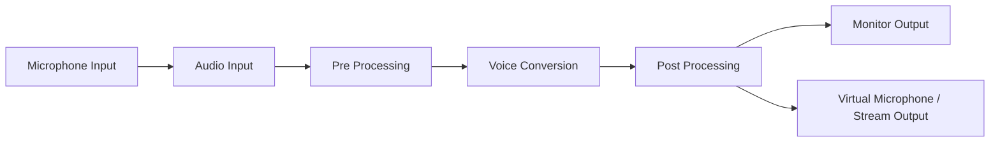
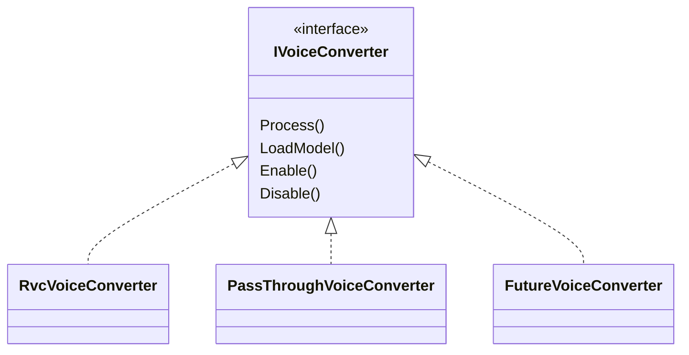

# 9. Voice Conversion

## 9.1 Basic Policy

The voice conversion function obtains the user's microphone audio in real time, converts it into a different voice using a voice conversion model such as RVC, and outputs it as monitoring audio and streaming audio.

Real-time voice conversion during streaming is, as a rule, completed inside the Unity application and does not depend on Python processes or local Python services.

Processing that requires Python is limited to setup uses such as model training, voice analysis, and voice generation.

### Rationale

Depending on a Python service during streaming means that

- abnormal termination of the Python process
- corruption of the Python environment
- port conflicts
- IPC or HTTP communication latency
- waiting for service startup
- dependency problems between Python and CUDA libraries

and so on directly lead to audio stopping during the stream.

Real-time voice conversion is a key function of VTuber streaming, and it is important that it is not easily affected by external service failures during streaming.

Therefore, the training environment and the inference environment are separated, and inference during streaming runs inside Unity.

---

## 9.2 Overall Audio Processing Structure

Audio processing is conceptually structured as the following pipeline.



The main processing stages are:

1. obtaining microphone audio
2. pre-processing the input audio
3. voice conversion
4. post-processing the converted audio
5. monitoring output
6. streaming audio output

### Rationale

Combining microphone input, RVC, pitch changes, volume adjustment, output, etc. into one process makes it difficult to disable or replace only specific processing.

Separating stages as an audio pipeline allows changes such as

- disabling only voice conversion
- changing only post-processing
- changing to a different voice conversion approach
- changing the input device
- changing the output method

to be made independently of other processing.

---

## 9.3 Audio Pipeline Abstraction

Each audio process handles common audio data as input and output as far as possible.

Conceptually, audio processes can be connected as follows.

```text
Audio Input
    ↓
Noise / Input Processing
    ↓
Voice Conversion
    ↓
Pitch Processing
    ↓
EQ / Gain
    ↓
Audio Output
```

The structure allows each process to be handled as an independent audio processor.

When voice conversion is disabled, the voice conversion process is switched to pass-through so that the audio pipeline itself is maintained.

### Rationale

A structure that recreates the audio I/O itself depending on whether RVC is enabled may cause audio to drop out or require device reinitialization when switching.

Always maintaining the same pipeline and replacing only processing stages makes it easier to implement

- voice conversion on/off
- model switching
- adding effects
- pass-through for debugging

and so on.

---

## 9.4 Audio Input and Output

Audio input is obtained from the microphone device selected by the user.

For output destinations, at least the following are handled separately:

- monitor output for the user to check themselves
- output passed to the stream

For streaming output, the basic approach is to pass it to the streaming within this application (chapter 10).

A virtual microphone (an output other applications see as an audio input device) is not a standard feature (user's decision, 2026-10-22). It needs a signed audio driver, which this application cannot provide on its own, and existing products cannot be bundled for distribution. Its original purpose was testing without speaking aloud; how to do that is decided with the audio module's design.

### Rationale

Monitor output and streaming output have different purposes.

Fixing both as the same output makes it hard to support requirements such as

- wanting to hear it oneself but not stream it
- wanting to stream it but not needing to monitor it oneself
- wanting to adjust volumes separately

Therefore, output destinations are separated at the end of the audio pipeline.

---

## 9.5 Real-time Voice Conversion

RVC is used for real-time voice conversion.

Inference runs inside Unity; processing is not requested in real time from the Python version of RVC.

On the Unity side, the inference model is loaded, and the required pre-processing, feature extraction, F0 estimation, RVC inference, etc. are executed.

The current configuration is based on inference with Unity Inference Engine (formerly Unity Sentis).

The user confirmed in a prototype that real-time RVC inference with Unity Inference Engine runs within 200 ms (15.4), and that the load is acceptable while tracking and the rest run at the same time (as of 2026-10-22). The reference prototype (ONNX export of ContentVec, RMVPE, and RVC v2, and WAV conversion on the GPU) is on the `feature/rvc` branch of VCBM, outside the repository. The real-time code is not included there.

### Rationale

Using the Python implementation of RVC as-is during streaming creates a large dependency on the Python runtime and PyTorch environment.

On the other hand, converting trained models into an inference-only format and handling them on the Unity side has the advantages that

- the Python environment does not need to be running on the streaming PC at all times
- streaming processing can be performed by the Unity application alone
- the runtime can be separated to some extent from updates to the Python-side RVC
- general users can use it without being aware of the Python environment

---

## 9.6 Abstraction of the Voice Conversion Engine

Although the initial implementation uses RVC, the structure ensures that the higher-level audio pipeline does not depend directly on the RVC-specific implementation.

Conceptually, the voice conversion engine is abstracted as



GPU work can only be issued from the main thread, so the actual interface separates issuing and collecting (Voice detailed design chapter 5).

### Rationale

Even if RVC is suitable now, higher-quality or lower-latency voice conversion approaches may become available in the future.

If the audio pipeline itself is made RVC-specific, changing the voice conversion approach would require changing the input/output processing as well.

Therefore, the audio pipeline and the voice conversion engine are separated.

---

## 9.7 Voice Model Management

RVC models used during streaming are not referenced directly from the training environment but are managed as inference models registered in this system.

Conceptually, they are handled as units such as

```text
Voice Model
├─ Model Metadata
├─ RVC Model
├─ Feature Model / Index
├─ Pitch Settings
└─ Runtime Settings
```

The runtime is not aware of the folder structure used during training or the internal directory structure of the Python version of RVC.

### Rationale

If the training environment and the runtime depend on the same file structure, updates to RVC or changes to training tools affect the streaming functions as well.

Therefore,

**training artifacts**

and

**models registered for streaming**

are separated.

At model registration, models are converted into and validated in the format required by the runtime, and only registered models are used during streaming.

---

## 9.8 Model Switching

The voice model used during streaming can be switched.

When switching models, the audio I/O is not stopped as far as possible; only the inference model inside the voice conversion engine is switched.

During switching, the structure allows choosing as needed among

- pass-through
- keeping the previous model
- temporary mute

and so on.

### Rationale

Reinitializing the microphone device and audio output every time the model is switched may interrupt streaming audio for a long time.

Separating the audio pipeline from the model lifecycle minimizes the impact of switching models during streaming.

---

## 9.9 Pitch and Audio Post-processing

Additional post-processing can be applied on the Unity side to the audio after RVC conversion.

Examples include

- pitch
- gain
- EQ
- limiter
- other audio adjustments

and so on.

The voice conversion settings of the RVC model itself and the final audio adjustments for streaming are managed as separate settings.

### Rationale

Even after the voice has been converted by RVC, final adjustments may be needed to suit the actual streaming environment and the user's voice.

Building these into RVC inference processing would require changing the voice conversion implementation even for simple pitch changes.

Therefore, voice conversion and post-processing are separated.

---

## 9.10 Low-latency Processing

In real-time voice conversion, end-to-end latency, not only audio quality, is treated as an important quality metric.

Processing time is conceptually evaluated as the sum of

```text
Microphone Input
      +
Audio Buffering
      +
Feature Extraction
      +
Pitch Estimation
      +
Voice Conversion
      +
Post Processing
      +
Audio Output
```

The processing time of each process can be measured independently as far as possible.

### Rationale

Measuring only the total latency makes it hard to identify the cause when performance degrades.

Making the time of each processing stage observable allows isolating causes such as

- slow audio I/O
- slow F0 estimation
- slow RVC inference
- the GPU backend not being used as expected

It also allows the trade-off between quality and latency to be evaluated when audio quality improvements increase processing time.

---

## 9.11 Separating Real-time Processing from UI Processing

Audio processing is structured to be affected as little as possible by temporary processing load from UI rendering and the normal Unity game loop.

The processing responsibilities of audio I/O, inference, UI updates, etc. are separated.

The UI displays and changes

- the current model
- voice conversion on/off
- volume
- pitch
- processing state

and so on, but the UI code itself is not responsible for audio buffer processing.

### Rationale

Real-time audio needs to keep supplying audio at a fixed period.

If audio processing stalls for a long time due to UI rendering, scene loading, or other Unity processing, it leads to

- audio dropouts
- noise
- buffer starvation
- increased latency

Therefore, the audio runtime and the UI are clearly separated.

---

## 9.12 GPU Usage

Inference processing such as RVC uses the GPU in environments where it is available.

On the other hand, dependencies on specific GPU vendors or specific execution backends are not exposed to the entire audio pipeline.

Selection of the inference backend and GPU availability are handled inside the voice conversion engine.

### Rationale

GPU environments differ from user to user.

Spreading GPU-specific processing into the UI or audio I/O widens the impact of backend changes.

Therefore, hardware differences are absorbed inside the inference implementation as far as possible.

---

## 9.13 Behavior on Failure

Even if an error occurs in inference processing during real-time voice conversion, the structure does not stop the entire application.

Depending on the type of error,

- disabling voice conversion and switching to pass-through
- temporarily muting
- reloading the model
- notifying the user of the error

and so on are performed.

### Rationale

A failure in voice conversion processing alone during streaming should not stop the avatar display, tracking, the streaming screen, etc.

Also, when voice conversion fails, passing through the original voice, if the user has allowed it, makes it easier to continue streaming than always going silent.

Therefore, failures of the voice conversion function are isolated from the entire system.

Because automatically using pass-through and muting have different privacy implications, this is configurable by the user. The default is mute (the user's approval, 2026-11-01).

---

## 9.14 Separating Setup and Runtime

Configuration / preparation processing and processing during streaming are also separated for voice conversion.

### Setup

Mainly handles:

- microphone selection
- monitor output selection
- streaming output selection
- voice model registration
- voice model selection
- adjusting pitch, etc.
- test playback
- checking the inference backend
- checking latency

### Runtime

Mainly performs:

- starting audio devices
- loading registered voice models
- voice conversion
- post-processing
- monitor output
- streaming output

### Rationale

Running processing such as model conversion and detailed diagnostics every time streaming starts increases startup time and the number of places where failures can occur.

Checking runtime usability at the setup stage and having the runtime only load validated settings makes starting a stream simple and stable.

---

## 9.15 Error Handling and Diagnostics

The UI for normal users and diagnostic information for developers are separated.

Users are shown information they can easily understand and act on, for example:

- the microphone cannot be used
- the voice model cannot be loaded
- voice conversion cannot be started
- the output device is not available

For developers, as needed,

- input device
- output device
- sample rate
- buffer size
- voice model
- inference backend
- feature extraction time
- pitch estimation time
- inference time
- total processing time
- buffer underruns
- exception
- stack trace

and so on are recorded.

### Rationale

Showing general users the inference backend name or internal buffer state normally does not help solve the problem.

On the other hand, this internal information is very important when investigating audio dropout or latency problems as OSS.

Therefore,

**users are given information to continue using and recover**

and

**developers are given information to analyze performance and failure causes**

---

## 9.16 Internal Division of Responsibilities

The voice conversion function separates audio I/O, voice conversion, post-processing, model management, etc. by responsibility.

Conceptually, the following structure is assumed.

```text
Voice/
├─ Core/
│  ├─ AudioFrame
│  ├─ VoiceState
│  └─ VoiceModelProfile
│
├─ Input/
│  ├─ IAudioInput
│  └─ MicrophoneInput
│
├─ Conversion/
│  ├─ IVoiceConverter
│  ├─ RvcVoiceConverter
│  └─ PassThroughVoiceConverter
│
├─ Processing/
│  ├─ PitchProcessor
│  ├─ GainProcessor
│  └─ AudioProcessorPipeline
│
├─ Model/
│  ├─ VoiceModelManager
│  └─ VoiceModelLoader
│
├─ Output/
│  ├─ MonitorOutput
│  └─ StreamOutput
│
├─ Runtime/
│  └─ VoiceRuntime
│
└─ Setup/
   └─ VoiceSetupController
```

### Rationale

Consolidating real-time audio processing into a single class makes changes to audio devices, RVC, pitch processing, etc. likely to affect each other.

Separating by responsibility makes it easier to independently

- add conversion approaches other than RVC
- change the audio I/O approach
- add post-processing
- change the model management approach
- measure performance

The class names and directory structure shown here illustrate the approach to dividing responsibilities, and details are adjusted during implementation.
