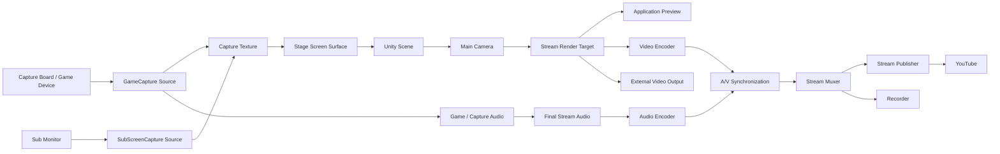
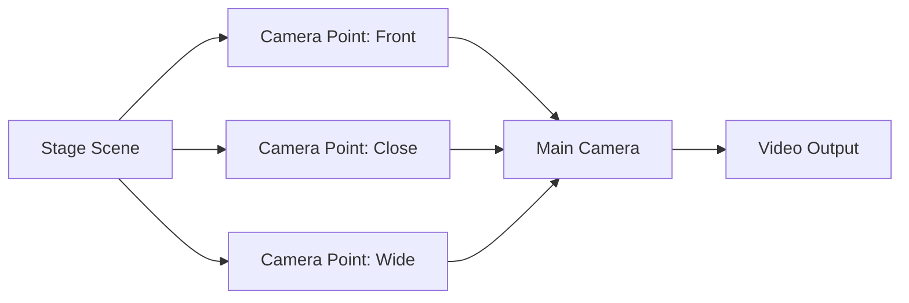

# 10. Video Input, Camera, and Video Output

## 10.1 Basic Policy

The video input, camera, and video output functions obtain external video from GameCapture, SubScreenCapture, etc., combine it with the avatar, stage, and various video elements built in Unity, and generate the streaming video within the application.

External video input is treated as a common capture source and can be assigned to screen surfaces, etc. on the stage. The final generated video can be output for the following uses:

- in-application preview
- live streaming to YouTube, etc.
- recording to video files
- future video output to external applications

This system does not require external streaming software such as OBS; the basic structure **allows everything from video input, video compositing in Unity, video encoding, and synchronization with audio to live streaming to be completed within this application**.

### Rationale

If OBS, etc. were required, users would need to configure, separately from this application,

- video capture settings
- audio input settings
- resolution settings
- streaming destination settings
- scene settings

and so on.

Because this system aims to integrate the functions required for VTuber activities, being able to start normal streaming with the application alone reduces the user's configuration burden.

On the other hand, for users who want to integrate with external applications in the future, the structure keeps it possible to add external video output via Spout, etc.

---

## 10.2 Overall Structure

Video output processing is conceptually structured as follows.



The arrows in the diagram indicate the flow of video / audio data and control information.

Video input, display on the stage, video generation, encoding, audio synchronization, and sending to the streaming destination are each treated as independent responsibilities.

Video obtained from GameCapture / SubScreenCapture is, as a rule, not sent directly to the video encoder; it is handled as a display element in the Unity scene, and the final streaming video is then generated from the main camera.

### Rationale

Directly coupling camera control with YouTube streaming would require changing camera control whenever the streaming method changes.

Therefore,

**the processing that generates video**

and

**how the generated video is used**

are separated.

This allows the same video to be used for

- preview
- streaming
- recording
- external output

---

## 10.3 Camera Management

A **main camera** is provided as the reference camera for generating VTuber video.

The main camera is placed in an area that is not destroyed by stage switching and, as a rule, is used continuously while the application is running.

The stage side places not cameras themselves but **camera points**, which indicate candidate camera placements.

A camera point has, for example, the following information:

- position
- rotation
- field of view
- camera point name
- additional camera settings as needed

Per-stage camera positions are achieved by moving the main camera to the selected camera point.



### Rationale

Giving each stage its own camera component causes problems such as

- camera settings differing per stage
- needing to switch the output camera
- duplicated post-processing settings, etc.
- streaming processing needing to track the currently active camera

Making the main camera itself common and giving stage scenes only camera points results in a structure based on

**"where to place the camera" rather than "which camera to use"**

This allows the video output to always reference the same main camera.

---

## 10.4 Camera Switching

Camera points can be changed even during streaming.

The structure can handle at least the following camera switching methods:

- immediate switching
- interpolated movement
- future switching with effects

Camera point switching and streaming processing are independent, and the video output pipeline itself does not stop even while the camera is moving.

### Rationale

Reinitializing the render target or video encoder every time the camera is switched may cause temporary video stalls or stream disconnection.

Keeping the main camera and changing only its transform, etc. allows camera effects while the video pipeline continues.

---

## 10.5 Video Generation

The rendering result of the main camera is not used only for direct screen display but is output to a render target that can be used as streaming video.

In Unity, RenderTexture, etc. is expected to be used and handled as a common video source as follows.

```text
Main Camera
     ↓
Render Target
     ├─ Application Preview
     ├─ Video Encoder
     ├─ Recorder
     └─ External Output
```

The resolution of the render target can be managed from the streaming settings.

For example,

- 1280 × 720
- 1920 × 1080
- 2560 × 1440

and so on can be selected.

### Rationale

Treating the resolution of the Game view or display as-is as the streaming video may cause the streaming resolution to change with the application window size.

Making the streaming render target independent separates

**the display size of the application UI**

from

**the size of the video actually streamed**

This ensures that resizing the application window does not affect the streamed video.

---

## 10.6 Preview Display

The generated streaming video can be previewed within the application.

As a rule, the preview uses the same render target as the video actually sent to the video encoder.

### Rationale

Using Unity's scene view or a separate camera as the preview may cause

**the video the user is watching**

and

**the video actually being streamed**

to differ.

Previewing the same video as the actual streaming video source gives the easy-to-understand behavior that

"what is shown on the screen is exactly what is streamed"

---

## 10.7 Video Encoding

Streaming video is encoded in real time by a video encoder.

The initial implementation assumes H.264 as the basic video codec, considering compatibility with YouTube.

YouTube Live currently supports H.264, H.265, AV1, etc. for RTMP/RTMPS streaming. The initial implementation uses the widely supported H.264 as the basis, and the structure allows other codecs to be added in the future.

The video encoder is abstracted, and a specific encoder implementation is not exposed to the entire video pipeline.

Conceptually, the structure is as follows.

```text
IVideoEncoder
├─ HardwareVideoEncoder
└─ SoftwareVideoEncoder
```

In environments where it is available, hardware encoding provided by the GPU, etc. can be used preferentially.

The encoder is built on Windows' own features (Media Foundation and the like), using external libraries as little as possible (user's decision, 2026-10-22). The concrete method is decided when the streaming implementation starts.

### Rationale

A VTuber application simultaneously runs

- 3D rendering in Unity
- tracking
- voice conversion
- other real-time processing

Processing video encoding with the CPU alone may affect other real-time processing.

Therefore, hardware encoding can be used in environments where it is available.

On the other hand, GPUs and available encoders differ from PC to PC, so the entire system does not depend directly on a specific GPU vendor's implementation.

---

## 10.8 Audio Input for Streaming

The audio sent to the live stream is the **final streaming audio** generated by the voice conversion function.

Conceptually, the flow is as follows.

```text
Microphone
    ↓
Voice Conversion
    ↓
Post Processing
    ↓
Final Stream Audio
    ↓
Audio Encoder
    ↓
Streaming
```

The camera / video output functions do not perform voice conversion processing such as RVC.

### Rationale

Separating the voice conversion approach from the video streaming approach means the streaming function only needs to receive

**"the audio that should ultimately be streamed"**

This means that even if RVC is replaced with a different voice conversion approach, the streaming side does not need to change.

---

## 10.9 Audio / Video Synchronization

In live streaming, video and audio are synchronized based on a common timeline.

In particular, because real-time voice conversion introduces processing latency on the audio side in this system, delay can be added to the video side as needed to adjust the final synchronization of video and audio.

Conceptually, the structure is as follows.

```text
Video
Camera
 ↓
Video Buffer ─────────┐
                      │
                      ├─ A/V Synchronization
                      │
Audio                 │
Voice Runtime         │
 ↓                    │
Audio Buffer ─────────┘
          ↓
      Stream Output
```

Timestamps are attached to video and audio, and the synchronization processing manages the time relationship between them.

### Rationale

Real-time audio processing such as RVC requires a certain amount of processing time.

If video is streamed immediately and only the audio is streamed late, the avatar's mouth movements and the actual audio no longer match.

Therefore, instead of simply sending video and audio separately, synchronization is managed just before the final output.

The structure can also handle changes in latency when the audio processing approach changes.

---

## 10.10 Live Streaming

Live streaming can be sent directly from this system to the streaming service without going through an external streaming application.

YouTube Live is assumed as the initial target service.

RTMPS is the basis for sending to YouTube.

YouTube supports live input via RTMPS, which is RTMP communication encrypted with TLS. YouTube also recommends using RTMPS for normal live streaming.

Conceptually, the structure is as follows.

```text
Video Encoder
      \
       \
        → A/V Muxer
       /
      /
Audio Encoder
       ↓
Stream Publisher
       ↓
RTMPS
       ↓
YouTube Live
```

### Rationale

Implementing the connection to the streaming service directly in the video encoder would require changing the encoder when adding destinations other than YouTube.

Therefore,

- encode
- multiplex
- publish

are separated.

This allows streaming destinations to be added without changing how video and audio are generated.

---

## 10.11 YouTube Integration

In the initial stage, the basic approach is to obtain

- the RTMPS ingestion URL
- the stream key

from the streaming settings created on the YouTube side, register them in this system, and stream.

It is also possible to obtain the RTMPS ingestion URL, etc. from the YouTube Live Streaming API.

In the future, extending the structure through YouTube API integration so that the application can perform

- YouTube account authentication
- creating broadcasts
- setting titles
- setting visibility
- obtaining streaming state
- managing stream start / end

and so on is considered.

### Rationale

Implementing YouTube API authentication and broadcast management from the initial implementation would require OAuth authentication, API permission management, streaming state management, etc., introducing complexity separate from the video streaming function itself.

By first making direct streaming with the stream URL and stream key work, the core function

**video generation → encoding → RTMPS transmission**

is completed first.

YouTube API integration is then added as a function to further simplify user operation.

---

## 10.12 Management of Streaming Credentials

Streaming credentials such as the stream key are treated as secrets.

The following are the principles:

- do not write them in source code
- do not save them in the Git repository
- do not output them to normal logs
- do not display the values as-is even in developer diagnostics
- mask them in the UI as a rule
- do not include them in diagnostics exports

### Rationale

This system is intended to be published on GitHub as OSS.

If the stream key leaks externally through logs, configuration samples, issue attachments, etc., a third party may stream without authorization.

Therefore,

**providing sufficient diagnostic information for developers**

and

**outputting secrets**

are clearly distinguished.

For example, logs record only state information such as

```text
Publisher     : YouTube RTMPS
Server        : Connected
Authentication: Configured
Stream Key    : ********
```

---

## 10.13 Recording

Recording to local video files is possible using the video and audio generated for live streaming.

Recording processing is independent of live streaming processing, and the structure allows choosing

- streaming only
- recording only
- streaming + recording

### Rationale

The video and audio generation processing itself is common to streaming and recording.

On the other hand, even if live streaming stops due to a network failure, local recording does not need to stop.

Therefore, Streaming and Recording are separated as output destinations while using common encoding results or video / audio sources.

---

## 10.14 External Video Output

External software such as OBS is not a required part of this system.

However, for integration with other applications, the structure allows video output via Spout, etc. to be used in the future.

External output branches from the main camera's render target and is independent of the live streaming function.

### Rationale

While the aim is for normal users to complete streaming within this system, advanced streaming environments may need external mixers, special streaming software, video transfer to another PC, etc.

Therefore, the structure is

**one that does not require external integration but is not a closed system either**

---

## 10.15 Changing Settings During Streaming

Settings that can be changed safely are allowed to change even during streaming.

For example,

- camera point
- camera FOV
- some image quality settings
- streaming volume

and so on are assumed.

On the other hand, changes to settings that require reinitializing the encoder or the communication connection, such as

- resolution
- video codec
- encoder
- some streaming protocol settings

are restricted during streaming.

### Rationale

Allowing all settings to change during streaming may unintentionally disconnect the stream due to encoder recreation or network reconnection.

Therefore, settings are classified into

**settings that can be changed safely during runtime**

and

**settings that can be changed only after streaming stops**

---

## 10.16 Behavior on Failure

Even if a failure occurs in video output or live streaming processing, other functions such as the 3D avatar, tracking, and voice conversion are not stopped as far as possible.

For example,

- YouTube connection failure
- network disconnection
- encoder initialization failure
- encoder processing errors
- recording file write failure

and so on are detected individually.

When the live streaming connection is lost, the structure allows

- reconnection
- notifying the user
- continuing local recording

and so on.

### Rationale

Stopping the entire VTuber application due to a live streaming failure would also lose the avatar state and tracking state.

Isolating failures of each output function from other functions makes it easier to resume only the stream after the problem is resolved.

---

## 10.17 Separating Setup and Runtime

Advance configuration and processing during streaming are also separated for the camera and video output functions.

### Setup

Mainly handles:

- streaming resolution
- frame rate
- video encoder
- video codec
- bitrate
- audio codec
- camera point settings
- YouTube connection settings
- stream key registration
- recording settings
- streaming test

### Runtime

Mainly performs:

- main camera rendering
- render target generation
- video encoding
- audio encoding
- A/V synchronization
- live streaming
- recording
- preview

### Rationale

Instead of building the encoder and streaming destination settings every time streaming starts, checking settings and availability at the setup stage keeps the stream start operation simple at runtime.

Separating the settings screens from real-time video processing also limits the impact of UI processing on streaming.

---

## 10.18 Error Handling and Diagnostics

The UI for normal users and diagnostic information for developers are separated.

Users are shown easy-to-understand messages, for example:

- Streaming could not be started
- Cannot connect to YouTube
- Recording cannot be started
- The video encoder cannot be used

As needed, actions the user should take, such as changing settings or reconnecting, are presented.

Developer logs record, as needed,

- resolution
- frame rate
- render format
- video encoder
- video codec
- video bitrate
- audio codec
- encode time
- dropped frames
- A/V sync offset
- publisher
- connection state
- reconnection count
- exception
- stack trace

and so on.

Secrets such as the stream key are not output.

### Rationale

Showing normal users internal encoder errors or stack traces of network libraries rarely helps solve the problem.

On the other hand, because this system is published as OSS, information is needed to investigate environment-dependent problems such as

- choppy video
- audio and video out of sync
- the encoder not working on a specific GPU
- being unable to connect to YouTube

Therefore,

**users are given an overview of the problem and how to respond**

and

**developers are given internal state and information for cause analysis**

---

## 10.19 Internal Division of Responsibilities

The camera and video output functions separate camera control, video generation, encoding, synchronization, streaming, etc. by responsibility.

Conceptually, the following structure is assumed.

```text
Video/
├─ Camera/
│  ├─ CameraManager
│  ├─ MainCameraController
│  └─ CameraPoint
│
├─ RenderCapture/
│  └─ StreamRenderTarget
│
├─ Encoding/
│  ├─ IVideoEncoder
│  ├─ VideoEncoder
│  └─ AudioEncoder
│
├─ Synchronization/
│  └─ AvSynchronizer
│
├─ Streaming/
│  ├─ IStreamPublisher
│  ├─ RtmpsPublisher
│  └─ StreamMuxer
│
├─ Recording/
│  └─ VideoRecorder
│
├─ ExternalOutput/
│  └─ ExternalVideoOutput
│
├─ Runtime/
│  └─ VideoRuntime
│
└─ Setup/
   └─ VideoSetupController
```

### Rationale

Consolidating everything from camera control to YouTube communication into a single class makes

- changes to the camera approach
- encoder changes
- adding streaming destinations other than YouTube
- adding recording functions
- adding external video output

and so on affect each other.

Separating each as an independent responsibility limits the impact of adding or changing functions.

Video / audio acquisition such as GameCapture / SubScreenCapture is the responsibility of the independent **Capture module** defined in 2.4, not the Video module.

The Capture module is conceptually assumed to have the following structure.

```text
Capture/
├─ Core/
│  ├─ IVideoCaptureSource
│  ├─ IAudioCaptureSource
│  ├─ CaptureSourceInfo
│  ├─ CaptureFrameInfo
│  └─ CaptureState
│
├─ Sources/
│  ├─ GameCaptureSource
│  └─ SubScreenCaptureSource
│
├─ Adapters/
│  ├─ GameCaptureAdapter
│  └─ DesktopDuplicationAdapter
│
├─ Runtime/
│  └─ CaptureSourceManager
│
├─ Diagnostics/
│  └─ CaptureDiagnostics
│
└─ Setup/
   └─ CaptureSetupController
```

The Video module does not reference capture sources directly; it handles only the result of rendering the Unity scene, including screen surfaces on the stage, from the main camera (see 10.23).

The class names and directory structure shown here illustrate the approach to dividing responsibilities, and the detailed implementation structure is decided in later design and implementation.

---

## 10.20 Common Capture Source Approach

External video input such as GameCapture and SubScreenCapture is treated by higher-level functions as a common **capture source**.

For video input, `IVideoCaptureSource` is conceptually provided, and the structure can handle at least:

- start / stop
- obtaining source information
- obtaining capture state
- input resolution
- frame rate
- obtaining a video texture usable in Unity

For capture sources that provide audio, audio responsibilities are not mixed into the video interface; a separate boundary such as `IAudioCaptureSource` is used.

```text
GameCaptureSource
├─ IVideoCaptureSource
└─ IAudioCaptureSource

SubScreenCaptureSource
└─ IVideoCaptureSource
```

### Rationale

GameCapture and SubScreenCapture differ in input devices and native implementation.

If the stage or UI handles them directly, higher-level functions must be modified every time the capture approach changes.

Abstracting them as capture sources allows the stage side to handle only "which video texture to display."

---

## 10.21 GameCapture

GameCapture is a function that obtains video and audio from external game devices such as the Nintendo Switch using a capture board and uses them in Unity.

The initial implementation uses the existing `GameCaptureUnityPlugin`.

- Repository: https://github.com/Yupopyoi/GameCaptureUnityPlugin

Conceptually, the structure is as follows.

```text
Game Device
    ↓
Capture Board
    ↓
GameCaptureUnityPlugin
    ↓
GameCapture Adapter
    ├─ Video → Capture Texture
    └─ Audio → Audio Module
```

GameCaptureUnityPlugin-specific APIs are not used directly from the stage, audio, UI, etc. but are confined inside `GameCaptureAdapter`.

GameCapture video is not sent directly to the streaming encoder but is passed to the Unity scene as a capture texture.

GameCapture audio is input to the audio mixer defined in Chapter 12 and mixed into the final streaming audio in the same way as voice, BGM, SE, etc.

### Rationale

Bringing game video into the Unity scene allows

- the 3D avatar
- the stage
- the game screen
- overlays
- other effects

to be composed together in Unity.

Also, limiting the dependency on the video / audio acquisition plugin to the inside of the adapter reduces the impact if the plugin implementation changes in the future.

---

## 10.22 SubScreenCapture

SubScreenCapture is a function that obtains the video displayed on a PC's sub-monitor and uses it in the Unity scene.

The initial implementation uses Windows D3D11 / DXGI Desktop Duplication.

The current implementation conceptually performs the following processing.

```text
Selected Monitor
      ↓
DXGI Desktop Duplication
      ↓
D3D11 Texture
      ↓
Capture Backend
      ↓
Unity-side Capture Adapter
      ↓
Capture Texture
```

The current native implementation selects the target output with `monitorIndex` and obtains frames with the Desktop Duplication API.

The native side may internally use CPU readback, shared memory, etc., but that specific method is not exposed above `SubScreenCaptureSource`.

The initial SubScreenCapture targets **video only**, and obtaining desktop audio is not a required function.

### Rationale

The native capture approach may change due to performance improvements, etc.

For example, even if the shared memory approach is changed to a GPU texture sharing approach in the future, maintaining the external interface of the capture source avoids changing the stage or UI.

---

## 10.23 Integrating Captured Video with the Stage

The Capture module is responsible only for obtaining video; where the obtained video is placed on screen is the responsibility of the Stage module.

```text
Capture Source
     ↓
Capture Texture
     ↓
Stage Screen Surface
     ↓
Main Camera
     ↓
Stream Render Target
```

On the stage side, a `CaptureSourceId` or an equivalent reference can be set on screen surfaces, etc.

This allows the same GameCapture video to be used differently per stage, for example as

- the full background
- a large monitor in the stage
- a screen next to the avatar

### Rationale

Giving video acquisition processing knowledge of display positions or stage structure tightly couples the Capture module and the Stage module.

The separation of responsibilities **Capture = obtain video**, **Stage = decide where to display the obtained video**, **Video = generate the final video from the whole scene** is maintained.

---

## 10.24 Capture State Management

A capture source can have at least the following states.

```text
Stopped
Starting
Ready
Capturing
Unavailable
Error
```

GameCapture checks the connection state of the capture board, and SubScreenCapture checks the availability of the target monitor and Desktop Duplication, etc.

Abnormalities in a capture source do not stop other functions such as avatar, tracking, voice, and streaming.

### Rationale

Capture device disconnection and display configuration changes can occur even during streaming.

The structure prevents input video failures from spreading into failures of the entire application.

---

## 10.25 Capture Setup

Setup allows at least the following to be configured and checked.

### GameCapture

- capture device
- video input
- input resolution
- frame rate
- audio input state
- preview

### SubScreenCapture

- target monitor
- input resolution
- capture state
- preview

After setup is complete, the settings can be restored from the project / capture profile, etc.

### Rationale

This prevents noticing a wrongly selected capture device or a video acquisition failure only after streaming has started.

---

## 10.26 Capture Diagnostics

Developer diagnostics can show the following as needed:

- capture source type
- device / monitor identification information
- backend
- input resolution
- frame rate
- capture frame time
- missed / dropped frames
- native plugin state
- GameCapture audio state
- exception

Normal users are shown easy-to-understand states such as

- available
- device not connected
- monitor not found
- capture start failed

and so on.

### Rationale

Capture processing is affected by environmental differences such as devices, drivers, GPUs, and display configurations, so information that allows failures to be investigated as OSS must be kept.

---

## 10.27 Basic Principles of Capture

The capture function adopts the following basic principles.

1. Treat GameCapture and SubScreenCapture as a common capture source.
2. Separate video and audio responsibilities as needed.
3. GameCapture provides video and audio; SubScreenCapture provides video in the initial stage.
4. Confine capture-implementation-specific APIs inside adapters.
5. Do not send raw captured video directly to the streaming encoder; as a rule, it goes through the Unity scene.
6. Capture handles video acquisition, Stage handles display position, and Video handles final video generation.
7. Do not let capture failures spread to other runtime modules.
8. Allow capture device / monitor selection and preview from setup.
9. Maintain a structure in which backend changes do not change higher-level modules.
10. Make capture performance and state checkable from developer diagnostics.
