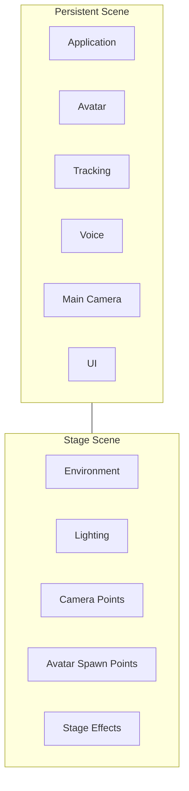

# 11. Stage Management

## 11.1 Basic Policy

The stage management function manages the 3D backgrounds, lighting, camera placement information, avatar placement positions, etc. used for VTuber streaming.

This system separates the system itself, such as avatars, tracking, audio processing, and UI, from the stage environment used for streaming.

Stages are managed as Unity scenes and loaded / unloaded additively as needed.

### Rationale

Placing the stage in the same scene as avatars, tracking, etc. may cause the system itself to be recreated when the stage changes.

Therefore,

**the VTuber system itself**

and

**the stage used for streaming**

are separated per scene.

This allows only the stage to be changed while keeping avatar and tracking states.

---

## 11.2 Scene Structure

Unity scenes are broadly classified into the following two types.

### Persistent Scene

A scene that, as a rule, stays loaded while the application is running.

The system itself is placed here, for example:

- application management
- Avatar Manager
- tracking
- voice runtime
- camera
- UI
- streaming
- audio management

### Stage Scene

A scene used as the stage for streaming.

Stage-specific elements are placed here, for example:

- background objects
- buildings
- furniture
- small props
- lighting
- environment
- camera points
- avatar spawn points
- stage-specific effects



### Rationale

Clearly dividing the roles of scenes makes it easier to handle

- stage changes
- avatar changes
- tracking reinitialization
- UI state
- audio state

and so on independently of each other.

---

## 11.3 Stage Scene Loading

Stage scenes are added to the persistent scene by additive load.

When switching stages, the following processing is performed as a rule:

1. load the new stage scene
2. obtain stage information
3. initialize camera points, etc.
4. check avatar spawn points
5. start displaying the new stage
6. unload the old stage scene

As needed, the new stage is loaded before the old stage is destroyed to minimize blank time during switching.

### Rationale

If normal scene switching destroys even the persistent scene, avatars, audio, etc. must be reinitialized.

Using additive load allows only the stage to be replaced while keeping the system itself.

---

## 11.4 Stage Definition

A stage scene has the information needed to treat that scene as a stage in this system.

Conceptually, the following information is managed.

```text
Stage
├─ StageId
├─ DisplayName
├─ Version
├─ Camera Points
├─ Avatar Spawn Points
├─ Environment Settings
└─ Stage-specific Settings
```

The stage management function does not directly search for arbitrary GameObjects inside the scene; it obtains stage information from an explicit entry point such as a stage root.

### Rationale

Searching the scene by name, etc. makes stage loading easily broken by

- GameObject name changes
- hierarchy changes
- added objects

Explicitly registering the information needed as a stage reduces dependence on the internal structure of the scene.

---

## 11.5 Camera Point Management

Camera points, which are candidate placements for the main camera, are placed in stage scenes.

A camera point can hold at least:

- ID
- display name
- position
- rotation
- field of view

Additional camera settings can be held as needed.

The main camera itself exists on the persistent scene side and is placed using the information of the selected camera point.

### Rationale

By giving the stage side only placement information instead of creating a camera per stage scene, the video output pipeline can always use the same main camera.

This allows camera switching and streaming processing to be separated.

---

## 11.6 Avatar Spawn Point Management

Avatar spawn points can be set in stage scenes as reference positions for placing avatars.

A spawn point holds at least:

- ID
- display name
- position
- rotation

Considering future multi-person support, multiple spawn points can be placed in one stage.

Example:

```text
Stage
├─ SpawnPoint_A
├─ SpawnPoint_B
└─ SpawnPoint_C
```

The initial implementation may use only one.

### Rationale

Writing avatar positions directly into code as fixed coordinates per stage would require program changes every time a stage is added.

Defining them on the stage side as spawn points allows stage creators to adjust placement in the Unity Editor.

Allowing multiple spawn points also prepares for future multi-avatar support.

---

## 11.7 Lighting and Environment Management

Lighting and environmental representation are, as a rule, managed on the stage scene side.

Examples:

- directional light
- point light
- spot light
- environment lighting
- skybox
- reflection probe
- fog
- post-processing-related settings

However, rendering settings that should be managed uniformly across the application are managed on the persistent side or in common rendering settings.

### Rationale

Lighting is an element that constitutes the appearance of the stage itself and differs per stage.

On the other hand, if each stage freely changes even render pipeline settings, rendering conditions change greatly on stage switching, and compatibility problems are likely.

Therefore,

**what should be changed as a stage effect**

and

**rendering settings that should be uniform across the system**

are separated.

---

## 11.8 Stage-specific Effects

Stage scenes can have stage-specific effects as needed.

Examples:

- turning on lights
- particles
- background animation
- object movement
- weather effects

However, stage-specific scripts avoid directly operating on the Avatar Runtime, Tracking Runtime, etc.

Required integration is done through published events and control interfaces.

### Rationale

A structure in which stage-specific scripts can freely access the system internals may cause the system itself to break when stages are added.

Restricting dependencies becomes especially important if user-created stages, etc. are handled in the future.

---

## 11.9 Stage Switching

Stages can be switched even during streaming.

During stage switching, the following are kept as far as possible:

- Avatar Runtime
- tracking
- voice runtime
- streaming
- main camera
- UI

Effects such as screen fades can be used as needed.

### Rationale

Tying stage switching to stopping streaming functions would require reinitializing audio and streaming just to change the background.

Treating the stage as an independent unit allows only the stage to be changed while streaming continues.

---

## 11.10 Stage Data Management

Stages added by users are registered in units that this system can manage.

Conceptually, the following information is managed.

```text
Stages/
└─ <StageId>/
    ├─ Stage Data
    ├─ stage-profile.json
    └─ thumbnail.png
```

The specific distribution and loading method, such as Unity scenes or AssetBundles, is decided in the detailed design.

### Rationale

Treating a stage merely as a Unity scene file makes it difficult to manage

- display name
- version
- thumbnail
- supported application version
- author information

and so on.

Therefore, stages are treated as managed objects in this system.

---

## 11.11 Separating Setup and Runtime

### Setup

Mainly handles:

- stage registration
- camera point settings
- spawn point settings
- checking lighting
- stage settings
- thumbnail settings
- operation checks

### Runtime

Mainly performs:

- loading stage scenes
- obtaining camera points
- obtaining spawn points
- stage switching
- executing stage-specific effects
- releasing stage scenes

### Rationale

Separating stage editing from stage use during streaming allows registered stages to be used at runtime simply by selecting them.

---

## 11.12 Error Handling and Diagnostics

Normal users are shown easy-to-understand information such as:

- The stage cannot be loaded
- The stage data is corrupted
- No camera point is set
- The stage is not supported

Developer logs record the following as needed:

- StageId
- stage version
- scene
- load time
- number of camera points
- number of spawn points
- missing objects
- exception
- stack trace

### Rationale

If adding and creating stages is opened to outside parties in the future, problems due to environment dependence or incomplete data become more likely.

Separating user-facing messages from developer diagnostic information achieves both clarity in normal use and investigability in OSS development.

---

## 11.13 Internal Division of Responsibilities

Conceptually, the following structure is assumed.

```text
Stage/
├─ Core/
│  ├─ StageProfile
│  └─ StageState
│
├─ Loading/
│  └─ StageLoader
│
├─ Camera/
│  └─ CameraPoint
│
├─ Avatar/
│  └─ AvatarSpawnPoint
│
├─ Runtime/
│  └─ StageManager
│
└─ Setup/
   └─ StageSetupController
```

### Rationale

Separating stage loading, camera settings, avatar placement, etc. by responsibility instead of consolidating them into a single class limits the scope of changes when adding stage functions.

---


## 11.14 Capture Screen Surface

Screen surfaces for displaying capture textures obtained from GameCapture, SubScreenCapture, etc. can be placed in stage scenes.

A screen surface is a stage-specific display element and does not perform capture processing itself.

Conceptually:

```text
Capture Module
    ↓
Capture Texture
    ↓
Stage Screen Surface
    ↓
Main Camera
```

A screen surface can specify the `CaptureSourceId`, etc. to display as needed.

This allows each stage to change its configuration, for example to

- display the game screen as the full background
- display it on a large monitor
- display the sub-screen on a small screen

### Rationale

Giving the capture side knowledge of positions on the stage or material configuration tightly couples video input and stage representation.

The separation of responsibilities, with the Capture module handling video acquisition and the Stage module handling video placement, is maintained.
