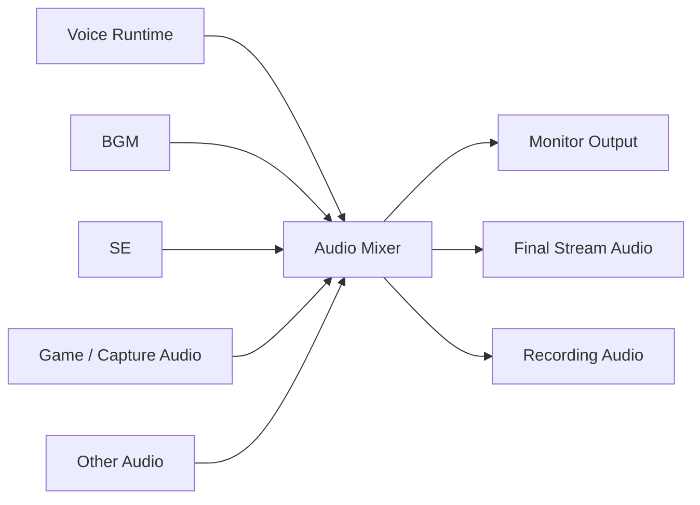

# 12. BGM, SE, and Audio Management

## 12.1 Basic Policy

The BGM, SE, and audio management function manages BGM, SE, and other audio materials used during streaming, and plays, stops, adjusts volume, and mixes them into the streaming audio as needed.

Playback of audio materials is managed as a function independent of voice conversion such as RVC.

Ultimately,

- converted microphone audio
- BGM
- SE
- game / capture audio
- other audio sources

are mixed into the streaming audio.

---

## 12.2 Audio Structure

Conceptually, the audio mixer is structured as follows.



### Rationale

Sending voice, BGM, and SE each directly to the streaming output makes it impossible to manage volume balance and mute states centrally.

Providing a final audio mixer manages each audio source uniformly.

---

## 12.3 Audio Buses

Audio sources are classified into audio buses by purpose.

The initial configuration assumes, for example:

```text
Master
├─ Voice
├─ Game / Capture
├─ BGM
├─ SE
└─ System
```

For each bus, the following can be managed individually:

- volume
- mute
- audio effects as needed

### Rationale

Managing volume settings per individual AudioSource makes adjusting the overall audio balance of the stream difficult.

Providing buses by purpose makes it easy to

"lower only the BGM a little"

"mute only the SE"

and so on.

---

## 12.4 BGM Management

Users can register BGM files to use in this system.

At least the following are managed for BGM:

- ID
- display name
- audio file
- volume
- loop setting

The following may be added in the future as needed:

- playlist
- shuffle
- fade in
- fade out
- repeat

### Rationale

A structure that plays audio files by specifying their paths directly may break settings when files are moved, etc.

Therefore, they are registered and managed as audio materials within the application.

---

## 12.5 SE Management

SE are also registered in this system and can be played immediately during streaming.

SE are assumed to be playable from, for example:

- UI buttons
- keyboard shortcuts
- future external devices
- future event integrations

Simultaneous playback of multiple SE is allowed.

### Rationale

Unlike BGM, it is important that SE play with low latency in response to operations during streaming.

The structure is not limited to exactly the same control approach as BGM playback and allows short audio to be played immediately.

---

## 12.6 Audio Material Storage

Registered BGM and SE are, as a rule, copied into the system-managed area rather than only referencing the original files.

Conceptual example:

```text
Data/
└─ Audio/
    ├─ BGM/
    │  └─ <AudioId>/
    │      ├─ audio.*
    │      └─ audio-profile.json
    │
    └─ SE/
       └─ <AudioId>/
           ├─ audio.*
           └─ audio-profile.json
```

### Rationale

As with avatar models, this prevents streaming settings from breaking due to moving or deleting the original files.

It also makes backing up and migrating projects easier.

---

## 12.7 Separating Monitor Audio from Streaming Audio

For each audio bus, as needed,

- monitoring for the user
- output to the streaming audio

can be controlled separately.

For example, a configuration such as

```text
BGM
├─ Monitor : OFF
└─ Stream  : ON
```

is possible.

### Rationale

The user does not necessarily need to hear all sounds at all times.

For example, the user may want to stream the BGM but not hear it in their own headphones.

Therefore, audio sources are not tied directly to physical output destinations but are controlled by routing.

---

## 12.8 Generating Streaming Audio

The final streaming audio mixed by the audio mixer is passed to the camera / video output function in Chapter 10.

```text
Voice
BGM
SE
 ↓
Audio Mixer
 ↓
Final Stream Audio
 ↓
Streaming Module
```

The streaming module side is not aware of voice, BGM, and SE individually and receives only the completed `Final Stream Audio`.

### Rationale

If the streaming module were aware of the composition of each audio source, adding BGM or SE would require changing the streaming side as well.

Therefore, responsibility for the audio composition is consolidated on the audio side.

---

## 12.9 Volume Management

Volume is managed at least at the following levels:

- master volume
- voice volume
- BGM volume
- SE volume
- monitor volume

Gain per individual source can also be set as needed.

### Rationale

The master volume alone cannot balance voice and BGM.

On the other hand, providing only overly fine-grained settings complicates operation.

Therefore, buses by purpose are the basic unit, and individual settings can be made only when needed.

---

## 12.10 Audio Effects

The structure allows audio effects to be applied to BGM, SE, voice, etc. as needed.

Examples:

- gain
- EQ
- compressor
- limiter

However, these are separated from voice conversion processing such as RVC inference.

### Rationale

Volume and tone adjustments on the audio mixer and voice conversion itself have different purposes.

Separating them allows the overall audio mixing processing of the stream to be maintained even when the voice conversion approach changes.

---

## 12.11 Operation During Streaming

At least the following can be operated during streaming:

- BGM playback
- BGM stop
- BGM change
- SE playback
- bus volume changes
- mute / unmute

The structure does not reinitialize the audio pipeline itself because of these operations.

### Rationale

BGM and SE are functions operated frequently during streaming, so a structure in which playback operations stop the voice runtime or streaming audio is avoided.

---

## 12.12 Preventing Audio Clipping

Even when multiple audio sources are mixed simultaneously, the structure makes extreme clipping in the final output unlikely.

A limiter, etc. can be applied to the master bus as needed.

### Rationale

If voice, BGM, and SE play loudly at the same time, the mixed signal may exceed the allowable range and distort.

The structure provides protective processing at the final output stage.

---

## 12.13 Separating Setup and Runtime

### Setup

Mainly handles:

- BGM registration
- SE registration
- volume settings
- loop settings
- audio routing
- audio effect settings
- test playback

### Runtime

Mainly performs:

- BGM playback
- SE playback
- mixer processing
- volume changes
- mute
- monitor output
- generating the final stream audio

### Rationale

This separates audio material registration and routing settings from normal operations during streaming so that the live UI is not complicated.

---

## 12.14 Error Handling and Diagnostics

Normal users are shown easy-to-understand errors such as:

- The audio file cannot be loaded
- The BGM cannot be played
- The output device cannot be used

Developer logs record the following as needed:

- AudioId
- audio format
- sample rate
- channels
- playback state
- output device
- audio bus
- buffer state
- exception
- stack trace

### Rationale

Audio failures may be caused by multiple factors such as file formats, audio devices, and routing.

Normal users are shown actionable information, and internal information needed to investigate causes is recorded for developers.

---

## 12.15 Internal Division of Responsibilities

Conceptually, the following structure is assumed.

```text
Audio/
├─ Core/
│  ├─ AudioProfile
│  └─ AudioState
│
├─ BGM/
│  └─ BgmPlayer
│
├─ SE/
│  └─ SePlayer
│
├─ Mixer/
│  ├─ AudioBus
│  └─ AudioMixerController
│
├─ Routing/
│  └─ AudioRouter
│
├─ Runtime/
│  └─ AudioRuntime
│
└─ Setup/
   └─ AudioSetupController
```

### Rationale

Separating BGM playback, SE playback, mixing, routing, etc. by responsibility limits the impact of adding audio functions in the future.

The class names and directory structure shown in this chapter illustrate the approach to dividing responsibilities, and details are adjusted during implementation.

---

## 12.16 Game / Capture Audio

Game audio provided by GameCapture is not sent directly from the capture plugin to streaming but is input to the Audio module.

Conceptually:

```text
Capture Board
     ↓
GameCapture Source
     ↓
Game / Capture Audio Bus
     ↓
Audio Mixer
     ├─ Monitor Output
     ├─ Final Stream Audio
     └─ Recording Audio
```

For game / capture audio, at least the following can be controlled:

- volume
- mute
- monitor routing
- stream routing
- recording routing
- effects as needed

SubScreenCapture targets video only in the initial implementation, and a function that automatically obtains desktop audio is not required.

### Rationale

Sending game audio directly from the video capture function to the stream makes it impossible to centrally manage volume balance and routing with voice, BGM, and SE.

Integrating it into the audio mixer allows game audio to be managed in the same way as other audio sources.
