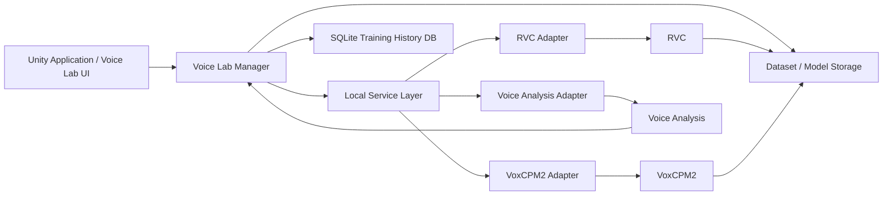

# 13. Voice Model Training and Voice Lab

## 13.1 Basic Policy

The voice model training and Voice Lab function creates, evaluates, and adjusts the voice conversion models used in VTuber streaming, and registers them as runtime models.

This function is separated from real-time voice conversion during streaming and is mainly provided for setup use.

Processing that requires a Python environment, such as RVC training, voice generation with VoxCPM2, and voice analysis, is not built directly into the Unity application but is started as a local service or external process as needed.

The structure does not require these Python services during streaming.

Also, for external OSS such as RVC and VoxCPM2, the basic policy is **not to add system-specific code to the external OSS itself as far as possible**.

Training history is managed in this system's SQLite database, without using external experiment management systems such as MLflow.

### Rationale

The voice model training environment has many external dependencies, such as

- Python
- PyTorch
- CUDA
- RVC
- VoxCPM2
- various audio processing libraries

Building these directly into the Unity application makes changes to the training environment likely to affect the streaming runtime.

Also, adding things such as

- saving training history
- database access
- UI integration
- custom APIs
- model management processing

directly inside external OSS such as RVC requires resolving differences with the custom changes when the upstream OSS is updated.

Therefore, the basis is

**separating the streaming runtime from the training environment**

and

**using external OSS from the outside rather than changing it**

---

## 13.2 Overall Structure

The voice model training and Voice Lab function is conceptually structured as follows.



The Unity side does not directly operate on the internal implementation of RVC, VoxCPM2, etc.; it uses them through adapters or local services.

### Rationale

If the Unity side depends directly on the CLI, Python API, internal directory structure, etc. of external OSS, the impact of external OSS updates spreads to the Unity side.

Providing an adapter layer absorbs

- command-line argument changes
- Python API changes
- output location changes
- file name changes
- version differences

and so on in a limited place.

---

## 13.3 Policy of Not Modifying External OSS

External OSS such as RVC and VoxCPM2 is, as a rule, used without modifying its source code.

System-specific processing is placed as external components such as:

- wrappers
- adapters
- launchers
- API servers
- post-processing
- management processing before and after training
- file monitoring
- result collection

If external OSS must be modified unavoidably, the changes are kept to a minimum, and the reason for the change and the difference from upstream are made explicit.

### Rationale

Directly modifying external OSS may be easy to implement at the time, but it raises the cost of following future upstream updates.

RVC in particular has many closely related functions, such as

- preprocessing
- training
- F0 processing
- index generation
- inference
- WebUI

Adding custom processing inside it means that structural changes in RVC require modifying system-specific code as well.

Therefore, a clear boundary is kept between external OSS and project-owned code.

---

## 13.4 Obtaining External OSS and Runtime Packages

For external components that use Python, such as RVC and VoxCPM2, normal users are not required to perform manual setup such as Git operations, installing Python, creating a venv, or running pip.

During development, the source of external OSS is obtained and verified using a pinned version / commit and dependency definition / lock.

For normal users, the basis is to distribute a **component runtime package** generated by the build pipeline from that source and dependency environment.

Depending on the characteristics of the component, the component runtime package includes

- the Python runtime for execution
- Python dependencies
- this system's service / adapter implementation
- external OSS code required for execution
- launcher / executable
- runtime package manifest

and so on.

Large data such as model weights, datasets, and training artifacts can be managed separately from the runtime package itself and obtained / registered separately as needed.

The installation flow for normal users is conceptually as follows.

```text
First launch of Voice Lab
        ↓
Check required components
        ↓
Check component manifest
        ↓
Detect missing runtime packages
        ↓
Obtain runtime packages
        ↓
Verify package hash / integrity
        ↓
Extract into the application-managed area
        ↓
Check capability / environment
        ↓
Confirm service startup
        ↓
Health check
        ↓
Voice Lab available
```

Having normal users manually run

```text
git clone ...
python -m venv ...
pip install ...
```

and so on is not part of the normal usage procedure.

### Rationale

The purpose of this system is to provide an integrated VTuber environment (Virtual Vessel Studio), and requiring general users to have knowledge of Git or Python environment setup is undesirable.

Also, building dependencies from source in each user environment tends to cause differences in

- Python version
- PyTorch version
- CUDA-related libraries
- package resolution
- external OSS version

and so on, reducing the reproducibility of defects.

Making verified runtime packages the unit of distribution reduces the setup burden on normal users while limiting differences from the environment verified during development and testing.

---

## 13.5 External OSS Version Management

External OSS is not obtained by unconditionally fetching the latest code on GitHub.

The

- release
- tag
- commit

and so on that this system has verified are explicitly specified when obtaining it.

Support information for external components is managed in a manifest, etc.

Conceptual example:

```text
External Components Manifest

RVC
  SourceVersion: <supported version>
  Commit: <commit>
  AdapterVersion: <version>
  RuntimePackageVersion: <version>
  PythonRuntimeVersion: <version>
  DependencyLockVersion: <version>
  BuildId: <build id>
  PackageHash: <hash>

VoxCPM2
  SourceVersion: <supported version>
  Commit: <commit>
  AdapterVersion: <version>
  RuntimePackageVersion: <version>
  PythonRuntimeVersion: <version>
  DependencyLockVersion: <version>
  BuildId: <build id>
  PackageHash: <hash>

VoiceAnalysis
  SourceVersion: <version>
  RuntimePackageVersion: <version>
  BuildId: <build id>
  PackageHash: <hash>
```

As needed, the contents of obtained files can be verified using hashes, etc.

### Rationale

The latest version of external OSS is not always compatible with this system.

Automatically updating to the latest version in user environments may suddenly break Voice Lab due to changes on the external OSS side.

Therefore,

**the latest upstream OSS version**

and

**the version this system has verified**

are distinguished.

---

## 13.6 Python Development and Distribution Environments

For external components that use Python, the **developer execution environment** and the **distribution environment for normal users** are separated.

### Developer Environment

Developers can run and test each component directly from source using native Python + `venv`.

As a rule, environments are separated per external component and per version.

Conceptually, the structure is as follows.

```text
Development/
├─ RVC/
│  └─ <Version>/
│     ├─ source/
│     └─ .venv/
│
├─ VoxCPM2/
│  └─ <Version>/
│     ├─ source/
│     └─ .venv/
│
└─ VoiceAnalysis/
   └─ <Version>/
      ├─ source/
      └─ .venv/
```

Dependencies are managed by explicit definitions such as `pyproject.toml`, requirements files, and lock files, and do not depend on an unpinned global environment.

Developers can use the venv to run

- debugging
- unit tests
- integration tests
- compatibility tests
- builds
- benchmarks

Docker is not required as the standard development approach.

### Environment for Normal Users

Normal users are not required to have Python itself or a venv.

A portable runtime package or standalone executable generated by the build pipeline is placed in the application-managed area, and the Unity application explicitly starts its launcher / executable.

Conceptually, the following structure is assumed.

```text
External/
├─ RVC/
│  └─ <RuntimePackageVersion>/
│     ├─ runtime/
│     ├─ component/
│     └─ manifest.json
│
├─ VoxCPM2/
│  └─ <RuntimePackageVersion>/
│     ├─ runtime/
│     ├─ component/
│     └─ manifest.json
│
└─ VoiceAnalysis/
   └─ <RuntimePackageVersion>/
      ├─ runtime/
      ├─ component/
      └─ manifest.json
```

Depending on the component's approach, `runtime/` contains

- an embedded Python runtime
- required Python packages
- native libraries
- other runtime dependencies

and so on.

The structure does not have normal users activate a venv or run `pip install`.

### Correspondence Between Development and Distribution Environments

The development venv and the distribution runtime package are separate things, but they are generated based on, as far as possible, the same

- source version / commit
- Python version
- dependency definition / lock
- adapter / service code
- tests

This maintains the relationship

```text
Source + Dependency Lock
          ↓
   Developer venv
          ↓
      Test / Build
          ↓
 Runtime Package
          ↓
      End User
```

### Rationale

RVC, VoxCPM2, and voice analysis may each require different versions of Python, PyTorch, CUDA-related libraries, NumPy, audio libraries, etc.

Providing developers with an environment verifiable from source while not requiring normal users to set up environments achieves

- ease of debugging during development
- ease of installation for normal users
- dependency reproducibility
- per-component update / rollback

at the same time.

---

## 13.7 Python Component Build and Distribution

Python components have a build pipeline that can generate runtime packages for normal users from development source.

The conceptual build flow is as follows.

```text
Source
  +
External OSS Version / Commit
  +
Dependency Definition / Lock
        ↓
Developer venv
        ↓
Build / Unit Test / Integration Test
        ↓
Generate runtime package
        ↓
Package startup test
        ↓
Health Check / Compatibility Test
        ↓
Generate hash
        ↓
Update manifest
        ↓
Release Artifact
```

### Lightweight Components

For services / tools with relatively simple dependencies, a standalone bundle using PyInstaller, etc. can be adopted.

Approaches with an extracted directory are basically preferred, and making a single executable is not required.

### Heavyweight Components

For VoxCPM2, RVC training, etc., which include PyTorch, CUDA-related libraries, many dynamic imports, etc., a portable runtime approach that bundles the Python runtime and dependencies per component can be adopted.

Packing Python entirely into a single executable is not an architectural requirement.

### Choosing Build Tools

The specific build tool is decided in the detailed design, considering the characteristics of each component.

Candidate examples:

- PyInstaller
- a portable runtime using the CPython embedded distribution
- other standalone / portable packaging approaches

What the system design fixes is not a specific tool but that

1. normal users are not required to install Python
2. versions can be identified per build artifact
3. the correspondence with source / dependencies can be traced
4. updates / rollbacks are possible per component
5. the runtime version can be checked from diagnostics

### Separation from Models / Datasets

Model weights, datasets, training artifacts, etc. are managed separately from the runtime package.

A structure that redistributes large models or datasets every time the runtime package is updated is avoided.

### Rationale

Lightweight services and heavyweight components including PyTorch / CUDA suit different packaging approaches.

Rather than forcing everything into the same format, the execution approach and version management approach seen by users are unified, while leaving appropriate choices for packaging inside each component.

---

## 13.8 Updating External Components

When updating an installed external component, the basis is not to overwrite the existing runtime package directly.

For example, the new version is extracted into a separate directory, as in

```text
RVC/
├─ RuntimePackageA/
│  ├─ runtime/
│  ├─ component/
│  └─ manifest.json
│
└─ RuntimePackageB/
   ├─ runtime/
   ├─ component/
   └─ manifest.json
```

When updating, conceptually the following is performed:

1. obtain new runtime package information
2. download the package
3. verify hash / integrity
4. extract into the directory for the new version
5. check capability / environment
6. confirm service startup
7. perform a health check
8. check adapter / API compatibility
9. switch the version in use

If problems occur, the structure allows reverting to the old runtime package.

Updating the developer source / venv is treated as development work separate from updating the runtime package for normal users.

### Rationale

Applying updates directly to the existing environment may make even the previously working Voice Lab unusable if the update fails.

Separating runtime packages per version makes

- isolating update failures
- rollback
- A/B comparison
- compatibility testing

easier.

---

## 13.9 RVC Training

RVC training runs in a Python environment.

The Unity application does not implement the RVC training algorithm itself; it starts the RVC training environment as a local service or external process and sends training requests.

Conceptually, the flow is as follows.

```text
Voice Lab UI
    ↓
Training Request
    ↓
RVC Adapter
    ↓
RVC Training Process
    ↓
Training Artifacts
    ↓
Result Collection
    ↓
Training History DB
```

The RVC adapter is responsible for the boundary between this system and RVC's CLI, training scripts, output file structure, etc.

### Rationale

Porting the RVC training logic to the Unity side would require tracking implementation differences whenever RVC is updated.

Using RVC as-is as far as possible and starting it through an adapter makes following upstream updates easier.

---

## 13.10 On-demand Startup of Training Processing

Python services such as the RVC training service, VoxCPM2, and voice analysis are not kept running at all times and are started only when the relevant function is used.

They can be stopped after processing completes as needed.

### Rationale

These environments may use many resources, such as

- Python processes
- GPU memory
- PyTorch
- CUDA
- temporary files

They are not needed during streaming, so there is little benefit in keeping them running at all times.

This also isolates Python environment failures from the runtime.

---

## 13.11 Dataset Management

Audio datasets used for RVC training are managed on the system side.

Conceptually, the following information is held.

```text
Dataset
├─ DatasetId
├─ Name
├─ CreatedAt
├─ Source
├─ Audio Files
├─ Preprocess Settings
└─ Metadata
```

Datasets are a management unit separate from training runs, and the same dataset can be reused in multiple trainings.

### Rationale

Combining datasets and training results would duplicate audio data every time different training conditions are compared with the same dataset.

Managing datasets independently makes

- comparing conditions with the same dataset
- retraining
- updating datasets
- checking dataset quality

easier.

---

## 13.12 Training History Database

**SQLite is adopted** for training history management.

One training is managed as one `Training Run`.

SQLite stores at least:

- RunId
- execution date and time
- DatasetId
- RVC version used
- adapter version used
- training settings
- number of epochs
- batch size
- sample rate
- F0 method
- execution environment such as the GPU used
- Python version
- PyTorch version
- CUDA version
- training start time
- training end time
- training state
- reference to the output model
- reference to the index file
- reference to log files
- evaluation results
- error information
- user comments

As a rule, the Python side does not operate on SQLite directly.

The system side receives training results and saves them to SQLite through a repository, etc.

### Rationale

As models increase, it easily becomes unclear

**which dataset, settings, and external OSS version a model was made with**

On the other hand, adding logging processing inside RVC to use MLflow, etc. increases custom changes to external OSS and makes following updates difficult.

SQLite has the advantages that

- no database server is needed
- it is self-contained in a local application
- it is easy to introduce
- it is easy to back up
- it is easy to handle from C#

Therefore, sufficient training history management is implemented on the system side.

---

## 13.13 Separating the Training History Database from Artifacts

Large files such as models, datasets, and logs themselves are not stored in SQLite.

SQLite stores

- metadata
- state
- settings
- references to artifacts

The actual files are managed on the file system.

Conceptual example:

```text
VoiceLab/
├─ voice-lab.db
│
├─ Datasets/
│
├─ TrainingRuns/
│
└─ Models/
```

### Rationale

Storing large data such as models and datasets in SQLite leads to

- increased database size
- increased backup load
- greater impact when the database is corrupted
- more complex file operations

Therefore, SQLite is limited to management information.

---

## 13.14 Training Run Directories

A dedicated management directory is created for each training run.

Conceptual example:

```text
TrainingRuns/
└─ <RunId>/
    ├─ run.json
    ├─ logs/
    ├─ checkpoints/
    ├─ output/
    │  ├─ model.pth
    │  └─ model.index
    └─ diagnostics/
```

If this differs from RVC's own output directory, the required artifacts are collected or copied into the system-managed area after training ends.

### Rationale

RVC's internal directory structure may change in the future.

Rather than adopting the internal structure of external OSS as-is as the persistent management format, it is organized into a stable management format on the system side.

---

## 13.15 Training State Management

Training runs have training states common to this system.

Example:

```text
Pending
Preparing
Preprocessing
Training
PostProcessing
Completed
Failed
Cancelled
```

The Unity UI does not use RVC's internal log strings as-is for state display but converts them into the common training state.

### Rationale

Log formats and progress representation differ for each external OSS.

Making the UI depend on raw logs of external OSS would require modifying the UI when versions change.

Therefore, external states are converted into states common to this system.

---

## 13.16 Obtaining Training Logs

The standard output and standard error of the RVC training process are obtained and saved as logs per training run.

The UI for normal users shows concise information such as

- preprocessing
- training
- generating the model
- completed
- failed

Developer diagnostics allow detailed Python and RVC logs to be checked.

### Rationale

Detailed Python logs are needed to investigate the causes of RVC training failures.

On the other hand, showing all logs to normal users complicates the UI and makes necessary information hard to see.

Therefore, user-facing state display and raw developer logs are separated.

---

## 13.17 Evaluating Training Results

After a training run completes, model evaluation can be run as needed.

Evaluation processing is not embedded in the RVC training itself but runs as independent processing after training completes.

Evaluation results are associated with the training run and saved in SQLite.

In the future, the following evaluation targets may be used:

- reference similarity
- pitch characteristics
- silence ratio
- amount of noise
- audio quality metrics
- comparison with test prompts
- subjective evaluation by the user

### Rationale

Building evaluation logic into the RVC training itself makes following RVC updates difficult.

Separating training and evaluation allows

- changing evaluation algorithms
- adding metrics
- re-evaluating past models

to be done without touching RVC itself.

---

## 13.18 VoxCPM2 Integration

VoxCPM2 is used in Voice Lab for purposes such as generating reference audio and voice cloning.

VoxCPM2 is started as a local Python service and used from Unity via an API.

The Unity side does not depend directly on VoxCPM2's internal Python implementation.

### Rationale

VoxCPM2 is also external OSS, and its models and implementation approach may change in the future.

Providing an adapter / service boundary localizes the impact of external changes.

---

## 13.19 Voice Analysis

Voice analysis processing is also treated as an independent local service.

Examples:

- audio length
- silence ratio
- pitch
- volume
- reference similarity
- other quality evaluations

Analysis results are used for

- checking dataset quality
- the Voice Lab UI
- evaluating training runs
- comparing generated audio

and so on.

### Rationale

Separating analysis logic from RVC training logic keeps changes in evaluation methods from affecting training code.

The same analysis function can also be reused for pre-training datasets and past model outputs.

---

## 13.20 Voice Lab

Voice Lab is provided as a setup function that integrates the work required to create voice models.

Examples:

- preparing audio datasets
- generating reference audio
- comparing voice candidates
- checking dataset quality
- RVC training
- checking training runs
- model evaluation
- listening to models
- registering models for runtime

Voice Lab is separated from the live UI used during streaming.

### Rationale

Creating voice models requires many settings and much trial and error.

Including these in the live UI would complicate operation during normal streaming, so it is provided as an independent work area.

---

## 13.21 Registering Models for Runtime

As a rule, an RVC model that has finished training is not used directly from the runtime.

It is explicitly **registered as a runtime model** from Voice Lab.

At registration, the following are performed as needed:

- model validation
- checking required files
- checking the index
- conversion to the runtime format
- model conversion for Unity Inference Engine (formerly Unity Sentis)
- metadata generation
- settings such as recommended pitch
- copying into the runtime-managed area

Conceptually, the flow is as follows.

```text
Training Run
     ↓
Model Evaluation
     ↓
Register for Runtime
     ↓
Runtime Model Conversion
     ↓
Voice Model Library
     ↓
Voice Runtime
```

### Rationale

Directly connecting models in the training environment to the streaming runtime may break the runtime due to updates, folder changes, deletion, etc. in the RVC training environment.

Managing runtime models independently separates the lifecycles of the training environment and the streaming environment.

---

## 13.22 Training Cancellation and Abnormal Termination

Users can cancel a running training run.

Even when cancelled or terminated abnormally, the run information is not deleted but kept in SQLite with states such as

- Cancelled
- Failed

Logs and artifacts generated midway can also be kept as needed.

### Rationale

Failed trainings are also important history for checking

- with which settings it failed
- how far processing progressed
- whether the same failure is being repeated

Saving only successful runs loses the history of trial and error.

---

## 13.23 Separating Setup and Runtime

### Setup / Voice Lab

Handles:

- external OSS setup
- Python environment setup
- dataset management
- RVC training
- VoxCPM2
- voice analysis
- training run management
- model comparison
- model evaluation
- runtime model registration

### Runtime

The runtime does not use the Python services for Voice Lab.

Real-time voice conversion is performed using only registered voice models.

### Rationale

The training environment has many dependencies and many failure factors.

Separating it from the streaming runtime allows streaming with already registered models even if the Python training environment is broken.

---

## 13.24 Error Handling and Diagnostics

Normal users are shown information such as:

- Required components could not be obtained
- Required Voice Lab components could not be prepared
- There is a problem with the dataset
- Training could not be started
- Training failed
- Registration as a runtime model failed

Developer diagnostics allow the following to be checked as needed:

- RunId
- external OSS name
- external OSS version / commit
- adapter version
- execution mode (portable runtime / developer venv)
- runtime package version / build ID
- Python version
- runtime package path / venv path
- PyTorch version
- CUDA version
- package versions
- executed command
- process ID
- exit code
- stdout
- stderr
- training time
- output artifacts
- health check results
- exception
- stack trace

### Rationale

In the Python training environment, failures occur due to many factors such as external OSS, Python, GPUs, and dependency libraries.

General users are presented with information needed for recovery, and OSS developers are given information needed to trace causes.

---

## 13.25 Internal Division of Responsibilities

Conceptually, the following structure is assumed.

```text
VoiceLab/
├─ Core/
│  ├─ TrainingRun
│  ├─ TrainingState
│  └─ DatasetProfile
│
├─ External/
│  ├─ ExternalComponentManager
│  ├─ ExternalComponentManifest
│  └─ PythonEnvironmentManager
│
├─ Dataset/
│  └─ DatasetManager
│
├─ Training/
│  ├─ TrainingManager
│  └─ RvcAdapter
│
├─ Generation/
│  └─ VoxCpmAdapter
│
├─ Analysis/
│  └─ VoiceAnalysisAdapter
│
├─ Evaluation/
│  └─ VoiceModelEvaluator
│
├─ History/
│  ├─ TrainingHistoryRepository
│  └─ SQLiteTrainingHistoryDatabase
│
├─ ModelRegistration/
│  └─ RuntimeModelRegistrar
│
├─ Services/
│  └─ VoiceLabServiceManager
│
└─ Setup/
   └─ VoiceLabSetupController
```

### Rationale

Separating external OSS management, Python environment management, datasets, training, analysis, evaluation, history management, and runtime registration prevents changes in a specific external OSS from spreading to the entire system.

In particular, separating external OSS such as RVC from training history management with SQLite allows past training run information to continue to be managed even when the external OSS is updated.

---

## 13.26 Basic Principles of External OSS Management

This system adopts the following basic principles for external OSS and Python components.

1. Do not modify external OSS itself as far as possible.
2. Place system-specific processing outside as adapters / wrappers.
3. Do not require general users to perform Git operations.
4. Do not require general users to install Python, create / activate a venv, or run pip.
5. Use the version / commit of external OSS that this system has verified.
6. For developers, provide an environment verifiable with native Python + venv per external component and per version.
7. For normal users, provide built runtime packages or standalone executables.
8. Base the development venv and the distribution runtime package on the same source version, Python version, and dependency definition / lock as far as possible.
9. Manage runtime packages per component and per version.
10. Do not overwrite existing runtime packages directly when updating external components.
11. Allow reverting to the old runtime package if an update fails.
12. Separate large data such as model weights, datasets, and training artifacts from runtime packages.
13. Do not expose internal structures such as Python, venv, ports, and processes to the user UI more than necessary.
14. Allow developers to sufficiently check external OSS, runtime packages, Python, dependencies, processes, logs, etc.
15. Manage training history in SQLite rather than on the external OSS side.
16. Do not store large artifacts in the database; manage them on the file system.
17. Clearly separate the training environment from the streaming runtime.
18. Docker is not a required dependency of the standard development and distribution approach.
