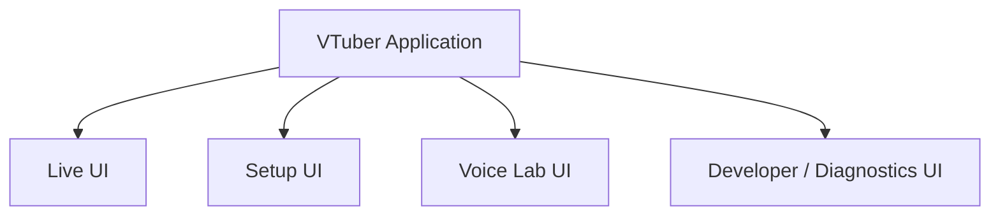

# 14. UI and Operation

## 14.1 Basic Policy

The UI of this system is broadly divided into the following areas according to purpose:

- Live UI
- Setup UI
- Voice Lab UI
- Developer / Diagnostics UI

Operations used during normal streaming are not mixed on the same screen with advance configuration, voice model creation, and development / diagnostic operations.

Conceptually, the structure is as follows.



### Rationale

This system has many functions, such as

- avatar
- tracking
- voice conversion
- streaming
- stage
- audio
- Voice Lab
- developer diagnostics

Showing everything on one screen would display settings unnecessary during normal streaming and complicate operation.

Therefore, screens are separated by purpose so that users can focus on the operations they need.

---

## 14.2 Basic UI Classification

### Live UI

Handles operations used frequently during streaming.

The main targets are:

- start / stop streaming
- start / stop recording
- avatar switching
- stage switching
- camera switching
- GameCapture / SubScreenCapture on / off
- checking capture source state
- voice model switching
- voice conversion on / off
- BGM / SE operation
- volume
- mute
- tracking state
- streaming state

### Setup UI

Handles pre-stream settings and registration / adjustment of each function.

The main targets are:

- project
- avatar
- tracking
- voice
- stage
- camera
- capture
- audio
- streaming
- external components
- application
- Data Root

### Voice Lab UI

Handles work related to voice model creation.

The main targets are:

- voice generation
- voice clone
- dataset
- voice analysis
- RVC training
- training runs
- model evaluation
- runtime model registration

### Developer / Diagnostics UI

Handles diagnostics and internal state checks for developers.

The main targets are:

- detailed logs
- diagnostic camera
- tracking overlay
- skeleton display
- face tracking values
- FPS
- frame time
- audio buffers
- RVC inference time
- streaming state
- Python service state
- external OSS information
- venv information

### Rationale

Dividing the UI not by type of function but by **the situation in which it is used** makes the operation system easier to understand.

---

## 14.3 UI Implementation

The normal runtime UI of this system, as a rule, uses **Unity UI Toolkit**.

The following UI responsibilities are separated.

```text
UXML
  └─ UI structure

USS / Theme Style Sheet
  └─ Appearance such as layout, colors, and fonts

C#
  └─ State management, commands, runtime integration
```

UI Builder can also be used to check screen structure and layout.

### Rationale

Separating screen structure, visual design, and runtime processing makes it easier to independently

- change only the appearance of the UI
- change the layout
- change the theme
- change runtime processing

It also makes it easier to use common styles across many settings screens.

---

## 14.4 Design System

The approach is not to create a unique design for each screen when implementing it.

An application-wide **design system** is defined.

The design system manages at least the following.

### Color

- Background
- Surface
- Primary
- Secondary
- Text
- Disabled
- Success
- Warning
- Error

### Typography

- Heading
- Body
- Caption
- Button
- Numeric
- Monospace

### Spacing

- XS
- S
- M
- L
- XL

### Shape

- Corner Radius
- Border
- Divider

### UI Component

- Primary Button
- Secondary Button
- Icon Button
- Toggle
- Slider
- Dropdown
- Text Field
- Numeric Field
- Tab
- Card
- Dialog
- Notification
- Status Indicator
- Progress Bar
- Navigation Item
- Setting Row

Conceptually:

```text
Design Tokens
      ↓
USS / Theme
      ↓
Common UI Components
      ↓
Application Screens
```

### Rationale

Creating designs per screen tends to cause

- button shapes not being unified
- margins differing per screen
- inconsistent font sizes
- the meaning of status colors changing

and so on.

Making the design system common keeps the design quality of the whole application consistent.

---

## 14.5 Common UI Components

Frequently used UI is implemented as reusable common components.

Conceptual example:

```text
UI/
└─ Components/
   ├─ PrimaryButton
   ├─ SecondaryButton
   ├─ SettingRow
   ├─ SectionHeader
   ├─ StatusBadge
   ├─ DeviceSelector
   ├─ ModelSelector
   ├─ ProgressPanel
   ├─ ErrorPanel
   └─ ConfirmDialog
```

Each screen is built by combining common components as far as possible.

### Rationale

Implementing buttons, setting rows, etc. from scratch on each screen causes differences not only in appearance but also in behavior.

Making them common components unifies visual design, usability, and maintainability.

---

## 14.6 UI Localization

The UI provides the following as initial languages:

- Japanese
- English

Localization uses a **lightweight project-owned mechanism** with one string table (JSON) per language. The Unity Localization package is not used, because it brings Addressables and extra build steps while this application only needs string lookup, placeholders, and switching the language while running (UI foundation detailed design 12.1).

The implementation does not assume only Japanese and English, and the structure allows new locales to be added in the future.

As a rule, UI strings are not written directly in C# or UXML; localization keys are used.

Conceptually:

```text
UI Element
    ↓
Localization Key
    ↓
String Table
    ├─ ja
    ├─ en
    └─ Future Locale
```

Example:

```text
ui.streaming.start

ja:
配信開始

en:
Start Streaming
```

The language can be switched while the application is running, and after switching, the UI is updated to the corresponding locale.

### Rationale

Writing display strings directly inside UI code requires program changes every time a language is added.

Separating them into localization tables separates adding translations from implementing functions.

---

## 14.7 Layout Considering Localization

UI layouts are not created based on Japanese alone.

The following are considered:

- longer strings in English
- languages added in the future
- UI scale
- font changes
- OS display scaling

Heavy use of fixed-width labels is avoided, and flexible layouts are used where practical.

### Rationale

Labels that are short in Japanese may become much longer in English.

To avoid redesigning screens every time a locale is added, changes in string length are considered from the initial stage.

---

## 14.8 Font Management

Fonts are not specified individually on UI elements.

They are managed in common using UI Toolkit font assets and USS / theme style sheets.

Conceptually:

```text
Theme
   ↓
Typography
   ├─ Heading
   ├─ Body
   ├─ Caption
   ├─ Button
   ├─ Numeric
   └─ Monospace
        ↓
     UI Elements
```

Each UI element uses a common typography style rather than a specific font name.

This allows the font of the entire application to be changed at once by changing the theme or typography settings.

Font assets or theme style sheets can also be switched per locale as needed.

### Rationale

Specifying fonts directly on each UI element requires modifying many UXML / USS files when changing fonts.

Consolidating them into a common theme allows

- font changes
- font size changes
- weight changes
- per-locale fonts
- theme changes

to be done at once.

---

## 14.9 Font Fallback

It is not assumed that the font used has every character glyph.

Fallback fonts are configured as needed.

Conceptual example:

```text
Primary Font
      ↓
Japanese Fallback
      ↓
Symbol / Other Language Fallback
```

### Rationale

This prevents missing characters even when the font lacks the required glyphs for future languages or symbol display.

---

## 14.10 Live UI

The live UI prioritizes being able to perform operations needed during streaming in few steps.

It focuses on frequently changed items rather than displaying many detailed settings.

The main targets are:

- streaming state
- recording state
- avatar
- stage
- camera
- voice
- BGM
- SE
- volume
- mute
- tracking state

### Rationale

During streaming, the user also pays attention to conversation, games, etc.

Therefore, the structure does not require complex operations like a settings screen and allows key operations to be performed immediately.

---

## 14.11 Separating the Live UI from the Setup UI

As a rule, detailed parameters are not changed directly from the live UI.

For example, the following are handled in the setup UI:

- tracking filter coefficients
- detailed encoder settings
- audio device settings
- external component settings

The live UI mainly handles:

- selection
- switching
- on / off
- volume
- mute

### Rationale

Changing detailed settings during streaming may lead to reinitialization of functions or unexpected stops.

Therefore, normal operations and detailed settings are separated.

---

## 14.12 Setup UI

The setup UI configures and verifies each function before streaming.

Conceptual example:

```text
Setup
├─ Project
├─ Avatar
├─ Tracking
├─ Voice
├─ Stage
├─ Camera
├─ Capture
├─ Audio
├─ Streaming
├─ External Components
└─ Application
```

Each setup screen provides test functions where practical.

Examples:

- avatar preview
- tracking preview
- microphone test
- voice conversion test
- camera preview
- capture preview
- audio test
- streaming connection test

### Rationale

Entering setting values alone may not tell whether a function actually works correctly.

Allowing each function to be checked before streaming reduces trouble during the actual stream.

---

## 14.13 Basic Voice Lab UI

Voice Lab does not display only the RVC training function on its own; it clearly shows **the whole flow up to creating the final runtime voice model**.

The main point is that users can create the voice they like. Rather than hitting the ideal with one description, users pick a voice close to it, move it a little at a time, try it with their own voice, and decide (the user's direction and review of the mock-up, 2026-11-03; Voice Lab detailed design 8.3).

The basic flow is as follows. The UI shows it as numbered steps, STEP 1 to STEP 5, and the buttons that move on name the step they lead to. Finished steps can be revisited.

```text
Voice Lab — Make a voice

[STEP 1 Pick a base]
      ↓
[STEP 2 Shape the timbre]
      ↓
[STEP 3 Make it]               training speech generated and edited, RVC training
      ↓
[STEP 4 Try it with your voice] back to STEP 2 if not right
      ↓
[STEP 5 Register]
```

Making a voice from the user's recordings (their own voice, or one they hold the rights to) imports the recordings in place of STEP 1 and STEP 2 and shares STEP 3 onward.

The workings, such as the dataset, seeds, and training runs, stay off the normal screens and are shown in Developer Mode (14.22).

### Rationale

Simply listing voice generation, voice clone, dataset, and RVC as independent functions makes it hard for users to understand what to do next.

This system treats everything up to creating the final runtime voice model as one piece of work.

In the experiment, instruction sliders alone did not reach the ideal voice (the seed changes the voice a lot under the same instruction), while editing the chosen voice's waveform changed it and kept it the same person, through training and conversion (decision record, 2026-11-03 "The voice-design experiment"). Generation, choice, and adjustment follow that, in the order the user decides.

---

## 14.14 Voice Lab — STEP 1 Pick a Base

It mainly handles:

- mood sliders (the main four; the rest folded under More detail)
- an instruction added in words (optional)
- several candidates generated with VoxCPM2 (about six at a time, Make more)
- making candidates near the picked one, to look around a voice that is close (Make candidates near this voice)
- listening to candidates
- each candidate's pitch (the median) and pitch range in Hz, drawn on a shared scale
- sorting by pitch
- choosing a candidate

Seeds and style_instruction are not shown on normal screens. The conditions of each candidate are kept internally so it can be made again.

### Rationale

Each candidate sounds different under the same instruction, so users compare several and pick. Numbers as well as ears make candidates easier to choose (the user's request, 2026-11-03).

---

## 14.15 Voice Lab — STEP 2 Shape the Timbre

It mainly handles:

- timbre knobs: pitch, age (resonance), brightness, breathiness
- comparing the original and the shaped voice (edited and played at once)
- the change in pitch, in Hz
- a warning for large moves (it may sound like someone else)
- reset

There are no intonation or pace knobs.

### Rationale

Timbre comes from the trained model, while intonation, pace, and articulation come from the speaker. Widening intonation mechanically sounded unnatural (the user's judgment, 2026-11-03). Adjustment must be quick to hear before training, so it is an edit that plays without waiting for training.

---

## 14.16 Voice Lab — STEP 3 Make It

It mainly handles:

- the stages of the work: making training speech, learning the voice (RVC training), checking
- progress and the time left
- cancelling
- telling the user it cannot run while streaming (14.26)

The dataset list, adopting and excluding, analysis results (silence ratio, pitch, length), and training run details are shown in Developer Mode.

Normal users are not required to operate RVC's internal Python.

### Rationale

Training speech is made from the chosen voice, so users need not pick it piece by piece. By offering RVC as this system's training workflow instead of having users operate RVC directly, users can use it without being aware of the training environment's internals.

---

## 14.17 Voice Lab — STEP 4 Try It with Your Voice

It mainly handles:

- the voice to try: a recording (WAV, M4A, MP3) or the microphone
- pitch: set automatically to suit the user's voice, moved only when needed
- comparing the original and the converted voice
- going back to STEP 2

The conversion uses the same real-time path as streaming (Voice Lab detailed design 8.3.4).

### Rationale

Converting a whole file at once hides the problems of real-time conversion and overrates a voice. Users judge by the voice they will stream with.

---

## 14.18 Voice Lab — STEP 5 Register

It mainly handles:

- the voice's name
- a summary of how it was made (base, timbre, pitch)
- whether to use it right after registering
- the list of registered voices, listening, comparing, and making again

What a voice was made from is kept, so it can be made again later.

### Rationale

Separating training completion from actual runtime adoption lets users compare several results before deciding which voice to adopt.

---

## 14.19 Project Selection

After the application starts, the project to use can be selected.

The previously used project may be shown as the initial candidate.

After a project is selected, the related profiles and assets defined in Chapter 6 are loaded.

### Rationale

This restores the streaming environment starting from a project instead of selecting every setting individually each time.

---

## 14.20 State Display

For the main functions, users can easily check the current state.

Examples:

- tracking
- microphone
- voice conversion
- streaming
- recording
- Python service
- external component

Internal implementation states are not displayed as-is but converted into user-facing states.

Examples:

```text
Tracking
  Ready
  Tracking
  Person Lost
  Error
```

```text
Streaming
  Offline
  Connecting
  Live
  Reconnecting
  Error
```

### Rationale

What users need is not internal class names but whether a function can be used now.

---

## 14.21 Error Notification

Errors and notifications are classified by severity:

- Information
- Warning
- Error
- Critical

User-facing errors, as a rule, show:

1. what happened
2. which functions are affected
3. what can be tried

Exceptions, stack traces, etc. are recorded in developer diagnostics.

### Rationale

User-facing information and developer-facing information require different levels of detail.

---

## 14.22 Developer Mode

A Developer Mode is provided to display development functions not needed in normal use.

Enabling Developer Mode gives access to the developer / diagnostics UI.

The on / off state of Developer Mode is saved as a UI-specific setting.

### Rationale

Development and maintenance as OSS require checking detailed internal state, while normal users do not need it.

---

## 14.23 Impact of Developer Mode on the Runtime

As a rule, enabling Developer Mode does not change the normal runtime pipeline itself.

For example, even when the diagnostic camera is displayed, the structure of

- the stream render target
- the streaming pipeline
- the voice runtime
- the tracking pipeline

is not changed.

### Rationale

This avoids behavior differing from the normal runtime merely because diagnostic functions are enabled.

---

## 14.24 Diagnostic Camera UI

The diagnostic camera is used from the developer / diagnostics UI.

As needed, the following can be displayed simultaneously:

- real camera input
- avatar preview
- skeleton
- tracking overlay
- face landmarks
- tracking confidence

The diagnostic camera and real camera video are not connected to the streaming pipeline.

### Rationale

Comparing the input video with the avatar output makes it easier to check whether the problem is in

- tracking
- normalization
- retargeting
- avatar control

---

## 14.25 UI for Long-running Processing

For long-running processing such as the following, the processing state is shown in the UI:

- obtaining external OSS
- setting up Python environments
- dataset preprocessing
- RVC training
- model conversion
- import / export

As needed, the following are displayed:

- current processing stage
- progress
- start time
- whether it can be cancelled
- error state

Displaying large amounts of raw external OSS logs on normal screens is avoided.

### Rationale

This allows users to judge whether processing is progressing normally while separating internal logs from user-facing state display.

---

## 14.26 Operation Control During Streaming

The whole UI is aware that streaming is in progress.

For settings that are dangerous to change during runtime,

- prohibiting the operation
- warning
- applying after streaming ends

and so on are performed.

Examples:

- encoder changes
- streaming resolution changes
- audio device reinitialization
- Data Root changes

On the other hand, the following, for which safe runtime change methods are provided, can be operated from the live UI:

- avatar
- stage
- camera point
- voice model
- BGM
- SE
- volume
- mute

### Rationale

Being operable from the UI and being safely changeable during runtime are different things.

The design constraints of each module are also respected on the UI side.

---

## 14.27 Operation Shortcuts

The structure allows keyboard shortcuts, etc. to be assigned to operations used frequently during streaming.

Examples:

- SE playback
- BGM operation
- camera switching
- stage switching
- mute
- expression presets
- avatar switching

The structure will allow the same operations to be performed from external input devices in the future.

---

## 14.28 Abstraction of Operation Commands

UI buttons and keyboard shortcuts do not call runtime processing directly; operations are converted into a common representation such as commands.

```text
UI Button
Keyboard Shortcut
External Device
       ↓
     Command
       ↓
Application Runtime
```

Examples:

```text
SwitchCameraCommand
PlaySeCommand
ToggleMuteCommand
SwitchAvatarCommand
```

### Rationale

Separating operation input from actual functions reduces the need to change the runtime side when adding new input methods.

---

## 14.29 Separating UI State from Runtime State

What is displayed on the UI is not treated as the system state itself.

The runtime state is authoritative and is reflected in the UI.

```text
User Operation
     ↓
Command
     ↓
Runtime
     ↓
Runtime State
     ↓
UI Update
```

### Rationale

This prevents state mismatches such as the UI showing on while the function actually failed to start.

---

## 14.30 Asynchronous UI

Time-consuming processing does not freeze the entire UI.

Examples:

- avatar loading
- stage loading
- project loading
- Python service startup
- obtaining external OSS
- starting training runs

The UI itself stays responsive, and only the operations of the affected functions are restricted.

### Rationale

This prevents UI processing from affecting runtime processing such as tracking, voice, and streaming.

---

## 14.31 Applying Setting Changes

The following are used depending on the nature of the setting.

### Immediate Application

Examples:

- volume
- preview settings
- some tracking filters

### Application with an Apply Operation

When multiple settings should be applied together.

### Application on Reinitialization

Examples:

- audio devices
- encoder
- some external component settings

### Rationale

Handling all setting changes in the same way reduces usability or safety.

---

## 14.32 First-time Setup

At first launch, the minimum settings required for normal use can be guided in order.

Conceptual example:

1. Data Root
2. avatar registration
3. camera / tracking
4. microphone
5. voice
6. streaming
7. project creation

Optional functions can be skipped.

### Rationale

Because there are many functions, this prevents not knowing where to start configuring on first use.

---

## 14.33 UI Design Development

For UI information design, wireframes, visual design, the design system, common components, and the Unity UI implementation, **Claude Code is used as the main development agent**.

Based on UI requirements, Claude Code performs:

- information architecture design
- navigation design
- creating wireframes
- visual design
- maintaining the design system
- designing common components
- UXML implementation
- USS implementation
- C# integration
- localization support
- font / theme support
- responsive layout adjustment
- design review with screenshots
- UI improvement

### Rationale

Rather than implementing UI by hand one screen at a time, repeating implementation and review by Claude Code on top of a documented design system and screen specifications aims to achieve both development speed and consistency.

However, Claude Code is not allowed to implement each screen with a free design; compliance with the common design system and UI guidelines is required.

---

## 14.34 Managing UI Design Specifications

UI design rules are not kept only in the Unity implementation but are managed as documents in the repository.

Conceptual example:

```text
docs/<lang>/
└─ ui/
   ├─ design-system.md
   ├─ ui-guidelines.md
   ├─ components.md
   │
   └─ screens/
      ├─ live-ui.md
      ├─ setup-ui.md
      ├─ voice-lab-ui.md
      └─ diagnostics-ui.md

docs/assets/ui/
└─ styleboard.html
```

`styleboard.html` is a language-independent visual reference (a preview page that opens in a browser) for the design system and components. It switches between Japanese and English itself, so it is placed in `docs/assets/` instead of under each language.

### design-system.md

Mainly defines:

- color
- typography
- spacing
- shape
- theme
- status colors
- icon policy

### components.md

Defines the visual design and usage of common components.

### screens/

Manages the following for each screen:

- purpose
- displayed content
- main operations
- navigation
- layout
- components used
- state changes
- error display

### Rationale

Managing UI specifications only in UXML / USS makes it hard to understand the design intent of screens and design rules.

Keeping the design system as documentation makes it easier to maintain quality even as Claude Code continuously adds screens.

---

## 14.35 UI Review by Claude Code

After UI implementation, the screen is actually displayed in Unity, and a visual review is performed using screenshots, etc.

The conceptual development cycle is as follows.

```text
UI Requirement
      ↓
Design by Claude Code
      ↓
UXML / USS / C# implementation
      ↓
Display in Unity
      ↓
Take screenshot
      ↓
Visual review by Claude Code
      ↓
UI fixes
      ↓
Recheck
```

Review by Claude Code checks, for example:

- consistency of spacing
- visual hierarchy
- button priority
- amount of information
- alignment
- font size
- Japanese display
- English display
- truncated text
- status representation
- design system compliance
- consistency between screens

### Rationale

Even if there are no problems in the UI code, layout or design problems may occur when it is actually displayed.

Providing a review cycle that checks the actual display allows improvement based on the actual appearance.

---

## 14.36 UI Review by the User

The UI is not finalized only by automated design, implementation, and review by Claude Code.

For major screens and large UI changes, **the user checks the actual screens and reviews the final design and usability**.

The user review checks, for example:

- appearance
- clarity of information
- ease of operation
- ease of use during streaming
- whether necessary information is displayed appropriately
- whether there is too much unnecessary information
- whether screen transitions are natural
- whether the Voice Lab workflow is easy to understand

As needed, change requests are made, and Claude Code reimplements.

Conceptually:

```text
Claude Code
  Design / implementation / self review
          ↓
      UI Candidate
          ↓
      User Review
          ↓
   OK          Fix
                ↓
           Claude Code
                ↓
            Re-review
```

### Rationale

Design quality and usability have subjective elements, and ultimately the judgment of the user who actually uses it is important.

Therefore, while using advanced automation with Claude Code, final UI decisions are made after human review.

---

## 14.37 UI Development Rules for Claude Code

When Claude Code adds new screens or components, it follows at least the following:

1. Check the existing design system.
2. Prefer existing common components.
3. Use localization instead of embedding UI strings directly.
4. Use common typography instead of specifying fonts individually.
5. Check the display in both Japanese and English.
6. Do not confuse runtime state with UI state.
7. Use boundaries such as commands instead of operating runtime functions directly from the UI.
8. Separate error display for users and for developers.
9. When introducing a new design pattern, reflect it in the design system.
10. After implementation, perform a visual review using screenshots, etc.

These rules are written in `CLAUDE.md` and the UI design documents.

### Rationale

Even when delegating design to Claude Code, having it design within system-wide constraints rather than making independent decisions per screen ensures long-term consistency.

---

## 14.38 Saving UI-specific Settings

Settings about the UI itself are saved as the basic application settings defined in Chapter 6.

Examples:

- UI language
- window position
- window size
- UI scale
- Developer Mode
- theme
- font settings
- the last opened screen

These are separated from project settings.

### Rationale

UI language, window size, etc. belong not to the content of a streaming project but to the environment in which the application is used.

---

## 14.39 Accessibility

The following are considered where practical:

- UI scale
- sufficient text size
- state display that does not rely on color alone
- keyboard operation
- tooltips
- clear labels
- preventing truncated text when localized

### Rationale

This system handles a lot of information, so visibility and operability must be ensured.

---

## 14.40 Internal Division of Responsibilities

Conceptually, the following structure is assumed.

```text
UI/
├─ DesignSystem/
│  ├─ Theme/
│  ├─ Typography/
│  ├─ Colors/
│  ├─ Spacing/
│  └─ Components/
│
├─ Localization/
│  ├─ Japanese/
│  ├─ English/
│  └─ LocaleManager
│
├─ Screens/
│  ├─ Live/
│  ├─ Setup/
│  ├─ VoiceLab/
│  └─ Diagnostics/
│
├─ Commands/
│  ├─ CommandDispatcher
│  └─ ShortcutManager
│
├─ Notifications/
│  ├─ NotificationManager
│  └─ ErrorPresenter
│
├─ State/
│  └─ RuntimeStatePresenter
│
└─ Core/
   ├─ UiState
   └─ Navigation
```

### Rationale

Separating visual design, localization, screens, commands, and runtime state makes it easier to independently

- change the design
- change fonts
- add languages
- improve components
- change runtime processing

---


## 14.41 Capture UI

For the capture function, detailed settings are separated into the setup UI, and operations needed during streaming into the live UI.

### Capture Setup UI

For GameCapture, it mainly handles:

- capture board / device selection
- video input state
- input resolution
- frame rate
- game audio state
- preview

For SubScreenCapture, it mainly handles:

- target monitor selection
- input resolution
- capture state
- preview

The UI for normal users does not display backend internals such as DXGI, D3D11, and shared memory.

### Live UI

During streaming, the following can mainly be operated:

- capture source on / off
- checking capture state
- game / capture audio volume
- game / capture audio mute

Detailed device settings and backend settings of capture sources are separated into the setup UI.

### Rationale

Selecting capture devices and monitors needs to be checked with a preview before streaming, while they are not changed frequently during streaming.

Separating setup and live keeps operation during streaming simple.

---

## 14.42 Basic Principles of UI and Operation

This system adopts the following basic principles for UI and operation.

1. Separate Live, Setup, Voice Lab, and Developer / Diagnostics.
2. Consolidate the operations needed during normal streaming in the live UI.
3. Separate detailed settings into the setup UI.
4. Voice Lab makes the workflow from voice generation to runtime voice model registration explicit.
5. Use Unity UI Toolkit as the basis for UI implementation.
6. Manage visual design with a common design system.
7. Prefer reusing common components.
8. Japanese and English are the initial languages.
9. Use the project-owned string tables for localization.
10. Use a structure that considers adding locales in the future.
11. Manage fonts collectively with UI Toolkit font assets and USS / theme style sheets.
12. Allow fonts to be switched per locale or theme.
13. Runtime state, not UI display, is authoritative.
14. UI input is passed to the runtime through commands, etc.
15. Enabling Developer Mode does not change the runtime pipeline itself as far as possible.
16. Do not freeze the entire UI with long-running processing.
17. Prevent operations that are dangerous during streaming on the UI side as well.
18. Separate user-facing errors from detailed developer information.
19. Actively use Claude Code for UI design, visual design, implementation, and self review.
20. Claude Code follows the existing design system and UI guidelines.
21. Perform visual review using actual screens after implementation.
22. The user also ultimately checks and reviews major UI.
23. Finalize the UI by reflecting the results of the user's review.
24. Capture device / monitor selection can be previewed in the setup UI.
25. Do not expose the internal technology of the capture backend to normal users.
