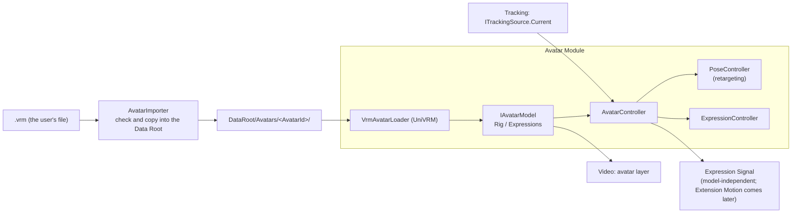
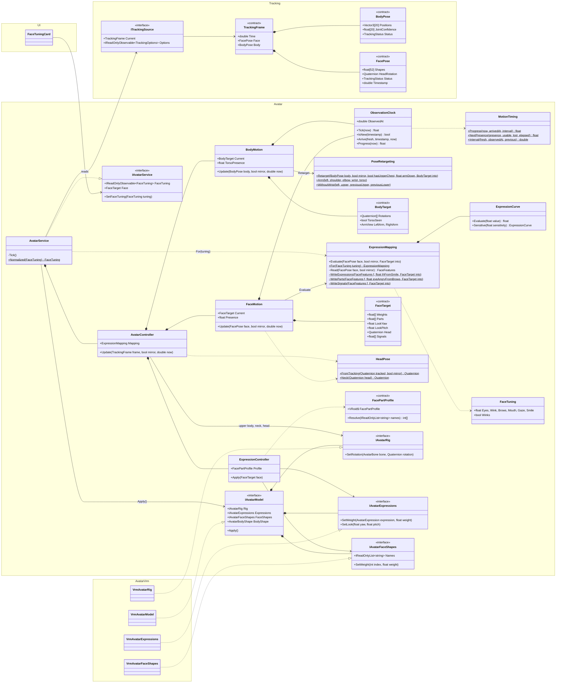

# Avatar Detailed Design

## 1. Purpose

This document defines the detailed design of the Avatar module. The Avatar module loads 3D models and applies Tracking observations (`TrackingFrame`) to the avatar's pose and expressions (system design chapter 7).

The scope built here (v0.1.0):

- Loading VRM (UniVRM; VRM 0.x is converted to 1.0 at load, 6.8) and the avatar abstraction (Avatar Runtime, skeleton, expressions)
- Registering avatars: copying into the Data Root, Avatar Profile, thumbnail, showing the model's license information
- Choosing the avatar to use, loading it at startup, and placing it on the stream
- Applying the pose (upper body, fingers) and expressions (eyes, mouth, gaze, brows)
- Handling lost tracking, mirroring, and interpolating between observations

Out of scope, handled by later designs:

- Loading FBX (system design 7.3; starting with the choice of library)
- Extension bones and Extension Motion (cat ears, tails, and so on; system design 7.8). The Expression Signal is output already (7.4)
- Applying full body (`BodyRange.FullBody`): hip movement, legs, foot contact
- Showing several avatars at once (system design 7.9; internally not limited to one)
- Transitions when switching avatars during a stream (fades and so on)
- Avatar Spawn Points in Stage Scenes (system design 11.6). Until then a default position is used (6.5)

Related system design sections: chapter 7 3D avatar control, chapter 8 tracking, 6.9–6.11 Data Root, 11.6 Avatar Spawn Point, 15.3 real-time behavior

Related detailed designs: Tracking (`tracking.md`), Video (`video.md` 7.2 the avatar layer), Stage (`stage.md`)

Prototype referenced (outside the repository): `E:\VirtualVessel\benchmarks\Voom`. Its VRM 1.0 loading (`Vrm10` of UniVRM 0.129.1) and its tuning knowledge for converting face movement to expressions are used as reference. Its body application (only the chest tilt, averaging Euler angles) is not kept (Tracking detailed design chapter 1).

### Overview



---

## 2. Responsibilities

| Responsibility | Owner |
|---|---|
| Checking a model file, copying it into the Data Root, and registering it | Avatar (`AvatarImporter`) |
| The file-picking screen (the OS dialog) | UI (`IFileDialog`, 6.7) |
| Loading a model format and converting it to a format-independent representation | Avatar (per-format loaders) |
| Fitting the observed pose to the avatar skeleton (body size, bone orientation) | Avatar (`PoseController`) |
| Converting face movement to the avatar's expressions | Avatar (`ExpressionController`) |
| Mirroring, interpolating between observations, handling lost tracking | Avatar |
| Observation, smoothing, input correction | Tracking |
| Where the avatar is placed (spawn point) | Stage (a default position in v0.1.0, 6.5) |
| The camera and layer that draw the avatar | Video |
| Screens for choosing and setting up avatars | UI (setup screen) |

---

## 3. Module Boundaries

- Avatar references Core, Diagnostics, ProjectData, and the public contracts of Tracking (`ITrackingSource`, `TrackingFrame`). It does not reference Capture, UI, Video, or Stage (the Tracking reference was added in step 4).
- Where the avatar goes (Video's avatar layer and Stage's spawn point) is passed by the composition root as `AvatarPlacement` (the layer number and a position and rotation). UI references Avatar, and Video and Stage reference UI, so Avatar referencing Video or Stage would make the assembly references circular ("UI → Avatar → Video → UI").
- UniVRM types (`UniVRM10.*`, `UniGLTF.*`) are used only inside the VRM loader (a separate assembly, chapter 16). The rest of Avatar uses only `IAvatarRig` and `IAvatarExpressions` (5.2) (system design 7.2).
- Other modules use only `IAvatarService` (5.1). They do not operate transforms or blendshapes directly (system design 7.2 Avatar Controller).
- It does not depend on Tracking's MediaPipe types. Its only input is `TrackingFrame`.

---

## 4. Main Classes and Interfaces

| Name | Kind | Summary |
|---|---|---|
| `IAvatarService` | Interface | The list of registered avatars, registering, choosing, the state of the current avatar (5.1) |
| `AvatarService` | Class (`IApplicationService`) | Implements the above. Loads, places, and calls the per-frame application |
| `AvatarPlacement` | Struct | Where the avatar goes: Video's avatar layer and Stage's spawn point (chapter 3) |
| `AvatarEntry` | Class | A registered avatar: id, profile (null when unreadable), thumbnail path |
| `AvatarStore` | Class | The avatar folders in the Data Root: listing, the temporary folder, moving in, deleting (6.1) |
| `AvatarFileCheck` | Static class | Checks before parsing: extension, size, glTF magic (pure functions, 6.2) |
| `AvatarImporter` | Class | Checks the file, copies it into the Data Root, and creates the profile (6.2). Returns an `AvatarImportResult` |
| `IAvatarLoader` | Interface | Per-format loading (system design 7.3) |
| `VrmAvatarLoader` | Class | Loads VRM with UniVRM. The only UniVRM-side class, created by the composition root |
| `IAvatarModel` | Interface | One loaded avatar: root, rig, expressions, model information (`AvatarModelInfo`), visibility, per-frame application, disposal (system design 7.2) |
| `AvatarLicense` | Class | The terms of use the author set, independent of the format (6.4) |
| `AvatarRestPose` | Static class | The pose when nothing moves the avatar: the reference pose with the arms lowered (7.2) |
| `IAvatarRig` | Interface | A format-independent skeleton. Sets standard bone (`AvatarBone`) rotations in a space where the reference pose is identity (7.1) |
| `IAvatarExpressions` | Interface | Format-independent expressions. Sets the weights of standard expressions (`AvatarExpression`) and the gaze |
| `IAvatarFaceShapes` | Interface | The model's own face shapes (blend shapes) by name, and their weights (7.4) |
| `FacePart` | Enum | The parts moved one by one: eyes (closing, wide, angry), brows, and mouth (a, i, u, e, o, closed smile, open smile, frown) |
| `FacePartProfile` | Class | Which of a model's shape names is which part (VRoid and so on); decides whether a model fits (pure functions) |
| `AvatarBone` | Enum | Standard human bones (same order as Unity Humanoid) |
| `AvatarExpression` | Enum | Standard expressions: `Blink`, `BlinkLeft`, `BlinkRight`, `Aa`, `Ih`, `Ou`, `Ee`, `Oh`, `Happy`, `Angry`, `Sad`, `Relaxed`, `Surprised`, `Neutral` |
| `AvatarController` | Class | The control entry point for one avatar; dispatches to pose and expressions |
| `PoseRetargeting` | Static class | Computes the upper body's bone rotations from observations (pure functions, 7.2) |
| `BodyMotion` | Class | Interpolation between upper body observations, and handling a lost torso or arm, each on its own (7.2, 7.3, 8.4). First designed as `PoseController`; named after the face's `FaceMotion` |
| `BodyTarget` | Class | What the avatar's upper body shows: each bone's rotation, and which parts the observation saw. Reused every frame |
| `MotionTiming` | Static class | The timing the face, the body, and the hands share: moving toward observations, and how much is shown when lost (pure functions, 7.3, 8.4) |
| `ObservationClock` | Class | One part's observations over time: when the newest was taken and arrived, and how far along the move toward it is (7.3). The face, the body, and each hand hold one. `FrameClock` is the seconds since the last frame alone, for the steps after them |
| `ExpressionMapping` | Class | Settings for converting expression values (`FaceShape`) to expressions (7.4) |
| `FaceFeatures` | Struct (internal) | The face values put through the curves once. The whole-face expressions, the part values, and the Expression Signal are all made from it (7.4) |
| `ExpressionController` | Class | Applies expressions and gaze: part by part or as whole-face expressions, substituting blinks the model lacks |
| `FaceTarget` | Class | What the avatar's face shows: a weight per expression, a weight per part, the Expression Signal, the gaze, and the head's turn. Reused every frame |
| `ExpressionSignal` | Enum | The values of the Expression Signal: smile, anger, sadness, surprise, each eye's opening, and the mouth's opening (7.4, system design 7.7) |
| `FaceMotion` | Class | Interpolation between face observations and handling a lost face (7.3, 8.4; timing in `ObservationClock`) |
| `HeadPose` | Static class | The head's turn: mirroring, the limit, and the neck's share (pure functions, 7.1) |
| `AvatarBodyShape` | Class | The model's body in the reference pose: bone positions, the head's ellipsoid, the torso's parts, the arms' thickness. Measured at load (7.6) |
| `ArmClearance` | Static class | Keeps the arms out of the head and torso by turning them in depth (pure functions, 7.6) |
| `HandRetargeting` | Static class | The hand's turn and the forearm's twist from the palm (pure functions, 7.7) |
| `HandMotion` | Class | Interpolating between palm and finger observations, and handling a lost hand (7.5, 7.7) |
| `FingerPose` | Class | One hand's finger angles: the bend at each joint and the spread. Reused every frame (7.5) |
| `FingerRetargeting` | Static class | Finger angles from the tracked hand, and the finger bones' rotations from them (pure functions, 7.5). `FingerRest` holds the model's hand in the reference pose |
| `SteadyMotion` | Class | The upper body's last step: how fast the arm bones may turn (7.8) |
| `ClearanceMotion` | Class | Keeping the arms out over time: remembers each limb's side and eases the added turn in and out (7.6) |
| `PlacedPart` | Struct | The head (an ellipsoid) or a part of the torso (an elliptic cylinder) this frame, and whether an arm's capsule reaches into it (pure functions, 7.6) |
| `ArmSide` | Struct | Each of the avatar's arms: its bones (`UpperBodyBone`, `AvatarBone`) and the tracked joints of the same name. Keeps choosing bones by side in one place |
| `ExpressionCurve` | Struct | The response curve from a value to an expression weight (7.4) |
| `FaceTuning` | Class | The user's face tuning: a sensitivity per part (7.4) |
| `AvatarProfile` | Class | Saved usage settings (6.3) |
| `AvatarSettings` | Class | The avatar in use and the face tuning (chapter 10) |

### Class Diagram (the face and the upper body, as of step 5)

The classes from a tracking observation to the avatar's upper body (torso, shoulders, arms), head, expressions, and gaze. Hands and fingers come in step 6.

- There are two kinds of abstraction, shown by color and by a stereotype. **Interfaces** (`<<interface>>`, a thick solid purple border) hide the concrete implementations at module boundaries. **Data contracts** (`<<contract>>`, a dashed green border) carry values in a form independent of formats and libraries. Classes without a stereotype are concrete processing on top of the abstractions.
- Every dependency points from the concrete to the abstract. Avatar's computation knows neither MediaPipe's types nor UniVRM's, and UniVRM's types are used only inside Avatar.Vrm (chapter 3).
- Relation notes: `reads` is the read every frame, and `upper body, neck, head` sets the upper body's, neck's, and head's rotations. The per-frame order is in 8.3.



---

## 5. Public API

### 5.1 IAvatarService

```csharp
public interface IAvatarService
{
    IReadOnlyObservable<IReadOnlyList<AvatarEntry>> Avatars { get; }   // Registered avatars
    IReadOnlyObservable<string> CurrentAvatarId { get; }                // The avatar in use, or null
    IReadOnlyObservable<AvatarState> State { get; }                     // None, Loading, Ready, Error
    IReadOnlyObservable<AvatarProblem> Problem { get; }                 // Problem shown to the user (chapter 11)

    IReadOnlyList<string> Extensions { get; }                           // Extensions that can be registered (for the file-picking screen)

    // Registers (6.2). confirm shows the model's information and terms before registering; false declines
    Task<AvatarImportResult> ImportAsync(string path, Func<AvatarModelInfo, Task<bool>> confirm, CancellationToken cancellationToken);
    Task SelectAsync(string avatarId, CancellationToken cancellationToken);   // Loads and swaps; null takes the avatar away
    Task RemoveAsync(string avatarId, CancellationToken cancellationToken);   // Unregisters (UI confirms)

    IReadOnlyObservable<FaceTuning> FaceTuning { get; }                        // Face tuning (7.4)
    void SetFaceTuning(FaceTuning tuning);                                     // Applies at once and saves
    FaceTarget Face { get; }                                                   // The face this frame; null without an avatar
    BodyTarget Body { get; }                                                   // The upper body this frame, for the skeleton comparison on the Diagnostics screen; null without an avatar
}
```

- `AvatarImportResult` is one of: registered (`Imported`), declined by the user (`Declined`), or a problem (`Problem`; for `AlreadyImported`, `Entry` is the avatar already registered).

- All operations and notifications happen on the main thread. Copying files and computing hashes happen on another thread.
- `SelectAsync` swaps out the old avatar only after the new one has loaded. If loading fails, the old avatar stays.

### 5.2 Format-independent Skeleton and Expressions

```csharp
public interface IAvatarRig
{
    bool Has(AvatarBone bone);
    float BoneLength(AvatarBone bone);                       // Length to the child bone (meters)
    void SetRotation(AvatarBone bone, Quaternion rotation);  // Rotation from the reference pose (7.1), in the avatar root space
    void SetRootPosition(Vector3 position);                  // For full body (later)
    void ResetPose();                                        // Back to the reference pose
}

public interface IAvatarExpressions
{
    bool Has(AvatarExpression expression);
    void SetWeight(AvatarExpression expression, float weight);   // 0–1
    void SetLook(float yaw, float pitch);                         // A share of the model's eye range (-1 to 1)
    IReadOnlyList<string> CustomNames { get; }                   // The model's own expression names (Perfect Sync and so on, later)
}

public interface IAvatarFaceShapes
{
    IReadOnlyList<string> Names { get; }                         // The model's face shape (blend shape) names
    void SetWeight(int index, float weight);                     // 0–1; Apply puts it on after the expressions
}
```

- For VRM, `IAvatarRig` is implemented with UniVRM's control rig (a normalized skeleton where every bone's rotation is identity in the reference pose). UniVRM absorbs per-model differences in bone axes (one bone's X axis points forward, another's Z axis, and so on). An FBX loader will do the same normalization inside the loader.
- Values given to `SetRotation` are applied together by `IAvatarModel.Apply`, parents first, so the order of calls does not matter.
- For VRM, `IAvatarExpressions` is implemented with VRM 1.0 expressions (presets) and LookAt.
- `IAvatarModel.FaceShapes` gives the model's face shapes (null when it has none). For VRM, the blend shapes of every SkinnedMeshRenderer are gathered by name and written after UniVRM's processing, so the part values win even where UniVRM's expressions move the same shapes.
- The gaze is given as a share of the model's eye range, not as an angle, because each model maps look angles onto its eyes over a different range (7.4). For VRM, the share is multiplied by the model's LookAt input range (sideways, up, and down) to make an angle.

```csharp
public interface IAvatarModel : IDisposable
{
    Transform Root { get; }            // Faces +Z in the reference pose
    IAvatarRig Rig { get; }
    IAvatarExpressions Expressions { get; }
    AvatarModelInfo Info { get; }      // Name, format, original version, whether converted, terms, thumbnail
    AvatarBodyShape BodyShape { get; } // The body measured at load (7.6); null when it could not be measured
    void SetVisible(bool visible);
    void Apply();                      // Applies the values set this frame and moves secondary motion (SpringBone)
}
```

---

## 6. Data Model

### 6.1 Storing Avatars (System Design 7.11, 6.10)

```text
DataRoot/Avatars/<AvatarId>/
├─ model.vrm               The copied model (the original file is not changed)
├─ avatar-profile.json     Usage settings (6.3)
└─ thumbnail.png / .jpg    Thumbnail (the image in the VRM meta, saved in the format stored in the file)
```

- `AvatarId` is a GUID (`N` format) created at registration. Names and file names are not used (to avoid duplicates and invalid characters).
- The list is built at startup by reading under `Avatars/`. An entry whose `avatar-profile.json` cannot be read (or whose model file is missing) is listed as "an avatar that cannot be loaded", and the user decides whether to remove it (never removed silently, CLAUDE.md chapter 25).
- Only folders named like an AvatarId are handled and deleted; other folders the user put there are left alone. The profile's `format` and `thumbnail` accept only lower-case letters and digits or the fixed name, so editing a profile cannot point outside the folder.
- `Avatars/.importing/` is deleted at startup; it holds what an interrupted registration left behind.

### 6.2 Registering (AvatarImporter)

1. The user picks a file (UI `IFileDialog`).
2. Check: the `.vrm` extension, a size limit (default 1 GB), and that the file starts as glTF binary (the `glTF` magic).
3. Copy into a temporary folder (`Avatars/.importing/<AvatarId>/`) on another thread. Compute SHA-256; if an avatar with the same hash is registered, point to it and do not register.
4. Check the copy in the temporary folder by actually loading it (`VrmAvatarLoader`, 6.4): the required bones (8.2) are present; extract the meta information. Then destroy it.
5. Show the model's name and terms of use (6.4) in a confirmation dialog. If the user declines, nothing is registered.
6. Write `avatar-profile.json` and the thumbnail, then move the temporary folder to `Avatars/<AvatarId>/`. If anything fails on the way, or it is canceled, delete the temporary folder.
7. Add it to the list. If no avatar is in use yet, make it the one in use.

- The original file path is kept in `avatar-profile.json` for reference but is not used at run time (system design 7.11).

### 6.3 Avatar Profile

```json
{
  "schemaVersion": 1,
  "avatarId": "3f2c...",
  "displayName": "The model's name (from the meta; the user can change it)",
  "format": "vrm",
  "formatVersion": "1.0",
  "converted": false,
  "sourceFileName": "original.vrm",
  "sha256": "...",
  "importedAt": "2026-10-20T12:00:00Z",
  "license": { "...": "The license fields of the VRM meta (6.4)" },
  "scale": 1.0,
  "pose": { "armDownAngle": 70 },
  "extensions": {}
}
```

- Unknown fields are kept (CLAUDE.md chapter 25). `extensions` is where later settings such as Extension Motion go.
- Fields equal to the defaults are not written, so improved defaults reach users who did not change them.
- Face tuning belongs to the user, not to an avatar, and is kept in `avatar-settings.json` (7.4, chapter 10; user's decision, 2026-10-20).

### 6.4 Model License (VRM Meta)

In VRM, the author writes the conditions for using the avatar (who may use it as an avatar, commercial use, violent or sexual expression, modification, redistribution, and so on).

- The author, conditions, and license URL are shown in the registration confirmation dialog and on the setup screen's avatar Card (`docs/en/ui/screens/setup.md` chapter 5).
- Registration or use is not blocked because of the conditions (the user judges). However, when who may use the model as an avatar is not "everyone" (the author only, people the author allows, or not stated), the confirmation dialog shows a notice.
- Conditions the file does not state are shown as "not stated". Leaving them out could be read as allowed.
- Only `https` license URLs are opened, in the external browser, and only when the user presses them. Other kinds (`file:` and so on) are shown as text only.
- `license` in `avatar-profile.json` holds the format-independent `AvatarLicense`.

### 6.5 Placing the Avatar

- The avatar is placed in the persistent area owned by the application (outside Stage Scenes) (system design 7.10).
- Until Stage Scene spawn points exist, Stage provides one default spawn point (`IAvatarSpawnPoints`, Stage detailed design 7.1): at the origin, facing the camera (-Z). The default Main Camera position is set so the upper body fits the stream (Video detailed design 7.5).
- Placing puts every part on the `Avatar` layer, moves it to the spawn point, and lowers the arms (`AvatarRestPose`, 70° by default) before showing it. Loading happens hidden, so it never shows for a moment at the origin or on the wrong layer.
- It is drawn on the Unity layer `Avatar`, by Video's Avatar Camera (Video detailed design 7.2: same position and field of view as the Main Camera, overlay). It appears in front of the flat videos (user's decision, 2026-10-17).

### 6.6 Mirroring

- With mirroring (default: on), when the user raises the right hand, the avatar raises its left hand. On screen the hand on the same side goes up, so the user can move as if looking in a mirror.
- The setting is `Mirror` in `ITrackingSource.Options`: one setting with the left-right flip of the camera image on the setup screen, saved by Tracking in `tracking-settings.json` (Tracking detailed design chapter 10).
- `TrackingFrame` holds the user's own left and right (Tracking detailed design 6.1). Mirroring swaps left and right and flips the X axis before application (input conversion of `PoseRetargeting`, a pure function). Left and right of expressions (a one-eye blink and so on) are swapped as well.

### 6.7 The File-picking Screen

- UI gets `IFileDialog` (`Task<string> OpenAsync(FileDialogOptions options)`; null when canceled). On Windows, `GetOpenFileNameW` (comdlg32) is opened on a dedicated STA thread (`WindowsFileDialog`). Opening it on the main thread would stop rendering and the stream image while the dialog is open.
- `GetOpenFileNameW` is used instead of the COM `IFileOpenDialog`: it shows the same Explorer-style screen and needs no COM interop, which Mono and IL2CPP support unevenly.
- The application window owns the dialog, so it stays in front and the window takes no input until it closes. Only one can be open at a time.
- No additional dependency (library) is added.

### 6.8 VRM 0.x

- VRM 0.x models are accepted too (user's decision, 2026-10-18; system design 7.3). UniVRM's loading converts VRM 0.x to VRM 1.0 (enabling the 0.x conversion of `Vrm10`).
- The original file (`model.vrm`) is stored as it is, and the conversion runs at every load. The converted result is not saved as a file, so improvements to UniVRM's conversion take effect without re-importing.
- The profile's `formatVersion` is the original version (`0.x`), and `converted` shows that it was converted.
- The license (6.4) is shown from the 0.x meta before conversion, mapping the 0.x fields to the 1.0 fields (`VrmLicense`). UniVRM's conversion replaces the license URL with the VRM 1.0 license, so its result is not used. Conditions 0.x has no field for (political or religious use, redistribution, modification, and so on) are "not stated"; the 0.x license name (such as `CC_BY`) and the other-permission URL are shown with their original values. Commercial use "allowed" maps to "personal profit allowed", as UniVRM's conversion does.
- Bone reference orientations and expression names differ between 0.x and 1.0, but after conversion the model is handled as 1.0. Remaining differences (such as the gaze range) are checked by tests.

---

## 7. Computing Pose and Expressions

### 7.1 Reference Pose and Bone Rotations

- In UniVRM's control rig, every bone's rotation is identity (no rotation) in the reference pose (T pose). For each bone, `PoseRetargeting` computes the rotation from "the bone direction in the reference pose (for example +X for the right upper arm)" to "the observed direction".
- A direction alone does not decide the twist around the bone. The twist is decided by a second direction:

| Bone | Direction | Direction that decides the twist |
|---|---|---|
| Torso (Spine, Chest) | Hips to neck | The line between the shoulders |
| Neck, head | The rotation of the facial transformation matrix (Tracking detailed design 6.3), split between neck and head (default: neck 40%, head 60%). Turns beyond 75° are stopped | Same |
| Upper arm | Shoulder to elbow | The plane the elbow bends in (normal of the plane of upper arm and forearm) |
| Forearm | Elbow to wrist | Half of the palm's orientation (from the Hand Landmarker) (7.7); carried over from the upper arm when the hand is not seen |
| Hand | Wrist to the base of the middle finger | The palm normal |
| Fingers | The flexion angle of each joint (7.5) | The palm |

- Neck and head (step 4, `HeadPose`): person space and the avatar's root space have the same axes (+X right, +Y up, +Z front), so the rotation is used as it is. Mirrored, it is reflected through the plane X = 0 (turning sideways and tilting go the other way; nodding stays the same). In root space the head gets the whole turn and the neck 40% of it, so the head turns the remaining 60% relative to the neck. Turns beyond 75° are stopped, because the face is then mostly out of the camera's view and the values are unreliable.
- Only rotations are applied, not positions. So even if the avatar's and the user's bodies differ (arm length and so on), the bone directions are the same (absorbing body-size differences, system design 7.6). Movements that need matching positions, such as touching the face with a hand, are considered later with IK (solving rotations from joint positions) together with full body (chapter 17).
- The computation is done by `PoseRetargeting` (pure functions): the input is the body and hands of `TrackingFrame`, mirroring, and profile corrections; the output is an array of rotations per bone (passed in by the caller, to avoid per-frame allocations).

### 7.2 Upper Body (BodyRange.UpperBody)

Built in step 5 (`PoseRetargeting`, `BodyMotion`). Every bone's rotation from the reference pose is worked out in the avatar root's space and set bone by bone (`IAvatarRig.SetRotation`). Only directions are used, never positions, so a person and an avatar of different builds point their bones alike (system design 7.6).

- The hips do not move. The torso's rotation takes its right from the line between the shoulders and its up from the line from the hips to the neck, and is shared over Spine, Chest, and Upper Chest (30%, 35%, 35%). On a model without an Upper Chest, Chest takes all of it.
- Torso rotation has limits: side tilt ±30°, forward/back ±25°, twist ±40°.
- The neck turns 40% of the way from the top of the torso to the head (7.1).
- The upper arm points at the elbow. Its twist is set by the plane the elbow bends in. A nearly straight arm's bend plane is unknown, so the twist of the shortest swing from the torso is used, blended in between: from the torso below a sine of 0.25 between upper arm and forearm, from the bend plane at 0.50 and above. The forearm points at the wrist; its twist is in 7.7.
- A shoulder rises only for an arm raised above level, by 25% of how far it is raised (at most 20°).
- A joint not seen is not used (`BodyPose.IsSeen`: visibility at least 0.5 and inside the camera image, tracking detailed design 8.4). Both shoulders seen move the torso; a shoulder and an elbow move the upper arm; the wrist points the forearm.
- While the wrist is hidden (behind the head, for example), the upper arm points at the elbow and keeps its previous twist, and the forearm keeps its last seen bend (`PoseRetargeting.WithoutWrist`).
- While the wrist is out of the camera image with the elbow in it, the forearm keeps its bend for 0.5 s, then goes back over 1 s to straight along the upper arm, and comes back over 0.2 s when the wrist is in the image again (`BodyMotion.LeftArmPresence.Forearm`, `RightArmPresence.Forearm`, 8.4).
- A lost arm (shoulder or elbow unseen) returns to hanging from the torso (70° below level by default), never to the T pose. The profile's `pose.armDownAngle` is not built yet (chapter 17).
- In a mirror, the person's sides are swapped and reflected through X = 0 before anything is worked out (`PoseRetargeting.Joint`). Visibility is read on the person's side.
- The lower body stays in the arms-down reference pose.

Why it is so, and the measurements behind it: [decisions/avatar-motion.md](../decisions/avatar-motion.md) (7.2).

### 7.3 Interpolating Between Observations

- For each rendered frame, the shown values move toward the newest observation over one observation interval (rotations with spherical interpolation), starting from what was shown when it arrived. A frame always lies between the previous display and the newest observation. This adds one observation interval of lag (about 33 ms at 30 per second).
- The move takes the time between the two observations, kept within 1/120 s to 0.2 s.
- When the next observation is late, it stops at the newest one (no prediction ahead).
- Used for the face (`FaceMotion`), the upper body (`BodyMotion`), and the palms and fingers (`HandMotion`). The timing is shared in `MotionTiming`, and each part's bookkeeping in `ObservationClock`. The clearance (7.6) and the arms' turning limit (7.8), which follow every frame, use `FrameClock`.

### 7.4 Expressions (ExpressionMapping)

Conversion from expression values (`FaceShape`, 0–1) to the avatar's expressions (`AvatarExpression`) and gaze. Each value has a response curve (`ExpressionCurve`: 0 at or below the lower end, the most at or above the upper end, rising smoothly between). MediaPipe's values rarely reach 1, so the upper ends are below 1.

- Each time, the face values are put through the curves once into `FaceFeatures` (the avatar's own sides). The whole-face expressions (`WriteExpressions`), the part values (`WriteParts`), and the Expression Signal (`WriteSignals`) are written from it by pure functions that know no curves.

| Expression | Source values | How |
|---|---|---|
| `Blink` (both), `BlinkLeft`, `BlinkRight` | `EyeBlinkLeft/Right` | Both eyes together. Only when winks are allowed (face tuning, off by default), one eye when the eyes differ by 0.3 or more after the curve |
| `Aa` | `JawOpen` | Mouth opening; the `MouthFunnel` share goes to `Oh` |
| `Oh` | `JawOpen` and `MouthFunnel` | Rounded and open |
| `Ou` | `MouthPucker`, `MouthFunnel` | Pursed lips, as far as the mouth is open |
| `Ee` | `MouthStretchLeft/Right` | Stretched sideways, as far as the mouth is open |
| `Ih` | `MouthSmileLeft/Right` | Pulled sideways and slightly open (half the smile), as far as the mouth is open |
| `Happy` | `MouthSmileLeft/Right` less `MouthStretchLeft/Right`, `CheekSquintLeft/Right` | The larger; at most 0.8 |
| `Surprised` | `BrowInnerUp`, `EyeWideLeft/Right` | Raised brows alone give half, wide eyes the rest; at most 0.8 |
| `Angry` | `BrowDownLeft/Right` | At most 0.8 |
| `Sad` | `BrowInnerUp` and `MouthFrownLeft/Right` | When both show; at most 0.8 |
| Gaze | `EyeLookIn/Out/Up/Down` (mean of both eyes) | A share of the model's eye range (-1 to 1), reaching the end at a value of 0.5. Up and down are weakened as far as the lids are closed |

- Whether the mouth is open (`JawOpen` from 0.04 to 0.12) gates `Ou`, `Ee`, and `Ih`: a closed mouth shows none of them.
- The smile is the corner value less the sideways pull, so saying "i" does not smile. Raised cheeks (`CheekSquint`) still make a smile on their own.
- The five mouth shapes are distributed by ratio so their sum does not exceed 1.
- VRM has no brow expressions, so the brows show through the feelings (surprise, anger, sadness).
- How feelings overlap blinks, the mouth, and the gaze (VRM 1.0 `overrideBlink`, `overrideMouth`, `overrideLookAt`) follows the model's settings.
- The gaze is given as a share of the model's range, not an angle (5.2).
- The defaults come from the user's camera checks (100% is what the user tuned).
- The Expression Signal (`FaceTarget.Signals`, 0 to 1 per `ExpressionSignal`) is what other control (Extension Motion for cat ears, tails, and so on) reacts to, independent of the model's format and of how its face is moved (system design 7.7, 7.8). Its values are the feelings' weights (smile, anger, sadness, surprise), each eye's opening (the avatar's own sides), and the mouth's opening, computed before anything is fitted to the model. They are interpolated like the other values and go back to neutral when the face is lost. v0.1.0 has no consumer yet.
- For a model with only a blink of both eyes, the per-eye values go to it, using the smaller; for one with only per-eye blinks, the both-eye value goes to each eye.

#### Moving the Face Part by Part (FacePart)

On a model with a shape per part, the eyes, brows, and mouth are moved separately, because VRM's whole-face expressions on some models close the eyes and open the mouth for a smile (VRoid's `Fcl_ALL_Joy`).

- The face is moved part by part only when the model's shape names fit a known convention (`FacePartProfile`; for now VRoid's `Fcl_EYE_*`, `Fcl_BRW_*`, `Fcl_MTH_*`). A model without both eyes' closing and the five vowel shapes keeps the standard expressions.
- While moving part by part, the standard expressions stay at 0. The gaze moves by LookAt either way.
- Whether a model fits is decided from its shape names each time it loads, and logged. It is saved to the Avatar Profile when a Setup screen lets the user choose the expression mapping (chapter 17).

| Part | VRoid shape | How |
|---|---|---|
| Eye closing (left, right) | `Fcl_EYE_Close_L/R` | As the standard blink (both eyes together, winks). A smile does not close them |
| Wide eyes | `Fcl_EYE_Spread` | `EyeWide` |
| Angry eyes | `Fcl_EYE_Angry` | Half the lowered brows |
| Raised brows | `Fcl_BRW_Surprised` | The larger of `BrowInnerUp` and `BrowOuterUp`, less the sad brows |
| Lowered brows | `Fcl_BRW_Angry` | `BrowDown` |
| Sad brows | `Fcl_BRW_Sorrow` | The smaller of `BrowInnerUp` and `MouthFrown` |
| a, o, u | `Fcl_MTH_A/O/U` | As the standard expressions; "a" gives way to the open smile as far as the corners rise |
| i, e | `Fcl_MTH_I/E` | Lips pulled sideways (`MouthStretch`): a little apart is "i", more open is "e" |
| Closed smile | `Fcl_MTH_Fun` | Raised corners × how closed the mouth is |
| Open smile | `Fcl_MTH_Joy` | Raised corners × the opening |
| Frown | `Fcl_MTH_Sorrow` | `MouthFrown` |

- The open mouth shapes (a, i, u, e, o, open smile) are distributed by ratio so their sum does not exceed 1.
- The smiling eyes (`Fcl_EYE_Joy`) are not used; the eyes move only with their own lids. A model without part shapes uses the standard `Happy` expression.
- The six tuning parts (below) work on the part values alike. The bars of the tuning screen come from the part values.
- Models with the 52 ARKit shapes (Perfect Sync) can be added later with one more convention (chapter 17).

#### Face Tuning (FaceTuning)

How much a face moves differs from person to person, so the user can change the sensitivity of each part.

| Part | What changes |
|---|---|
| Eye closing | The blink curve |
| Winks | Whether one eye may close alone (on or off, off by default) |
| Winking | The difference between the eyes that counts as a wink (only with winks on) |
| Brows | The curves of the brows, wide eyes, and the frown (surprise, anger, sadness) |
| Mouth | The curves of the mouth opening and shapes |
| Gaze | The value at which the eyes reach the end of their range |
| Smile | The smile curve |

- Winks are off by default: both eyes always close together, as winks are easily misread.
- Each value is a sensitivity (0.5 to 3, shown as 50 to 300%) that divides both ends of the curves. A value outside the range is read as the nearest end.
- The tuning belongs to the user, not to a model, and stays when the avatar changes. It is saved in `avatar-settings.json` (chapter 10).
- A change applies to the avatar in use from the next observation. The tuning screen is UI `setup.md` chapter 9.
- `IAvatarExpressions.CustomNames` exists so a method passing values straight through can be added later for Perfect Sync models (chapter 17).

Why it is so, and the camera checks behind the values: [decisions/avatar-motion.md](../decisions/avatar-motion.md) (7.4).

### 7.5 Fingers

Built in step 6, part 2.

- `FingerRetargeting.TryMeasure` (pure) reads the angles from the tracked hand's 21 points in the hand's own frame: the back of the hand as the palm's rotation takes it, and across toward the thumb from the little finger's base to the index finger's. They are angles only, so neither the hand's size nor the mirror changes them.
- Four fingers:
  - the base bends 0–90° toward the palm: the bend read past 10° (`OpenBend`), scaled by 1.5 (`BaseGain`), because MediaPipe reads curled fingers small;
  - the middle joint bends 0–100°: each finger's reading of an open hand shows straight and its reading of a fist shows 100°, in proportion between (`ShownMiddle`; open 18, 36, 25, 23°, fist 85, 90, 84, 72°, index to little finger);
  - where the middle joint bends past the base, 35% of the difference moves to the base (`Arc`, `ArcShare`), so a finger curves as a whole. In a rounded hand, such as half of a heart, the base reads 5-20° and the middle 60-88° (the user's recordings, 2026-10-30), which showed as a straight finger hooked at the end. An open hand and a fist barely change;
  - the end joint bends two thirds as far as the middle one (`EndShare`, at most 80°);
  - the base spreads ±15° toward the thumb, fading as the finger bends.
- The thumb points where the user's does: its base bone turns toward the direction from the thumb's base to its tip, in the avatar root's space (`ThumbDirection`). Not in the palm, because the shown palm can differ from the tracked one (30° on the user's recordings, 2026-10-30). A model's thumb rests in its own direction, so bending its joints alone pointed it at the face in half of a heart (the user's report). As the thumb tucks in, this lets go, and a hand not seen keeps the model's direction.
- The thumb is tucked in by how far its tip reaches across the palm from the index finger's base: from -0.3 of the palm's width (`TuckFrom`) to fully at 0 (`TuckFull`). The tip tells a tucked thumb from one raised out of a fist.
  - Tucked in, every thumb joint bends across the palm, toward the little finger: 30° at its base (`MaxThumbFold`), and at least 85° and 60° at the middle and end joints (`ThumbTuckBend`, `ThumbTuckEndBend`), partly on the way. It lies on the palm under the curled fingers, hidden in a rock-paper-scissors fist.
  - The thumb's middle (0–60°) and end (0–80°) joints otherwise bend by their angles past 20° (`ThumbOpenBend`), scaled by 1.5 (`ThumbGain`).
- `FingerRest` holds each finger bone's direction, the back of the hand, and the direction toward the thumb, from the bone positions measured at load (`AvatarBodyShape`, 7.6); a typical hand where the model lacks a bone. `FingerRetargeting.Rotations` (pure) turns each joint about the model's own axes, into the palm for the four fingers and across it for the thumb, carrying the parent's turn on the hand's final rotation (after 7.6 and 7.8).
- `HandMotion` moves the fingers with the palm on the same observation clock (7.3). It holds them while the hand is lost, then goes over 1 s to the loosely closed hand (`FingerPose.Relaxed`: 15°, 20°, and 10°; the thumb 5°, 10°, and 10°). Without hand tracking the fingers stay loosely closed. A shown angle changes at most 600° a second.
- Checked on the three sample models (`VrmLoaderTests.Fingers_CloseTheModelsOwnHand`) and drawn with the render probe (14.1).
- The values were tuned on one person and one model. How a hand bends depends on the person and the camera, so the user can set the strength of the four fingers and of the thumb (`FingerTuning`, 50–200% each, 100% by default). It scales the bend after an open hand's reading is taken off, so an open hand stays open at any value. Tucking the thumb goes by where its tip is, and does not change. The tuning belongs to the user, not to a model, and is saved in `avatar-settings.json` (chapter 10). Tuning per model is added if it proves necessary (#67).

Why it is so, and the readings behind the values: [decisions/avatar-motion.md](../decisions/avatar-motion.md) (7.5).

### 7.6 Keeping the Arms Out of the Head and Torso (ArmClearance)

Only directions are carried over (7.1), so on an avatar built differently from the user, the arms can sink into the head or torso (most anime-style models have big heads for their arms). Only when an arm would enter the head or torso is it turned, by the least angle that keeps it out (`ArmClearance`, pure functions). This absorbs body differences with model-specific information (system design 7.6).

- The body's shape (`AvatarBodyShape`), measured once right after loading in the reference pose (8.2): the upper-body bones' positions, the head's ellipsoid, the torso's parts, the thickness of the upper arm, forearm, and hand, and the hand's length.
  - Each mesh point is grouped by following the bone that moves it most up to the first humanoid bone (sleeves with the arms, hair and ears with the head).
  - The head is an ellipsoid around the head's points, leaving out hair hanging below the neck.
  - The torso is an upright elliptic cylinder around the points of each of Spine, Chest, and Upper Chest, turning with its bone; a bone with fewer than 20 points is not measured.
  - For sizes, the outermost 5% of points at each end of each axis are left out.
  - An arm's thickness is the median distance from the bone along its middle; an arm without a mesh takes a share of the upper arm's length.
  - When it cannot be measured, it is `null` and the arms stay as tracked.
- Contact: the arm is three capsules (upper arm, forearm, hand), each checked against the head or a part of the torso grown by its thickness. The upper arm is not checked against the torso.
- A part of the torso is grown by half a limb's thickness (`TorsoContactShare`), and counts as entered only across its front (+Z) or near its middle; touching its sides or back does not count.
- Turning changes only the depth: an arm turns within the plane containing it and the camera's axis, keeping its direction on the camera's image, because tracking is least sure of depth (tracking detailed design 8.4).
  1. The upper arm turns about the shoulder when it enters the head, or when the elbow enters the torso.
  2. The forearm turns about the elbow when the forearm or hand still enters the head or torso.
- Front or back: the limb turns forward when its end is in front of the center of the part entered, else back. The side is kept until the end moves more than 5 cm to the other side (`ArmClearance.ClearanceSides`); the other side is tried only when the first cannot clear. The least angle is found by halving (12 times).
- 2D (tracking detailed design 8.6): the arms always go in front of the body (`frontOnly`).
- Limits: up to 60°, and no closer than 5° to the camera's axis. A head the shoulder is in, or a part the elbow is in, is left out.
- Timing (`ClearanceMotion`): the turn added eases with a time constant of 0.08 s; the tracked motion itself is followed without delay.
- The head and the torso's parts move with the torso's rotation and the head's turn (`FaceTarget.Head`). `AvatarController` applies it to `BodyMotion`'s output every frame; `AvatarController.Body` is the pose after it.
- Known limits: poses depth alone cannot clear (a forearm crossing over the head) stay inside; when the side changes, the arm moves over 0.1–0.2 s; the arms are not kept out of each other, the hips, or the legs.

Why it is so, and the methods compared on recordings: [decisions/avatar-motion.md](../decisions/avatar-motion.md) (7.6).

### 7.7 The Hands and the Forearms' Twist (HandRetargeting)

Step 6, part 1.

- The palm (`HandPose.PalmRotation`) becomes the hand's rotation in the avatar root's space. In the reference pose the palm is down and the fingers point along the arm. In a mirror the person's other hand is used, reflected through X = 0.
- The hand takes the palm's whole turn; its depth is set from the forearm's in Tracking (tracking detailed design 8.4).
- The twist is measured from neutral: the back of the hand along the elbow's hinge axis. Supination (palm up) is positive; a reading more than 150° toward pronation is read as supination.
- The forearm and wrist turn up to ±90° from neutral; a twist past that is left out (the shoulder is not turned).
- The forearm's bone takes half of the twist (`ForearmTwistShare`), the wrist the rest.
- Within 30° of the reading's wrap (210° of supination, 150° of pronation) the twist fades back to neutral.
- A hand bent until its back lies along the forearm has no twist to read: below a sine of 0.2 between them the twist is not read, from 0.5 fully.
- The shown palm turns no faster than 540° a second (`HandMotion.MaxDegreesPerSecond`).
- The hands are inferred apart from the body, so `HandMotion` has the face's timing (7.3, 8.4): interpolated, held 0.5 s when lost, back to following the forearm over 1 s, in again over 0.2 s.
- `AvatarController` turns the hands after the body's motion, then keeps the arms out of the head and torso (7.6).

Why it is so, and the measurements behind it: [decisions/avatar-motion.md](../decisions/avatar-motion.md) (7.7).

### 7.8 How Fast the Arms Turn (SteadyMotion)

At the last step of the upper body, an arm bone (upper arm, forearm, hand) turns where it points no faster than 720° a second (12° a frame at 60), and twists no faster than 360° a second (6° a frame). The torso has no limit. Where the bone points and its twist are limited apart (`SteadyMotion.Limit`, pure); the twist changes mostly from noise, so its limit is lower. Steadiness and natural motion come before following every turn (the user's decision).

Measurements: [decisions/avatar-motion.md](../decisions/avatar-motion.md) (7.8).

---

## 8. State / Lifecycle

### 8.1 AvatarService

- An optional application service, started after Logging, Video, and Stage (not created without Video and Stage). Without Tracking, the avatar is shown in the reference pose.
- At startup it builds the list and starts loading the avatar in use from `avatar-settings.json`. Startup goes on without waiting for the load (not blocking the main thread for long, chapter 9). If the avatar in use is no longer registered, no avatar is in use.
- At shutdown it destroys the avatar's GameObjects, textures, meshes, and materials (using the disposal of UniVRM's `RuntimeGltfInstance`).

### 8.2 Loading

1. `Loading`. `VrmAvatarLoader` reads the file and builds it with UniVRM.
2. Check the rig and expressions. If a required bone (Hips, Spine, Head, left and right upper arms, forearms, hands) is missing, `Error` (`MissingBones`). These are the upper-body bones VRM 1.0 requires. Chest, Upper Chest, and Neck are optional in VRM 1.0, so when one is missing its rotation goes to the nearest bone. While the model is in the reference pose, its body shape (`AvatarBodyShape`, 7.6) is measured.
3. Set the layer to `Avatar` and place it at the spawn point (6.5).
4. `Ready`. Destroy the old avatar, if any.

- If another avatar is chosen while one is loading, the earlier load is canceled. When a swap fails, the old avatar stays `Ready` and `Problem` says what failed.

### 8.3 Per-frame Application

- Before the Avatar Camera renders, in this order (equivalent of `LateUpdate`, after `IFrameLoop`):
  1. Read `ITrackingSource.Current`. Tracking registers with the per-frame work (`IFrameLoop`) before Avatar, so it reads the observation updated in the same frame.
  2. `AvatarController`: the face (`FaceMotion`: interpolation between observations, handling a lost face, `ExpressionMapping`) and the neck and head turn. The upper body (`BodyMotion`: interpolation, returning lost parts, `PoseRetargeting`) is set on the bones, and the neck turns from the top of the torso toward the head (step 5). Before they are set on the bones, the arms are kept out of the head and torso (`ArmClearance`, 7.6).
  3. `ExpressionController`: expressions and gaze.
  4. Call UniVRM's processing (applying the control rig, expressions, LookAt, SpringBone) explicitly once. UniVRM's automatic update is turned off and the order is decided here (so SpringBone runs after the pose).
- Nothing is allocated per frame. The bone rotation and expression value arrays are reused.

### 8.4 When Tracking Is Lost

| Status | Handling |
|---|---|
| `Tracked` | Apply the observation |
| `LowConfidence` | Blend between the previous value and the observation by confidence |
| `Lost` (within 0.5 s) | Keep the last value |
| `Lost` (over 0.5 s) | Return over 1 s to the reference pose (arms down, hands lightly closed, no expression) |
| On return | Move toward the observation over 0.2 s |
| `Disabled`, `NotSupported` | Reference pose |

- For the face it was built as follows (step 4, `FaceMotion`): the time since the face was lost counts from the last usable observation. A presence (0 to 1) moves to 1 over 0.2 s while the face is found, and to 0 over 1 s once it has been lost for 0.5 s; the face is blended with a neutral face (no expression, eyes ahead, head straight) by it. For `LowConfidence`, a new observation is moved toward from the previous one only as far as its confidence. Without tracking, or while it is stopped, the face is neutral.

---

## 9. Threading / async

- Building the avatar (GameObjects, meshes, textures) uses Unity APIs and happens on the main thread. Reading the file and parsing glTF use UniVRM's asynchronous loading (`Vrm10.LoadBytesAsync` and so on, splitting the work over several frames with `IAwaitCaller`), so no single frame is blocked for long. The loading time and the longest frame are recorded.
- Copying, hashing, and writing the thumbnail happen on another thread.
- Pose and expression application happens on the main thread once per frame.

---

## 10. Settings

```csharp
public sealed class AvatarSettings
{
    public string CurrentAvatarId { get; set; }   // No avatar is shown when null
    public FaceTuning Face { get; set; }          // Face tuning (7.4): sensitivity per part and whether winks are allowed; the user's
}
```

- Saved to `avatar-settings.json` in the project's folder (`Projects/<ProjectId>/`, `ConfigFileStore`; project data detailed design 6). Until the refactoring after step 7 it was in the settings folder; the first project took a copy of it (project data detailed design 8).
- Per-avatar settings are in `avatar-profile.json` (6.3).
- An older file without `Face` reads as the default tuning (a field was only added, so the version stays).
- Mirroring is a Tracking setting (6.6).

---

## 11. Logging and Diagnostics

- Registration, loading, swapping, and failures are logged at Information with the avatar id, format, version, and loading time. Missing bones and expressions are logged at Warning (system design 7.13). Full file paths are not logged (they contain the user name); only file names are.
- Performance metrics:

| Metric | Kind | Content |
|---|---|---|
| `Avatar/Load` | Timer | Loading time |
| `Avatar/LoadLongestFrame` | Timer | The longest frame while loading |
| `Avatar/Apply` | Timer | Per-frame pose and expression application time |

- Problems shown to the user (`AvatarProblem`): `NotVrm` (this is not a VRM file), `TooLarge`, `MissingBones` (this model cannot be used because its humanoid bones are incomplete), `LoadFailed` (the avatar could not be loaded), `AlreadyImported`, `StorageFailed` (could not save; check free space at the save location).

---

## 12. Error Handling and Recovery

| Event | Handling |
|---|---|
| Registration fails midway | Delete the temporary folder; the list does not change |
| The avatar in use cannot be loaded (at startup) | `Error`. Continue without an avatar; another avatar can be chosen |
| Loading for a swap fails | Keep the old avatar |
| Missing bones | Unusable if a required bone (8.2) is missing. For optional bones such as fingers, only that bone's application stops |
| Missing expressions | Only that expression's application stops |
| No Tracking, or it is stopped | Show the reference pose |
| UniVRM exceptions | Caught in the loader and turned into `LoadFailed`. The application keeps running |

---

## 13. Security and Privacy

- Model files are untrusted input brought in from outside. The extension, size limit, and format magic are checked before parsing. Parsing is done by UniVRM; there is no mechanism to run scripts contained in a model.
- Parsing exceptions are caught in the loader, and objects created midway are destroyed.
- Registered models stay only in the user's Data Root and are not sent anywhere.
- The model license (6.4) is shown to the user. The user judges the conditions.
- Only `https` license URLs are opened, and only by the user's action.

---

## 14. Testing Strategy

| Kind | Target |
|---|---|
| EditMode | `PoseRetargeting`: from synthetic observations of known poses (arms sideways, down, forward, the elbow bent forward or up, a tilted torso), the bone rotations are as expected. Mirroring, the torso's limits, how shoulders rise, unseen arms. `BodyMotion`: a lost arm holds, then hangs, and comes back; a hidden wrist keeps the forearm's bend. Turning the palm comes in step 6 |
| EditMode (Explicit) | `AvatarRecordingTests`: on the developer's recordings (outside the repository), no rotation is not a number; how often the arms move, how bone lengths vary, and jumps go to the log |
| EditMode | Interpolation (7.3), returning when lost (8.4), blending for `LowConfidence` |
| EditMode | `ExpressionMapping`: response curves, keeping eyes together, distributing mouth shapes, overlap with emotion expressions |
| EditMode | `AvatarImporter`: checking extension, size, and magic; cleaning up the temporary folder; detecting the same hash; reading and writing the profile (keeping unknown fields) |
| EditMode | `AvatarController` driven by fake `IAvatarRig` and `IAvatarExpressions` |
| PlayMode | Loading a real VRM: bones and expressions are present, and destroying leaves nothing behind. Uses a small test model that can be committed, if one exists; otherwise the sample from the user (outside the repository) with `[Explicit]` |
| Hardware | Camera, MediaPipe, and avatar connected and checked visually (demo branch) |
| Performance | Loading time and the longest frame; per-frame application time |

Tests for how fast the arms turn (2026-10-24): `SteadyMotionTests` (EditMode: a turn within the limits is taken whole; where a bone points and its twist are each held to their limits; the torso is not held), `VrmRecordingTests.Body_OnTheRecordings_MovesSteadily` (Explicit: on the developer's recordings, each bone's largest turn in a frame, how often past 15°, the shake, and the worst moments with tracking's turn alone).

Tests for the fingers (2026-10-24): `FingerTests` (EditMode: an open hand is straight; a fist bends each joint within its limit and folds the thumb; the spread is toward the thumb on either hand and within its limit; a hand not seen is not measured; the fingers bend into the palm and the thumb across it on either hand, a tucked thumb lying on the palm without going out in front of it or back toward the wrist, joints carrying their parent's turn and turning with the hand; a lost hand holds its fingers, then closes them loosely), `VrmLoaderTests.Fingers_CloseTheModelsOwnHand` (PlayMode, Explicit: a fist turns the model's own index finger into its palm), and `VrmRecordingTests.Body_OnTheRecordings_MovesSteadily`, which also measures the fingers.

Tests for the hands and the forearms' twist (2026-10-24): `HandRetargetingTests` (EditMode: a palm down is the reference pose; a palm turned up turns the hand as far as the forearm's reach, a quarter, the forearm's bone half of that, and not the shoulder; on a bent arm a twist past the reach is left out; a palm nearly over is read on the supination side, without a jump at the wrap; how much is seen blends with following the forearm; in a mirror the other hand is used, reflected; a lost hand holds, then follows the forearm, and comes back; `AvatarController` sets the hand and forearm). `ArmClearanceTests`: turning the forearm at the elbow turns the hand too. `VrmLoaderTests.Body_PointsTheModelsOwnArms_AndAppliesWithinItsBudget`: a palm turned up turns the back of the model's hand down. `AvatarRecordingTests.TheElbow_OnEachRecording_BendsWhereAnArmCan` (Explicit) measures the elbow's bend plane and the palm's twist on the recordings.

Tests for keeping the arms out of the head and torso (2026-10-24): `ArmClearanceTests` (EditMode: a forearm across the face turns in depth at the elbow, forward when in front and back when behind; an upper arm toward the head turns back at the shoulder; folded arms come forward; an elbow in the chest comes forward at the shoulder; each keeping the direction seen from the camera; the side kept until the forearm is clearly on the other; the added turn easing in and out; arms clear of the body, or no shape, stay as they are; a shoulder inside the head is not turned; the ellipsoid moves with the head; `AvatarController` sets the pose it shows on the bones; the head's and torso's shapes are measured from mesh points, leaving out hair below the neck), `VrmLoaderTests.Body_KeepsTheArmsOutOfTheHeadAndTorso` (the shape measured on three real models; a forearm across the face kept out of the head on the model's own bones; resting arms not moved; folded arms kept out of the chest), `VrmRecordingTests.Body_OnTheRecordings_ClearanceMovesTheArmsSmoothly` (on the developer's recordings: how often and how far the arms are turned, how much shows on the image, what stays inside, and the jumps added).

Tests made in step 5: `AvatarBodyTests` (EditMode: arms sideways, down, and forward, the elbow bent forward or up, mirroring, the torso's tilt and limit, how shoulders rise, unseen arms, a lost arm holding and then hanging, a hidden wrist keeping the forearm's bend, the rest pose without tracking, `AvatarController` and the neck), `AvatarRecordingTests` (EditMode, Explicit, on the developer's recordings), `VrmLoaderTests.Body_PointsTheModelsOwnArms_AndAppliesWithinItsBudget` (on real models, the arm and forearm bones point as observed, and the application time).

Tests made in step 4: `AvatarFaceTests` (EditMode: response curves, fitting a part convention and the part values (a closed smile that keeps the eyes open, i and e, brows), the Expression Signal (feelings, eyes, mouth, sides, neutral, the same values part by part and whole-face), both eyes and winks, the mouth's shares and a closed mouth, feelings, gaze, tuning, mirroring and limiting the head, interpolation and a lost face, substituting blinks, `AvatarController`), `AvatarServiceTests` (the head turn from tracking, the mirroring option, applying and saving tuning), `VrmLookTests` (from a share of the eye range to angles), `VrmLoaderTests.Face_TurnsTheHead_MovesTheFace_AndAppliesWithinItsBudget` (head, expressions, gaze, and application time on real models). UI: `AvatarCardPanelTests` (the face tuning Card) and `LiveSetupPanelTests` (movement speed).

Tests made in step 3: `AvatarCoreTests`, `AvatarImportTests`, `AvatarServiceTests` (EditMode, fake loader), `VrmLoaderTests` (PlayMode, `[Explicit]`; samples are read from the folder in the `VV_SAMPLES_DIR` environment variable, else `samples` next to the repository, else the repository's `tests/samples`, by `VrmSamples`, which the tests on the samples share). The measurements on the developer's recordings with the samples are in `VrmRecordingTests` (PlayMode, `[Explicit]`), which replays a recording as the app runs it: corrections, 2D flattening when asked, smoothing, then 60 frames a second. The setup screen's Card: `AvatarCardPanelTests` (UI PlayMode).

### 14.1 The Render Probe

Motion is judged by how the avatar looks, and a screen recording by the user for each change was slow (the fist's thumb took several rounds). The render probe draws it instead (2026-10-27).

```text
pwsh tools/unity/render-probe.ps1 -Recording 20261025-122051.vvtrack -Times "8,16.5,19.5"
```

- It replays a developer's tracking recording (tracking detailed design 12) on a sample model as the app runs it: corrections, 2D when asked (`-TwoD`), smoothing at a level (`-Level`, the standard by default), then 60 frames a second (`RecordingReplay`, shared with `VrmRecordingTests`).
- At each time it writes:
  - `<seconds>-stream.png`: the avatar from the stream camera;
  - `<seconds>-<side>-front.png`: each of the avatar's hands up close, from the front;
  - `<seconds>-<side>-palm.png`: the same hand from its palm's side;
  - `fingers.csv`: the finger angles shown.
- It runs as the explicit PlayMode test `AvatarRenderProbe` in a mirrored copy, so the Editor can stay open. The output goes to `build/render-probe/` (not in Git). The images show the avatar, never the person.
- A sleeve can hide a hand from some angles; the palm's side shows a fist's fingers best.
- `RenderProbeOptionsTests` checks how the options are read.

---

## 15. Performance

- Per-frame application (`Avatar/Apply`) targets 0.3 ms or less (measured on the development PC and recorded here).
- A single frame while loading targets 50 ms or less, so switching avatars during a stream does not visibly freeze the image.
- SpringBone load depends on the model. It is measured and recorded.
- Measured (2026-10-20, development PC, `VrmLoaderTests`): the two VRM 1.0 samples (14 MB, 17 MB) loaded in 0.33–0.37 s, and the VRM 0.x sample (15 MB) in 0.58 s including the conversion to 1.0. The longest frame while loading was 46–47 ms for each. Per-frame application (`Avatar/Apply`) was measured in step 4.
- Measured (2026-10-20, development PC, `VrmLoaderTests`): per-frame application, the face computation and UniVRM's processing (SpringBone included) together, took a median of 0.031–0.033 ms, a 95th percentile of 0.035–0.038 ms, and at most 0.044–0.146 ms on the three samples. Moving the face part by part (2026-10-21), it took a median of 0.034–0.035 ms, a 95th percentile of 0.038–0.040 ms, and at most 0.057–0.130 ms. Within the 0.3 ms target.
- Measured (2026-10-22, step 5): with the upper body added, observations of the face only took a median of 0.038–0.039 ms. With the body moving too (the synthetic motion of raising and waving an arm), a median of 0.041 ms, a 95th percentile of 0.044–0.049 ms, and at most 0.062–2.808 ms (2.8 ms only on one sample's first frame). Within the target.
- Measured (2026-10-24, up to the arms' turning limit): per-frame application with the body moving took a median of 0.065 ms and a 95th percentile of 0.075 ms.
- Measured (2026-10-24, the hands and the forearms' twist): per-frame application with the body moving took a median of 0.080–0.093 ms and a 95th percentile of 0.114–0.124 ms. Within the target.
- Measured (2026-10-24, keeping the arms out of the head and torso): the body shape is measured once at load, in 13.4–30.8 ms on the three samples. The longest frame while loading was 47–48 ms, within the 50 ms target. With the arms kept out of the head and torso, per-frame application with the body moving (the synthetic motion of raising and waving an arm, which passes near the head) took a median of 0.084–0.092 ms and a 95th percentile of 0.113–0.121 ms (a median of 0.041 ms before). Searching all five directions to the same precision took a median of 0.146 ms and a 95th percentile of 0.24 ms, so a direction that does not clear at the least angle found so far is ruled out with one check.
- Measured shapes (same day): the head ellipsoid's half sizes were 7.4–10.2 cm across, 9.0–13.0 cm up and down, and 9.3–10.7 cm front to back. The torso parts' half sizes were 6.8–13.5 cm across and 7.3–10.6 cm front to back. The upper arm's thickness (radius) was 3.7–5.3 cm. Resting arms (70°) touched no torso on any of the three and were not moved. Folded arms came out of the chest by turning the whole arm 23–41° forward.

---

## 16. Directory / Namespace and Dependencies

```text
Assets/VirtualVessel/Avatar/
├─ Runtime/                                   VirtualVessel.Avatar
│  ├─ IAvatarService.cs     IAvatarService, AvatarState, AvatarPlacement
│  ├─ AvatarService.cs      AvatarService
│  ├─ Core/                 IAvatarModel, IAvatarRig, IAvatarExpressions, AvatarBone, AvatarExpression,
│  │                        AvatarProfile, AvatarSettings, AvatarEntry, AvatarLicense, AvatarModelInfo
│  ├─ Loading/              IAvatarLoader, AvatarProblem, AvatarFileCheck, AvatarImporter, AvatarStore
│  ├─ Pose/                 AvatarRestPose, HeadPose, PoseRetargeting, BodyTarget, ArmSide, AvatarBodyShape, ArmClearance, PlacedPart, HandRetargeting,
│  │                        FingerPose, FingerRetargeting
│  ├─ Expression/           ExpressionCurve, ExpressionMapping, FaceFeatures, ExpressionController, ExpressionSignal, FaceTarget, FaceTuning, FacePart, FacePartProfile
│  └─ Runtime/              AvatarController, FaceMotion, BodyMotion, HandMotion, ClearanceMotion, SteadyMotion, MotionTiming,
│                           ObservationClock, FrameClock
├─ Vrm/                                       VirtualVessel.Avatar.Vrm (the only assembly that references UniVRM)
│  ├─ VrmAvatarLoader.cs
│  ├─ VrmAvatarModel.cs     IAvatarModel; turns UniVRM's own update off and runs it in Apply
│  ├─ VrmAvatarRig.cs       IAvatarRig on the control rig
│  ├─ VrmBodyShape.cs       Measures the body shape right after loading (7.6)
│  ├─ VrmAvatarExpressions.cs
│  ├─ VrmAvatarFaceShapes.cs  IAvatarFaceShapes: blend shapes by name, written after UniVRM's processing
│  └─ VrmLicense.cs         VRM meta to AvatarLicense (pure functions)
└─ Tests/
   ├─ EditMode/
   └─ PlayMode/
```

- References: Core, Diagnostics, ProjectData, Tracking (from step 4). The VRM assembly references Avatar and UniVRM (`UniGLTF`, `UniGLTF.Utils`, `UniHumanoid`, `VRM10`, `VrmLib`). The composition root (Application) creates `VrmAvatarLoader`.
- UniVRM was added by UPM Git URL with a pinned version tag (v0.131.4: `https://github.com/vrm-c/UniVRM.git?path=/Packages/UniGLTF#v0.131.4` and `...?path=/Packages/VRM10#v0.131.4`). `packages-lock.json` pins the commit (`efd20f6`). It was confirmed to run on Unity 6.6. The license is MIT. The SBOM records `com.vrmc.gltf`, `com.vrmc.vrm`, and the `com.unity.mathematics` they depend on. The repository checks read a Git package's version from its tag and fail for one without a tag.
- UniVRM finds the shaders of run-time loaded models' materials by name, so MToon 1.0 (URP), UniUnlit, and URP Lit are in the Graphics Settings' always-included shaders. The release package's licenses include UniVRM's `LICENSE.txt` (`tools/release/licenses`) and UniGLTF's `LICENSE.md`.

---

## 17. Open Issues

| Item | Plan |
|---|---|
| Whether to accept VRM 0.x models | Decided: accepted by converting to 1.0 at load (6.8, system design 7.3; user's decision, 2026-10-18) |
| A VRM model for tests | Checked with the user's samples (outside the repository, in `E:\VirtualVessel\samples\`; two VRM 1.0 models and one 0.x model). After conversion, the 0.x model passed the tests of bones, root-space rotation, expressions, and disposal. Decided (2026-10-25): the user's own model `otoha-chan.vrm`, re-exported with a license that allows redistribution and modification, is in the repository at `tests/samples/` in Git LFS (`tests/samples/README.md`). The VRM tests use it where the developer's own set is not found. They stay Explicit until Unity runs in CI |
| Models without a thumbnail | "No image" is shown for now. Capturing one at load is considered if wanted |
| How models of different heights are framed | The default camera position is fixed (Video detailed design 7.5). If the upper body of a much taller or shorter model does not fit, fitting to the head height is considered with the Camera Point design |
| Position matching such as touching the face (IK) | Considered together with full body |
| Setting the arm-down angle in the profile (`pose.armDownAngle`, 6.3) | Not built; the default 70° for now. Added to profile loading and the avatar Card if, for example, a model's arms sink into its body |
| Depth estimation (tracking detailed design 8.4) | Decided: four methods were compared on recordings, and a correction straightening arms that point at the camera was added (tracking detailed design 8.4). The avatar's elbow bend in "arms forward" went from a median of 40° to 6°. Awaiting the camera check. The earlier **known issue** (the user's camera check, 2026-10-22): an arm thrust forward does not straighten. In the recording "arms forward", the elbow bends 33–40° at the median and the wrist is only 36–39 cm ahead of the shoulder for an arm about 43–45 cm long: MediaPipe underestimates the depth. Fixed by working the depth out again from bone lengths (8.4) |
| The forearm's twist (the palm's direction) | Addressed: the hand and forearm turn from the palm (7.7; step 6, part 1, 2026-10-24). Awaiting the camera check. Before: added with the hands in step 6; the forearm kept the upper arm's twist. **Known issue** (same check): the elbow seems to bend the wrong way. The forearm does point at the wrist, so the cause is mainly the twist of the forearm and hand (the palm's direction). On a nearly straight arm, the bend from depth errors also makes the upper arm's twist unsteady, so depth estimation should reduce it too. The order is depth estimation, then step 6 (user's decision, 2026-10-22) |
| Checking the upper body (2026-10-22, the user's camera) | Mirroring has the sides right. The arms with the hands behind the head pass. The arms' direction and bending have the two issues above |
| Arms sinking into the head (2026-10-24, the user's camera) | Addressed: the arms are kept out of the head (7.6). The user checked it with the camera and accepted it (same day) |
| Arms sinking into the torso (arms folded in front of the chest, for example) | Addressed: the arms are kept out of the torso too (7.6; the user's request, 2026-10-24). Awaiting the camera check. The arms are not kept out of each other, the hips, or the legs |
| Perfect Sync (models with the 52 ARKit expressions) | After v0.1.0 |
| Saving the part convention to the Avatar Profile (system design 7.12) | For now it is decided from the shape names each time a model loads (7.4). When a Setup screen lets the user choose the expression mapping, it is decided at registration and saved |
| Puffing the cheeks | MediaPipe's `CheekPuff` hardly responds, and VRM has no standard expression for it. The three samples (VRoid) have neither such an expression nor a blend shape for it. Considered together with Perfect Sync (user's request, 2026-10-21) |
| The cropped video of the face tuning Card | Decided: the user moves it up and down (UI `setup.md` chapter 9; where the face is depends on the avatar's height). Not saved. Choosing the part from the head's position automatically is considered with Camera Points |
| Expression defaults | Decided: the values the user tuned on a camera became the defaults (7.4, 2026-10-21). Someone whose face moves differently changes them on the tuning screen |
| FBX | Starting with the choice of library. After v0.1.0 |
| Screens for adjusting the spawn point and camera position | When designing Stage Scenes and Camera Points |
| Moving settings to Project / Profile | Done (2026-10-27): `avatar-settings.json` is in the project's folder (project data detailed design) |

---

## 18. Implementation Order

Tracking and Avatar proceed together in this order. Each step is one branch with its tests and a demo branch to try it (CLAUDE.md 29.2). The plan was to release v0.1.0 after step 7; it was released after step 6 instead, with steps 1 to 6 (the user's decision, 2026-10-25), and step 7 followed.

1. Tracking foundation (Tracking detailed design chapter 18, item 1)
2. MediaPipe and the camera (Tracking detailed design chapter 18, item 2)
3. Loading avatars: adding UniVRM (SBOM), registration, Data Root, `IFileDialog`, Video's avatar layer and Avatar Camera, the default spawn point, the avatar card on the setup screen
4. Face: expressions, gaze, head orientation, including the face tuning screen and ten levels of movement speed (Tracking detailed design 8.2)
5. Upper body: torso, shoulders, arms. Comparing depth estimation (Tracking detailed design 8.4)
6. Fingers: part 1 is the hands and the forearms' twist (7.7), part 2 the fingers (7.5)
7. Tracking settings screen (range choice with "full body: coming soon", smoothing levels, mirroring, reference pose), finishing diagnostics. Done (2026-10-26): what moves, the parts tracked, and the Pose model (light or standard) on the tracking Card, and the outliers on the Diagnostics screen; the smoothing levels and mirroring were already there. The reference pose, tried as the person's front, was not adopted (Tracking detailed design 8.5)
