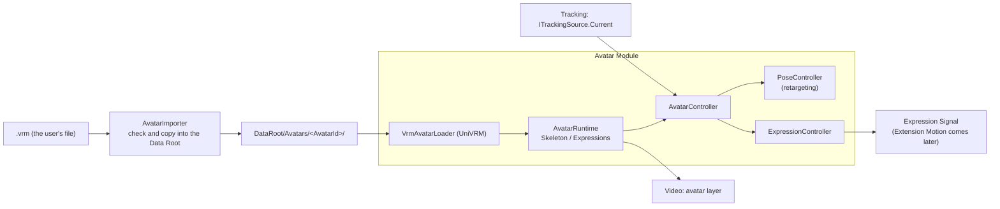

# Avatar Detailed Design

## 1. Purpose

This document defines the detailed design of the Avatar module. The Avatar module loads 3D models and applies Tracking observations (`TrackingFrame`) to the avatar's pose and expressions (system design chapter 7).

The scope built here (v0.1.0):

- Loading VRM (UniVRM; VRM 0.x is converted to 1.0 at load, 6.8) and the avatar abstraction (Avatar Runtime, skeleton, expressions)
- Registering avatars: copying into the Data Root, Avatar Profile, thumbnail, showing the model's license information
- Choosing the avatar to use, loading it at startup, and placing it on the stream
- Applying the pose (upper body, fingers) and expressions (eyes, mouth, gaze, brows)
- Handling lost tracking, mirroring, and interpolating between observations

Out of scope, handled by later designs:

- Loading FBX (system design 7.3; starting with the choice of library)
- Extension bones and Extension Motion (cat ears, tails, and so on; system design 7.8). The Expression Signal is output already (7.4)
- Applying full body (`BodyRange.FullBody`): hip movement, legs, foot contact
- Showing several avatars at once (system design 7.9; internally not limited to one)
- Transitions when switching avatars during a stream (fades and so on)
- Avatar Spawn Points in Stage Scenes (system design 11.6). Until then a default position is used (6.5)

Related system design sections: chapter 7 3D avatar control, chapter 8 tracking, 6.9–6.11 Data Root, 11.6 Avatar Spawn Point, 15.3 real-time behavior

Related detailed designs: Tracking (`tracking.md`), Video (`video.md` 7.2 the avatar layer), Stage (`stage.md`)

Prototype referenced (outside the repository): `E:\VirtualVessel\benchmarks\Voom`. Its VRM 1.0 loading (`Vrm10` of UniVRM 0.129.1) and its tuning knowledge for converting face movement to expressions are used as reference. Its body application (only the chest tilt, averaging Euler angles) is not kept (Tracking detailed design chapter 1).

### Overview



---

## 2. Responsibilities

| Responsibility | Owner |
|---|---|
| Checking a model file, copying it into the Data Root, and registering it | Avatar (`AvatarImporter`) |
| The file-picking screen (the OS dialog) | UI (`IFileDialog`, 6.7) |
| Loading a model format and converting it to a format-independent representation | Avatar (per-format loaders) |
| Fitting the observed pose to the avatar skeleton (body size, bone orientation) | Avatar (`PoseController`) |
| Converting face movement to the avatar's expressions | Avatar (`ExpressionController`) |
| Mirroring, interpolating between observations, handling lost tracking | Avatar |
| Observation, smoothing, input correction | Tracking |
| Where the avatar is placed (spawn point) | Stage (a default position in v0.1.0, 6.5) |
| The camera and layer that draw the avatar | Video |
| Screens for choosing and setting up avatars | UI (setup screen) |

---

## 3. Module Boundaries

- Avatar references Core, Diagnostics, ProjectData, the public contracts of Tracking (`ITrackingSource`, `TrackingFrame`), and the public contract of Video (the avatar layer). It does not reference Capture or UI.
- UniVRM types (`UniVRM10.*`, `UniGLTF.*`) are used only inside the VRM loader (a separate assembly, chapter 16). The rest of Avatar uses only `IAvatarRig` and `IAvatarExpressions` (5.2) (system design 7.2).
- Other modules use only `IAvatarService` (5.1). They do not operate transforms or blendshapes directly (system design 7.2 Avatar Controller).
- It does not depend on Tracking's MediaPipe types. Its only input is `TrackingFrame`.

---

## 4. Main Classes and Interfaces

| Name | Kind | Summary |
|---|---|---|
| `IAvatarService` | Interface | The list of registered avatars, registering, choosing, the state of the current avatar (5.1) |
| `AvatarService` | Class (`IApplicationService`) | Implements the above. Loads, places, and calls the per-frame application |
| `AvatarEntry` | Class | A registered avatar: id, display name, format, thumbnail, license information |
| `AvatarImporter` | Class | Checks the file, copies it into the Data Root, and creates the profile (6.2) |
| `IAvatarLoader` | Interface | Per-format loading (system design 7.3) |
| `VrmAvatarLoader` | Class (internal) | Loads VRM with UniVRM |
| `AvatarRuntime` | Class | One loaded avatar: rig, expressions, profile, state (system design 7.2) |
| `IAvatarRig` | Interface | A format-independent skeleton. Sets standard bone (`AvatarBone`) rotations in a space where the reference pose is identity (7.1) |
| `IAvatarExpressions` | Interface | Format-independent expressions. Sets the weights of standard expressions (`AvatarExpression`) and the gaze |
| `AvatarBone` | Enum | Standard human bones (same order as Unity Humanoid) |
| `AvatarExpression` | Enum | Standard expressions: `Blink`, `BlinkLeft`, `BlinkRight`, `Aa`, `Ih`, `Ou`, `Ee`, `Oh`, `Happy`, `Angry`, `Sad`, `Relaxed`, `Surprised`, `Neutral` |
| `AvatarController` | Class | The control entry point for one avatar; dispatches to pose and expressions |
| `PoseRetargeting` | Static class | Computes bone rotations from observations (pure functions, chapter 7) |
| `PoseController` | Class | Interpolation, handling lost tracking, application according to the range (`BodyRange`) |
| `ExpressionMapping` | Class | Settings for converting expression values (`FaceShape`) to expressions (7.4) |
| `ExpressionController` | Class | Applies expressions and gaze; produces the Expression Signal |
| `AvatarProfile` | Class | Saved usage settings (6.3) |
| `AvatarSettings` | Class | The avatar in use (chapter 10) |

---

## 5. Public API

### 5.1 IAvatarService

```csharp
public interface IAvatarService
{
    IReadOnlyObservable<IReadOnlyList<AvatarEntry>> Avatars { get; }   // Registered avatars
    IReadOnlyObservable<string> CurrentAvatarId { get; }                // The avatar in use, or null
    IReadOnlyObservable<AvatarState> State { get; }                     // None, Loading, Ready, Error
    IReadOnlyObservable<AvatarProblem> Problem { get; }                 // Problem shown to the user (chapter 11)

    Task<AvatarEntry> ImportAsync(string path, CancellationToken cancellationToken);  // Registers (6.2)
    Task SelectAsync(string avatarId, CancellationToken cancellationToken);           // Loads and swaps
    Task RemoveAsync(string avatarId, CancellationToken cancellationToken);           // Unregisters (UI confirms)
}
```

- All operations and notifications happen on the main thread. Copying files and computing hashes happen on another thread.
- `SelectAsync` swaps out the old avatar only after the new one has loaded. If loading fails, the old avatar stays.

### 5.2 Format-independent Skeleton and Expressions

```csharp
public interface IAvatarRig
{
    bool Has(AvatarBone bone);
    float BoneLength(AvatarBone bone);                       // Length to the child bone (meters)
    void SetRotation(AvatarBone bone, Quaternion rotation);  // Rotation from the reference pose (7.1), in the avatar root space
    void SetRootPosition(Vector3 position);                  // For full body (later)
}

public interface IAvatarExpressions
{
    bool Has(AvatarExpression expression);
    void SetWeight(AvatarExpression expression, float weight);   // 0–1
    void SetLookAt(float yawDegrees, float pitchDegrees);
    IReadOnlyList<string> CustomNames { get; }                   // The model's own expression names (Perfect Sync and so on, later)
}
```

- For VRM, `IAvatarRig` is implemented with UniVRM's control rig (a normalized skeleton where every bone's rotation is identity in the reference pose). UniVRM absorbs per-model differences in bone axes (one bone's X axis points forward, another's Z axis, and so on). An FBX loader will do the same normalization inside the loader.
- For VRM, `IAvatarExpressions` is implemented with VRM 1.0 expressions (presets) and LookAt.

---

## 6. Data Model

### 6.1 Storing Avatars (System Design 7.11, 6.10)

```text
DataRoot/Avatars/<AvatarId>/
├─ model.vrm               The copied model (the original file is not changed)
├─ avatar-profile.json     Usage settings (6.3)
└─ thumbnail.png           Thumbnail (the image in the VRM meta; captured at load if missing)
```

- `AvatarId` is a GUID (`N` format) created at registration. Names and file names are not used (to avoid duplicates and invalid characters).
- The list is built at startup by reading under `Avatars/`. An entry whose `avatar-profile.json` cannot be read is listed as "an avatar that cannot be loaded", and the user decides whether to remove it (never removed silently, CLAUDE.md chapter 25).

### 6.2 Registering (AvatarImporter)

1. The user picks a file (UI `IFileDialog`).
2. Check: the `.vrm` extension, a size limit (default 1 GB), and that the file starts as glTF binary (the `glTF` magic).
3. Copy into a temporary folder (`Avatars/.importing/<AvatarId>/`) on another thread. Compute SHA-256; if an avatar with the same hash is registered, point to it and do not register.
4. Check the copy in the temporary folder by actually loading it (`VrmAvatarLoader`, 6.4): the standard bones are present; extract the meta information.
5. Write `avatar-profile.json` and the thumbnail, then move the temporary folder to `Avatars/<AvatarId>/`. If anything fails on the way, delete the temporary folder.
6. Add it to the list. If it is the first avatar, make it the one in use.

- The original file path is kept in `avatar-profile.json` for reference but is not used at run time (system design 7.11).

### 6.3 Avatar Profile

```json
{
  "schemaVersion": 1,
  "avatarId": "3f2c...",
  "displayName": "The model's name (from the meta; the user can change it)",
  "format": "vrm",
  "formatVersion": "1.0",
  "converted": false,
  "sourceFileName": "original.vrm",
  "sha256": "...",
  "importedAt": "2026-10-20T12:00:00Z",
  "license": { "...": "The license fields of the VRM meta (6.4)" },
  "scale": 1.0,
  "expressionMapping": { "...": "Only items changed from the defaults (7.4)" },
  "pose": { "armDownAngle": 70 },
  "extensions": {}
}
```

- Unknown fields are kept (CLAUDE.md chapter 25). `extensions` is where later settings such as Extension Motion go.
- Fields equal to the defaults are not written, so improved defaults reach users who did not change them.

### 6.4 Model License (VRM Meta)

In VRM, the author writes the conditions for using the avatar (who may use it as an avatar, commercial use, violent or sexual expression, modification, redistribution, and so on).

- At registration and in the avatar details, the author, conditions, and license URL are shown to the user.
- Registration or use is not blocked because of the conditions (the user judges). However, when `avatarPermission` is author-only or similar, a notice is shown before registering.
- The license URL opens in the external browser only when the user presses it.

### 6.5 Placing the Avatar

- The avatar is placed in the persistent area owned by the application (outside Stage Scenes) (system design 7.10).
- Until Stage Scene spawn points exist, Stage provides one default spawn point (`IAvatarSpawnPoints`, added to the Stage detailed design): at the origin, facing the camera. The default Main Camera position is set so the upper body fits the stream (Video).
- It is drawn on the Unity layer `Avatar`, by Video's Avatar Camera (Video detailed design 7.2: same position and field of view as the Main Camera, overlay). It appears in front of the flat videos (user's decision, 2026-10-17).

### 6.6 Mirroring

- With mirroring (default: on), when the user raises the right hand, the avatar raises its left hand. On screen the hand on the same side goes up, so the user can move as if looking in a mirror.
- The setting is `Mirror` in `ITrackingSource.Options`: one setting with the left-right flip of the camera image on the setup screen, saved by Tracking in `tracking-settings.json` (Tracking detailed design chapter 10).
- `TrackingFrame` holds the user's own left and right (Tracking detailed design 6.1). Mirroring swaps left and right and flips the X axis before application (input conversion of `PoseRetargeting`, a pure function). Left and right of expressions (a one-eye blink and so on) are swapped as well.

### 6.7 The File-picking Screen

- UI gets `IFileDialog` (`Task<string> OpenAsync(FileDialogOptions options)`). On Windows, the COM `IFileOpenDialog` is opened on a dedicated STA thread. Opening it on the main thread would stop rendering and the stream image while the dialog is open.
- No additional dependency (library) is added.

### 6.8 VRM 0.x

- VRM 0.x models are accepted too (user's decision, 2026-10-18; system design 7.3). UniVRM's loading converts VRM 0.x to VRM 1.0 (enabling the 0.x conversion of `Vrm10`).
- The original file (`model.vrm`) is stored as it is, and the conversion runs at every load. The converted result is not saved as a file, so improvements to UniVRM's conversion take effect without re-importing.
- The profile's `formatVersion` is the original version (`0.x`), and `converted` shows that it was converted.
- The license (6.4) is shown by mapping the 0.x meta fields to the 1.0 fields. Fields without a counterpart are shown with their original values.
- Bone reference orientations and expression names differ between 0.x and 1.0, but after conversion the model is handled as 1.0. Remaining differences (such as the gaze range) are checked by tests.

---

## 7. Computing Pose and Expressions

### 7.1 Reference Pose and Bone Rotations

- In UniVRM's control rig, every bone's rotation is identity (no rotation) in the reference pose (T pose). For each bone, `PoseRetargeting` computes the rotation from "the bone direction in the reference pose (for example +X for the right upper arm)" to "the observed direction".
- A direction alone does not decide the twist around the bone. The twist is decided by a second direction:

| Bone | Direction | Direction that decides the twist |
|---|---|---|
| Torso (Spine, Chest) | Hips to neck | The line between the shoulders |
| Neck, head | The rotation of the facial transformation matrix (Tracking detailed design 6.3), split between neck and head (default: neck 40%, head 60%) | Same |
| Upper arm | Shoulder to elbow | The plane the elbow bends in (normal of the plane of upper arm and forearm) |
| Forearm | Elbow to wrist | Palm orientation (from the Hand Landmarker; otherwise carried over from the upper arm) |
| Hand | Wrist to the base of the middle finger | The palm normal |
| Fingers | The flexion angle of each joint (7.5) | The palm |

- Only rotations are applied, not positions. So even if the avatar's and the user's bodies differ (arm length and so on), the bone directions are the same (absorbing body-size differences, system design 7.6). Movements that need matching positions, such as touching the face with a hand, are considered later with IK (solving rotations from joint positions) together with full body (chapter 17).
- The computation is done by `PoseRetargeting` (pure functions): the input is the body and hands of `TrackingFrame`, mirroring, and profile corrections; the output is an array of rotations per bone (passed in by the caller, to avoid per-frame allocations).

### 7.2 Upper Body (BodyRange.UpperBody)

- The hips do not move. The torso is distributed over Spine, Chest, and Upper Chest from the tilt of the shoulder line and the forward/back tilt of the neck (default: 30%, 35%, 35%), so the torso moves even when seated.
- Torso rotation has limits (side tilt ±30°, forward/back ±25°, twist ±40°) so inference errors do not bend the torso unnaturally.
- Shoulders rise slightly only when the arms are raised (part of the upper arm's raise angle goes to the shoulder).
- When an arm is lost, it returns to the arms-down pose (`pose.armDownAngle`, lowered 70° by default), never to the T pose.
- The lower body stays in the arms-down reference pose (a straight standing pose that looks natural whether seated or standing).

### 7.3 Interpolating Between Observations

- For each rendered frame, the two latest observations are interpolated at the render time (rotations with spherical interpolation). The render time is "now − one observation interval", so it always falls between two observations. This adds one observation interval of lag (about 33 ms at 30 per second) but removes the steps caused by rendering more often than inference.
- When the next observation is late, it stops at the last observation (no prediction ahead, because the correction when a prediction is wrong is noticeable).

### 7.4 Expressions (ExpressionMapping)

Conversion from expression values (`FaceShape`, 0–1) to the avatar's expressions (`AvatarExpression`). Each value has a response curve (lower bound, upper bound, curvature). The defaults are below and can be changed in the Avatar Profile.

| Expression | Source values | Tuning (including Voom's knowledge) |
|---|---|---|
| `BlinkLeft` / `BlinkRight` | `EyeBlinkLeft` / `EyeBlinkRight` | How easily the eyes close (lower and upper bounds). Keep both eyes together (default: on; a one-eye blink only when the difference is large) |
| `Aa` | `JawOpen` | Mouth opening |
| `Ou` | `MouthPucker`, `MouthFunnel` | Pursed lips |
| `Oh` | `MouthFunnel` and `JawOpen` | Rounded and open |
| `Ee` | `MouthStretchLeft/Right` | Stretched sideways |
| `Ih` | `MouthSmileLeft/Right` and a small `JawOpen` | Pulled sideways and slightly open |
| `Happy` | `MouthSmileLeft/Right`, `CheekSquintLeft/Right` | Default: weak (×0.6) |
| `Surprised` | `BrowInnerUp`, `EyeWideLeft/Right` | Default: weak |
| `Angry` | `BrowDownLeft/Right` | Default: weak |
| `Sad` | `MouthFrownLeft/Right`, `BrowInnerUp` | Default: weak |
| Gaze | `EyeLookIn/Out/Up/Down` (left and right) | Angle range (default: ±12° horizontal, ±10° vertical) |

- The five mouth shapes (`Aa` and so on) are distributed by ratio so their sum does not exceed 1. Some models break when an emotion expression (`Happy` and so on) overlaps blinks or mouth shapes, so blinks and mouth shapes are weakened while an emotion expression is shown (following the VRM 1.0 `overrideBlink` and `overrideMouth` settings).
- From the result, the Expression Signal (a 0–1 value per expression) is produced. v0.1.0 has no consumer (Extension Motion) yet, but the output shape is fixed (system design 7.7).
- `IAvatarExpressions.CustomNames` exists so a method passing values straight through can be added later for models that have their own 52 ARKit expressions (Perfect Sync) (chapter 17).

### 7.5 Fingers

- The flexion of each finger joint comes from the angle between neighboring bones (Tracking detailed design 8.4). Flexion is limited to 0–90° (the thumb has its own range) and spreading to ±15°.
- When a hand is lost, it slowly returns to a lightly closed natural shape.
- When a lost hand returns, it moves toward the observation over 0.2 s so the shape does not change suddenly.

---

## 8. State / Lifecycle

### 8.1 AvatarService

- An optional application service, started after Logging, Video, Stage, and Tracking. Without Tracking, the avatar is shown in the reference pose.
- At startup it builds the list and loads the avatar in use from `avatar-settings.json` (without blocking the main thread for long, chapter 9).
- At shutdown it destroys the avatar's GameObjects, textures, meshes, and materials (using the disposal of UniVRM's `RuntimeGltfInstance`).

### 8.2 Loading

1. `Loading`. `VrmAvatarLoader` reads the file and builds it with UniVRM.
2. Check the rig and expressions. If a required bone (Hips, Spine, Chest, Neck, Head, left and right upper arms, forearms, hands) is missing, `Error` (`MissingBones`).
3. Set the layer to `Avatar` and place it at the spawn point.
4. `Ready`. Destroy the old avatar, if any.

### 8.3 Per-frame Application

- Before the Avatar Camera renders, in this order (equivalent of `LateUpdate`, after `IFrameLoop`):
  1. Read `ITrackingSource.Current`.
  2. `PoseController`: interpolation, returning lost parts, `PoseRetargeting`, setting the rig.
  3. `ExpressionController`: expressions and gaze.
  4. Call UniVRM's processing (applying the control rig, expressions, LookAt, SpringBone) explicitly once. UniVRM's automatic update is turned off and the order is decided here (so SpringBone runs after the pose).
- Nothing is allocated per frame. The bone rotation and expression value arrays are reused.

### 8.4 When Tracking Is Lost

| Status | Handling |
|---|---|
| `Tracked` | Apply the observation |
| `LowConfidence` | Blend between the previous value and the observation by confidence |
| `Lost` (within 0.5 s) | Keep the last value |
| `Lost` (over 0.5 s) | Return over 1 s to the reference pose (arms down, hands lightly closed, no expression) |
| On return | Move toward the observation over 0.2 s |
| `Disabled`, `NotSupported` | Reference pose |

---

## 9. Threading / async

- Building the avatar (GameObjects, meshes, textures) uses Unity APIs and happens on the main thread. Reading the file and parsing glTF use UniVRM's asynchronous loading (`Vrm10.LoadBytesAsync` and so on, splitting the work over several frames with `IAwaitCaller`), so no single frame is blocked for long. The loading time and the longest frame are recorded.
- Copying, hashing, and writing the thumbnail happen on another thread.
- Pose and expression application happens on the main thread once per frame.

---

## 10. Settings

```csharp
public sealed class AvatarSettings
{
    public string CurrentAvatarId { get; set; }   // No avatar is shown when null
}
```

- Saved to `avatar-settings.json` (settings folder, `ConfigFileStore`). Moves to Project / Profile once those exist.
- Per-avatar settings are in `avatar-profile.json` (6.3).
- Mirroring is a Tracking setting (6.6).

---

## 11. Logging and Diagnostics

- Registration, loading, swapping, and failures are logged at Information with the avatar id, format, version, and loading time. Missing bones and expressions are logged at Warning (system design 7.13). Full file paths are not logged (they contain the user name); only file names are.
- Performance metrics:

| Metric | Kind | Content |
|---|---|---|
| `Avatar/Load` | Timer | Loading time |
| `Avatar/LoadLongestFrame` | Timer | The longest frame while loading |
| `Avatar/Apply` | Timer | Per-frame pose and expression application time |

- Problems shown to the user (`AvatarProblem`): `NotVrm` (this is not a VRM file), `TooLarge`, `MissingBones` (this model cannot be used because its humanoid bones are incomplete), `LoadFailed` (the avatar could not be loaded), `AlreadyImported`, `StorageFailed` (could not save; check free space at the save location).

---

## 12. Error Handling and Recovery

| Event | Handling |
|---|---|
| Registration fails midway | Delete the temporary folder; the list does not change |
| The avatar in use cannot be loaded (at startup) | `Error`. Continue without an avatar; another avatar can be chosen |
| Loading for a swap fails | Keep the old avatar |
| Missing bones | Unusable if a required bone (8.2) is missing. For optional bones such as fingers, only that bone's application stops |
| Missing expressions | Only that expression's application stops |
| No Tracking, or it is stopped | Show the reference pose |
| UniVRM exceptions | Caught in the loader and turned into `LoadFailed`. The application keeps running |

---

## 13. Security and Privacy

- Model files are untrusted input brought in from outside. The extension, size limit, and format magic are checked before parsing. Parsing is done by UniVRM; there is no mechanism to run scripts contained in a model.
- Parsing exceptions are caught in the loader, and objects created midway are destroyed.
- Registered models stay only in the user's Data Root and are not sent anywhere.
- The model license (6.4) is shown to the user. The user judges the conditions.
- Only `https` license URLs are opened, and only by the user's action.

---

## 14. Testing Strategy

| Kind | Target |
|---|---|
| EditMode | `PoseRetargeting`: from synthetic observations of known poses (arm 90° to the side, 90° forward, bent elbow, turned palm, tilted torso), the bone rotations are as expected. Mirroring. Joint limits |
| EditMode | Interpolation (7.3), returning when lost (8.4), blending for `LowConfidence` |
| EditMode | `ExpressionMapping`: response curves, keeping eyes together, distributing mouth shapes, overlap with emotion expressions |
| EditMode | `AvatarImporter`: checking extension, size, and magic; cleaning up the temporary folder; detecting the same hash; reading and writing the profile (keeping unknown fields) |
| EditMode | `AvatarController` driven by fake `IAvatarRig` and `IAvatarExpressions` |
| PlayMode | Loading a real VRM: bones and expressions are present, and destroying leaves nothing behind. Uses a small test model that can be committed, if one exists; otherwise the sample from the user (outside the repository) with `[Explicit]` |
| Hardware | Camera, MediaPipe, and avatar connected and checked visually (demo branch) |
| Performance | Loading time and the longest frame; per-frame application time |

---

## 15. Performance

- Per-frame application (`Avatar/Apply`) targets 0.3 ms or less (measured on the development PC and recorded here).
- A single frame while loading targets 50 ms or less, so switching avatars during a stream does not visibly freeze the image.
- SpringBone load depends on the model. It is measured and recorded.

---

## 16. Directory / Namespace and Dependencies

```text
Assets/VirtualVessel/Avatar/
├─ Runtime/                                   VirtualVessel.Avatar
│  ├─ IAvatarService.cs     IAvatarService, AvatarEntry, AvatarState, AvatarProblem
│  ├─ AvatarService.cs      AvatarService, AvatarSettings
│  ├─ Core/                 AvatarRuntime, IAvatarRig, IAvatarExpressions, AvatarBone, AvatarExpression, AvatarProfile
│  ├─ Loading/              IAvatarLoader, AvatarImporter, AvatarStore
│  ├─ Pose/                 PoseRetargeting, PoseController, PoseInterpolation
│  ├─ Expression/           ExpressionMapping, ExpressionController, ExpressionSignal
│  └─ Runtime/              AvatarController
├─ Vrm/                                       VirtualVessel.Avatar.Vrm (the only assembly that references UniVRM)
│  ├─ VrmAvatarLoader.cs
│  ├─ VrmAvatarRig.cs       IAvatarRig on the control rig
│  └─ VrmAvatarExpressions.cs
└─ Tests/
   ├─ EditMode/
   └─ PlayMode/
```

- References: Core, Diagnostics, ProjectData, Tracking, Video. The VRM assembly also references UniVRM (`com.vrmc.vrm`, `com.vrmc.gltf`).
- UniVRM is added by UPM Git URL with a pinned version tag (currently v0.131.3; `path=/Packages/VRM10` and so on, the layout since v0.131). `packages-lock.json` pins the commit. Whether it runs on Unity 6.6 is checked in that step. The license is MIT. It is recorded in the SBOM in the same change.
- The VRM shaders (MToon for URP) must be confirmed to be included in the distribution build (materials of models loaded at run time use them, and they would not render if left out of the build).

---

## 17. Open Issues

| Item | Plan |
|---|---|
| Whether to accept VRM 0.x models | Decided: accepted by converting to 1.0 at load (6.8, system design 7.3; user's decision, 2026-10-18) |
| A VRM model for tests | Receive a sample from the user (outside the repository, in `E:\VirtualVessel\samples\`). Start with VRM 1.0; ask for a 0.x model when the 0.x conversion tests need one. If a small model with a license that allows committing exists, use it for automated tests |
| Position matching such as touching the face (IK) | Considered together with full body |
| Perfect Sync (models with the 52 ARKit expressions) | After v0.1.0 |
| FBX | Starting with the choice of library. After v0.1.0 |
| Screens for adjusting the spawn point and camera position | When designing Stage Scenes and Camera Points |
| Moving settings to Project / Profile | When designing Project / Profile |

---

## 18. Implementation Order

Tracking and Avatar proceed together in this order. Each step is one branch with its tests and a demo branch to try it (CLAUDE.md 29.2). v0.1.0 is released after step 7.

1. Tracking foundation (Tracking detailed design chapter 18, item 1)
2. MediaPipe and the camera (Tracking detailed design chapter 18, item 2)
3. Loading avatars: adding UniVRM (SBOM), registration, Data Root, `IFileDialog`, Video's avatar layer and Avatar Camera, the default spawn point, the avatar card on the setup screen
4. Face: expressions, gaze, head orientation
5. Upper body: torso, shoulders, arms. Comparing depth estimation (Tracking detailed design 8.4)
6. Fingers
7. Tracking settings screen (range choice with "full body: coming soon", smoothing levels, mirroring, reference pose), finishing diagnostics
