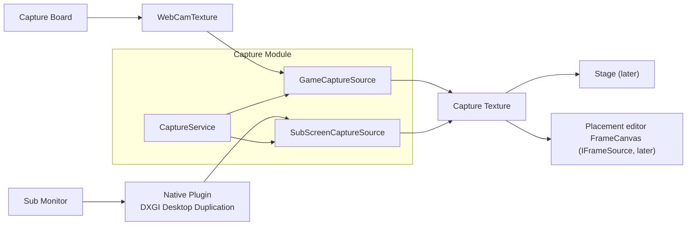

# Capture Detailed Design

## 1. Purpose

This document defines the detailed design of the Capture module. The Capture module acquires external video (and audio) and hands it to other modules as textures Unity can use.

It covers:

- The common contract of capture sources (`IVideoCaptureSource`) and their states
- GameCapture: video from a capture board (a game device such as a Nintendo Switch)
- SubScreenCapture: video from a PC's sub monitor (DXGI Desktop Duplication)
- Starting and stopping capture sources, degrading on failure, and diagnostics
- The native plugin (SubScreenCapture) and how it is built

These are out of scope and handled by later designs:

- Where captured video is shown (Stage module, system design 10.23, 11.14)
- Producing the final video and its preview (Video module, system design 10.5, 10.6)
- GameCapture audio (designed together with the Audio module, system design 12.16)
- The Capture setup screen and live screen controls (designed with each screen's specification, system design 14.41)
- Where settings are stored (decided with the Project / Profile design)

Related system design sections:

- 10.19 Internal responsibilities (Capture module)
- 10.20–10.27 Capture
- 11.14 Capture screen surfaces
- 12.16 Game / capture audio
- 14.41 Capture UI
- 15.5 Real-time video performance
- 16.30 Capture source and backend extensions

Prototypes consulted (outside the repository, CLAUDE.md chapter 12):

- `E:\VirtualVessel\benchmarks\GameCaptureUnityPlugin` (`VideoDisplayer.cs`)
- `E:\VirtualVessel\benchmarks\SubScreenCapture` (`DDCapture.cpp`)

### Overview



---

## 2. Responsibilities

| Responsibility | Owner |
|---|---|
| Acquiring video and turning it into a Unity texture | Capture |
| Capture source states, detecting failures, degrading, reconnecting | Capture |
| Listing and choosing devices (capture boards, monitors) | Capture. The choosing itself is UI (setup screen, later) |
| Where captured video is shown, and the placement data | Stage (later) |
| Producing the final video | Video (later) |
| Mixing and routing GameCapture audio | Audio (later) |
| Creating sources and the start/stop order | Application (composition) |

---

## 3. Module Boundaries

- The Capture module references only Core and Diagnostics. It does not reference Stage, Video, or UI.
- Other modules use only `IVideoCaptureSource` and `ICaptureSources`. `WebCamTexture`, DXGI, and the native plugin's types and handles never leave the module (system design 10.27).
- Video is handed over as a texture (`UnityEngine.Texture`). How it is acquired (a copy through the CPU, sharing on the GPU, and so on) is not visible from outside (system design 10.22).
- The native plugin lives in `native/capture/` and is called only from inside the Capture module (`SubScreen/`).

---

## 4. Main Classes and Interfaces

| Name | Kind | Summary |
|---|---|---|
| `IVideoCaptureSource` | Interface | The common contract of a capture source that provides video |
| `ICaptureDeviceSource` | Interface | A capture source with a device to choose (board, monitor): the device list and the choice |
| `ICaptureSources` | Interface | The list of capture sources. Other modules get sources from here |
| `CaptureState` | Enum | `Stopped`, `Starting`, `Ready`, `Capturing`, `Unavailable`, `Error` |
| `CaptureProblem` | Enum | What kind of problem to tell the user (device not found, and so on) |
| `CaptureDevice` | Class | A device's identifier and display name |
| `CaptureSourceInfo` | Struct | The actual resolution, frame rate, and device display name |
| `CaptureService` | Class (`IApplicationService`) | Creates, starts, stops, and updates sources every frame; measures |
| `GameCaptureSource` | Class | GameCapture through `WebCamTexture` |
| `SubScreenCaptureSource` | Class | SubScreenCapture through the native plugin |
| `IDesktopDuplication` | Interface (internal) | The boundary to the native plugin; replaced by a fake in tests |
| `ICameraDevices` | Interface (internal) | The boundary to `WebCamTexture`; replaced by a fake in tests |
| `CaptureStateMachine` | Static class | Decides state transitions (pure functions) |
| `IFrameLoop` | Interface (Core) | Registers work called on the main thread every frame (added to the application foundation design) |

---

## 5. Public API

```csharp
public interface IVideoCaptureSource
{
    string Id { get; }                                       // "game", "subscreen". Stage refers to sources by this
    CaptureSourceKind Kind { get; }                          // GameCapture, SubScreenCapture
    IReadOnlyObservable<CaptureState> State { get; }
    IReadOnlyObservable<CaptureProblem> Problem { get; }     // What to tell the user; None when there is nothing
    IReadOnlyObservable<CaptureSourceInfo> Info { get; }     // Actual resolution, frame rate, device name
    IReadOnlyObservable<Texture> Texture { get; }            // The video; a different texture when the resolution changes
    void Start();
    void Stop();
}

public interface ICaptureDeviceSource : IVideoCaptureSource
{
    IReadOnlyList<CaptureDevice> Devices { get; }            // The devices found by the last check
    void RefreshDevices();                                   // Checks the devices again (main thread, a few ms or more)
    string SelectedDeviceId { get; }
    void SelectDevice(string deviceId);                      // While running, captures again from the chosen device
}

public interface ICaptureSources
{
    IReadOnlyList<IVideoCaptureSource> Sources { get; }
    IVideoCaptureSource Find(string id);
}
```

- Every operation and state notification happens on the main thread.
- `Texture` is `null` until the first frame and after the device is closed (stopped, gone, or failed). While the device stays open but the video stops (`Ready`, `NoSignal`), it keeps the last image. Users subscribe to `Texture` and swap what they show.
- `Info` returns to its default (0×0, 0 fps, no device name) when the device is closed.
- `Start()` returns without waiting; the result comes through `State`, because opening a device can take time.

---

## 6. Data Model

### 6.1 States (system design 10.24)

| State | Meaning |
|---|---|
| `Stopped` | Stopped: the user stopped it, or it was never started |
| `Starting` | Opening the device |
| `Ready` | The device is open but no video is arriving, either not yet or no longer (no input on the capture board, and so on) |
| `Capturing` | Video is arriving |
| `Unavailable` | The chosen device or monitor is not found. Checked again at intervals and opened automatically when it comes back |
| `Error` | It could not open, or an unrecoverable failure happened while capturing |

`CaptureStateMachine` (pure functions) decides transitions, and the sources act on the results.

### 6.2 Problems for the User (system design 10.26)

| `CaptureProblem` | What the user sees (example) |
|---|---|
| `None` | — |
| `DeviceNotFound` | The capture board can't be found |
| `MonitorNotFound` | The monitor can't be found |
| `NoSignal` | No video is arriving (check the game device's power and cable) |
| `StartFailed` | The video couldn't be captured |
| `PluginMissing` | A developer problem; users see it as `StartFailed` |

The texts go into the UI string tables when the screens are built. Internal details such as DXGI or HRESULTs are not shown to users (system design 14.41).

### 6.3 Devices

```csharp
public sealed class CaptureDevice
{
    public string Id { get; }            // The identifier used for saving
    public string DisplayName { get; }   // The name shown
}
```

| Source | `Id` | `DisplayName` |
|---|---|---|
| GameCapture | `WebCamDevice.name` | The same |
| SubScreenCapture | The monitor's device name (for example `\\.\DISPLAY2`) | Its number and resolution, such as "Monitor 2 (1920×1080)", with a mark for the main monitor |

SubScreenCapture defaults to the first monitor that is not the main one. With a single monitor it picks that one, for trying it out.

---

## 7. State / Lifecycle

### 7.1 CaptureService

- `CaptureService` is an Optional application service that starts after logging and performance metrics. Its failure stops no other feature (system design 10.24). The composition registers it as the service `Capture`, depending on Logging. It needs `IFrameLoop` for its per-frame update, so it is not registered when there is no frame loop (as in tests that run no frames).
- At startup it creates two sources, `game` and `subscreen`. Both start `Stopped` and never start on their own; they are started and stopped from the setup screen, the live screen (later), or the demo.
- On shutdown it stops every source and releases textures, `WebCamTexture`, and native handles.
- It receives its per-frame update through `IFrameLoop` (7.3).

### 7.2 Frame Loop (Added to the Application Foundation)

```csharp
// VirtualVessel.Core.Lifecycle
public interface IFrameLoop
{
    IDisposable Register(Action tick);   // Dispose removes the registration
}
```

- `ApplicationBootstrap.Update` calls the registered work in registration order, after the work posted to the main thread (`MainThreadDispatcher.Drain`).
- One piece of work throwing does not stop the others. The exception is recorded as an error, and the same work's exceptions are not recorded again and again.
- The composition passes it explicitly to the services that need it; it is not a global instance.
- Per-frame work avoids allocations and keeps heavy work out (CLAUDE.md chapter 23).

### 7.3 Per-Frame Work

| Source | Work |
|---|---|
| GameCapture | Checks for `WebCamTexture` updates and reflects the state (`Ready` / `Capturing`) and the actual resolution and frame rate. Only when no video has arrived for a second does it check that the device is still in the list (8.1) |
| SubScreenCapture | When the native side has a new frame, uploads it to the texture (8.2), and reflects the native state |
| Both | `Unavailable` sources check their device again every 2 seconds |

---

## 8. Main Sequences

### 8.1 GameCapture

As in the prototype (`VideoDisplayer.cs`), the capture board is opened as a UVC video device through `WebCamTexture`. No native plugin is used.

1. `Start()`: if the chosen device is not in `WebCamTexture.devices`, `Unavailable` (`DeviceNotFound`).
2. Create a `WebCamTexture` with the device name and the requested resolution and frame rate (default 1920×1080, 60 fps), and `Play()` it. `Starting`.
3. Until the first frame arrives (`didUpdateThisFrame`, width over 16 px), `Ready`.
4. When frames arrive, `Capturing`. `Texture` exposes the `WebCamTexture`; `Info` gets the actual resolution and the frame rate that actually arrives (counted about every second).
5. When no frame arrives for 5 seconds (after opening, or after the last frame), `Ready` with `Problem = NoSignal`. `Texture` keeps the last image and the frame rate in `Info` becomes 0. A frame makes it `Capturing` again.
6. When no frame has arrived for a second, it checks that the device is still in the list (at most every 2 seconds). If it dropped out, `Unavailable`; it reopens automatically when it comes back. `WebCamTexture` has no event for a device that goes away; its image just stops. While frames arrive the list is not checked: listing devices queries the OS and allocates memory, and a device that sends video is clearly there.

The prototype chose devices by their index in the list. Indices change as devices are plugged in and out, so the product chooses by device name.

### 8.2 SubScreenCapture

The native plugin (`VirtualVessel.Capture.Native.dll`) acquires frames with DXGI Desktop Duplication and copies them into CPU memory. The managed side uploads to a Unity texture only when there is a new frame. It keeps the prototype's approach (`DDCapture.cpp`, a copy through the CPU) and fixes the following:

| The prototype's problem | What the product does |
|---|---|
| It created a staging texture every frame | Reuses it until the resolution changes |
| Writing and reading had no exclusion, so images could mix | Uses three buffers in turn (being written, latest, being read), with only short locks and no waiting |
| There was no way to tell whether a frame was new | Numbers frames; the managed side uploads only when the number changes |
| Resolution changes and switching to the UAC screen (`DXGI_ERROR_ACCESS_LOST`) stopped it for good | Recreates the duplication; `Error` if failures continue |
| Only monitors on the first GPU could be chosen | Lists monitors on every GPU and duplicates on the GPU the monitor is attached to |
| It put the screen in named shared memory (`Local\DDCaptureBuffer`) | Other programs of the same user could read it, so it is not used; only memory inside the process |
| It swallowed exceptions with SEH | Checks ranges before copying and reports failures as states |

1. `Start()`: if the chosen monitor is not found, `Unavailable` (`MonitorNotFound`).
2. The native side creates a D3D11 device on the GPU the monitor is attached to, calls `DuplicateOutput`, and starts its capture thread. `Starting` → `Ready`.
3. The thread waits in `AcquireNextFrame` (100 ms). When a frame comes, it copies it to the staging texture, maps it, and copies it row by row into a free buffer. Then it advances the frame number and makes that buffer the latest.
4. Every frame, the managed side looks at the latest buffer's number. When it changed, it takes that buffer for reading and uploads it with `Texture2D.LoadRawTextureData` and `Apply`. The first frame makes it `Capturing`.
5. When the duplication is lost (`ACCESS_LOST` and so on), the native side recreates it (up to 5 times, with pauses). If it cannot, `Error` (`StartFailed`).
6. `Stop()`: stops the thread and releases the COM references, buffers, and texture.

- Frames are `B8G8R8A8` and uploaded as-is to Unity's `TextureFormat.BGRA32`.
- Desktop Duplication returns a frame only when the screen changes. A still screen sends no frames; that is not a failure.
- The mouse cursor is not in the image (a property of Desktop Duplication). Whether to draw it is an open issue (chapter 17).
- A rotated (portrait) monitor is first shown as it comes, rotated. Correcting the orientation is an open issue.

### 8.3 Choosing Another Device

- `SelectDevice` stops a running source and opens it again with the chosen device. A stopped source only records the choice.
- The choice is kept in `CaptureSettings`. Where it is stored is an open issue (chapter 17); until then it returns to the default at every start.

---

## 9. Threading / Async

- Operating `IVideoCaptureSource`, changing states, and creating and uploading textures all happen on the main thread.
- SubScreenCapture acquires frames on a native thread. It hands them to the managed side through the three buffers and the frame number (8.2). The native thread never calls Unity.
- Unity manages `WebCamTexture`, which is operated from the main thread.
- Per-frame work is heavy only when an upload is needed (about 8 MB at 1920×1080). The upload time is measured (chapter 11).

---

## 10. Configuration

```csharp
public sealed class CaptureSettings
{
    public string GameDeviceId { get; set; }          // The first in the list when not set
    public int GameWidth { get; set; } = 1920;
    public int GameHeight { get; set; } = 1080;
    public int GameFrameRate { get; set; } = 60;
    public string SubScreenMonitorId { get; set; }    // The first monitor that is not the main one when not set
}
```

- The values are passed when `CaptureService` is created. Saving and loading are decided with the Project / Profile design (chapter 17).
- When a device does not support the requested resolution or frame rate, it uses something close; `Info` shows the actual values.

---

## 11. Logging and Diagnostics (System Design 10.26)

- State changes are recorded at Information with the source, the device name, and the reason (`Error` at Warning). Nothing is recorded per frame.
- Native failures are recorded in the developer log with their HRESULT. Repeated identical failures are summarized.
- Each source records the following in performance metrics (`IPerformanceMetrics`), which the Diagnostics table shows:

| Metric | Kind | Content |
|---|---|---|
| `Capture/<id>.FrameInterval` | Timer | The interval between new frames |
| `Capture/<id>.Upload` | Timer | The time to upload to the texture (SubScreenCapture) |
| `Capture/<id>.Frames` | Counter | Frames received |
| `Capture/<id>.Skipped` | Counter | Frames overwritten by the next one before being uploaded |
| `Capture/<id>.Recovered` | Counter | Times the duplication was recreated (SubScreenCapture) |

- The content of captured video is never kept in logs or diagnostics (CLAUDE.md chapter 20).

---

## 12. Error Handling and Recovery

| Event | Handling |
|---|---|
| The chosen device or monitor is missing | `Unavailable`. Checked again every 2 seconds and opened automatically when found |
| `WebCamTexture` cannot open | `Error` (`StartFailed`). The user can start it again |
| No input on the capture board | `Ready` with `NoSignal`; the same when the video stops while capturing |
| Desktop Duplication is lost | Recreated on the native side; `Error` if failures continue |
| The native plugin is missing or cannot load | `Error` (`PluginMissing`). The reason goes to the developer log |
| One source fails | Only that source stops; other sources and features keep running (system design 10.24) |

---

## 13. Security and Privacy

- The captured screen is the user's screen and may contain personal information. Only sources the user started are captured, and only the chosen monitor is duplicated.
- Captured video never leaves the process. The prototype's named shared memory is not used (8.2).
- The content of the video is never written to files, logs, or diagnostics.
- Values passed to the native plugin (such as the monitor number) are checked on the native side too.

---

## 14. Testing Strategy

| Kind | Target |
|---|---|
| EditMode | `CaptureStateMachine` transitions, choosing the default device, monitor display names, deciding uploads from frame numbers (pure functions) |
| EditMode | `GameCaptureSource` and `SubScreenCaptureSource` driven by fake `ICameraDevices` and `IDesktopDuplication`: states, recovering from `Unavailable`, choosing again, releasing on stop |
| EditMode | `FrameLoop` order, isolating exceptions, removing registrations |
| PlayMode | Fake frames handed to `SubScreenCaptureSource` are uploaded to a real `Texture2D` |
| Hardware | SubScreenCapture shows a real monitor and recovers from `ACCESS_LOST` (a resolution change); GameCapture shows a real capture board. Marked `[Explicit]` and run only by name |
| Performance | Records the upload time at 1920×1080 (`Capture/subscreen.Upload`) |
| Native | `native/capture/` builds (`tools/native/build-capture.ps1`) |

---

## 15. Performance (System Design 15.5)

- The main cost is the upload on the main thread (1920×1080, about 8 MB). Uploads happen only when there is a new frame, at most once per frame.
- The native side acquires frames on its own thread and never makes the main thread wait. Buffers are reused, so acquiring allocates no memory.
- Listing the devices (`WebCamTexture.devices`) took 0.72 ms on average with 4 devices on the development PC, and 3.86 ms the first time (2026-10-17, `GameCaptureHardwareTests.ListingCameras_Timing`). `Unavailable` sources list them every 2 seconds; capturing sources list them only when no video has arrived for a second (8.1).
- Sharing directly on the GPU (without the CPU) is considered after measuring (chapter 17). Replacing the approach the prototype proved requires a comparison measurement (CLAUDE.md chapter 33).

---

## 16. Directory / Namespace

```text
Assets/VirtualVessel/Capture/
├─ Runtime/                                   VirtualVessel.Capture
│  ├─ IVideoCaptureSource.cs   IVideoCaptureSource, ICaptureDeviceSource, ICaptureSources
│  ├─ CaptureTypes.cs          CaptureSourceKind, CaptureState, CaptureProblem, CaptureDevice, CaptureSourceInfo
│  ├─ CaptureStateMachine.cs   CaptureEvent, CaptureStatus, CaptureStateMachine
│  ├─ CaptureSourceBase.cs     State, device choice, checking again, and metrics shared by sources
│  ├─ FrameRateMeter.cs        Counts the frame rate that actually arrives (pure)
│  ├─ CaptureService.cs        CaptureService, CaptureSettings
│  ├─ Game/          GameCaptureSource, ICameraDevices, UnityCameraDevices     VirtualVessel.Capture.Game
│  └─ SubScreen/     SubScreenCaptureSource, IDesktopDuplication, DesktopDuplicationNative   VirtualVessel.Capture.SubScreen
├─ Plugins/x86_64/   VirtualVessel.Capture.Native.dll (chapter 17)
└─ Tests/
   ├─ EditMode/
   └─ PlayMode/

native/capture/
├─ CMakeLists.txt
├─ include/vv_capture.h        The C ABI declarations
└─ src/desktop_duplication.cpp

tools/native/build-capture.ps1
```

---

## 17. Open Issues

| Item | Planned handling |
|---|---|
| Whether the native DLL is committed to the repository, or built by each developer and CI | Decided with the user. Until then the DLL is kept out of Git and built locally |
| GameCapture audio (library: NAudio, Unity's Microphone, native WASAPI) | With the Audio module design. Using NAudio needs approval as a new dependency |
| Where capture settings are stored | With the Project / Profile design |
| Whether SubScreenCapture draws the mouse cursor | After checking what the user wants |
| Correcting the orientation of portrait monitors | When it is needed |
| Sharing directly on the GPU | Decided from the measured upload times |
| Capture setup screen and live screen controls | When each screen's specification is written |

---

## 18. Implementation Order

Each step is one branch with its tests (CLAUDE.md 29.2).

1. Core: `IFrameLoop` and its implementation in Application. Capture: the contracts, the state decisions, `CaptureService`
2. GameCapture (`WebCamTexture`)
3. SubScreenCapture (the native plugin and `SubScreenCaptureSource`)
4. Demo: show captured video in the placement editor (`FrameCanvas`) and try it with real devices (demo branch)

Stage (screen surfaces, saving placement data, `IFrameSource`) and Video (main camera, stream render target, `IStreamPreviewSource`) are built after their own detailed designs.
