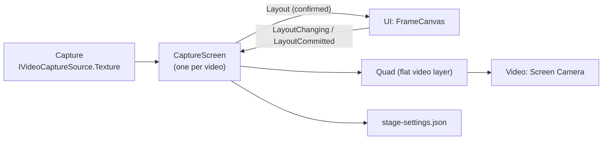

# Stage Detailed Design

## 1. Purpose

This document defines the detailed design of the Stage module. The Stage module decides what appears on the stream screen and where (system design 10.23).

It covers:

- The default background when there is no stage
- Stream Screens: capture videos (the game screen, the sub monitor) shown flat on the stream screen where the placement editor put them
- The link to the placement editor (implementing `IFrameSource`, UI foundation detailed design 9.8)
- Saving and loading placements (`stage-settings.json`)

The following are left to later designs:

- Loading and switching Stage Scenes (system design 11.3, 11.4)
- Camera Points and camera switching (system design 10.4, 11.5)
- Avatar Spawn Points (system design 11.6)
- Screen Surfaces inside a 3D stage (system design 11.14). This document's Stream Screens are Screen Surfaces placed flat on the stream screen
- Moving placements into Project / Profile (with the Project / Profile design)

Related system design sections:

- 10.23 Linking capture video to Stage
- 11.14 Capture Screen Surfaces
- 14.29 Separating UI state from runtime state

### Overview



---

## 2. Responsibilities

| Responsibility | Owner |
|---|---|
| Creating a Stream Screen for each capture video | Stage |
| Applying a placement (`FrameLayout`) to the quad's position, size, crop, flip, and stacking | Stage |
| Showing a placement being edited at once, and saving confirmed placements | Stage |
| The operations that edit placements | UI (`FrameCanvas`) |
| Capturing video and flipping it (correcting its orientation) | Capture |
| The layers drawn and making the stream video | Video |

---

## 3. Module Boundaries

- Stage uses the public contracts of Capture (`ICaptureSources`, `IVideoCaptureSource`), Video (`IStreamScreenLayer`), and the UI (`IFrameSource`, `IStageLighting`).
- The video is `IVideoCaptureSource.Texture`, put on the quad as it is. Capture's flip corrects the video's own orientation; the placement's left-right flip (`FrameLayout.FlipHorizontal`) is separate and applies on top.
- Stage does not copy video. It only sets the texture on the quad's material.

---

## 4. Main Classes and Interfaces

| Name | Kind | Summary |
|---|---|---|
| `StageService` | Class (`IApplicationService`) | Creates the Stream Screens, loads placements, and saves them |
| `CaptureScreen` | Class (the UI's `IFrameSource`) | One capture source's quad and placement; accepts edits |
| `StageSettings` | Class | What is saved (a placement per video, the light's brightness) |
| `ScreenPlacementMath` | Static class | The quad's position, size, and UVs from a placement (pure functions) |
| `StageDefaults` | Static class | Placements for the first use, the default avatar spawn point, and the default light's direction |
| `IAvatarSpawnPoints` | Interface | Where avatars stand (7.1) |
| `IStageLighting` (UI) | Interface | The light's brightness. The settings screen changes it; Stage implements it (7.1) |
| `StageLightIntensity` (UI) | Static Class | The brightness's range and default, and a function that keeps a value in range (pure) |

---

## 5. Public API

```csharp
public sealed class StageService : IApplicationService, IAvatarSpawnPoints, IStageLighting
{
    public IReadOnlyList<IFrameSource> Screens { get; }   // Passed to the placement editor; in source order, not stacking order
    public IAvatarSpawnPoints SpawnPoints { get; }        // Where avatars stand (7.1)
    public IReadOnlyObservable<float> Intensity { get; }  // The light's brightness (7.1); 1 is the light as made
    public void SetIntensity(float intensity);            // Applies to the light at once and saves; from the main thread
}

// UI (VirtualVessel.UI.Lighting). Stage references UI, so the contract is in UI (as IFrameSource is)
public interface IStageLighting
{
    IReadOnlyObservable<float> Intensity { get; }
    void SetIntensity(float intensity);
}

public interface IAvatarSpawnPoints
{
    Pose Default { get; }   // World position and rotation for an avatar whose reference pose faces +Z
}
```

- The composition passes `Screens` to the UI. The UI sees only `IFrameSource`.
- The composition passes `SpawnPoints.Default` to Avatar as part of `AvatarPlacement` (Avatar detailed design 3).
- The composition passes `StageService` to the UI as `IStageLighting`. The face tuning Card on the settings screen changes the brightness beside its picture (UI `setup.md` 9).

---

## 6. Data Model

### 6.1 Stream Screen

| Item | Value |
|---|---|
| Id | The capture source's id (`game`, `subscreen`) |
| Name | A string table key (`stage.screen.game`, `stage.screen.subscreen`); the UI shows it in the user's language (6.4) |
| Video | `IVideoCaptureSource.Texture` |
| Aspect ratio | The resolution in `IVideoCaptureSource.Info`; 16:9 when unknown |
| On the stream (`Visible`) | While there is a video (texture) |
| Placement | `FrameLayout` (Core); the value being edited and the confirmed value are kept apart |

### 6.2 Applying a Placement to the Quad

`ScreenPlacementMath` (pure functions) computes the following from a placement and the stream screen's coordinates (Video detailed design 7.3):

- Position and size: the center, width, and height of `FrameLayout.Placement` (0 to 1 over the stream screen).
- UVs: the range of `FrameLayout.Crop`. Unity textures start at the bottom, so top and bottom are swapped. A left-right flip (`FlipHorizontal`) swaps the left and right UVs.
- Stacking: a larger `Order` is in front (a smaller z).

### 6.3 Saving (stage-settings.json)

```json
{
  "schemaVersion": 1,
  "screens": {
    "game": { "placement": [0, 0, 1, 1], "crop": [0, 0, 1, 1], "flipHorizontal": false, "locked": false, "allowOutside": false, "order": 0 },
    "subscreen": { "placement": [0.66, 0.04, 0.3, 0.3], "crop": [0, 0, 1, 1], "flipHorizontal": false, "locked": false, "allowOutside": false, "order": 1 }
  },
  "lightIntensity": 0.7
}
```

- Kept in the settings folder (the same as the UI's `ui-settings.json`, system design 6.8) and read and written with `ConfigFileStore` (ProjectData). A broken file is moved aside and the defaults are used.
- Placements of unknown ids are kept, not deleted (CLAUDE.md chapter 25).
- After each confirmation (`LayoutCommitted`), the file is saved 0.5 seconds after the last one. Anything unsaved is saved at shutdown.
- `lightIntensity` is the light's brightness (7.1). It is `null` until changed, and the default (1) is used, so a better default reaches users who never changed it. A value outside the range (a hand-edited file, for example) is read as the nearest end, and a value that is not a number as the default. While a slider keeps changing it, nothing is saved; it is saved 0.5 seconds after the last change.
- Older files without `lightIntensity` read the default, so the version (`schemaVersion`) stays 1.
- Moved into Project / Profile once they exist (chapter 17).

### 6.4 Translating Names

`IFrameSource` gets `NameKey` (UI foundation detailed design 9.8 is updated). When there is a `NameKey`, the UI shows that key in the user's language and does not use `DisplayName`. Stage does not need to know the user's language.

### 6.5 Default Placements

| Video | Position and size | Stacking |
|---|---|---|
| Game screen | The whole stream screen (0, 0, 1, 1) | 0 (back) |
| Sub monitor | Top right (0.66, 0.04, 0.3, 0.3) | 1 |

---

## 7. State / Lifecycle

- `StageService` is an Optional application service that starts after Capture and Video. It is not registered without either (there would be no place for flat videos, or no videos).
- At start it reads `stage-settings.json`, creates a `CaptureScreen` for each capture source, and places the quads under `IStreamScreenLayer.Root`. Sources of the `Camera` kind (the tracking camera) get none, so the user's face and room never go on the stream (Tracking detailed design 5.4, `StageService.ShowsOnStream`).
- It subscribes to changes of the video (`Texture`) and sets it on the quad's material. Without a video the quad is hidden.
- At shutdown it saves unsaved placements and destroys the quads, the materials, and the default light.

### 7.1 Avatar Spawn Point and Light (until Stage Scenes)

- Until Stage Scenes provide their own (system design 11.6), there is one spawn point: the origin, turned 180° to face the Main Camera on -Z (Video detailed design 7.5).
- The persistent scene has no light, and lit avatar materials (MToon) would be dark without one. At start Stage creates a directional light, `StageDefaultLight`: from above the camera and a little to its left (rotation 35°, 15°, 0°), no shadows. A Stage Scene with its own lights will replace it.
- The user can change the light's brightness on the settings screen (`IStageLighting`; user's request, 2026-10-21). Under a light of intensity 1, the face was washed out and its expression hard to see. The range is 10 to 150%, and the default is 100% (intensity 1). The brightness scales the light as made, so that with Stage Scenes it can still adjust how bright the whole lighting is (chapter 17).
- In system design 11.7, Stage manages the lighting. Stage also owns the brightness setting and saves it in `stage-settings.json` (6.3). It changes the stream too, so unlike the picture's height and zoom, which are only for looking (UI `setup.md` 9), it is saved.

---

## 8. Main Sequences

### 8.1 Editing a Placement (UI foundation detailed design 9.5)

1. While dragging, the UI calls `PreviewLayout`. `CaptureScreen` applies it to the quad at once and does not save it.
2. When the drag ends, the UI calls `CommitLayoutAsync`. `CaptureScreen` checks the value, makes it the confirmed one, applies it to the quad, and schedules a save.
3. The confirmed value is reported through `Layout`. The UI's frame shows it.
4. To undo, the UI sends the earlier placement as a confirmation. For Stage it is an ordinary confirmation.

### 8.2 Checking Values

- A placement whose size is zero or less, or that is not a number, is rejected with a `UserFacingException` ("This placement cannot be used"). The UI goes back to the previous placement.
- `Order` is used as it is (larger in front). It is not renumbered, so the value the UI sent is the value saved.

---

## 9. Threading / Async

- Everything runs on the main thread. `CommitLayoutAsync` only schedules the save and completes at once. `ConfigFileStore` writes the file.

---

## 10. Configuration

`stage-settings.json` (6.3). Capture sources' settings (the chosen device, flips, whether they were started) are saved in `capture-settings.json` (Capture detailed design chapter 10).

---

## 11. Logging and Diagnostics

- At startup, the number of placements read and whether the defaults were used are recorded at Information.
- A failure to save is recorded at Warning (as with the UI settings).
- Placement values contain nothing personal, so they may be recorded at Debug.

---

## 12. Error Handling and Recovery

| Event | Handling |
|---|---|
| `stage-settings.json` is broken | Moved aside, the defaults are used, and a Warning is recorded |
| It cannot be saved | A Warning is recorded. Placements are kept while running |
| An invalid placement is confirmed | Rejected; the UI goes back (8.2) |
| There are no capture sources or no Video | StageService is not registered. The placement editor shows nothing |

---

## 13. Security and Privacy

- Only placement numbers are saved, never video content.
- Whether a video is shown follows starting and stopping the capture source. Stage never shows a video by itself.

---

## 14. Testing Strategy

| Kind | Target |
|---|---|
| EditMode | `ScreenPlacementMath` (position, size, UVs, the top-bottom swap, left-right flip, stacking) and reading, writing, and defaults of `StageSettings` (pure functions and a fake store) |
| EditMode | `CaptureScreen`: the display follows the video, a confirmation schedules a save, invalid placements are rejected |
| EditMode | The light's brightness: the default, keeping it in range, reading a saved value (pure functions); a change applies to the light at once, is saved after the delay, and is read back on the next start |
| PlayMode | A placed video is drawn at the decided place in the Stream Render Target (pixels read back) |

---

## 15. Performance

- One material per quad. Updating the video only swaps a texture; there is no per-frame work.
- Showing an edit only changes the quad's `Transform` and material values.

---

## 16. Directory / Namespace

```text
Assets/VirtualVessel/Stage/
├─ Runtime/                          VirtualVessel.Stage
│  ├─ StageService.cs
│  ├─ CaptureScreen.cs
│  ├─ StageSettings.cs
│  ├─ ScreenPlacementMath.cs        ScreenPlacementMath, StageDefaults
│  ├─ IAvatarSpawnPoints.cs
│  └─ Resources/StreamScreen.shader An unlit quad shader: the crop and flip are only material values (_MainTex_ST); in Resources so that builds include it
└─ Tests/
   ├─ EditMode/
   └─ PlayMode/
```

References: Core, Diagnostics, ProjectData, Capture, Video, UI.

---

## 17. Open Issues

| Item | Planned handling |
|---|---|
| Stage Scenes, Camera Points, Avatar Spawn Points | With the Stage Scene design |
| Screen Surfaces inside a 3D stage | With the Stage Scene design |
| Keeping a capture running without showing it on the stream | When it is asked for |
| Moving placements into Project / Profile | With the Project / Profile design |
| Stage Scene lighting and the light's brightness | With the Stage Scene design. Decide whether the brightness scales the whole lighting of a Stage Scene |

---

## 18. Implementation Order

The second half of the Capture → Stage → Video flow, in this order. Each step comes with its tests and a demo branch to try it.

1. Video: the Main Camera, the Stream Render Target, the flat video layer, `IStreamPreviewSource`
2. Stage: Stream Screens, `IFrameSource`, `stage-settings.json`
3. Capture: `capture-settings.json` (the chosen device, flips, whether it was started)
4. UI: the live screen (stream preview and placement editing) and the setup screen (capture settings) (`docs/<lang>/ui/screens/`)
