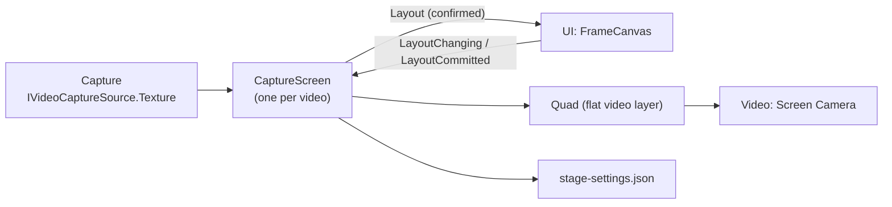

# Stage Detailed Design

## 1. Purpose

This document defines the detailed design of the Stage module. The Stage module decides what appears on the stream screen and where (system design 10.23).

It covers:

- The default background when there is no stage
- Stream Screens: capture videos (the game screen, the sub monitor) shown flat on the stream screen where the placement editor put them
- The link to the placement editor (implementing `IFrameSource`, UI foundation detailed design 9.8)
- Saving and loading placements (`stage-settings.json`)

The following are left to later designs:

- Loading and switching Stage Scenes (system design 11.3, 11.4)
- Camera Points and camera switching (system design 10.4, 11.5)
- Avatar Spawn Points (system design 11.6)
- Screen Surfaces inside a 3D stage (system design 11.14). This document's Stream Screens are Screen Surfaces placed flat on the stream screen
- Moving placements into Project / Profile (done: the project's folder, project data detailed design)

Related system design sections:

- 10.23 Linking capture video to Stage
- 11.14 Capture Screen Surfaces
- 14.29 Separating UI state from runtime state

### Overview



---

## 2. Responsibilities

| Responsibility | Owner |
|---|---|
| Creating a Stream Screen for each capture video | Stage |
| Applying a placement (`FrameLayout`) to the quad's position, size, crop, flip, and stacking | Stage |
| Showing a placement being edited at once, and saving confirmed placements | Stage |
| The operations that edit placements | UI (`FrameCanvas`) |
| Capturing video and flipping it (correcting its orientation) | Capture |
| The layers drawn and making the stream video | Video |

---

## 3. Module Boundaries

- Stage uses the public contracts of Capture (`ICaptureSources`, `IVideoCaptureSource`), Video (`IStreamScreenLayer`), and the UI (`IFrameSource`, `IStageLighting`).
- The video is `IVideoCaptureSource.Texture`, put on the quad as it is. Capture's flip corrects the video's own orientation; the placement's left-right flip (`FrameLayout.FlipHorizontal`) is separate and applies on top.
- Stage does not copy video. It only sets the texture on the quad's material.

---

## 4. Main Classes and Interfaces

| Name | Kind | Summary |
|---|---|---|
| `StageService` | Class (`IApplicationService`) | Creates the Stream Screens, loads placements, and saves them |
| `CaptureScreen` | Class (the UI's `IFrameSource`) | One capture source's quad and placement; accepts edits |
| `StageSettings` | Class | What is saved (a placement per video, the lights, the ambient light) |
| `ScreenPlacementMath` | Static class | The quad's position, size, and UVs from a placement (pure functions) |
| `StageDefaults` | Static class | Placements for the first use, the default avatar spawn point, and the backdrop's place and size |
| `DefaultBackdrop` | Static class | The provisional backdrop's picture, drawn in code (pure function, 7.1) |
| `IAvatarSpawnPoints` | Interface | Where avatars stand (7.1) |
| `AvatarFrame` | Class (the UI's `IFrameSource`) | The avatar frame; sets the Avatar Camera's framing from its placement (7.2) |
| `AvatarFramingMath` | Static class | The camera's position and projection from the avatar frame (pure functions, 7.2) |
| `IStageLighting` (UI) | Interface | The lights and the ambient light. The settings screen changes them; Stage implements it (7.3) |
| `StageLight`, `StageLighting` (UI) | Class (immutable) | One light, and the list of lights with the ambient light. Their ranges and defaults, and functions that keep values in range (pure) |
| `StageLightColors` (UI) | Static Class | The lights' colors, and a function from color temperature to color (pure) |
| `StageLightPlacement` | Static Class | A light's position, rotation, and the intensity given to Unity (pure, 7.3) |
| `StageLightRig` | Class (internal) | Creates, removes, and sets Unity's lights; changes the ambient light and puts it back at shutdown |
| `StageView` | Class | The stage view (7.4). Implements `IStageView` (UI): the camera and render target, the viewpoint, the guides, and drags |
| `StageViewMath` | Static Class | The viewpoint's position and rotation, a ray from a point on the view, a point's position on the view, the handle on a sphere (pure) |
| `IStageViewItem` | Interface (internal) | A thing editable in the stage view: its marker position, guides, and kind of handle |
| `IStageView`, `StageViewMarker` (UI) | Interface, Struct | The stage view's interface, and a marker's position |

---

## 5. Public API

```csharp
public sealed class StageService : IApplicationService, IAvatarSpawnPoints, IStageLighting
{
    public IReadOnlyList<IFrameSource> Screens { get; }   // Passed to the placement editor; in source order, not stacking order
    public IAvatarSpawnPoints SpawnPoints { get; }        // Where avatars stand (7.1)
    public IReadOnlyObservable<StageLighting> Lighting { get; }  // The lights and the ambient light (7.3)
    public void SetLighting(StageLighting lighting);             // Keeps it in range, applies it at once, and saves; from the main thread
}

// UI (VirtualVessel.UI.Lighting). Stage references UI, so the contract is in UI (as IFrameSource is)
public interface IStageLighting
{
    IReadOnlyObservable<StageLighting> Lighting { get; }
    void SetLighting(StageLighting lighting);
}

public interface IAvatarSpawnPoints
{
    Pose Default { get; }   // World position and rotation for an avatar whose reference pose faces +Z
}
```

- The composition passes `Screens` to the UI. The UI sees only `IFrameSource`.
- The composition passes `SpawnPoints.Default` to Avatar as part of `AvatarPlacement` (Avatar detailed design 3).
- The composition passes `StageService` to the UI as `IStageLighting`. The lighting Card on the settings screen's avatar page changes it (UI `setup.md` 15).

---

## 6. Data Model

### 6.1 Stream Screen

| Item | Value |
|---|---|
| Id | The capture source's id (`game`, `subscreen`) |
| Name | A string table key (`stage.screen.game`, `stage.screen.subscreen`); the UI shows it in the user's language (6.4) |
| Video | `IVideoCaptureSource.Texture` |
| Aspect ratio | The resolution in `IVideoCaptureSource.Info`; 16:9 when unknown |
| On the stream (`Visible`) | While there is a video (texture) |
| Placement | `FrameLayout` (Core); the value being edited and the confirmed value are kept apart |

### 6.2 Applying a Placement to the Quad

`ScreenPlacementMath` (pure functions) computes the following from a placement and the stream screen's coordinates (Video detailed design 7.3):

- Position and size: the center, width, and height of `FrameLayout.Placement` (0 to 1 over the stream screen).
- UVs: the range of `FrameLayout.Crop`. Unity textures start at the bottom, so top and bottom are swapped. A left-right flip (`FlipHorizontal`) swaps the left and right UVs.
- Stacking: a larger `Order` is in front (a smaller z).

### 6.3 Saving (stage-settings.json)

```json
{
  "schemaVersion": 1,
  "screens": {
    "game": { "placement": [0, 0, 1, 1], "crop": [0, 0, 1, 1], "flipHorizontal": false, "locked": false, "allowOutside": false, "order": 0 },
    "subscreen": { "placement": [0.66, 0.04, 0.3, 0.3], "crop": [0, 0, 1, 1], "flipHorizontal": false, "locked": false, "allowOutside": false, "order": 1 }
  },
  "lightIntensity": null,
  "lights": [
    { "kind": "directional", "yaw": -15, "pitch": 35, "distance": 2, "intensity": 0.7, "color": "white", "temperature": 6500, "spotAngle": 50 },
    { "kind": "spot", "yaw": 45, "pitch": 15, "distance": 2, "intensity": 1, "color": "pink", "temperature": 6500, "spotAngle": 50 }
  ],
  "ambientLight": 1
}
```

- Kept in the project's folder (`Projects/<ProjectId>/`, project data detailed design 6) and read and written with `ConfigFileStore` (ProjectData). A broken file is moved aside and the defaults are used. Until the refactoring after step 7 it was in the settings folder; the first project took a copy of it.
- Placements of unknown ids are kept, not deleted (CLAUDE.md chapter 25).
- After each confirmation (`LayoutCommitted`), the file is saved 0.5 seconds after the last one. Anything unsaved is saved at shutdown.
- `lights` is the list of lights and `ambientLight` the ambient light's scale (7.3). They are `null` until changed, and the defaults are used, so a better default reaches users who never changed them. A value outside the range (a hand-edited file, for example) is read as the nearest end; a value that is not a number, a missing field, and an unknown kind or color take the default light's value. Lights after the fourth are not read. While a slider keeps changing them, nothing is saved; they are saved 0.5 seconds after the last change.
- `lightIntensity` is the brightness of the one light of the versions up to 0.3. While `lights` is missing, it is read as the first light's brightness. When the lights are saved it is written as `null`; the brightness is then in `lights`, so nothing is lost.
- Fields were only added and older files read as they are, so the version (`schemaVersion`) stays 1.

### 6.4 Translating Names

`IFrameSource` gets `NameKey` (UI foundation detailed design 9.8 is updated). When there is a `NameKey`, the UI shows that key in the user's language and does not use `DisplayName`. Stage does not need to know the user's language.

### 6.5 Default Placements

| Video | Position and size | Stacking |
|---|---|---|
| Game screen | The whole stream screen (0, 0, 1, 1) | 0 (back) |
| Sub monitor | Top right (0.66, 0.04, 0.3, 0.3) | 1 |
| Avatar | Middle, full height (7.2) | Always in front |

---

## 7. State / Lifecycle

- `StageService` is an Optional application service that starts after Capture and Video. It is not registered without either (there would be no place for flat videos, or no videos).
- At start it reads `stage-settings.json`, creates a `CaptureScreen` for each capture source, and places the quads under `IStreamScreenLayer.Root`. Sources of the `Camera` kind (the tracking camera) get none, so the user's face and room never go on the stream (Tracking detailed design 5.4, `StageService.ShowsOnStream`).
- It subscribes to changes of the video (`Texture`) and sets it on the quad's material. Without a video the quad is hidden.
- At shutdown it saves unsaved placements and destroys the quads, the materials, and the default light.

### 7.1 Avatar Spawn Point and Light (until Stage Scenes)

- Until Stage Scenes provide their own (system design 11.6), there is one spawn point: the origin, turned 180° to face the Main Camera on -Z (Video detailed design 7.5).
- The persistent scene has no light, and lit avatar materials (MToon) would be dark without one. At start Stage creates the lights. By default there is one directional light, `StageDefaultLight`: from above the camera and a little to its left (rotation 35°, 15°, 0°), no shadows. The user can add lights and change their direction, brightness, and color (7.3). A Stage Scene with its own lights will replace them.
- In system design 11.7, Stage manages the lighting. Stage also owns the light settings and saves them in `stage-settings.json` (6.3). They change the stream too, so unlike the picture's height and zoom, which are only for looking (UI `setup.md` 9), they are saved.
- Until a Stage Scene brings its own backdrop, Stage puts up a provisional one behind the avatar (the user's request, 2026-10-24). The picture is a dark gradient from plum through indigo to navy, with a soft glow behind the avatar, faint polka dots, and pastel stars and hearts in the side bands, away from the avatar. A pastel version was tried first; the user preferred a dark one. `DefaultBackdrop` (pure) draws it in code at 1600 × 900, so no image file is bundled; this takes about 0.37 s once at start in the Editor. It sits on a quad (`StageBackdrop`) 2 m behind the avatar at the camera's height. The quad is 4.27 × 2.4 m, the default camera's view (video detailed design 7.5) with about 15% to spare. The Main Camera draws it, under the flat videos and the avatar. It is unlit, with the stream screens' shader. It is removed with the default light.

### 7.2 The Avatar Frame (placement editor)

The user's request (2026-11-18): put the avatar on the right of the screen and the game screen on the left, and also make the avatar look seated, without more settings.

- The placement editor gains one avatar frame (`AvatarFrame`, an `IFrameSource`). With the same operations as the game screen, it changes the position and size (`Placement`) and the part shown (`Crop`). Its Id is `avatar` and its name `stage.avatar.name` (アバター / Avatar). It is saved as `screens.avatar` in `stage-settings.json` (the same form as 6.3).
- The frame's "whole video" is a square standing in front of the avatar. Its side is S = 1.1 × H, where H is the height from the feet to the top of the head in the reference pose, measured by Avatar. It reaches S up from the feet, and ±S/2 to each side of the avatar's center. `SourceAspect` is 1. The part shown (`Crop`) is a part of this square, 0 at the top and 1 at the bottom.
- The Avatar Camera's (Video detailed design 7.6) position and projection are set so that the part shown fits the frame (`AvatarFramingMath`, pure functions).
  - The camera stands in front of the avatar at D = 2.0 m, at the height of the middle of the part shown, facing the avatar. Seen from the front, the avatar does not turn at an angle even when the frame is moved to the side of the screen.
  - A perspective projection with a shifted center (off-center) puts the center of the part shown at the frame's center, and its height at the frame's height. The width follows the height and is never stretched.
- The part shown is a fraction of the height, so models of different heights show the same part in the same frame (avatar detailed design chapter 17, "how models of different heights are framed").
- The frame does not cut the avatar: hands and the like outside the frame are still drawn, as URP overlay cameras cannot limit where they draw. To hide the body below the waist, put the frame's bottom on the stream's bottom edge, or allow it outside and move it down.
- The avatar is always drawn in front of the flat videos (Video detailed design 7.2). So its frame is always at the top of the stacking list and cannot be reordered (`IFrameSource.StaysInFront`); Stage keeps its `Order` at a fixed large value (`AvatarFrame.FrontOrder`). It cannot be flipped (`IFrameSource.CanFlip` is false). Locking and allowing outside work.
- Without a saved placement, it is close to how the avatar was shown before: the upper body in the middle. The part shown is (0.21, 0, 0.58, 0.58), and the frame is the stream's full height, centered ((0.219, 0, 0.5625, 1) at 16:9).
- Without an avatar (no Avatar, none chosen, or it cannot be loaded), the frame is hidden (`Visible` is false) and the Avatar Camera's framing is removed (back to following the Main Camera, Video detailed design 7.2).
- Avatar gives the avatar's height as `IAvatarService.Height`, and the composition passes it to Stage (Stage does not reference Avatar).

### 7.3 Lights and Ambient Light (user's request, 2026-11-22)

Until Stage Scenes exist, the user can build the provisional lighting. This replaces the provisional brightness slider (2026-10-21).

- One to four lights. URP lights an object with the main light and additional lights (up to four per object), so with four every light reaches the avatar. The last light cannot be removed.
- A light is "Whole stage" (directional) or "Spot". A spot always aims at the avatar's face (`StageLightPlacement.Target`, 1.3 m above the spawn point).
- It is placed by angles around the face: left and right (-180 to 180°; 0° is the camera's side, plus the screen's right), up and down (-30 to 90°; 0° is the face's height, 90° straight above), and for a spot the distance (0.5 to 5 m). Straight above or below, the up direction is the camera's way, as Unity's `LookRotation` is undefined there.
- Brightness is 10 to 200%. A spot dims with the square of its distance, so Unity gets the brightness × distance². At the same brightness, the face is as bright under a directional light as under a spot at any distance. A spot reaches three times its distance, so the fall-off at the end of its range does not show on the face.
- Colors are white and seven stage colors (pink, orange, yellow, green, sky blue, blue, purple). White follows the color temperature (2700 to 9000 K, 6500 K by default), turned into a color by an approximation of black-body colors (Tanner Helland; pure). The stage colors are light, so the face stays visible. A color of the user's own is set by a color code (`#RRGGBB`) or RGB (0 to 255 each), and saved in `color` as its code (user's request, 2026-11-22). A code that cannot be read is read as white.
- A spot's spread is 10 to 120° (50° by default). It dims softly from 60% of the cone outward, so its edge does not stand out.
- The ambient light is how bright the shade is where no light reaches. It is a scale (0 to 200%, 100% by default) of the scene's ambient light (`RenderSettings.ambientProbe`), so the default looks as before. The scene's ambient light at start is kept and put back at shutdown.
- No shadows (as in 7.1).
- Values go through `StageLighting.Normalized` (pure) before they apply, whether they come from the UI or from the file.

### 7.4 Stage View (system design 11.15)

A 3D view for building the stage while looking at it in Setup, corresponding to Unity's Scene View. It is first used to place lights (user's request, 2026-11-22: from numbers alone it was unclear where a light is and which way its light goes), and with 3D stages also for Camera Points, Spawn Points, Screen Surfaces, and props. So the view and its operation are built apart from the kinds of things they edit.

#### 7.4.1 Parts

| Part | Owner | Role |
|---|---|---|
| Stage view camera | Stage (`StageView`) | Draws the stage and the avatar into a render target separate from the stream |
| Viewpoint | Stage (`StageViewMath`, pure) | A viewpoint going around a pivot: orbit, zoom, move the pivot, reset |
| Editable things | Stage (`IStageViewItem`, internal) | Per kind: where its marker is, its guides, and its kind of handle. Only lights for now (`LightViewItem`) |
| Guides | Stage (`StageViewGuides`) | Lines such as a light's direction and a spot's cone, drawn only by the stage view camera |
| Markers | UI (the lighting Card) | Numbered markers at the things' positions, placed as UI elements where Stage says each frame |
| Input | UI | Turns pointer and keyboard input into view control, selection, and drag commands |

- Markers are UI elements so that their numbers are drawn legibly, they do not rely on color alone (a number and a frame), and focus and tooltips work as on any other element. That is simpler than drawing text in 3D, and follows the tokens.
- Lines and cones are at 3D positions, so Stage draws them with the stage view camera.

#### 7.4.2 Interface

```csharp
// UI (VirtualVessel.UI.StageEditing). Stage references the UI, so the interface is in the UI (as IStageLighting is)
public interface IStageView
{
    IReadOnlyObservable<Texture> Image { get; }             // The render target while open; null when closed
    IReadOnlyObservable<IReadOnlyList<StageViewMarker>> Markers { get; }  // Marker positions; every frame while open
    IDisposable Open(int width, int height);                  // Starts drawing; closing the last one stops and releases it
    void Orbit(Vector2 degrees);                              // x: left and right, y: up and down
    void Zoom(float steps);                                   // Plus comes closer
    void Pan(Vector2 viewFraction);                           // Moves the pivot by a fraction of the view
    void ResetView();
    void Frame(string itemId);                                // Puts that thing at the pivot
    void Select(string itemId);                               // The chosen thing (drawn bolder); null for none
    bool BeginDrag(string itemId, Vector2 uv);                // False for a thing without a handle
    void DragTo(Vector2 uv);
    void EndDrag();
}

public readonly struct StageViewMarker
{
    public string ItemId { get; }      // Such as "light:0": kind:index
    public string Label { get; }       // The marker's text ("1")
    public Vector2 Uv { get; }         // Position on the view (top left 0, bottom right 1)
    public bool Visible { get; }       // False behind the camera and the like
    public Color Color { get; }        // A light's color for a light
}
```

- Which thing is chosen is the UI's state (the same as the lighting Card's light choice). Stage gets it through `Select(string itemId)` to draw the markers and guides.
- A drag's result goes to the thing's normal interface. A light goes through `StageService.SetLighting`, is kept in range, and is saved (7.3, 6.3). The stage view saves nothing itself.

#### 7.4.3 Camera and Render Target

- The first `Open` creates the camera and the render target (a `RenderTexture` the size of the UI's view, at most 960 × 540, 4× MSAA). The last `Dispose` destroys them; so does Stage's Dispose.
- It is a Base camera, not in the Main Camera's stack (video detailed design 7.2), and has no `MainCamera` tag. It draws every layer except the flat videos' (`StreamScreens`): the stage, the backdrop quad, and the avatar's layer. The flat videos are 2D laid over the stream, so they are not in the 3D view.
- The vertical view is 40°. It clears to the stage's dark color.
- It is `enabled` only while open; during a stream alone it does not draw. While open, the stage and the avatar are drawn twice (the stream and the stage view), which uses that much more GPU.

#### 7.4.4 Viewpoint

- The viewpoint is on a sphere around the pivot, set by the left-right angle, the up-down angle (-10 to 80°), and the distance (1.5 to 10 m) (`StageViewMath.Pose`, pure). By default the pivot is the face (`StageLightPlacement.Target`), at -35° left-right, 22° up-down, and 5.2 m.
- The stage turns with the pointer (as in Unity's Scene View): dragging right turns the stage to the right (the viewpoint goes around to the left). Up and down, the viewpoint follows the pointer: dragging down raises it (the user's decision after trying it, 2026-11-22). The mockup first had it the other way, which was the opposite of what the user expected (2026-11-22). People find different directions natural, so left-right and up-down can each be reversed (UI `setup.md` 15.2; a UI setting Stage does not know).
- One wheel step changes the distance by 10%. Moving the pivot follows the pointer on a plane parallel to the view.

#### 7.4.5 Handles

| Handle | Movement | Used by |
|---|---|---|
| On a sphere (Orbit) | Keeps its distance from the center and faces the center while moving on the sphere. Set by where the pointer's ray meets the sphere; when it misses, the ray's nearest point is projected onto the sphere (pure) | Lights (now) |
| Move | Along three axes or on the floor | Spawn Points, Camera Points, Screen Surfaces, props (later) |
| Rotate | With rings around the axes | Camera Points, Screen Surfaces, props (later) |
| Scale | With the frame's corners | Screen Surfaces, props (later) |

- An `IStageViewItem` returns its kind of handle, and `StageView` handles them all the same way. A new kind of thing adds its own `IStageViewItem`.
- Dragging a light changes its left-right and up-down angles in 1° steps. The distance is changed with its slider (a sphere changing size would change how the drag feels).

#### 7.4.6 Guides

- The line meshes are on objects that are active only while the stage view camera renders (switched on in `RenderPipelineManager.beginCameraRendering` and off in `endCameraRendering`). Only that camera draws them, not the Main Camera, the Avatar Camera, or the Screen Camera, and no new layer is needed. Drawing with a camera given (`Graphics.RenderMesh` with `RenderParams.camera`, `Graphics.DrawMesh`) was not drawn by this camera under URP, so it is not used (2026-11-22).
- Lights: a spot has a line to the face and its cone (a ring at the face and four lines from the light to the ring). A whole-stage light has five parallel arrows toward the face from 2.4 m away. They are in the light's color; the chosen light is bold, the others faint.
- A camera-shaped marker shows the stream camera's position, as a guide to which way the stream looks. Stage does not know the Main Camera's position, so it is not drawn until Video offers it (chapter 17).
- Lines use an unlit shader (`StageGuide.shader`, in Resources) and follow depth; only the chosen thing's lines are drawn without the depth test, so they show even behind something.

#### 7.4.7 With 3D Stages

- When a Stage Scene is loaded, the stage view camera shows the same scene, so the stage is seen as it is.
- A Stage Scene's Camera Points, Spawn Points, and Screen Surfaces are each registered as `IStageViewItem`s. A Camera Point shows its view frustum, a Spawn Point a ring at the feet with an arrow for its direction, and a Screen Surface its frame.
- Choosing a Camera Point lets the user check the view from it (by moving the stage view camera there, not the stream camera).
- Where positions the user moved are saved (the project's stage settings or the stage's definition) is decided with the Stage Scene design (chapter 17).

#### 7.4.8 Checking That It Never Reaches the Stream

- A PlayMode test draws the guides in a distinct color, reads back the stream render target, and checks that the pixels where the guides are do not have the guides' color.
- EditMode tests check that the stage view camera's render target is not the stream render target, that the camera is not in the Main Camera's stack, and that closing destroys it.

---

## 8. Main Sequences

### 8.1 Editing a Placement (UI foundation detailed design 9.5)

1. While dragging, the UI calls `PreviewLayout`. `CaptureScreen` applies it to the quad at once and does not save it.
2. When the drag ends, the UI calls `CommitLayoutAsync`. `CaptureScreen` checks the value, makes it the confirmed one, applies it to the quad, and schedules a save.
3. The confirmed value is reported through `Layout`. The UI's frame shows it.
4. To undo, the UI sends the earlier placement as a confirmation. For Stage it is an ordinary confirmation.

### 8.2 Checking Values

- A placement whose size is zero or less, or that is not a number, is rejected with a `UserFacingException` ("This placement cannot be used"). The UI goes back to the previous placement.
- `Order` is used as it is (larger in front). It is not renumbered, so the value the UI sent is the value saved.

---

## 9. Threading / Async

- Everything runs on the main thread. `CommitLayoutAsync` only schedules the save and completes at once. `ConfigFileStore` writes the file.

---

## 10. Configuration

`stage-settings.json` (6.3). Capture sources' settings (the chosen device, flips, whether they were started) are saved in `capture-settings.json` (Capture detailed design chapter 10).

---

## 11. Logging and Diagnostics

- At startup, the number of placements read and whether the defaults were used are recorded at Information.
- A failure to save is recorded at Warning (as with the UI settings).
- Placement values contain nothing personal, so they may be recorded at Debug.

---

## 12. Error Handling and Recovery

| Event | Handling |
|---|---|
| `stage-settings.json` is broken | Moved aside, the defaults are used, and a Warning is recorded |
| It cannot be saved | A Warning is recorded. Placements are kept while running |
| An invalid placement is confirmed | Rejected; the UI goes back (8.2) |
| There are no capture sources or no Video | StageService is not registered. The placement editor shows nothing |

---

## 13. Security and Privacy

- Only placement numbers are saved, never video content.
- Whether a video is shown follows starting and stopping the capture source. Stage never shows a video by itself.

---

## 14. Testing Strategy

| Kind | Target |
|---|---|
| EditMode | `ScreenPlacementMath` (position, size, UVs, the top-bottom swap, left-right flip, stacking) and reading, writing, and defaults of `StageSettings` (pure functions and a fake store) |
| EditMode | `CaptureScreen`: the display follows the video, a confirmation schedules a save, invalid placements are rejected |
| EditMode | Lights: the default, keeping values in range, reading the brightness of 0.3 and saved lights (pure functions). Position and rotation (the default light keeps its old direction, lights aim at the face, straight above), a spot's intensity. A change rebuilds the lights at once, is saved after the delay, and is read back on the next start. The ambient light is scaled and put back at shutdown |
| EditMode | `AvatarFramingMath`: the center of the part shown lands on the frame's center and its height on the frame's height, independent of the avatar's height, and the default placement. `AvatarFrame`: showing and the camera's framing follow whether there is an avatar, a confirmation saves, the stacking order stays fixed |
| PlayMode | A placed video is drawn at the decided place in the Stream Render Target (pixels read back) |
| EditMode | `StageViewMath`: the viewpoint's position, the orbit direction, rays, positions on the view, the handle on a sphere (hit and miss). `StageView`: opening creates the camera and a render target apart from the stream's and outside the stack, closing destroys them, dragging a light changes the lighting |
| PlayMode | The stage view's guides are not drawn into the stream render target (reading pixels back, 7.4.8) |

---

## 15. Performance

- One material per quad. Updating the video only swaps a texture; there is no per-frame work.
- Showing an edit only changes the quad's `Transform` and material values.

---

## 16. Directory / Namespace

```text
Assets/VirtualVessel/Stage/
├─ Runtime/                          VirtualVessel.Stage
│  ├─ StageService.cs
│  ├─ CaptureScreen.cs
│  ├─ StageSettings.cs               StageSettings, ScreenSettings, LightSettings
│  ├─ StageLightRig.cs               StageLightPlacement, StageLightRig (7.3)
│  ├─ StageView.cs                   StageView, StageViewMath, IStageViewItem, LightViewItem (7.4)
│  ├─ StageViewGuides.cs             The guides' line meshes
│  ├─ Resources/StageGuide.shader    The guides' shader (unlit)
│  ├─ ScreenPlacementMath.cs        ScreenPlacementMath, StageDefaults
│  ├─ DefaultBackdrop.cs             The provisional backdrop's picture
│  ├─ IAvatarSpawnPoints.cs
│  └─ Resources/StreamScreen.shader An unlit quad shader: the crop and flip are only material values (_MainTex_ST); in Resources so that builds include it
└─ Tests/
   ├─ EditMode/
   └─ PlayMode/
```

References: Core, Diagnostics, ProjectData, Capture, Video, UI.

---

## 17. Open Issues

| Item | Planned handling |
|---|---|
| Stage Scenes, Camera Points, Avatar Spawn Points | With the Stage Scene design. How the avatar frame (7.2) fits an avatar standing in the stage is decided then too |
| Cutting the avatar to its frame | When requested. The Avatar Camera would have to draw into a separate render target that is then laid over (7.2) |
| Screen Surfaces inside a 3D stage | With the Stage Scene design |
| Keeping a capture running without showing it on the stream | When it is asked for |
| Moving placements into Project / Profile | Done (2026-10-27): `stage-settings.json` is in the project's folder, as the layout belongs to the project (project data detailed design 6) |
| Stage Scene lighting and the user's lights | With the Stage Scene design. Decide whether the user's lights (7.3) are added to a Stage Scene's lights or replace them |
| Where positions moved in the stage view are saved | With the Stage Scene design: the project's stage settings or the stage's definition (7.4.7) |
| Move, rotate, and scale handles | When Camera Points, Spawn Points, and Screen Surfaces are edited (7.4.5) |
| The stream camera's marker in the stage view | When Video adds an interface giving the stream camera's position (7.4.6) |

---

## 18. Implementation Order

The second half of the Capture → Stage → Video flow, in this order. Each step comes with its tests and a demo branch to try it.

1. Video: the Main Camera, the Stream Render Target, the flat video layer, `IStreamPreviewSource`
2. Stage: Stream Screens, `IFrameSource`, `stage-settings.json`
3. Capture: `capture-settings.json` (the chosen device, flips, whether it was started)
4. UI: the live screen (stream preview and placement editing) and the setup screen (capture settings) (`docs/<lang>/ui/screens/`)
