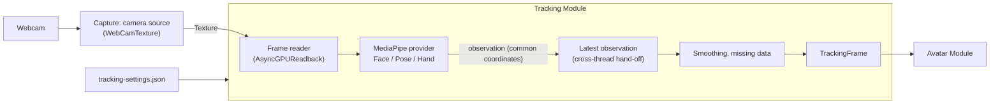

# Tracking Detailed Design

## 1. Purpose

This document defines the detailed design of the Tracking module. The Tracking module takes the movement of a person's face, body, and hands from a camera image and passes it to the Avatar module as a `TrackingFrame` that depends on neither a specific library nor an avatar (system design chapter 8).

The scope built here (v0.1.0):

- Common contracts: `TrackingFrame`, `ITrackingProvider`, tracking status
- MediaPipe provider: camera tracking with the Face / Pose / Hand Landmarkers of MediaPipeUnityPlugin
- Common processing: one coordinate system, confidence and missing data, smoothing
- Tracking camera: reusing the camera input of the Capture module
- Choosing what moves (face, upper body, hands and fingers; full body shown as "coming soon")
- Recording and replay for tuning and evaluation (developer-only)

Out of scope, handled by later designs:

- Other providers such as mocopi (system design 16.3)
- Tracking several people (system design 8.12; the design does not assume a single person)
- Full body (lower body, hip movement, foot contact). The choice is provided in advance (6.5)
- The details of the tracking settings screen (handled in the UI screen specification; chapter 10 lists only the needed items)

Related system design sections:

- 7.6 Pose application and body-size differences, 7.7 Expression control
- Chapter 8 Tracking
- 15.3 Real-time behavior, 15.7 Main-thread load
- 16.3 Adding tracking providers, 16.4 Combining tracking sources

Related detailed designs:

- Avatar detailed design (`avatar.md`): the side that applies `TrackingFrame` to the avatar
- Capture detailed design (`capture.md`): adds the tracking camera source (5.4)

Prototype referenced (outside the repository, CLAUDE.md chapter 12):

- `E:\VirtualVessel\benchmarks\Voom` (MediaPipeUnityPlugin 0.16.0, UniVRM 0.129.1)

### What is taken from the prototype, and what is not

Voom showed that the Face / Pose / Hand Landmarkers of MediaPipeUnityPlugin run in Unity on Windows and that face movement can be applied to a VRM 1.0 avatar. In the user's assessment, however, finger movement and three-dimensional movement (especially toward and away from the camera) were still immature. The product handles it as follows.

| In the prototype | In the product |
|---|---|
| The MediaPipeUnityPlugin Task API (`LIVE_STREAM`), reading the image with `AsyncGPUReadback` | Kept. It is proven to work |
| Computing eyes, mouth, and brows from the positions of face points | Not kept. The product uses the expression values (blendshapes) MediaPipe outputs (6.3). The tuning knowledge of the prototype (how easily the eyes close, keeping both eyes together, and so on) stays as settings of the conversion in Avatar (Avatar detailed design chapter 7) |
| The body was only the chest tilt, smoothed by averaging Euler angles over 30 frames | Not kept. The average suppressed jitter but lagged 0.5–1 s. The product separates the causes of jitter and suppresses each with a low-lag method (chapter 8) |
| Fingers and depth | The prototype is not taken as correct. They are built while being checked both numerically and visually with the evaluation tools (chapter 12) |
| UI handling MediaPipe types directly, printing settings with `Debug.Log` | Not kept. MediaPipe types do not leave the provider |

### Overview



---

## 2. Responsibilities

| Responsibility | Owner |
|---|---|
| Listing, choosing, starting, and stopping the camera; the image texture | Capture (`camera` source, 5.4) |
| Reading the image and passing it to inference | Tracking (MediaPipe provider) |
| Inference (face, body, and hand points and expression values) | Tracking (MediaPipe provider, using MediaPipeUnityPlugin internally) |
| One coordinate system, the definition of left and right, confidence and status | Tracking (conversion in the provider and common processing) |
| Smoothing, outlier removal, holding missing data | Tracking (common processing) |
| Correcting the input (facing direction, reference pose) | Tracking (system design 8.11) |
| Fitting the observed pose to the avatar skeleton, converting to expressions, mirroring | Avatar |
| Saving the choice of what moves | Tracking (`tracking-settings.json`) |
| Creating services and the order of startup and shutdown | Application (composition) |

---

## 3. Module Boundaries

- Tracking references Core, Diagnostics, ProjectData, and the public contracts of Capture (`ICaptureSources`, `IVideoCaptureSource`). It does not reference Avatar, Stage, Video, or UI.
- MediaPipeUnityPlugin types (`Mediapipe.*`) are used only inside the MediaPipe provider (a separate assembly, chapter 16). `TrackingFrame` contains no MediaPipe point indices, coordinate systems, or types (system design 8.1).
- Other modules use only `ITrackingSource` (5.1), never a provider directly.
- The names of expression values (6.3) are the 52 names that come from ARKit. They are not a type of a specific library but a widely used list of names for face movements, independent of providers (MediaPipe, a future iPhone, and so on) and of avatars (Perfect Sync models and so on).

---

## 4. Main Classes and Interfaces

| Name | Kind | Summary |
|---|---|---|
| `TrackingFrame` | Class | One observation: body, left and right hands, face, each with its status and time (chapter 6) |
| `BodyJoint` | Enum | Body joints (6.2) |
| `HandJoint` | Enum | Hand joints (21 points, 6.4) |
| `FaceShape` | Enum | Expression values (52, 6.3) |
| `TrackingStatus` | Enum | `Tracked`, `LowConfidence`, `Lost`, `NotSupported`, `Disabled` (6.1) |
| `TrackingRegions` | Flags enum | `Face`, `Body`, `LeftHand`, `RightHand`. The capabilities of a provider and the enabled parts |
| `BodyRange` | Enum | What moves: `UpperBody`, `FullBody` (6.5) |
| `ITrackingProvider` | Interface | The contract of an input method that produces observations (5.2) |
| `ObservationTraits` | Flags enum | What kind of observation a provider makes, to pick the corrections that suit it (8.4): `MonocularDepth`, `None` |
| `IObservationCorrection` | Interface | One correction of observations, with the traits it applies to (`Requires`) (8.4) |
| `ObservationCorrections` | Class | Picks from the corrections (`Catalog`) those that suit the provider's traits, and applies them to a copy of each observation (8.4) |
| `CameraAxisArmStraightening` | Class | Straightens arms that point at the camera (D in 8.4; the computation is a pure function) |
| `ITrackingSource` | Interface | What other modules use: the latest smoothed `TrackingFrame` and the status (5.1) |
| `TrackingService` | Class (`IApplicationService`) | Creates and starts the provider; per-frame processing, settings, metrics |
| `TrackingSettings` | Class | Saved settings (chapter 10) |
| `FrameSlot<T>` | Class | Hands only the latest value across threads (chapter 9) |
| `OneEuroFilter` | Struct | Smoothing whose strength follows speed (8.2, pure computation) |
| `RotationFilter` | Struct | Smoothing for rotations (quaternions) (8.2) |
| `TrackingProcessor` | Class | Common processing from observation to `TrackingFrame` (outliers, smoothing, missing data) |
| `TrackingStateMachine` | Static class | Decides the status of each part (pure functions) |
| `MediaPipeTrackingProvider` | Class (internal) | The MediaPipe provider |
| `MediaPipeConversion` | Static class (internal) | Converts MediaPipe points and coordinates to the common form (pure functions) |
| `ITrackingRecordings` | Interface | The entry point for recording and replay (developer-only, 5.5) |
| `TrackingRecordings`, `TrackingRecorder`, `TrackingRecordingFile`, `TrackingRecordingFormat`, `TrackingReplayProvider` | Class | Recording and replaying observations (developer-only, chapter 12) |

---

## 5. Public API

### 5.1 ITrackingSource

```csharp
public interface ITrackingSource
{
    IReadOnlyObservable<TrackingState> State { get; }          // Stopped, Starting, Running, Unavailable, Error
    IReadOnlyObservable<TrackingProblem> Problem { get; }      // Problem shown to the user (chapter 11)
    TrackingRegions Supported { get; }                         // Parts the provider can track
    IReadOnlyObservable<TrackingOptions> Options { get; }      // What the user chose (chapter 10)
    double ObservationsPerSecond { get; }                      // Camera images inferred over the last second (shown on the setup screen)

    // The latest smoothed observation, updated every frame on the main thread. Its contents are
    // overwritten by the next update, so callers read it within that frame and do not keep it
    // (the same object is returned each time to avoid allocations).
    TrackingFrame Current { get; }

    void Start();
    void Stop();
    void SetOptions(TrackingOptions options);                  // A change of parts takes effect at once

    IReadOnlyObservable<float> Front { get; }                  // The person's front, degrees to the right of the camera's (8.5)
    bool TakeFront();                                          // The way the person faces now becomes the front; false when no one is seen
    void ResetFront();                                         // Back to the camera's front
}
```

`TrackingOptions` gathers what the user chose into one value (immutable: `With…` makes a changed value, given whole to `SetOptions`). New choices change neither the interface nor how saving compares.

```csharp
public readonly struct TrackingOptions
{
    TrackingRegions Regions;            // Parts inferred
    BodyRange BodyRange;                // What moves (full body is coming soon and falls back to the upper body, 6.5)
    int Smoothing;                      // Smoothing level, 1 to 10 (8.2)
    bool Mirror;                        // Mirroring (chapter 10)
    BodyDepth BodyDepth;                // The body in 3D or 2D (8.6)
    PoseModel PoseModel;                // Lite, Full, Heavy; a change restarts a running provider (chapter 10)
}
```

- All operations and notifications happen on the main thread.
- `TrackingService` updates `Current` every frame (`IFrameLoop`). Avatar reads it at the equivalent of `LateUpdate` (Avatar detailed design 8.3).
- One `ITrackingSource` is created per person. For several people, there will be one source per person (system design 8.12). It is not a singleton.
- The person's front (8.5) is not one of the options: it is measured from the person, not chosen.

### 5.2 ITrackingProvider

```csharp
public interface ITrackingProvider : IDisposable
{
    TrackingRegions Supported { get; }
    ObservationTraits Traits { get; }                          // What kind of observation, to pick the corrections that suit it (8.4); MediaPipe is MonocularDepth
    IReadOnlyObservable<TrackingState> State { get; }          // The same states for sources and providers
    void Start(TrackingOptions options);                       // Returns without waiting; the result comes through State
    void SetOptions(TrackingOptions options);                  // Changes them while running; inference for disabled parts stops
    void Stop();
    void Tick();                                               // Every frame on the main thread; advances reading the input

    // Copies the latest observation into the given object. Returns false when there is no new observation.
    // Copying into the caller's object avoids a per-frame allocation (exception to CLAUDE.md 15.1, chapter 23).
    bool TryTakeLatest(TrackingFrame into);
}
```

- A provider outputs observations as a `TrackingFrame` before smoothing (chapter 6; the same type before and after smoothing, so it is only copied). Provider differences (coordinate system, point indices, left and right) are converted to the common form inside the provider before output (system design 8.8).
- A new provider (mocopi and so on) is added by implementing this contract only. Stating its observation's traits (`Traits`) correctly gets it only the corrections that suit it (8.4).

### 5.3 TrackingService

- An optional application service, started after Logging, metrics, and Capture. It is not created when Capture is not running.
- At startup it reads `tracking-settings.json` and creates the provider. The MediaPipe provider is created only when the plugin is installed (`#if VV_MEDIAPIPE` in the composition, 16.2). Without the plugin the project still runs; starting tracking gives `Error` (`StartFailed`), and the developer log points to the setup script.
- If it was running, it starts again at the next launch (the same as Capture).

### 5.4 Tracking Camera (Addition to Capture)

Capture got a third source, the tracking webcam `camera`. It opens with `WebCamCaptureSource` (`WebCamTexture`), the same as GameCapture (Capture detailed design 8.5).

| Item | Value |
|---|---|
| Id, kind | `camera` (`CaptureService.TrackingCameraId`), `CaptureSourceKind.Camera` |
| Until a device is chosen | Not opened (`DeviceNotChosen`), for the same reason as Capture detailed design 6.3 |
| Requested resolution, frame rate | 1280×720, 30 fps (enough as inference input, with a small readback cost). `CameraWidth` and others in `capture-settings.json` |
| The same device twice | `game` and `camera` do not open the device the other has open (`WebCamTexture` cannot open one device twice). Shown as `Error` (`DeviceInUse`) |
| Telling new images | `IVideoCaptureSource.FrameCount` and `LastFrameTimestamp` (added to Capture). The same image is not inferred twice, and the image time becomes the observation time |
| Display on the stream | None. Stage creates no screen for sources of the `Camera` kind, so the user's face or room never appears on the stream unintentionally (chapter 13) |
| Setup screen | No capture Card. The device is chosen in the tracking Card (UI `setup.md` chapter 4) |
| Flip | Capture's flip (`CaptureFlip`) is not used. Left and right are decided by the Tracking coordinate definition (6.1) and Avatar mirroring |

### 5.5 ITrackingRecordings (Developer-only)

The entry point for recording and replay (chapter 12), used by the Diagnostics screen (Developer Mode only). Everything is called on the main thread.

```csharp
public interface ITrackingRecordings
{
    IReadOnlyObservable<RecordingActivity> Activity { get; }                       // Idle, Recording, Replaying
    IReadOnlyObservable<IReadOnlyList<TrackingRecordingInfo>> Recordings { get; }  // newest first
    string ActiveId { get; }                       // The recording being recorded or replayed, or null
    double RecordedSeconds { get; }                // Length of the recording in progress
    Task RefreshAsync(CancellationToken cancellationToken);
    void StartRecording(string description);       // Throws while tracking is not running
    void StopRecording();
    Task StartReplayAsync(string id, CancellationToken cancellationToken);
    void StopReplay();
    Task DeleteAsync(string id, CancellationToken cancellationToken);
    Task DeleteAllAsync(CancellationToken cancellationToken);
    void StopAll();                                // When Developer Mode turns off, for example
}

public sealed class TrackingRecordingInfo
{
    string Id;                 // The file name (12.3)
    string Description;
    DateTime StartedAtUtc;
    double Seconds;
    long Bytes;
    bool Readable;             // False for an unknown version or a broken header
}
```

- For recording and replay, `TrackingService` has two members used only inside its assembly: one that receives observations (before smoothing), and one that temporarily replaces the provider with replay. Other modules cannot see them.

---

## 6. Data Model

### 6.1 TrackingFrame

```text
TrackingFrame
├─ Sequence            Increases with each observation
├─ Body                BodyPose (6.2)
├─ LeftHand            HandPose (6.4; the user's own left hand)
├─ RightHand           HandPose
└─ Face                FacePose (6.3)

Common to each part:
├─ Status              Tracked / LowConfidence / Lost / NotSupported / Disabled
├─ Confidence          0–1
└─ Timestamp           Time of the image frame the part came from (seconds, monotonic since application start)
```

- Each part has its own time and status. Face, body, and hands come from separate inferences, so the source image frame can differ between parts (9.2).
- Left and right are the **user's own** left and right, not the image's. Whether to mirror is decided by Avatar (Avatar detailed design 6.6).
- The coordinate system is the "person space", oriented like a Unity avatar: origin at the midpoint of the hips, +Y up, +Z the person's front (toward the camera), +X the person's right. The unit is meters. It does not depend on the camera position or field of view.
- `Status`: `Tracked` means the value is usable. `LowConfidence` means there is a value with low confidence (Avatar uses it less strongly). `Lost` means it was lost (the value is the last usable one). `NotSupported` means the provider cannot track it. `Disabled` means the user turned it off.

### 6.2 BodyPose

| Item | Content |
|---|---|
| Joints | `BodyJoint`: `Head` (center of the head), `LeftEar`, `RightEar`, `Nose`, `Neck` (midpoint of the shoulders), `LeftShoulder`, `RightShoulder`, `LeftElbow`, `RightElbow`, `LeftWrist`, `RightWrist`, `Hips` (origin), `LeftHip`, `RightHip`, `LeftKnee`, `RightKnee`, `LeftAnkle`, `RightAnkle`, `LeftFoot`, `RightFoot` |
| Per joint | Position (person space), confidence (0–1), `Tracked`/`LowConfidence`/`Lost` |
| Image position | Each joint also keeps its position in the image (0–1), used for depth estimation (8.4) |

- Below the knees is used only for full body (`BodyRange.FullBody`). For the upper body, the values are present but Avatar does not use them.
- Of the 33 MediaPipe Pose points, the finger points (17–22) are not used. Fingers come from the Hand Landmarker.

### 6.3 FacePose

| Item | Content |
|---|---|
| Which face | Up to two faces are found, and the one whose nose tip is nearest the body's nose is the person's. If all are far (more than 12% of the image width), the face is lost, so a face on a poster behind the person is not picked up. Without the body, the most confident face is used |
| Head rotation | Rotation (person space), from MediaPipe's facial transformation matrix. More stable than computing it from Pose points |
| Head position | Position relative to the camera (meters), used for leaning and moving closer |
| Expression values | 0–1 per `FaceShape`: the 52 that come from ARKit (`EyeBlinkLeft`, `JawOpen`, `MouthSmileLeft`, and so on). Values that cannot be tracked (`TongueOut` with MediaPipe) are `NotSupported` |
| Gaze | Also gives the direction (angles) of each eye from the expression values (`EyeLookIn/Out/Up/Down`) |

- Left and right of expression values are also the user's own. The left and right in MediaPipe's names may be based on the image; the provider's conversion checks this and aligns them (made into a test at implementation time).

### 6.4 HandPose

| Item | Content |
|---|---|
| Joints | `HandJoint`: 21 points — wrist, thumb (CMC, MCP, IP, tip), and the other four fingers (MCP, PIP, DIP, tip) |
| Positions | Person space. Combines the finger shape relative to the wrist (the 3D points of the Hand Landmarker) with the wrist position (Pose wrist) |
| Palm orientation | A rotation from the wrist and the bases of the index and little fingers |
| Image positions | The 21 points' positions in the image (0–1). Shown over the camera image on the setup screen and used to decide left and right |
| Deciding left and right | MediaPipe's handedness depends on image orientation and can flicker between frames. The product assigns a detected hand to **whichever Pose wrist is nearer** (two hands take the pairing with the smaller total distance, so they never land on the same side). Handedness is used only when the body is not seen; it assumes a mirrored image, so on an unmirrored camera "Right" is the person's left hand. Hands away from the body are not left out: hands and body come from separate inferences, often of different image frames, so a moving hand looks a frame's movement away from the body's wrist. Leaving such hands out made moving hands flicker (tried in step 2 and undone, 2026-10-19) |

### 6.5 What Moves (BodyRange)

| Value | Content | v0.1.0 |
|---|---|---|
| `UpperBody` | Head, neck, torso, shoulders, arms. Fixed below the hips (streaming seated) | Default. Available |
| `FullBody` | Adds hip movement and rotation, legs, and foot contact | Shown as "coming soon" and cannot be chosen |

- Face (expressions, gaze) and hands are enabled or disabled separately from the range (`TrackingRegions`). Inference for disabled parts does not run (to reduce load).
- To widen the range, add a value to `BodyRange` and add its application in Avatar. `TrackingFrame` holds the full-body joints from the start.

---

## 7. State / Lifecycle

### 7.1 TrackingSource State

| State | Meaning |
|---|---|
| `Stopped` | Stopped |
| `Starting` | Preparing the camera or inference (loading models can take a few seconds) |
| `Running` | Producing observations (still `Running` when no one is in view; parts become `Lost`) |
| `Unavailable` | No camera chosen or the camera is not found. Follows the Capture state and continues automatically when it returns |
| `Error` | Inference cannot start (missing models, the plugin cannot load, and so on) |

### 7.2 Starting and Stopping

1. `Start()`: starts the Capture `camera` source. The tracking camera is used only for tracking, so it starts and stops together with tracking.
2. When camera images arrive, the provider loads models (without blocking the main thread, chapter 9) and starts inference. `Running`.
3. `Stop()`: stops inference, discards pending readbacks without waiting, and releases buffers and models.

### 7.3 Status of Each Part

`TrackingStateMachine` (pure functions) decides the status of each part from whether there is an observation, its confidence, and elapsed time.

| Condition | Status |
|---|---|
| Observed, confidence at or above the threshold (default 0.5) | `Tracked` |
| Observed, below the threshold | `LowConfidence` |
| No observation for more than 0.2 s | `Lost` (the last value is kept) |
| Turned off by the user | `Disabled` |

- How values return when lost (holding, easing back to the rest pose) is decided by Avatar (Avatar detailed design 8.4). Tracking passes "since when it has been lost".
- So that the status does not flicker on every brief loss (1–2 frames), it moves to `Lost` by time and back to `Tracked` after two consecutive observations.

---

## 8. Smoothing and Accuracy

Voom's average was needed to suppress jitter. The product separates the causes of jitter and suppresses each with a low-lag method. Each method becomes the default only after replaying recorded observations and comparing numbers (chapter 12) shows less lag than the Voom method (a 30-frame average) with equal or less jitter (CLAUDE.md chapter 33).

### 8.1 Causes of Jitter and Countermeasures

| Cause | Countermeasure |
|---|---|
| Small fluctuations of inferred values (moving slightly every frame even when still) | One Euro filter (8.2): strong smoothing when still, weak when moving fast |
| Inference at 30 per second and rendering at 60, so the avatar moves only every other frame and steps are visible | For each rendered frame, interpolate between the two latest observations (Avatar detailed design 7.3). Adds at most one observation interval (about 33 ms) |
| Occasional large outliers (an arm jumping for a moment) | Discard values where a joint moved faster than a person can, or with low confidence, and use the previous value (8.3) |
| Unstable depth (values toward and away from the camera swing widely) | Re-estimate depth from image positions and bone lengths (8.4) |
| Wrong rotation averages (averaging Euler angles breaks across ±180°) | Handle rotations as quaternions; never average Euler angles |

### 8.2 One Euro Filter

- Chooses the strength of a low-pass filter each time from how fast the value changes. Slow movement is smoothed strongly, fast movement catches up quickly. Two parameters: the minimum cutoff (`MinCutoff`) and how much speed relaxes it (`Beta`).
- Applied per axis for positions and per value for expression values. For rotations (head orientation and so on), the same idea is applied with spherical interpolation, using the angle of the quaternion difference as the speed (`RotationFilter`).
- The joints of the body, and those of each hand, are smoothed together (`LinkedPositionFilter`, 2026-10-24): every joint moves the same share of the way each observation, with the cutoff of the fastest seen joint. The same low-pass filter on every joint keeps the shape, so a straight arm stays straight while it moves. With a cutoff per joint and axis, the slower elbow lagged behind the wrist, and an arm raised and lowered straight was shown bent (the user's screen recording). Joints not seen (`BodyPose.IsSeen`, 8.4), such as legs below the camera, do not set the cutoff, since their guesses jump about. The beta is half that of `Position` (`SmoothingProfile.Joints`), because the fastest joint in three axes is faster than one joint along one axis. Measured on the user's recordings at level 1 (`RecordedSmoothingTests`; the bend beyond any the arm showed in the second before): on "1024不自然解消用", observations bent past 15° went from 88 to 13 with the lag unchanged (383 ms) and the shake a little lower (1.07° to 0.99° per observation); on "腕を前へ伸ばす" from 24 to 0. The torso now shares the arms' cutoff while they move, and shook 0.18° a frame instead of 0.10° on the avatar.
- Each hand's joints use the same filter, but never steadier than 2 Hz while still (`SmoothingProfile.Hands`, `MinHandCutoff`, 2026-10-25). Fingers change shape by a few centimeters, too slowly to quicken the filter, so at the steady levels a hand's shape barely followed. At level 1 (0.003 Hz while still), a thumb tucked into a rock-paper-scissors fist for over a second was never seen tucked on the user's recording made for the hands, and the fingers stayed bent in an open hand. At 2 Hz it was seen in 121 of 128 observations (87 at 0.5 Hz, 108 at 1 Hz), 0.07 s late, while a finger's angle changed a median of 0.30° per observation (0.17°). Only the fingers' angles come from these positions; the palm and the arms have their own filters.
- Uses the time of the image frame, not the processing time, so uneven frame intervals do not change the smoothing strength.
- Parameters are per part (fast for the face, slow for the torso, and so on). The user sees ten levels of "movement speed" (1: steadiest, 10: fastest) (chapter 10, UI `setup.md` chapter 4). Each level changes the parameters from the standard set measured in step 1 toward the smooth set by the same ratio per level (half the ratio between the two sets). The smooth set falls at level 9 and the standard set at 11, so levels 1 to 10 are all on the steadier side. The default is 5 (standard). Face values are never slower than the smooth set, so blinks and the mouth keep up.
- History: at first the three sets (smooth, standard, responsive) were levels 3, 5, and 7 with 5 as the default (it was 7 for a while after a camera check, and went back to 5 after more checks, 2026-10-21). The arms were steadier at the former 3, so it became the standard (version 3). Then, with lag of about 300 ms acceptable and steadiness mattering more, the level 1 of that time became the standard (version 4; both the user's decisions, 2026-10-24). No requirement caps the lag (the 80 ms of chapter 15 is the processing delay from a video frame to `Current`, not smoothing lag).
- The computation is a pure function (it takes the state as an argument and returns a new state) and is checked in EditMode with inputs and outputs only.
- The speed of a rotation is smoothed as an angular velocity with a direction (a vector). Smoothing only the size of the angle (always positive) does not let shakes in opposite directions cancel, so a still value looks like it is moving (the first implementation shook about three times as much as the average when still).

#### Measured Results (Step 1, 2026-10-18)

Synthetic motion (an angle with 2° noise at 30 per second: still for 3 s, raised 90° in 0.3 s, held, waved ±30° at 0.5 Hz), compared over 20 noise seeds (`OneEuroComparisonTests`, `SmoothingProfile`).

| Method | Jitter when still (RMS of the per-frame change) | Lag | Error while waving slowly |
|---|---|---|---|
| Voom's method (30-frame average) | 0.097° | 483 ms | 23.2° |
| Smooth (MinCutoff 0.05 Hz, Beta 0.003) | 0.057° | 99 ms | 9.6° |
| Standard (0.1 Hz, 0.005) | 0.088° | 66 ms | 7.5° |
| Responsive (0.2 Hz, 0.01) | 0.160° | 56 ms | 5.2° |

- Standard is as steady as the average or steadier when still, with about 1/7 of the lag. A single noise draw can favor either method by about a third, so the test compares the average of 10 seeds.
- Positions (joints) use provisional values with beta converted at 1 cm ≈ 2° for an arm (Standard: 0.1 Hz, 1.0). For an arm movement with 1 cm noise, the angle jitter went from 4.7° to 0.13° with 100 ms lag. Face values are provisional too and are tuned in steps 2–5 on movements recorded with a camera (chapter 17).

#### Measuring the Ten Levels (step 4, 2026-10-21)

The same synthetic motion, compared over 10 noise seeds (`FilterTests.EachLevel_IsLessSteady_ButLessBehind_ThanTheOneBelow`). Lag is measured in steps of one observation (33 ms). Avatar's interpolation between observations adds one observation on top (Avatar detailed design 7.3).

| Level | Still jitter | Lag |
|---|---|---|
| 1 | 0.041° | 133 ms |
| 2 | 0.049° | 133 ms |
| 3 (formerly smooth) | 0.059° | 100 ms |
| 4 | 0.073° | 100 ms |
| 5 (formerly standard, default) | 0.091° | 67 ms |
| 6 | 0.121° | 67 ms |
| 7 (formerly responsive) | 0.162° | 60 ms |
| 8 | 0.217° | 33 ms |
| 9 | 0.290° | 33 ms |
| 10 | 0.386° | 33 ms |

#### After Shifting the Levels (2026-10-24, version 3)

The user found the arms steadier at the former level 3 and asked for it as the standard, with steadier levels added. The levels moved two steps: the three measured sets (smooth, standard, responsive) are levels 5, 7, and 9, and levels 1 to 4 extend past them toward steadier by the same ratio. The synthetic motion (as above), and the right upper arm's lag on the user's recordings (`RecordedSmoothingTests`, Explicit; 30 observations a second):

| Level | Still jitter | Lag (synthetic) | Lag (recording "arms forward and sideways") | Lag (recording "arms forward") |
|---|---|---|---|---|
| 1 | 0.029° | 177 ms | 257 ms | 165 ms |
| 2 | 0.035° | 167 ms | | |
| 3 | 0.041° | 133 ms | 202 ms | 129 ms |
| 4 | 0.049° | 133 ms | | |
| 5 (standard, default; formerly 3) | 0.059° | 100 ms | 147 ms | 92 ms |
| 6 | 0.073° | 100 ms | | |
| 7 (formerly 5) | 0.091° | 67 ms | 110 ms | 74 ms |
| 8 | 0.121° | 67 ms | | |
| 9 (formerly 7) | 0.162° | 60 ms | 74 ms | 37 ms |
| 10 | 0.217° | 33 ms | | |

#### After Making the Standard Steadier, up to About 300 ms Lag (2026-10-24, version 4)

The levels moved four more steps (version 3's 1 is the standard 5). Lag on the recordings was measured again, searching up to 30 observations (one second). Avatar's interpolation between observations adds one observation (33 ms) to it.

| Level | Still jitter | Lag (synthetic) | Lag (recording "arms forward and sideways") | Lag (recording "arms forward") |
|---|---|---|---|---|
| 1 | 0.014° | 303 ms | 460 ms | 312 ms |
| 2 | 0.017° | 267 ms | | |
| 3 | 0.021° | 233 ms | 349 ms | 221 ms |
| 4 | 0.025° | 200 ms | | |
| 5 (standard, default; version 3's 1) | 0.029° | 177 ms | 276 ms | 165 ms |
| 6 | 0.035° | 167 ms | | |
| 7 | 0.041° | 133 ms | 221 ms | 129 ms |
| 8 | 0.049° | 133 ms | | |
| 9 (the smooth set) | 0.059° | 100 ms | 165 ms | 92 ms |
| 10 | 0.073° | 100 ms | | |

- Tried and dropped (2026-10-24): an "ultra fast" mode apart from the levels. Smoothing was weakened to four times the responsive set (the right upper arm lagged 0–37 ms on the recordings and kept about 70% of the raw shake), and Avatar stopped interpolating between observations, showing each at once. The user checked it with the camera and dropped it as far too unsteady.

### 8.3 Outlier Removal

- The palm's direction likewise: a value turned faster than 1800° a second (60° in an observation at 30 a second) is not used, and the third in a row is accepted (`TrackingProcessor.MaxPalmDegreesPerSecond`). On the user's recordings the palm turned a median of 3–6° per observation, and when read the other way round it jumped past 90° up to 174°, often coming back within 2–5 observations (2026-10-24).
- For each joint, a value whose speed from the previous value exceeds a limit (for example 8 m/s for a wrist) is not used that time. If it keeps exceeding (a really fast movement), it is accepted from the third time.
- Points whose confidence (MediaPipe visibility, presence) is below the threshold are `LowConfidence`, and smoothing gets stronger.

### 8.4 Depth (Toward and Away From the Camera) and Correcting Observations

With a single camera, depth is less certain than image position, and least certain for limbs pointing at the camera. In the user's camera check (2026-10-22), an arm thrust forward did not straighten on the avatar.

#### Methods Compared (Step 5, 2026-10-22)

On the user's three recordings (chapter 12), the median elbow bend (left arm / right arm) and the upper arm's jumps of more than 30° in one observation (before smoothing, all three recordings) were compared. In "arms forward" the arms are straight, so less bend is more correct; in the other two the arms really bend.

| Method | Arms forward | Hands clasped in front of the chest | Hands behind the head | Jumps |
|---|---|---|---|---|
| A: world landmarks as they are | 33° / 40° | 65° / 81° | 76° / 86° | 1 |
| B: x and y as they are, depth rebuilt from bone length (`√(L² − d²)`, its sign from z with hysteresis; the first plan) | 31° / 42° | 67° / 92° | 79° / 82° | 5 |
| C: x and y from the 2D image detections, scaled to meters by the shoulder width, depth from bone length | 78° / 59° | 103° / 117° | 122° / 124° | 2 |
| **D: only when both the upper arm and the forearm point toward the camera, move the elbow toward the line from the shoulder to the wrist** | **6° / 0°** | 65° / 81° | 76° / 81° | 3 |

- B did not help because the world landmarks' x and y themselves bend the arm; correcting depth alone does not straighten it.
- In C, an arm pointing at the camera looks short in the image, so small detection errors became large bends.
- The bend appears when both the upper arm and the forearm point toward the camera (0.73–0.93 along its axis in "arms forward", 0.3–0.5 with the hands clasped).
- **D is used** (user's decision, 2026-10-22). The elbow starts moving when how far both parts point toward the camera (the smaller cosine to its axis) reaches 0.5, and the arm is fully straight at 0.8, blended smoothly in between. The shoulder and the wrist stay, so the hand does not move. An arm that really bends while pointing at the camera is straightened too; that direction is a single camera's weakest anyway, and showing it straight was preferred. Nothing is corrected while the shoulder, elbow, or wrist is unseen (visibility below 0.5).
- With D, arms near straight left the bend plane undefined and the upper arm's twist unsteady (jumps rose to 5, mostly twist). Avatar raised the bend at which the twist follows the bend plane from a sine of 0.10–0.35 to 0.25–0.50, bringing them to 3 (avatar detailed design 7.2).

#### How Observations Are Corrected (Extensibility)

Corrections are common Tracking Processing, not per input method (provider) (system design 8.10, 8.11). So that inputs such as mocopi can be added later without changing them, they are split as follows.

- **A provider states what kind of observation it makes (`ObservationTraits`)** and holds no corrections. MediaPipe is `MonocularDepth`: depth estimated from one camera's image, least reliable for limbs pointing at the camera. An input that observes with sensors on the body, such as mocopi, has no camera axis, so it is `None` and gets no camera corrections.
- **Each correction is an `IObservationCorrection`**, with the traits it applies to (`Requires`). For now there are two, `CameraAxisArmStraightening` (D) and `HandDepthFromForearm` (below), applied in that order.
- **`ObservationCorrections` picks from the list of corrections (`Catalog`) those that suit the active provider's traits.** `TrackingService` corrects a copy of the provider's observation and passes it to smoothing (8.2). It picks again when the provider changes (when a replay starts and ends).
- **Recordings (chapter 12) keep the observation before correction.** A replay picks the same corrections again from the recorded input's traits, so corrections can change and be compared without filming again. The recording's header keeps the input's traits (12.3).
- A new correction only implements `IObservationCorrection` and joins the `Catalog`. An input that needs a new trait adds one value to `ObservationTraits`.
- Whether a joint is seen is decided once, in `BodyPose.IsSeen`, used by the corrections and by Avatar alike: its visibility at least 0.5 (`BodyPose.MinVisibility`) and its position inside the camera image (0 to 1). MediaPipe also guesses joints outside the image and may call them visible: on the user's recordings, a wrist outside the image was visible past 0.5 in up to all of those frames, and moved the avatar's arm where the person's was not (the user's report, 2026-10-24). Such a joint is not seen, as a hidden one is.

#### Giving the Hand the Forearm's Depth (HandDepthFromForearm, step 6, 2026-10-24)

- The hands and the body are inferred apart, each guessing its own depth, and they disagree. On the user's recordings the hand's direction (wrist to the base of the middle finger) was a median of 24–63° off the forearm's in 3D, but only 4–26° across and up (as seen from the front). The avatar's wrists bent where the person's did not (the user's screen recording).
- The hand keeps its bend from the forearm as seen from the front (across and up), and leans toward or away from the camera as the forearm does. The back of the hand is kept at right angles to that. The angle across and up is taken from the 3D points' X and Y, so the image's aspect ratio is not needed.
- When the hand shows less than 0.1 of its length from the front, its bend there is not used; at 0.3 it is used fully (smoothly in between). A hand pointing at the camera looks short from the front, and its direction there is unreliable.
- Nothing is corrected when the elbow, the wrist, or the hand is not seen.

For fingers, the joint **angles** (the angle between neighboring bones) are primary. Angles do not depend on hand size or distance from the camera, and depth errors affect them less than positions. Finger flexion is limited to 0 to about 90°, and spreading to a small range (Avatar detailed design 7.5).

### 8.5 Reference Pose (Input Correction, System Design 8.11)

Step 7 implements the person's front (the user's decision, 2026-10-26). With the camera to one side, a person facing their own front is seen turned, and so was the avatar.

- `TakeFront()` takes how far the person is turned now as their front: from the line between the shoulders, or from the head's turn in 2D, where the body faces the camera by construction. It is added to the front already in use, because it is read from observations already turned back by it, and limited to ±60° (`FacingCorrection.MaxDegrees`): a camera further to the side sees too little of the far side of the body, so a larger turn more likely comes from looking away. It returns false, changing nothing, when no one is seen.
- Each observation is turned back by the front about the vertical through the hips, after the corrections (8.4) and the 2D body (8.6) and before smoothing (`FacingCorrection.Turn`). The head's turn and the hands turn too. The body turns in 3D only, as the 2D body already faces the camera. The head's position, relative to the camera, stays. Recordings keep what was observed (12.2).
- `ResetFront()` goes back to the camera's front. The front is saved (`frontDegrees`, chapter 10).
- Not done: measuring automatically at the first start (a person may not face their front then), and bone lengths and a reference head position (the depth correction of 8.4 does not need them). Correction to fit the avatar's body (different arm lengths and so on) is done by Avatar (system design 7.6).

### 8.6 The Body in 2D (BodyDepth)

The camera sees across and up well and depth poorly (8.4). For when depth errors make the arms point unsteadily, 2D can be chosen, using only the movement seen from the front (the user's request, 2026-10-24).

- `TrackingOptions.BodyDepth`: `Tracked` (3D, the default) or `Flat` (2D). Switched on the tracking Card of the setup screen (UI `setup.md` chapter 4). Saved as `bodyDepth` in `tracking-settings.json` (0: 3D, 1: 2D).
- In 2D, after the corrections (8.4) and before smoothing, every body joint is put at the hips' depth (0 in person space) (`BodyFlattening`), except the elbows, which go 10 cm in front, and the wrists 5 cm further. With the forearm level with the elbow, a forearm swung from up to down passed straight through the line of the upper arm, its bend turned over at once, and the arm twisted up to 120° in a frame on the recordings replayed in 2D; leaning a little forward, it bends forward on the way, as in 3D. The body moves only across and up: the torso's lean and twist, and arms reaching forward or back, are gone.
- The arms always pass in front of the body (the user's request, 2026-10-24). With the elbows and wrists at the body's depth too, keeping the avatar's arms out of the torso (avatar detailed design 7.6) moved them behind it. 10 cm in front leans a hanging upper arm about 20° forward; that much depth is accepted (the user's judgment). On some builds the arm is still behind the torso's center, so in 2D Avatar also turns the arms only forward.
- Like the corrections, it works on a copy, and recordings (chapter 12) keep what was observed. A switch glides through the smoothing.
- The face (head turn, expressions) and the hands are not changed.
- An arm pointing at the camera looks short from the front, and its direction is easily set by the observation's jitter. In 2D this cannot be helped.
- Keeping the avatar's arms out of the head and torso (avatar detailed design 7.6) moves them in depth, so it works in 2D too.

---

## 9. Threading / async

### 9.1 Flow

```mermaid
sequenceDiagram
    participant Main as Main thread
    participant GPU as GPU (AsyncGPUReadback)
    participant MP as MediaPipe thread

    Main->>GPU: Copy a new camera image flipped upright, request the readback
    GPU-->>Main: Pixels (into a free buffer)
    Main->>MP: DetectAsync (Face / Pose / Hand; the same buffer, not copied)
    MP-->>MP: Inference
    MP->>MP: Convert the result to the common form and put it in FrameSlot
    MP-->>Main: Release the images (deleter) → the buffer is free
    Main->>Main: Every frame: take the latest from FrameSlot, smooth it, update Current
```

- Only new images (`FrameCount` changed) are read. One read at a time, and MediaPipe holds at most two camera images. Images beyond that are skipped, not queued (`Tracking/Dropped`), so lag does not grow.
- The read flips the image on the GPU: Unity textures start at the bottom row and MediaPipe images at the top one. Images wider than 1280 px are scaled down.
- The buffers (`ImageBufferPool`, three) go through taking (reserving) → a readback → being referenced by MediaPipe images. MediaPipe images reference a buffer without copying it. MediaPipe reads a buffer after `DetectAsync` returns, so a buffer is reused only after every image made over it has been released (counted through the plugin's deleter). The deleter receives only the pixel pointer, so the pool keeps a table from pointer to buffer. If a buffer is not given back within 2 s, the developer log records it and the buffer waits, rather than overwriting memory MediaPipe may still read.
- MediaPipe results are delivered on MediaPipe's threads. They are converted to the common form there and put in `FrameSlot`. No Unity API is called there. Failures are counted and logged on the main thread, gathered, at most every 10 s.
- `FrameSlot<T>` cycles three objects (being written, latest, being read). Only a short lock, no waiting (the same idea as Capture detailed design 8.2). Objects are reused; nothing is allocated per observation. Face, body, and hands (both) have separate slots.
- Assigning hands to left and right and leaving out faces away from the body (6.3, 6.4) happen on the main thread, with the latest body.
- Smoothing and status decisions run on the main thread once per frame.
- The plugin allocates images and packets each time. Those allocations are the plugin's; our processing allocates nothing per frame.

### 9.2 Per-part Times

Face, body, and hand inferences run in parallel and their results arrive separately. `TrackingFrame` holds the latest observation of each part with its own time (the time of the source image frame). Avatar interpolates using the per-part times.

### 9.3 Loading Models

- Reading the models (`.bytes`) and creating the tasks happen on the thread pool. Models are given to the plugin as bytes; the plugin's asset loading is not used.
- If tracking stops while loading, the tasks are closed when they finish being created.
- On the development PC, the first result came 0.69 s after starting (chapter 15).

### 9.4 Background Removal (Tried and Removed)

Against body points being pulled toward things in the background, cutting the person out (Selfie Segmentation) and painting the background gray before finding the face, body, and hands was tried (2026-10-19). With a real camera it made mistakes more frequent, so it was removed (the user's judgment).

- The person mask is coarse (144×256); the tips of hands and arms were likely painted as background, which disturbed the points. It also added about 15 ms of lag on average (chapter 15).
- At the same time, leaving out hands away from the body was tried and removed because hands flickered (6.4).
- When background mistakes are taken up again, options such as widening the mask around the hands or using it only for the body inference are compared on recorded movements (chapter 12) before deciding.

---

## 10. Settings

```csharp
public sealed class TrackingSettings
{
    public string Provider { get; set; } = "mediapipe";
    public TrackingRegions Regions { get; set; } = TrackingRegions.All;   // Enabled parts: face, body, both hands
    public BodyRange BodyRange { get; set; } = BodyRange.UpperBody;
    public int SmoothingLevel { get; set; } = 5;                          // Smoothing level, 1 to 10 (8.2); from version 4, 5 is version 3's 1
    public PoseModel PoseModel { get; set; } = PoseModel.Full;             // Lite, Full, Heavy (load and accuracy); one of the options
    public bool Mirror { get; set; } = true;                              // Mirroring
    public BodyDepth BodyDepth { get; set; } = BodyDepth.Tracked;          // The body in depth: 3D (0) or 2D (1) (8.6); added in version 3 without a step
    public float FrontDegrees { get; set; }                               // The person's front (8.5); added in version 4 without a step
    public bool Running { get; set; }                                     // Whether it was started; restored at the next launch
}
```

- What the user chose is read and written as `TrackingOptions` (`GetOptions`, `With`). It is saved only when the choices, whether tracking was started, or the front change.
- Saved to `tracking-settings.json` (settings folder, `ConfigFileStore`). Like Capture and Stage, it moves to Project / Profile once those exist (`Profiles/Tracking/` in system design 6.10).
- The camera device choice is saved in `capture-settings.json` (`camera` source).
- Mirroring (user's decision, 2026-10-19): when on, the camera image and points on the setup screen are flipped left to right, like a mirror. The avatar follows the same setting, moving its left hand for the user's right (Avatar detailed design 6.6). Tracking holds it as one setting so the preview and the avatar never disagree. `Current` keeps the person's own sides whatever the setting.
- The Pose model is one of the options (step 7). The provider loads it when it starts, so a change while tracking restarts the provider; the camera keeps running. Before step 7 it was fixed when the provider was created, and a change took effect only after restarting the app.
- Version 2 (step 4): the three-level `smoothing` (0 to 2) became the ten-level `smoothingLevel` (1 to 10). Version 1 files are moved over when read. Version 1 had no screen to choose a level, so standard (1) was never the user's choice and becomes the default, 5. Smooth (0) and responsive (2) came only from editing the file by hand, so they keep their measured values as 3 and 7. Other values and unknown fields are kept.
- Version 4 (2026-10-24): the levels moved four more steps (8.2). A version 3 level becomes the level four steps up, keeping the body's motion. Version 3's standard 5, the untouched default, becomes the new standard 5. Version 3's 6 to 10 all become 10.
- Version 3 (2026-10-24): the levels moved two steps (8.2). A version 2 level becomes the level two steps up, keeping its motion. Version 2's standard 5, though, was the untouched default nearly every time, and the user asked for the former 3 as the standard, so it becomes the new standard 5. Version 2's 9 and 10 both become 10. Version 1 files go through version 2.

---

## 11. Logging and Diagnostics

- State changes, the provider, model kinds and versions, and model loading time are logged at Information. Nothing is logged per frame.
- The following are recorded in performance metrics (`IPerformanceMetrics`) and appear in the Diagnostics screen table.

| Metric | Kind | Content |
|---|---|---|
| `Tracking/face.Inference`, `body.Inference`, `hands.Inference` | Timer | From handing over the image to the result (including waiting) |
| `Tracking/Latency` | Timer | From the image frame time to the update of `Current` |
| `Tracking/Readback` | Timer | Image readback time |
| `Tracking/Dropped` | Counter | Images not inferred because MediaPipe was still busy with earlier ones |
| `Tracking/Outliers` | Counter | Joint positions and palm turns dropped as moving faster than a person can (8.3) |

- Values discarded as outliers (8.3), counted by `TrackingProcessor.Outliers`, go to the counter `Tracking/Outliers` (step 7).

- Problems shown to the user (`TrackingProblem`): `CameraNotChosen` (choose a camera), `CameraNotFound`, `CameraInUse` (the same camera as the game screen), `StartFailed` (tracking could not start), `NoPerson` (no one is in view; status display only). Plugin or model paths are not shown to the user.
- The setup screen overlays points and bones on the camera image so the user can check that tracking works (never on the stream).

---

## 12. Recording and Replay (Developer-only)

Tools for choosing the smoothing and depth methods by comparison rather than by feel. A movement filmed with the camera is recorded and replayed any number of times, and only the method changes between comparisons, in numbers and by eye.

### 12.1 Parts

| Name | Summary |
|---|---|
| `TrackingRecordingFormat` | Converts one observation and the file's header to and from bytes (pure functions) |
| `TrackingRecordingFile` | Reads the header and length for the list, and the whole file for replay |
| `TrackingRecorder` | Writes observations to the file being recorded; writing happens on another thread |
| `TrackingRecordings` (`ITrackingRecordings`, 5.5) | Starts and stops recording and replay, lists, and deletes. Used by the Diagnostics screen |
| `TrackingReplayProvider` | Replays read observations as an `ITrackingProvider` (step 1) |
| `TrackingMetrics`, `SyntheticMotion` | Evaluation values (12.6) and synthetic movements (step 1) |

### 12.2 Recording

- Only the provider's observations (`TrackingFrame` before smoothing) are recorded. **Images are not recorded.**
- Recording happens only when a developer starts it on the Diagnostics screen (shown only in Developer Mode, UI foundation detailed design 7.7). The design first enabled it with a launch argument, but changes are usually tried in the Editor, which Unity Hub launches, so it is operated from the screen instead (user's decision, 2026-10-22). It is never available from the normal screens.
- Recording is possible only while tracking runs, and not during replay.
- Before starting, an optional description can be given (for example "arms forward", up to 100 characters). It is kept inside the file, not in the file name.
- A recording is at most 5 minutes long (about 15 MB) and stops on its own after that.
- It also stops when tracking stops, when the application exits, and when Developer Mode is turned off.
- Each observation is turned into bytes on the main thread (about 1.7 KB, in reused buffers) and handed to the writing thread. The main thread never writes to the file.

### 12.3 File

- Location: `Cache/TrackingRecordings/` in the Data Root. In system design 6.24, Cache is for temporary data that can be made again. A recording cannot be made again (only filmed again), but it is treated as **developer data that may disappear at any time** and kept there (user's decision, 2026-10-22).
- No database is used. One file holds one recording, with the description and the like at the start of the file. There are a few dozen recordings at most, nothing is queried or related to other data, and the database and the files cannot drift apart (2026-10-22).
- Name: `yyyyMMdd-HHmmss.vvtrack` from the UTC time recording started. If the name exists, `-2`, `-3`, and so on are added.
- Format (little-endian):

```text
Header
├─ Identifier "VVTR" (4 bytes)
├─ Format version (int32; 2 for now)
├─ Size of one observation (int32, bytes)
├─ When recording started (int64, UTC ticks)
├─ Parts the provider can track (TrackingRegions, int32)
├─ What kind of observation the provider makes (ObservationTraits, int32; from version 2)
└─ Description (int32 byte count + UTF-8)
Observations × count (all the same size)
├─ Sequence (int64), Time (double)
├─ Body: status, confidence, time, 20 joints' positions, image positions, and confidences
├─ Left hand, right hand: status, confidence, time, 21 points' positions and image positions, palm rotation
└─ Face: status, confidence, time, head rotation and position, 52 values, supported values (bits), each eye's gaze
```

- All observations have the same size, so their count follows from the file size and the length from the first and last observations' times. The list reads only the header and the first and last observations.
- A file whose end is missing, for example after a crash, is used up to the last complete observation.
- Version 2 added the observation's traits (8.4). Version 1 files still read; every version 1 recording was made with MediaPipe, so they read as `MonocularDepth`.
- Files of an unknown version or with a broken header are listed as "cannot be read", not deleted (CLAUDE.md chapter 25). They can be deleted.
- A format change raises the version and either keeps reading the old one or shows that it cannot be read.

### 12.4 Replay

- A recording is chosen from the list and replayed. During replay, the camera and the provider stop, and the recording plays in a loop through `TrackingReplayProvider`. Stopping returns to the state before replay: the camera and the provider if tracking was running.
- Replay works while tracking is stopped, to reproduce a movement without a camera. Starting tracking for replay is not saved. Stopping tracking during replay stops the replay too.
- The processing and settings, such as smoothing, apply during replay as usual, so only the method being compared changes on the same movement.
- The file is read on another thread (about 15 MB for 5 minutes).
- Turning Developer Mode off stops replay too.

### 12.5 Keeping and Deleting

- Nothing is deleted automatically. Recordings serve as baselines for comparisons over several days, so only a developer deletes them (user's decision, 2026-10-22).
- One recording or all of them can be deleted, each after a confirmation dialog (Danger).
- A recording being replayed or recorded cannot be deleted; it is stopped first.
- Only `.vvtrack` files in the recordings folder whose names fit 12.3 are deleted. No path outside the folder is made from a name in the list.

### 12.6 Evaluation Values

Pure functions computed in EditMode (`TrackingMetrics`).

| Value | Meaning |
|---|---|
| Jitter | Size of joint angle changes during still intervals (RMS) |
| Lag | During fast movements, the time until the smoothed value catches up with the raw value (from cross-correlation) |
| Bone-length stability | Variation of bone lengths; an indicator of depth estimation quality |
| Joint-limit violations | Number of times a joint limit was exceeded |

### 12.7 The Repository and Developers' Recordings

- Recordings committed to the repository are only synthetic movements made for tests (fixed movements with added noise). A recording a developer makes of themself can be personal information including the face's movement, so it stays on that developer's machine and out of the repository (chapter 13).
- The Data Root is normally outside the repository (`%LOCALAPPDATA%`). In case a launch argument points it inside, `.gitignore` excludes `*.vvtrack`.

---

## 13. Security and Privacy

- The camera image shows the user's face and room. It never leaves the process and is not written to files, logs, or diagnostics. Reading for inference happens only inside reused buffers.
- The tracking camera image is not put on the stream (5.4).
- The skeleton comparison on the developer Diagnostics screen (UI foundation detailed design 7.7) shows the camera image with the face covered, and covers the whole image while the face's place is not known. The image is not recorded either.
- Observations (face points, expression values, body points) can also contain personal characteristics. Recording (chapter 12) happens only when a developer starts it on the Diagnostics screen, and goes to `Cache/TrackingRecordings/` in the Data Root. What a recording holds is not written to logs or included in diagnostics exports, and never leaves the PC. While recording, the Diagnostics screen shows "Recording" with an icon and text. Logs carry only the file name, the length, and the count.
- MediaPipe runs inference inside the process and does not communicate over the network. Model files are included in the distribution and are not downloaded at run time. The versions and hashes (SHA-256) of models and the plugin are pinned in the SBOM and the setup script (16.2).
- Inference failures (invalid input, plugin exceptions) are caught inside the provider and become `Error`; they do not crash the application.

---

## 14. Testing Strategy

| Kind | Target |
|---|---|
| EditMode | `OneEuroFilter`, `RotationFilter`: jitter decreases on a constant value, time to catch up with a step input, changing time intervals, rotations across ±180° |
| EditMode | `MediaPipeConversion`: the coordinate system (conversion to person space, left/right, up/down, toward the camera), point mapping, left/right assignment independent of handedness. Checked with synthetic data of known poses |
| EditMode | Depth estimation (8.4): depth from apparent length and bone length, sign hysteresis, re-choosing by joint limits |
| EditMode | `TrackingStateMachine`, outlier removal, `FrameSlot` (including hand-off across threads) |
| EditMode | Evaluation values (chapter 12): with synthetic movements, smoothing lag and jitter are within targets. The Voom method (30-frame Euler average) is implemented for comparison, and the product method has less lag on the same input |
| EditMode | `TrackingService` driven by the replay provider: start/stop, enabling/disabling parts, switching the range, saving settings |
| PlayMode | The plugin's test images (`lenna.png`, `thumb-up.jpg`, not copied into the repository) are given to `MediaPipeTrackingProvider` as a still camera: a face is found (only when the image is upright), it looks forward, a hand is found, and results keep coming (buffers are given back). Compiled only when the plugin is installed |
| Hardware | Face, body, and hands are tracked with a real camera, and left and right are right (checked by winking). Checked visually on a demo branch |
| Performance | `MediaPipeProviderTests.AllTasks_Timing` (`[Explicit]`): observations and their age with the three inferences together (chapter 15) |

- `tools/unity/run-tests.ps1` runs only the project's test assemblies under `Assets/VirtualVessel`. The plugin brings its own tests, and one crashes the Editor in batch mode. `[Explicit]` tests carry the `Explicit` category and run only when named.

---

## 15. Performance

- Targets (checked on the development PC, results recorded here):
  - Inferring face, body, and both hands together keeps up with the camera at 30 per second.
  - The median lag from the image frame to the update of `Current` (`Tracking/Latency`) is 80 ms or less.
  - Main-thread work (requesting readbacks, receiving, smoothing) is 0.5 ms or less per frame, with no per-frame allocation.
- On Windows, MediaPipe inference runs on the CPU (GPU paths are limited to Android and similar). If the targets are not met, the options are chosen by measurement:
  - Use the lighter Pose model (Lite).
  - Infer hands every other time (if hands affect perceived motion less than the face).
  - Compare with the Holistic Landmarker, which combines the three inferences (experimental in plugin 0.16).
  - Later, build a provider that infers on the GPU with Unity Inference Engine (formerly Sentis) (within system design 16.3).
- Inference runs on MediaPipe's threads and never makes the main thread wait.

#### Measured Results (Step 2, 2026-10-19, development PC)

`MediaPipeProviderTests.AllTasks_Timing`: a still image (512×512) given as a 30 fps camera, with Face, Pose (Full), and Hand together.

| Value | Result |
|---|---|
| From start to the first result | 0.69 s |
| Results | 90.3 per second (three parts per 30 fps image) |
| Age of an observation when taken | 13 ms on average, 92 ms at most |

- The three inferences together kept 30 fps. Switching to the Holistic Landmarker or inferring hands less often is not needed now.

A record of measuring with background removal (9.4, tried and removed), under the same conditions (2026-10-19).

| Background removal | From start to the first result | Results | Age of an observation |
|---|---|---|---|
| Off | 0.24 s | 89.8 per second | 15 ms on average, 57 ms at most |
| On | 0.23 s | 90.1 per second | 30 ms on average, 65 ms at most |

- Background removal added about 15 ms on average.
- Values with a real camera (1280×720) are recorded from `Tracking/Latency` and the others in the demo.

---

## 16. Directory / Namespace and Dependencies

### 16.1 Directory

```text
Assets/VirtualVessel/Tracking/
├─ Runtime/                                    VirtualVessel.Tracking
│  ├─ TrackingFrame.cs        TrackingFrame, TrackedPart, BodyPose, HandPose, FacePose
│  ├─ TrackingTypes.cs        BodyJoint, HandJoint, FaceShape, TrackingStatus, TrackingRegions, BodyRange, TrackingState, TrackingProblem, SmoothingLevel
│  ├─ ITrackingSource.cs      ITrackingSource, ITrackingProvider
│  ├─ TrackingService.cs      TrackingService
│  ├─ TrackingOptions.cs      TrackingOptions (what the user chose)
│  ├─ TrackingSettings.cs     TrackingSettings, PoseModel
│  ├─ Processing/             OneEuroFilter (with PositionFilter, RotationFilter), SmoothingProfile, OutlierGate, TrackingProcessor, TrackingStateMachine, EventRate, ObservationCorrections (with IObservationCorrection), CameraAxisArmStraightening, HandDepthFromForearm, BodyFlattening
│  ├─ Threading/FrameSlot.cs
│  ├─ Recording/              ITrackingRecordings, TrackingRecordings, TrackingRecorder, TrackingRecordingFile, TrackingRecordingFormat (step 5), TrackingReplayProvider, TrackingMetrics, SyntheticMotion
│  └─ MediaPipe/MediaPipeConversion.cs   MediaPipe points to the common form (pure functions; no plugin types, so it lives here and is tested without the plugin)
├─ MediaPipe/                                  VirtualVessel.Tracking.MediaPipe (the only assembly that references MediaPipeUnityPlugin; compiled only with the plugin, through `VV_MEDIAPIPE`)
│  ├─ MediaPipeTrackingProvider.cs   Starting and stopping, and the flow from image to result
│  ├─ MediaPipeTasks.cs              Creating, calling, and closing tasks (the part that uses the plugin's task API)
│  ├─ MediaPipeResults.cs            Copying the plugin's results into arrays; choosing the person's face and hands among candidates (FacesObservation, HandsObservation)
│  ├─ MediaPipeTracking.cs           Creation for the composition root
│  ├─ CameraFrameReader.cs           Flipping on the GPU and AsyncGPUReadback
│  └─ ImageBufferPool.cs             Buffers not reused until MediaPipe releases them
└─ Tests/
   ├─ EditMode/
   └─ PlayMode/                                Only with the plugin (`VV_MEDIAPIPE`)
```

References: Core, Diagnostics, ProjectData, Capture. The MediaPipe assembly also references MediaPipeUnityPlugin (`Mediapipe.Runtime`) and uses `allowUnsafeCode` (to take the buffers' pointers).

### 16.2 Adding MediaPipeUnityPlugin

- The version is pinned to v0.16.3 (MediaPipe v0.10.22). It was confirmed to compile and run on Unity 6.6 (2026-10-19).
- The plugin is the `.tgz` published in the GitHub releases (about 290 MB) and is not committed, because it would weigh down Git history.
  - `tools/deps/fetch-mediapipe.ps1` downloads the pinned `.tgz` into `build/deps/`, checks its SHA-256, and unpacks it as an embedded package at `unity/VirtualVesselStudio/Packages/com.github.homuler.mediapipe/` (outside Git's control). Unity finds packages under Packages without a `manifest.json` entry, so a working copy without the plugin still opens (only the MediaPipe assembly is not compiled).
  - `packages-lock.json` lists it as an embedded package (version `file:`). The repository checks compare an embedded package with the version in `tools/deps/mediapipe.json`.
  - Local machines and the release script (`tools/release/build-release.ps1`) use the same script, the same idea as the native plugin (the DLL is not in Git and is produced by a procedure).
- The models (`face_landmarker_v2_with_blendshapes`, `pose_landmarker_lite` / `full` / `heavy`, `hand_landmarker`) are the ones in the plugin package. Their SHA-256 values are pinned in `tools/deps/mediapipe.json`; the script checks them and copies the files to `Assets/StreamingAssets/Tracking/MediaPipe/` (outside Git's control; part of the build's StreamingAssets).
- The distribution includes only the Windows x64 native library (`mediapipe_c.dll`), per the plugin's import settings.
- Licenses: the plugin is MIT; MediaPipe and the models are Apache-2.0. The libraries built into the plugin's native library (Abseil, OpenCV, Protocol Buffers, TensorFlow Lite, XNNPACK, and others, all permissive) are listed in the plugin's `Third Party Notices.md`, which the release package includes. Recorded in the SBOM (CLAUDE.md chapter 35).

#### Preparing for Updates

MediaPipeUnityPlugin keeps being updated (about nine months from v0.16.0 to v0.16.3). To make following updates easy:

- The version, download URL, and SHA-256 are written in one place, `tools/deps/mediapipe.json`. The script, CI, and the SBOM check read these values. An update is one change (a `chore:` branch) that changes these values and the SBOM.
- Only the MediaPipe assembly uses plugin types, and within it, the part that calls the plugin (creating tasks, `DetectAsync`, receiving results) is separate from the part that converts results to the common form (`MediaPipeConversion`). When the plugin API changes, the fix is limited to the part that calls the tasks.
- `MediaPipeConversion` is a pure function that takes arrays of points (positions, confidence), not plugin types. Its tests keep working when the plugin API changes.
- Model files have their own hashes, separate from the plugin's. If updating the plugin changes a model, the script stops and says so, so a model never changes unnoticed.
- Checking an update: EditMode and PlayMode tests (face, body, and hands found on still images), the `AllTasks_Timing` measurement, and a visual check with a camera are compared before and after the update, and the results go in the pull request.
- The update procedure is in development workflow 14.1.

---

## 17. Open Issues

| Item | Plan |
|---|---|
| The depth estimation method (8.4) compared with world landmarks | Decided: four methods were compared on recordings, and the correction straightening arms that point at the camera (D) was chosen (8.4; user's decision, 2026-10-22) |
| An arm out sideways read as forward | Not addressed. In the user's screen recording (2026-10-23), seen in the skeleton comparison (UI foundation detailed design 7.7), arms held straight out sideways were observed turned 71–72° forward. The arm's length in the image cannot tell forward from sideways (perspective cancels the shortening), so another cue is needed. The method is to be considered later (user's decision, 2026-10-24) |
| Default smoothing parameters | In step 4 the user can choose one of ten levels, with 5 as the default (8.2). On 2026-10-24 the levels moved two steps and then four more, making a level steady within about 300 ms lag the standard 5 (user's decision). The ratios between the parts' parameters are revisited with the body's movement |
| Switching to the Holistic Landmarker | Judged unnecessary (the three inferences together kept 30 fps, chapter 15). Revisited if a real camera is not enough |
| Left and right of MediaPipe's face values (6.3) | Assumed to be the person's sides (`MediaPipeTracking.FaceSidesMirrored = false`). Checked by winking in the demo |
| Gaze angle range (`MaxGazeDegrees`, 25°) | Avatar does not use the gaze angles of `FacePose`; it takes the face values (`EyeLook*`) as a share of the model's eye range (Avatar detailed design 7.4). So this value does not affect the avatar. To be decided when something needs the angles |
| Distance at which a face counts as away from the body (12% of the image width) | Provisional. Revisited if mistakes remain with a real camera |
| Adding full body (`FullBody`) | After v0.1.0 |
| Combining lip sync from voice with face tracking | When designing Voice / Audio |
| Moving tracking settings to Project / Profile | Moved in the refactoring after step 7 (the avatar's motion) (user's decision, 2026-10-22) |

---

## 18. Implementation Order

Each step is one branch with its tests and a demo branch to try it (CLAUDE.md 29.2). The order together with Avatar is in Avatar detailed design chapter 18.

1. Tracking foundation: `TrackingFrame`, contracts, `OneEuroFilter`, `RotationFilter`, `FrameSlot`, status decisions, evaluation values and replay (synthetic movements)
2. MediaPipe: adding the plugin and models (SBOM), the Capture `camera` source, `TrackingService`, `MediaPipeTrackingProvider`, the camera and point display on the setup screen, measuring load and lag (done)
