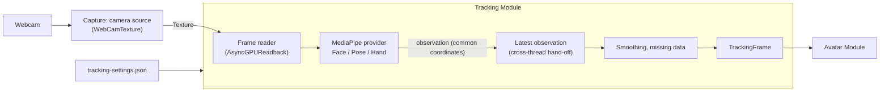
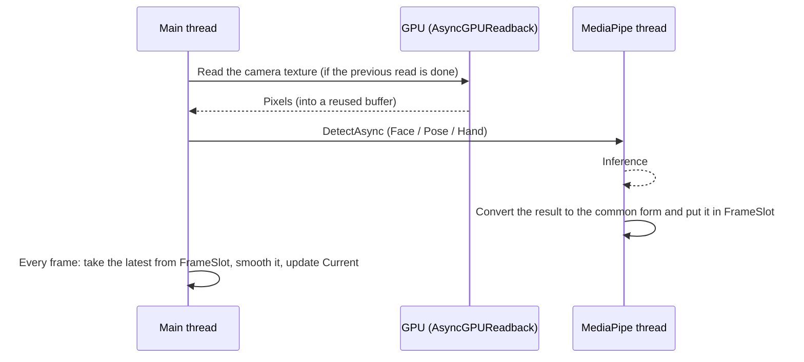

# Tracking Detailed Design

## 1. Purpose

This document defines the detailed design of the Tracking module. The Tracking module takes the movement of a person's face, body, and hands from a camera image and passes it to the Avatar module as a `TrackingFrame` that depends on neither a specific library nor an avatar (system design chapter 8).

The scope built here (v0.1.0):

- Common contracts: `TrackingFrame`, `ITrackingProvider`, tracking status
- MediaPipe provider: camera tracking with the Face / Pose / Hand Landmarkers of MediaPipeUnityPlugin
- Common processing: one coordinate system, confidence and missing data, smoothing
- Tracking camera: reusing the camera input of the Capture module
- Choosing what moves (face, upper body, hands and fingers; full body shown as "coming soon")
- Recording and replay for tuning and evaluation (developer-only)

Out of scope, handled by later designs:

- Other providers such as mocopi (system design 16.3)
- Tracking several people (system design 8.12; the design does not assume a single person)
- Full body (lower body, hip movement, foot contact). The choice is provided in advance (6.5)
- The details of the tracking settings screen (handled in the UI screen specification; chapter 10 lists only the needed items)

Related system design sections:

- 7.6 Pose application and body-size differences, 7.7 Expression control
- Chapter 8 Tracking
- 15.3 Real-time behavior, 15.7 Main-thread load
- 16.3 Adding tracking providers, 16.4 Combining tracking sources

Related detailed designs:

- Avatar detailed design (`avatar.md`): the side that applies `TrackingFrame` to the avatar
- Capture detailed design (`capture.md`): adds the tracking camera source (5.4)

Prototype referenced (outside the repository, CLAUDE.md chapter 12):

- `E:\VirtualVessel\benchmarks\Voom` (MediaPipeUnityPlugin 0.16.0, UniVRM 0.129.1)

### What is taken from the prototype, and what is not

Voom showed that the Face / Pose / Hand Landmarkers of MediaPipeUnityPlugin run in Unity on Windows and that face movement can be applied to a VRM 1.0 avatar. In the user's assessment, however, finger movement and three-dimensional movement (especially toward and away from the camera) were still immature. The product handles it as follows.

| In the prototype | In the product |
|---|---|
| The MediaPipeUnityPlugin Task API (`LIVE_STREAM`), reading the image with `AsyncGPUReadback` | Kept. It is proven to work |
| Computing eyes, mouth, and brows from the positions of face points | Not kept. The product uses the expression values (blendshapes) MediaPipe outputs (6.3). The tuning knowledge of the prototype (how easily the eyes close, keeping both eyes together, and so on) stays as settings of the conversion in Avatar (Avatar detailed design chapter 7) |
| The body was only the chest tilt, smoothed by averaging Euler angles over 30 frames | Not kept. The average suppressed jitter but lagged 0.5–1 s. The product separates the causes of jitter and suppresses each with a low-lag method (chapter 8) |
| Fingers and depth | The prototype is not taken as correct. They are built while being checked both numerically and visually with the evaluation tools (chapter 12) |
| UI handling MediaPipe types directly, printing settings with `Debug.Log` | Not kept. MediaPipe types do not leave the provider |

### Overview



---

## 2. Responsibilities

| Responsibility | Owner |
|---|---|
| Listing, choosing, starting, and stopping the camera; the image texture | Capture (`camera` source, 5.4) |
| Reading the image and passing it to inference | Tracking (MediaPipe provider) |
| Inference (face, body, and hand points and expression values) | Tracking (MediaPipe provider, using MediaPipeUnityPlugin internally) |
| One coordinate system, the definition of left and right, confidence and status | Tracking (conversion in the provider and common processing) |
| Smoothing, outlier removal, holding missing data | Tracking (common processing) |
| Correcting the input (facing direction, reference pose) | Tracking (system design 8.11) |
| Fitting the observed pose to the avatar skeleton, converting to expressions, mirroring | Avatar |
| Saving the choice of what moves | Tracking (`tracking-settings.json`) |
| Creating services and the order of startup and shutdown | Application (composition) |

---

## 3. Module Boundaries

- Tracking references Core, Diagnostics, ProjectData, and the public contracts of Capture (`ICaptureSources`, `IVideoCaptureSource`). It does not reference Avatar, Stage, Video, or UI.
- MediaPipeUnityPlugin types (`Mediapipe.*`) are used only inside the MediaPipe provider (a separate assembly, chapter 16). `TrackingFrame` contains no MediaPipe point indices, coordinate systems, or types (system design 8.1).
- Other modules use only `ITrackingSource` (5.1), never a provider directly.
- The names of expression values (6.3) are the 52 names that come from ARKit. They are not a type of a specific library but a widely used list of names for face movements, independent of providers (MediaPipe, a future iPhone, and so on) and of avatars (Perfect Sync models and so on).

---

## 4. Main Classes and Interfaces

| Name | Kind | Summary |
|---|---|---|
| `TrackingFrame` | Class | One observation: body, left and right hands, face, each with its status and time (chapter 6) |
| `BodyJoint` | Enum | Body joints (6.2) |
| `HandJoint` | Enum | Hand joints (21 points, 6.4) |
| `FaceShape` | Enum | Expression values (52, 6.3) |
| `TrackingStatus` | Enum | `Tracked`, `LowConfidence`, `Lost`, `NotSupported`, `Disabled` (6.1) |
| `TrackingRegions` | Flags enum | `Face`, `Body`, `LeftHand`, `RightHand`. The capabilities of a provider and the enabled parts |
| `BodyRange` | Enum | What moves: `UpperBody`, `FullBody` (6.5) |
| `ITrackingProvider` | Interface | The contract of an input method that produces observations (5.2) |
| `ITrackingSource` | Interface | What other modules use: the latest smoothed `TrackingFrame` and the status (5.1) |
| `TrackingService` | Class (`IApplicationService`) | Creates and starts the provider; per-frame processing, settings, metrics |
| `TrackingSettings` | Class | Saved settings (chapter 10) |
| `FrameSlot<T>` | Class | Hands only the latest value across threads (chapter 9) |
| `OneEuroFilter` | Struct | Smoothing whose strength follows speed (8.2, pure computation) |
| `RotationFilter` | Struct | Smoothing for rotations (quaternions) (8.2) |
| `TrackingProcessor` | Class | Common processing from observation to `TrackingFrame` (outliers, smoothing, missing data) |
| `TrackingStateMachine` | Static class | Decides the status of each part (pure functions) |
| `MediaPipeTrackingProvider` | Class (internal) | The MediaPipe provider |
| `MediaPipeConversion` | Static class (internal) | Converts MediaPipe points and coordinates to the common form (pure functions) |
| `TrackingRecorder` / `TrackingReplayProvider` | Class | Recording and replaying observations (developer-only, chapter 12) |

---

## 5. Public API

### 5.1 ITrackingSource

```csharp
public interface ITrackingSource
{
    IReadOnlyObservable<TrackingState> State { get; }          // Stopped, Starting, Running, Unavailable, Error
    IReadOnlyObservable<TrackingProblem> Problem { get; }      // Problem shown to the user (chapter 11)
    TrackingRegions Supported { get; }                         // Parts the provider can track
    IReadOnlyObservable<TrackingRegions> Enabled { get; }      // Enabled parts (settings)
    IReadOnlyObservable<BodyRange> BodyRange { get; }

    // The latest smoothed observation, updated every frame on the main thread. Its contents are
    // overwritten by the next update, so callers read it within that frame and do not keep it
    // (the same object is returned each time to avoid allocations).
    TrackingFrame Current { get; }

    void Start();
    void Stop();
    void SetEnabled(TrackingRegions regions);
    void SetBodyRange(BodyRange range);
    void Recenter();                                           // Makes the current pose the front and reference (8.5)
}
```

- All operations and notifications happen on the main thread.
- `TrackingService` updates `Current` every frame (`IFrameLoop`). Avatar reads it at the equivalent of `LateUpdate` (Avatar detailed design 8.3).
- One `ITrackingSource` is created per person. For several people, there will be one source per person (system design 8.12). It is not a singleton.

### 5.2 ITrackingProvider

```csharp
public interface ITrackingProvider : IDisposable
{
    TrackingRegions Supported { get; }
    IReadOnlyObservable<TrackingState> State { get; }          // The same states for sources and providers
    void Start(TrackingRegions regions);                       // Returns without waiting; the result comes through State
    void Stop();
    void Tick();                                               // Every frame on the main thread; advances reading the input

    // Copies the latest observation into the given object. Returns false when there is no new observation.
    // Copying into the caller's object avoids a per-frame allocation (exception to CLAUDE.md 15.1, chapter 23).
    bool TryTakeLatest(TrackingFrame into);
}
```

- A provider outputs observations as a `TrackingFrame` before smoothing (chapter 6; the same type before and after smoothing, so it is only copied). Provider differences (coordinate system, point indices, left and right) are converted to the common form inside the provider before output (system design 8.8).
- A new provider (mocopi and so on) is added by implementing this contract only.

### 5.3 TrackingService

- An optional application service, started after Logging, metrics, and Capture. Without Capture, the camera provider is `Unavailable` (the replay provider still works).
- At startup it reads `tracking-settings.json` and creates the configured `Provider` (default `mediapipe`).
- If it was running, it starts again at the next launch (the same as Capture).

### 5.4 Tracking Camera (Addition to Capture)

Capture gets a third source, the tracking webcam `camera`. Like GameCapture, it opens with `WebCamTexture`. The addition is written into the Capture detailed design at implementation time.

| Item | Value |
|---|---|
| Id, kind | `camera`, `CaptureSourceKind.Camera` |
| Until a device is chosen | Not opened (`DeviceNotChosen`), for the same reason as Capture detailed design 6.3 |
| Requested resolution, frame rate | 1280×720, 30 fps (enough as inference input, with a small readback cost). Changeable in settings |
| The same device twice | The device of `game` cannot be chosen (`WebCamTexture` cannot open one device twice). Choosing it shows the `DeviceInUse` problem |
| Display on the stream | None. Stage creates no screen for sources of the `Camera` kind, so the user's face or room never appears on the stream unintentionally (chapter 13) |
| Flip | Capture's flip (`CaptureFlip`) is not used. Left and right are decided by the Tracking coordinate definition (6.1) and Avatar mirroring |

---

## 6. Data Model

### 6.1 TrackingFrame

```text
TrackingFrame
├─ Sequence            Increases with each observation
├─ Body                BodyPose (6.2)
├─ LeftHand            HandPose (6.4; the user's own left hand)
├─ RightHand           HandPose
└─ Face                FacePose (6.3)

Common to each part:
├─ Status              Tracked / LowConfidence / Lost / NotSupported / Disabled
├─ Confidence          0–1
└─ Timestamp           Time of the image frame the part came from (seconds, monotonic since application start)
```

- Each part has its own time and status. Face, body, and hands come from separate inferences, so the source image frame can differ between parts (9.2).
- Left and right are the **user's own** left and right, not the image's. Whether to mirror is decided by Avatar (Avatar detailed design 6.6).
- The coordinate system is the "person space", oriented like a Unity avatar: origin at the midpoint of the hips, +Y up, +Z the person's front (toward the camera), +X the person's right. The unit is meters. It does not depend on the camera position or field of view.
- `Status`: `Tracked` means the value is usable. `LowConfidence` means there is a value with low confidence (Avatar uses it less strongly). `Lost` means it was lost (the value is the last usable one). `NotSupported` means the provider cannot track it. `Disabled` means the user turned it off.

### 6.2 BodyPose

| Item | Content |
|---|---|
| Joints | `BodyJoint`: `Head` (center of the head), `LeftEar`, `RightEar`, `Nose`, `Neck` (midpoint of the shoulders), `LeftShoulder`, `RightShoulder`, `LeftElbow`, `RightElbow`, `LeftWrist`, `RightWrist`, `Hips` (origin), `LeftHip`, `RightHip`, `LeftKnee`, `RightKnee`, `LeftAnkle`, `RightAnkle`, `LeftFoot`, `RightFoot` |
| Per joint | Position (person space), confidence (0–1), `Tracked`/`LowConfidence`/`Lost` |
| Image position | Each joint also keeps its position in the image (0–1), used for depth estimation (8.4) |

- Below the knees is used only for full body (`BodyRange.FullBody`). For the upper body, the values are present but Avatar does not use them.
- Of the 33 MediaPipe Pose points, the finger points (17–22) are not used. Fingers come from the Hand Landmarker.

### 6.3 FacePose

| Item | Content |
|---|---|
| Head rotation | Rotation (person space), from MediaPipe's facial transformation matrix. More stable than computing it from Pose points |
| Head position | Position relative to the camera (meters), used for leaning and moving closer |
| Expression values | 0–1 per `FaceShape`: the 52 that come from ARKit (`EyeBlinkLeft`, `JawOpen`, `MouthSmileLeft`, and so on). Values that cannot be tracked (`TongueOut` with MediaPipe) are `NotSupported` |
| Gaze | Also gives the direction (angles) of each eye from the expression values (`EyeLookIn/Out/Up/Down`) |

- Left and right of expression values are also the user's own. The left and right in MediaPipe's names may be based on the image; the provider's conversion checks this and aligns them (made into a test at implementation time).

### 6.4 HandPose

| Item | Content |
|---|---|
| Joints | `HandJoint`: 21 points — wrist, thumb (CMC, MCP, IP, tip), and the other four fingers (MCP, PIP, DIP, tip) |
| Positions | Person space. Combines the finger shape relative to the wrist (the 3D points of the Hand Landmarker) with the wrist position (Pose wrist) |
| Palm orientation | A rotation from the wrist and the bases of the index and little fingers |
| Deciding left and right | MediaPipe's handedness depends on image orientation and can flicker between frames. The product assigns a detected hand to **whichever Pose wrist is nearer**; handedness is only a hint |

### 6.5 What Moves (BodyRange)

| Value | Content | v0.1.0 |
|---|---|---|
| `UpperBody` | Head, neck, torso, shoulders, arms. Fixed below the hips (streaming seated) | Default. Available |
| `FullBody` | Adds hip movement and rotation, legs, and foot contact | Shown as "coming soon" and cannot be chosen |

- Face (expressions, gaze) and hands are enabled or disabled separately from the range (`TrackingRegions`). Inference for disabled parts does not run (to reduce load).
- To widen the range, add a value to `BodyRange` and add its application in Avatar. `TrackingFrame` holds the full-body joints from the start.

---

## 7. State / Lifecycle

### 7.1 TrackingSource State

| State | Meaning |
|---|---|
| `Stopped` | Stopped |
| `Starting` | Preparing the camera or inference (loading models can take a few seconds) |
| `Running` | Producing observations (still `Running` when no one is in view; parts become `Lost`) |
| `Unavailable` | No camera chosen or the camera is not found. Follows the Capture state and continues automatically when it returns |
| `Error` | Inference cannot start (missing models, the plugin cannot load, and so on) |

### 7.2 Starting and Stopping

1. `Start()`: starts the Capture `camera` source (Tracking remembers that it started it and stops it on stop; it does not stop a source the user started on the Capture screen).
2. When camera images arrive, the provider loads models (without blocking the main thread, chapter 9) and starts inference. `Running`.
3. `Stop()`: stops inference, discards pending readbacks without waiting, and releases buffers and models.

### 7.3 Status of Each Part

`TrackingStateMachine` (pure functions) decides the status of each part from whether there is an observation, its confidence, and elapsed time.

| Condition | Status |
|---|---|
| Observed, confidence at or above the threshold (default 0.5) | `Tracked` |
| Observed, below the threshold | `LowConfidence` |
| No observation for more than 0.2 s | `Lost` (the last value is kept) |
| Turned off by the user | `Disabled` |

- How values return when lost (holding, easing back to the rest pose) is decided by Avatar (Avatar detailed design 8.4). Tracking passes "since when it has been lost".
- So that the status does not flicker on every brief loss (1–2 frames), it moves to `Lost` by time and back to `Tracked` after two consecutive observations.

---

## 8. Smoothing and Accuracy

Voom's average was needed to suppress jitter. The product separates the causes of jitter and suppresses each with a low-lag method. Each method becomes the default only after replaying recorded observations and comparing numbers (chapter 12) shows less lag than the Voom method (a 30-frame average) with equal or less jitter (CLAUDE.md chapter 33).

### 8.1 Causes of Jitter and Countermeasures

| Cause | Countermeasure |
|---|---|
| Small fluctuations of inferred values (moving slightly every frame even when still) | One Euro filter (8.2): strong smoothing when still, weak when moving fast |
| Inference at 30 per second and rendering at 60, so the avatar moves only every other frame and steps are visible | For each rendered frame, interpolate between the two latest observations (Avatar detailed design 7.3). Adds at most one observation interval (about 33 ms) |
| Occasional large outliers (an arm jumping for a moment) | Discard values where a joint moved faster than a person can, or with low confidence, and use the previous value (8.3) |
| Unstable depth (values toward and away from the camera swing widely) | Re-estimate depth from image positions and bone lengths (8.4) |
| Wrong rotation averages (averaging Euler angles breaks across ±180°) | Handle rotations as quaternions; never average Euler angles |

### 8.2 One Euro Filter

- Chooses the strength of a low-pass filter each time from how fast the value changes. Slow movement is smoothed strongly, fast movement catches up quickly. Two parameters: the minimum cutoff (`MinCutoff`) and how much speed relaxes it (`Beta`).
- Applied per axis for positions and per value for expression values. For rotations (head orientation and so on), the same idea is applied with spherical interpolation, using the angle of the quaternion difference as the speed (`RotationFilter`).
- Uses the time of the image frame, not the processing time, so uneven frame intervals do not change the smoothing strength.
- Parameters are per part (fast for the face, slow for the torso, and so on). The user sees three levels: "smooth / standard / responsive" (chapter 10).
- The computation is a pure function (it takes the state as an argument and returns a new state) and is checked in EditMode with inputs and outputs only.
- The speed of a rotation is smoothed as an angular velocity with a direction (a vector). Smoothing only the size of the angle (always positive) does not let shakes in opposite directions cancel, so a still value looks like it is moving (the first implementation shook about three times as much as the average when still).

#### Measured Results (Step 1, 2026-10-18)

Synthetic motion (an angle with 2° noise at 30 per second: still for 3 s, raised 90° in 0.3 s, held, waved ±30° at 0.5 Hz), compared over 20 noise seeds (`OneEuroComparisonTests`, `SmoothingProfile`).

| Method | Jitter when still (RMS of the per-frame change) | Lag | Error while waving slowly |
|---|---|---|---|
| Voom's method (30-frame average) | 0.097° | 483 ms | 23.2° |
| Smooth (MinCutoff 0.05 Hz, Beta 0.003) | 0.057° | 99 ms | 9.6° |
| Standard (0.1 Hz, 0.005) | 0.088° | 66 ms | 7.5° |
| Responsive (0.2 Hz, 0.01) | 0.160° | 56 ms | 5.2° |

- Standard is as steady as the average or steadier when still, with about 1/7 of the lag. A single noise draw can favor either method by about a third, so the test compares the average of 10 seeds.
- Positions (joints) use provisional values with beta converted at 1 cm ≈ 2° for an arm (Standard: 0.1 Hz, 1.0). For an arm movement with 1 cm noise, the angle jitter went from 4.7° to 0.13° with 100 ms lag. Face values are provisional too and are tuned in steps 2–5 on movements recorded with a camera (chapter 17).

### 8.3 Outlier Removal

- For each joint, a value whose speed from the previous value exceeds a limit (for example 8 m/s for a wrist) is not used that time. If it keeps exceeding (a really fast movement), it is accepted from the third time.
- Points whose confidence (MediaPipe visibility, presence) is below the threshold are `LowConfidence`, and smoothing gets stronger.

### 8.4 Depth (Toward and Away From the Camera)

With a single camera, depth is less certain than image position. The depth (z) of MediaPipe Pose world landmarks swings widely in movements such as reaching forward, and can even flip direction. The product handles it as follows.

1. **Image positions are primary**: the position in the image (x, y) is more stable than depth.
2. **The magnitude of depth comes from bone length**: the lengths of the upper arm, forearm, and so on do not change. From the length `L` measured in the reference pose (8.5) and the apparent length `d` in the image, the magnitude of the depth difference is `√(L² − d²)` (the shorter it looks, the more it points toward or away from the camera).
3. **The direction (toward or away) comes from MediaPipe's z**: the magnitude comes from step 2; only the sign is taken from z. To keep the sign from flickering, the switch has hysteresis (it flips only after exceeding a margin).
4. **Joint limits check the result**: if the result violates a constraint such as the elbow bending only one way, the other direction is chosen.

Whether this method is better than using world landmarks as they are is decided after replaying recorded movements (reaching forward, folding hands in front of the chest, putting a hand behind the head, and so on), comparing them, and checking visually (chapter 12). The comparison is recorded in this document.

For fingers, the joint **angles** (the angle between neighboring bones) are primary. Angles do not depend on hand size or distance from the camera, and depth errors affect them less than positions. Finger flexion is limited to 0 to about 90°, and spreading to a small range (Avatar detailed design 7.5).

### 8.5 Reference Pose (Input Correction, System Design 8.11)

- `Recenter()` takes the current pose as the reference: the person's facing direction, bone lengths (8.4), and the reference head position.
- Until a reference pose is taken, standard body lengths are used. On the first start, it is measured once automatically while the person faces forward with arms down (the median of a few seconds of observations).
- Correction to fit the avatar's body (different arm lengths and so on) is done by Avatar (system design 7.6).

---

## 9. Threading / async

### 9.1 Flow



- A new readback starts only when the previous readback and inference have finished. Old frames are not queued; inference always runs on the latest image (so lag does not grow).
- MediaPipe results are delivered on MediaPipe's thread. They are converted to the common form there and put in `FrameSlot`. No Unity API is called there.
- `FrameSlot<T>` cycles three objects (being written, latest, being read). Only a short lock, no waiting (the same idea as Capture detailed design 8.2). Objects are reused; nothing is allocated per observation.
- Smoothing and status decisions run on the main thread once per frame.

### 9.2 Per-part Times

Face, body, and hand inferences run in parallel and their results arrive separately. `TrackingFrame` holds the latest observation of each part with its own time (the time of the source image frame). Avatar interpolates using the per-part times.

### 9.3 Loading Models

- Loading models (`.bytes`) and preparing inference happen asynchronously so the main thread is not blocked. The time taken is measured.

---

## 10. Settings

```csharp
public sealed class TrackingSettings
{
    public string Provider { get; set; } = "mediapipe";
    public TrackingRegions Regions { get; set; } = TrackingRegions.All;   // Enabled parts: face, body, both hands
    public BodyRange BodyRange { get; set; } = BodyRange.UpperBody;
    public SmoothingPreset Smoothing { get; set; } = SmoothingPreset.Standard;  // Smooth, Standard, Responsive
    public PoseModel PoseModel { get; set; } = PoseModel.Full;             // Lite, Full, Heavy (load and accuracy)
    public TrackingCalibration Calibration { get; set; }                  // Reference pose (8.5); null until measured
    public bool Running { get; set; }                                     // Whether it was started; restored at the next launch
}
```

- Saved to `tracking-settings.json` (settings folder, `ConfigFileStore`). Like Capture and Stage, it moves to Project / Profile once those exist (`Profiles/Tracking/` in system design 6.10).
- The camera device choice is saved in `capture-settings.json` (`camera` source).
- Mirroring is an Avatar setting (Avatar detailed design chapter 10).

---

## 11. Logging and Diagnostics

- State changes, the provider, model kinds and versions, and model loading time are logged at Information. Nothing is logged per frame.
- The following are recorded in performance metrics (`IPerformanceMetrics`) and appear in the Diagnostics screen table.

| Metric | Kind | Content |
|---|---|---|
| `Tracking/<region>.Inference` | Timer | Inference time (face, body, hands) |
| `Tracking/<region>.Interval` | Timer | Interval between new observations |
| `Tracking/Latency` | Timer | From the image frame time to the update of `Current` |
| `Tracking/Readback` | Timer | Image readback time |
| `Tracking/Dropped` | Counter | Images not inferred because the previous inference was not finished |
| `Tracking/Outliers` | Counter | Values discarded as outliers |

- Problems shown to the user (`TrackingProblem`): `CameraNotChosen` (choose a camera), `CameraNotFound`, `CameraInUse` (the same camera as the game screen), `StartFailed` (tracking could not start), `NoPerson` (no one is in view; status display only). Plugin or model paths are not shown to the user.
- The setup screen overlays points and bones on the camera image so the user can check that tracking works (never on the stream).

---

## 12. Recording and Replay (Developer-only)

Tools for choosing the smoothing and depth methods by comparison rather than by feel.

- `TrackingRecorder`: records the provider's observations (`TrackingFrame` before smoothing) with times to a file. **Images are not recorded.**
- `TrackingReplayProvider`: replays a recording as an `ITrackingProvider`. The same movement can be reproduced any number of times without a camera.
- Evaluation values (pure functions computed in EditMode):

| Value | Meaning |
|---|---|
| Jitter | Size of joint angle changes during still intervals (RMS) |
| Lag | During fast movements, the time until the smoothed value catches up with the raw value (from cross-correlation) |
| Bone-length stability | Variation of bone lengths; an indicator of depth estimation quality |
| Joint-limit violations | Number of times a joint limit was exceeded |

- Recordings committed to the repository are only synthetic movements made for tests (fixed movements with added noise). A recording a developer makes of themself can be personal information including face shape, so it stays on that developer's machine and out of the repository (chapter 13).
- Recording is enabled only by a developer setting (a launch argument), never from the normal screens.

---

## 13. Security and Privacy

- The camera image shows the user's face and room. It never leaves the process and is not written to files, logs, or diagnostics. Reading for inference happens only inside reused buffers.
- The tracking camera image is not put on the stream (5.4).
- Observations (face points, expression values, body points) can also contain personal characteristics. Recording (chapter 12) happens only when a developer explicitly enables it and goes to `Cache/TrackingRecordings/` in the Data Root. Values are not written to logs.
- MediaPipe runs inference inside the process and does not communicate over the network. Model files are included in the distribution and are not downloaded at run time. The versions and hashes (SHA-256) of models and the plugin are pinned in the SBOM and the setup script (16.2).
- Inference failures (invalid input, plugin exceptions) are caught inside the provider and become `Error`; they do not crash the application.

---

## 14. Testing Strategy

| Kind | Target |
|---|---|
| EditMode | `OneEuroFilter`, `RotationFilter`: jitter decreases on a constant value, time to catch up with a step input, changing time intervals, rotations across ±180° |
| EditMode | `MediaPipeConversion`: the coordinate system (conversion to person space, left/right, up/down, toward the camera), point mapping, left/right assignment independent of handedness. Checked with synthetic data of known poses |
| EditMode | Depth estimation (8.4): depth from apparent length and bone length, sign hysteresis, re-choosing by joint limits |
| EditMode | `TrackingStateMachine`, outlier removal, `FrameSlot` (including hand-off across threads) |
| EditMode | Evaluation values (chapter 12): with synthetic movements, smoothing lag and jitter are within targets. The Voom method (30-frame Euler average) is implemented for comparison, and the product method has less lag on the same input |
| EditMode | `TrackingService` driven by the replay provider: start/stop, enabling/disabling parts, switching the range, saving settings |
| Hardware | Face, body, and hands are tracked with a real camera and MediaPipe. Marked `[Explicit]` |
| Performance | Inference time (face, body, hands, together), readback time, and lag recorded on the development PC (chapter 15) |

---

## 15. Performance

- Targets (checked on the development PC, results recorded here):
  - Inferring face, body, and both hands together keeps up with the camera at 30 per second.
  - The median lag from the image frame to the update of `Current` (`Tracking/Latency`) is 80 ms or less.
  - Main-thread work (requesting readbacks, receiving, smoothing) is 0.5 ms or less per frame, with no per-frame allocation.
- On Windows, MediaPipe inference runs on the CPU (GPU paths are limited to Android and similar). If the targets are not met, the options are chosen by measurement:
  - Use the lighter Pose model (Lite).
  - Infer hands every other time (if hands affect perceived motion less than the face).
  - Compare with the Holistic Landmarker, which combines the three inferences (experimental in plugin 0.16).
  - Later, build a provider that infers on the GPU with Unity Inference Engine (formerly Sentis) (within system design 16.3).
- Inference runs on MediaPipe's threads and never makes the main thread wait.

---

## 16. Directory / Namespace and Dependencies

### 16.1 Directory

```text
Assets/VirtualVessel/Tracking/
├─ Runtime/                                    VirtualVessel.Tracking
│  ├─ TrackingFrame.cs        TrackingFrame, TrackedPart, BodyPose, HandPose, FacePose
│  ├─ TrackingTypes.cs        BodyJoint, HandJoint, FaceShape, TrackingStatus, TrackingRegions, BodyRange
│  ├─ ITrackingSource.cs      ITrackingSource, ITrackingProvider
│  ├─ TrackingService.cs      TrackingService, TrackingSettings
│  ├─ Processing/             OneEuroFilter (with PositionFilter, RotationFilter), SmoothingProfile, OutlierGate, TrackingProcessor, TrackingStateMachine, DepthEstimation (step 5)
│  ├─ Threading/FrameSlot.cs
│  └─ Recording/              TrackingRecorder (step 2), TrackingReplayProvider, TrackingMetrics, SyntheticMotion
├─ MediaPipe/                                  VirtualVessel.Tracking.MediaPipe (the only assembly that references MediaPipeUnityPlugin)
│  ├─ MediaPipeTrackingProvider.cs   Creating and calling tasks (the part that uses the plugin API)
│  ├─ MediaPipeConversion.cs
│  └─ CameraFrameReader.cs    AsyncGPUReadback and buffer reuse
└─ Tests/
   ├─ EditMode/
   └─ PlayMode/
```

References: Core, Diagnostics, ProjectData, Capture. The MediaPipe assembly also references MediaPipeUnityPlugin.

### 16.2 Adding MediaPipeUnityPlugin

- The version is pinned to the latest at the time of adding it (currently v0.16.3, MediaPipe v0.10.22). Whether it runs on Unity 6.6 is checked in that step.
- The plugin is the `.tgz` (a Unity package) published in the GitHub releases. It is not committed to the repository: it is large (about 380 MB unpacked in Voom, mostly native libraries for other platforms) and would weigh down Git history.
  - `tools/deps/fetch-mediapipe.ps1` downloads the pinned `.tgz`, checks its SHA-256, and places it outside Git's control. `Packages/manifest.json` references that file.
  - Local machines and CI use the same script, the same idea as the native plugin (the DLL is not in Git and is produced by a procedure).
- Models (Face Landmarker, Pose Landmarker, Hand Landmarker) are fetched by the same script with pinned versions and hashes, and are included in the distribution.
- The distribution includes only the Windows x64 native libraries.
- Licenses: the plugin is MIT; MediaPipe and the models are Apache-2.0. They are recorded in the SBOM in the same change (CLAUDE.md chapter 35).

#### Preparing for Updates

MediaPipeUnityPlugin keeps being updated (about nine months from v0.16.0 to v0.16.3). To make following updates easy:

- The version, download URL, and SHA-256 are written in one place, `tools/deps/mediapipe.json`. The script, CI, and the SBOM check read these values. An update is one change (a `chore:` branch) that changes these values and the SBOM.
- Only the MediaPipe assembly uses plugin types, and within it, the part that calls the plugin (creating tasks, `DetectAsync`, receiving results) is separate from the part that converts results to the common form (`MediaPipeConversion`). When the plugin API changes, the fix is limited to the part that calls the tasks.
- `MediaPipeConversion` is a pure function that takes arrays of points (positions, confidence), not plugin types. Its tests keep working when the plugin API changes.
- Model files have their own versions and hashes, separate from the plugin. Updating the plugin does not require changing the models, and vice versa.
- Checking an update: EditMode tests, `[Explicit]` hardware tests (face, body, and hands are tracked), and performance measurements (inference time, lag) are compared before and after the update, and the results go in the pull request.
- The update procedure is written in the dependency-update section of the development workflow (added in the step that introduces the plugin).

---

## 17. Open Issues

| Item | Plan |
|---|---|
| The depth estimation method (8.4) compared with world landmarks | Decided in steps 2–5 by replaying recorded movements |
| Default smoothing parameters | Decided in steps 2–5 by evaluation values and visual checks |
| Switching to the Holistic Landmarker | In step 2, after measuring the load of running the three inferences together |
| Adding full body (`FullBody`) | After v0.1.0 |
| Combining lip sync from voice with face tracking | When designing Voice / Audio |
| Moving tracking settings to Project / Profile | When designing Project / Profile |

---

## 18. Implementation Order

Each step is one branch with its tests and a demo branch to try it (CLAUDE.md 29.2). The order together with Avatar is in Avatar detailed design chapter 18.

1. Tracking foundation: `TrackingFrame`, contracts, `OneEuroFilter`, `RotationFilter`, `FrameSlot`, status decisions, evaluation values and replay (synthetic movements)
2. MediaPipe: adding the plugin and models (SBOM), the Capture `camera` source, `MediaPipeTrackingProvider`, the camera and point display on the setup screen, measuring load and lag
