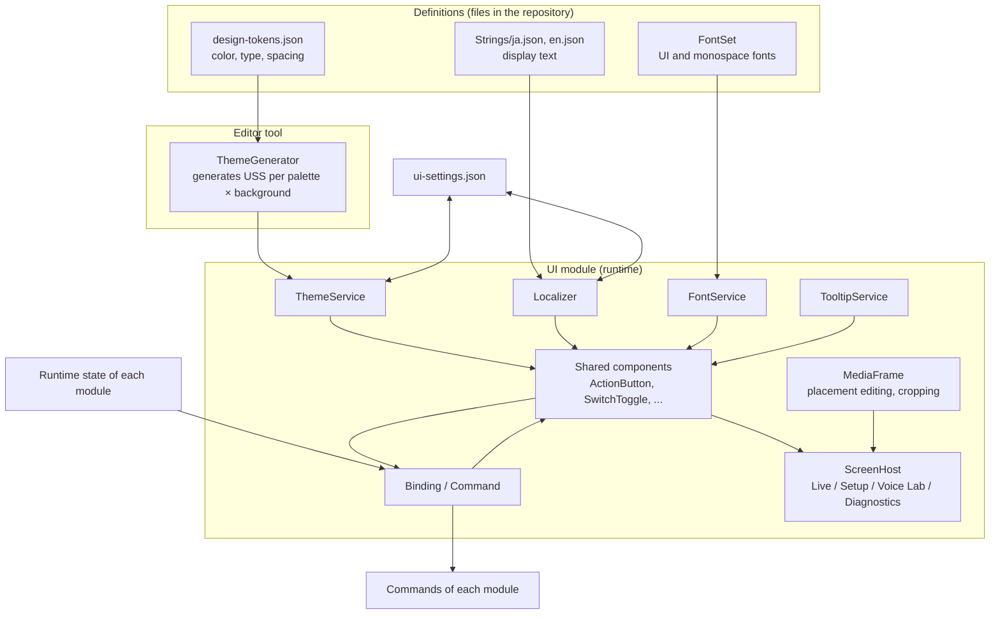
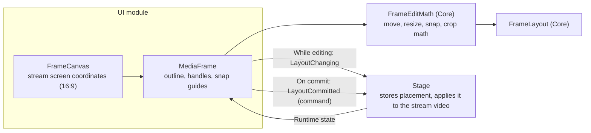

# UI Foundation Detailed Design

## 1. Purpose

This document defines the detailed design of the foundation of the UI module.

It covers:

- easy-to-use shared components (project-owned parts built on UI Toolkit)
- theme (palette, dark or light, UI scale, reduced motion)
- managing and switching fonts as a whole
- localization (a lightweight project-owned mechanism)
- tooltips
- displaying runtime state and operating through commands
- a panel for editing placement on the stream screen and cropping (`MediaFrame`)
- screen switching and Developer Mode
- storing UI-specific settings
- checking the display with screenshots

Visual values and component specifications are defined in the following documents. This document defines how they are realized in Unity.

- `docs/en/ui/design-system.md`
- `docs/en/ui/components.md`
- `docs/en/ui/ui-guidelines.md`

Related system design: Chapter 14 (UI and operation), 6.8 (storing basic settings), 16.14 (UI locale extension), 16.15 (UI theme extension)

### Overview



---

## 2. Responsibilities

| Responsibility | Owner |
|---|---|
| Shared components, tooltips, binding, command execution | UI |
| Switching theme, fonts, and language | UI |
| Screen switching, switching Developer Mode | UI |
| Contents of UI-specific settings (`ui-settings.json`) | UI |
| Reading and writing settings files (schema version, atomic write, keeping unknown fields) | ProjectData |
| Placement editing math (move, resize, snap, crop) | Core (`FrameEditMath`, no Unity dependency) |
| Storing placement data (`FrameLayout`) and applying it to the stream video | Stage (when implemented). The UI requests changes through commands |
| State and operations of each function | Each module. The UI only displays state and calls commands |

---

## 3. Module Boundaries

- The UI receives each module's runtime state as `IReadOnlyObservable<T>` and displays it. UI state is not treated as runtime state (system design 14.29).
- Operations from the UI reach each module through `IUiCommand`. The UI does not operate other modules' internal classes directly.
- `MediaFrame` does not draw video. Compositing the stream video is the responsibility of Stage and Video (CLAUDE.md Chapter 6); `MediaFrame` only edits placement data.
- The dependency direction is `Application → UI → each module → Diagnostics → Core`. UI parts do not depend on other modules. Screens depend only on the public interfaces of the modules.

---

## 4. Pain Points of Stock Unity UI and Remedies

Using UI Toolkit as is has the following problems. The shared components and surrounding mechanisms solve them.

| Problem | Remedy |
|---|---|
| Event registration and unregistration are written by hand; a missed unregistration causes leaks or calls after disposal | Bindings unregister automatically when the element leaves the panel (7.3) |
| No way to show tooltips at runtime (the `tooltip` attribute is editor-only) | `TooltipService` (7.6) |
| Localizing display text requires code every time | Specifying `text-key` in UXML is enough for language switching (7.4) |
| Visual variants are specified by class-name strings, and typos go unnoticed | Variants are enum properties (for example `variant="Primary"`) |
| Setting a value from code also raises the change event, making it hard to tell from user input | Display updates use `SetValueWithoutNotify`, and only user input goes to commands (7.3) |
| No standard way to tell why something cannot be pressed | Commands carry the reason; the button is disabled and shows it in a tooltip (7.5) |
| Label position and spacing differ between controls | Shared components have the structure and spacing defined in `components.md` |

---

## 5. Main Classes and Interfaces

| Name | Kind | Summary |
|---|---|---|
| `UiRoot` | MonoBehaviour | Entry point of the UI in the persistent scene. Holds the `UIDocument` and UI assets and connects the services |
| `UiAssets` | ScriptableObject | References to PanelSettings, generated themes, font sets, string tables, and screen UXML |
| `UiApplicationService` | Class | Starts and stops the UI as one application service (7.9) |
| `ThemeService` | Class | Applies palette, background, scale, and reduced motion |
| `FontService` | Class | Switches font sets |
| `FontSet` | ScriptableObject | UI and monospace font assets, fallback |
| `Localizer` / `ILocalizer` | Class / Interface | Gets display text and switches language |
| `TooltipService` | Class | Shows tooltips |
| `DialogService` / `IDialogService` | Class / Interface | Shows confirmation dialogs |
| `NotificationService` / `INotificationService` | Class / Interface | Shows notifications |
| `IUiCommand` | Interface | An operation run from the UI |
| `IReadOnlyObservable<T>` / `ObservableValue<T>` | Interface / Class (Core) | A value that notifies changes |
| Shared components | VisualElement | The parts in `components.md` (Chapter 6) |
| `MediaFrame` / `FrameCanvas` | VisualElement | Placement editing and cropping (Chapter 9) |
| `FrameLayout` / `FrameEditMath` | Struct / static class (Core) | Placement data and editing math |
| `AppShell` | VisualElement | Navigation, screen area, and version (7.7) |
| `ScreenHost` | VisualElement | Screen switching (7.7) |
| `ScreenDefinition` / `IScreen` | Class / Interface | What a screen registers, and shown/hidden notifications (7.7) |
| `DeveloperModeService` | Class | Switches Developer Mode and propagates it to related functions |
| `UiSettings` | Class | Contents of the UI-specific settings (the values as written in the file) |
| `UiSettingsResolver` / `ResolvedUiSettings` | Static class / Struct | Checks the setting values against allowed lists and decides the values to use (8.1) |
| `UiSettingsService` | Class | Reports setting changes and saves them together (7.9) |
| `ConfigFileStore` | Class (ProjectData) | Reads and writes settings files |
| `ThemeGenerator` | Editor | Generates USS for each theme from the tokens |
| `ComponentGalleryScreen` | VisualElement | The component gallery (7.7) |
| `UiScreenshotCapture` | Editor | The menu that writes screens to PNG (7.10) |
| `UiShotPlan` / `UiScreenshotCaptureRun` | Static class / PlayMode test | The combinations to write, and the writing itself (7.10) |

---

## 6. Shared Components

### 6.1 List

Each part in `components.md` is implemented as a class derived from `VisualElement`, usable from both UXML and C#.

| Part | Class | UXML example |
|---|---|---|
| Button | `ActionButton` | `<vv:ActionButton variant="Primary" text-key="live.start" tooltip-key="tip.live.start" />` |
| Icon Button | `IconButton` | `<vv:IconButton icon="Mic" toggle="true" tooltip-key="tip.mute" shortcut="Ctrl+M" />` |
| Toggle | `SwitchToggle` | `<vv:SwitchToggle text-key="voice.convert" />` |
| Slider | `ValueSlider` | `<vv:ValueSlider low-value="-60" high-value="0" unit="dB" />` |
| Level Meter | `LevelMeter` | `<vv:LevelMeter segments="24" />` |
| Dropdown | `SelectField` | `<vv:SelectField label-key="audio.mic.device" />` |
| Text Field | `TextInput` | `<vv:TextInput label-key="stream.title" />` |
| Numeric Field | `NumberInput` | `<vv:NumberInput label-key="audio.sampleRate" unit="Hz" />` |
| Tab | `TabBar` | `<vv:TabBar />` |
| Setting Row | `SettingRow` | `<vv:SettingRow name-key="audio.noise" description-key="audio.noise.desc">…</vv:SettingRow>` |
| Card | `Card` | `<vv:Card title-key="voice.title">…</vv:Card>`; a collapsible card adds `collapsible="true" expanded="false"` |
| Dialog | `ConfirmDialog` | Shown from C# with `ConfirmAsync` (6.4) |
| Status Indicator | `StatusChip` | `<vv:StatusChip status="Success" text-key="trk.good" />` |
| Notification | `Notice` | Shown from C# through `NotificationService` |
| Progress Bar | `ProgressMeter` | `<vv:ProgressMeter label-key="lab.training" />` |
| Navigation Item | `NavItem` | `<vv:NavItem icon="Live" text-key="nav.live" />` |
| Preview | `StreamPreview` | `<vv:StreamPreview />` |
| Segmented | `Segmented` | `<vv:Segmented item-keys="settings.dark,settings.light" />` |
| Key Hint | `KeyHint` | `<vv:KeyHint keys="Ctrl+M" />` |
| Icon | `Icon` | `<vv:Icon icon="Live" />` (6.6) |
| Popup Menu | `PopupMenu` | Shown from C# with `PopupMenu.Show` (`components.md` 3.23) |
| Panel | `MediaFrame` | Chapter 9 |
| Layer List | `LayerList` | Created from C# with `new LayerList(canvas)` (9.7) |
| Table | `DataTable` / `TableColumn` | Created from C# with `Ui.Table(TableColumn.Number(...), ...)` (`components.md` 3.24) |

The UXML namespace is `VirtualVessel.UI.Controls` with the prefix `vv`. Classes are defined with `[UxmlElement]` and `[UxmlAttribute]` (Unity 6).

### 6.2 Common Attributes

Every shared component has the following attributes.

| Attribute | Contents |
|---|---|
| `*-key` such as `text-key` | String key of the display text. Updated automatically when the language changes |
| `tooltip-key` | String key of the tooltip |
| `shortcut` | Shortcut notation shown with the tooltip |

Attributes that set display text directly (such as `text`) are not used on user-facing screens.

**How components find services**

- A component receives `UiServices` (`ILocalizer`, `IMainThreadDispatcher`, `ILog`, where to show failures, and confirmation dialogs) from the nearest `UiServicesScope` above it. UiRoot (implementation step 7) puts a `UiServicesScope` at the top of the screen. There is no global instance.
- `KeyedText` handles `*-key` text. It looks the text up when the component joins a panel and again whenever the language changes, and unsubscribes when the component leaves the panel.
- Outside a scope, such as while editing in the UI Builder, the key is shown as `[live.start]`, so that it is still clear which text goes where.

### 6.3 Building from C#

For building without UXML, a short factory (`Ui`) is provided.

```csharp
var start = Ui.Button("live.start", ButtonVariant.Primary)
    .WithTooltip("tip.live.start", "Ctrl+Enter")
    .Bind(_startStreaming);
```

- `Ui` has a method for each part (`Button`, `IconButton`, `Toggle`, `Segmented`, `Tabs`, `Card`, `SettingRow`, `Chip`, `NavItem`, `Slider`, `Select`, `TextField`, `NumberField`, `Progress`) and `Text`, which makes a label that follows the language. Every display text is passed as a string key.
- Buttons and Icon Buttons chain `WithTooltip` and `Bind`.

### 6.4 Dialogs and Confirmation

Actions that are hard to undo run only after confirmation.

```csharp
bool confirmed = await _dialogs.ConfirmAsync(
    titleKey: "live.end.confirm.title",
    bodyKey: "live.end.confirm.body",
    confirmKey: "live.end",
    style: ConfirmStyle.Danger);
```

A command registered as a `DangerCommand` shows the confirmation dialog automatically when run from an `ActionButton`.

- The dialog is shown over the nearest `vv-root` element. While it is open, a layer over the whole screen stops interaction behind it.
- USS cannot draw a blurred shadow, so the "large shadow" (`components.md` 3.11) is replaced by a scrim that darkens the whole screen with `Scrim` (`design-system.md` 3.5). The scrim is darker on dark backgrounds, so that the dialog still stands out from a page that is already dark.
- With `ConfirmStyle.Danger`, the action button is Danger and the other is a Secondary "Cancel", and focus starts on "Cancel", so that pressing Enter by mistake does not run the action. With `Normal`, focus starts on the action button. `DialogService.FocusCancelFirst` (a pure function) decides which.
- While it is open, focus moved by Tab and the arrow keys stays between the two buttons. Esc and the navigation cancel act as "Cancel". When it closes, focus returns to the element that had it before.
- If another confirmation is requested while one is open, it is shown after the first closes. A canceled `CancellationToken` acts as "Cancel".
- A button shows its busy state as soon as it is pressed, so a second dialog does not open while the first is waiting for an answer.
- If `UiServices` has no confirmation dialog, a `DangerCommand` does not run and an Error is recorded in the developer log, so that an action that is hard to undo never runs without confirmation.

### 6.5 Style

- Each part's USS lives in `Assets/VirtualVessel/UI/Styles/Components/`, and every color, spacing, and radius refers to tokens with `var()`.
- States are expressed with USS pseudo-classes (`:hover`, `:active`, `:disabled`) and classes added by the part (such as `vv-chip--success` and `vv-switch--on`).
- `Styles/components.uss` gathers the USS of every part with `@import`. `ThemeGenerator` registers it as `ThemeAssets.Components`, and `ThemeService.Attach` adds the common tokens, the components, and the theme to the root in that order.
- Unity's default button look (`unity-button`) is removed, and every state is set from tokens.
- USS has no `:focus-visible`. `FocusRing` therefore adds `vv-focus-visible` only when focus comes from the keyboard (when the focus change has a direction), which shows the 2px outline.

### 6.6 Icons

The project uses its own icons, without an external icon set or an SVG import package.

- Shapes are written in `IconLibrary` as SVG path data (such as `M4 7h10M18 7h2`) on a 24×24 grid with 2-unit strokes and round ends and joins, the same rules as the `styleboard.html` icons. Because they are written as SVG, any viewer can show them.
- `IconGeometry.ParsePath` (a pure function) turns path data into polylines. It supports M, L, H, V, C, Q, A, and Z, and splits curves into short segments.
- The `Icon` element draws the polylines with Painter2D in the element's text color, so it follows hover, disabled, theme, and dark/light automatically and stays sharp at any size.
- To add an icon, add it to `IconName` and `IconLibrary`. A test checks that every icon parses and stays inside the grid.

### 6.7 Implementing the Input and Display Parts

| Part | Key points |
|---|---|
| `ValueSlider` | The grab area is 24px tall (pressable parts are at least 24px, `components.md` 2) around a 6px rail. Values snap to `step` (1/100 of the range when `step` is 0). Left and right keys move by one step. `ValueSlider.Format` (a pure function) shows negative numbers with "−" (U+2212) and, with `signed`, positive numbers with "+" |
| `SelectField` | Options (`SelectChoice`) are either string keys or text from data, such as audio device names, which is not translated. The value is the option id. The list opens on the nearest `vv-root` element, so it uses the theme colors. Up and down keys move, Enter chooses, and Esc closes. It also closes on a press outside the list, when the part leaves the screen, or when the language changes |
| `TextInput` / `NumberInput` | They wrap Unity's `TextField` and style it with tokens. USS cannot draw an outer glow, so focus is shown by an `Accent Line` border. `NumberInput` commits on Enter or when focus leaves: values outside the range are brought into it, and text that is not a number shows an error (`field.number-invalid`) and keeps the previous value. Full-width digits and "−" are accepted |
| `LevelMeter` | The 24 segments are drawn in one pass. `LevelMeter.KindOf` (a pure function) decides each segment's range: normal, warning, or the red top. `BindLevel` does not subscribe to changes; while the meter is shown it reads the value at a fixed interval (33 ms by default, about 30 Hz), so the audio thread does no UI work or allocations. Setting `Level` and updating a binding do not allocate (checked by `UiAllocationTests` in `Tests/Performance`) |
| `ProgressMeter` | USS has no gradients, so the fill is drawn as a quad with colored vertices. The gradient spans the whole track, so partial progress ends between the two colors. Text with numbers, such as "Epoch 120 / 300" (`Detail`), is built by the caller with the localizer |
| `NavItem` | `ScreenHost` (implementation step 7) decides which item is selected; the item only shows it |
| `SettingRow` | The setting name is specified as weight 500, but the font set has no medium weight, so it is shown in Regular |

- String-valued parts (`SelectField`, `TextInput`, `NumberInput`) stop the text change events of their inner labels. Unity labels send a `ChangeEvent<string>` when their text changes, and it would bubble up and look like a change of the part's value.

---

## 7. Mechanisms

### 7.1 Theme

**Source of tokens**

`Assets/VirtualVessel/UI/Theme/design-tokens.json` holds the values from `design-system.md` (palettes, neutral S/L, status colors, derived color ratios, spacing, radius, text sizes and roles). It is the single source on the Unity side. It is read with Unity's built-in `JsonUtility`, because its fields are fixed and Newtonsoft.Json is not used outside ProjectData.

**Generating USS**

USS cannot compute colors with `color-mix()` or HSL. The editor tool `ThemeGenerator` (menu: Virtual Vessel > UI > Generate Theme; batch mode: `-executeMethod VirtualVessel.UI.Editor.Theme.ThemeGenerator.Generate`) therefore generates the following USS from the tokens.

```text
Assets/VirtualVessel/UI/Theme/
├─ design-tokens.json
├─ ThemeAssets.asset                references to the generated USS and font sets (used by the runtime to switch)
└─ Generated/
   ├─ tokens-common.uss             --vv-space-*, --vv-radius-*, text sizes (.vv-text-*)
   ├─ theme-lavender-dark.uss       --vv-color-* (precomputed values)
   ├─ theme-lavender-light.uss
   ├─ …                             6 palettes × 2 backgrounds = 12 files
   └─ fonts-notosans.uss            font mapping per font set (7.2)
```

- Variables are defined on `.vv-root` and named `--vv-color-*`, `--vv-space-*`, and `--vv-radius-*`. The `vv-` prefix keeps them apart from the variables of Unity's default theme.
- `ThemeColor` does the color math (HSL, mixing, contrast ratios), and `ThemeStyleSheetGenerator` writes the USS text. Both are pure and do not touch files, so tests use them directly.
- The generated USS and `ThemeAssets.asset` are committed to the repository. Builds do not need to generate them.

**Applying a theme**

`ThemeService` adds the `vv-root` class and `tokens-common.uss` to the root `VisualElement` and swaps only the theme USS. Every part refers to `var(--vv-color-primary)` and similar, so swapping changes the colors everywhere.

| Setting | How it is applied |
|---|---|
| Palette, background | Swap the theme USS. An unknown palette falls back to the default (Lavender) and a warning is recorded |
| UI scale | Done through `PanelSettings` by `UiRoot` (implementation step 7) |
| Reduced motion | Add the `vv-reduced-motion` class to the root; each part's USS stops transitions and blinking |

**Token tests (`ThemeTokenTests`)**

- The committed USS matches the result of regenerating from `design-tokens.json`, with no stale files.
- `ThemeAssets.asset` references every palette, background, and the default font set.
- Every palette and background meets the contrast in `design-system.md` 9.2. This covers each text level on backgrounds and surfaces, `On Accent` on Primary and Secondary, `Accent Line` on backgrounds and surfaces, status text on its soft background (composited over a card), status colors on surfaces, and Text 2 on a wash (composited over a card).
- The palette values written in `docs/assets/ui/styleboard.html` match `design-tokens.json`.

During the first implementation, this test showed that the original status colors and some light-background colors fell short of the rules. The values in `design-system.md` were therefore adjusted (soft status background, Error, Live, light Success and Warning, Text 3, Accent Line). Later, after a visual review in a sandbox, neutral saturation was lowered so that backgrounds are close to colorless, and washes and accent decoration (`design-system.md` 3.6) were added instead. Primary and Secondary are also adjusted per background (deeper on light, brighter on dark; `accentShift` in `design-tokens.json`). The light adjustment stays within the range that keeps 4.5:1 for On Accent. Later, Mint and Peach looked dull in the component demo, so their base colors were made more vivid.

### 7.2 Fonts

**FontSet**

Fonts are handled as a set in a `FontSet` (ScriptableObject, `Assets/VirtualVessel/UI/Fonts/`).

| Item | Contents |
|---|---|
| Id | Identifier stored in `ui-settings.json` (for example `NotoSans`) |
| Regular | Body text, labels, captions |
| Bold | Headings, buttons, bold text |
| Mono | Numbers, logs, identifiers |

The default font set is `NotoSans` (Noto Sans JP Regular and Bold + Noto Sans Mono). `ThemeGenerator` creates it if it is missing.

**How bulk changes work**

- All text decides its font through typography classes (`vv-text-heading`, `vv-text-body`, `vv-text-mono`, and so on) or `vv-bold` and `vv-mono`. Root text uses Regular.
- For each font set, `ThemeGenerator` generates `fonts-<id>.uss`. Only this USS maps the classes and `.vv-root` to font files (`-unity-font: url("project://database/...")`). `-unity-font-definition` is reset to `initial` so that it wins over the font of Unity's default theme.
- `FontService` swaps this USS. Swapping it changes the font of the whole application at once. An unknown font set falls back to the default and a warning is recorded.
- Which font (Regular, Bold, Mono) each typography class uses is set in `typography` of `design-tokens.json`.

The first plan referred to fonts through a custom property (`var(--font-ui)`). Passing fonts through USS variables has not been confirmed to work, so the class approach verified in the sandbox is used instead. Swapping a single USS is unchanged.

This enables two kinds of bulk change.

| Situation | Method |
|---|---|
| Changing the default font during development | Replace the fonts of the default font set and run `ThemeGenerator`. Screen UXML and USS do not change |
| A user changes it in settings | Change `fontSet` in `ui-settings.json`. It switches while running |

**Language and fonts**

- Each language in the string tables (7.4) can name a preferred font set. This is for future languages that the Japanese font cannot display.
- Fallback is set in the PanelSettings text settings so that no glyphs are missing (system design 14.9). `UiRoot` does this (7.9).
- Japanese has many characters, so fonts are treated as dynamic (glyphs are added to the atlas at runtime as needed). Referring to a TTF with `-unity-font` makes Unity create a dynamic font asset.

**Font files**

- Font files are placed unmodified in `Assets/ThirdParty/NotoSansJP/` and `Assets/ThirdParty/NotoSansMono/`, together with the OFL license text (`OFL.txt`) and a `README.md` recording the source.
- `*.ttf` and `*.otf` are added to `.gitattributes` as binary.

### 7.3 Binding and Runtime State

**Observable**

Each module exposes the state it shows to the UI as `IReadOnlyObservable<T>` (Core).

```csharp
public interface IReadOnlyObservable<T>
{
    T Value { get; }

    IDisposable Subscribe(Action<T> onChanged);
}
```

**Writing bindings**

```csharp
_voiceToggle.BindValue(_voice.ConversionEnabled, onUserChange: _setConversion);
_latencyChip.BindText(_voice.InferenceLatency, latency => $"{latency.TotalMilliseconds:F0} ms");
```

- `BindValue` shows the runtime value with `SetValueWithoutNotify` and passes only user input to the `onUserChange` command. If the command fails or is rejected, the display returns to the runtime value.
- A binding subscribes when the part is added to a panel and unsubscribes when it leaves (`AttachToPanelEvent`, `DetachFromPanelEvent`). No manual unsubscription is needed.
- When state changes on a thread other than the main thread, `IMainThreadDispatcher` moves the update to the main thread.
- Frequently changing values, such as the volume meter, update the display at a fixed interval (30 Hz by default) instead of on every change.

### 7.4 Localization

The purpose of system design 14.6 (separating display text from code and making languages easy to add) is achieved with a lightweight project-owned mechanism. The Unity Localization package is not used (12.1).

**String tables**

```text
Assets/VirtualVessel/UI/Strings/
├─ ja.json
└─ en.json
```

```json
{
  "schemaVersion": 1,
  "locale": "en",
  "displayName": "English",
  "fontSet": "NotoSans",
  "strings": {
    "live.start": "Start streaming",
    "live.elapsed": "Live {time}",
    "tip.live.start": "Starts sending to the streaming site"
  }
}
```

- Keys have the form `<area>.<item>`: lowercase letters, digits, and hyphens, separated by dots. Tooltip keys start with `tip.`.
- `{name}` in a value is a named placeholder. `{{` and `}}` are literal braces. A placeholder without a matching argument is left as is. Numbers are formatted with the language's culture.
- When singular and plural differ, provide `.one` and `.other` keys and pick with `Localizer.Plural(key, count)`, which also fills in `{count}`. Both forms come from the same language. Because every language has the same keys, a language without a singular form gives `.one` the same text as `.other`.
- Tables are read with `StringTable.Parse`, which uses ProjectData's `ConfigDocument.Parse` (application foundation detailed design 11.1), so only ProjectData uses the JSON library. Tables ship with the application, so a table with another `schemaVersion` is a build mistake and fails to load.

**Getting and switching**

```csharp
string text = _localizer.Get("live.elapsed", ("time", elapsed));
```

- `ILocalizer.LocaleChanged` notifies language changes. Parts with `*-key` attributes update automatically.
- When a key is missing, the English string is used. If English also lacks it, the key is shown as `[live.start]` and a developer warning is recorded once per key.
- An unknown language code, such as one from a hand-edited settings file, falls back to English with a warning. `Localizer.ChooseInitialLocale` picks the starting language when none is set (8.1).
- Lookups without placeholders do not allocate. Call from the main thread.
- Key constants used from C# are `const string` fields of static classes marked `[StringKeys]`, such as `CommonStrings`.

**Adding a language**

Adding `<locale>.json` is enough for it to appear in the language options. No code changes are needed (system design 16.14). `Localizer` receives the tables as text; `UiAssets` (implementation step 7) collects every `Strings/*.json` so that adding the file is enough.

**Tests**

- `ja` and `en` exist, and each file name matches its `locale`.
- Every language has the same set of keys. Keys follow the format above, and no value is empty.
- Placeholders (`{name}`) of each key match across languages.
- `*-key` attributes in UXML and string key constants in C# exist in the string tables.

### 7.5 Commands

```csharp
public interface IUiCommand
{
    bool CanExecute { get; }

    /// <summary>String key of why it cannot run, or null when it can.</summary>
    string DisabledReasonKey { get; }

    event Action CanExecuteChanged;

    Task ExecuteAsync(CancellationToken cancellationToken);
}
```

- `ActionButton.Bind(command)` handles the enabled state, the tooltip with the disabled reason, and preventing double presses while running.
- While running, the part is disabled, and a loading indication appears when it takes time (system design 14.30).
- Exceptions are split into a user-facing notification and a developer log. If a command throws an exception carrying a user-facing string key (`UserFacingException`), that text is shown; otherwise a generic failure text (`error.unexpected`) is shown. A cancellation (`OperationCanceledException`) is not treated as a failure. `CommandRunner.MessageKeyFor` (a pure function) decides which text is shown.
- `UiCommand` is built from a delegate and an `IReadOnlyObservable<string>` holding the reason it cannot run. It can run while the reason is null. Changes of the reason are watched only while `CanExecuteChanged` has subscribers.
- Commands run from buttons receive `CancellationToken.None`. Screens are kept once created (7.7), so a running operation is not stopped when its component leaves the panel.

### 7.6 Tooltip

- Each panel has one tooltip element shared by all parts. `TooltipService` is attached once to the nearest `vv-root` element.
- It appears when the pointer rests on a part with `tooltip-key` (0.5 seconds by default), or on keyboard focus. It disappears when the pointer leaves, on press, and on scroll.
- Parts with a tooltip implement `ITooltipSource`. The service walks up from the element under the pointer and shows the text of the first such part (`TooltipService.FindSource`, a pure function), so resting on an icon shows its button's tooltip.
- It is placed above the part, or below when there is no room above, and never extends beyond the screen edge. `TooltipPlacement.Place` (a pure function) decides the position.
- On a disabled part, it shows the text of `DisabledReasonKey`. Disabled parts receive no events, so the root watches trickle-down events instead.
- A shortcut, if any, is shown to the right of the text as a Key Hint.

**Values that may change**

The delay and the position numbers are current defaults and may change. The numbers live only in `TooltipOptions`, never in parts or screens.

| Item | Default | Where |
|---|---|---|
| Delay before showing | 0.5 seconds | `TooltipOptions.ShowDelay` |
| Gap to the part | 6px | `TooltipOptions.Gap` |
| Margin to the screen edge | 8px | `TooltipOptions.EdgeMargin` |
| Look (colors, radius, maximum width) | `components.md` 3.12 | `Styles/Components/tooltip.uss` |

### 7.7 Screens and Developer Mode

**Layout** (the screen mockup in `styleboard.html`)

- A 200px navigation column (Bg background, 1px Border on its right edge) sits on the left, and the screen area on the right (`AppShell`).
- The navigation items are Live, Setup, Voice Lab, and Diagnostics, in that order. Each item's tooltip says what the screen is for.
- The application version (for example `v0.1.0`, monospace, Text 3) sits at the bottom of the navigation. The project name is added when the Project feature is built.
- Each screen starts with its name as a heading.
- Screens have XL (40px) padding, and their content is at most 960px wide (1200px for Diagnostics), next to the navigation (`design-system.md` chapter 5).

**ScreenHost**

- Screens are registered as `ScreenDefinition`s: id, icon, name key, tooltip key, whether it shows only in Developer Mode, and how to create it. The ids are `live`, `setup`, `lab`, and `diagnostics`, and are stored in `lastScreen`.
- A screen is created the first time it opens and kept afterwards. Screens not shown have `display: none`.
- When a screen implements `IScreen`, `OnShown` is called when it is shown and `OnHidden` when it is hidden. This is for work done only while visible, such as refreshing Diagnostics.
- The open screen is saved in `lastScreen` and opens at the next start. An unknown id, or a screen that cannot show because Developer Mode is off, opens Live instead (`ScreenNavigation.Choose`, a pure function).
- When Developer Mode is turned off while Diagnostics is open, Live opens.
- When creating a screen fails, its area shows "This screen couldn't be shown" and an error is recorded. The other screens keep working (chapter 13).
- Navigation items are buttons, operated with Tab and Enter. The Up and Down keys also move between items (`components.md` 3.16).

**Developer Mode**

- `DeveloperModeService` tells the receivers registered by the composition whenever `developerMode` in `UiSettingsService` changes, and once when the UI is built. The UI does not depend on the concrete `PerformanceMetricsService`; the composition passes `SetDetailedEnabled`.
- After the UI is built, detailed metrics follow Developer Mode (performance metrics detailed design 7.1).
- Developer Mode changes are recorded at Information.
- Developer Mode only shows more; it grants no rights (7.9).

**App settings** (temporarily on the Setup screen)

- Language, palette, background, UI size, and reduced motion are in "App settings" on the Setup screen, not on the Live screen.
- Until the Setup screen has a specification (`docs/<lang>/ui/screens/`), the Setup screen holds only the "App settings" card. Its place is revisited when the Setup screen is specified.
- The items are laid out with Setting Rows.

| Item | Part | Choices |
|---|---|---|
| Language | Dropdown | The string tables' `displayName` (日本語, English) |
| Palette | Dropdown | The palette names in `ThemeAssets` |
| Background | Segmented | Dark, Light |
| UI size | Dropdown (five or more choices) | 100%, 110%, 125%, 150%, 175%, 200% |
| Reduce motion | Dropdown (a long choice) | Match Windows settings, On, Off. The description says motion stops when Animation effects is off in Windows |
| Developer Mode | Toggle | Shows the Diagnostics screen |

- A chosen value goes to `UiSettingsService`, which applies and saves it (7.9). When a setting changes elsewhere, the controls follow with `SetValueWithoutNotify`.

**First screens**

Live and Setup follow their screen specifications (`docs/en/ui/screens/live.md`, `setup.md`): Live has the stream preview and placement editing, Setup the capture Cards and the App settings. Until its specification exists, Voice Lab shows only its heading and "This screen is on its way".

- The composition passes what they need together in `UiRootContext.Screens` (`ScreenServices`): `IStreamPreviewSource` (Video), the list of `IFrameSource` and `IStageLighting` (Stage), `ICaptureSources` (Capture), `ITrackingSource` and `ITrackingRecordings` (Tracking), `IAvatarService` (Avatar), `IFileDialog`, and `ICreditFiles`. Anything missing stays `null`, and that part says it is unavailable or is left out.
- A new service for the screens is added once to `ScreenServices` and passed only to the Cards that use it. Before, it was a new parameter of `UiRootContext` and of `SetupScreen` in turn, so each new service brought pass-through changes in four places (2026-10-21).
- The UI may reference Capture's public contracts (`ICaptureSources`, `ICaptureDeviceSource`, `IPointerOption`), as it shows Capture's state. Capture does not reference the UI.

Two more screens get minimal content that may be revised later:

- Diagnostics (Developer Mode only): the performance metrics table and the tracking recordings (below).
- The performance metrics table (`PerformanceSnapshot`) is built with the shared `DataTable`.
  - The columns are module, name, kind, current, average, max, P95, P99, count, and over budget. Numbers are monospace, right-aligned, with units.
  - The table refreshes every second with `IPerformanceMetrics.GetSnapshot`, only while shown. Nothing is taken while hidden, because building a snapshot allocates.
  - Whether detailed metrics are on is shown above the table, so it is clear why timers and gauges do not move while they are off.
  - Without the performance metrics service, the screen says "Performance metrics aren't available".
  - The number texts come from pure functions (`DiagnosticsFormat`). Module and metric names are identifiers and are shown as they are, untranslated.
- Tracking recordings (`TrackingRecordingsCard`, tracking detailed design chapter 12): placed under the metrics table only when Tracking's `ITrackingRecordings` is available.

| Row | Component | Content |
|---|---|---|
| State | Status Chip | Not recording (Idle), Recording (Recording, elapsed time), Replaying (Running, the recording's description), with an icon and text |
| Description | Text Field | The recording's description (optional, up to 100 characters). Fixed while recording or replaying |
| Record | Button (Primary) "Start recording" / "Stop recording" | Disabled while tracking is not running or during replay, with the reason as a tooltip |
| Recordings | `DataTable` (description, date, length, size) | Newest first. A recording that cannot be read says so in the description column. Dates are shown in the user's local time |
| Choose | Dropdown | Chooses one recording from the list, for replay and deletion |
| Replay | Button "Replay" / "Stop replay" | Disabled for a recording that cannot be read and while recording |
| Delete | Button (Danger) "Delete", "Delete all" | After a confirmation dialog. A recording being recorded or replayed cannot be deleted |
| Note | Caption | "Recordings hold only numbers, no video. They never leave this PC." and the total (count and size) |

  - The description is shown as data text and never parsed as rich text.
  - The elapsed time is redrawn once a second, only while recording.
  - Turning Developer Mode off stops recording and replay (`DeveloperModeReceivers`).
- Component Gallery: the same parts as the "Common components" of `styleboard.html`, laid out in Unity to check how they look and work (`ComponentGalleryScreen`).
  - It is a tool for building the UI, not part of the application, so it is included only when running in the Unity Editor (`#if UNITY_EDITOR`). Built applications, development builds included, contain neither the screen nor its code. Its string table keys stay but are never shown.
  - Even in the Editor, it shows only in Developer Mode, below Diagnostics in the navigation. Its icon is `Gallery` (a 2×2 grid of squares).
  - Parts are grouped in cards by kind and wrap to the width: buttons, tooltips, toggles and icon buttons, status (status indicators, level meter, key hints), fields (text field, numeric field, dropdown, slider), tabs and setting rows (segmented), notifications and progress, the confirmation dialog, the context menu, and the table.
  - States other than normal are shown too, such as a disabled button with its reason tooltip and a field with an error.
  - Notifications, the confirmation dialog, and the context menu really open from their buttons. It is a sample: nothing it does changes any setting or state.
  - Parts that need video (media frame, layer list, preview) are not included; they are checked on the placement editing screen.
  - When a part is added, it is added here too (`components.md` chapter 4).

### 7.8 Notifications

- `NotificationService` is attached once to the nearest `vv-root` element. Notices stack vertically in a corner of the screen.
- `Show(kind, titleKey, bodyKey)` shows a notice. Each kind (Info, Success, Warning, Error) has an icon of a different shape, so status is not conveyed by color alone (`design-system.md` 9.1).
- Command failures (7.5) are shown with `ShowFailure`. The heading is "Couldn't complete the action" (`notice.failure.title`) and the body is the failure text. UiRoot connects `NotificationService.ShowFailure` as the failure target of `UiServices`.
- The close button closes a notice at any time.
- Notices are never dropped. Notices that do not fit wait in a queue and appear when a shown notice hides or is closed. The number waiting is shown at the corner end of the stack as "N more notices".
- The queue shows the highest priority first (Error, Warning, Success, Info), and notices of the same priority in arrival order (`NotificationPolicy.NextToShow`).
- When the stack is full and a notice arrives with a higher priority than one on screen, the lowest-priority notice on screen (the oldest if tied) goes back to the queue and the new notice appears at once (`NotificationPolicy.ToMakeRoomFor`). The notice sent back is not dropped; it appears again when its turn comes. An error is never sent back.
- While the pointer is on a notice that hides by itself, its timer stops; when the pointer leaves, the count starts again from the beginning.
- Notices appear and leave with a short change of opacity and position. With reduced motion, they do not animate.

**Values that may change**

The position and the times are current defaults and may change. The values live only in `NotificationOptions`, and `NotificationPolicy` (pure functions) makes the decisions. The corner is a USS class (such as `vv-notices--bottom-right`), so moving the stack changes no screen code.

| Item | Default | Where |
|---|---|---|
| Position | Bottom right | `NotificationOptions.Corner` |
| Time until Info and Success hide | 5 seconds | `InfoDuration`, `SuccessDuration` |
| Time until Warning hides | 8 seconds | `WarningDuration` |
| Error | Stays until closed, so it is not missed | `ErrorDuration` (null keeps it) |
| Notices shown at once | 3; the rest wait in the queue | `MaxVisible` |
| Priority | Error, Warning, Success, Info | `NotificationPolicy.Priority` |
| While the pointer is on a notice | The timer stops | `PauseOnHover` |
| Length of the appear and leave change | 0.15 seconds (`design-system.md` 7) | `TransitionDuration` |

New notices go on the side nearest the corner: at the bottom for the bottom corners, at the top for the top corners (`NotificationPolicy.NewestFirst`).

### 7.9 UiRoot (the UI Entry Point)

**Connection to the application**

- `UiRoot` sits on the same GameObject as the `UIDocument` in the persistent scene. `ApplicationBootstrap` references it through a serialized field and hands it to the composition. There is no static instance (application foundation detailed design chapter 3).
- The composition registers `UiApplicationService` last (service name `UI`, Optional, depends on Logging). So the UI is built after every other application service has started (chapter 10). A failure to build the UI does not stop the other services.
- `UiApplicationService` receives the UI log, `IMainThreadDispatcher`, the monotonic clock, the system clock, and the settings folder (`DataRootResolver.ConfigDirectory`) through its constructor.

**Build order** (`UiRoot.Build`)

1. Read `ui-settings.json` and resolve its values (8.1).
2. Copy the PanelSettings in `UiAssets` and set the copy on the `UIDocument`. Changing the asset itself at run time would leave the change in the asset in the Editor. The copy is destroyed with the UI.
3. Create `Localizer`, `ThemeService`, and `FontService`. `UiAssets` holds the string tables (7.4).
4. Put a `UiServicesScope` (`vv-root`) at the root and attach theme, font, notifications, dialogs, and tooltips. `UiServices` gets `NotificationService.ShowFailure` for failures and `DialogService` for confirmations.
5. Apply the resolved settings (theme, font, language, UI scale).
6. Add the screen area (`UiRoot.Content`) and put `AppShell` (navigation and `ScreenHost`, 7.7) in it.
7. If the settings file was moved aside, tell the user with a notification (Warning).

**UI scale**

- PanelSettings use `ConstantPhysicalSize` (reference 96 DPI), so they follow the Windows display scale (125%, 150%, and so on). The `uiScale` setting is then applied through `scale`.

**"system" for reduced motion**

- The Windows "Animation effects" setting (`SPI_GETCLIENTAREAANIMATION` of `SystemParametersInfo`) is read once at startup. When it is off, motion is reduced. On other platforms, or when it cannot be read, motion is not reduced.

**Font fallback** (system design 14.9)

- A dynamic font asset is created at run time from the Regular font of the default font set (Noto Sans JP) and set as the fallback in the PanelSettings text settings. This keeps glyphs from going missing when the monospace Noto Sans Mono, or a font set added later, has no Japanese characters. The text settings copy is destroyed with the UI. The font asset is created once per font and reused, never destroyed, while the application runs: TextCore keeps referring to a font asset's atlas after its panel is gone, so destroying it breaks text in the next panel, such as the startup problem screen after a failed build.

**Changing and saving settings** (`UiSettingsService`)

- Operations that change a setting (`SetPalette` and so on) report the change through `Changed` right away, and `UiRoot` applies it to the screen.
- Saving happens once, 0.5 seconds after the last change (`SaveDebounce`). `UiRoot.Update` calls `Tick` every frame to check.
- Files are written on a worker thread, one at a time, so that file writes never stall the main thread (chapter 16).
- On exit (`UiApplicationService.ShutdownAsync`), a pending save is completed.
- When saving fails, a warning is recorded and a Warning notification "Couldn't save the settings" is shown. It is not repeated while the same failure continues, and it resets after a successful save.

**Screen shown when the application cannot start** (application foundation detailed design 8.1, chapter 17)

- After startup, `ApplicationBootstrap` calls `UiRoot.ShowStartupProblem` when the application is `Failed` or when the UI service is not running.
- There are two kinds of content:

| Kind | Heading | Body |
|---|---|---|
| The Data Root cannot be used | Can't use the data folder | Virtual Vessel Studio can't write to the data folder. Check the folder location and free space, then start again. (The folder path is shown below.) |
| Anything else | Virtual Vessel Studio couldn't start | Start it again. If this keeps happening, report it with the logs. |

- The "Quit" button runs the normal shutdown (application foundation detailed design 7.2).
- This screen uses the default theme and the default font set, so it depends as little as possible on what may have caused the failure.
- The language is the first one with a string table among: the language shown until now, `language` in `ui-settings.json`, and the OS language. `UiSettingsPeek` only reads the settings file; a broken file is neither moved aside nor written. This tells the user what happened in the language they chose.

**Security considerations**

- `ui-settings.json` can be changed by the user or by another program running with the same user rights. It is treated as untrusted input, and its values are checked against allowed lists (8.1).
- The settings file holds no secrets (stream keys and so on). Secrets are handled as described in system design 6.13.
- Developer Mode only shows more; it grants no rights. Anyone can turn it on by editing the settings file, so nothing that needs protection is placed behind it. Diagnostics shows no secrets either (7-2).
- The startup problem screen and notifications show no internal details such as exception messages, service names, or stack traces. Details go to the developer log.

### 7.10 Writing Screens to Images (UiScreenshotCapture)

A development tool that writes the real UI's screens to PNG for the visual review of system design 14.35.

- Screens are written in Play Mode. `UiRoot` is built with the real `UiAssets` and a temporary settings folder, drawn into the PanelSettings `targetTexture`, and saved. UI Toolkit runtime panels are drawn in Play Mode.
- The work is a PlayMode test (`UiScreenshotCaptureRun.Capture`) run by the Unity Test Framework. It is marked `[Explicit]`, so it runs only when named and never in a normal test run. It runs in batch mode as long as `-nographics` is not given.
- There are two ways to run it:
  - The Unity menu "Virtual Vessel/UI/Capture Screenshots" (`UiScreenshotCapture`, Editor), which opens the output folder when done.
  - `tools/ui/capture-ui.ps1`, which runs Unity in batch mode while the Editor is closed. `-Screens` limits the screens, and `-Quick` reduces the combinations.
- `UiShotPlan.Create` (a pure function) decides the combinations. For each screen it writes (`ui-guidelines.md` chapter 5):
  - dark and light × Japanese and English (1600×900, UI size 100%, Lavender);
  - a palette with a bright accent (Lemon, light, Japanese);
  - a narrow window (1024×768, dark, Japanese);
  - UI size 150% (dark, Japanese).
  - With `-Quick`, only dark Japanese and light English.
- A screen taller than the window is written whole: the image grows to the height of its content.
- Screens are drawn at 96 DPI (Windows scale 100%), so the images have the same size on any machine. The UI size of each combination is applied on top.
- After switching settings, the capture waits a few frames and 0.3 seconds before writing. Batch mode runs frames so fast that frames alone would catch parts halfway through their color transitions (0.12 s for buttons).
- Developer Mode is on, and the Diagnostics screen shows sample metrics.
- File names are `<screen>-<background>-<language>-<palette>-<width>x<height>-<UI size %>.png`. An `index.html` to look through them is written too.
- The default output is `screenshots/<timestamp>/` at the repository root, which Git ignores (`.gitignore`). The environment variable `VV_UI_CAPTURE` changes it.
- Color view simulation (red–green, blue–yellow, gray) is not included; the images are checked with another tool.

---

## 8. Data Model

### 8.1 UiSettings

`%LOCALAPPDATA%\VirtualVesselStudio\Config\ui-settings.json` (system design 6.8)

```json
{
  "schemaVersion": 1,
  "language": "ja",
  "palette": "lavender",
  "background": "dark",
  "uiScale": 1.0,
  "reducedMotion": "system",
  "fontSet": "NotoSans",
  "developerMode": false,
  "lastScreen": "live"
}
```

| Item | Default | Notes |
|---|---|---|
| `language` | `ja` if the OS language is Japanese, otherwise `en` | Only languages with a string table |
| `palette` | `lavender` | |
| `background` | `dark` | |
| `uiScale` | `1.0` | 1.0, 1.1, 1.25, 1.5, 1.75, 2.0. 175% and 200% are for high-resolution monitors used without raising the Windows scale |
| `reducedMotion` | `system` | `system`, `on`, `off` |
| `fontSet` | `NotoSans` | |
| `developerMode` | `false` | |
| `lastScreen` | `live` | |

- ProjectData's `ConfigFileStore` reads and writes the file (8.3).
- Unknown values (such as a palette name that does not exist) are treated as the default, and the file keeps its value until overwritten.
- `UiSettingsResolver.Resolve` (a pure function) checks the values against allowed lists. A value outside them is replaced by the default and recorded as a warning.
  - `language`: a language that has a string table. An unknown language becomes English (7.4).
  - `palette`, `fontSet`: those in `ThemeAssets`.
  - `background`: `dark`, `light`. `reducedMotion`: `system`, `on`, `off`.
  - `uiScale`: only the steps in the table. Allowing any value would let an extreme value make the screen unusable.
  - `lastScreen`: one of the screens (`ScreenHost`, implementation step 7-2).
- When there is no file, `language` is chosen from the OS language and stored in the settings (`Localizer.ChooseInitialLocale`).

### 8.2 FrameLayout

Represents the placement of one video (game screen, second monitor, and so on) on the stream screen. It is a Unity-independent value in Core, used by both UI and Stage.

| Item | Type | Contents |
|---|---|---|
| `Placement` | `NormalizedRect` | Position and size on the stream screen, with the whole stream screen as 0 to 1 |
| `Crop` | `NormalizedRect` | The part of the video to show, with the whole video as 0 to 1. Defaults to the whole video |
| `FlipHorizontal` | `bool` | Horizontal flip |
| `Locked` | `bool` | Disallows moving and resizing |
| `AllowOutside` | `bool` | Allows extending beyond the stream screen |
| `Order` | `int` | Stacking order; larger is in front |

Position and size are stored as ratios so that the values do not depend on the stream resolution.

### 8.3 ConfigFileStore (ProjectData)

- Always has `schemaVersion`; older versions are migrated on load (CLAUDE.md Chapter 25).
- Writes go to a temporary file that then replaces the original (atomic write).
- Fields unknown to the current version are kept as read and written back.
- A broken file is moved aside to `<name>.broken-<timestamp>.json`, and the application starts with defaults. Moving it aside is recorded as a warning.
- A file over 1 MiB is far too large for a settings file, so it is treated as broken without being read. This keeps startup from spending time and memory on a large file.
- JSON is read and written with `com.unity.nuget.newtonsoft-json` 3.2.2 (approved by the user). See 11.1 of the application foundation detailed design for details.

---

## 9. MediaFrame (Placement Editing and Cropping)

### 9.1 Purpose

Lets the user edit, intuitively with mouse and keyboard, where on the stream screen a game screen or second-monitor video appears, how large it is, and which part of the video is shown.

It carries over the operations whose usability was confirmed in the earlier prototype (`ImageMover`, `Resize`, and `RightClickMenu` in `E:\VirtualVessel\benchmarks\GameCaptureUnityPlugin`).

| Prototype operation | How it is carried over |
|---|---|
| Drag near the center to move | Drag inside the frame to move |
| Drag an edge to resize keeping the aspect ratio, with the opposite side fixed | Resize with corner and edge handles; keeps the aspect ratio and fixes the opposite side by default |
| Minimum width (200px) | Minimum width and height are 5% of the stream screen (independent of resolution) |
| Whether it may extend off screen (`CanStickOutScreen`) | `AllowOutside` |
| Horizontal flip | `FlipHorizontal` |
| Locking operations | `Locked` |
| Settings panel on right click | Right-click menu (9.4) |
| Slider for stacking order | Drag in the layer list to reorder (9.7); bring to front, send to back (9.4) |

The prototype was written with uGUI `RectTransform` and `Input`, reading the mouse every frame. This design receives operations through UI Toolkit pointer events and separates the math into `FrameEditMath`.

### 9.2 Structure



- `FrameCanvas` is a transparent layer over the stream preview (`StreamPreview`). It converts between stream screen coordinates and on-screen coordinates.
- `MediaFrame` draws the outline, handles, and guides. The video itself already appears in the stream preview, so `MediaFrame` does not draw it.
- Where there is no stream preview, for example on a setup screen, `FrameCanvas.ShowVideos` makes the canvas draw each video (`IFrameSource.Video`) itself, in stacking order and clipped to the stream screen. Cropping is expressed with UI Toolkit's `Image.uv` and flipping with `scale`, without copying the video. The videos sit in a video layer of the canvas rather than in `MediaFrame`, so that bringing the selected frame's outline to the top does not change the videos' stacking order.

### 9.3 Operations

**Selection**

- Click to select. A selected frame shows eight handles at the corners and edges and an outline.
- Clicking an empty area clears the selection. `Tab` selects the next frame.

**Moving**

- Drag inside the frame.
- Arrow keys move by 1px, `Shift`+arrow keys by 10px (1px at the stream resolution).
- Even when a frame may go beyond the stream screen, 10% of the screen (or half the frame, if that is smaller) stays on it (`FrameEditMath.ReachableFraction`). The part off screen cannot be grabbed, so a frame moved further could no longer be edited.

**Resizing**

- Corner handles: keep the aspect ratio and fix the opposite corner.
- Edge handles: move only that edge while keeping the aspect ratio (the center of the opposite edge stays fixed).
- With `Shift`: do not keep the aspect ratio.
- With `Alt`: resize around the fixed center.

**Snapping**

- Snaps to the stream screen's edges and center lines and to other frames' edges and center lines within 8px (on-screen distance).
- Lines being snapped to are shown as guides.
- Holding `Ctrl` disables snapping.

**Cropping (enlarging part of the video)**

- Turning the mouse wheel over a selected frame zooms the video inside without changing the frame size, centered on the pointer.
- A zoomed video can be panned by dragging with the middle button, or by dragging while holding `Space`.
- To crop edges, switch to "crop mode". It can be switched with the mode switch at the top left of the preview, the `C` key, a double-click on the frame, or the right-click menu. A double-click while cropping returns to layout mode, the same way it entered. A double-click is two presses on the same frame within 0.5 seconds and 6px (`FrameCanvasMath.IsDoubleClick`). The platform click count is not used, because it also counts a single press right after a press elsewhere, such as on the mode switch.
- In crop mode the frame being cropped wins over frames in front of it, and a press on its faint whole video keeps crop mode, so the mode never changes back by surprise (`FrameCanvasMath.CropPressAt`).
- In crop mode, dragging a handle crops that edge. Dragging inside the frame leaves the video still and moves the crop window (the frame) over it (`FrameEditMath.MoveCropWindow`). `Enter`, `Esc`, or switching again returns to layout mode and keeps the selection. A press outside the video clears the selection and so ends crop mode, the same as a press outside in layout mode.
- Selecting another frame always returns to layout mode, so a click never lands in a mode that was chosen for a different frame.
- The crop range never goes outside the video.

`Alt` is used only for resizing around the fixed center. `Alt` + edge drag was first assigned to cropping as well, but the two conflicted, so after review in the sandbox it was replaced by the mode switch. The mode is always shown on screen and does not rely on double-click alone.

**Feedback during operations**

- While dragging, position and size are shown at the stream resolution (for example `1280 × 720 · 320, 180`).
- While cropping, the zoom level is shown (for example `200%`).

**Undo**

- Each drag or key operation is recorded as one unit; `Ctrl+Z` undoes and `Ctrl+Y` redoes. Consecutive mouse wheel steps form one unit.
- The history is kept only while the placement editing screen is open.

**Cursors**

- Over handles the cursor is ↔ ↕ ⤡ ⤢; inside a frame it is the move shape; over a locked frame it is the not-allowed shape (`components.md` 3.19).
- The USS `cursor` property works only in Editor UI, not in runtime panels. `CursorService` therefore draws cursor images and sets them with `Cursor.SetCursor`. Horizontal and vertical arrows look heavier than diagonal ones, so their shafts and heads are slimmer.

### 9.4 Right-click Menu

| Item | Contents |
|---|---|
| Flip horizontally | Toggles `FlipHorizontal` |
| Lock | Toggles `Locked`. While locked, moving, resizing, and cropping are not accepted |
| Allow outside the screen | Toggles `AllowOutside` |
| Fit to screen | Largest size that fits in the stream screen, keeping the aspect ratio |
| Fill screen | Size that covers the stream screen, keeping the aspect ratio |
| Center | Moves to the center of the stream screen |
| Crop mode | Switches between layout mode and crop mode |
| Reset crop | Returns `Crop` to the whole video. The video keeps its on-screen scale and the frame grows to the whole video |
| Bring forward / Send backward | Swaps places with the frame just in front (behind) |
| Bring to front / Send to back | Moves it all the way to the front (back) |

Each menu item also shows a tooltip and its shortcut.

The main shortcuts are `H` (flip), `L` (lock), `O` (allow outside), `C` (crop mode), `R` (reset crop), `Shift+1` (fit), `Shift+2` (fill), `Shift+C` (center), `]` (bring forward), `[` (send backward), `Shift+]` (bring to front), `Shift+[` (send to back), and `F` (full-screen preview).

### 9.5 Commit and Runtime State

- While dragging, `LayoutChanging` is sent, and Stage applies it to the stream preview immediately, so the video follows the operation without lag.
- When the drag ends, `LayoutCommitted` is sent as a command, and Stage stores it.
- `MediaFrame` ultimately displays Stage's runtime state (the committed `FrameLayout`). If Stage rejects a change, the frame returns to the previous placement (system design 14.29).
- Placement editing does not change the structure of the stream output (Stream Render Target) (system design 14.23).

### 9.6 Separating the Math

`FrameEditMath` (Core) holds the following calculations as pure functions without Unity dependencies:

- moving (including limits on extending outside)
- resizing with corners and edges (aspect-ratio lock, fixed opposite side, fixed center, minimum size)
- snapping (candidate lines and distances)
- zooming and panning the crop (zoom centered on the pointer, range limits)
- fit to screen, fill screen

This allows the results of operations to be checked thoroughly with EditMode tests.

### 9.7 Layer List

- The placement editing screen has a list of the videos on the stream screen from front to back (`components.md` 3.20).
- Dragging a row changes the stacking order. After reordering, `Order` is renumbered from front to back. One reorder is one undo unit.
- Selection in the list and selection in the preview refer to the same frame.
- The list is `LayerList`, used together with a `FrameCanvas`. It shares the canvas's selection and undo history. Reordering goes through `FrameCanvas.MoveInStack` (a front-to-back position), and `FrameCommands.MoveTo` renumbers `Order`, the same calculation as the menu's stacking commands (9.4).
- `LayerListMath` (pure functions) computes where a row lands and its new position. A press becomes a drag after moving 4px; anything shorter is a click (select). The landing line is drawn over the rows rather than inserted between them: inserting it would shift the rows, move their centers, and make the landing row flicker at a boundary. Row positions are measured once, when the drag starts.
- From the keyboard, up and down move the selection, and `Ctrl`+up or down moves the selected video one step forward or backward, the same as `]` and `[` in the preview, so the mouse and the keyboard can do the same things.
- A locked video is not reordered (as in the menu). A hidden video is listed but cannot be selected.

### 9.8 Implementation (FrameCanvas and IFrameSource)

**Boundary with Stage**

The UI and Stage are connected through `IFrameSource` (UI module), which Stage implements for each video.

```csharp
public interface IFrameSource
{
    string Id { get; }
    string NameKey { get; }                            // a string table key for the name; when set, the UI translates it and ignores DisplayName
    IReadOnlyObservable<string> DisplayName { get; }   // the name when there is no NameKey (data such as a device name)
    IReadOnlyObservable<bool> Visible { get; }         // whether it is on the stream
    double SourceAspect { get; }                       // aspect ratio of the whole video (for fitting)
    Texture Video { get; }                             // to show the whole video faintly while cropping; null shows an outline
    IReadOnlyObservable<FrameLayout> Layout { get; }   // the confirmed layout (runtime state)
    void PreviewLayout(FrameLayout layout);            // LayoutChanging: each step of a drag
    Task CommitLayoutAsync(FrameLayout layout, CancellationToken cancellationToken);  // LayoutCommitted
}
```

- Commits run through `CommandRunner`. If Stage rejects one with a `UserFacingException`, that text is shown as a notification. Whether the commit succeeds or not, the editor then shows the value of `Layout`, so a rejected edit returns to the previous layout.
- While a commit is pending, the edited layout stays on screen. If a newer edit starts before the commit finishes, the newer edit is shown.

- Stage gives names as `NameKey` (Stage detailed design 6.4), so it does not need to know the user's language.

**Hidden videos**

- A video whose `IFrameSource.Visible` is false shows no frame in the preview, cannot be selected by pressing it, and is left out of the Tab order. If the selected video becomes hidden, the selection is cleared.

**FrameCanvas**

- Put it inside the element that shows the stream screen. `FrameCanvas` is 12px larger than the stream screen on every side, so handles on the edges can still be grabbed. That size is part of how the canvas works rather than its look, so it is set in code, not USS.
- It holds the output resolution (`OutputSize`, 1920 × 1080 by default), which aspect ratios, minimum sizes, and the one-pixel arrow-key step are based on.
- A handle can be grabbed within 12px of its center (a 24px target, `components.md` 2). Where a corner and an edge handle are close, the corner wins.
- Hit testing and display decisions (handles and frames under the pointer, the cursor shape, the position and size text, the Tab order) are in `FrameCanvasMath` (pure functions).

**Keyboard**

- Repeated arrow keys preview each step with `PreviewLayout` and commit once, when the key is released (or focus leaves).
- `Tab` selects the frames from front to back. After the last frame it clears the selection and lets focus leave the canvas, so keyboard users are not trapped. Entering the canvas from the keyboard selects the frontmost frame.
- `Esc` cancels a drag in progress (returning the preview to the original layout with `PreviewLayout`); otherwise it clears the selection.

**Cropping**

- Crop mode is a state of the selected frame, held in `FrameCanvas.CropMode`. A change of selection or locking the frame returns to placement mode.
- In crop mode the video is shown faintly where the whole video would be (`FrameEditMath.VideoPlacement`). Without `IFrameSource.Video`, only an outline is shown there. A zoomed video can be larger than the stream screen, so only the part on the stream screen is shown, never covering the rest of the UI.
- A burst of mouse-wheel steps previews each step with `PreviewLayout` and commits once when the wheel has been still for 0.4 seconds. `FrameCanvasMath.CropPivot` gives the zoom center, mirrored for a flipped frame.
- "Reset crop" uses `FrameEditMath.Uncrop`: the frame grows to the whole video while the video keeps its size on the stream screen.

**Undo**

- `FrameHistory` records the `FrameLayout` before and after an edit (up to 100 edits). When one action changes several frames, as a stacking change does, they are recorded together as one edit. Undo and redo send the recorded layout to `IFrameSource` as a commit.
- The history is cleared when the placement editor leaves its panel.

**Right-click menu and shortcuts**

- The menu is the shared `PopupMenu` part (`components.md` 3.23).
- Each menu item and its shortcut run the same `FrameAction`. `FrameCanvasMath.ActionFor` (a pure function) maps keys to actions. `[` and `]` are read from the typed character rather than the key position, because their position differs between keyboard layouts.
- `FrameCommands` (pure functions) computes the layout changes. A stacking change (`FrameCommands.Restack`) moves the frame within the front-to-back order and renumbers `Order` from 0 at the back. Reordering in the layer list (9.7) follows the same idea.
- A locked frame accepts only unlocking and flipping (`FrameCanvasMath.AllowedWhenLocked`).
- Turning off "allow going off screen" brings a frame that is outside back onto the stream screen.

**Cursor**

- `CursorService` is a static class, because the mouse cursor is a single application-wide resource. `CursorShapes` (pure functions) draws the cursor images, which are made once and kept. They are white shapes with a dark outline, visible on light and dark backgrounds.

### 9.9 Preview (StreamPreview)

The stream preview (`components.md` 3.17) is `StreamPreview`. The placement editor's `FrameCanvas` goes in `StreamPreview.Overlay` and works on top of the video.

```csharp
public interface IStreamPreviewSource
{
    IReadOnlyObservable<Texture> Video { get; }        // the stream render target (the same video as the stream, system design 10.6)
    IReadOnlyObservable<PreviewStats> Stats { get; }   // frame rate, target frame rate, resolution, bitrate
}
```

- The Video module implements it. Until it exists, a pretend implementation in the demo is used.
- The video keeps 16:9 at the largest size that fits (`PreviewMath.Fit`, a pure function). The size and the layering are part of how it works, so they are set in code.
- The video is clipped to the rounded screen, but `Overlay` is not, so placement handles can still be grabbed beyond the screen's edge.
- In full screen, the screen moves to a layer at the top of the UI (the nearest `vv-root`) and moves back when leaving. The stream output is not affected (system design 14.23). `F` and `Esc` are handled on the screen, so they work in full screen too.
- The placement editor gets `Esc` first. It steps back one layer at a time: the drag, crop mode, then the selection. Only when there is nothing left does `Esc` reach `StreamPreview`, which leaves full screen.
- The number texts and the frame rate status (`PreviewMath.FrameRateText`, `FormatText`, `FrameRateStatus`) are pure functions. They contain only numbers and units, so they read the same in every language.

---

## 10. State and Lifecycle

1. `ApplicationBootstrap` starts the application services. `UiApplicationService` starts last, and `UiRoot` builds the UI (7.9).
2. `UiRoot` reads `ui-settings.json`, applies theme, font, language, and UI scale, and then shows the first screen.
3. Setting changes apply immediately and are saved to `ui-settings.json` 0.5 seconds after the last change.
4. On exit, `UiApplicationService.ShutdownAsync` saves unsaved settings, and `Dispose` destroys the UI. The UI service starts after the other services, so it stops before them.

A failure to build the UI does not stop the application services. It is recorded in the developer log, and a minimal error screen (the startup problem screen in 7.9) is shown.

---

## 11. Threading / async

- All UI operations run on the main thread.
- State changes from other threads are moved to the main thread with `IMainThreadDispatcher`.
- Commands run `async` and do not block the UI. A running command is cancelled with a `CancellationToken` when its screen closes.

---

## 12. Decision Records

### 12.1 Not Using the Unity Localization Package

System design 14.6 specified the Unity Localization package. With the user's approval, this is changed to a project-owned mechanism.

| Aspect | Unity Localization | Project-owned |
|---|---|---|
| Dependencies | Requires Addressables and Newtonsoft JSON | None added (JSON reading shared with 8.3) |
| Build | Adds Addressables setup and build steps | Nothing added |
| Initialization | Asynchronous | Synchronous (loaded at startup) |
| Editing | Tables in the editor | Edit JSON files directly (easy for translators) |
| Features | Rich: plurals, smart strings, pseudo-localization, and more | Placeholders and simple singular/plural only |

What this application needs is getting strings, placeholders, and switching language while running; a project-owned mechanism is enough. If advanced features become necessary, the `ILocalizer` implementation can be replaced.

System design 3.4, 14.6, 14.42, 16.14 and CLAUDE.md Chapter 19 are updated accordingly.

### 12.2 Generating USS from Tokens

USS cannot compute colors, so precomputed values are generated for each palette × background combination. Setting the color of every element from C# at runtime is not adopted, because the work grows with the number of elements and it combines poorly with USS pseudo-classes such as `:hover`.

---

## 13. Error Handling

| Situation | Handling |
|---|---|
| `ui-settings.json` is broken | Move it aside, start with defaults, and tell the user with a Warning notification (7.9, 8.3) |
| `ui-settings.json` cannot be saved | Record a warning and tell the user with a Warning notification, not repeated while the same failure continues (7.9) |
| The application cannot start, or the UI cannot be built | Show the startup problem screen (7.9) |
| A string key is missing | Show English, then the key, instead, and record a warning once |
| A font asset cannot be loaded | Return to the default font set and record an error |
| A command fails | Show a user-facing notification and record details in the developer log |
| Building a screen fails | Show an error in place of that screen and keep other screens usable |

---

## 14. Logging and Diagnostics

- Changes of theme, font, language, UI scale, and Developer Mode are recorded at Information.
- The result of reading `ui-settings.json` (created, loaded, migrated, moved aside, newer version) and values outside the allowed lists are recorded. Moving aside and values outside the lists are warnings.
- Missing string keys and font loading failures are recorded as Warning or Error.
- No log is written for each UI draw or operation (CLAUDE.md Chapter 20).

---

## 15. Tests

| Kind | Target |
|---|---|
| EditMode | Generated tokens match, contrast ratios, agreement with `styleboard.html` (7.1) |
| EditMode | Keys and placeholders of string tables match; behavior when a key is missing (7.4) |
| EditMode | Automatic unbinding, moving to the main thread, display via `SetValueWithoutNotify` (7.3) |
| EditMode | Command disabled reasons, double-press prevention, exception handling (7.5) |
| EditMode | Each calculation of `FrameEditMath` (9.6) |
| EditMode | `ConfigFileStore` read/write, migration, keeping unknown fields, moving broken files aside (8.3) |
| PlayMode | Pointer operations of `MediaFrame` (move, resize, snap, crop, undo), reproduced with the UI Test Framework bundled with Unity 6.6 |
| EditMode | Tooltip position; notice times, count, priority, queue order, corner, and icons; dialog focus; `DangerCommand` delegation (7.6, 7.8, 6.4) |
| PlayMode | Tooltip delay, disabled reasons, finding the part with the tooltip |
| EditMode | `FrameCanvasMath` hit testing, cursor shapes, position and size text, Tab order, cursor images (9.8) |
| PlayMode | `FrameCanvas` drags (move, resize, Shift, snapping, Ctrl), rejected commits, locking, arrow keys, Esc, Tab (9.8) |
| EditMode | `FrameHistory`, `FrameCommands`, shortcut mapping, crop readout and pivot, `PopupMenu` placement, `FrameEditMath.Uncrop` (9.8) |
| EditMode | `FrameCommands.MoveTo`, `LayerListMath` (landing row, new position, key moves, state text) (9.7) |
| EditMode | `PreviewMath` (16:9 size, number texts, frame rate status) (9.9) |
| PlayMode | `StreamPreview` 16:9, video and numbers, the empty state, entering and leaving full screen (button, `F`, `Esc`), `Esc` clearing the selection first (9.9) |
| PlayMode | `LayerList` order, names, states, and shared selection; reordering by drag and undoing it; keyboard; hidden videos; `ShowVideos` stacking and cropping (9.7, 9.8) |
| PlayMode | Switching crop mode, cutting an edge, wheel zoom committed as one edit, panning with the middle button, undo and redo, the right-click menu, the menu on a locked frame, shortcuts (9.8) |
| PlayMode | Dialog confirm, cancel, and Esc; focus trapping and return; `DangerCommand` runs only after confirmation |
| PlayMode | Notices hide on time, errors stay, the count limit and the queue, priority, the waiting count, order per corner, `ShowFailure` |
| EditMode | `UiSettingsResolver` (allowed values, defaults, keeping unknown values, UI scale, resolving reduced motion), `SaveDebounce` (7.9, 8.1) |
| EditMode | `UiSettingsService` (change notification, saving 0.5 seconds after the last change, saving on exit, reporting a save failure only once) |
| EditMode | `UiAssets` string tables match `Strings/*.json`, the persistent scene has one `UiRoot` that `ApplicationBootstrap` references, deciding the kind of startup problem screen |
| EditMode | `ConfigFileStore` moves aside a file over 1 MiB (8.3) |
| PlayMode | The component gallery: a card for every kind, and notifications, the confirmation dialog, and the context menu opening from their buttons (7.7) |
| PlayMode | `UiShotPlan` (the default combinations, limiting screens, Quick, file names, output folder) (7.10) |
| PlayMode | Layout with the real styles: every screen keeps XL from the navigation and the top, `DataTable` header and value columns line up, a narrow table scrolls sideways inside itself without spilling out, and a vertical wheel reaches the screen (7.7) |
| EditMode | `ScreenNavigation` (the screens shown, the screen opened first, moving away when Developer Mode is turned off), `DiagnosticsFormat`, `DeveloperModeService` (7.7) |
| PlayMode | `ScreenHost` (creating a screen on first open and keeping it, switching, `OnShown` and `OnHidden`, saving `lastScreen`, showing and hiding Diagnostics with Developer Mode, a failing screen, Up and Down keys), operating and applying App settings, the Diagnostics table refreshing only while shown (7.7) |
| PlayMode | Building `UiRoot` (applying theme, font, language, and UI scale, the PanelSettings asset staying unchanged, font fallback, notifications connected), applying setting changes, the startup problem screen text, how its language is chosen, leaving the settings file untouched, and the Quit button (7.9) |
| Display check | `UiScreenshotCapture` writes images for combinations of dark/light, Japanese/English, and scale for review (system design 14.35) |
| Performance | Binding updates and level meter updates do not allocate (performance tests) |

`UiScreenshotCapture` draws a screen into the PanelSettings `targetTexture` in Play Mode and saves it as PNG (7.10). It runs in batch mode as long as `-nographics` is not given.

---

## 16. Performance

- The UI has lower priority than streaming work (audio, tracking, video). UI updates never make streaming work wait.
- Frequently changing values are displayed at a fixed interval (30 Hz by default).
- Binding and display updates avoid per-update allocations.
- While dragging a `MediaFrame`, only the style for the frame's position and size is updated. Video is not copied.

---

## 17. Directory / Namespace

```text
Assets/VirtualVessel/
├─ Core/Runtime/
│  ├─ State/IReadOnlyObservable.cs, ObservableValue.cs          VirtualVessel.Core.State
│  └─ Geometry/NormalizedRect.cs, FrameLayout.cs, FrameEditTypes.cs, FrameEditMath.cs  VirtualVessel.Core.Geometry
├─ ProjectData/Runtime/
│  └─ Config/ConfigFileStore.cs                                  VirtualVessel.ProjectData.Config
└─ UI/
   ├─ Runtime/                                                    VirtualVessel.UI
   │  ├─ UiRoot.cs, UiAssets.cs, UiApplicationService.cs, StartupProblemView.cs
   │  ├─ Controls/          shared components (including PopupMenu), UiServices, KeyedText, FocusRing, ReducedMotion, Ui   VirtualVessel.UI.Controls
   │  ├─ Icons/             IconName, IconLibrary, IconGeometry   VirtualVessel.UI.Icons
   │  ├─ Frames/            IFrameSource, FrameCanvas, MediaFrame, FrameCanvasMath, FrameCommands, FrameHistory, LayerList, CursorService   VirtualVessel.UI.Frames
   │  ├─ Binding/, Commands/ (IUiCommand, CommandRunner, DangerCommand)
   │  ├─ Preview/           StreamPreview, IStreamPreviewSource, PreviewMath   VirtualVessel.UI.Preview
   │  ├─ Lighting/          IStageLighting, StageLightIntensity (the contract Stage implements)   VirtualVessel.UI.Lighting
   │  ├─ Tooltips/          TooltipService, TooltipOptions, TooltipPlacement   VirtualVessel.UI.Tooltips
   │  ├─ Dialogs/           DialogService, ConfirmDialog          VirtualVessel.UI.Dialogs
   │  ├─ Notifications/     NotificationService, Notice, WaitingCount, NotificationOptions, NotificationPolicy   VirtualVessel.UI.Notifications
   │  ├─ Theme/             ThemeService, FontService, FontSet, ThemeAssets, ThemeSettings
   │  ├─ Localization/      ILocalizer, Localizer, StringTemplate, StringTable, LocaleInfo, CommonStrings
   │  ├─ Credits/           CreditCatalog, CreditEntry, ICreditFiles, CreditFiles, CreditText (setup.md chapter 8)   VirtualVessel.UI.Credits
   │  ├─ Screens/           AppShell, ScreenHost, ScreenDefinition, IScreen, ScreenNavigation, ScreenStrings, PlaceholderScreen, ScreenServices, AppSettingsCard, CreditsCard, FaceTuningCard, DiagnosticsScreen, TrackingRecordingsCard, DiagnosticsFormat, ComponentGalleryScreen   VirtualVessel.UI.Screens
   │  └─ Settings/          UiSettings, UiSettingsResolver, UiSettingsService, UiSettingsPeek, SaveDebounce, SystemMotionPreference, DeveloperModeService   VirtualVessel.UI.Settings
   ├─ Styles/               components.uss (imports the USS of each part), Components/ USS of each part
   ├─ Theme/                design-tokens.json, ThemeAssets.asset, Generated/*.uss
   ├─ Fonts/                FontSet (NotoSans.asset)
   ├─ Strings/              ja.json, en.json
   ├─ Uxml/                 screen UXML
   ├─ Editor/               ThemeGenerator, ThemeStyleSheetGenerator, ThemeColor, DesignTokens, UiAssetsUpdater, UiScreenshotCapture   VirtualVessel.UI.Editor
   ├─ UiAssets.asset, PanelSettings.asset, RuntimeTheme.tss
   └─ Tests/
      ├─ EditMode/
      ├─ PlayMode/          UiScreenshotCaptureRun, UiShotPlan (7.10)
      └─ Performance/

Assets/ThirdParty/
├─ NotoSansJP/              font files and OFL
└─ NotoSansMono/
```

---

## 18. Implementation Order

Each step is one branch and includes its tests (CLAUDE.md 29.2).

1. Core: `IReadOnlyObservable<T>`, `NormalizedRect`, `FrameLayout`, `FrameEditMath`
2. ProjectData: `ConfigFileStore` (introduces `com.unity.nuget.newtonsoft-json`)
3. UI: assembly, tokens, `ThemeGenerator`, `ThemeService`, fonts, `FontService`
4. UI: `Localizer` and string tables
5. UI: shared components, binding, commands, tooltips, dialogs, notifications, split into three parts:
   1. The component foundation (`UiServices`, `KeyedText`, binding, commands, icons) and the basic parts (Button, Icon Button, Toggle, Segmented, Card, Status Indicator, Key Hint)
   2. The remaining input and display parts (Slider, Dropdown, Text Field, Numeric Field, Tab, Setting Row, Level Meter, Progress Bar, Navigation Item)
   3. Tooltip, Dialog, Notification
6. UI: `MediaFrame` and `FrameCanvas`, split into four parts:
   1. `FrameCanvas`, selection, moving, resizing, snapping, keyboard, cursors
   2. Cropping, the right-click menu and shortcuts, undo
   3. The layer list (`LayerList`), hidden videos, and showing videos without a preview
   4. The preview (`StreamPreview`) and full screen
7. UI: `UiRoot`, `ScreenHost`, Developer Mode, Diagnostics screen, Component Gallery, `UiScreenshotCapture`, split into three parts:
   1. `UiRoot`, `UiAssets`, reading, applying, and saving settings, UI scale, font fallback, the startup problem screen
   2. `ScreenHost`, navigation, Developer Mode, the Diagnostics screen
   3. Component Gallery, `UiScreenshotCapture`

   The Diagnostics screen and Component Gallery start with minimal content and may be revised later.

---

## 19. Open Issues

| Item | Planned handling |
|---|---|
| How Stage stores `FrameLayout` and applies it to the stream video | Stage detailed design |
| Rotation (rotating a `MediaFrame`) | Consider when needed |
| Specifications of each screen (`docs/<lang>/ui/screens/`) | When each screen is designed |
