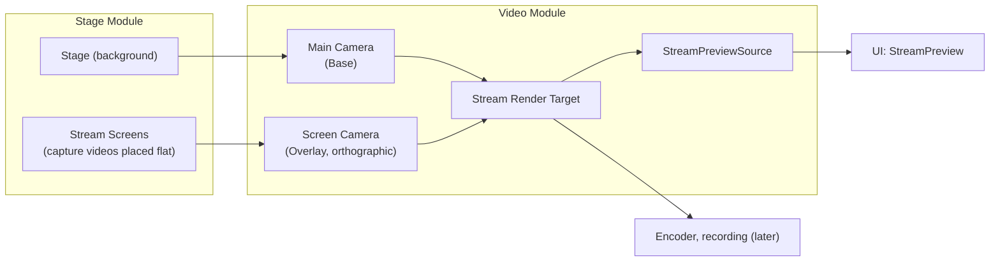

# Video Detailed Design

## 1. Purpose

This document defines the detailed design of the Video module. The Video module makes the stream video (the Stream Render Target) from the Main Camera and the screen contents that Stage decides.

It covers:

- The Main Camera (in the persistent scene, one for the whole application, system design 10.3)
- The Stream Render Target (the one video source for streaming, recording, and the preview, system design 10.5, 10.6)
- The layer of videos placed flat on the stream screen (the Stream Screen Layer); Stage puts its contents there
- The video and the numbers for the in-app preview (`IStreamPreviewSource`, UI foundation detailed design 9.9)
- The target frame rate and measuring the actual one

The following are left to later designs:

- Video encoding, recording, and streaming (system design 10.7–10.10)
- The avatar layer (added with the avatar design; 7.2)
- Moving to and switching Camera Points (with the Stage Scene design; system design 10.4, 11.5)
- The Diagnostic Camera (system design 5.17)
- A screen where the user changes the resolution and frame rate (with the stream settings design)

Related system design sections:

- 10.3 Camera management
- 10.5 Video generation
- 10.6 Preview
- 10.23 Linking capture video to Stage
- 15.5 Real-time video performance

### Overview



---

## 2. Responsibilities

| Responsibility | Owner |
|---|---|
| Setting up the Main Camera (target, layers drawn, background color) | Video |
| Creating, recreating, and releasing the Stream Render Target | Video |
| The order of the per-layer cameras (stage, flat videos, avatar) | Video |
| The coordinates of the flat video layer (0 to 1 over the stream screen) | Video |
| What goes on the layer (which capture video, where, in what order) | Stage |
| Saving placements and accepting edits | Stage (`IFrameSource`) |
| Showing the preview | UI (`StreamPreview`) |
| Measuring and diagnosing the video frame rate | Video |

---

## 3. Module Boundaries

- Video does not reference Capture. It draws capture videos as Stage placed them on the flat video layer.
- Video implements the UI's public contract (`IStreamPreviewSource`). The UI does not reference Video.
- Stage uses Video's public contracts (`IStreamOutput`, `IStreamScreenLayer`). Video does not reference Stage.
- Unity's `Camera` and `RenderTexture` stay inside Video. Only a `Texture` (the video, to read) and the `Transform` of the flat video layer go out.

---

## 4. Main Classes and Interfaces

| Name | Kind | Summary |
|---|---|---|
| `VideoService` | Class (`IApplicationService`) | Sets up the Main Camera and the Stream Render Target, and measures every frame |
| `IStreamOutput` | Interface | The stream video (`Video`), its size, and the flat video layer |
| `IStreamScreenLayer` | Interface | Where flat videos go: a `Transform` that maps the stream screen to 0 to 1, and the layer number to draw |
| `StreamPreviewSource` | Class (the UI's `IStreamPreviewSource`) | The video and numbers for the preview |
| `VideoSettings` | Class | Resolution and target frame rate |
| `StreamFrameMeter` | Struct | Counts the actual frame rate (pure) |
| `ScreenLayerMath` | Static class | The orthographic camera's size and the 0-to-1 coordinates (pure functions) |

---

## 5. Public API

```csharp
public interface IStreamOutput
{
    IReadOnlyObservable<Texture> Video { get; }   // The Stream Render Target; a different texture when the resolution changes
    VideoSize Size { get; }                       // Size of the stream video (default 1920×1080)
    IStreamScreenLayer Screens { get; }
    int AvatarLayer { get; }                      // The Unity layer avatars use (Avatar); -1 before start
}

public interface IStreamScreenLayer
{
    // Children's localPosition: x from 0 (left) to 1 (right), y from 0 (top) to 1 (bottom) is the stream
    // screen. A smaller z is drawn in front.
    Transform Root { get; }
    int Layer { get; }                            // The Unity layer to set on the children's GameObjects
}

public readonly struct VideoSize
{
    public int Width { get; }
    public int Height { get; }
}
```

- What is placed under `IStreamScreenLayer.Root` is drawn only by the Screen Camera. Its `layer` must be `Layer`.
- The flat video layer is drawn above the stage and below the avatar (7.2).
- Avatar sets `AvatarLayer` on every part of an avatar, so only the Avatar Camera draws it. The composition passes it to Avatar (Avatar detailed design 3).

---

## 6. Data Model

### 6.1 VideoSettings

```csharp
public sealed class VideoSettings
{
    public int Width { get; set; } = 1920;
    public int Height { get; set; } = 1080;
    public int TargetFrameRate { get; set; } = 60;
    public Color BackgroundColor { get; set; }   // Background when there is no stage (dark navy by default)
    public Vector3? CameraPosition { get; set; } = (0, 1.25, -1.9);   // Where the Main Camera starts (7.5); null leaves it
    public float? CameraFieldOfView { get; set; } = 30;               // Vertical, degrees; null leaves it
}
```

- Not saved (decided with the stream settings design; chapter 17).
- The resolution need not be 16:9. The preview and the placement editor follow the aspect ratio of `Size`.

### 6.2 Stream Render Target

| Item | Value | Reason |
|---|---|---|
| Format | `ARGB32`, sRGB | The color space is linear; without sRGB the preview looks washed out (seen in the UI foundation prototype) |
| Depth | 24 bit | For 3D drawing of the stage and the avatar |
| MSAA | None (at first) | Decided after measuring (chapter 17) |
| Name | `StreamRenderTarget` | To tell it apart in the Frame Debugger and so on |

---

## 7. State / Lifecycle

### 7.1 VideoService

- An Optional application service that starts after logging and performance metrics. It needs the persistent scene's Main Camera, so the composition registers it only when `ApplicationBootstrap` passes one.
- At start it creates the Stream Render Target, sets up the Main Camera (including its default position, 7.5), and creates the Screen Camera and the Avatar Camera. It sets the target frame rate (`Application.targetFrameRate`, with VSync off).
- Every frame it counts the actual frame rate through `IFrameLoop` and updates the preview numbers about every second.
- At shutdown it removes the Main Camera's target, gives back its culling mask, position, and field of view, and destroys the Screen Camera, the Avatar Camera, and the Stream Render Target. The Main Camera belongs to the scene and is not destroyed.

### 7.2 Camera Order

The layers are drawn with the Universal Render Pipeline's camera stack.

| Order | Camera | Kind | Draws | Clears |
|---|---|---|---|---|
| 1 | Main Camera | Base, perspective | The stage (everything except the two layers below) | Background color |
| 2 | Screen Camera | Overlay, orthographic | The flat video layer (`StreamScreens`) | Nothing |
| 3 | Avatar Camera | Overlay, same position and field of view as the Main Camera | The avatar layer (`Avatar`) | Depth only |

- Flat videos go behind the avatar (the user's decision, 2026-10-17). The order is kept as a table so that choosing front or back per video can be added later.
- The Screen Camera is not a child of the Main Camera. It sits at the origin with an orthographic projection and draws only the stream screen, so flat videos stay put when the Main Camera moves.
- The Unity layers `StreamScreens` and `Avatar` are added to the project settings. The Main Camera draws neither.
- The Avatar Camera is a child of the Main Camera, so the avatar is seen from the stage camera. It copies the Main Camera's field of view and clip planes every frame. URP overlay cameras clear depth by default (the setting is read-only from code), so the stage's depth never hides the avatar.
- With the Main Camera drawing into the Stream Render Target, no camera would draw the application window, and the UI drawn on top of the window would not show. A Window Camera that draws nothing and only clears (no layers, cleared to black) keeps it drawn.

### 7.3 Coordinates of the Flat Video Layer

- The Screen Camera looks along +Z from the origin, with an orthographic height of 1. Its width is the aspect ratio (1.78 for 16:9).
- `Root` gets a position and scale (x by the aspect ratio, y by -1) so that its top-left is (0, 0) and its bottom-right (1, 1) (`ScreenLayerMath`, pure functions).
- `localPosition.z` sets the stacking. Stage gives videos with a larger order a smaller z.

### 7.4 Changing the Resolution

- When the resolution in `VideoSettings` changes, a new Stream Render Target is created and set on the Main Camera, `Video` becomes the new texture, and then the old one is released. The preview swaps on the change of `Video`.
- For now only the value at startup is used (a screen to change it comes later).

### 7.5 The Default Camera Position

- Until Camera Points exist, the Main Camera starts at (0, 1.25, -1.9), looking along +Z, with a vertical field of view of 30°: in front of an avatar at the default spawn point (the origin, Stage detailed design 7.1), framing its upper body. A narrow field of view keeps a close-up of the face free of wide-angle distortion.
- The values are in `VideoSettings`; null leaves the camera as the scene put it. The original values are given back at shutdown.

---

## 8. Main Sequences

### 8.1 From Startup to the Preview

1. `ApplicationBootstrap` passes the persistent scene's Main Camera to the composition.
2. `VideoService.InitializeAsync` creates the Stream Render Target and sets it as the Main Camera's `targetTexture`. It removes `StreamScreens` from the layers the Main Camera draws and clears with the background color.
3. It creates the Screen Camera and adds it to the Main Camera's camera stack.
4. `StageService` (Stage detailed design) places flat videos under `IStreamScreenLayer.Root`.
5. The UI's `StreamPreview` shows `StreamPreviewSource.Video`. It is the same texture that is streamed, so what is seen is what goes out.

---

## 9. Threading / Async

- Cameras, render targets, and numbers are all updated on the main thread.
- Drawing is left to Unity's render loop; Video does not call rendering every frame.

---

## 10. Configuration

`VideoSettings` (6.1) is passed when `VideoService` is created. Where it is saved and a screen to change it come later.

---

## 11. Logging and Diagnostics

- At startup, the resolution, target frame rate, color space, and Stream Render Target format are recorded at Information.
- Performance metrics:

| Metric | Kind | Content |
|---|---|---|
| `Video/FrameInterval` | Timer | The interval between frames (the source of the actual frame rate) |
| `Video/Frames` | Counter | Frames drawn |

- Preview numbers (`PreviewStats`): the actual frame rate (about every second), the target frame rate, and the resolution. The bitrate is `null` until there is an encoder.

---

## 12. Error Handling and Recovery

| Event | Handling |
|---|---|
| No Main Camera is passed | VideoService is not registered. The preview says there is no video |
| The Stream Render Target cannot be created | Recorded as an Optional service that failed to start. Other features keep running |
| The Main Camera was destroyed | Detected the next frame; an Error is recorded and the preview video is removed |

---

## 13. Security and Privacy

- The stream video does not leave the process (until there is an encoder). The preview is shown only inside the application.
- Development views such as the Diagnostic Camera are never drawn into the Stream Render Target (system design 5.18).

---

## 14. Testing Strategy

| Kind | Target |
|---|---|
| EditMode | `ScreenLayerMath` (0-to-1 coordinates, aspect ratio), `StreamFrameMeter` (pure functions) |
| PlayMode | A colored quad placed on the flat video layer is drawn at the right place in the Stream Render Target (pixels read back); the Main Camera clears with the background color |
| PlayMode | At shutdown the target is removed and what was created is destroyed |

---

## 15. Performance (System Design 15.5)

- One more overlay camera pass. Flat videos are a few quads, so it is light.
- The Stream Render Target is about 8 MB at 1920×1080 (color) plus depth.
- The frame rate is measured by `Video/FrameInterval`. Falling below the target shows on the preview (a warning).

---

## 16. Directory / Namespace

```text
Assets/VirtualVessel/Video/
├─ Runtime/                         VirtualVessel.Video
│  ├─ IStreamOutput.cs              IStreamOutput, IStreamScreenLayer, VideoSize
│  ├─ VideoSettings.cs
│  ├─ VideoService.cs
│  ├─ StreamPreviewSource.cs
│  ├─ StreamFrameMeter.cs
│  └─ ScreenLayerMath.cs
└─ Tests/
   ├─ EditMode/
   └─ PlayMode/
```

References: Core, Diagnostics, UI (`IStreamPreviewSource`), URP.

---

## 17. Open Issues

| Item | Planned handling |
|---|---|
| Encoder, recording, streaming | With each design |
| A screen to change and save the resolution and frame rate | With the stream settings design |
| The avatar layer | With the avatar design |
| MSAA, HDR | After measuring |
| Choosing front or back of the avatar per video | When it is asked for (7.2) |

---

## 18. Implementation Order

Listed in chapter 18 of the Stage detailed design.
