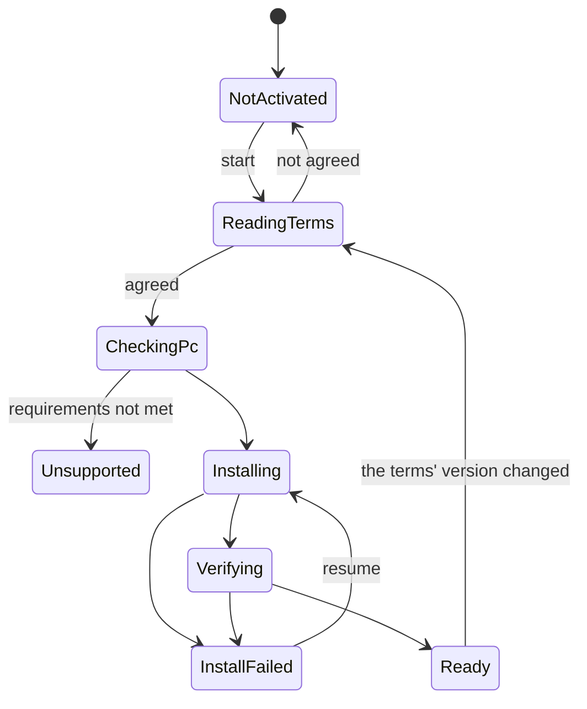

# Voice Lab Detailed Design

## 1. Purpose

Lets users make and register their ideal voice (system design chapter 13), by operating the application, with no commands or Python in view.

The main point is that users can create the voice they like (the user's direction, 2026-11-03). Rather than hitting the ideal with one description, users pick a voice close to it, move it a little at a time, try it with their own voice, and decide (8.3).

- The feature for making voices does not work until the user activates it (the user's decision, 2026-11-01).
- Activation builds the training environment. An internet connection is assumed.
- The information the terms of use need, and the disclaimers, can always be shown (the user's decision, 2026-11-01).
- Voice conversion needs a high-end PC (a fast GPU with ample memory). Users are always told, before activation and on the download page (the user's remark, 2026-11-02). The required values are not yet decided (chapter 17).

Out of scope: real-time conversion ([Voice detailed design](voice.md)), and starting and watching processes ([External Services detailed design](external-services.md)).

## 2. Responsibilities

| Responsibility | Owner |
|---|---|
| Showing the terms and recording agreement | VoiceLab (`VoiceTerms`) |
| Building, checking, and removing the training environment | VoiceLab (`VoiceComponentInstaller`) |
| Managing training audio | VoiceLab (`DatasetStore`) |
| Running training and its state | VoiceLab (`VoiceDesigner`, `TrainingRunStore`, `PythonScripts`) |
| Registering a voice | VoiceLab (`VoiceModelRegistrar`) |
| Running processes | ExternalServices |
| Using registered voices | Voice |

## 3. Module Boundaries

- `VirtualVessel.VoiceLab` runs processes only through ExternalServices' `IExternalProcessRunner` (system design 4.4).
- RVC and VoxCPM2 themselves are not changed (system design 13.3). The project's code sits in adapters in `services/`.
- Unity knows only the adapters' inputs and outputs, not RVC's folders or log format.
- The streaming path does not depend on VoiceLab.

## 4. Main Classes and Interfaces

| Class | Kind | Role |
|---|---|---|
| `IVoiceLab` | Interface (UI) | For the screen: candidates, timbre previews, building, registration (5); activation later |
| `VoiceLabService` | Class | Application Service |
| `VoiceTerms` | Class | The terms' version, where the text is, checking agreement |
| `VoiceComponentInstaller` | Class | Moves the build through its steps |
| `VoiceComponentManifest` | Class | What to fetch, with versions and hashes |
| `DatasetStore` | Class | Importing and checking training audio |
| `TrainingRunStore` | Class | Training Run folders and `run.json` (6.3) |
| `PythonScripts` | Class | Talks to the Python scripts (8.5); the only place that knows their names and protocol |
| `VoiceLabEnvironment` | Class | Where the training environment is; a developer names it until activation exists (6.4) |
| `VoiceModelRegistrar` | Class | Registers a training result as a voice |
| `VoiceDesigner` | Class | The flow of designing a voice (8.3): base candidates, timbre previews, training speech |

On the Python side:

| File | Role |
|---|---|
| `services/voice-lab/train.py` | Runs preprocessing, features, and training, with progress as JSON Lines (8.5) |
| `services/voice-lab/export_voice.py` | Writes a training result into the template (8.4) |
| `services/voice-lab/generate.py` | Makes speech with VoxCPM2: base candidates and training speech (8.3) |
| `services/voice-lab/timbre.py` | Changes the timbre with WORLD (8.3.2), with the same values for previews and for training speech |

## 5. Public API

`IVoiceLab` is declared in the UI module (`VirtualVessel.UI.VoiceLab`), so the screen depends on no Voice Lab class; `VoiceLabService` implements it. Its types are the screen's own: the request and result types of 8.5 stay inside Voice Lab.

```csharp
public interface IVoiceLab
{
    VoiceLabAvailability Availability { get; }   // Ready, or NotSetUp without a training environment (6.4)
    VoiceLabShelf Shelf { get; }                 // STEP 1's words and examples (8.3.1); null when not set up
    string SampleFile(string language, string name);           // A sample's file, or null before it is made
    Task MakeSamplesAsync(CancellationToken cancellationToken);  // Makes the samples on this PC (8.3.1)
    VoiceLabMaking SamplesProgress { get; }

    // Designing a voice (8.3)
    Task<IReadOnlyList<VoiceLabCandidate>> MakeCandidatesAsync(VoiceLabRequest request, int count, VoiceLabCandidate near, CancellationToken cancellationToken);  // near: null, or the candidate to make them near (8.3.1)
    Task<VoiceLabPreview> PreviewAsync(VoiceLabCandidate candidate, VoiceLabTimbre timbre, CancellationToken cancellationToken);
    Task<VoiceLabBuild> BuildAsync(VoiceLabCandidate candidate, VoiceLabTimbre timbre, CancellationToken cancellationToken);
    VoiceLabMaking CandidatesProgress { get; }    // Candidates made of the round; no total while the model loads
    VoiceLabBuildProgress BuildProgress { get; }  // The running build's state and fraction, read by the screen as often as it needs
    void Register(string runId, string name);
}
```

- `VoiceLabRequest` holds the shelf's word ids and the user's own words. `VoiceLabShelf` holds the shelf's groups, words (each with its slot and whether it is the slot's default), and examples, and decides what pressing a word does. `VoiceLabCandidate` holds the sample to play, its pitch (the median and the 5 to 95% range in Hz), and the instruction it was made from, shown folded (system design 14.14). The seed stays inside Voice Lab.
- `VoiceLabTimbre` holds five steps, pitch (semitones), age (a formant ratio), brightness, breathiness from -6 to +6, and softness from 0 to +6, each 0 (no change) by default. `run.json` keeps all five; one without softness was made with 0. Voice Lab clamps them on the way in.
- A failure that the screen should tell the user about throws `VoiceLabFailedException`, whose message is for developers. Cancelling throws `OperationCanceledException`. A build reports failing and cancelling in `VoiceLabBuild.State` instead, with `OutOfMemory` for GPU memory.
- None of the methods blocks the main thread.
- `Register` copies files and is called off the main thread by the screen.
- Activation and terms (8.1, 8.2) and importing one's own recordings (the first stage of 8.3) come with their stages (17).

## 6. Data Model

### 6.1 Activation

Saved in `Config/voice-activation.json`.

| Item | Meaning |
|---|---|
| `schemaVersion` | Format version |
| `termsVersion` | The version of the terms agreed to |
| `agreedAtUtc` | When they were agreed to |
| `componentsVersion` | The version of the built environment |
| `state` | `NotStarted`, `Installing`, `Ready`, `Failed` |

### 6.2 What to fetch

`voice-components.json`, bundled with the application and fixed per application version (system design 13.5).

```json
{
  "schemaVersion": 1,
  "version": "1",
  "uv": { "url": "...", "sha256": "..." },
  "python": "3.12.2",
  "lock": "services/voice-lab/uv.lock",
  "rvc": { "repository": "...", "commit": "81eed5e8f68b...", "sha256": "..." },
  "files": [
    { "id": "rmvpe.pt", "url": "...", "sha256": "...", "license": "MIT" }
  ]
}
```

### 6.3 Training Run

As in system design 13.14, kept in `VoiceLab/TrainingRuns/<RunId>/`, with state in `run.json`.

**The first version does not use SQLite.** The list can be made by reading `run.json`. SQLite (system design 13.12) comes with the comparison screen.

```text
VoiceLab/
├─ Samples/<language>/          STEP 1's samples, made on this PC (8.3.1)
├─ Designs/<start time>/        One session of designing a voice (8.3.1, 8.3.2)
│  ├─ candidates/              The candidates' audio
│  ├─ previews/                Timbre previews, one per candidate and timbre
│  ├─ requests/, logs/         Requests to the scripts and their logs; the same operation again is numbered
└─ TrainingRuns/<RunId>/        Building one voice (8.3.3)
   ├─ run.json
   ├─ requests/, logs/
   ├─ speech/, speech-edited/   Training speech, and the same with the timbre edited
   ├─ train/voice.pth           The trained weights
   └─ output/                   voice.sentis, voice.spk, voice.json (what registration copies)
```

`run.json` holds `schemaVersion`, `runId` (start time and a random part: `20261104-120000-1a2b`), `state` (system design 13.15), `createdAtUtc`, `updatedAtUtc`, `design` (the instruction, the seed, the candidate's audio, the audio it was made near if any, the timbre), `errorCode` and `error` (on failure and cancelling), and `versions` (torch, voxcpm, and numpy as the scripts reported them). `state` is written as the state's name. It is read and written with ProjectData's settings files (`ConfigFileStore`): writes that never leave half a file, unknown fields from newer versions kept, and a damaged file moved aside, as for any settings file. A state name it does not know (from a newer version) counts as failed. Only ProjectData's parts read and write JSON, so requests to the scripts and their output also go through `ConfigDocument`.

The build's steps and states: training speech (`Preparing`) → timbre edit (`Preprocessing`) → training (`Training`) → export (`PostProcessing`) → `Completed`. A failure ends as `Failed` and cancelling as `Cancelled`, and the run stays (system design 13.22). Overall progress weighs each step's own progress by its measured share of the time (speech 39%, edit 6%, training 50%, export 5%).

### 6.4 The Environment During Development

Until activation (the sixth stage) exists, a developer names the training environment in a JSON file: `python` (the venv's `python.exe`), `scripts` (`services/voice-lab`), `rvc`, `voxCpmModel` (the folder at the pinned revision), and `template` and `manifest` (the 1 s window's template and table). Programs run only from inside the venv folder that holds `python.exe`.

### 6.5 Registered Voices

`VoiceModels/voice-<RunId>/` holds `voice.sentis`, `voice.spk`, `voice.json`, and `model.json` (`schemaVersion`, `id`, `name`, `runId`, `registeredAtUtc`, `medianPitchHz`, `design`, `versions`). Only a completed run is registered. The files are copied into a folder beside the target and then renamed, so streaming never reads half a voice. The run's own files stay.

## 7. State and Lifecycle



Training Run states are as in system design 13.15.

## 8. Important Sequences

### 8.1 Activation

```text
Open Voice Lab
  ↓ Explain: what it does, size (about 8 GB, with VoxCPM2 needing more), time, an NVIDIA GPU is needed, the high hardware requirements
Show the terms (8.2) → agree
  ↓
Check the PC: GPU, driver, free space, connection
  ↓
Fetch (resumable; every hash is checked)
  1. uv
  2. Python
  3. Dependencies (to the lock's hashes)
  4. RVC (a fixed commit)
  5. Models and the template
  ↓
Verify: actually run preprocessing and one epoch of training on short audio
  ↓
Done
```

Measured (2026-11-01, the development PC with an RTX 4070): about an hour to fetch and unpack. About 7 GB for the environment and training models, and about 1 GB for the runtime's shared models and the template, about 8 GB in all. uv's cache adds about 6 GB, so about 14 GB is needed during the build. The cache is removed afterwards. How the time divides, such as between the connection and file scanning, has not been measured. VoxCPM2's environment has not been narrowed down.

Because it takes long, the explanation screen gives an estimate and says it can resume after an interruption.

Things come from their sources. The project's template and the `.sentis` of HuBERT and RMVPE sit on the project's GitHub Releases.

So that new users are not stopped when a source changes or disappears:

- Copies of the MIT and Apache-2.0 models and of RVC's source sit on the same GitHub Releases. When a source lacks them, the copy is used, and both are checked against the same hash. Notices stay with the copies.
- PyPI packages, PyTorch, and CUDA have no copies. They are unlikely to disappear, and the latter are not redistributed.
- GitHub Actions periodically checks that every source is reachable and its hash matches.
- The list of sources is bundled with the application, so fixing it takes an application update. If PyTorch's source removes an old version, new activation stops until that update. Streaming and built environments are not affected.

Progress says things like "Preparing the environment", with no words such as Python or pip in ordinary screens (system design 4.27).

### 8.2 Terms of use and disclaimers

Follows the requirement in the [decision record](../decisions/voice-conversion.md).

- The text is bundled with the application, in Japanese and English, with a version.
- The whole text is shown before activation, and nothing proceeds without agreement.
- The version agreed to and the time are saved.
- When the version changes, agreement is asked again before making a voice. Streaming with registered voices does not stop.
- The same content can be read at any time from Credits and licenses in Setup.
- Importing a recording shows a confirmation that it is your own voice or one you hold the rights to.

### 8.3 Making a voice

First stage (from your own audio):

```text
Import audio files → check (length, silence, clipping) → train → listen → register
```

Second stage (designing an ideal voice), a flow based on the experiment (decision record, 2026-11-03 "The voice-design experiment"):

```text
1. Pick a base           : describe the mood with sliders and words → make many candidates → listen and pick
2. Move the timbre       : pitch, age, brightness, and breathiness knobs → edit the base, preview at once → repeat
3. Make it               : training speech in the base's voice → the same edit → train (once)
4. Try it with your voice: convert your recording or the microphone through the application's real-time conversion
5. Register              : if you don't like it, back to 2
```

The default training is 150 epochs. On an RTX 4070, 7 minutes of audio took about 10 minutes. Step 3 takes about 20 minutes per voice (about 7 minutes to generate 7.5 minutes of training speech, about 2 to edit it, about 11 to train; measured 2026-11-03).

#### 8.3.1 Picking a base

- The voice is asked for with words from a shelf (`voicelab/shelf.json`, read by the scripts and by Unity) and free words. Each word fills one slot of the instruction (person, pitch, resonance, breath, character, energy, intonation, pace); a slot takes one word, so opposite words share a slot, and a slot with none takes its default. An empty pick gives the instruction VCBM's `VoicePromptBuilder` was tuned with. The sentences are VCBM's, or were heard apart in a blind test; brightness is not on the shelf and is set in STEP 2. VCBM's sentences are written for a female voice; the male word swaps the person and the pronouns, and the user's words are left as written (decision record, 2026-11-07).
- The screen starts from examples (a set of words with a seed), offers each word with a sample of the base (no words) with only that word added, made with one seed, and reads the request back as one sentence in the screen's language from each word's phrase. Samples are made on the user's PC when Voice Lab is set up (`generate.py samples`, into `Samples/<language>/`); until activation exists the screen offers to make them. They are made in Japanese for now: the same seed in English gave a voice of another pitch, so each language needs its own seeds.
- The user's words are sent inside the instruction, which is sent in brackets before the line read aloud. The scripts remove brackets, line breaks, controls, and invisible or direction-changing characters, and keep 200 characters, so the words cannot end the instruction and be read aloud. Imitating a real person is not something code can stop; the terms (8.2) cover it.
- The same instruction gives very different voices with different seeds (268 Hz and 406 Hz). Sliders alone do not reach the ideal, so several candidates (about six) are made at a time, with More to add more.
- STEP 1 only finds a base close to the ideal; STEP 2 shapes it (the user's decision, 2026-11-05). Make candidates near this voice makes six with the picked candidate as VoxCPM2's reference and the same instruction, to look around a voice that is close. Picking one of them and going again uses it as the next reference. In a measurement three rounds of this stayed natural to the ear; the six of a round differ clearly, so they are compared and picked, not fine-tuned (2026-11-05). Keeping the same person is not needed here: training clones the base afterwards.
- The mood items' levels and words move a voice's pitch little (the combination of youth and pitch about +60 Hz, writing Hz no effect; 2026-11-05). The pitch in Hz is set in STEP 2.
- Candidates can be compared by numbers as well as by ear (the user's request, 2026-11-03): pitch (the median) and its range (5 to 95%) in Hz, with the range drawn on a shared scale, and sorting by pitch.
- The screen numbers its steps STEP 1 to STEP 5, and the buttons that move on name the step they lead to (the user's request, 2026-11-03).
- Words that move the voice use only the chosen base as the reference. Using generated voices as references, one after another, makes the voice hoarse.
- Bases made from samples of real people's voices are not offered (the user's judgment, 2026-11-03; there is no voice free of rights issues to use).

#### 8.3.2 Moving the timbre

- WORLD (pyworld, MIT; WORLD itself modified BSD) splits the base into pitch, the spectral envelope, and the breath component, and moves each. The same values give the same result, and a preview takes seconds.
- Praat (parselmouth) is GPL and is not used.
- The knobs and what the experiment found:

| Knob | Edit | Result |
|---|---|---|
| Pitch | Pitch in semitones | Still the same person at +4 semitones |
| Age | The envelope stretched along frequency | ×1.10 is "the same person, if anything" (the user) |
| Brightness | The harmonics of 2 to 5 kHz raised or lowered (16 dB at +6), the noise there kept at its level | Brighter without hoarseness; the old slope to 24 kHz was heard as hiss (decision record, 2026-11-06) |
| Softness (0 to +6) | The first harmonic raised (up to 12 dB) and above 4 kHz lowered (up to 6 dB) | Soft without the nasal sound of tilting every harmonic; no pressed side, which sounded harsh |
| Breathiness | Aperiodicity of voiced parts | No difference in the measured numbers; needs listening |

- Brightness and softness are sized by what is heard after training and conversion: half these sizes was not heard, these were heard and natural, and one and a half times these muffled the voice (decision record, 2026-11-06).
- Pitch, age, and brightness moved far together (all three at 4 or more) sound mechanical, so the screen warns of it (decision record, 2026-11-06).
- There are no intonation or pace knobs. After conversion, intonation and pace come from the speaker (changing them in training speech does not survive conversion). Widening intonation during conversion sounds mechanical (the user, 2026-11-03).
- The edited timbre survived training and a conversion that is not real-time (decision record).

#### 8.3.3 Making it

- Training speech is VoxCPM2 copying the chosen base (with no instruction), then edited with the same values as 8.3.2.
- What to read: all five vowels, held vowels, and higher pitches. Held "u" drifting toward "a" (Voice detailed design) may partly come from too few vowels in the training speech. **This is an untested hypothesis.**
- The base's instruction, seed, and timbre values are kept in the Training Run, so the voice can be made again (6.3).

#### 8.3.4 Trying it with your voice

- Trying goes through the application's real-time conversion (the window, the overlap at joins, the recent speech, and noise removal in the Voice detailed design). Upstream's conversion of a whole file at once hides the window's problems and overrates a voice: held "u" and "e" were right there and drifted in real time.
- The input is the user's recording (WAV, M4A, MP3; audio detailed design 5.4) or the microphone.
- The conversion's pitch is matched automatically: registration keeps the voice's median pitch, and the shift comes from its distance to the user's. How Voice takes it is for the Voice detailed design (chapter 17).

### 8.4 Registration (making a `.sentis` without the Editor)

The Unity Editor's ONNX conversion is not available in a distributed application. The trained weights are written into a template (see the decision record for the verification).

```text
Training result (.pth)
  ↓ export_voice.py
Export to ONNX (the speaker is an input, kept apart in .spk)
  ↓
Write the weights at the table's places in the template .sentis
  ↓
Check: size, hash, and an actual conversion of short audio
  ↓
Place in VoiceModels/<VoiceModelId>/
```

- Developers make the template and table in the Editor, paired with a version of `com.unity.ai.inference`.
- After updating that package, they are remade and the SHA-256 comparison is repeated.
- The training output (`.pth`) is kept in case an application update changes the format. With it, registration can be redone.

### 8.5 The Python Side's Inputs and Outputs

Unity runs each script in `services/voice-lab` once, through ExternalServices' `IExternalProcessRunner` (system design 4.4). There is one environment, used for both RVC training and VoxCPM2 generation (decision record, 2026-11-03).

```text
python -I <script>.py <operation> <request JSON file>
```

- Under `-I` the script's folder is not on the path, so each script adds its own folder (where the `voicelab` package is).
- The request is a JSON file, so paths and text are not laid out on the command line and spaces and Japanese quoting cause no trouble.
- Progress and results go to standard output as JSON Lines, one per line. Standard error is the log, saved in the Training Run's folder (chapter 13). What libraries print to standard output (VoxCPM2's loading messages, RVC's log) goes to standard error while an operation runs.
- Exit codes: 0 success, 1 failure (after an `error` line), 2 a bad request.
- Cancelling stops the process, by the runner. Outputs are written to temporary files and then renamed, so a stopped run leaves no half-made files.

| Line `type` | Contents |
|---|---|
| `progress` | `stage` (the step's name), `done`, `total` |
| `result` | Each operation's result (table below) |
| `error` | `code` (`bad_request`, `out_of_memory`, `missing_file`, `failed`) and a `message` for developers |

| Script and operation | Main request items | Result |
|---|---|---|
| `generate.py candidates` | The shelf's word ids and the user's words, count, first seed, model location, output folder, optionally a reference to make them near | Each candidate's audio, seed, and median pitch and range (5 to 95%) |
| `generate.py samples` | The languages, model location, output folder | Each example with its seed, the base (no words), and each word added to the base alone, with one seed; files already made are kept |
| `generate.py speech` | The reference audio, first seed, model location, output folder | The training speech files and their total length |
| `timbre.py preview` | The source audio, timbre values, output | The edited audio and its median pitch |
| `timbre.py batch` | The source folder, timbre values, output folder | The edited files |
| `train.py run` | RVC's location, the training speech folder, a work folder, epochs | The trained weights (`.pth`) |
| `export_voice.py run` | The weights, the template and its table, RVC's location, the training speech (for the median pitch), output folder | The voice's `.sentis`, `.spk`, and its information (`voice.json`: the median pitch and more) |

- Timbre values are steps of pitch (semitones), age, brightness, and breathiness (-6 to +6, 0 for no change). One age step is 2.5% on the formants, one brightness step a slope of 1.5 dB per octave about 1 kHz, and one breathiness step multiplies the aperiodicity's exponent by 2^(1/5). Age +4 (formants ×1.10) was tried in the experiment; how well brightness and breathiness work is not yet tried (chapter 17).
- The texts for training speech are this system's own (`voicelab/corpus.py`), with all five vowels, held sounds, and lines that tend to a higher voice (8.3.3's untested hypothesis).
- RVC training's progress is read from the lines of its log that start with `====>`. The wording changes with the language; that form does not.
- RVC training makes its working files in `logs/vvs-lab-<id>` under RVC's folder (RVC is not changed). After the weights are copied to the work folder, that folder is removed, and also on failure (RVC's log is copied to standard error, so diagnosis does not need it). Cancelling stops the process before it can, so the next training first removes earlier folders and weights named `vvs-lab-`. Only one training runs at a time.

## 9. Threading and Async

Installation and training run in separate processes. Unity does not block the main thread, and passes progress to the UI through `IMainThreadDispatcher`. Everything stops with a `CancellationToken`.

Training uses GPU memory, so it cannot start during a stream.

## 10. Configuration

The only ordinary setting is training length (standard or longer). Detailed values appear in Developer Mode.

## 11. Storage

| Content | Location |
|---|---|
| Training environment | `%LOCALAPPDATA%\VirtualVesselStudio\External\VoiceLab\<version>\` |
| Agreement and state | `Config/voice-activation.json` |
| Voice design, Training Runs | `VoiceLab/` in the Data Root (6.3) |
| Registered voices | `VoiceModels/` in the Data Root |

The environment is large, so it stays out of the Data Root and out of backups. Removing it leaves registered voices working, and a screen offers to remove it.

## 12. Error Handling and Recovery

| What happened | Behavior | Shown to the user |
|---|---|---|
| The connection dropped | Fetching resumes where it stopped | Check your connection and try again |
| A hash differs | That file is discarded | A fetched file had a problem |
| Not enough free space | Does not start | This needs X GB of free space |
| Training failed | The run stays as `Failed` | Training could not finish |
| Out of GPU memory | The run stays as `Failed` | Close other applications and try again |
| Canceled | The run stays as `Cancelled` | |

Voice Lab's failures do not affect streaming (CLAUDE.md chapter 21).

## 13. Logging and Diagnostics

- Training's stdout and stderr go to the run's folder (system design 13.16).
- The content of users' audio is not logged, and audio is not sent outside.
- The Diagnostics screen shows the environment, Python, and CUDA versions, the RunId, and the exit code (system design 13.24).

## 14. Testing Strategy

| Kind | Content |
|---|---|
| EditMode | Reading script output, building requests, the environment file, reading and writing `run.json`, the build flow (with a fake process runner: success, failure, cancelling), registration. Later: agreement decisions, `voice-components.json`, hash checks |
| EditMode (a developer's environment) | Only when `VV_VOICE_LAB_ENV` names an environment JSON: candidates and a timbre preview from the real scripts. With `VV_VOICE_LAB_BUILD=1`, a whole voice built and registered (about 20 minutes on an RTX 4070) |
| Python | Adapter unit tests, applying the table |
| Manual (heavy) | Activation on an empty PC, resuming, canceling |
| When versions update | The SHA-256 comparison of the template and table |

Actual fetching and training do not run in CI. They run by hand on the self-hosted runner.

## 15. Performance Constraints

- It does not run during a stream, so it has no real-time constraint.
- The main thread is not blocked.
- Size and time are shown before activation.

## 16. Directory / Namespace Structure

```text
Assets/VirtualVessel/VoiceLab/Runtime/
├─ Activation/   VoiceTerms, VoiceComponentInstaller, VoiceComponentManifest
├─ Dataset/      DatasetStore (later)
├─ Scripts/      VoiceLabEnvironment, PythonScripts, ScriptLine
├─ Training/     TrainingRun, TrainingRunStore
├─ Registration/ VoiceModelRegistrar
└─ Design/       VoiceDesigner

services/voice-lab/
├─ pyproject.toml, uv.lock
├─ train.py, export_voice.py, generate.py, timbre.py   Entry points (8.5)
├─ voicelab/      Shared code: I/O, instructions, timbre, pitch, texts, generator export, weight writing
├─ stubs/parselmouth.py   An empty module that only satisfies the import (decision record), in a folder apart from the entry scripts so they do not hide RVC's "train" package
└─ tests/
```

## 17. Stages and Open Issues

Stages:

1. ExternalServices and activation (terms, building, verifying)
2. Importing audio, training, registering
3. Designing a voice with VoxCPM2
4. Evaluation and comparison, SQLite training history

Open issues:

- Narrowing down VoxCPM2's dependencies. `kaldiio` must be left out (decision record).
- Checking on a truly new PC. The development PC already has drivers and so on.
- VoxCPM2's GPU memory needs, and switching between it and RVC training.
- The agreement screen's wording, reviewed by a legal professional before release.
- The GPU and memory voice conversion needs, decided by measuring on PCs other than the development PC.
- The flow of designing a voice (8.3): how well the brightness and breathiness knobs work, the range of the age ratio, and the training-speech vowel hypothesis. "Passable" above was judged on upstream's conversion, not yet on real-time conversion.
- Matching the conversion's pitch automatically: the registered voice's format for its median pitch, and how Voice uses it (the Voice detailed design's part).

Approved by the user (2026-11-01):

1. The environment is built on the user's PC from uv and a lock. System design 13.4, 13.6, 13.7, 13.8, and chapter 4 were updated.
2. Training is limited to NVIDIA GPUs. Using a voice is expected to work on others, but that has not been tried.
3. SQLite is put off until the comparison screen (6.3), as noted in system design 13.12.
