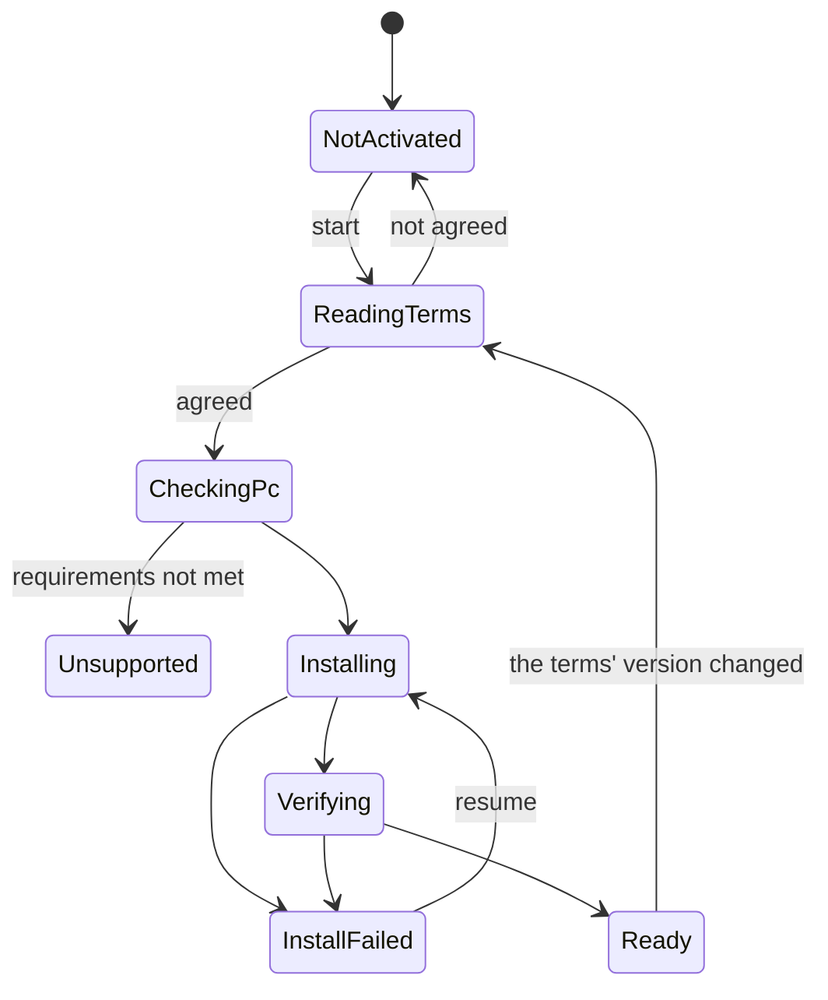

# Voice Lab Detailed Design

## 1. Purpose

Lets users make and register their ideal voice (system design chapter 13), by operating the application, with no commands or Python in view.

- The feature for making voices does not work until the user activates it (the user's decision, 2026-11-01).
- Activation builds the training environment. An internet connection is assumed.
- The information the terms of use need, and the disclaimers, can always be shown (the user's decision, 2026-11-01).

Out of scope: real-time conversion ([Voice detailed design](voice.md)), and starting and watching processes ([External Services detailed design](external-services.md)).

## 2. Responsibilities

| Responsibility | Owner |
|---|---|
| Showing the terms and recording agreement | VoiceLab (`VoiceTerms`) |
| Building, checking, and removing the training environment | VoiceLab (`VoiceComponentInstaller`) |
| Managing training audio | VoiceLab (`DatasetStore`) |
| Running training and its state | VoiceLab (`TrainingManager`, `RvcAdapter`) |
| Registering a voice | VoiceLab (`VoiceModelRegistrar`) |
| Running processes | ExternalServices |
| Using registered voices | Voice |

## 3. Module Boundaries

- `VirtualVessel.VoiceLab` runs processes only through ExternalServices' `IExternalProcessRunner` (system design 4.4).
- RVC and VoxCPM2 themselves are not changed (system design 13.3). The project's code sits in adapters in `services/`.
- Unity knows only the adapters' inputs and outputs, not RVC's folders or log format.
- The streaming path does not depend on VoiceLab.

## 4. Main Classes and Interfaces

| Class | Kind | Role |
|---|---|---|
| `IVoiceLab` | Interface (UI) | For the UI: activation, audio, training, registration |
| `VoiceLabService` | Class | Application Service |
| `VoiceTerms` | Class | The terms' version, where the text is, checking agreement |
| `VoiceComponentInstaller` | Class | Moves the build through its steps |
| `VoiceComponentManifest` | Class | What to fetch, with versions and hashes |
| `DatasetStore` | Class | Importing and checking training audio |
| `TrainingManager` | Class | Training Run state |
| `RvcAdapter` | Class | Talks to the Python adapter |
| `VoiceModelRegistrar` | Class | Registers a training result as a voice |

On the Python side:

| File | Role |
|---|---|
| `services/voice-lab/train.py` | Runs preprocessing, features, and training, with progress as JSON Lines |
| `services/voice-lab/export_voice.py` | Writes a training result into the template (8.4) |
| `services/voice-lab/generate.py` | Makes speech with VoxCPM2 (second stage) |

## 5. Public API

```csharp
public interface IVoiceLab
{
    IReadOnlyObservable<VoiceLabState> State { get; }
    IReadOnlyObservable<InstallProgress> Install { get; }
    VoiceTermsDocument Terms { get; }
    Task ActivateAsync(VoiceTermsAgreement agreement, CancellationToken cancellationToken);
    Task<DatasetInfo> ImportDatasetAsync(IReadOnlyList<string> files, CancellationToken cancellationToken);
    Task<TrainingRunInfo> TrainAsync(TrainingRequest request, CancellationToken cancellationToken);
    Task<VoiceModelInfo> RegisterAsync(string runId, string name, CancellationToken cancellationToken);
}
```

## 6. Data Model

### 6.1 Activation

Saved in `Config/voice-activation.json`.

| Item | Meaning |
|---|---|
| `schemaVersion` | Format version |
| `termsVersion` | The version of the terms agreed to |
| `agreedAtUtc` | When they were agreed to |
| `componentsVersion` | The version of the built environment |
| `state` | `NotStarted`, `Installing`, `Ready`, `Failed` |

### 6.2 What to fetch

`voice-components.json`, bundled with the application and fixed per application version (system design 13.5).

```json
{
  "schemaVersion": 1,
  "version": "1",
  "uv": { "url": "...", "sha256": "..." },
  "python": "3.12.2",
  "lock": "services/voice-lab/uv.lock",
  "rvc": { "repository": "...", "commit": "81eed5e8f68b...", "sha256": "..." },
  "files": [
    { "id": "rmvpe.pt", "url": "...", "sha256": "...", "license": "MIT" }
  ]
}
```

### 6.3 Training Run

As in system design 13.14, kept in `VoiceLab/TrainingRuns/<RunId>/`, with state in `run.json`.

**The first version does not use SQLite.** The list can be made by reading `run.json`. SQLite (system design 13.12) comes with the comparison screen.

## 7. State and Lifecycle



Training Run states are as in system design 13.15.

## 8. Important Sequences

### 8.1 Activation

```text
Open Voice Lab
  ↓ Explain: what it does, size (about 8 GB, with VoxCPM2 needing more), time, an NVIDIA GPU is needed
Show the terms (8.2) → agree
  ↓
Check the PC: GPU, driver, free space, connection
  ↓
Fetch (resumable; every hash is checked)
  1. uv
  2. Python
  3. Dependencies (to the lock's hashes)
  4. RVC (a fixed commit)
  5. Models and the template
  ↓
Verify: actually run preprocessing and one epoch of training on short audio
  ↓
Done
```

Measured (2026-11-01, the development PC with an RTX 4070): about an hour to fetch and unpack. About 7 GB for the environment and training models, and about 1 GB for the runtime's shared models and the template, about 8 GB in all. uv's cache adds about 6 GB, so about 14 GB is needed during the build. The cache is removed afterwards. How the time divides, such as between the connection and file scanning, has not been measured. VoxCPM2's environment has not been narrowed down.

Because it takes long, the explanation screen gives an estimate and says it can resume after an interruption.

Things come from their sources. The project's template and the `.sentis` of HuBERT and RMVPE sit on the project's GitHub Releases.

So that new users are not stopped when a source changes or disappears:

- Copies of the MIT and Apache-2.0 models and of RVC's source sit on the same GitHub Releases. When a source lacks them, the copy is used, and both are checked against the same hash. Notices stay with the copies.
- PyPI packages, PyTorch, and CUDA have no copies. They are unlikely to disappear, and the latter are not redistributed.
- GitHub Actions periodically checks that every source is reachable and its hash matches.
- The list of sources is bundled with the application, so fixing it takes an application update. If PyTorch's source removes an old version, new activation stops until that update. Streaming and built environments are not affected.

Progress says things like "Preparing the environment", with no words such as Python or pip in ordinary screens (system design 4.27).

### 8.2 Terms of use and disclaimers

Follows the requirement in the [decision record](../decisions/voice-conversion.md).

- The text is bundled with the application, in Japanese and English, with a version.
- The whole text is shown before activation, and nothing proceeds without agreement.
- The version agreed to and the time are saved.
- When the version changes, agreement is asked again before making a voice. Streaming with registered voices does not stop.
- The same content can be read at any time from Credits and licenses in Setup.
- Importing a recording shows a confirmation that it is your own voice or one you hold the rights to.

### 8.3 Making a voice

First stage (from your own audio):

```text
Import audio files → check (length, silence, clipping) → train → listen → register
```

Second stage (designing an ideal voice):

```text
Describe the voice → make candidates with VoxCPM2 → choose → make training audio → train → listen → register
```

The default training is 150 epochs. On an RTX 4070, 7 minutes of audio took about 10 minutes.

### 8.4 Registration (making a `.sentis` without the Editor)

The Unity Editor's ONNX conversion is not available in a distributed application. The trained weights are written into a template (see the decision record for the verification).

```text
Training result (.pth)
  ↓ export_voice.py
Export to ONNX (the speaker is an input, kept apart in .spk)
  ↓
Write the weights at the table's places in the template .sentis
  ↓
Check: size, hash, and an actual conversion of short audio
  ↓
Place in VoiceModels/<VoiceModelId>/
```

- Developers make the template and table in the Editor, paired with a version of `com.unity.ai.inference`.
- After updating that package, they are remade and the SHA-256 comparison is repeated.
- The training output (`.pth`) is kept in case an application update changes the format. With it, registration can be redone.

## 9. Threading and Async

Installation and training run in separate processes. Unity does not block the main thread, and passes progress to the UI through `IMainThreadDispatcher`. Everything stops with a `CancellationToken`.

Training uses GPU memory, so it cannot start during a stream.

## 10. Configuration

The only ordinary setting is training length (standard or longer). Detailed values appear in Developer Mode.

## 11. Storage

| Content | Location |
|---|---|
| Training environment | `%LOCALAPPDATA%\VirtualVesselStudio\External\VoiceLab\<version>\` |
| Agreement and state | `Config/voice-activation.json` |
| Audio, Training Runs | `VoiceLab/` in the Data Root |
| Registered voices | `VoiceModels/` in the Data Root |

The environment is large, so it stays out of the Data Root and out of backups. Removing it leaves registered voices working, and a screen offers to remove it.

## 12. Error Handling and Recovery

| What happened | Behavior | Shown to the user |
|---|---|---|
| The connection dropped | Fetching resumes where it stopped | Check your connection and try again |
| A hash differs | That file is discarded | A fetched file had a problem |
| Not enough free space | Does not start | This needs X GB of free space |
| Training failed | The run stays as `Failed` | Training could not finish |
| Out of GPU memory | The run stays as `Failed` | Close other applications and try again |
| Canceled | The run stays as `Cancelled` | |

Voice Lab's failures do not affect streaming (CLAUDE.md chapter 21).

## 13. Logging and Diagnostics

- Training's stdout and stderr go to the run's folder (system design 13.16).
- The content of users' audio is not logged, and audio is not sent outside.
- The Diagnostics screen shows the environment, Python, and CUDA versions, the RunId, and the exit code (system design 13.24).

## 14. Testing Strategy

| Kind | Content |
|---|---|
| EditMode | Agreement decisions, `voice-components.json`, state changes, reading progress, hash checks |
| Python | Adapter unit tests, applying the table |
| Manual (heavy) | Activation on an empty PC, resuming, canceling |
| When versions update | The SHA-256 comparison of the template and table |

Actual fetching and training do not run in CI. They run by hand on the self-hosted runner.

## 15. Performance Constraints

- It does not run during a stream, so it has no real-time constraint.
- The main thread is not blocked.
- Size and time are shown before activation.

## 16. Directory / Namespace Structure

```text
Assets/VirtualVessel/VoiceLab/Runtime/
├─ Activation/   VoiceTerms, VoiceComponentInstaller, VoiceComponentManifest
├─ Dataset/      DatasetStore
├─ Training/     TrainingManager, RvcAdapter
└─ Registration/ VoiceModelRegistrar

services/voice-lab/
├─ pyproject.toml, uv.lock
├─ train.py, export_voice.py, generate.py
├─ parselmouth.py   An empty module that only satisfies the import (decision record)
└─ tests/
```

## 17. Stages and Open Issues

Stages:

1. ExternalServices and activation (terms, building, verifying)
2. Importing audio, training, registering
3. Designing a voice with VoxCPM2
4. Evaluation and comparison, SQLite training history

Open issues:

- Narrowing down VoxCPM2's dependencies. `kaldiio` must be left out (decision record).
- Checking on a truly new PC. The development PC already has drivers and so on.
- VoxCPM2's GPU memory needs, and switching between it and RVC training.
- The agreement screen's wording, reviewed by a legal professional before release.

Approved by the user (2026-11-01):

1. The environment is built on the user's PC from uv and a lock. System design 13.4, 13.6, 13.7, 13.8, and chapter 4 were updated.
2. Training is limited to NVIDIA GPUs. Using a voice is expected to work on others, but that has not been tried.
3. SQLite is put off until the comparison screen (6.3), as noted in system design 13.12.
