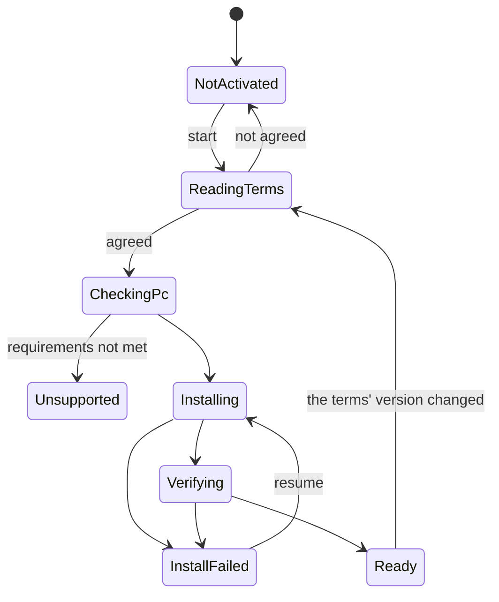

# Voice Lab Detailed Design

## 1. Purpose

Lets users make and register their ideal voice (system design chapter 13), by operating the application, with no commands or Python in view.

The main point is that users can create the voice they like (the user's direction, 2026-11-03). Rather than hitting the ideal with one description, users pick a voice close to it, move it a little at a time, try it with their own voice, and decide (8.3).

- The feature for making voices does not work until the user activates it (the user's decision, 2026-11-01).
- Activation builds the training environment. An internet connection is assumed.
- The information the terms of use need, and the disclaimers, can always be shown (the user's decision, 2026-11-01).
- Voice conversion needs a high-end PC (a fast GPU with ample memory). Users are always told, before activation and on the download page (the user's remark, 2026-11-02). The required values are not yet decided (chapter 17).

Out of scope: real-time conversion ([Voice detailed design](voice.md)), and starting and watching processes ([External Services detailed design](external-services.md)).

## 2. Responsibilities

| Responsibility | Owner |
|---|---|
| Showing the terms and recording agreement | VoiceLab (`VoiceTerms`) |
| Building, checking, and removing the training environment | VoiceLab (`VoiceComponentInstaller`) |
| Managing training audio | VoiceLab (`DatasetStore`) |
| Running training and its state | VoiceLab (`VoiceDesigner`, `TrainingRunStore`, `PythonScripts`) |
| Registering a voice (handing it over to Voice) | VoiceLab (`VoiceModelRegistrar`) |
| Records of registered voices | Voice (`IVoiceModelRepository`; Voice detailed design 6.1) |
| Running processes | ExternalServices |
| Using registered voices | Voice |

## 3. Module Boundaries

- `VirtualVessel.VoiceLab` runs processes only through ExternalServices' `IExternalProcessRunner` (system design 4.4).
- RVC and VoxCPM2 themselves are not changed (system design 13.3). The project's code sits in adapters in `services/`.
- Unity knows only the adapters' inputs and outputs, not RVC's folders or log format.
- The streaming path does not depend on VoiceLab.
- Voice owns registered voices (user's decision, 2026-11-08). VoiceLab hands voices over, renames them, and deletes them through Voice's `IVoiceModelRepository`. Voice does not reference VoiceLab.

## 4. Main Classes and Interfaces

| Class | Kind | Role |
|---|---|---|
| `IVoiceLab` | Interface (UI) | For the screen: candidates, timbre previews, building, registration (5); activation later |
| `VoiceLabService` | Class | Application Service |
| `VoiceTerms` | Class | The terms' version, where the text is, checking agreement |
| `VoiceComponentInstaller` | Class | Moves the build through its steps |
| `VoiceComponentManifest` | Class | What to fetch, with versions and hashes |
| `DatasetStore` | Class | Importing and checking training audio |
| `TrainingRunStore` | Class | Training Run folders and `run.json` (6.3) |
| `PythonScripts` | Class | Talks to the Python scripts (8.5); the only place that knows their names and protocol |
| `VoiceLabEnvironment` | Class | Where the training environment is; a developer names it until activation exists (6.4) |
| `VoiceModelRegistrar` | Class | Hands a training result over to Voice, with how it was made (`design.json`) |
| `VoiceDesigner` | Class | The flow of designing a voice (8.3): base candidates, timbre previews, training speech |

On the Python side:

| File | Role |
|---|---|
| `services/voice-lab/train.py` | Runs preprocessing, features, and training, with progress as JSON Lines (8.5) |
| `services/voice-lab/export_voice.py` | Writes a training result into the template (8.4) |
| `services/voice-lab/generate.py` | Makes speech with VoxCPM2: base candidates and training speech (8.3) |
| `services/voice-lab/timbre.py` | Changes the timbre with WORLD (8.3.2), with the same values for previews and for training speech |

## 5. Public API

`IVoiceLab` is declared in the UI module (`VirtualVessel.UI.VoiceLab`), so the screen depends on no Voice Lab class; `VoiceLabService` implements it. Its types are the screen's own: the request and result types of 8.5 stay inside Voice Lab.

```csharp
public interface IVoiceLab
{
    VoiceLabAvailability Availability { get; }   // Ready, or NotSetUp without a training environment (6.4)
    VoiceLabShelf Shelf { get; }                 // STEP 1's words and examples (8.3.1); null when not set up
    string SampleFile(string language, string name);           // A sample's file, or null before it is made
    Task MakeSamplesAsync(CancellationToken cancellationToken);  // Makes the samples on this PC (8.3.1)
    VoiceLabMaking SamplesProgress { get; }

    // Designing a voice (8.3)
    Task<IReadOnlyList<VoiceLabCandidate>> MakeCandidatesAsync(VoiceLabRequest request, int count, VoiceLabCandidate near, CancellationToken cancellationToken);  // near: null, or the candidate to make them near (8.3.1)
    Task<VoiceLabPreview> PreviewAsync(VoiceLabCandidate candidate, VoiceLabTimbre timbre, CancellationToken cancellationToken);
    Task<VoiceLabBuild> BuildAsync(VoiceLabCandidate candidate, VoiceLabTimbre timbre, VoiceLabTrainingLength length, CancellationToken cancellationToken);  // length: 8.3.3
    VoiceLabMaking CandidatesProgress { get; }    // Candidates made of the round; no total while the model loads
    void CancelBuild();                           // Stops the build, for starting a stream or a recording (system design 14.26)
    VoiceLabBuildProgress BuildProgress { get; }  // The running build's state and fraction, read by the screen as often as it needs
    CrudResult<string> Register(string runId, string name);   // The registered voice's ID, to use it right away

    CrudResult<VoiceLabRemake> Remake(string runId);             // A run's words, base, and timbre, to make it again (8.6)
}
```

`IVoiceLabLibrary` (also in the UI module) is what was made, for the Made voices tab. It works without a training environment, so it is a separate interface; `VoiceLabLibrary` implements it over the repositories (8.6).

```csharp
public interface IVoiceLabLibrary
{
    CrudResult<IReadOnlyList<VoiceLabRunRecord>> ListRuns();     // Newest first
    CrudResult<IReadOnlyList<VoiceLabVoiceRecord>> ListVoices(); // Newest first
    CrudResult SetComment(string runId, string comment);
    CrudResult RenameVoice(string voiceId, string name);
    CrudResult DeleteRun(string runId);                    // Refused while that run is being made
    CrudResult DeleteVoice(string voiceId);
}
```

- `VoiceLabRequest` holds the shelf's word ids and the user's own words. `VoiceLabShelf` holds the shelf's groups, words (each with its slot and whether it is the slot's default), and examples, and decides what pressing a word does. `VoiceLabCandidate` holds the sample to play, its pitch (the median and the 5 to 95% range in Hz), and the instruction it was made from, shown folded (system design 14.14). `VoiceLabRequest` also holds the line the candidates read (empty for the shelf's) and the first seed. `VoiceLabCandidate` also holds its seed, shown on its tile (the user's decision, 2026-11-14). Voice Lab picks the first seed each session (`IVoiceLab.StartSeed`), and the screen moves it on by the candidates made.
- `VoiceLabTimbre` holds five steps, pitch (semitones), age (a formant ratio), brightness, breathiness from -6 to +6, and softness from 0 to +6, each 0 (no change) by default. `run.json` keeps all five; one without softness was made with 0. Voice Lab clamps them on the way in.
- A failure that the screen should tell the user about throws `VoiceLabFailedException`, whose message is for developers. Cancelling throws `OperationCanceledException`. A build reports failing and cancelling in `VoiceLabBuild.State` instead, with `OutOfMemory` for GPU memory.
- None of the methods blocks the main thread.
- `Register` copies files and is called off the main thread by the screen.
- Activation and terms (8.1, 8.2) and importing one's own recordings (the first stage of 8.3) come with their stages (17).

## 6. Data Model

### 6.1 Activation

Saved in `Config/voice-activation.json`.

| Item | Meaning |
|---|---|
| `schemaVersion` | Format version |
| `termsVersion` | The version of the terms agreed to |
| `agreedAtUtc` | When they were agreed to |
| `componentsVersion` | The version of the built environment |
| `installingVersion` | The version being built; kept after a stop or failure, so the next start continues it |
| `state` | `NotStarted`, `Installing`, `Ready`, `Failed` |

### 6.2 What to fetch

`voice-components.json`, bundled with the application and fixed per application version (system design 13.5).

```json
{
  "schemaVersion": 1,
  "version": "0.1",
  "python": "3.12.2",
  "lock": "uv.lock",
  "components": [
    {
      "id": "rvc",
      "url": "https://github.com/RVC-Project/.../archive/81eed5e8f68b....zip",
      "sha256": "c0427564...",
      "size": 821646,
      "license": "MIT",
      "place": "environment",
      "target": "rvc",
      "extract": "zip",
      "strip": 1
    }
  ]
}
```

It is `services/voice-lab/voice-components.json`, bundled with the app beside the scripts. `tools/voice/voice_components.py` builds it from `tools/voice/voice-components.sources.json` (sources, licenses, places) and the very files tested on the developer's PC, so the sizes and hashes are theirs. With `--release`, it gathers the files for the GitHub Release into one folder, for the user to publish.

- `place`: `environment` goes into the training environment's version folder (`<version>/`), `sharedModels` into the Data Root's `VoiceModels/Shared/1/`. The HuBERT and RMVPE `.sentis` streaming uses are the latter, so streaming keeps working when the environment is deleted.
- `target`: a relative path inside the place; for `extract` `zip`, the folder it is extracted into. `strip` drops that many leading folders from the zip's paths (the top folder of GitHub's archives).
- `url`: the source. Others' files point only at where they are published; the project keeps no copies (8.1). Files the project made (the template, the shared models) point at the project's GitHub Release.
- The app checks it when reading (`VoiceComponentManifest`): an unknown schema version is not read, URLs are https only, hashes are 64 lowercase hex digits, and `target` is relative with no `..` or drive, so the list cannot write a file anywhere.
- Version 0.1 has 21 components, about 6.1 GB in all (2026-11-11). Hugging Face files point at fixed revisions (`e6d0c1a1…` of `lj1995/VoiceConversionWebUI`, `32279eff…` of `openbmb/VoxCPM2`), and the large files' hashes matched those the hosts publish. A GitHub archive zip can change its hash when GitHub rebuilds it; the periodic check then finds it, and the list is fixed.

### 6.3 Training Run

As in system design 13.14, kept in `VoiceLab/TrainingRuns/<RunId>/`, with state in `run.json`.

**The first version does not use SQLite.** The list can be made by reading `run.json`. SQLite (system design 13.12) comes with the comparison screen, behind the same repositories (8.6).

```text
VoiceLab/
├─ Samples/<language>/          STEP 1's samples, made on this PC (8.3.1)
├─ Designs/<start time>/        One session of designing a voice (8.3.1, 8.3.2)
│  ├─ candidates/              The candidates' audio
│  ├─ previews/                Timbre previews, one per candidate and timbre
│  ├─ requests/, logs/         Requests to the scripts and their logs; the same operation again is numbered
└─ TrainingRuns/<RunId>/        Building one voice (8.3.3)
   ├─ run.json
   ├─ requests/, logs/
   ├─ speech/, speech-edited/   Training speech, and the same with the timbre edited
   ├─ train/voice.pth           The trained weights
   └─ output/                   voice.sentis, voice.spk, voice.json (what registration copies)
```

`run.json` holds `schemaVersion`, `runId` (start time and a random part: `20261104-120000-1a2b`), `state` (system design 13.15), `createdAtUtc`, `updatedAtUtc`, `design` (the instruction, the seed, the candidate's audio, the audio it was made near if any, the timbre, and the shelf's `words`, the user's `freeWords`, the prompt written whole `prompt`, the line the candidate read `line` (empty for the shelf's), and the base's pitch `medianHz`, `lowHz`, `highHz`; missing in older runs, read as none or 0), `comment` (the user's note), `errorCode` and `error` (on failure and cancelling), and `versions` (torch, voxcpm, and numpy as the scripts reported them). `state` is written as the state's name. It is read and written with ProjectData's settings files (`ConfigFileStore`): writes that never leave half a file, unknown fields from newer versions kept, and a damaged file moved aside, as for any settings file. A state name it does not know (from a newer version) counts as failed. Only ProjectData's parts read and write JSON, so requests to the scripts and their output also go through `ConfigDocument`.

The build's steps and states: training speech (`Preparing`) → timbre edit (`Preprocessing`) → training (`Training`) → export (`PostProcessing`) → `Completed`. A failure ends as `Failed` and cancelling as `Cancelled`, and the run stays (system design 13.22). Overall progress weighs each step's own progress by its share of the expected time (measured at 150 epochs: speech 7 minutes, edit 1, training 9, export 1; training scales with the epochs).

### 6.4 The Environment During Development

Until activation (the sixth stage) exists, a developer names the training environment in a JSON file: `python` (the venv's `python.exe`), `scripts` (`services/voice-lab`), `rvc`, `voxCpmModel` (the folder at the pinned revision), and `template` and `manifest` (the 1 s window's template and table). Programs run only from inside the venv folder that holds `python.exe`.

### 6.5 Registered Voices

Voice owns registered voices (Voice detailed design 6.1). Only a completed run is registered. Voice Lab hands Voice the run's `output/` files `voice.sentis`, `voice.spk`, and `voice.json`, and `design.json` with how it was made (`RunDesign`, with a `schemaVersion`). Voice copies them to `VoiceModels/voice-<RunId>/` and writes `model.json`. Only Voice Lab reads `design.json`, to play the base in the Made voices tab. With the design kept beside the voice, deleting the run leaves how the voice was made. A voice can be renamed and deleted (8.6). The run's own files stay.

Voices registered before 2026-11-08 have no `design.json`; their design is in `model.json`'s `design`. They are development voices only, so they are not moved over, and the Made voices tab cannot play their base.

### 6.6 Unfinished Work

STEP 1 and STEP 2 left unfinished are kept in `VoiceLab/work.json` (`WorkFile`, `schemaVersion` 1), so they can be continued after the app was closed (the user's decision, 2026-11-15). It is read and written with ProjectData's settings files (`ConfigFileStore`), and `WorkStore` reports through CRUD results (system design 6.31). One is kept; new work replaces it.

- Fields: when it was kept `savedAtUtc`, the step that was open `step` (0 for STEP 1, 1 for STEP 2), how the candidates were asked for (`words`, `freeWords`, `prompt`, `line`, and the next seed `firstSeed`), the candidates `candidates` (the number on the screen `number`, the number of the one it was made near `from`, the seed, the audio file, the pitch, the instruction, the audio it was made near, and how it was asked for), the number of the one picked `picked` (0 for none), the timbre `timbre`, and the timbres held `held`.
- The screen keeps it half a second after a change, gathering a slider's moves into one write, and when the screen is left (`VoiceLabWorkKeeper`). Nothing is kept without candidates or once building has begun; STEP 3 before building keeps STEP 2's work.
- Reading it registers the candidates whose audio is still there as candidates of this session, under new ids (`work_<number>_<seed>`) that never meet this session's. Candidates whose audio is gone are left out, and with none left there is no work. Without the picked candidate it goes back to STEP 1.
- Building forgets it (`IVoiceLab.BuildAsync`): the Training Run is kept from then on and is offered as a voice made but not registered. Discard on the screen forgets it too.
- Deleting old candidates (8.6) keeps the unfinished work's candidates and the audio they were made near.
- A damaged file is moved aside, and nothing is offered; the log says why.

## 7. State and Lifecycle



Training Run states are as in system design 13.15.

## 8. Important Sequences

### 8.1 Activation

```text
Open Voice Lab
  ↓ Explain: what it does, size (about 13 GB once built, up to about 30 GB while building), time, an NVIDIA GPU is needed, the high hardware requirements
Check the PC: GPU, driver, free space at the location, connection (the location can be chosen)
  ↓
Show the terms (8.2) → agree
  ↓
Fetch (resumable; every hash is checked)
  1. uv
  2. Python
  3. Dependencies (to the lock's hashes)
  4. RVC (a fixed commit)
  5. Models and the template
  ↓
Verify: actually run preprocessing and one epoch of training on short audio
  ↓
Done
```

Measured (2026-11-01, the development PC with an RTX 4070): about an hour to fetch and unpack. About 7 GB for the environment and training models, and about 1 GB for the runtime's shared models and the template, about 8 GB in all. uv's cache adds about 6 GB, so about 14 GB is needed during the build. The cache is removed afterwards. How the time divides, such as between the connection and file scanning, has not been measured. VoxCPM2's environment has not been narrowed down.

Measured (2026-11-11, the same development PC, built by `VoiceComponentInstaller`): about 32 minutes from download to the end of the build (the project's four files were already downloaded). The environment is about 11.5 GB once built (venv 5.9 GB, VoxCPM2 4.7 GB, RVC and its models 0.6 GB, Python 0.1 GB, the template 0.1 GB, uv 0.07 GB), about 13 GB with the 0.8 GB of shared models streaming uses. The downloads and uv's cache were removed at the end. The largest space used during the build was not measured; with the 6.1 GB of downloads and the cache still there, it is estimated at about 30 GB, the value the terms and the screen give. The final check (making one voice) took about 5 minutes. It found that training failed because RVC's source archive has no empty folders (`assets/weights`, `logs`), so `train.py` now makes them.

Measured (2026-11-11, the same development PC, prepared from the screen, PyTorch cu128): about 42 minutes from the last continue to done (downloading 24 minutes, installing Python 13 seconds, installing the packages 12 minutes 24 seconds, the check 5 minutes). Downloads ran at about 0.1 MB/s for uv from GitHub and about 4 MB/s from Hugging Face. Partway, the template's download stopped on a connection exception and never went on, because that version of the app could not treat the exception as a failure; stopped downloads are now tried again (8.1.1). After the app was restarted and the build continued, the downloaded components were still there and it went on from them. The environment is about 11.8 GB once built (venv 6.2 GB, VoxCPM2 4.7 GB, RVC and its models 0.57 GB, Python 0.14 GB, the template 0.11 GB, uv 0.07 GB), about 12.6 GB with the 0.8 GB of shared models streaming uses. The downloads and uv's cache were removed at the end.

Because it takes long, the explanation screen gives an estimate and says it can resume after an interruption.

The PC is checked before the terms, so a PC that does not meet the conditions stops before its user has read them (the mock-up, 2026-11-11). The screen follows Voice Lab screen spec 2.1.

The user chooses the location (2026-11-11), since the build can need up to about 30 GB. The build goes in `VirtualVesselStudio\External\VoiceLab` inside the chosen folder, so nothing the user keeps in that folder is deleted. The default is `%LOCALAPPDATA%`. The location is kept in the activation record (`Location` in `Config\voice-activation.json`) and cannot change while an environment is in use.

Things come from their sources. The project's template and the `.sentis` of HuBERT and RMVPE sit on the project's GitHub Releases.

The project keeps no copies of others' files (the user's decision, 2026-11-11): a copy is redistribution, and keeping license notices with it on the Release takes work. When a source changes or disappears:

- GitHub Actions periodically checks that every source is reachable and its hash matches.
- The list of sources is bundled with the application, so fixing it takes an application update. If PyTorch's source removes an old version, new activation stops until that update. Streaming and built environments are not affected.

Progress is shown as, for example, "Preparing the environment"; words such as Python and pip do not appear on normal screens (system design 4.27).

#### 8.1.1 How it builds

`VoiceComponentInstaller` builds it, and `VoiceLabActivation` keeps the record and switches (2026-11-11).

- **Download**: each component goes to `External\VoiceLab\downloads\<sha256>`. A `.part` file continues with an HTTP Range request. Files come only from their sources. When the connection drops, or no data comes for 60 seconds, it waits 3 seconds and continues where it stopped; a third failure stops it as a network failure. Unity's runtime does not stop a read for a cancellation, so after 60 seconds the response is closed to end the read (on 2026-11-11 a real download stopped and never went on). A full disk is not taken for a dropped connection: it stops at once as a lack of space, without trying again. A file that does not match its hash stops it as a damaged file. A checked file stays under its hash, so it is not downloaded again after a stop. The downloads are removed once a build succeeds, so the next version downloads again what it needs.
- **Build**: straight into the version's folder (`External\VoiceLab\<version>\`). Building elsewhere and renaming would break the absolute paths the venv records. The folder is cleared first, so nothing half made is left from a stop. Zips are extracted making sure no entry leaves its folder. The shared models streaming uses go to `VoiceModels\Shared\1\`, and one already there with the same hash is not rewritten. A different one is written beside it and swapped in with one replace (`File.Replace`), so a stop in between never leaves streaming without its model.
- **Python**: `uv python install <version> --install-dir <version>\python`, then `uv sync --frozen --no-dev --project <scripts>`. uv is set to put the venv in `<version>\venv` and its cache in `External\VoiceLab\cache`, to use only the Python it installed (`UV_PYTHON_PREFERENCE=only-managed`), and to copy files rather than link them, as the cache is deleted. uv runs through ExternalServices' runner, which allows only programs inside `External\VoiceLab`.
- **Check**: the built environment makes one VoxCPM2 candidate and builds a voice from it with the shortest plan (4 lines, 1 epoch) (`VoiceActivationCheck`). It goes the same way real use does, so the GPU, the packages, RVC, and the template are proven to work together.
- **Switch**: only after both the build and the check succeed is the environment file (`Config\voice-lab-environment.json`) written. A file for an environment a developer set up is kept as `voice-lab-environment.before-activation.json`. Voice Lab then reloads onto the new environment (`IVoiceLab.Reload`, on the thread that started the build, which is Unity's main thread), and only after that are other versions' folders, the downloads, and uv's cache removed. Removed first, Voice Lab could still start a candidate or a build on the old environment and use files being deleted.
- **Failure**: it reports whether the network, a mismatched file, disk space, the build, or the check stopped it. An exception of none of these kinds still records `Failed`: left at `Installing`, a restart would show it paused rather than failed, and continuing would fail the same way. The downloads stay, so starting again continues.
- **Update**: when the version of the list bundled with the app differs from the environment in use, there is an update. The new version is built in another folder, so the environment in use keeps working while it builds, and if it stops or fails.
- **Agreement**: nothing is built until the current version of the terms is agreed to.
- **Streaming and recording**: when streaming or recording starts, the build pauses, since downloading and the check's voice compete with the stream for the connection and the GPU (the user's decision, 2026-11-13). So that it pauses whichever screen is open, the composition root watches streaming's and recording's states and tells `VoiceLabSetupService.SetLive`. A build does not start while they run. Continuing is the user's, with Continue once they end.
- **GPU and driver**: PyTorch is its CUDA 12.8 build (cu128). The packages carry CUDA's libraries, so the PC's CUDA Toolkit version does not matter. It needs an NVIDIA GPU of sm_50 (Maxwell) or later and a driver of 528.33 or later; the RTX 50 series works. The PC check looks at both before downloading anything (decision record 2026-11-11).

### 8.2 Terms of use and disclaimers

Follows the requirement in the [decision record](../decisions/voice-conversion.md).

- The text is bundled with the application, in Japanese and English, with a version.
- The files are `terms/voice-lab-terms.<language>.md` beside the scripts, with the version in the first line, `<!-- version: … -->` (`VoiceTerms`); without the screen's language, English is shown. The current version, `0.1`, is the pre-release (v0.2.0) version reviewed with the user. Article 11 says that, as a pre-release, it is likely to change. It is to be checked by a legal professional before the full release (1.0) (user decision, 2026-11-14).
- The whole text is shown before activation, and nothing proceeds without agreement.
- The version agreed to and the time are saved.
- When the version changes, agreement is asked again before making a voice. Even when built, Make a voice shows the terms, and until they are agreed to, the steps and Made voices' Make again and Try cannot be used. Agreeing goes back to the steps, with nothing built. Streaming with registered voices does not stop.
- The same content can be read at any time from Voice Lab's Terms tab (Voice Lab screen 2.3). The terms are not a license, so they were taken out of Credits and licenses in Setup and of the SBOM entry (the user's decision, 2026-11-15). The files ship with the scripts in `VoiceLab/scripts/terms/`.
- Importing a recording shows a confirmation that it is your own voice or one you hold the rights to.

### 8.3 Making a voice

First stage (from your own audio):

```text
Import audio files → check (length, silence, clipping) → train → listen → register
```

Second stage (designing an ideal voice), a flow based on the experiment (decision record, 2026-11-03 "The voice-design experiment"):

```text
1. Pick a base           : describe the mood with sliders and words → make many candidates → listen and pick
2. Move the timbre       : pitch, age, brightness, and breathiness knobs → edit the base, preview at once → repeat
3. Make it               : training speech in the base's voice → the same edit → train (once)
4. Try it with your voice: convert your recording or the microphone through the application's real-time conversion
5. Register              : if you don't like it, back to 2
```

The default training is 150 epochs. On an RTX 4070, 7 minutes of audio took about 10 minutes. The training length can be chosen in STEP 3's details (8.3.3). Step 3 takes about 20 minutes per voice (about 7 minutes to generate 7.5 minutes of training speech, about 2 to edit it, about 11 to train; measured 2026-11-03).

#### 8.3.1 Picking a base

- The voice is asked for with words from a shelf (`voicelab/shelf.json`, read by the scripts and by Unity) and free words. Each word fills one slot of the instruction (person, pitch, resonance, breath, character, energy, intonation, pace); a slot takes one word, so opposite words share a slot, and a slot with none takes its default word or default sentence. The words the screen starts with (a slot's `start`, `prompt.start_picks`) give the instruction VCBM's `VoicePromptBuilder` was tuned with. The character slot has no default word and its `start` is Friendly, so taking the character off gives "{She} speaks naturally" and no character word (the user's decision, 2026-11-14). The samples' base is made with the `start` words too, so the base instruction and samples already made do not change; a word's sample replaces the base's word in its slot. Eight characters were added: Graceful, Teasing and cheeky, Shy, Caring, Intelligent, Dignified, Dreamy, and Aloof (the user's choice, 2026-11-14). These sentences and the one without a character have not been checked by listening yet. Pitch gets Even mid-range (`mid`) and High and clear (`high`) (the user's choice, 2026-11-15). Words move the Hz little, so they are there for the impression of the voice; they have not been checked by listening either. The sentences are VCBM's, or were heard apart in a blind test; the person's say the age the screen shows (in her forties, twenties, late teens), so the label and the instruction agree (the user's decision, 2026-11-07). Brightness is not on the shelf and is set in STEP 2. VCBM's sentences are written for a female voice; the male word swaps the person and the pronouns, and the user's words are left as written (decision record, 2026-11-07).
- The screen starts from examples (a set of words with a seed), offers each word with a sample of the base (no words) with only that word added, made with one seed, and reads the prompt used to make the voice (its name on screen) back as one sentence in the screen's language from each word's phrase. Samples are made on the user's PC when Voice Lab is set up (`generate.py samples`, into `Samples/<language>/`); until activation exists the screen offers to make them. They are made in Japanese for now: the same seed in English gave a voice of another pitch, so each language needs its own seeds.
- The user's words are sent inside the instruction, which is sent in brackets before the line read aloud. The scripts remove brackets, line breaks, controls, and invisible or direction-changing characters, and keep 200 characters, so the words cannot end the instruction and be read aloud. Imitating a real person is not something code can stop; the terms (8.2) cover it.
- A prompt can also be written whole, without the words (the user's decision, 2026-11-11). With the request's `prompt`, the script uses it as the instruction in place of the shelf's words and the user's words, cleaned as the user's words are (brackets, line breaks, invisible characters) and cut at 500 characters (`prompt.written`). When nothing is left, it is refused before the model loads. The prompt is kept as the run's `design.prompt`, and Make again opens with it. How well prompts in languages other than English work has not been checked.
- The line the candidates read and the seed can be changed in STEP 1's folded details (the user's decision, 2026-11-14). The default line is `lines.ja` in `shelf.json`, the samples' line, which the scripts and Unity both read. With the request's `line`, the candidates read it, cleaned as the user's words are (brackets, line breaks, invisible characters) so it cannot be taken for the instruction, and cut at 200 characters. When nothing is left, it is refused before the model loads. The default line is not sent. The line itself is not trained on (the training speech reads the `corpus` lines), but the candidate's audio is the reference of the training speech, so another line gives another candidate even with the same seed.
- The screen sends the seed as `firstSeed`, and the candidates take the seeds after it (0 to 2,147,483,647). The screen moves it on by the number made each time, so every press gives new voices; the same words, line, and seed make the same candidates again under the same environment versions. As a seed can be given again, each call writes its candidates into `candidates/<call>/` with the ids `candidate_<call>_<seed>`: preview files are named from the id, and must not meet an earlier candidate's. Make again puts the run's `line` and seed back into the details.
- The same instruction gives very different voices with different seeds (268 Hz and 406 Hz). Sliders alone do not reach the ideal, so several candidates (about six) are made at a time, with More to add more.
- STEP 1 only finds a base close to the ideal; STEP 2 shapes it (the user's decision, 2026-11-05). Make candidates near this voice makes six with the picked candidate as VoxCPM2's reference and the same instruction, to look around a voice that is close. Picking one of them and going again uses it as the next reference. In a measurement three rounds of this stayed natural to the ear; the six of a round differ clearly, so they are compared and picked, not fine-tuned (2026-11-05). Keeping the same person is not needed here: training clones the base afterwards.
- The mood items' levels and words move a voice's pitch little (the combination of youth and pitch about +60 Hz, writing Hz no effect; 2026-11-05). The pitch in Hz is set in STEP 2.
- Candidates can be compared by numbers as well as by ear (the user's request, 2026-11-03): pitch (the median) and its range (5 to 95%) in Hz, with the range drawn on a shared scale, and sorting by pitch.
- The screen numbers its steps STEP 1 to STEP 5, and the buttons that move on name the step they lead to (the user's request, 2026-11-03).
- Words that move the voice use only the chosen base as the reference. Using generated voices as references, one after another, makes the voice hoarse.
- Bases made from samples of real people's voices are not offered (the user's judgment, 2026-11-03; there is no voice free of rights issues to use).

#### 8.3.2 Moving the timbre

- WORLD (pyworld, MIT; WORLD itself modified BSD) splits the base into pitch, the spectral envelope, and the breath component, and moves each. The same values give the same result, and a preview takes seconds.
- Praat (parselmouth) is GPL and is not used.
- The knobs and what the experiment found:

| Knob | Edit | Result |
|---|---|---|
| Pitch | Pitch in semitones | Still the same person at +4 semitones |
| Age | The envelope stretched along frequency | ×1.10 is "the same person, if anything" (the user) |
| Brightness | The harmonics of 2 to 5 kHz raised or lowered (16 dB at +6), the noise there kept at its level | Brighter without hoarseness; the old slope to 24 kHz was heard as hiss (decision record, 2026-11-06) |
| Softness (0 to +6) | The first harmonic raised (up to 12 dB) and above 4 kHz lowered (up to 6 dB) | Soft without the nasal sound of tilting every harmonic; no pressed side, which sounded harsh |
| Breathiness | Aperiodicity of voiced parts | No difference in the measured numbers; needs listening |

- Brightness and softness are sized by what is heard after training and conversion: half these sizes was not heard, these were heard and natural, and one and a half times these muffled the voice (decision record, 2026-11-06).
- Pitch, age, and brightness moved far together (all three at 4 or more) sound mechanical, so the screen warns of it (decision record, 2026-11-06).
- There are no intonation or pace knobs. After conversion, intonation and pace come from the speaker (changing them in training speech does not survive conversion). Widening intonation during conversion sounds mechanical (the user, 2026-11-03).
- The edited timbre survived training and a conversion that is not real-time (decision record).

#### 8.3.3 Making it

- Training speech is VoxCPM2 copying the chosen base (with no instruction), then edited with the same values as 8.3.2.
- What to read: all five vowels, held vowels, and higher pitches. Held "u" drifting toward "a" (Voice detailed design) may partly come from too few vowels in the training speech. **This is an untested hypothesis.**
- The base's instruction, seed, timbre values, and epochs are kept in the Training Run, so the voice can be made again (6.3). A `run.json` without `epochs` was made with 150.
- Training length: Short (150 epochs, the default, about 20 minutes), Normal (300, about 30 minutes), or Long (600, about 50 minutes), chosen in STEP 3's details (user's decision, 2026-11-08). At 150 the voice lost its "mochi-mochi" quality (softness and roundness); at 600 it came back, by ear and by the first harmonic's level (H1−H2) (decision record, 2026-11-08). The default stays 150 for its time. The screen shows the choices as epochs, since the time cannot be promised.
- Test (Unity's Editor only): 4 lines of training speech and 1 epoch (`BuildPlan.EditorTest`), to check the screens in minutes; the voice is not one to use (user's request, 2026-11-08; about 3 minutes on the development PC). The choice and the composition's permission to Voice Lab (`AllowEditorTest`) are both inside `#if UNITY_EDITOR`, so built players have neither; a Test request without the permission builds the default. `run.json` keeps `speechLines` (0 for all).

#### 8.3.4 Trying it with your voice

- Trying goes through the application's real-time conversion (the window, the overlap at joins, the recent speech, and noise removal in the Voice detailed design). Upstream's conversion of a whole file at once hides the window's problems and overrates a voice: held "u" and "e" were right there and drifted in real time.
- The input is the user's recording (WAV, M4A, MP3; audio detailed design 5.4) or the microphone. A recording is converted a block at a time with the stream's processing and then played to the monitor only (Voice detailed design 8.5; user's decision, 2026-11-08), so it can be heard whatever the microphone's settings and compared with the original back and forth.
- The conversion's pitch is matched automatically: registration keeps the voice's median pitch, and the shift comes from its distance to the user's. How Voice takes it is in Voice detailed design 8.4.

### 8.6 Made Voices

The Made voices tab of Voice Lab (screen spec 8) lists the training runs and the registered voices, plays them, names and notes them, deletes them, and makes a run again (the user's decision, 2026-11-07).

**CRUD follows system design 6.31.** The repositories, the library, `Register`, and `Remake` return `CrudResult` and only report a failure (NotFound, Invalid, Busy, StorageFailed); the screen handles it, telling the user by its kind and logging the detail. Deleting what is not there succeeds.

**Storage behind repositories.** Runs and voices are read and written only through `ITrainingRunRepository` (list, get, create, save, delete) and Voice's `IVoiceModelRepository` (list, get, add, rename, delete; Voice detailed design 6.1). The first implementations keep `run.json` and `model.json` (6.3, 6.5). SQLite (system design 13.12) will be another implementation of the same interfaces, with the large files staying in the folders (13.13), so the service and the screen do not change. Nothing outside the repositories reads those files.

- List: runs and voices, newest first. A run shows its date, state, the words picked, the timbre, its note, and the voices registered from it; a voice shows its name, its pitch, and its date. Both play the base the run was made from (registered voices are tried with the real-time conversion, the fifth stage).
- Rename and note: a voice's name follows the register rules (required, up to 60 characters). A run's note is up to 500 characters. Both are saved at once.
- Delete: after a confirmation. A run being built cannot be deleted. Deleting a voice leaves its run, and deleting a run leaves the voices registered from it (each voice folder holds its own files and design). The voice used for the stream (the Voice Profile's `voiceModelId`; Voice detailed design 6.2) cannot be deleted: `VoiceLabLibrary.DeleteVoice` refuses with `Busy`. Voice knows which voice is in use, so the composition passes it in through `VoiceLabService.VoiceInUse`. A trial (Voice detailed design 8.5) does not change the voice in use.
- Make again: the run's words, free words, base, and timbre go back into STEP 1 and STEP 2, which open at STEP 2. When the base's audio is gone, STEP 1 opens with the words and says so. A run from before the words were kept (no `words`) opens with an empty shelf.
- Freeing space (the user's request, 2026-11-11): the samples (`Samples/`) and earlier sessions' candidates and previews (`Designs/<start time>/`) can each be deleted (`VoiceLabStorage`, `IVoiceLabLibrary.DeleteSamples`, `DeleteOldCandidates`). Deleting the samples while they are being made is refused with `Busy`. Candidates a run was built from or made near (`design.candidate`, `design.reference`) and the open session's folder stay, and folders left empty go, so Make again still finds its base. The size (`StorageUse`) counts only what can be deleted.

### 8.4 Registration (making a `.sentis` without the Editor)

The Unity Editor's ONNX conversion is not available in a distributed application. The trained weights are written into a template (see the decision record for the verification).

```text
Training result (.pth)
  ↓ export_voice.py
Export to ONNX (the speaker is an input, kept apart in .spk)
  ↓
Write the weights at the table's places in the template .sentis
  ↓
Check: size, hash, and an actual conversion of short audio
  ↓
Place in VoiceModels/<VoiceModelId>/
```

- Developers make the template and table in the Editor, paired with a version of `com.unity.ai.inference`.
- After updating that package, they are remade and the SHA-256 comparison is repeated.
- The training output (`.pth`) is kept in case an application update changes the format. With it, registration can be redone.

### 8.5 The Python Side's Inputs and Outputs

Unity runs each script in `services/voice-lab` once, through ExternalServices' `IExternalProcessRunner` (system design 4.4). There is one environment, used for both RVC training and VoxCPM2 generation (decision record, 2026-11-03).

```text
python -I -X utf8 <script>.py <operation> <request JSON file>
```

- Under `-I` the script's folder is not on the path, so each script adds its own folder (where the `voicelab` package is).
- UTF-8 input and output is set by `-X utf8`. `-I` ignores every environment variable such as `PYTHONUTF8`, so while they set it, the output came in Windows' default code page (cp932) and Japanese in a result (the user's words in the instruction, a path with the user's folder name) was garbled (2026-11-14).
- The request is a JSON file, so paths and text are not laid out on the command line and spaces and Japanese quoting cause no trouble.
- Progress and results go to standard output as JSON Lines, one per line. Standard error is the log, saved in the Training Run's folder (chapter 13). What libraries print to standard output (VoxCPM2's loading messages, RVC's log) goes to standard error while an operation runs.
- Exit codes: 0 success, 1 failure (after an `error` line), 2 a bad request.
- Cancelling stops the process, by the runner. Outputs are written to temporary files and then renamed, so a stopped run leaves no half-made files.

| Line `type` | Contents |
|---|---|
| `progress` | `stage` (the step's name), `done`, `total` |
| `result` | Each operation's result (table below) |
| `error` | `code` (`bad_request`, `out_of_memory`, `missing_file`, `failed`) and a `message` for developers |

| Script and operation | Main request items | Result |
|---|---|---|
| `generate.py candidates` | The shelf's word ids and the user's words, count, first seed, model location, output folder, optionally a reference to make them near | Each candidate's audio, seed, and median pitch and range (5 to 95%) |
| `generate.py samples` | The languages, model location, output folder | Each example with its seed, the base (no words), and each word added to the base alone, with one seed; files already made are kept |
| `generate.py speech` | The reference audio, first seed, model location, output folder, an optional limit on the lines (the test plan only) | The training speech files and their total length |
| `timbre.py preview` | The source audio, timbre values, output | The edited audio and its median pitch |
| `timbre.py batch` | The source folder, timbre values, output folder | The edited files |
| `train.py run` | RVC's location, the training speech folder, a work folder, epochs | The trained weights (`.pth`) |
| `export_voice.py run` | The weights, the template and its table, RVC's location, the training speech (for the median pitch), output folder | The voice's `.sentis`, `.spk`, and its information (`voice.json`: the median pitch and more) |

- Timbre values are steps of pitch (semitones), age, brightness, and breathiness (-6 to +6, 0 for no change). One age step is 2.5% on the formants, one brightness step a slope of 1.5 dB per octave about 1 kHz, and one breathiness step multiplies the aperiodicity's exponent by 2^(1/5). Age +4 (formants ×1.10) was tried in the experiment; how well brightness and breathiness work is not yet tried (chapter 17).
- The texts for training speech are this system's own (`voicelab/corpus.py`), with all five vowels, held sounds, and lines that tend to a higher voice (8.3.3's untested hypothesis).
- RVC training's progress is read from the lines of its log that start with `====>`. The wording changes with the language; that form does not.
- RVC training makes its working files in `logs/vvs-lab-<id>` under RVC's folder (RVC is not changed). After the weights are copied to the work folder, that folder is removed, and also on failure (RVC's log is copied to standard error, so diagnosis does not need it). Cancelling stops the process before it can, so the next training first removes earlier folders and weights named `vvs-lab-`. Only one training runs at a time.

## 9. Threading and Async

Installation and training run in separate processes. Unity does not block the main thread, and passes progress to the UI through `IMainThreadDispatcher`. Everything stops with a `CancellationToken`.

Training uses GPU memory, so it cannot start during a stream.

## 10. Configuration

The only ordinary setting is training length (standard or longer). Detailed values appear in Developer Mode.

## 11. Storage

| Content | Location |
|---|---|
| Training environment | `%LOCALAPPDATA%\VirtualVesselStudio\External\VoiceLab\<version>\` |
| Agreement and state | `Config/voice-activation.json` |
| Voice design, Training Runs | `VoiceLab/` in the Data Root (6.3) |
| Registered voices | `VoiceModels/` in the Data Root |

The environment is large, so it stays out of the Data Root and out of backups. Streaming does not use it, so removing it leaves registered voices working. The Made voices tab removes it (`IVoiceLab.RemoveEnvironmentAsync`, `VoiceLabEnvironmentRemover`; the user's request, 2026-11-11). Only an environment the app built is removed: every part of it inside one version folder of the place above. One set up elsewhere, such as a developer's, is not (CLAUDE.md 26). While anything runs in Voice Lab, it is refused with `Busy`. The settings file (`voice-lab-environment.json`) goes first, then the folder, so a half-removed environment is never taken for a working one. Once the settings file is gone, activation forgets the environment too (`EnvironmentRemoved`), even when deleting the folder failed: otherwise the screen would show it built and offer no way to build it again. The next build clears what is left of the folder first. Afterwards Voice Lab cannot be used until the environment is built again.

## 12. Error Handling and Recovery

| What happened | Behavior | Shown to the user |
|---|---|---|
| The connection dropped | Fetching resumes where it stopped | Check your connection and try again |
| A hash differs | That file is discarded | A fetched file had a problem |
| Not enough free space | Does not start | This needs X GB of free space |
| Training failed | The run stays as `Failed` | Training could not finish |
| Out of GPU memory | The run stays as `Failed` | Close other applications and try again |
| Canceled | The run stays as `Cancelled` | |

Voice Lab's failures do not affect streaming (CLAUDE.md chapter 21).

## 13. Logging and Diagnostics

- Training's stdout and stderr go to the run's folder (system design 13.16).
- The content of users' audio is not logged, and audio is not sent outside.
- The Diagnostics screen shows the environment, Python, and CUDA versions, the RunId, and the exit code (system design 13.24).

## 14. Testing Strategy

| Kind | Content |
|---|---|
| EditMode | Reading script output, building requests, the environment file, reading and writing `run.json`, the build flow (with a fake process runner: success, failure, cancelling), registration. Later: agreement decisions, `voice-components.json`, hash checks |
| EditMode (a developer's environment) | Only when `VV_VOICE_LAB_ENV` names an environment JSON: candidates and a timbre preview from the real scripts. With `VV_VOICE_LAB_BUILD=1`, a whole voice built and registered (about 20 minutes on an RTX 4070) |
| Python | Adapter unit tests, applying the table |
| Manual (heavy) | Activation on an empty PC, resuming, canceling |
| When versions update | The SHA-256 comparison of the template and table |

Actual fetching and training do not run in CI. They run by hand on the self-hosted runner.

## 15. Performance Constraints

- It does not run during a stream, so it has no real-time constraint.
- The main thread is not blocked.
- Size and time are shown before activation.

## 16. Directory / Namespace Structure

```text
Assets/VirtualVessel/VoiceLab/Runtime/
├─ Activation/   VoiceTerms, VoiceComponentInstaller, VoiceComponentManifest
├─ Dataset/      DatasetStore (later)
├─ Scripts/      VoiceLabEnvironment, PythonScripts, ScriptLine
├─ Training/     TrainingRun, TrainingRunStore
├─ Registration/ VoiceModelRegistrar
└─ Design/       VoiceDesigner

services/voice-lab/
├─ pyproject.toml, uv.lock
├─ train.py, export_voice.py, generate.py, timbre.py   Entry points (8.5)
├─ voicelab/      Shared code: I/O, instructions, timbre, pitch, texts, generator export, weight writing
├─ stubs/parselmouth.py   An empty module that only satisfies the import (decision record), in a folder apart from the entry scripts so they do not hide RVC's "train" package
└─ tests/
```

## 17. Stages and Open Issues

Stages:

1. ExternalServices and activation (terms, building, verifying)
2. Importing audio, training, registering
3. Designing a voice with VoxCPM2
4. Evaluation and comparison, SQLite training history

Open issues:

- Narrowing down VoxCPM2's dependencies. `kaldiio` must be left out (decision record).
- Checking on a truly new PC. The development PC already has drivers and so on.
- VoxCPM2's GPU memory needs, and switching between it and RVC training.
- The agreement screen's wording, to be reviewed by a legal professional before the full release (1.0). In particular Article 8 (limitation of liability): whether disclaiming liability even for slight negligence falls under the Consumer Contract Act's ban on full exemption (Article 8) or on exemptions that do not make their scope clear (the 2023 amendment), and whether a developer distributing free OSS as an individual counts as a "business" under that Act. The user chose the current wording, which takes on as little liability as possible (2026-11-14).
- The GPU and memory voice conversion needs, decided by measuring on PCs other than the development PC.
- The flow of designing a voice (8.3): how well the brightness and breathiness knobs work, the range of the age ratio, and the training-speech vowel hypothesis. "Passable" above was judged on upstream's conversion, not yet on real-time conversion.

Approved by the user (2026-11-01):

1. The environment is built on the user's PC from uv and a lock. System design 13.4, 13.6, 13.7, 13.8, and chapter 4 were updated.
2. Training is limited to NVIDIA GPUs. Using a voice is expected to work on others, but that has not been tried.
3. SQLite is put off until the comparison screen (6.3), as noted in system design 13.12.
