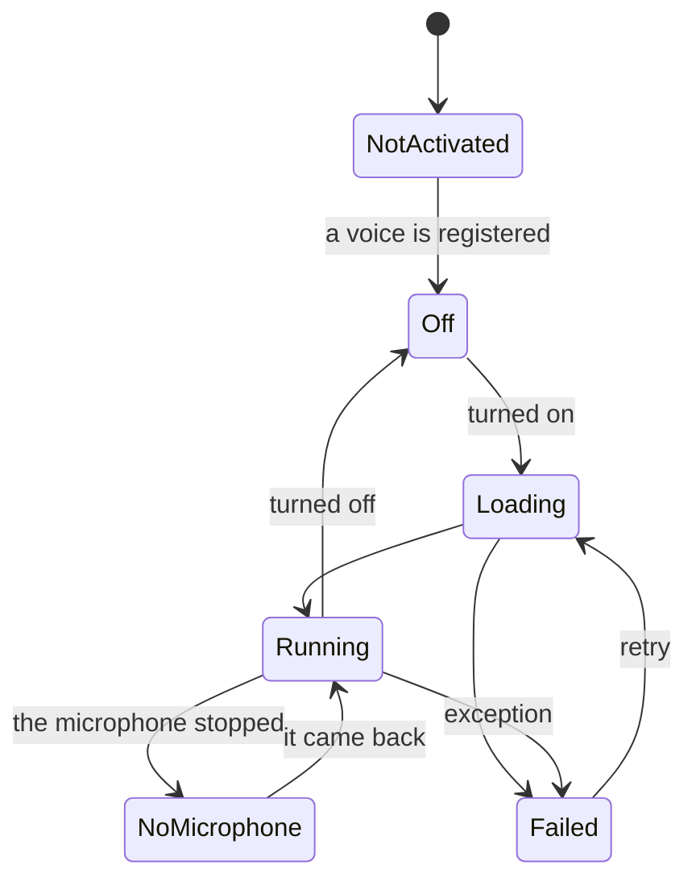

# Voice Detailed Design

## 1. Purpose

The Voice module converts the microphone's voice into a registered voice in real time. During a stream it uses no Python and stays inside Unity (system design 9.1, 9.5).

The prototype's measurements and history are in the [decision record](../decisions/voice-conversion.md). This document sets the product's form.

Out of scope: making voices ([Voice Lab detailed design](voice-lab.md)), a virtual microphone (system design 9.4), and post-processing such as EQ after conversion (system design 9.9, a later stage).

## 2. Responsibilities

| Responsibility | Owner |
|---|---|
| Microphone capture, the mix, the monitor, the stream bus | Audio |
| Moving audio through a processing stage (`IAudioStage`) | Audio |
| Passing blocks, conversion on and off, what to do on failure | Voice (`VoiceService`) |
| The conversion (DSP, running the models) | Voice (`RvcVoiceConverter`) |
| Listing, checking, and loading registered voices | Voice (`VoiceModelLibrary`) |
| Saving the chosen voice, pitch, and failure behavior | ProjectData (Voice Profile) |
| Making and registering voices | VoiceLab |
| Choosing a voice and showing its state | UI |

## 3. Module Boundaries

- `VirtualVessel.Voice` uses only `IAudioStage` from `VirtualVessel.Audio`. It does not call the native audio plugin.
- The UI sees only `IVoiceConversion`, an interface placed in UI. Types from RVC, the models, and Inference Engine do not reach the UI.
- Inference Engine's types stay inside `RvcVoiceConverter` (system design 9.12). Everything above sees only `IVoiceConverter` (system design 9.6).
- Registered voices work even if Voice Lab is broken (system design 13.23). Voice references neither VoiceLab nor ExternalServices.

## 4. Main Classes and Interfaces

| Class | Kind | Role |
|---|---|---|
| `IVoiceConversion` | Interface (UI) | State, chosen voice, pitch, on and off |
| `VoiceService` | Class | Application Service: moves blocks along each frame |
| `IVoiceConverter` | Interface | Abstraction of the conversion method (system design 9.6) |
| `RvcVoiceConverter` | Class | The RVC v2 implementation; the prototype's `RvcStream` |
| `RvcDsp` | Static class | Resampling, mel, F0, crossfade; no side effects |
| `VoiceModelLibrary` | Class | Lists, checks, and loads `VoiceModels` |
| `VoiceModelManifest` | Class | The content of `voice.json` |
| `VoiceActivation` | Class | Reads the activation state |

## 5. Public API

`Process()` in system design 9.6 is synchronous, but GPU work can only be issued from the main thread, and waiting for it stalls the frame. So issuing and collecting are separate.

```csharp
public interface IVoiceConverter : IDisposable
{
    int BlockSamples { get; }                // 48 kHz, mono
    TimeSpan AlgorithmDelay { get; }         // Delay apart from the block and the work
    bool IsBusy { get; }
    void Start(ReadOnlySpan<float> input);   // Sends a block to the GPU. Main thread
    bool Advance(Span<float> output);        // Moves along; true once output is ready. Never waits
    void Reset();                            // Forgets the state at the join
    VoiceTimings Timings { get; }            // Stage times of system design 9.10
}

public interface IVoiceConversion
{
    IReadOnlyObservable<VoiceConversionState> State { get; }
    IReadOnlyObservable<IReadOnlyList<VoiceModelInfo>> Models { get; }
    IReadOnlyObservable<VoiceOptions> Options { get; }  // Voice, pitch, failure behavior
    void SetOptions(VoiceOptions options);
    void SetEnabled(bool enabled);
}
```

## 6. Data Model

### 6.1 Registered voices

Kept in `VoiceModels/<VoiceModelId>/`. They are not the training output (system design 9.7, 13.21).

```text
VoiceModels/
├─ <VoiceModelId>/
│  ├─ voice.json        Name, recommended pitch, format version, origin, hashes
│  ├─ generator.sentis  The generator with the trained weights written in
│  └─ speaker.spk       The speaker vector (256 floats)
└─ Shared/<version>/
   ├─ hubert.sentis
   └─ rmvpe.sentis
```

`voice.json` has a `schemaVersion` (CLAUDE.md chapter 25). Its `shape` holds the window and block values. A voice whose shape the runtime does not support says "This voice cannot be used in this version" and is kept, not deleted.

HuBERT and RMVPE are the same for every voice, so there is one pair.

### 6.2 Voice Profile

A project setting (system design 6.3).

| Item | Meaning |
|---|---|
| `schemaVersion` | Format version |
| `voiceModelId` | The chosen voice; none when not chosen |
| `semitones` | Pitch, from -24 to 24 |
| `onFailure` | `Mute` or `PassThrough`; `Mute` by default (chapter 12) |

The setting is kept even when its voice cannot be found (CLAUDE.md chapter 25).

### 6.3 Settings per PC (being designed)

The GPU load differs from PC to PC, so these belong to the PC, not the Project (user decision, 2026-11-03). They are kept in the settings folder as `Config/voice-settings.json`. They do not go into `app-settings.json`, ProjectData's file that records the project in use; like `ui-settings.json`, it is a file per module.

| Item | Meaning |
|---|---|
| `schemaVersion` | Format version |
| `denoise` | Noise removal |
| `monitorVoice` | What the user hears: `Converted` or `Original` (setup screen 13.4) |

The window is fixed at 1 s and the overlap at joins at 50 ms; neither is a setting (user decision, 2026-11-03).

## 7. State and Lifecycle



- While off, no per-frame work is registered, so people who do not use it pay nothing.
- A registered voice works without the Voice Lab environment. `NotActivated` means no voices, and nothing prepared to make one.

## 8. Important Sequences

### 8.1 One block

```text
Microphone → Audio → IAudioStage.Read → gather (100 ms)
  → Start: noise removal (RNNoise; the original is blended back while voiced), to 16 kHz, mel, HuBERT (1 s of the user's recent speech before the window) and RMVPE to the GPU
  → Advance: read each as it completes; the data lasts only the frame it completed
  → the generator to the GPU
  → Advance: read, to 48 kHz, crossfade
  → IAudioStage.Write → the mix
```

### 8.2 Switching voices

As in system design 9.8, audio devices do not stop. The new voice loads in the background, warms up, and takes over at the next block. The old voice keeps running until then.

### 8.3 Sync with the video

The stream video is delayed by the conversion's delay (audio detailed design 8.3, 8.4). `IAudioStage` gets a way to declare that delay. The prototype does not have it yet.

## 9. Threading and Async

- `Start` and `Advance` run on the main thread, from `IFrameLoop`. This is Inference Engine's constraint on GPU work.
- Model files load on the thread pool. Creating the `Worker` and warming up happen on the main thread.
- Audio threads exchange audio through Audio's ring buffers, so the mix never stops.
- Measured: a frame that issues work costs 13 to 17 ms, and other frames 0.1 ms. Reducing the cost of issuing is an open task (chapter 15).

## 10. Configuration

The Voice Profile, and these values in Developer Mode. Fixed values come from `shape` in `voice.json`.

| Value | Default | Meaning |
|---|---|---|
| Block | 100 ms | Shorter lowers latency, but the work may not keep up |
| Window | 1 s (fixed) | What HuBERT and the generator see. With the user's speech before the window, the user heard no difference with 2.5 s or 5.4 s. Longer uses more GPU (decision record, 2026-11-03) |
| Crossfade | 50 ms | With 20 ms, the sound changed at every join, heard on held notes as a wobble (decision record, 2026-11-03) |
| Tail guard | 30 ms | Less lowers latency and raises the ripple at joins (decision record) |

Changing the block or window requires rebuilding from the template (Voice Lab detailed design 8.4).

## 11. Storage

As in chapter 6. `VoiceModels` is in the Data Root and is treated as the user's asset, like avatars.

Voice Lab writes the activation state, and Voice only reads it.

## 12. Error Handling and Recovery

| What happened | Behavior | Shown to the user |
|---|---|---|
| Exception during inference | Follows the failure setting | Voice conversion could not continue |
| A voice fails to load | Stays off | This voice could not be loaded |
| The microphone stopped | Waits | No sound from the microphone |
| The work fell behind | Drops old blocks | Nothing; counted in diagnostics |
| A voice's hash differs | Not loaded | The voice's files are damaged |

**The default on failure is `Mute` (the user's approval, 2026-11-01).** System design 9.13 makes it the user's setting. For someone streaming with a changed voice, their real voice going out cannot be undone, so by default it does not. It is implemented by leaving the stage on and writing nothing, which gives silence.

## 13. Logging and Diagnostics

- State changes, the loaded voice's ID, the format version, and the backend are recorded.
- Nothing is logged per block (CLAUDE.md chapter 20). Stage times are aggregated into `IPerformanceMetrics`.
- Audio content is not recorded.
- The Diagnostics screen shows the items of system design 9.15.

## 14. Testing Strategy

| Kind | Content |
|---|---|
| EditMode | `RvcDsp`, reading and writing `voice.json` including old formats, library checks, state changes |
| PlayMode | Real-time benchmark with real models; asynchronous readback can only be checked in PlayMode |
| Native | Stage bursts, on and off |
| Manual | Listening with a real microphone |

Without models, as in CI, the benchmarks are ignored.

## 15. Performance Constraints

| Measure | Standard | Measured (RTX 4070, Editor) |
|---|---|---|
| Input to output | 200 ms (system design 15.4) | **About 270 ms, not met** |
| One block's work | Shorter than a block | 87 ms |
| Cost of a frame issuing work | To be lowered | 13 to 17 ms |
| Dropped blocks | 0 | 0 in 199 |

The order for lowering latency:

1. Reduce the tail guard and burst margin, checking by listening. A 10 ms tail guard did little and made held notes waver, so it was set aside
2. Make a block's work not grow with the window (for example, reuse HuBERT's earlier output). A 50 ms block can follow. Only overlapping blocks left the GPU behind (decision record)
3. Reduce issuing RMVPE's unrolled GRU, whose many layers take half of the issuing time

## 16. Directory / Namespace Structure

```text
Assets/VirtualVessel/Voice/
├─ Runtime/
│  ├─ VoiceService.cs
│  ├─ Conversion/   IVoiceConverter, RvcVoiceConverter, RvcDsp
│  └─ Models/       VoiceModelLibrary, VoiceModelManifest
├─ Editor/          VoiceModelImport (developers make the template)
└─ Tests/
   ├─ EditMode/
   └─ Performance/  Runs in PlayMode
```

The `VirtualVessel.Voice` asmdef references `VirtualVessel.Audio`, `VirtualVessel.Core`, `VirtualVessel.Diagnostics`, `VirtualVessel.ProjectData`, `VirtualVessel.UI`, and `Unity.InferenceEngine`.

## 17. Stages and Open Issues

Stages:

1. The prototype in product form: `IVoiceConverter`, the voice folders, Voice Profile, the settings screen
2. Sync with the video (8.3)
3. Lowering latency (chapter 15)
4. Post-processing (system design 9.9)

Open issues:

- Correcting clock drift between the microphone and the mix. The prototype does not. One idea is adding or removing a few samples per block.
- How the settings are shown (the user's request, 2026-11-03). Simple to use, with the detailed settings such as the window kept. There is no choice by what comes first (Lighter GPU, Smoothness): the 1 s window was the best in sound and on the GPU (user decision, 2026-11-03). No names by use such as "singing": they invite expectations about songs and questions of rights. What the user hears of themselves (the converted voice, the original voice, or nothing) is a separate setting. The converted voice comes 0.38 s late, which makes keeping rhythm hard when singing. The screen is designed in setup screen chapter 13 (the mock-up waits for the user's review).
- Slow GPUs. Voice conversion cannot be turned on only when there is no usable GPU (user decision, 2026-11-03; setup screen 13.3). There is no minimum GPU. There is no required performance yet, and only the RTX 4070 has been measured.
- GPU contention with the stream video has not been measured.
