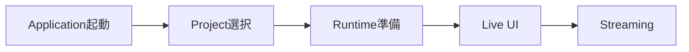

# 1. システム概要

## 1.1 目的

本システムは、3Dアバター、リアルタイムトラッキング、音声変換、ステージ、BGM・SE、映像生成、ライブ配信、音声モデル作成等の機能を統合し、**1つのアプリケーションからVTuber配信に必要な一連の操作を行える統合環境**を提供することを目的とする。

一般的なVTuber配信環境では、

- 3Dアバター表示
- Face / Body Tracking
- Voice Conversion
- Audio Mixing
- Streaming
- Recording
- Voice Model Training
- 外部ツール

等が別々のApplicationやScriptとして構成される場合がある。

その場合、利用者は複数Applicationの起動、設定、Device Routing、Window管理、外部Process管理等を行う必要がある。

本システムではこれらを可能な限り統合し、利用者から見た操作対象を**単一のVTuber Application（Virtual Vessel Studio）**へ集約する。

また、単に複数機能を1つのApplicationへ詰め込むのではなく、

- 機能単位で責務を分離する
- 外部OSSとの依存関係を限定する
- 配信RuntimeとSetup / Trainingを分離する
- 将来的なTracking、Voice、Streaming等の技術変更へ対応可能とする
- OSSとして継続的に開発・保守できる構造とする

ことも目的とする。

### 採用理由

VTuber配信では、利用する技術やDeviceが多く、各機能を個別Applicationとして構成すると、利用者が内部構成を理解して運用する必要が生じる。

本システムでは、

**複雑な内部構成をApplication側で吸収し、利用者には統合された操作環境を提供する**

ことを基本的な価値とする。

---

## 1.2 対象範囲

本システムでは、主に以下の機能を対象とする。

### 3Dアバター

- VRM 1.0以降（VRM 0.xは読み込み時に1.0へ変換して受け付ける）
- FBX
- Avatar登録
- Avatar切り替え
- Pose制御
- Expression制御
- Extension Bone制御
- 猫耳・尻尾等の拡張要素

### Tracking

- Cameraを利用したTracking
- Face Tracking
- Body Tracking
- Hand Tracking
- MediaPipe
- 将来的なmocopi等のTracking Provider

### Voice Conversion

- Microphone Input
- RVCによるリアルタイムVoice Conversion
- Pitch等のPost Processing
- Voice Model選択
- 仮想Microphone等へのOutput

### Voice Lab

- 音声生成
- Voice Clone
- Dataset作成
- Voice Analysis
- RVC Training
- Training History
- Model Evaluation
- Runtime用Voice Model登録

### Stage

- 3D Stage
- Stage切り替え
- Camera Point
- Avatar Spawn Point
- Lighting
- Stage Effect
- Capture Textureを表示するScreen Surface

### Audio

- Voice
- BGM
- SE
- Game / Capture Audio
- Audio Mixing
- Monitor Output
- Stream Audio

### Capture

- GameCaptureによるCapture Board映像・音声入力
- SubScreenCaptureによるサブモニタ映像入力
- Capture SourceのPreview・ON/OFF
- Stage上のScreen Surfaceへの映像供給

### Camera / Video

- Main Camera
- Camera Point切り替え
- Streaming Render Target
- Diagnostic Camera
- Video Encoding
- Recording

### Streaming

- YouTube Live
- Audio / Video Synchronization
- RTMPS等による配信
- Streaming State管理

### Project / Data

- Project
- Profile
- Asset
- Data Root
- Backup
- Import / Export
- Migration
- Credential管理

### Developer / Diagnostics

- Logging
- Runtime Diagnostics
- Performance Monitoring
- External Process Monitoring
- Diagnostic Camera
- Diagnostics Export

---

本システムの対象外または初期実装の必須対象外とするものについては、将来拡張として扱う。

例：

- 複数人同時配信
- 完全なPlugin SDK
- 多数のStreaming Serviceへの同時対応
- すべての3D Model形式への対応
- すべてのMotion Capture Deviceへの対応

### 採用理由

初期段階から将来機能をすべて実装すると、現在必要な機能に対して過剰な複雑性を持つシステムとなる。

そのため、現在必要な機能を中心に実装しつつ、将来変更が想定される箇所には拡張可能な境界を設ける。

---

## 1.3 基本方針

本システムの基本方針を以下とする。

### 単一Applicationとして提供する

通常利用者から見たシステムは、1つのUnity Applicationとして提供する。

内部でPython Serviceや外部OSSを利用する場合でも、通常利用者へ、

- Command Prompt
- Python
- venv
- Port
- Git
- 外部OSSの内部構造

等を意識させない。

---

### UnityをRuntimeの中心とする

配信中に必要となる主要機能はUnityを中心に実行する。

対象例：

- Avatar
- Tracking
- Voice Conversion
- Audio
- Camera
- Stage
- Streaming
- UI

特にRVCによるリアルタイムVoice ConversionはUnity Runtime内で実行し、配信時にPython Serviceを必須としない。

---

### PythonはSetup・Training・Analysisを中心に使用する

Pythonは主に以下で利用する。

- Voice Generation
- Voice Clone
- RVC Training
- Voice Analysis
- Model Conversion
- External OSS Setup

これらは必要時のみ起動する。

---

### SetupとRuntimeを分離する

各機能について、

- 登録
- 解析
- Training
- Mapping
- 詳細設定

等はSetup側で実施する。

配信Runtimeでは、Setup済みのAssetやProfileを読み込み、可能な限り軽量な処理のみを行う。

---

### 外部OSSを直接Application設計へ露出させない

RVC、VoxCPM2等の外部OSSは、Adapter / Wrapper等の境界を介して利用する。

外部OSS本体への改変は可能な限り避ける。

---

### モジュール単位で責務を分離する

Application全体を巨大なManagerへ集約しない。

Avatar、Tracking、Voice、Streaming等を独立したModuleとして扱い、明確なInterfaceおよびData Contractを介して連携する。

---

### 通常利用者とDeveloper向け情報を分離する

通常利用者には必要な状態と操作のみを表示する。

Developerには、

- 詳細Log
- Performance
- Internal State
- External Process
- Version
- Exception

等を十分に観測可能とする。

---

### 将来拡張を考慮する

初期実装を過度に複雑化しない範囲で、

- 新Tracking Provider
- 新Voice Converter
- 新Avatar形式
- 新Streaming Service
- 新Locale
- 複数Avatar

等へ拡張可能な構造を維持する。

---

### OSSとして保守可能な構成とする

本システムはGitHub等でのOSS公開を想定する。

そのため、

- Module境界
- Documentation
- Test
- Logging
- External Dependency
- Version管理
- Migration

等を設計段階から考慮する。

---

## 1.4 想定利用形態

本システムでは、大きく以下の利用形態を想定する。

### 通常配信

利用者が既に登録済みの、

- Avatar
- Tracking Profile
- Voice Model
- Stage
- Streaming Profile

等をProjectから読み込み、配信を開始する。

基本的な流れを以下とする。



通常配信時には、PythonやVoice Lab環境を起動する必要はない。

---

### 配信前Setup

Avatar、Tracking、Voice、Stage、Streaming等を設定する。

例：

```text
Avatar Import
Tracking Setup
Voice Setup
Stage Setup
Camera Setup
Audio Setup
Streaming Setup
Project Save
```

各Setup画面では可能な範囲でPreviewやTestを提供する。

---

### Voice Lab

新しいVoice Modelを作成する場合に使用する。

基本的な流れを以下とする。

```text
Generate
   ↓
Clone
   ↓
Dataset
   ↓
Train RVC
   ↓
Evaluate
   ↓
Register for Runtime
```

Voice Lab利用時のみ、VoxCPM2、Voice Analysis、RVC Training等の外部Service / Processを必要に応じて起動する。

---

### Developer / Diagnostics

Developer Modeでは、

- Runtime State
- Logging
- Diagnostic Camera
- Tracking情報
- Audio情報
- Streaming情報
- External Service状態

等を確認する。

通常利用者がこれらの内部構成を理解することは要求しない。
