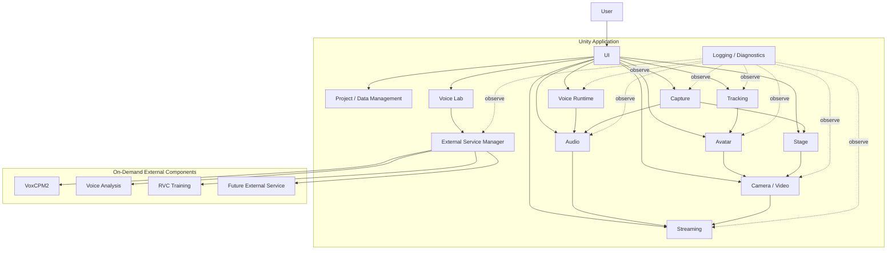
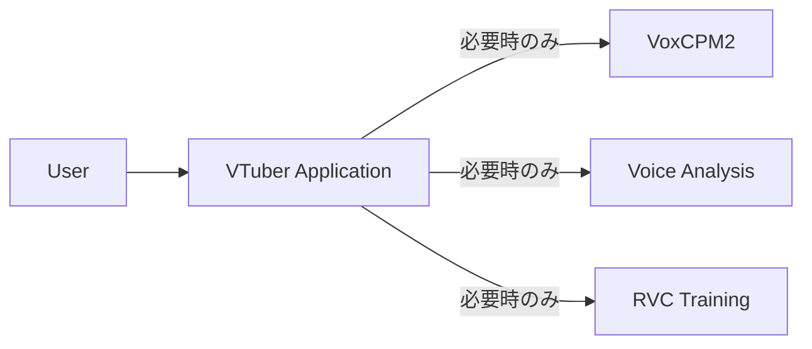

# 2. システム全体方式

## 2.1 全体アーキテクチャ

本システムは、Unity Applicationを中心として構成する。

Unity内部に配信Runtimeの主要機能を配置し、Training、Generation、Analysis等については必要に応じてローカル外部Service / Processを利用する。

概念的な全体構成を以下に示す。



図中の矢印は主に、

- 制御要求
- データの受け渡し
- 状態参照

を示すものであり、必ずしもクラス間の直接参照を意味しない。

### 採用理由

UnityをApplicationの中心へ置くことで、

- 3D Rendering
- Tracking
- Audio
- UI
- Streaming

等、配信中に連携する機能を同一Runtime上で扱える。

一方、Training等の重いSetup処理を外部Serviceへ分離することで、配信Runtimeへ不要なPython依存を持ち込まずに済む。

---

## 2.2 Unityと外部サービスの役割分担

UnityとExternal Serviceの責務を明確に分離する。

### Unity側

主に以下を担当する。

- Application Lifecycle
- UI
- Project管理
- Avatar
- Tracking
- Runtime Voice Conversion
- Audio Mixing
- GameCapture / SubScreenCapture等の映像入力
- Stage
- Camera
- Rendering
- Streaming
- Recording
- Diagnostics
- External Service Lifecycle管理

### External Service / Process側

主に以下を担当する。

- Voice Generation
- Voice Clone
- Voice Analysis
- RVC Training
- Dataset Processing
- Model Conversion
- その他Setup / Analysis系処理

### 基本原則

外部Serviceでしか実行できない処理を除き、配信中の主要Runtimeを外部Serviceへ依存させない。

### 採用理由

配信RuntimeとTraining環境を分離することで、

- Python環境障害
- External Service障害
- Dependency Error

等が発生しても、登録済みAssetによる通常配信への影響を抑えられる。

---

## 2.3 単一アプリUX・内部マルチサービス構成

利用者から見たシステムは単一Applicationとする。

内部的には、

- Unity Runtime
- VoxCPM2 Service
- Voice Analysis Service
- RVC Training Process

等、複数Processが存在してもよい。

ただし、通常利用者がそれらを個別に起動・停止する必要はない。



通常UIでは、

- Port
- PID
- venv
- Python Command

等を表示しない。

例えばVoice Generationを開始した場合、

```text
音声生成サービスを準備しています
        ↓
利用可能
        ↓
音声生成
```

という利用者向け状態として表示する。

### 採用理由

内部構成が複雑でも、Applicationとしての利用方法まで複雑にする必要はない。

単一Application UXを維持することで、利用者の環境構築・運用負担を抑える。

---

## 2.4 モジュール分割方針

システム内部を責務単位のModuleへ分割する。

主要Moduleとして以下を想定する。

```text
Application
Project / Data
Avatar
Tracking
Voice
Audio
Capture
Stage
Video
Streaming
VoiceLab
ExternalServices
Diagnostics
UI
```

各Moduleは、自身の責務に必要な内部実装を管理する。

例えばAvatar Moduleであれば、

- Avatar Loading
- Avatar Runtime
- Skeleton
- Pose
- Expression
- Extension Motion

等を内部に持つ。

Tracking Moduleであれば、

- Provider
- Normalization
- Filtering
- Calibration

等を管理する。

Capture Moduleであれば、

- Capture Source
- GameCapture Adapter
- SubScreenCapture Adapter
- Capture State
- Capture Texture / Audioの受け渡し

等を管理する。

### Module分割原則

以下を基本とする。

1. 1つのModuleが複数機能の内部実装を直接管理しない。
2. 他Moduleの内部Classへ自由に依存しない。
3. 外部へ公開するInterfaceを限定する。
4. Module内部変更を他Moduleへ波及させない。
5. 巨大なGlobal Managerを作らない。

### 採用理由

すべてを1つのApplication Manager等へ集約すると、

- 責務が不明確になる
- Unit Testしにくくなる
- 変更影響範囲が大きくなる
- Claude Codeによる変更時にも対象範囲を判断しにくくなる

ためである。

---

## 2.5 モジュール間連携方式

Module間連携では、用途に応じて以下を使い分ける。

- Interface
- Data Contract
- Command
- Event
- Service
- Runtime State

Module内部の具体Classを直接参照することを基本とはしない。

---

### Interface

他Moduleから機能を利用するための安定した境界として使用する。

例：

```text
IAvatarLoader
ITrackingProvider
IVoiceConverter
IVideoCaptureSource
IAudioCaptureSource
IVideoEncoder
IStreamPublisher
```

### Data Contract

Module間でデータを受け渡す際に使用する。

例：

```text
TrackingFrame
AvatarPose
ExpressionSignal
CaptureSourceInfo
CaptureFrameInfo
FinalStreamAudio
```

### Command

利用者操作や外部入力からRuntimeへ操作要求を渡す。

例：

```text
SwitchAvatarCommand
SwitchCameraCommand
PlaySeCommand
ToggleMuteCommand
```

### Event

状態変化等を複数のModuleへ通知する必要がある場合に使用する。

例：

```text
ProjectChanged
AvatarChanged
StageChanged
StreamingStateChanged
```

### Runtime State

現在状態をUIやDiagnosticsへ公開する際に使用する。

UIがModule内部変数を直接参照しない構成とする。

---

### 直接依存の抑制

例えばUIから、

```text
Button
  ↓
VrmAvatarLoader
```

のように具体実装を直接呼び出さない。

代わりに、

```text
Button
  ↓
Command
  ↓
Avatar Module
  ↓
内部実装
```

とする。

### 採用理由

UI、External Device、Automation等、異なる入力手段から同じ処理を再利用可能にするためである。

また、具体Classへの依存を減らすことで、内部実装変更の影響を限定する。

---

## 2.6 共通データ形式・抽象化方針

Module間で使用するデータは、特定のLibraryや外部OSS固有形式を可能な限り直接使用しない。

システム共通のData Contractへ変換してから利用する。

### Tracking

例えばMediaPipe固有のLandmark情報をAvatar Moduleへ直接渡さない。

```text
MediaPipe Data
      ↓
Tracking Provider
      ↓
TrackingFrame
      ↓
Avatar Module
```

### Avatar

VRMやFBX固有のBone構造をTracking Moduleへ公開しない。

```text
VRM / FBX
   ↓
Skeleton Mapping
   ↓
Common Avatar Bone
```

### Expression

VRM ExpressionやFBX BlendShapeをFace Tracking側で直接扱わない。

```text
Face Tracking
      ↓
Expression Signal
      ↓
Expression Mapping
      ↓
VRM / FBX
```

### Voice

RVC固有処理をAudio Mixer等へ露出させない。

```text
Audio Input
    ↓
IVoiceConverter
    ↓
Converted Audio
    ↓
Audio Processing
```

### Capture

GameCaptureUnityPluginやDXGI Desktop Duplication等の具体的なCapture実装を、StageやVideo Moduleへ直接露出させない。

```text
Capture Board / DXGI Desktop Duplication
      ↓
Capture Adapter
      ↓
IVideoCaptureSource / IAudioCaptureSource
      ↓
Capture Texture / Capture Audio
      ↓
Stage / Audio Module
```

GameCaptureは映像と音声を提供可能なCapture Sourceとして扱い、SubScreenCaptureは初期実装では映像のみを提供する。

Capture Sourceは映像取得のみを担当し、取得映像をStage上のどこへ表示するかはStage Module、最終映像をどのように配信・録画するかはVideo / Streaming Moduleの責務とする。

### Streaming

配信Service固有処理をRenderingへ露出させない。

```text
Render / Audio
      ↓
Encoder
      ↓
Encoded Stream
      ↓
IStreamPublisher
```

---

### 共通データ形式の原則

共通Data Contractは、

- Model Format
- Tracking Library
- Voice Engine
- Capture Backend
- Streaming Service

等の具体技術から可能な限り独立させる。

また、必要に応じて、

- Timestamp
- Confidence
- State
- Version

等を含める。

### 採用理由

外部Libraryの型をそのままModule境界で利用すると、そのLibraryを変更した際に多数のModuleを変更する必要がある。

具体技術から共通表現へ一度変換することで、変更範囲を限定する。
