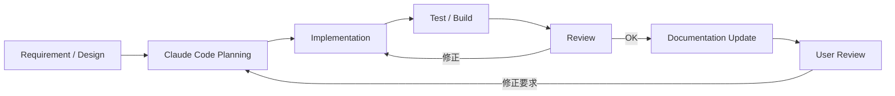

# 3. 開発・運用方式

## 3.1 開発基本方針

本システムは、長期的な機能追加およびOSS公開を前提として開発する。

開発では、

- 設計
- 実装
- Test
- Review
- Documentation
- Refactoring

を継続的に実施する。

単に機能を追加するだけでなく、Module境界やDesign Ruleを維持することを重視する。

また、Claude Code等の開発Agentを積極的に利用する。

### 基本原則

1. 方式設計を基準として実装する。
2. Module責務を守る。
3. 外部OSSへの変更を最小限にする。
4. 実装と同時にTestを追加する。
5. Logging / Diagnosticsを機能実装の一部として扱う。
6. 仕様変更時はDocumentationも更新する。
7. Performance Regressionを考慮する。
8. Security / PrivacyをReview対象とする。
9. 巨大ClassやGlobal Singletonへの集中を避ける。
10. 自動化可能な作業は開発Agentへ委譲する。

### 採用理由

機能数が多いシステムでは、その場限りの実装を繰り返すと設計が崩れやすい。

実装規則と設計文書を開発プロセスへ組み込むことで、機能追加による品質低下を防ぐ。

---

## 3.2 Claude Codeを用いた開発自動化

Claude Codeを本システムの主要な開発Agentとして利用する。

Claude Codeには、単純なコード生成だけでなく、以下の作業を担当させる。

- 既存設計の確認
- 実装計画作成
- Code実装
- Refactoring
- Unit Test
- Integration Test
- Build確認
- Code Review
- Performance確認
- Logging / Diagnostics確認
- Documentation更新
- UI Design
- UI実装
- Visual Review
- 不具合修正

概念的な開発サイクルを以下とする。



### 採用理由

本システムでは、

- Unity
- C#
- Python
- External OSS
- Voice Model
- UI
- Streaming

等、多数の技術領域が存在する。

開発Agentに設計ルールを共有し、実装・Test・Review・Documentationまで一貫して実行させることで、開発作業の効率化を図る。

ただし、Claude Codeの生成結果を無条件に採用しない。

アーキテクチャ、主要仕様、UI、体感品質等についてはユーザー自身も確認する。

---

## 3.3 リポジトリ構成

Repositoryは、機能責務およびRuntime / External Serviceの境界が分かりやすい構成とする。

概念例を以下に示す。

```text
virtual-vessel-studio/
├─ CLAUDE.md
├─ README.md
│
├─ docs/
│  ├─ ja/
│  │  ├─ architecture/
│  │  ├─ detailed-design/
│  │  ├─ development/
│  │  ├─ decisions/
│  │  └─ ui/
│  │     ├─ design-system.md
│  │     ├─ ui-guidelines.md
│  │     ├─ components.md
│  │     └─ screens/
│  │
│  └─ en/
│     └─ (jaと同一の構成)
│
├─ unity/
│  └─ VirtualVesselStudio/
│     ├─ Assets/
│     │  └─ VirtualVessel/
│     │     ├─ Core/
│     │     ├─ Application/
│     │     ├─ ProjectData/
│     │     ├─ Avatar/
│     │     ├─ Tracking/
│     │     ├─ Voice/
│     │     ├─ Audio/
│     │     ├─ Capture/
│     │     ├─ Stage/
│     │     ├─ Video/
│     │     ├─ Streaming/
│     │     ├─ VoiceLab/
│     │     ├─ ExternalServices/
│     │     ├─ Diagnostics/
│     │     └─ UI/
│     ├─ Packages/
│     └─ ProjectSettings/
│
├─ native/
│
├─ services/
│  ├─ voxcpm/
│  ├─ voice-analysis/
│  └─ adapters/
│
├─ tests/
│  ├─ unit/
│  ├─ integration/
│  ├─ system/
│  └─ performance/
│
└─ tools/
```

実際のUnity Project構造等については実装時に調整する。

重要なのは、Directory自体ではなく、責務の境界がRepository構造から把握できることである。

---

### docs

設計・仕様・判断理由等を保持する。

日本語版を`docs/ja/`、英語版を`docs/en/`へ配置し、同じ文書は同じRelative Pathを使用する。

### unity

Unity Applicationの本体を保持する。

Unity Projectのルートは`unity/VirtualVesselStudio/`とする。

機能Moduleごとに責務を分離する。

### native

本システムが所有するNative Windowsコード、Native Pluginを保持する。

### services

本システム側で管理するExternal Service用Wrapper、Adapter、Launcher等を保持する。

外部OSSそのものを自作コードと混在させない。

### tests

Unit、Integration、System Testを目的別に管理する。

RVC Latency、Capture性能、長時間運用等の製品の性能計測について、Unity上で実行する性能テスト本体は各Moduleの`Tests/Performance/`へ配置し、`tests/performance/`にはHardware CI用の実行Script、比較用の基準値、結果の履歴を置く。

過去のBenchmark / Prototype実装はRepository外の参照用Snapshotとし、本Repositoryへコピーしない。

### tools

Build、Setup、Conversion、Development Support等の補助Toolを管理する。

### 採用理由

Repository構造とArchitecture構造を近づけることで、開発者およびClaude Codeが変更対象を判断しやすくする。

---

## 3.4 CLAUDE.md

Repository Rootに`CLAUDE.md`を配置し、Claude Codeが開発時に必ず従う共通ルールを定義する。

`CLAUDE.md`には少なくとも以下を記載する。

### Architecture Rule

- Unity中心のApplicationであること
- SetupとRuntimeを分離すること
- Module境界を守ること
- 外部OSSはAdapter / Wrapper越しに利用すること
- Module内部実装へ他Moduleから直接依存しないこと

### Code Rule

- 巨大Managerを作らない
- 不要なSingletonを作らない
- Interface / Data Contractを優先する
- Public APIを必要最小限にする
- 非自明な処理には設計意図が分かるCommentを付ける

### External OSS Rule

- 外部OSS本体を可能な限り変更しない
- 必要なCustom処理はApplication側へ配置する
- Versionを固定・管理する
- 独自Patchが必要な場合は理由をDocumentationへ残す

### Test Rule

- 新機能には必要なTestを追加する
- Bug Fix時には可能な範囲でRegression Testを追加する
- Module単位Testを優先する
- Performance重要処理では性能劣化を確認する

### Diagnostics Rule

- Error時に十分なDeveloper Contextを残す
- User NotificationとDeveloper Logを分離する
- SecretをLogへ出力しない
- 高頻度処理で過剰Logを出さない

### UI Rule

- Design Systemへ従う
- 既存Componentを優先して利用する
- Project独自の多言語対応（文字列表）を利用する
- 日本語 / Englishで確認する
- Fontを個別指定しない
- ScreenshotによるVisual Reviewを行う

### Documentation Rule

- Architecture変更時には関連文書を更新する
- 新しいDesign Patternを導入した場合はDocumentationへ追加する
- 実装と文書の不一致を放置しない

### 採用理由

Claude Codeへ個別PromptごとにArchitecture Ruleを説明すると、指示漏れや判断の不一致が発生しやすい。

Repository内へ永続的な開発Ruleとして配置することで、変更時の一貫性を高める。

---

## 3.5 テスト・レビュー・ドキュメント更新

機能実装完了の条件を、Codeが動作することだけとはしない。

原則として、

```text
Implementation
      ↓
Build
      ↓
Test
      ↓
Review
      ↓
Documentation
      ↓
User確認
```

までを1つの開発Cycleとする。

---

### Unit Test

個々のClassやAlgorithmを検証する。

対象例：

- Data Conversion
- Profile Validation
- Mapping
- State Transition
- Command

---

### Integration Test

Module間の連携を検証する。

対象例：

```text
Tracking → Avatar
Voice → Audio
GameCapture → Capture / Audio
SubScreenCapture → Capture / Stage
Audio → Streaming
Project → Runtime
Voice Lab → External Service
```

---

### System Test

Unity Application全体として検証する。

対象例：

- Application起動
- Project Load
- Avatar表示
- Tracking
- Voice Conversion
- Stage
- Streaming
- Recording

---

### Performance Test

Realtime処理については必要に応じて性能も検証する。

対象例：

- RVC Latency
- Tracking Processing Time
- Frame Time
- Encoding Time

---

### Review

Claude CodeによるSelf Reviewでは、少なくとも以下を確認する。

- Architecture準拠
- Module境界
- Code Quality
- Error Handling
- Diagnostics
- Security
- Privacy
- Performance
- Test Coverage
- Documentation

---

### UI Review

UIについては実際の画面をScreenshot等で確認し、

- Spacing
- Alignment
- Visual Hierarchy
- 日本語
- English
- Font
- Design System準拠

等をClaude Code自身でもReviewする。

最終的にはユーザー自身もUIを確認する。

---

### Documentation更新

以下に変更がある場合、関連Documentも更新する。

- Interface
- Data Format
- Directory Structure
- Setup方式
- UI
- External Component
- Project Format
- Architecture

### 採用理由

実装だけを更新しDocumentationが古い状態になると、後続の開発者やClaude Codeが誤った前提で変更を行う可能性がある。

DocumentationもSystemの構成要素として扱う。

---

## 3.6 OSSとしての開発方針

本システムはOSSとして公開可能な構成を前提とする。

そのため、特定の開発環境や開発者しか理解できない状態を可能な限り避ける。

---

### 外部依存の明示

利用する外部Library、OSS、Toolについて、

- 名称
- Version
- License
- 利用目的

を把握可能とする。

---

### 外部OSSとの分離

RVC、VoxCPM2等の外部OSS本体と本システム独自実装を明確に分離する。

独自機能は原則として、

- Adapter
- Wrapper
- Launcher
- Application-side Processing

として実装する。

### 採用理由

外部OSSを直接大量改変すると、上流Versionへの追従が困難になるためである。

---

### 再現可能な開発・配布環境

Pythonを利用するExternal Componentについては、**開発環境**と**通常利用者向け配布環境**を分離して管理する。

開発環境では、Componentごとに、

- External OSS Version / Commit
- Python Version
- Dependency Definition / Lock
- venv
- Build手順
- Test手順

を明示し、開発者ごとのGlobal Python Environmentへ過度に依存しない。

通常利用者のPCには、アクティベーションのときに、開発環境で検証した次の情報から環境を構築する（13.4）。

- 環境のVersion
- Python Runtime Version
- Dependency Version
- External OSS Version / Commit
- Adapter Version
- Package Hash

構築した環境は、これらのVersionを識別できる。

通常利用者にPython本体、venv、pip等の導入・操作を要求しない。

venvは主として開発・Test・Build用の環境とし、通常利用者向け配布物の実行方式とは分離する。

また、標準の開発・配布方式としてDockerを必須依存としない。

---

### Issue調査可能性

利用者からの障害報告に対応できるよう、

- Application Version
- External Component Version
- Logs
- Diagnostics
- Environment

等を確認可能とする。

秘密情報を含まないDiagnostics Exportを提供可能とする。

---

### Contributorが理解しやすい構成

Repository内で、

- Architecture
- Module責務
- Setup
- Build
- Test
- Coding Rule
- External Dependency

を確認できる状態を目指す。

---

### SecretのRepository混入防止

以下をRepositoryへCommitしない。

- Stream Key
- OAuth Token
- Password
- API Key
- 個人Credential

Application Runtimeでも秘密情報を通常設定FileやLogへ保存しない。

---

### Patch管理

外部OSSへ独自Patchが必要となった場合、

- Patch内容
- Patch理由
- 対象Version
- Upstreamとの差分
- 将来的な削除可能性

をDocumentationへ残す。

### 採用理由

将来外部OSSをUpdateする際に、独自変更が必要なのか判断できるようにする。

---

### 開発判断の記録

重要なArchitecture変更については必要に応じて、

```text
docs/<lang>/decisions/
```

等へ設計判断を記録する。

対象例：

- なぜUnity RuntimeでRVCを動かすか
- なぜPythonを配信Runtimeへ依存させないか
- なぜ外部OSSを改変しないか
- なぜUI Toolkitを採用したか

### 採用理由

時間が経過すると「なぜこの構造になっているか」が失われやすい。

最終的な構造だけでなく、主要な判断理由を残すことで、将来の変更判断を行いやすくする。

---

### OSS開発の基本原則

本システムでは、OSSとしての開発について以下を基本原則とする。

1. ArchitectureおよびModule責務を文書化する。
2. 外部OSSと独自実装を明確に分離する。
3. 外部OSSへの直接改変を最小限にする。
4. External DependencyのVersionを管理する。
5. Globalな開発環境依存を減らす。
6. Test可能なModule構造を維持する。
7. Logging / Diagnosticsを十分に提供する。
8. Secret情報をRepository・Log・Diagnosticsへ含めない。
9. Architecture変更時はDocumentationを更新する。
10. Claude Codeによる変更も同じ開発Ruleへ従わせる。
11. Claude Codeによる自動Reviewだけでなく、必要に応じてユーザー自身も結果を確認する。
12. 将来のContributorが理解・変更可能な構造を維持する。
