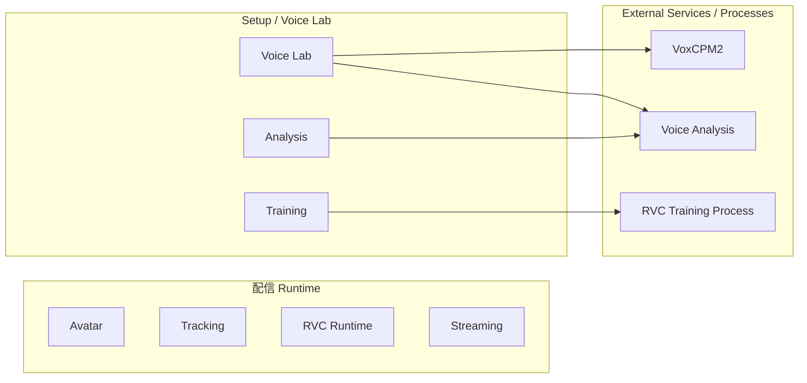
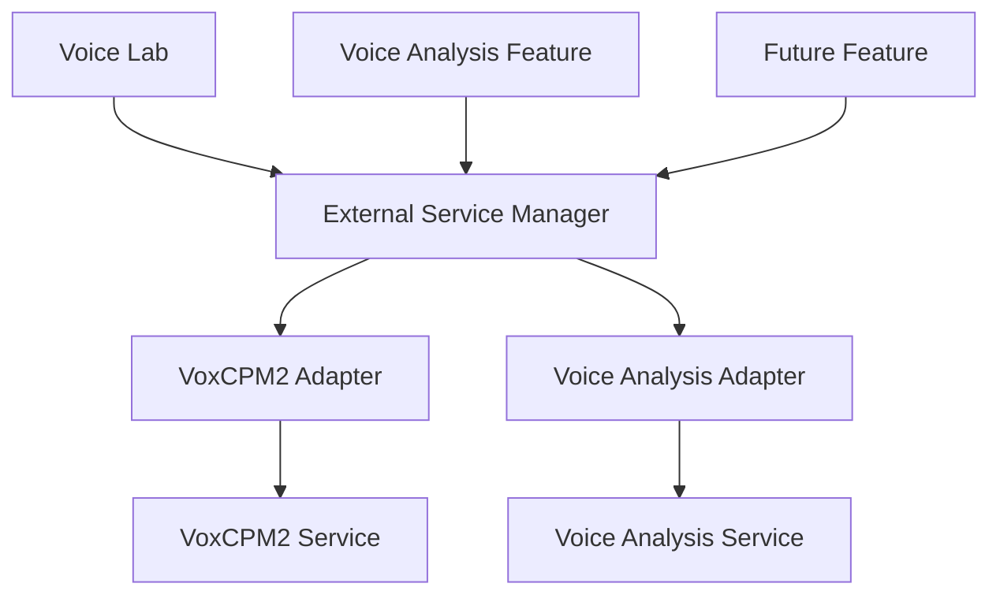
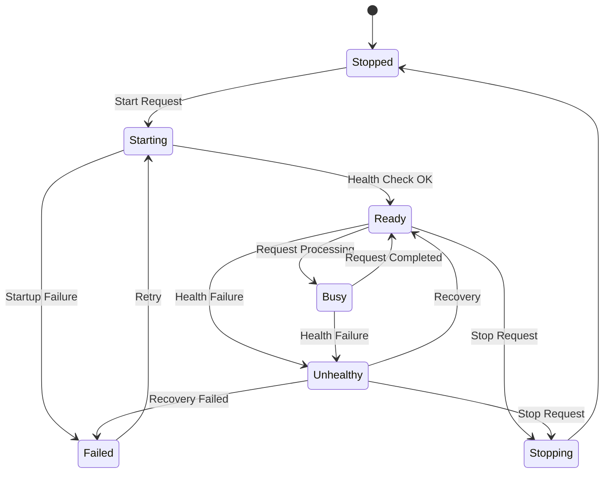
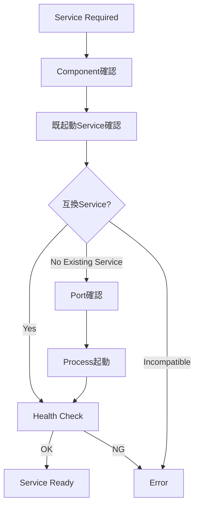

# 4. 外部サービス管理方式

## 4.1 基本方針

本システムでは、Unityアプリケーション単体では実行しない一部の処理について、Python等で実装されたローカルサービスまたは外部プロセスを利用する。

対象例として以下を想定する。

- VoxCPM2
- Voice Analysis
- RVC学習処理
- 音声解析処理
- モデル変換処理
- その他将来追加される外部ツール

ただし、通常利用者に、

- Pythonのインストール
- Pythonの起動
- venvの作成・Activation
- pip等による依存パッケージ導入
- コマンド入力
- Port番号
- Process ID
- 外部OSSのディレクトリ構造

等を意識させない。

Pythonを利用するComponentは、通常利用者向けにはBuild済みのPortable Runtime PackageまたはStandalone Executableとして配布することを基本とする。

Unityアプリケーション側から必要な処理を要求した場合に、インストール済みのRuntime Packageを確認し、必要な外部サービスまたは外部プロセスを自動的に準備・起動して利用可能な状態にする。

開発者は同一SourceとDependency Definition / Lockを用いて、Native Python + venv環境から各Componentを直接実行・Test可能とする。

また、配信Runtimeでは不要な外部サービスを常時起動しない。

### 採用理由

本システムは利用者から見ると1つのアプリケーションとして動作することを目的とする。

内部実装上Pythonや外部OSSを利用していても、その構成を利用者へ露出すると、

- 起動手順が複雑になる
- Python環境の知識が必要になる
- 起動忘れや順序間違いが発生する
- PortやProcess管理が必要になる

等、利用負担が大きくなる。

そのため、外部サービスのLifecycleをアプリケーション側で管理する。

---

## 4.2 外部処理の分類

外部処理を大きく以下の2種類に分類する。

### Managed Local Service

一定時間起動状態を維持し、Unityから複数回Requestを受け付けるローカルサービス。

対象例：

- VoxCPM2 Service
- Voice Analysis Service
- 将来追加される解析Service

主にHTTP等のローカルIPCを利用する。

### Managed External Process

特定の処理を行うために起動し、処理完了後に終了する外部Process。

対象例：

- RVC Training
- Dataset Preprocess
- Model Conversion
- Setup Script
- その他Batch処理

### 採用理由

長時間稼働するServiceと、一度の処理で終了するProcessではLifecycleが異なる。

両者を同一方式で無理に管理せず、

- Service Lifecycle
- Process Execution

を分離して扱う。

---

## 4.3 配信Runtimeとの分離

Python Local Serviceは、通常の配信Runtimeに必須としない。

通常配信時には、

- Avatar
- Tracking
- RVC Runtime
- Audio
- Stage
- Camera
- Streaming

等、Unity Runtime上で必要な機能のみを利用する。

特にRVCによるリアルタイム音声変換はUnity側Runtimeで実行し、Python Serviceへ依存しない。

一方、

- Voice Lab
- RVC学習
- Voice Clone
- Voice Analysis
- 外部OSS Setup

等を利用する場合のみ、必要なServiceまたはProcessを起動する。



### 採用理由

Voice Labや学習環境に問題が発生した場合でも、すでに登録済みのモデルを利用した通常配信を継続可能とするためである。

---

## 4.4 External Service Manager

外部サービスのLifecycle管理を行う共通機能として、`External Service Manager`を設ける。

External Service Managerは主に以下を担当する。

- Service登録情報の管理
- 必要なServiceの起動要求
- 既起動Serviceの検出
- Service再利用
- Port確認
- Process起動
- Health Check
- Ready待機
- Service状態管理
- Service停止
- 異常検出

各機能Moduleが直接Python Processを起動する構成とはしない。



### 採用理由

各Moduleが個別に、

- Process起動
- Port確認
- Health Check
- Shutdown

を実装すると、同じ処理が重複し、異なるLifecycle管理が混在する。

共通Managerへ集約することで、Service管理方式を統一する。

---

## 4.5 Service Adapter方式

External Service Managerが、各外部サービス固有のAPIや内部仕様を直接認識しすぎない構成とする。

サービス固有処理はAdapterへ分離する。

概念的には以下のInterfaceを想定する。

```text
IExternalServiceAdapter

- GetServiceInfo()
- StartAsync()
- CheckHealthAsync()
- StopAsync()
- GetStatusAsync()
```

具体的な実装として、

- VoxCpmServiceAdapter
- VoiceAnalysisServiceAdapter
- FutureServiceAdapter

等を配置する。

### 採用理由

各外部サービスでは、

- 起動方法
- Health Check
- API仕様
- Version取得方法
- Shutdown方法

等が異なる。

これらをExternal Service Managerへ直接記述すると、Service追加のたびにManagerを修正する必要がある。

Service固有処理をAdapterへ閉じ込めることで、外部サービス追加時の影響を限定する。

---

## 4.6 Service Descriptor

各外部サービスについて、管理に必要な情報をService Descriptorとして保持する。

想定する情報は以下とする。

| 項目 | 内容 |
|---|---|
| ServiceId | サービス識別子 |
| DisplayName | 表示名称 |
| ComponentId | 対応する外部Component |
| SupportedVersion | 対応Version |
| AdapterVersion | Adapter Version |
| Executable | 起動対象 |
| WorkingDirectory | Working Directory |
| DefaultPort | 既定Port |
| HealthEndpoint | Health Check先 |
| InfoEndpoint | Service情報取得先 |
| StartupTimeout | 起動待機上限 |
| ShutdownPolicy | 終了方式 |

具体的な保存形式については詳細設計で決定する。

### 採用理由

Service情報をC#コードへ分散して記述すると、Versionや起動方法の変更時に修正箇所が増える。

Service管理情報を明確な単位として保持することで、管理・診断を容易にする。

---

## 4.7 Service Lifecycle

Managed Local Serviceは、概念的に以下の状態を持つ。



UI側には、この内部状態を必要に応じて簡略化して表示する。

### 採用理由

単なるRunning / Stoppedだけでは、

- Process起動中
- API準備中
- 処理中
- Processは存在するが応答不能

等を区別できない。

Service Lifecycleを明示することで、状態管理および障害診断を容易にする。

---

## 4.8 Service起動フロー

Serviceを必要とする機能から起動要求を受けた場合、概念的に以下の順序で処理する。



主な処理は以下とする。

1. 必要なExternal Componentが利用可能か確認する
2. 対象Serviceがすでに起動していないか確認する
3. 既起動Serviceが互換性を持つか確認する
4. 必要なPortが利用可能か確認する
5. Service Processを起動する
6. Health Checkを繰り返す
7. Ready状態になったことを確認する
8. 呼び出し元へ利用可能状態を返す

### 採用理由

Process起動直後にRequestを送信すると、Service内部のModel Load等が完了していない可能性がある。

単にProcessを起動するだけでなく、実際にRequestを処理可能な状態になるまで確認する。

---

## 4.9 既起動Serviceの再利用

対象Serviceがすでに起動している場合、直ちに新しいProcessを起動しない。

まず、

- Service Identity
- Version
- API Compatibility
- Health
- 対象Port

等を確認する。

互換性のあるServiceであれば、そのServiceを再利用可能とする。

### 採用理由

同一Serviceを複数起動すると、

- Port競合
- GPU Memoryの重複使用
- Modelの重複Load
- 不要なMemory消費

等が発生する。

既存Serviceを安全に再利用することでResource消費を抑える。

---

## 4.10 Service Identity確認

Portが使用中であることだけを理由に、対象Serviceが起動していると判断しない。

可能な場合、Serviceへ問い合わせて、

- ServiceId
- Version
- API Version
- Health

等を確認する。

例えば、

```text
/health
/info
```

等のEndpointをService Adapter経由で利用する。

### 採用理由

対象Portを別Applicationが利用している可能性がある。

「Portが開いている = 対象Serviceが存在する」と判断すると、誤ったServiceへRequestを送信する危険がある。

---

## 4.11 Port管理

各Serviceには既定Portを割り当て可能とする。

現行構成では例として、

| Service | 既定Port |
|---|---:|
| VoxCPM2 Reference Service | 8765 |
| Voice Analysis Service | 8766 |

を使用する。

ただし、通常利用者にPort番号を直接設定させることを基本とはしない。

Port番号はService DescriptorまたはApplication設定として管理する。

### 採用理由

Port番号は内部実装上必要である一方、通常利用者にとって意味のある設定ではない。

内部構造として管理し、必要な場合のみDeveloper Diagnosticsから確認可能とする。

---

## 4.12 Port競合

使用予定Portが別Processに利用されている場合、対象Processが互換Serviceか確認する。

互換Serviceでない場合、勝手にProcessを終了させたり別Applicationを操作したりしない。

通常利用者には例えば、

> 音声生成サービスを開始できませんでした。  
> 必要な通信ポートが他のアプリケーションで使用されています。

等を表示する。

Developer Diagnosticsには、

- ServiceId
- Port
- 対象Process情報
- Health Check結果
- Service Identity判定

等を記録する。

### 採用理由

Port競合を解決するために無関係なProcessを終了すると、他Applicationへ影響する可能性がある。

安全側に倒し、競合状態として利用者へ通知する。

---

## 4.13 Process Ownership

External Service Managerは、

**自分が起動したProcess**

と、

**起動済みだったため再利用したProcess**

を区別する。

Process起動時には必要に応じて、

- PID
- Application Session
- ServiceId
- 起動時刻

等を記録する。

### 採用理由

既存Serviceを再利用した場合、そのProcessは別Applicationや別Sessionが起動した可能性がある。

そのServiceを本アプリケーション終了時に勝手に停止してはならない。

---

## 4.14 Service停止方式

アプリケーションから起動したServiceについては、利用終了時またはApplication終了時に停止可能とする。

停止時は可能であれば、

1. Graceful Shutdown要求
2. Process終了待機
3. 必要に応じた強制終了

の順で行う。

ただし、既起動Serviceを再利用しただけの場合は、原則として停止しない。

### 採用理由

本システムが所有していないProcessへ影響を与えないようにするためである。

また、強制終了を最初から利用すると、Serviceが保存中のデータ等を破損する可能性がある。

---

## 4.15 On-Demand起動

External Serviceは、アプリケーション起動時にすべて開始しない。

必要になった時点で起動する。

例：

- Voice Clone画面を利用する → VoxCPM2起動
- 音声解析を開始する → Voice Analysis起動
- RVC Trainingを開始する → Training Process起動

### 採用理由

すべてを常時起動すると、

- Startup時間増加
- Memory消費
- GPU Memory消費
- 不要なProcess増加

につながる。

特に通常配信では利用しないServiceが多いため、必要時のみ起動する。

---

## 4.16 Serviceの遅延停止

Service利用終了直後に必ず終了するのではなく、必要に応じて一定期間再利用可能な状態を維持する方式も許容する。

例えばVoice Labで、

- 音声生成
- 試聴
- 再生成
- 別Prompt生成

を繰り返す場合、毎回VoxCPM2を再起動しない。

具体的な停止TimingはServiceごとの特性を考慮して詳細設計で決定する。

### 採用理由

Model Load等に時間のかかるServiceでは、毎回起動・終了すると操作性が大きく低下する。

On-Demand起動と再利用を組み合わせる。

---

## 4.17 External Process実行方式

RVC Training等の一時的な処理については、Managed External Processとして実行する。

Process実行では少なくとも以下を管理する。

- Process ID
- Command
- Working Directory
- Environment
- Start Time
- End Time
- Exit Code
- stdout
- stderr
- Cancellation State

外部Processを直接UIから起動するのではなく、対象機能のAdapterまたはManagerを介する。

### 採用理由

外部Process実行もApplicationの処理の一部として状態管理する必要がある。

単純なProcess起動だけでは、進捗や失敗理由をApplicationから追跡できない。

---

## 4.18 Python実行環境

Pythonを利用するExternal Service / Processは、13章で管理される実行環境を明示的に指定して起動する。

OSのGlobal Pythonや、Shellで現在Activateされている環境へ依存しない。

通常利用者向けの配布環境では、Runtime Packageの`manifest.json`が示すLauncher / Executableを起動する（13.6、13.7参照）。

```text
External/<Component>/<RuntimePackageVersion>/manifest.json
        ↓
Launcher / Executable
```

開発環境では、Componentごと・Versionごとの開発用venvのPythonを明示的に指定して起動できる。

```text
<ExternalComponent>/<Version>/.venv/Scripts/python.exe
```

どちらの場合も、起動に使用した実行環境のPathおよびVersionをDiagnosticsから確認可能とする。

### 採用理由

Global Pythonへ依存すると、利用者環境によって、

- Python Version
- Package Version
- CUDA対応
- Dependency

が変化し、再現性が失われる。

Applicationが管理する環境を明示的に使用する。

---

## 4.19 External Component管理との責務分離

External Service Managerは、基本的に**インストール済みComponentの実行Lifecycle**を担当する。

以下は13章のExternal Component管理側の責務とする。

- External OSS / Source Version管理
- Dependency Definition / Lock管理
- 開発者向けvenv構築手順
- Runtime Package Build情報管理
- Runtime Package取得
- Package Hash / Integrity確認
- Runtime Package展開・登録
- Update
- Rollback
- Capability / Dependency Verification

通常利用者向けSetupでは、Sourceからvenvを構築することを基本とはせず、Build済みRuntime Packageを導入する。

External Service ManagerからComponentが見つからない場合は、Setup機能へ処理を誘導する。


### 採用理由

「環境を作る責務」と「作られた環境を起動する責務」を分離することで、管理処理を単純化する。

---

## 4.20 Version互換性

External Serviceを利用する前に、本ApplicationおよびAdapterが対応しているVersionか確認する。

少なくとも、

- External Component Version
- API Version
- Adapter Version

等の互換性を確認可能とする。

対応外Versionを検出した場合、無条件に利用しない。

### 採用理由

Processが正常起動しても、API仕様や出力形式が変更されている場合には正しく動作しない可能性がある。

「起動できること」と「互換性があること」を分離する。

---

## 4.21 Service Health Check

Managed Local Serviceについて、Health Check機構を設ける。

Health Checkでは必要に応じて以下を確認する。

- Processの存在
- API応答
- Service Identity
- Service Version
- 内部初期化状態
- 必須ModelのLoad状態

Health Check結果は、

- Ready
- Busy
- Unhealthy
- Failed

等の共通状態へ変換する。

### 採用理由

Processが存在していても、

- Model Load失敗
- GPU初期化失敗
- Dependency Error

等によってRequestを処理できない場合がある。

そのため、Process存在だけではなくServiceとしての利用可能性を確認する。

---

## 4.22 起動Timeout

Service起動処理にはTimeoutを設ける。

Model Load等に時間がかかるServiceについては、Serviceごとに適切なStartup Timeoutを設定可能とする。

Timeout発生時には、

- Process State
- Health Check結果
- stdout
- stderr

等を診断情報へ残す。

### 採用理由

外部Serviceが応答しない場合に、Unity側が無期限に待機し続けることを防止する。

---

## 4.23 異常終了検出

Applicationから起動したExternal Service / Processが予期せず終了した場合、その状態を検出する。

例えば以下を記録する。

- Process ID
- Exit Time
- Exit Code
- 最後のstdout
- 最後のstderr
- 実行中だった処理

### 採用理由

外部Processが異常終了した場合、Unity側で単に通信エラーとして扱うだけでは原因を特定しにくい。

Process Lifecycleと通信状態を関連付けて管理する。

---

## 4.24 自動復旧

一時的な障害について、自動復旧可能なServiceでは再起動を試行可能とする。

ただし、

- 無制限再起動
- 短時間での連続再起動

は行わない。

再試行回数や条件はServiceごとに管理する。

学習処理等、再起動によって処理結果に影響するExternal Processについては、自動再実行を原則としない。

### 採用理由

Service型処理では一時的な異常から自動復旧できる場合がある一方、Training等を勝手に再実行すると重複処理やArtifact不整合が発生する可能性がある。

処理特性に応じてRecovery方針を分ける。

---

## 4.25 同時要求制御

External Serviceが複数Requestの同時処理に対応しているとは限らない。

Serviceごとに、

- Concurrent
- Serialized
- Single Job

等の実行特性を定義可能とする。

必要に応じてApplication側でRequest Queueを管理する。

### 採用理由

特にGPU Modelを利用するServiceでは、複数処理を同時実行すると、

- GPU Memory不足
- 処理速度低下
- Service Crash

等が発生する可能性がある。

Service能力に応じて並列度を制御する。

---

## 4.26 Request Cancellation

長時間Requestについては、対象Serviceが対応可能な場合、Cancellationを扱える構成とする。

Cancellation不能な外部処理については、UI上でそのことを明確にする。

Processを強制終了してCancellationとみなす処理は、データ破損の可能性を考慮して個別に判断する。

### 採用理由

Unity側でCancellation要求を受けても、外部Service側が安全に停止できるとは限らない。

Cancellationの意味をServiceごとに明確にする。

---

## 4.27 UIへの内部構造非公開

通常UIには、

- Port番号
- PID
- Runtime Package Path / Developer venv Path
- Python Command
- Health Endpoint

等を原則として表示しない。

通常UIでは、

- 準備中
- 利用可能
- 処理中
- セットアップが必要
- エラー

等の利用者向け状態へ変換する。

Developer Modeでは詳細情報を表示可能とする。

### 採用理由

通常利用者に必要なのは、内部Service構造ではなく「その機能を利用できるか」である。

内部情報は5章で定義したDeveloper Diagnosticsへ分離する。

---

## 4.28 Service Setup導線

必要なExternal Componentが未セットアップの場合、通常利用者へPythonやGitの手動操作を要求しない。

例えば、

> 音声生成機能の初期セットアップが必要です。

等を表示し、Setup UIから環境構築を開始できるようにする。

### 採用理由

内部依存関係を理解しなくても利用開始できることを重視する。

---

## 4.29 セキュリティ

Managed Local Serviceは、原則としてLocalhostのみで待ち受ける。

外部Networkからアクセス可能な状態を既定としない。

また、外部Serviceへ渡すPath、Parameter等について必要なValidationを行う。

### 採用理由

Voice Lab用Service等を外部Networkへ公開する必要は通常ない。

不要なAttack Surfaceを増やさない。

---

## 4.30 Secret情報

External Service / Processへ秘密情報を渡す必要が生じた場合、Command LineやLogへ平文出力しない方式を優先する。

秘密情報については6章で定義するCredential管理方式に従う。

5章で定義するDeveloper Logについても秘密情報を記録しない。

### 採用理由

Process CommandやLogは障害調査等で外部へ共有される可能性があるためである。

---

## 4.31 ログ・診断との連携

External Service ManagerおよびExternal Process管理機能は、5章で定義した共通Logging / Diagnostics方式を利用する。

主な診断情報として以下を扱う。

- ServiceId
- Component Version
- Adapter Version
- Python Version
- venv
- Process ID
- Port
- Process State
- Service Health
- Start / Stop Time
- Exit Code
- stdout
- stderr
- Health Check結果
- Exception

通常利用者向け表示では必要な情報だけを簡潔に表示する。

### 採用理由

外部Process障害ではUnity内部だけの情報では原因を特定できないため、外部環境まで含めて観測可能とする。

---

## 4.32 Application終了時の処理

Application終了時には、本Application Sessionが所有しているExternal Serviceについて停止処理を行う。

既存Serviceを再利用していただけの場合は、原則として停止しない。

外部Processが処理中の場合は、そのProcessの性質に応じて、

- 正常終了を待つ
- Cancellationする
- 終了確認を行う

等を選択する。

### 採用理由

Application終了時に無関係なProcessまで停止しないこと、および処理中データの破損を防ぐことを目的とする。

---

## 4.33 Application異常終了後のService

Applicationが異常終了した場合、外部Serviceだけが残る可能性がある。

次回起動時には、

- 対象Port
- Service Identity
- Health
- Version

等を確認し、互換性がある場合は再利用可能とする。

ただし、再利用したServiceを自動的に現在Session所有とみなさない。

### 採用理由

異常終了後に残った正常Serviceを毎回強制終了する必要はない。

一方で、所有権を誤認すると他SessionのProcessを終了する可能性があるため、Lifecycle上のOwnershipを分離する。

---

## 4.34 外部サービス追加方式

新しいExternal Serviceを追加する場合、原則として以下を追加する。

1. External Component定義
2. Service Descriptor
3. Service Adapter
4. Health Check
5. Version Compatibility定義
6. Setup情報
7. Diagnostics情報

既存External Service Managerの主要ロジックを変更せず追加できる構造を目標とする。

### 採用理由

外部サービス追加のたびに共通Lifecycle処理を変更すると、既存ServiceへRegressionを発生させやすい。

---

## 4.35 SetupとRuntimeの責務分離

外部サービス関連処理についてもSetupとRuntimeを分離する。

### Setup

通常利用者向けSetupでは主に以下を行う。

- External Component Manifest確認
- Version選択
- Build済みRuntime Package取得
- Package Hash / Integrity確認
- Runtime Package展開・登録
- 必要なModel / Asset取得
- Capability / Environment Verification
- Service起動Test
- Health Check Test

開発者向け環境では、これとは別にNative Python + venvを利用してSourceから直接実行・Test可能とする。

### Runtime / Voice Lab利用時

- 必要Serviceの検出
- 起動
- 既起動Service再利用
- Health Check
- Request
- 状態監視
- 必要に応じた停止

### 採用理由

通常利用時に環境構築処理まで実行すると、機能開始までの処理が複雑になる。

環境構築と実際のService利用を分離する。

---

## 4.36 内部責務分割

概念的には以下の構成を想定する。

```text
ExternalServices/
├─ Core/
│  ├─ ServiceDescriptor
│  ├─ ServiceState
│  ├─ ServiceInstance
│  └─ ServiceId
│
├─ Management/
│  ├─ ExternalServiceManager
│  ├─ ServiceRegistry
│  ├─ ServiceLifecycleManager
│  └─ ServiceRequestCoordinator
│
├─ Process/
│  ├─ ExternalProcessRunner
│  ├─ ProcessOwnership
│  └─ ProcessResult
│
├─ Network/
│  ├─ PortChecker
│  └─ ServiceIdentityChecker
│
├─ Health/
│  ├─ HealthChecker
│  └─ ServiceHealth
│
├─ Adapters/
│  ├─ VoxCpmServiceAdapter
│  ├─ VoiceAnalysisServiceAdapter
│  └─ FutureServiceAdapter
│
└─ Diagnostics/
   └─ ExternalServiceDiagnostics
```

なお、外部OSSのSource、venv、Version、Update等については13章のExternal Component管理機能へ分離する。

### 採用理由

Process起動、Port管理、Health Check、Service固有API、Version管理等を1つの巨大なManagerへ集中させると責務が不明確になる。

共通LifecycleとService固有処理を分離することで保守性を確保する。

---

## 4.37 外部サービス管理方式の基本原則

本システムでは、外部サービス管理について以下を基本原則とする。

1. 通常利用者にPythonやPort等の内部構造を意識させない。
2. 配信RuntimeはPython Local Serviceへ依存しない。
3. External Serviceは必要時のみOn-Demandで起動する。
4. Serviceと一時的External Processを区別する。
5. Service LifecycleはExternal Service Managerで共通管理する。
6. Service固有処理はAdapterへ分離する。
7. Process起動だけでなくHealth Check完了までを起動処理とする。
8. 既起動Serviceが互換であれば再利用する。
9. Port使用中だけで対象Serviceと判断しない。
10. Service IdentityおよびVersionを確認する。
11. Port番号は通常利用者へ原則として露出しない。
12. Port競合時に他Applicationを勝手に終了しない。
13. 自分が起動したProcessと再利用Processを区別する。
14. 所有していないProcessを勝手に停止しない。
15. PythonはApplicationが管理する実行環境（配布時はRuntime Package、開発時は開発用venv）を明示して実行する。
16. External Componentの取得・更新とService Lifecycleを分離する。
17. Service VersionとAdapter Versionの互換性を確認する。
18. Process存在とService Healthを区別する。
19. Service起動にはTimeoutを設ける。
20. External Processのstdout / stderr / Exit Codeを取得する。
21. Service型処理とBatch処理でRecovery方式を分ける。
22. Service能力に応じて同時Request数を制御する。
23. Managed Local Serviceは原則としてLocalhostのみで公開する。
24. Secret情報をCommandやLogへ不用意に出力しない。
25. 外部Serviceの詳細情報はDeveloper Diagnosticsから確認可能とする。
26. 新しいServiceはDescriptorとAdapterを追加する方式を基本とする。
27. Setupと実際のService利用Lifecycleを分離する。
