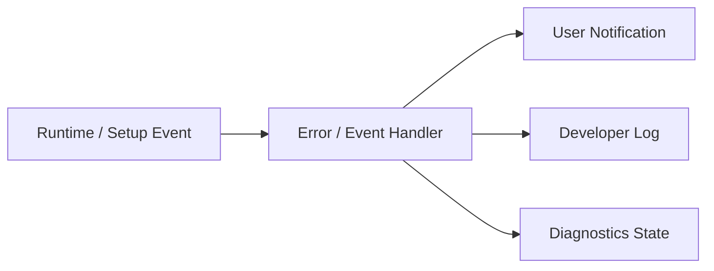
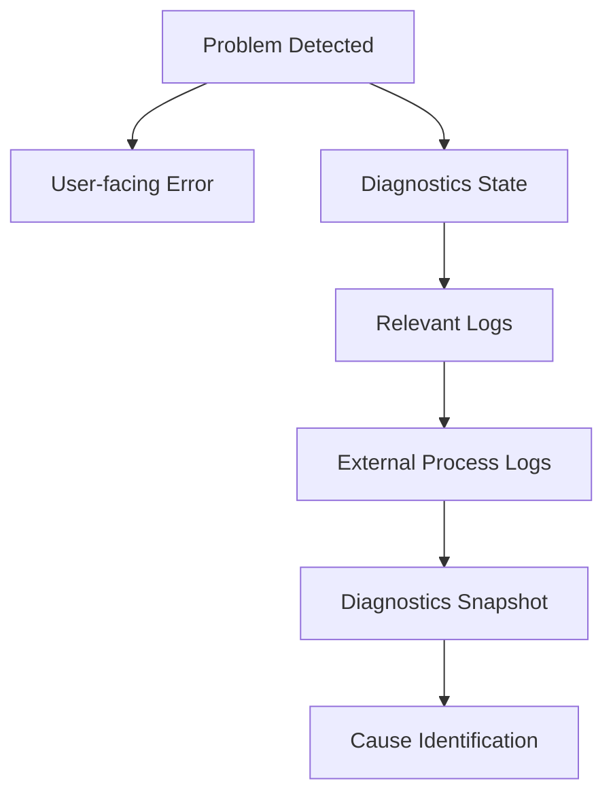

# 5. ログ・診断方式

## 5.1 基本方針

本システムでは、通常利用者向けの状態表示・エラー通知と、開発者向けの詳細ログ・診断情報を分離する。

基本方針を以下とする。

**通常利用者には内部構造を意識させず、開発者には内部状態を十分に観測可能とする。**

通常利用者向けには、

- 現在何が起きているか
- どの機能に影響しているか
- 何を確認・操作すればよいか

を中心に表示する。

一方、開発者向けには、

- Module
- 処理段階
- 設定値
- Version
- Timing
- Process
- External Component
- Exception
- Stack Trace

等を詳細に記録する。

### 採用理由

一般利用者に、

```text
NullReferenceException
CUDA error
HTTP 500
Port 8765 bind failed
```

等の内部情報をそのまま表示しても、問題解決にはつながりにくい。

一方で、OSSとして開発・保守する場合には、単に「失敗しました」という情報だけでは原因を特定できない。

そのため、利用者向け情報と開発者向け情報を別の責務として扱う。

---

## 5.2 ログとユーザー通知の分離

内部で発生した1つの事象について、

- User Notification
- Developer Log

をそれぞれ生成可能な構成とする。

概念的には以下とする。



例えばMicrophone初期化に失敗した場合、通常UIでは、

> マイクを使用できませんでした。  
> 選択した入力デバイスが接続されているか確認してください。

等を表示する。

一方、開発者向けには、

- Device Name
- Device ID
- Sample Rate
- Buffer Size
- Audio Backend
- Exception
- Stack Trace

等を記録する。

### 採用理由

内部ログの構造をそのままUIへ流用すると、内部実装変更によって利用者向け表示まで変化しやすくなる。

通知とログを分離することで、双方をそれぞれの用途に適した形で設計可能とする。

---

## 5.3 ログレベル

ログは少なくとも以下のLevelを持つ。

| Level | 用途 |
|---|---|
| Trace | 非常に詳細な処理追跡 |
| Debug | 開発・デバッグに必要な内部状態 |
| Information | 正常な主要処理の記録 |
| Warning | 処理は継続可能だが注意が必要な状態 |
| Error | 特定処理・機能が失敗した状態 |
| Critical | アプリケーション全体へ重大な影響を与える状態 |

通常運用では、不要なTrace / Debugログを大量出力しない。

Developer Modeや診断設定によって、必要に応じて詳細度を変更可能とする。

### 採用理由

すべての内部情報を常時記録すると、

- Log容量増大
- File I/O増加
- 必要な情報の埋没

等が発生する。

一方、障害再現時には詳細なログが必要となるため、ログレベルを切り替え可能とする。

---

## 5.4 Structured Logging方式

主要ログについては、単純な自由文だけではなく、可能な範囲で構造化された情報を付与する。

概念例：

```text
Timestamp
Level
Module
Category
EventId
SessionId
ProjectId
AvatarId
RunId
Message
Properties
Exception
```

すべての項目が必須という意味ではなく、対象処理に応じて必要なContextを付与する。

例えばVoice LabのTraining処理では、

```text
Module      = VoiceLab
Category    = RvcTraining
RunId       = ...
DatasetId   = ...
RvcVersion  = ...
State       = Training
```

等を記録可能とする。

### 採用理由

自由文だけのログでは、後から特定Run、Avatar、Project等のログを検索しにくい。

Context情報を持たせることで、障害範囲を特定しやすくする。

---

## 5.5 Module別ログ

各主要Moduleは共通Logging機構を利用しつつ、Module名またはCategoryを付与する。

対象例：

- Application
- Project
- Avatar
- Tracking
- Voice
- Audio
- Capture
- Video
- Streaming
- Stage
- VoiceLab
- ExternalComponent
- UI
- Diagnostics

概念例：

```text
[Information][Avatar] Avatar loaded.
[Warning][Tracking] Tracking confidence dropped.
[Error][Streaming] Connection failed.
```

### 採用理由

複数機能が同時に動作するシステムでは、時系列だけではどの機能のログか判断しにくい。

Module単位で分類することで、対象機能だけを絞り込んで確認可能とする。

---

## 5.6 Session単位の識別

アプリケーション起動ごとに、必要に応じてSessionを識別可能とする。

例えばSessionIdを生成し、

- Application Start
- Project Load
- Runtime Start
- Streaming Start
- Application Exit

等を同一Sessionとして追跡可能にする。

### 採用理由

複数回の起動ログが同じFileへ存在する場合、どの起動時に発生した問題か分からなくなる可能性がある。

Session単位で識別可能にすることで、時系列解析を容易にする。

---

## 5.7 処理単位のCorrelation

長時間処理や複数Componentを跨ぐ処理について、必要に応じて共通IDを使用して追跡可能とする。

対象例：

- Project Load
- Avatar Import
- Voice Model Registration
- Training Run
- External Component Setup
- Streaming Session

例えばTraining Runでは13章で定義した`RunId`をそのまま診断Contextとして利用する。

### 採用理由

1つの処理が、

```text
UI
 ↓
Manager
 ↓
Adapter
 ↓
Python Process
 ↓
Artifact Collection
```

等の複数層を通過する場合でも、同一処理としてログを追跡できるようにする。

---

## 5.8 Log出力先

ログは6章で定義したData Rootまたはアプリケーション管理領域内のLogs領域へ保存する。

概念例：

```text
DataRoot/
└─ Logs/
   ├─ Application/
   ├─ VoiceLab/
   ├─ ExternalServices/
   └─ Diagnostics/
```

実際の配置については全体のData Root構成と整合させる。

通常Runtimeログと、特定Training Run等に属するログは必要に応じて分離する。

例えばTraining Run固有ログは、

```text
VoiceLab/
└─ TrainingRuns/
   └─ <RunId>/
      └─ logs/
```

へ保持できる。

### 採用理由

すべてのログを1つの巨大Fileへ集約すると、機能単位・処理単位での調査が困難になる。

用途に応じて保存場所を分離する。

---

## 5.9 External Processログ

Python Serviceや外部OSS等のExternal Processについては、

- stdout
- stderr
- Process Start
- Process Exit
- Exit Code

を取得・保存可能とする。

対象例：

- RVC
- VoxCPM2
- Voice Analysis
- その他将来のExternal Component

通常利用者向けUIにはstdout / stderrを直接表示しない。

Developer Diagnosticsから必要に応じて確認可能とする。

### 採用理由

外部Process内部で発生した障害はUnity側のExceptionだけでは原因を特定できない場合がある。

External Processの標準出力・標準エラーを保持することで、外部OSSの問題も調査可能とする。

---

## 5.10 External Process起動情報

External Process起動時には、必要に応じて以下を記録する。

- Component Name
- Component Version
- Source Version / Commit
- Adapter Version
- Execution Mode（Portable Runtime / Developer venv）
- Runtime Package Version / Build Id
- Python Version
- Runtime Package Path / venv Path
- Process ID
- 起動時刻
- Port
- Working Directory
- Command
- Health Check結果

ただし、Command Line中に秘密情報が含まれる場合はMaskingを行う。

### 採用理由

外部OSS障害では、「どのVersion・どのPython環境で実行されていたか」が原因調査に重要となる。

---

## 5.11 Service状態診断

External Serviceについて、単にProcessが存在するかだけでなく、利用可能な状態か確認可能とする。

状態例：

```text
Not Installed
Stopped
Starting
Ready
Busy
Unhealthy
Failed
```

Health Check APIが存在する場合は、その結果を利用する。

### 採用理由

Processが起動していても、初期化失敗等によって実際には要求を処理できない可能性がある。

Process StateとService Healthを分離して扱う。

---

## 5.12 Runtime診断情報

Developer Diagnosticsでは、主要Runtime Moduleの状態を確認可能とする。

対象例：

### Avatar

- AvatarId
- Model Format
- Loaded State
- Missing Bone
- Missing Expression
- Extension Motion状態

### Tracking

- Provider
- Tracking State
- Tracking FPS
- Confidence
- Lost Parts
- Filtering状態

### Voice

- Input Device
- Sample Rate
- Buffer Size
- Voice Model
- Backend
- Voice Conversion State
- Latency
- Underrun / Overrun

### Capture

- Capture Source種類
- Capture Device / Monitor
- Capture State
- Input Resolution
- Input Frame Rate
- Capture Frame Time
- Dropped / Missed Frame
- GameCapture Audio State
- SubScreenCapture Backend
- Native Plugin / Adapter状態

### Video

- Render Resolution
- Target FPS
- Actual FPS
- Frame Time
- Encoder
- Encode Time
- Dropped Frame

### Streaming

- Connection State
- Bitrate
- Reconnect State
- Queue
- A/V Offset

### Audio

- Output Device
- Mixer State
- Peak
- Clipping
- Routing

### 採用理由

リアルタイムシステムでは、問題が必ずExceptionとして現れるとは限らない。

内部状態を観測可能にすることで、性能劣化や一時的な状態異常を特定しやすくする。

---

## 5.13 性能診断

性能情報については、必要に応じて以下を測定可能とする。

- Main Thread Frame Time
- Render Frame Time
- Tracking Processing Time
- Voice Processing Time
- RVC Inference Time
- Pitch Estimation Time
- Video Encoding Time
- Memory Usage
- GPU Memory Usage
- CPU Usage
- GPU Usage

単純な平均値だけでなく、必要に応じて、

- 現在値
- 平均
- 最大
- Drop回数

等を扱う。

### 採用理由

平均処理時間が正常でも、一時的なSpikeによって音切れやFrame Dropが発生する場合がある。

そのため、瞬間的な性能異常も診断可能な構成とする。

---

## 5.14 音声Pipeline診断

音声変換については、9章で定義したPipeline単位で処理時間を確認可能とする。

対象例：

```text
Audio Input
   ↓
Input Buffer
   ↓
Feature Extraction
   ↓
Pitch Estimation
   ↓
RVC Inference
   ↓
Post Processing
   ↓
Audio Output
```

必要に応じて各段階の処理時間を記録する。

### 採用理由

End-to-End遅延だけでは、どの処理がボトルネックか判断できない。

処理段階ごとのTimingを取得可能にすることで、性能改善箇所を特定しやすくする。

---

## 5.15 Streaming診断

Streamingについては、必要に応じて以下を確認可能とする。

- Publisher State
- Connection State
- Reconnect Count
- Encoder State
- Actual Bitrate
- Dropped Frames
- Encoding Queue
- Network Error
- A/V Offset
- Stream Start Time

### 採用理由

Streaming障害は、

- Rendering
- Encoder
- Network
- 配信先Service

等、複数箇所が原因となり得る。

各段階の状態を分離して観測可能にする。

---

## 5.16 Developer Mode

通常利用では不要な診断機能を表示するため、14章で定義したDeveloper Modeを利用する。

Developer Modeでは例えば以下を利用可能とする。

- 詳細Log Viewer
- Runtime State Viewer
- Performance Metrics
- Diagnostic Camera
- Tracking Visualization
- External Service State
- Version情報
- Developer Actions

Developer ModeをOFFにしていても必要なログ記録自体は行えるものとし、主にUI表示範囲を変更する。

### 採用理由

通常UIへ大量の内部情報を表示すると使いにくくなる。

一方で、開発・障害調査時には即座に内部状態を確認できる必要がある。

---

## 5.17 Diagnostic Camera

10章および14章で定義したDiagnostic CameraをDeveloper Diagnosticsの一部として扱う。

表示可能な内容の例を以下とする。

- Camera Input
- Tracking Landmark
- Skeleton
- Face Landmark
- Avatar
- Tracking Confidence
- Debug Text

必要に応じて入力映像とアバターを同時に確認可能とする。

Diagnostic CameraはStreaming Pipelineへ接続しない。

### 採用理由

例えばアバターの腕が不自然な場合、

- Camera Inputが正しいか
- Tracking結果が正しいか
- Normalizationが正しいか
- Retargetingが正しいか
- Avatar Bone Mappingが正しいか

を視覚的に切り分けやすくする。

また、実写Camera映像が誤って配信されることを構造的に防ぐ。

---

## 5.18 Diagnostic Overlay

必要に応じて、Developer Mode中のみAvatar View等へ診断Overlayを表示可能とする。

対象例：

- Bone Name
- Joint Position
- Tracking Confidence
- Extension Bone
- FPS
- Frame Time

通常Streaming Render TargetへDiagnostic Overlayを含めないことを基本とする。

### 採用理由

診断表示が意図せず配信映像へ混入することを避ける。

---

## 5.19 Log Viewer

Developer / Diagnostics UIから、Application Logを確認可能とする。

必要に応じて以下の絞り込みを提供する。

- Log Level
- Module
- Category
- Session
- Keyword
- RunId等のContext

### 採用理由

ログファイルを外部Editorで毎回開かなくても、アプリケーション上で基本的な障害確認を行えるようにする。

---

## 5.20 Diagnostics Snapshot

障害発生時の状態をまとめた**Diagnostics Snapshot**を生成可能とする。

Snapshotには必要に応じて以下を含める。

- Application Version
- OS
- Unity / Runtime情報
- Project基本情報
- Module状態
- Avatar形式
- Tracking Provider
- Voice Model情報
- Encoder情報
- External Component Version
- Python Version
- Performance Metrics
- Recent Logs
- Exception情報

### 採用理由

問題報告時に利用者へ多数の情報を手作業で確認してもらうことを避ける。

---

## 5.21 診断情報Export

Developer Diagnosticsから、障害報告に必要な情報をまとめてExport可能とする。

概念例：

```text
diagnostics-<timestamp>/
├─ system-info.json
├─ runtime-state.json
├─ versions.json
├─ recent-logs/
└─ errors.json
```

必要に応じてZIP等の単一Packageへまとめる。

### 採用理由

GitHub Issue等で問題を報告する場合、必要な診断情報を簡単に共有可能にするためである。

---

## 5.22 診断情報ExportのPrivacy

Diagnostics Exportへ秘密情報や不要な個人データを含めない。

少なくとも以下は除外またはMaskingする。

- Stream Key
- OAuth Token
- API Key
- Password
- Credential
- Microphone音声
- Voice Dataset本体
- Camera画像・映像
- その他秘密情報

Pathにユーザー名等が含まれる場合は、必要に応じてMaskingする。

### 採用理由

診断PackageはGitHub Issue等へ公開される可能性がある。

利用者が内容を細かく確認しなくても安全に共有しやすい構成とする。

---

## 5.23 Logへの秘密情報出力禁止

秘密情報については、Debug Levelを含めてLogへ出力しない。

特に以下を禁止する。

```text
Stream Key = xxxx
OAuth Token = xxxx
Authorization: Bearer xxxx
Password = xxxx
```

必要な場合でも、

```text
Stream Key = ********
```

等のMasking済み情報のみを表示する。

### 採用理由

Log Fileは障害調査やIssue報告で外部へ共有される可能性がある。

「Developer Logだから秘密情報を出してよい」とはしない。

---

## 5.24 ファイルPathの扱い

開発者向けLogには障害調査のためFile Pathが必要となる場合がある。

ただし、

- 診断Export
- 外部共有用Log

については個人識別情報を含むPathを必要に応じて正規化・Masking可能とする。

例：

```text
C:\Users\UserName\...
```

を、

```text
%USERPROFILE%\...
```

等として扱うことを検討する。

### 採用理由

File Path自体にユーザー名等の個人情報が含まれる場合があるためである。

---

## 5.25 Log Rotation

Log Fileが無制限に増加しないようにする。

少なくとも以下のいずれかまたは組み合わせを利用する。

- File SizeによるRotation
- 日付によるRotation
- 保持世代数
- 保存期間
- 古いLogの自動削除

### 採用理由

長期間利用するアプリケーションでは、LogだけでStorageを圧迫する可能性がある。

---

## 5.26 高頻度ログの制御

Frame単位、Audio Buffer単位等の高頻度処理では、通常運用中に毎回Log出力しない。

例えばTracking Confidence等は、

- State変化時のみ
- 一定間隔
- Developer Trace時のみ

等の方式で記録する。

### 採用理由

毎Frame File I/Oを発生させると、Performanceへ影響するだけでなく、重要ログが大量の情報に埋もれる。

---

## 5.27 同一エラーの抑制

短時間に同一Errorが大量発生する場合、必要に応じて重複Logを抑制する。

例えば、

```text
Camera frame unavailable.
Camera frame unavailable.
Camera frame unavailable.
...
```

を無制限に記録するのではなく、

```text
Camera frame unavailable. repeated 128 times.
```

等として扱える構成を検討する。

### 採用理由

Root Causeとなる最初のErrorが大量の重複ログによって埋もれることを防ぐ。

---

## 5.28 起動・終了ログ

ApplicationのLifecycleについて、少なくとも以下を記録する。

### 起動時

- Application Version
- Build情報
- OS
- Graphics Device
- Audio Device
- Data Root
- Developer Mode
- 起動時刻

### 終了時

- 正常終了
- 終了時刻
- 必要に応じたResource Cleanup結果

異常終了の場合は、次回起動時に前回Sessionが正常終了しなかったことを識別できる方式を検討する。

### 採用理由

障害発生時に、環境情報およびApplication Lifecycleを確認可能にする。

---

## 5.29 Version情報

Diagnosticsから、システムを構成する主要ComponentのVersionを確認可能とする。

対象例：

- Application Version
- Unity Version
- Avatar Library
- MediaPipe関連Version
- RVC Version / Commit
- VoxCPM2 Version / Commit
- Voice Analysis Version
- Adapter Version
- Python Version
- PyTorch Version
- CUDA Version

### 採用理由

同じコードに見えても、External Component Versionの差によって挙動が異なる可能性がある。

Version情報は障害再現に重要である。

---

## 5.30 Configuration診断

必要に応じて現在利用している設定の概要をDiagnosticsから確認可能とする。

ただし秘密情報は除外する。

対象例：

- ProjectId
- ProfileId
- AvatarId
- Tracking Provider
- Voice Model
- Stage
- Encoder
- Resolution
- Sample Rate

### 採用理由

「どの設定で問題が発生したか」をログだけでなく現在状態からも確認できるようにする。

---

## 5.31 起動時Validationとの連携

起動時またはProject Load時に検出した、

- Missing Asset
- Invalid Profile
- Unsupported Version
- Missing External Component
- Invalid Credential Reference

等をDiagnosticsへ記録する。

通常利用者には、利用に必要な内容だけを簡潔に通知する。

### 採用理由

Validation Errorは実際のRuntime Errorになる前の重要な診断情報である。

---

## 5.32 Error Recoveryログ

自動復旧処理についても結果を記録する。

例えばStreamingの場合、

```text
Connection lost.
Reconnect attempt 1 started.
Reconnect attempt 1 failed.
Reconnect attempt 2 started.
Connection restored.
```

等を追跡可能とする。

対象例：

- Streaming Reconnect
- Device Reinitialize
- Tracking Provider Restart
- External Service Restart
- Voice Model Reload

### 採用理由

最終的に復旧した場合でも、その直前に何が発生していたかを後から確認可能にする。

---

## 5.33 User Actionログ

障害解析に必要な主要操作については、必要に応じてInformation Levelで記録する。

対象例：

- Project切り替え
- Avatar切り替え
- Stage切り替え
- Voice Model切り替え
- Streaming開始・終了
- Recording開始・終了
- External Service起動

ただし、Keyboard入力やText入力内容等を無差別に記録しない。

### 採用理由

障害直前にどの操作が行われたか分かることで、再現条件を特定しやすくなる。

一方で不要なユーザー入力を記録しないことでPrivacyを保護する。

---

## 5.34 開発者向け診断操作

Developer Modeでは、必要に応じて診断用操作を提供可能とする。

例：

- Tracking Provider再初期化
- External Service再起動
- Voice Model再読み込み
- Diagnostics Snapshot取得
- Log Directoryを開く
- Performance Counter Reset

ただし、通常利用者が誤って操作しないようDeveloper UIへ限定する。

### 採用理由

障害調査のたびにApplication全体を再起動する必要を減らす。

---

## 5.35 診断機能のRuntime影響抑制

診断機能そのものによってRuntime性能が大幅に変化しないようにする。

特に、

- 高頻度Trace Log
- Tracking Overlay
- Performance Sampling
- Diagnostic Camera

等については、必要時のみ有効化する。

### 採用理由

診断機能を有効にしたことで現象が消える、または逆に性能問題が発生する状態を可能な限り避ける。

---

## 5.36 障害調査フロー

障害発生時の基本的な調査フローを以下とする。



すべての障害で必ずこの順序を要求するものではないが、調査経路を一定化する。

### 採用理由

Moduleごとに異なる調査方法を取ると、OSS開発者が障害調査方法を把握しにくい。

共通の診断経路を用意する。

---

## 5.37 Claude Codeによるログ・診断実装

Claude Codeが新しい機能を実装する場合、正常系処理だけでなくログ・診断についても実装対象とする。

少なくとも以下を確認する。

- 適切なModule / CategoryでLogを出しているか
- Error時に十分なContextがあるか
- User NotificationとDeveloper Logを分離しているか
- Secretを出力していないか
- 外部Processの場合stdout / stderrを取得しているか
- Runtime状態をDiagnosticsから観測可能か
- 高頻度処理で過剰Logを出していないか

これらの規則は`CLAUDE.md`等へ記載する。

### 採用理由

新機能追加時にDiagnosticsを後回しにすると、障害が発生して初めて調査手段が不足していることに気付きやすい。

Logging / Diagnosticsも機能実装の一部として扱う。

---

## 5.38 内部責務分割

概念的には以下の構成を想定する。

```text
Diagnostics/
├─ Logging/
│  ├─ Logger
│  ├─ LogEntry
│  ├─ LogContext
│  ├─ LogWriter
│  └─ LogRotation
│
├─ Runtime/
│  ├─ RuntimeDiagnostics
│  ├─ ModuleDiagnostics
│  └─ PerformanceMetrics
│
├─ External/
│  ├─ ProcessLogCollector
│  ├─ ServiceHealthMonitor
│  └─ VersionCollector
│
├─ Snapshot/
│  ├─ DiagnosticsSnapshot
│  └─ DiagnosticsExporter
│
├─ Privacy/
│  ├─ SecretMasker
│  └─ DiagnosticsSanitizer
│
└─ UI/
   └─ DiagnosticsController
```

### 採用理由

Logging、Runtime Monitoring、External Process、Export、Privacy処理を分離することで、単一の巨大なDiagnostics Managerへ責務が集中することを防ぐ。

---

## 5.39 ログ・診断方式の基本原則

本システムでは、ログ・診断について以下を基本原則とする。

1. 通常利用者向け通知とDeveloper Logを分離する。
2. 利用者には内部実装ではなく、影響と対処方法を示す。
3. 開発者向けには障害解析可能なContextを十分に残す。
4. Log Levelを用途に応じて使い分ける。
5. Module / Category単位でログを識別可能とする。
6. 必要に応じてSessionやRun等のCorrelation情報を付与する。
7. External Processのstdout / stderrを取得可能とする。
8. External ComponentのVersionおよび実行環境を記録可能とする。
9. Process StateとService Healthを区別する。
10. Runtime状態およびPerformanceをDeveloper Diagnosticsから観測可能とする。
11. Diagnostic CameraをStreaming Pipelineから構造的に分離する。
12. 診断Overlayを通常配信映像へ含めない。
13. 障害報告用Diagnostics Exportを生成可能とする。
14. Secret情報をLogおよびDiagnostics Exportへ出力しない。
15. 必要に応じて個人情報を含むPathをMaskingする。
16. Logを無制限に保存しない。
17. 高頻度処理では過剰なLog出力を避ける。
18. 同一Errorの大量出力を必要に応じて抑制する。
19. Application VersionおよびExternal Component Versionを確認可能とする。
20. Recovery処理についても履歴を残す。
21. 診断機能自体によるRuntime性能への影響を抑える。
22. Logging / Diagnosticsを各機能実装の一部として扱う。
23. Claude Codeによる実装時もLogging・DiagnosticsをReview対象とする。
