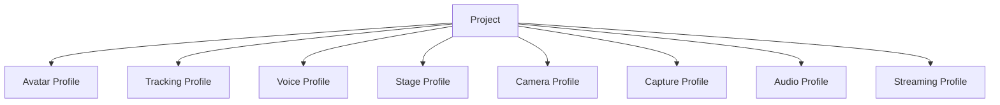

# 6. Project・設定・データ管理方式

## 6.1 基本方針

本システムでは、配信に必要な複数の設定を個別に管理するだけでなく、関連する設定をまとめた**Project**という単位を設ける。

Projectは、特定の配信構成を再現するために必要な情報をまとめて保持する。

例えば以下を関連付ける。

- Avatar
- Tracking設定
- Voice Model
- Voice設定
- Stage
- Camera設定
- Capture設定
- BGM / SE設定
- Streaming設定
- Audio Routing
- その他配信固有設定

概念的には以下の構成とする。

```text
Project
├─ Avatar
├─ Tracking Profile
├─ Voice Profile
├─ Stage
├─ Camera Profile
├─ Capture Profile
├─ Audio Profile
└─ Streaming Profile
```

### 採用理由

各機能の設定を完全に独立して管理すると、配信開始時に毎回、

- アバターを選択する
- 音声モデルを選択する
- ステージを選択する
- カメラを設定する
- 音量を調整する
- 配信設定を選択する

といった作業が必要となる。

Projectとして一括管理することで、過去の配信構成を簡単に再現できるようにする。

---

## 6.2 ProjectとProfileの分離

Projectは、各機能の設定値をすべて直接保持するのではなく、原則として各機能が管理するProfileを参照する。

概念的には以下の関係とする。



### 採用理由

Project内部へすべての設定値をコピーすると、同じ設定を複数Projectで利用した場合に重複が発生する。

例えば同じTracking Profileを複数Projectで利用している場合、Tracking設定を変更するたびに複数Projectを更新する必要が生じる。

そのため、

**各機能固有の再利用可能な設定はProfile**

**Profileの組み合わせをProject**

として扱う。

---

## 6.3 Profile管理方式

各機能は、その機能固有の設定をProfileとして管理可能とする。

初期段階では以下を想定する。

| Profile | 主な設定 |
|---|---|
| Avatar Profile | ボーン、表情、体格補正等 |
| Tracking Profile | Provider、カメラ、平滑化、キャリブレーション等 |
| Voice Profile | Voice Model、Pitch、後処理等 |
| Camera Profile | Camera Point、FOV、切り替え設定等 |
| Capture Profile | GameCapture Device、SubScreen Monitor、Capture Source設定等 |
| Audio Profile | Bus音量、Routing、Effect等 |
| Streaming Profile | 解像度、FPS、Encoder、Bitrate等 |

Stageについては、Stage自身にStage Profile相当の情報を持たせてもよい。

### 採用理由

機能ごとに設定のライフサイクルが異なるためである。

例えばTracking設定だけを変更したい場合に、Project全体を作り直す必要がない構成とする。

---

## 6.4 Projectデータ構成

Projectには少なくとも以下の情報を保持する。

```text
Project
├─ ProjectId
├─ DisplayName
├─ CreatedAt
├─ UpdatedAt
├─ AvatarId
├─ TrackingProfileId
├─ VoiceProfileId
├─ StageId
├─ CameraProfileId
├─ CaptureProfileId
├─ AudioProfileId
├─ StreamingProfileId
└─ Project-specific Settings
```

Project固有でのみ必要な設定については、Project自身に保持可能とする。

### 採用理由

すべてをProfileへ分離すると、Projectにしか意味を持たない設定までProfileとして管理する必要があり、かえって管理構造が複雑になる。

そのため、

- 再利用したい設定 → Profile
- そのProjectだけで意味を持つ設定 → Project

として分ける。

---

## 6.5 設定データ保存形式

ProjectやProfile等の設定データについては、人間および開発者が内容を確認しやすいテキスト形式を基本とする。

初期実装ではJSONを基本形式とする。

SQLiteは、13章のTraining Run履歴等、検索・履歴管理が重要なデータに使用する。

### 採用理由

すべての設定をSQLiteへ格納すると、利用者や開発者が設定内容を直接確認しにくくなる。

一方、履歴や大量レコードの検索にはDBが適している。

そのため、

**設定・構成情報はJSON等のファイル**

**履歴・検索性が重要な情報はSQLite**

という役割分担とする。

---

## 6.6 IDによる参照方式

Projectや各Profile間の関連付けには、表示名やファイルパスではなく、一意なIDを使用する。

例：

```text
Project
  AvatarId = avatar_001
  VoiceProfileId = voice_profile_003
  StageId = stage_room_001
```

表示名は利用者向け情報として別に保持する。

### 採用理由

表示名はユーザーが変更する可能性がある。

また、ファイルパスを直接参照すると、保存場所変更によって設定が壊れる可能性がある。

そのため、内部参照には安定したIDを使用する。

---

## 6.7 データ保存領域の基本方針

本システムのデータは、用途に応じて大きく以下の3種類に分けて保存する。

1. **アプリケーション基本設定**
2. **ユーザーデータ・Project・Asset**
3. **秘密情報**

それぞれ保存先を分離する。

### 採用理由

設定、ユーザーデータ、秘密情報では、

- 更新頻度
- サイズ
- 可搬性
- セキュリティ要件
- バックアップ方法

が異なる。

すべてを同一フォルダや同一ファイル形式で扱わず、役割に応じて分離する。

---

## 6.8 アプリケーション基本設定の保存方式

アプリケーション起動に必要な小規模設定については、OS標準のユーザーデータ領域へ保存する。

Windowsを主対象とする場合、初期配置先として以下を想定する。

```text
%LOCALAPPDATA%/
└─ VirtualVesselStudio/
   ├─ bootstrap.json
   └─ Config/
      ├─ app-settings.json
      └─ ui-settings.json
```

対象例：

- Data Rootの保存先
- UI設定
- Developer Mode
- 既定デバイス
- アプリケーション全体設定

### 採用理由

アプリケーション実行ファイルと同じ場所や`Program Files`配下へユーザー設定を保存すると、

- 書き込み権限
- アプリ更新
- 再インストール
- バージョン差し替え

等の影響を受けやすい。

そのため、OS標準のユーザーデータ領域を利用する。

---

## 6.9 Data Root方式

Project、Avatar、Stage、Voice Model、Dataset等のユーザーデータについては、**Data Root**と呼ぶ専用の管理領域へ保存する。

初期値は例えば以下とする。

```text
%LOCALAPPDATA%\VirtualVesselStudio\Data
```

ただし、Data Rootはユーザーが変更可能とする。

例：

```text
D:\VirtualVesselStudioData
```

Data Rootの実際の場所は、OS標準領域に配置した`bootstrap.json`等から参照する。

概念的には以下とする。

```text
%LOCALAPPDATA%\VirtualVesselStudio\
        ↓
bootstrap.json
        ↓
Data Root
        ↓
D:\VirtualVesselStudioData
```

### 採用理由

Avatar、Stage、Voice Model、Dataset、Training Run、録画データ等は容量が大きくなる可能性がある。

これらを常に`%LOCALAPPDATA%`へ保存すると、システムドライブ容量を圧迫する可能性がある。

そのため、小規模な起動設定だけをOS標準領域へ残し、大容量データについては保存先を変更可能とする。

---

## 6.10 Data Root内部構成

Data Rootは概念的に以下のように構成する。

```text
DataRoot/
├─ Projects/
│  └─ <ProjectId>/
│     └─ project.json
│
├─ Profiles/
│  ├─ Tracking/
│  ├─ Voice/
│  ├─ Camera/
│  ├─ Capture/
│  ├─ Audio/
│  └─ Streaming/
│
├─ Avatars/
│  └─ <AvatarId>/
│     ├─ model.vrm
│     ├─ avatar-profile.json
│     └─ thumbnail.png
│
├─ Stages/
│
├─ VoiceModels/
│
├─ Audio/
│  ├─ BGM/
│  └─ SE/
│
├─ VoiceLab/
│  ├─ voice-lab.db
│  ├─ Datasets/
│  ├─ TrainingRuns/
│  └─ Models/
│
├─ Cache/
└─ Logs/
```

RVC、VoxCPM2等の外部OSSについては、13章で定義したExternal管理領域として別途管理する。

### 採用理由

用途別にディレクトリを分離することで、

- バックアップ
- 障害調査
- データ削除
- Import / Export
- 容量確認

を行いやすくする。

---

## 6.11 AssetとProfileの配置方針

特定Assetに強く紐付くProfileについては、そのAssetと同じ管理領域へ配置可能とする。

例えばAvatar Profileは、

```text
Avatars/
└─ <AvatarId>/
   ├─ model.vrm
   ├─ avatar-profile.json
   └─ thumbnail.png
```

のように保存する。

一方、複数AssetやProjectから再利用されるProfileについては、

```text
Profiles/
├─ Tracking/
├─ Voice/
├─ Camera/
├─ Audio/
└─ Streaming/
```

等の共通領域へ保存する。

### 採用理由

すべてのProfileを一律に同じ場所へ配置すると、特定Asset専用設定と再利用可能設定の区別が分かりにくくなる。

そのため、

**Asset固有設定はAssetと同じ場所**

**再利用可能設定は共通Profile領域**

とする。

---

## 6.12 アプリケーション管理領域への取り込み

本システムへ登録されたAssetは、原則としてData Root配下へコピーして管理する。

対象例：

- Avatar Model
- Stage
- Voice Model
- BGM
- SE
- Dataset
- Training Run成果物

元ファイルへのパスは必要に応じてメタデータとして保持してもよいが、Runtime時の必須参照先とはしない。

### 採用理由

外部ファイルへの参照のみを保存すると、元ファイルの移動、名称変更、削除等によってProjectを再現できなくなる可能性がある。

本システム管理領域へ取り込むことで、登録後は本システム内だけでデータを完結して管理できる。

---

## 6.13 秘密情報管理方式

以下のような秘密情報は、ProjectやProfileの通常JSONへ直接保存しない。

- YouTube Stream Key
- OAuth Token
- API Key
- その他認証情報

秘密情報は、OSが提供するCredential Store等の安全な保存方式を利用する。

ProjectやStreaming Profileからは、必要に応じてCredential IDを参照する。

```text
Streaming Profile
        ↓
CredentialId
        ↓
OS Credential Store
```

### 採用理由

ProjectやProfileは、

- バックアップ
- Import / Export
- GitHub Issue
- ユーザー間共有

等によって外部へ持ち出される可能性がある。

秘密情報を同じファイルへ保存すると、意図せず外部へ流出する危険があるためである。

---

## 6.14 設定スキーマバージョン管理

ProjectやProfileには設定形式のSchema Versionを持たせる。

例：

```json
{
  "schemaVersion": 3,
  "projectId": "project_001"
}
```

アプリケーション更新によって設定構造が変更された場合、旧設定から新設定へ変換可能とする。

### 採用理由

OSSとして継続的にアップデートする場合、設定項目やデータ構造が変更される可能性が高い。

Schema Versionを明示することで、旧データの形式を判別できるようにする。

---

## 6.15 Migration方式

設定スキーマ変更時には、旧形式から新形式へのMigration処理を提供する。

概念的には以下の流れとする。

```text
Load Data
    ↓
Check Schema Version
    ↓
Old Version?
    ├─ No → Load
    │
    └─ Yes
         ↓
      Migration
         ↓
      Validation
         ↓
        Load
```

Migrationは可能な限り段階的に行う。

```text
v1 → v2 → v3
```

### 採用理由

各旧Versionから最新版への専用変換処理をすべて用意すると、Version増加に伴ってMigration処理が増大する。

段階的Migrationにより管理を単純化する。

---

## 6.16 データ検証方式

ProjectやProfile読み込み時には、設定値および参照先を検証する。

対象例：

- AvatarIdが存在するか
- StageIdが存在するか
- Voice Modelが存在するか
- Profile形式が正しいか
- 必須項目が存在するか
- Schema Versionが対応しているか
- Credential参照が有効か

不正な設定をそのままRuntimeへ渡さない。

### 採用理由

設定ファイルは、

- アプリ更新
- 手動編集
- ファイル破損
- Import
- Asset削除

等によって不整合が発生する可能性がある。

Runtime開始後にエラーとなるより、読み込み段階で問題を検出した方が原因を明確に提示できる。

---

## 6.17 Project読み込み方式

Project読み込み時には、関連するProfileやAssetを解決し、Runtimeへ適用する。

```text
Project Load
    ↓
Project Validation
    ↓
Profile Resolution
    ↓
Asset Validation
    ↓
Runtime Configuration
    ↓
Avatar / Tracking / Voice / Stage / Camera / Audio
```

個々の設定適用は各Moduleへ委譲する。

### 採用理由

Project Manager自身がAvatar、Tracking、Voice等の内部実装を直接操作すると、Project管理機能が全Moduleへ強く依存する。

Project Managerは、

**何を利用するかを解決する**

ところまでを担当し、

**どう適用するか**

については各Moduleへ任せる。

---

## 6.18 Project切り替え方式

配信中のProject切り替えについては、すべてを無条件に一括再初期化する方式とはしない。

Projectを構成する設定を、

- Runtime中に安全に変更可能なもの
- 再初期化を必要とするもの

に分類し、必要な処理を順序立てて適用する。

例：

- Avatar切り替え
- Stage切り替え
- Voice Model切り替え
- Camera設定変更
- Audio設定変更

### 採用理由

Project変更によってStreaming Encoder等まで不用意に再初期化すると、配信停止につながる可能性がある。

そのため、各Moduleで定義された安全なRuntime変更方式を利用する。

---

## 6.19 自動保存方式

Setup画面等で設定を変更した場合、必要に応じて自動保存を利用可能とする。

ただし、すべての編集操作を即座に確定データとして保存するのではなく、

- 編集中状態
- 確定済み状態

を分離可能とする。

### 採用理由

すべてを即時保存すると、試行中の設定や誤操作まで永続化される可能性がある。

一方、明示的な保存のみでは異常終了時に変更内容が失われる可能性がある。

そのため、対象機能に応じて自動保存と確定保存を使い分ける。

---

## 6.20 バックアップ方式

Project、Profile、SQLite DB等の重要データについて、バックアップ可能な構成とする。

主な保護対象は以下とする。

- Projects
- Profiles
- Avatar Profile
- Voice Model情報
- Voice Lab SQLite DB
- その他再作成コストの高い設定

必要に応じて世代バックアップを行える構成とする。

### 採用理由

Project設定や学習履歴には、再作成に時間がかかる情報が含まれる。

ファイル破損やMigration失敗によってすべて失われることを防ぐ。

---

## 6.21 Import / Export方式

Projectおよび関連データについて、Import / Export可能な構成とする。

Exportでは必要に応じて以下をまとめられるようにする。

- Project
- Profile
- Avatar
- Voice Model
- Stage
- Audio素材

秘密情報はExport対象から除外する。

対象外例：

- YouTube Stream Key
- OAuth Token
- API Key

### 採用理由

Projectを別PCへ移行したり、バックアップしたりする需要が想定される。

一方で認証情報まで同梱すると、意図せず秘密情報が共有される可能性がある。

そのため、可搬データと秘密情報を分離する。

---

## 6.22 Project削除方式

Projectを削除しても、参照しているAvatar、Voice Model、Stage等を自動削除しないことを基本とする。

### 採用理由

同一AssetやProfileが複数Projectから参照されている可能性がある。

Project削除時にAssetまで削除すると、他Projectが使用不能になる可能性がある。

---

## 6.23 Asset削除方式

Avatar、Voice Model、Stage等を削除する場合は、そのAssetを参照しているProjectやProfileを確認する。

参照されている場合は、利用者へ影響範囲を通知する。

### 採用理由

参照関係を確認せずAssetを削除すると、既存Projectが不完全な状態になるためである。

---

## 6.24 Cache管理方式

再生成可能な一時データについてはCache領域へ保存する。

対象例：

- サムネイル一時データ
- 一時変換ファイル
- Preview用データ
- 一時解析結果

Cacheは必要に応じて削除・再生成可能とする。

### 採用理由

永続データと一時データを混在させると、バックアップ対象や削除可否が分かりにくくなる。

再生成可能なデータをCacheへ分離することで、容量管理を容易にする。

---

## 6.25 Logs管理方式

アプリケーションログについては、ユーザーデータとは分離したLogs領域へ保存する。

ログの詳細方式についてはログ・診断方式の章で定義する。

### 採用理由

ProjectやAssetのバックアップ時に大量のログまで含まれることを避ける。

また、障害調査時にログを一箇所から取得しやすくする。

---

## 6.26 Data Root変更方式

ユーザーはData Rootを変更可能とする。

変更時には、既存データを新しいData Rootへ移行するか、空のData Rootとして使用するかを選択可能な構成を検討する。

移行時には、コピー完了およびデータ整合性を確認してから、新Data Rootを有効化する。

### 採用理由

単にData Root設定だけを変更すると、既存ProjectやAssetが見つからなくなる可能性がある。

そのため、保存先変更とデータ移行を明確に区別し、安全に切り替えられる構成とする。

---

## 6.27 SetupとRuntimeの分離

### Setup

以下を扱う。

- Project作成
- Project編集
- Profile作成・編集
- Asset登録
- Data Root設定
- Import / Export
- Backup
- Migration
- データ管理

### Runtime

以下を扱う。

- Project読み込み
- Profile解決
- Runtimeへの設定適用
- 安全な設定切り替え
- Runtime状態保持

### 採用理由

ファイル操作、Migration、データ移行等の処理をリアルタイムRuntimeから分離し、配信処理へ影響させないためである。

---

## 6.28 エラー処理・診断方式

通常利用者には例えば以下を表示する。

- Projectを読み込めません
- 必要なアバターが見つかりません
- 音声モデルが見つかりません
- Data Rootへアクセスできません
- 設定データが古いため更新します
- 設定ファイルが壊れています
- データ移行に失敗しました

Developer Diagnosticsでは必要に応じて以下を記録する。

- ProjectId
- ProfileId
- AssetId
- Schema Version
- Migration Version
- Data Root
- Data Path
- Missing Reference
- Validation Result
- Migration Result
- Exception
- Stack Trace

秘密情報は出力しない。

### 採用理由

Project読み込みやデータ移行のエラーは、複数Module、Profile、Asset、ファイルシステム等の参照関係から発生する可能性がある。

通常利用者には復旧に必要な情報を提示し、開発者にはどの処理で問題が発生したか追跡可能な情報を提供する。

---

## 6.29 内部責務分割

概念的には以下の構成を想定する。

```text
DataManagement/
├─ Bootstrap/
│  ├─ BootstrapSettings
│  └─ DataRootResolver
│
├─ Project/
│  ├─ ProjectProfile
│  ├─ ProjectManager
│  └─ ProjectValidator
│
├─ Profiles/
│  ├─ ProfileRepository
│  └─ ProfileResolver
│
├─ Assets/
│  ├─ AssetManager
│  └─ AssetRegistry
│
├─ Serialization/
│  └─ JsonSerializer
│
├─ Migration/
│  └─ DataMigrationManager
│
├─ Backup/
│  └─ BackupManager
│
├─ Transfer/
│  ├─ ImportManager
│  └─ ExportManager
│
├─ Credentials/
│  └─ CredentialStore
│
├─ Cache/
│  └─ CacheManager
│
└─ Runtime/
   └─ ProjectRuntimeLoader
```

### 採用理由

Project管理、Profile管理、Asset管理、Data Root、Migration、Import / Export等を単一クラスへ集約すると、データ構造変更時の影響範囲が大きくなる。

責務ごとに分離することで、

- Profile追加
- 新しいAsset追加
- Schema変更
- Data Root変更
- Migration追加
- Import / Export拡張

等を独立して行いやすくする。

---

## 6.30 データ管理の基本原則

本システムでは、Project・設定・データ管理について以下を基本原則とする。

1. 配信構成はProject単位で管理する。
2. 再利用可能な機能設定はProfileとしてProjectから分離する。
3. 内部参照には表示名やファイルパスではなく一意なIDを使用する。
4. 登録Assetは原則として本システム管理領域へ取り込む。
5. アプリケーション基本設定はOS標準のユーザーデータ領域へ保存する。
6. 大容量ユーザーデータは変更可能なData Rootへ保存する。
7. Data Rootの場所はbootstrap設定から解決する。
8. 秘密情報はProjectやProfileとは分離し、OS Credential Store等へ保存する。
9. 設定データにはSchema Versionを持たせる。
10. 旧データはMigrationによって新形式へ変換可能とする。
11. Runtimeへ適用する前に設定および参照先を検証する。
12. 大容量AssetをSQLiteへ格納しない。
13. 履歴管理等、DBが適した情報にはSQLiteを使用する。
14. Project削除とAsset削除を別操作として扱う。
15. Import / Export時には秘密情報を含めない。
16. Cacheと永続データを分離する。
17. 配信中のProject変更は各Moduleの安全な変更方式を利用する。
18. Data Root変更時には既存データの整合性を確認してから切り替える。
