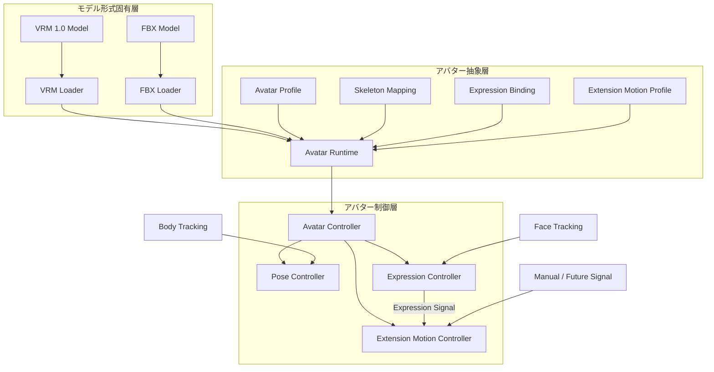
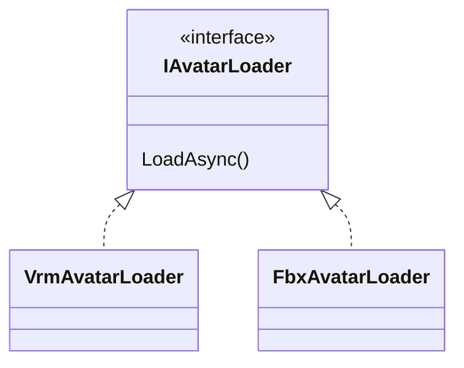
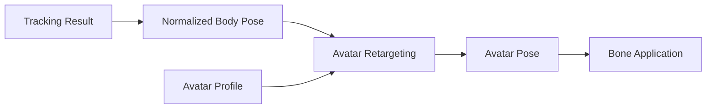
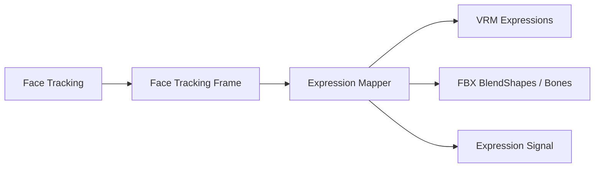
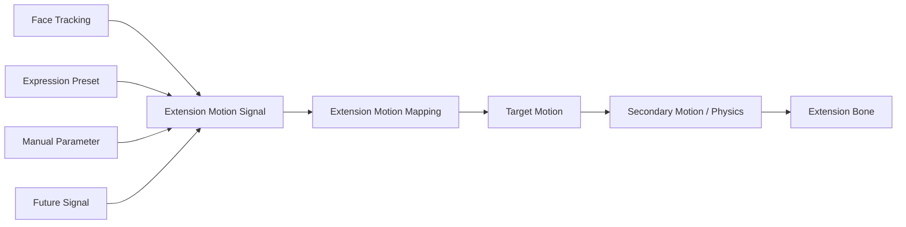
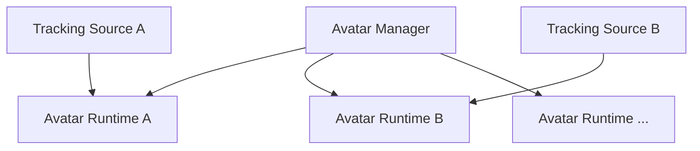

# 7. 3Dアバター制御方式

## 7.1 目的

3Dアバター制御機能では、VTuberとして使用する3Dモデルの読み込み、登録、切り替え、姿勢制御、表情制御、拡張ボーン制御、およびモデル固有設定の管理を行う。

本機能では、VRMやFBX等のモデル形式固有の情報を、トラッキング機能やアプリケーションの他機能から直接扱わない構成とする。

モデル形式とアバター制御処理の間に**アバター抽象層**を設け、VRM、FBXおよび将来追加されるモデル形式を、上位機能から可能な限り同一の方法で扱える構成とする。

また、Humanoid標準骨格に含まれない猫耳、尻尾等についても、拡張ボーンとしてモデル形式から独立して扱う。

初期機能として猫耳および尻尾の表情連動動作を提供し、動作内容はユーザーが変更可能とする。

さらに、猫耳・尻尾以外の任意の拡張要素についても、ユーザーが対象ボーンと動作条件を登録することで追加可能な構成とする。

### 採用理由

3Dモデル形式ごとにボーン取得方法、表情制御方法、メタデータ構造等が異なる。

これらの違いをTracking ModuleやUI等まで露出させると、モデル形式を追加するたびに複数機能を修正する必要が生じる。

そのため、モデル形式固有処理を限定された領域へ閉じ込め、その上に共通のアバター表現を設ける。

また、猫耳や尻尾等をモデルごとの専用コードとして実装すると、新しいモデルや拡張要素を追加するたびにプログラム修正が必要となる。

そのため、拡張ボーンについても共通の制御方式を設ける。

これにより、モデル形式、標準人体骨格、拡張要素の違いによる変更範囲を小さくし、システム全体の保守性と拡張性を確保する。

---

## 7.2 アバター制御アーキテクチャ

3Dアバター制御は、大きく以下の3層に分離する。



図中の矢印は、クラス継承そのものを意味するものではなく、主として以下を表す。

- データの変換
- 情報の受け渡し
- 制御要求の流れ

### モデル形式固有層

VRM、FBX等のモデルファイルを読み込み、モデル形式固有の情報を解釈する。

VRM固有APIやFBX固有APIは、原則としてこの層に閉じ込める。

### アバター抽象層

モデル形式の違いを吸収し、上位の制御処理から同一のアバターとして扱えるようにする。

標準人体ボーン、拡張ボーン、表情、拡張ボーン動作設定、モデル設定等を、本システム共通の形式として提供する。

### アバター制御層

トラッキング結果等を受け取り、抽象化されたアバターへ姿勢、表情および拡張ボーン動作を適用する。

VRMやFBXの具体的な内部構造については認識しない。

### 採用理由

モデル読み込み処理とアバター制御処理を直接接続すると、例えばVRM用の制御処理とFBX用の制御処理がそれぞれ必要となり、モデル形式の数に応じて処理が増加する。

そこで、

**形式固有処理 → 共通表現 → 制御**

という境界を設ける。

これにより、

- VRMライブラリを変更する
- FBX対応方法を変更する
- 新しい3Dモデル形式を追加する
- 新しい拡張ボーン制御を追加する

といった変更が発生しても、他のアバター制御処理への影響を抑えられる。

また、各層の責務を明確にすることで、障害発生時に「読み込み処理」「マッピング処理」「姿勢制御」「表情制御」「拡張ボーン制御」のどこで問題が発生したかを切り分けやすくする。

---

### Avatar Runtime

`Avatar Runtime`は、読み込まれた3Dモデルを本システム上で実際に制御するための実行時アバター表現である。

Unity上に生成されたGameObjectだけを意味するものではなく、

- 読み込まれたモデル
- 標準ボーンへの参照
- 拡張ボーンへの参照
- 表情への参照
- Avatar Profile
- Extension Motion設定
- 現在のアバター状態

等をまとめて扱う。

基本的に、1体の読み込まれたアバターに対して1つのAvatar Runtimeを生成する。

### 採用理由

UnityのGameObjectだけをアバターとして扱うと、ボーンマッピング、表情設定、拡張ボーン設定、モデル固有設定等が別々の場所で管理されやすくなる。

これらを実行時の1つの単位としてまとめることで、

**「現在このアバターを制御するために必要な情報」**

を一箇所から取得できるようにする。

また、将来的に複数アバターを同時に扱う場合でも、Avatar Runtimeを複数生成することで対応できるため、システム全体で唯一のAvatarを前提とせずに済む。

---

### Avatar Profile

`Avatar Profile`は、モデルファイルそのものではなく、

**そのモデルを本システム上でどのように利用するか**

を表す永続設定である。

例えば以下を保持する。

- ボーンマッピングに関する補足設定
- 拡張ボーン登録情報
- 表情マッピング
- Extension Motion Profileへの参照
- モデルのスケール
- 初期位置
- 初期回転
- トラッキング適用時の補正情報
- モデル固有の制御設定

### 採用理由

モデルファイルそのものへ本システム固有情報を書き込むと、元モデルを変更する必要が生じる。

また、VRMとFBXではモデル内部へ保存できる情報や方法も異なる。

そこで、モデルファイルと本システム固有設定を分離する。

これにより、

- 元モデルを変更しない
- 同じモデルに異なる設定を適用できる
- 拡張ボーンの動きをモデルファイルから独立して変更できる
- アプリケーション側だけで設定形式を更新できる
- モデル形式によらず同じ設定管理方式を利用できる

ようにする。

---

### Avatar Controller

`Avatar Controller`は、Avatar Runtimeを操作するための上位制御窓口とする。

他モジュールがTransform、BlendShape、VRM API等を直接操作することは避け、Avatar Controllerを介して制御要求を渡す。

内部ではPose Controller、Expression Controller、Extension Motion Controller等へ処理を振り分ける。

Avatar Controllerをシステム全体で1つだけ存在するSingletonとしては設計しない。

### 採用理由

外部モジュールからUnity Transform等を自由に操作可能にすると、複数の処理が同じボーンを書き換え、処理順序や依存関係が分からなくなる可能性がある。

制御窓口を設けることで、

- アバターへの変更経路を限定する
- 制御処理を追跡可能にする
- 将来制御処理を追加しやすくする
- 複数アバターにも対応できる

構成とする。

---

## 7.3 3Dモデル読み込み方式

モデル読み込み処理はモデル形式ごとに分離する。

共通のモデル読み込みインターフェイスを設け、その実装として形式別Loaderを配置する。



初期対応形式は以下とする。

| 形式 | 対応方針 |
|---|---|
| VRM | VRM 1.0以降を対象とする。VRM 0.xのモデルも、読み込み時にVRM 1.0へ変換して受け付ける（利用者の決定、2026-10-18。0.xのモデルが今も多く使われているため） |
| FBX | 対応対象とする |

FBXのランタイム読み込み方法については、使用ライブラリ等を詳細設計時に決定する。

Loaderは標準人体ボーンだけでなく、モデル内に存在する拡張ボーンについても後続処理から参照可能な状態で読み込む。

### 採用理由

モデル形式ごとの読み込み処理を共通処理へ直接記述すると、形式追加のたびに既存コードを変更する必要がある。

Loaderを形式ごとに独立させることで、新しい形式を追加する場合は原則としてLoaderの追加だけで対応可能とする。

また、VRMライブラリ等の外部依存をLoader内部に限定することで、外部ライブラリ更新による影響範囲も限定する。

---

## 7.4 アバタープロファイル管理方式

モデルファイルと、本システム固有の設定情報を分離して管理する。

本方式設計では、この設定情報を**Avatar Profile**と呼ぶ。

名称候補は以下の通りである。

| 名称 | 意味・特徴 |
|---|---|
| Avatar Definition | アバター自体の定義という意味が強く、モデルデータまで含むように受け取られやすい |
| Avatar Configuration | 設定情報であることは明確だが対象範囲が広い |
| Avatar Descriptor | アバターを記述する情報という意味だが、やや抽象的 |
| Avatar Mapping Profile | ボーン・表情マッピングを表現しやすいが、それ以外の設定を含めにくい |
| **Avatar Profile** | アバターごとの利用設定一式を表しやすく、モデルファイルと区別しやすい |

本システムでは**Avatar Profile**を採用する。

### 採用理由

`Definition`という名称では、「アバターとは何かを定義するデータ」、すなわちモデルそのものまで含む印象が強い。

今回保存したい情報は、

**モデルそのものではなく、本システム上でそのモデルをどう使用するか**

である。

そのため、設定一式という意味を持たせやすい`Profile`を採用する。

---

## 7.5 ボーン抽象化方式

VRM、FBX等の内部Transform構造をTracking Module等から直接参照しない。

人体の基本骨格についてはHumanoid構造を基本とし、本システム共通のボーン識別子へ変換する。

対象例：

- Head
- Neck
- Chest
- Spine
- Hips
- Shoulder
- UpperArm
- LowerArm
- Hand
- UpperLeg
- LowerLeg
- Foot
- 指各関節

一方、Humanoid構造に含まれない以下のようなボーンも扱える構成とする。

- 猫耳
- 狐耳
- うさ耳
- 尻尾
- 翼
- 髪
- 衣服
- 装飾
- その他モデル固有ボーン

そのため、ボーンは大きく、

- 標準人体ボーン
- 拡張ボーン

として管理する。

### 初期対応する拡張ボーン

初期機能として、VTuberモデルで利用頻度が高い以下を標準対応対象とする。

- 猫耳
- 尻尾

ただし、内部実装を猫耳・尻尾専用にはしない。

猫耳・尻尾についても後述する共通のExtension Motion機構を使用し、その標準設定として提供する。

### ユーザー定義拡張ボーン

モデル内に存在する任意のボーンについて、ユーザーが拡張ボーンとして追加登録可能とする。

例えば、

- 狐耳
- うさ耳
- 翼
- アホ毛
- リボン
- 触角
- 特殊な尻尾
- その他独自装飾

等を登録可能とする。

### 採用理由

人体トラッキングの対象となる身体部位については共通名称を定義することで、VRMやFBXの内部構造を意識せず制御できる。

一方、猫耳や尻尾をHuman Boneへ無理に組み込むと、人体骨格と追加構造の意味が混在する。

そのため、Humanoidは標準人体ボーンとして共通化し、それ以外は拡張ボーンとして別に扱う。

さらに、猫耳や尻尾だけをプログラムへ固定実装せず、任意ボーンを登録可能にすることで、モデル固有の特徴にも対応できる構成とする。

---

## 7.6 姿勢適用・体格差吸収方式

Tracking Moduleから取得した人体姿勢をモデルのTransformへ直接適用しない。

トラッキング結果をモデル非依存の姿勢情報として扱い、その後対象アバターへリターゲティングする。



モデルごとに、

- 身長
- 腕の長さ
- 脚の長さ
- 肩幅
- ボーン初期姿勢
- ボーン回転軸
- モデル全体のスケール

等が異なる。

これらについてAvatar Profile等のモデル固有情報を用いて差異を吸収する。

### 採用理由

実際の人間とアバターの体格が完全に一致することは期待できない。

トラッキング値をそのままモデルへ適用すると、

- 手が正しい位置へ届かない
- 肩が不自然に変形する
- 足が床から浮く
- モデルごとに動作結果が異なる

等が起こり得る。

そのため、

**観測された人体姿勢**

と

**アバターへ適用する姿勢**

を分離する。

体格差補正の具体的なアルゴリズムについては詳細設計で決定する。

旧案で独立していたキャリブレーション処理についても、このリターゲティング処理の一部として扱う。

---

## 7.7 表情制御方式

表情制御では、笑顔や怒り等の表情プリセット切り替えを主方式とはせず、**顔トラッキングによる連続的な表情制御**を基本とする。

例えば、

- 左右の目の開閉量
- 瞬き
- 口の開閉量
- 口形状
- 眉の動き
- 頬等の動き

を連続値として取得する。



VRMとFBXにおける表情実装の違いはExpression Mappingで吸収する。

また、

- Smile
- Angry
- Sad
- Surprised
- 任意登録表情

等の表情プリセットも補助的に利用可能とする。

表情制御機能は、アバターの顔へ表情を適用するだけでなく、他のアバター制御機能から利用可能な**Expression Signal**を提供する。

Expression Signalは、例えばSmile、Sad等の表情状態や、目・口等の連続的な顔トラッキング値を、モデル形式に依存しない入力値として表現する。

### 採用理由

VTuber用途では、表情を単純なON/OFF状態として切り替えるより、実際の顔の動きに追従して連続的に変化させる方が自然な表現となる。

一方、配信演出等では特定の表情へ即座に切り替えたい場合もある。

そのため、

**顔トラッキングを基本**

としつつ、

**プリセット表情を補助機能**

として併用可能とする。

また、Expression Signalとして他の制御から利用可能にすることで、猫耳や尻尾等を表情と連動して動かすことができる。

---

## 7.8 拡張ボーン・Extension Motion制御方式

標準人体ボーン以外の拡張ボーンについて、表情やその他の入力に応じた動作を設定できる**Extension Motion**機構を設ける。

Extension Motionでは、

**何を動かすか**

と

**何に反応して、どのように動かすか**

を分離する。

```text
Extension Bone
  = 何を動かすか

Extension Motion Profile
  = 何に反応して、どう動かすか
```

### Extension Motion全体構成

概念的には以下の構成とする。



Extension Motion Controllerは、入力Signalと設定されたMappingに基づいて対象拡張ボーンの動作を生成する。

---

### Expression Signalとの連動

初期機能では、猫耳および尻尾について表情との連動を提供する。

入力として例えば以下を利用可能とする。

- Smile
- Angry
- Sad
- Surprised
- Eye Open
- Mouth Open
- その他Face Tracking値
- Expression Preset
- Manual Parameter

入力値は可能な範囲で0.0～1.0等の正規化されたSignalとして扱う。

### 採用理由

特定の表情名をExtension Motion Controller内部へハードコードすると、新しい表情や入力Signalを追加しにくい。

入力を共通Signalとして扱うことで、表情プリセット、連続的な顔トラッキング値、将来の外部入力等を同じ仕組みで扱えるようにする。

---

### 猫耳の標準Motion

猫耳については、表情に連動する標準Motion Profileを提供する。

初期設定例として、

```text
Smile
 → 耳をやや立てる

Sad
 → 耳を伏せる

Surprised
 → 耳を強く立てる

Angry
 → 耳をやや後方へ向ける
```

等を想定する。

ただし、これらの動作内容を固定仕様とはしない。

ユーザーは少なくとも以下を変更可能とする。

- 対象ボーン
- 動作軸
- 回転量
- Position変化量
- 初期Offset
- 左右差
- 反応速度
- Smoothing
- どのSignalに反応するか
- Signalに対する動作量

### 採用理由

同じ猫耳であってもモデルによって、

- ボーン軸
- 初期姿勢
- 耳の大きさ
- 好ましい動き

が異なる。

標準設定を提供しつつ、モデルおよび利用者の好みに応じて変更できる構成とする。

---

### 尻尾の標準Motion

尻尾についても表情連動の標準Motion Profileを提供する。

初期設定例として、

```text
Smile
 → ゆっくり左右に振る

Sad
 → 下方向へ垂らす

Surprised
 → 立ち上がる方向へ変化する

Angry
 → 通常より強い動作を行う
```

等を想定する。

尻尾については、単純に表情から固定角度へ変換するだけでなく、

```text
Expression Signal
      ↓
Base Pose / Motion Parameter
      ↓
Secondary Motion / Physics
      ↓
Final Tail Motion
```

のように、表情に応じた基準姿勢や動作量の上へ揺れや物理挙動を加えられる構成とする。

### 採用理由

尻尾は複数ボーンで構成される場合が多く、固定回転だけでは自然な動きを表現しにくい。

表情によって基準となる姿勢や振り方を変更し、その上にSecondary Motionを適用することで自然な動作を実現しやすくする。

---

### Extension Motion Mapping

Extension Motionの設定はMappingとして保持する。

概念例：

```text
Extension Motion Mapping
├─ MappingId
├─ Target Extension Element
├─ Input Signal
├─ Input Range
├─ Response Curve
├─ Rotation
├─ Position
├─ Scale
├─ Response Speed
├─ Smoothing
└─ Secondary Motion Settings
```

詳細なデータ構造については詳細設計で決定する。

1つのExtension Elementに複数のMappingを設定可能な構成とする。

複数Signalが同一要素へ同時に作用する場合の、

- Blend
- Priority
- Weight

等についても詳細設計で定義する。

---

### Extension Motion Profile

Extension Motion Mappingの集合を**Extension Motion Profile**として管理する。

例えば、

```text
Extension Motion Profile
├─ Cat Ear Settings
├─ Tail Settings
└─ User-defined Extension Settings
```

のように保持する。

Extension Motion ProfileはAvatar Profileから参照可能とする。

必要に応じてMotion Profileの複製、Preset化、Import / Export等へ拡張可能な構成とする。

### 採用理由

拡張ボーンそのものと動作設定を分離することで、同じモデルに異なる動きを適用したり、設定を変更して比較したりしやすくする。

また、将来的なMotion Profile共有にも対応しやすくなる。

---

### ユーザー定義Extension Element

猫耳および尻尾以外の拡張要素についても、ユーザーがSetup UIから追加可能とする。

概念的には以下の情報を設定する。

```text
Extension Element

Name:
  Fox Tail

Target Bones:
  Tail_01
  Tail_02
  Tail_03

Input:
  Smile

Motion:
  Rotation / Position / Secondary Motion

Response:
  User-defined Settings
```

ユーザーはモデル内のボーンを対象として、

- Extension Element名
- 対象ボーンまたはボーン列
- Input Signal
- Motion Mapping

を登録可能とする。

これにより、

- 狐耳
- うさ耳
- 翼
- アホ毛
- 触角
- リボン
- 独自装飾

等を、本体コードの変更なしに追加可能とする。

### 採用理由

3Dアバターにはモデルごとに固有の追加構造が存在する。

あらゆる種類を本体側で事前定義することは現実的ではない。

そのため、頻繁に使用される猫耳・尻尾については標準設定を提供し、それ以外については共通Extension Motion機構を利用してユーザーが追加可能とする。

---

### 拡張ボーン制御失敗時の扱い

設定された拡張ボーンが存在しない場合やMappingに問題がある場合でも、標準人体ボーンの姿勢制御や表情制御を停止させない。

問題のあるExtension Elementのみを無効化し、利用者へ通知する。

### 採用理由

補助的な拡張要素の設定異常によってアバター全体が利用不能になることを避ける。

---

## 7.9 アバター管理・切り替え方式

配信中であってもアバターを切り替え可能とする。

初期実装では1人での利用を主対象とするが、内部設計上は1体のアバターしか存在できないことを前提としない。



初期バージョンでは同時に利用するアバター数を1体に制限してもよい。

### 採用理由

現在必要な機能だけを考えると、単一の`CurrentAvatar`を保持する実装が最も簡単である。

しかし、その構造にシステム全体が依存すると、将来複数人配信へ対応するときに大規模な設計変更が必要となる。

そのため、

**初期機能として1人しか使わないこと**

と、

**内部構造が1人専用であること**

を分けて考える。

将来の拡張可能性を残しながら、初期実装を必要以上に複雑化しない構成とする。

---

## 7.10 Scene構成方式

UnityのSceneを以下の2種類に分ける。

### Persistent Scene

アプリケーション起動中、原則として読み込み状態を維持するSceneとする。

主に以下を配置する。

- アプリケーション管理機能
- Avatar Manager
- Avatar Runtime
- Tracking関連機能
- Audio関連機能
- Camera
- UI
- その他常駐システム

### Stage Scene

背景や3D空間等、ステージ固有のオブジェクトを保持する。

Stage SceneはAdditive Load / Unloadによって切り替える。

### 採用理由

アバターやTracking等をStage Sceneへ配置すると、ステージを変更するたびにそれらも破棄・再生成される。

その場合、

- アバター再読み込み
- トラッキング再初期化
- 音声処理再初期化
- UI状態消失
- カメラ状態消失

等が発生する可能性がある。

そこで、

**ステージと無関係に継続すべきシステム**

と、

**ステージ変更時に入れ替える3D環境**

をScene単位で分離する。

Persistent Sceneを「VTuberシステム本体」、Stage Sceneを「舞台」として扱う。

なお、`Persistent Scene`という用語は本方式設計内で定義するものであり、過去文書の前提知識を要求しないものとする。

---

## 7.11 アバターデータ保存方式

ユーザーが登録したモデルについては、元ファイルへの参照のみを保存せず、本システム管理領域へコピーして管理する。

6章で定義したData Rootを利用し、概念的には以下のように保存する。

```text
DataRoot/
└─ Avatars/
    └─ <AvatarId>/
        ├─ model.vrm
        ├─ avatar-profile.json
        ├─ extension-motion-profile.json
        └─ thumbnail.png
```

FBXについても、必要な関連ファイルを同様に管理する。

Extension Motion Profileについて、Avatar Profile内部へ直接保存するか別ファイルとして管理するかは詳細設計で決定する。

### 採用理由

元ファイルへのパスだけを保存すると、

- 元ファイルの移動
- 削除
- ファイル名変更
- 外付けドライブの未接続

等によって、登録済みアバターが使用不能になる可能性がある。

統合環境側へコピーすることで、登録完了後は本システム内だけでモデルを完結して管理できる。

また、

- バックアップ
- Project移行
- エクスポート
- 診断
- Motion Profile再利用
- 将来的な共有機能

も実装しやすくなる。

インポート元パスについてはメタデータとして保存してもよいが、実行時には依存しない。

---

## 7.12 SetupとRuntimeの分離

アバター登録・設定時の処理と、配信中の処理を分離する。

### Setup

- モデルインポート
- モデル形式判定
- 標準ボーン認識
- 標準ボーン割り当て
- 拡張ボーン認識
- 猫耳・尻尾候補確認
- ユーザー定義拡張ボーン登録
- 表情認識
- 表情マッピング
- Extension Motion Mapping設定
- Extension Motion Preview
- モデル固有補正
- サムネイル設定
- Avatar Profile保存
- Extension Motion Profile保存

### Runtime

- モデル読み込み
- Avatar Profile読み込み
- Extension Motion Profile読み込み
- Avatar Runtime生成
- Tracking接続
- 姿勢適用
- 表情適用
- Expression Signal生成
- Extension Motion適用

### 採用理由

配信中にボーン解析やExtension Motion設定を毎回行う構成にすると、起動時間が長くなり、ユーザー操作も複雑になる。

Setup時に解析・設定を完了して保存しておくことで、Runtimeでは既存設定を読み込むだけでアバターを利用可能とする。

これにより、

- 配信開始手順を簡単にする
- Runtime処理を軽量化する
- Extension Motionを事前確認する
- 設定ミスを事前に検出する

ことを目的とする。

---

## 7.13 エラー処理・診断方式

通常利用者向けのエラー表示と、開発者向けの診断ログを分離する。

例えば、モデル読み込みに失敗した場合、利用者には、

> アバターの読み込みに失敗しました。

等の理解しやすいメッセージを表示する。

拡張ボーン設定に問題がある場合は、例えば、

> 尻尾の動作設定を適用できませんでした。アバター本体の動作は継続します。

等、問題の影響範囲が分かるようにする。

一方で、開発者向けログには必要に応じて以下を記録する。

- AvatarId
- モデル形式
- Loader
- 対象ファイル
- Missing Bone
- Missing Expression
- Extension Element
- Extension Bone
- Extension Motion Mapping
- Input Signal
- Extension Motion適用結果
- Exception
- Stack Trace

### 採用理由

通常利用者と開発者では必要な情報が異なる。

例えば、

```text
NullReferenceException at VrmAvatarLoader.cs:183
```

という情報は開発者には有用だが、一般利用者にとっては問題の解決につながらず、不必要に複雑な印象を与える。

逆に、

> モデルの読み込みに失敗しました

という情報だけでは、OSS開発者がGitHub Issue等から原因を調査するには不足する。

そのため、

**利用者向けUIでは「何が起きたか」「利用者がどうすればよいか」を示す**

一方で、

**開発者向けログでは「内部で何が起きたか」を詳細に記録する**

という役割分担とする。

これにより、通常利用時の分かりやすさと、OSSとしての障害解析能力の両方を確保する。

また、利用者向け表示と内部ログを分離することで、将来内部実装を変更しても、ユーザー向けメッセージまで内部構造に引きずられにくくする。

---

## 7.14 内部責務分割

3Dアバター制御機能は、単一の巨大なControllerへ処理を集約せず、責務単位で分割する。

概念的には以下の構成を想定する。

```text
Avatar/
├─ Core/
│  ├─ AvatarProfile
│  ├─ AvatarRuntime
│  ├─ AvatarState
│  └─ AvatarBone
│
├─ Loading/
│  ├─ IAvatarLoader
│  ├─ VrmAvatarLoader
│  └─ FbxAvatarLoader
│
├─ Skeleton/
│  ├─ SkeletonMapping
│  └─ ExtensionBone
│
├─ Pose/
│  ├─ AvatarPose
│  ├─ PoseRetargeting
│  └─ PoseController
│
├─ Expression/
│  ├─ FaceTrackingFrame
│  ├─ ExpressionSignal
│  ├─ ExpressionMapping
│  └─ ExpressionController
│
├─ Extension/
│  ├─ ExtensionElement
│  ├─ ExtensionMotionProfile
│  ├─ ExtensionMotionMapping
│  ├─ ExtensionMotionSignal
│  ├─ SecondaryMotionProcessor
│  └─ ExtensionMotionController
│
├─ Runtime/
│  ├─ AvatarController
│  └─ AvatarManager
│
└─ Setup/
   └─ AvatarSetupController
```

### 採用理由

すべての処理を1つのControllerへ集約すると、

- モデル読み込み
- 姿勢処理
- 表情制御
- Extension Motion
- 設定保存
- アバター管理

等が相互に依存し、1箇所の変更が別機能へ影響しやすくなる。

責務ごとに分離することで、

- 各機能の役割を明確化する
- テスト対象を限定する
- 変更影響範囲を小さくする
- 不具合原因を追跡しやすくする
- 新しいモデル形式を追加しやすくする
- 新しい拡張ボーンを追加しやすくする
- 新しいExtension Motion方式を追加しやすくする

ことを目的とする。

なお、ここで示すディレクトリ構造やクラス名は責務分割の考え方を示すものであり、実装時に詳細を調整する。
