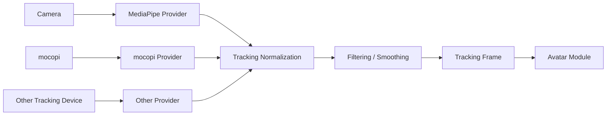
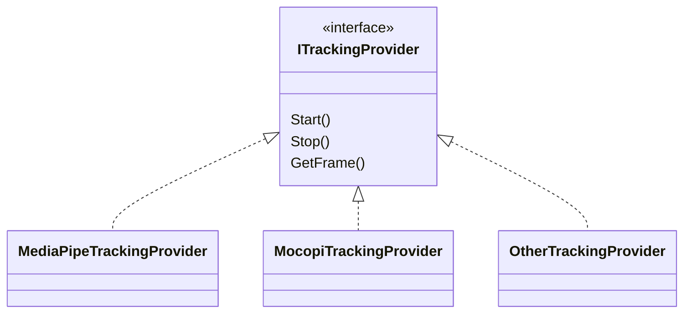

# 8. トラッキング方式

## 8.1 基本方針

トラッキング機能では、カメラや外部トラッキング機器等から人体・顔・手指の動きを取得し、本システム内部で共通利用できるトラッキング情報へ変換する。

初期実装ではMediaPipeを利用したカメラベースのトラッキングを対象とする。

将来的にはmocopi等の外部トラッキング機器や、別のトラッキングライブラリを追加可能な構成とする。

トラッキング機能は、特定の3Dモデル形式やアバター構造には依存しない。

### 採用理由

MediaPipe等のトラッキングライブラリが出力するデータ形式を、そのままAvatar Moduleへ渡すと、アバター制御側がMediaPipe固有のランドマーク構造や座標系へ依存する。

この状態では、将来的にmocopi等へ切り替える際に、アバター制御側まで変更する必要が生じる。

そのため、

**トラッキング入力方式**

と

**アバター制御方式**

の間に、本システム共通のトラッキング表現を設ける。

---

## 8.2 トラッキング全体構成

トラッキング処理は、概念的に以下の流れで構成する。



図中の矢印は、主としてデータの取得・変換・受け渡しの流れを示す。

### 採用理由

入力デバイスやライブラリ固有処理をProvider内部へ閉じ込め、その後の処理を共通化することで、入力方式の追加・変更による影響を限定できる。

また、正規化や平滑化等を共通処理として分離することで、Providerごとに同じ処理を重複実装することを避ける。

---

## 8.3 トラッキング入力方式

トラッキング入力は、入力方式ごとにProviderとして分離する。

概念的には以下の構成とする。



初期実装ではMediaPipeを利用する。

将来的に、

- mocopi
- 別のカメラベーストラッキング
- モーションキャプチャ機器
- ネットワーク経由のトラッキング入力

等を追加可能とする。

### 採用理由

トラッキング入力を共通インターフェイス化することで、上位処理が使用ライブラリを意識する必要をなくす。

また、複数入力方式を同時に利用する可能性も考慮し、Providerをシステム全体で1つだけ存在するSingletonとしては扱わない。

---

## 8.4 共通トラッキングデータ形式

各Providerから取得した情報は、本システム共通の `TrackingFrame` へ変換する。

TrackingFrameは概念的に以下の情報を持つ。

- Body Tracking
- Hand Tracking
- Face Tracking
- Timestamp
- Tracking Confidence
- Tracking Source
- Tracking Status

Body、Hand、Faceについては、それぞれ独立したデータ構造として保持可能とする。

概念例：

```text
TrackingFrame
├─ Timestamp
├─ Body
├─ LeftHand
├─ RightHand
├─ Face
└─ Status
```

### 採用理由

身体、手指、顔では取得方法や更新頻度、欠損条件が異なる場合がある。

すべてを1つの巨大な構造へ固定的に持たせると、一部トラッキングしか利用しない入力方式へ対応しにくい。

そのため、TrackingFrameを共通コンテナとし、その内部に各種トラッキング情報を分離して保持する。

---

## 8.5 身体トラッキング方式

身体トラッキングでは、頭部、胴体、腕、脚等の姿勢情報を取得する。

トラッキング側では、アバターの具体的な骨格構造へ変換せず、人体として観測された姿勢情報を保持する。

例えば、

- Head
- Neck
- Shoulder
- Elbow
- Wrist
- Hips
- Knee
- Ankle

等を本システム共通の人体部位として扱う。

### 採用理由

Tracking Moduleの責務は、

**人間がどのような姿勢をしているかを取得すること**

であり、

**その姿勢を特定アバターの骨格へどう適用するか**

ではない。

体格差やボーン長差の吸収については、3Dアバター制御側のリターゲティング処理で行う。

これにより、Tracking ModuleとAvatar Moduleの責務を明確に分離する。

---

## 8.6 手・指トラッキング方式

手・指トラッキングでは、左右の手および各指関節の姿勢を取得する。

取得可能な場合は、

- 手首
- 親指
- 人差し指
- 中指
- 薬指
- 小指

の各関節情報を保持する。

手指トラッキングが利用できない入力方式については、Body Trackingのみでも動作可能とする。

### 採用理由

入力方式によって取得可能な情報量が異なるため、手指トラッキングを必須条件にすると対応可能なProviderが制限される。

そのため、Body、Hand、Faceを独立した能力として扱い、利用可能な情報だけを使用できる構成とする。

---

## 8.7 顔トラッキング方式

顔トラッキングでは、顔の向きだけでなく、目、口、眉等の動きを取得する。

基本的には連続値として、

- 左右の目の開閉量
- 口の開閉量
- 口形状
- 眉の動き
- 顔の向き
- その他取得可能な顔特徴

を保持する。

Tracking Moduleではこれらをモデル非依存の顔情報として出力し、VRM ExpressionやFBX BlendShape等への変換はAvatar Module側で行う。

### 採用理由

顔トラッキング情報をVRM Expression名等へ直接変換すると、Tracking Moduleがモデル形式へ依存してしまう。

そのため、Tracking Moduleは「人の顔がどう動いているか」だけを表現し、その動きをモデル上でどう表現するかはAvatar Moduleへ委ねる。

---

## 8.8 座標系・姿勢表現方式

各Providerから取得した座標系は、そのまま上位処理へ渡さず、本システム共通の座標系へ変換する。

Providerごとに、

- 右手系 / 左手系
- 軸方向
- 原点位置
- 単位
- Quaternionの定義

等が異なる可能性があるため、Providerまたは正規化処理内で統一する。

### 採用理由

座標系変換をAvatar Module側へ任せると、ProviderとAvatarの組み合わせごとに個別処理が必要となる。

トラッキング出力時点で座標系を統一することで、Avatar Moduleは入力元を意識せず処理できる。

---

## 8.9 信頼度・欠損データの扱い

トラッキングデータには、各部位の信頼度や追跡状態を保持できる構成とする。

例えば、

- Tracked
- LowConfidence
- Lost
- NotSupported

等の状態を表現可能とする。

トラッキング対象を一時的に見失った場合、無効な値を強制的に適用せず、直前値の保持やフェード、制御停止等を選択可能とする。

### 採用理由

カメラベースのトラッキングでは、遮蔽や画角外への移動によって一部ランドマークを取得できなくなることがある。

欠損を通常値と区別しないと、アバターが突然不自然な姿勢へ移動する可能性がある。

そのため、位置や回転値だけでなく、その値が信頼できるかどうかも共通データとして扱う。

---

## 8.10 フィルタリング・平滑化方式

トラッキング値に含まれる細かな揺れやノイズを抑えるため、必要に応じて平滑化処理を行う。

平滑化処理はProvider固有処理とは分離し、本システム共通のTracking Processingとして配置する。

対象として、

- 位置
- 回転
- 顔表情値
- 手指姿勢

等を想定する。

### 採用理由

トラッキング結果を直接アバターへ反映すると、検出値の微小な変動によってモデルが常に細かく震える可能性がある。

一方で平滑化を強くしすぎると操作遅延が増える。

そのため、平滑化処理を独立させ、対象や強度を調整可能な構成とする。

具体的なフィルタ方式については詳細設計で決定する。

---

## 8.11 キャリブレーション方式

Tracking Moduleでは、トラッキング入力そのものに関するキャリブレーションを扱う。

例えば、

- 原点設定
- センサー固有補正

等を対象とする。

本人から正面方向を設定すること（カメラ位置に対する基準姿勢）は、1台のカメラで試したが採用しない。横にあるカメラは体をほとんど見られず、観測を回して戻すと、奥行きの誤差が体の傾きに入ったためである（Tracking詳細設計8.5、2026-10-26）。代わりに、カメラを本人の正面に置く。

一方、

- アバターの身長
- 腕の長さ
- 肩幅
- モデル固有の初期姿勢

等の差異吸収はAvatar Module側で扱う。

### 採用理由

「キャリブレーション」という言葉には、入力機器の補正とアバター体格差の補正の両方が含まれやすい。

これらを同じ機能へまとめると責務が曖昧になる。

そのため、

**入力系を正しく観測するための補正**

をTracking Module、

**観測結果を対象アバターへ合わせる補正**

をAvatar Module

として分離する。

---

## 8.12 複数人トラッキングへの対応

初期実装では1人の利用を主対象とする。

ただし、TrackingFrameやProvider等の内部設計は、1人しか存在できないことを前提としない。

将来的には、

```text
Tracking Session
├─ Person A
│  └─ TrackingFrame
├─ Person B
│  └─ TrackingFrame
└─ Person ...
```

のように複数対象を扱える構成へ拡張可能とする。

### 採用理由

初期段階から複数人トラッキングを完全実装すると複雑性が増す。

一方、単一のGlobal TrackingFrameしか持てない構造にすると、後から複数人対応する際に大幅な変更が必要となる。

そのため、

**初期機能は1人**

としつつ、

**設計上は1人専用にしない**

方針とする。

---

## 8.13 SetupとRuntimeの分離

トラッキングに関しても、SetupとRuntimeを分離する。

### Setup

主に以下を扱う。

- 使用するProvider選択
- カメラ選択
- キャリブレーション
- トラッキング範囲確認
- 平滑化設定
- デバッグ表示
- 各トラッキング機能の有効・無効設定

### Runtime

主に以下を行う。

- Provider起動
- トラッキング取得
- 共通形式への変換
- 正規化
- 平滑化
- TrackingFrame出力

### 採用理由

配信中に入力方式や詳細パラメータを毎回設定する必要があると、操作が複雑になる。

Setup時に必要な設定を保存し、Runtimeでは保存済み設定を使用して速やかにトラッキングを開始できる構成とする。

---

## 8.14 エラー処理・診断方式

通常利用者向けの表示と開発者向けログを分離する。

通常利用者には、

- カメラが見つからない
- トラッキングを開始できない
- 対象人物を検出できない

等、利用者が理解しやすい状態を表示する。

開発者向けログには必要に応じて、

- Provider名
- Providerバージョン
- 入力デバイス
- フレームレート
- 検出状態
- Tracking Confidence
- 初期化失敗理由
- Exception
- Stack Trace

等を記録する。

### 採用理由

通常ユーザーにライブラリ内部エラー等を直接表示しても問題解決につながりにくい。

一方、OSSとして障害を調査する際には、内部状態やエラー詳細が必要となる。

そのため、3Dアバター制御方式と同様に、

**利用者向けには行動可能な情報**

を、

**開発者向けには原因解析可能な情報**

を提供する。

---

## 8.15 内部責務分割

トラッキング機能は、入力、正規化、平滑化、状態管理等を責務単位で分離する。

概念的には以下の構成を想定する。

```text
Tracking/
├─ Core/
│  ├─ TrackingFrame
│  ├─ BodyTrackingData
│  ├─ HandTrackingData
│  ├─ FaceTrackingData
│  └─ TrackingStatus
│
├─ Providers/
│  ├─ ITrackingProvider
│  ├─ MediaPipeTrackingProvider
│  └─ MocopiTrackingProvider
│
├─ Processing/
│  ├─ CoordinateNormalizer
│  ├─ TrackingFilter
│  └─ ConfidenceProcessor
│
├─ Calibration/
│  └─ TrackingCalibration
│
├─ Runtime/
│  └─ TrackingManager
│
└─ Setup/
   └─ TrackingSetupController
```

### 採用理由

Provider固有処理、座標変換、平滑化等を単一クラスへ集約すると、入力方式追加時の変更範囲が大きくなる。

責務単位で分離することで、

- Provider追加
- フィルタ方式変更
- 座標系変更
- デバッグ機能追加

等を互いに独立して行いやすくする。

なお、ここで示すクラス名やディレクトリ構造は責務分割の考え方を示すものであり、詳細は実装時に調整する。
