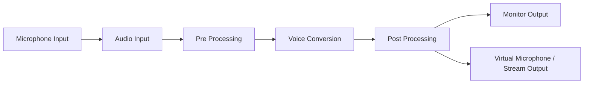
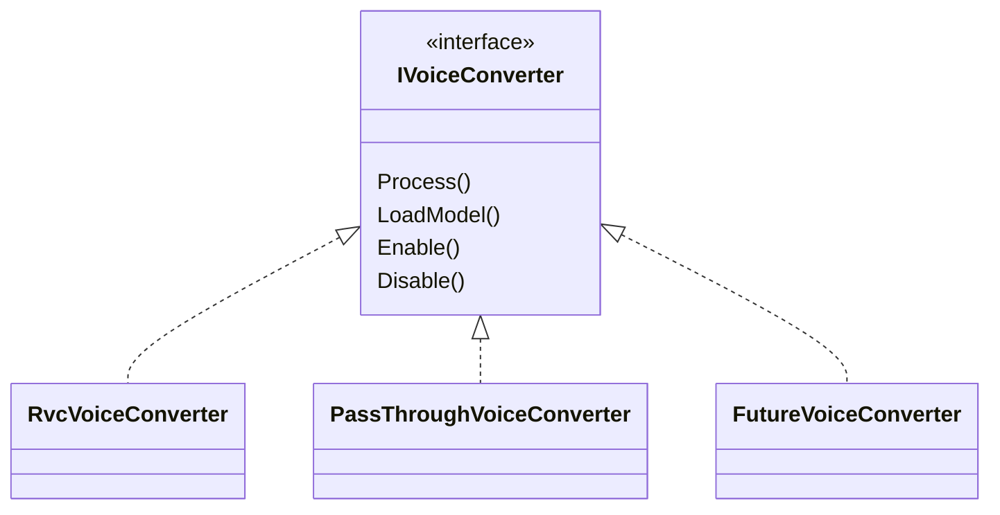

# 9. 音声変換方式

## 9.1 基本方針

音声変換機能では、ユーザーのマイク音声をリアルタイムに取得し、RVC等の音声変換モデルを用いて別の声質へ変換した上で、モニタリングおよび配信用音声として出力する。

配信中のリアルタイム音声変換処理は、原則としてUnityアプリケーション内部で完結させ、PythonプロセスやローカルPythonサービスには依存しない構成とする。

Pythonを必要とする処理は、モデル学習、音声解析、音声生成等のSetup用途に限定する。

### 採用理由

配信中にPythonサービスへ依存すると、

- Pythonプロセスの異常終了
- Python環境の破損
- ポート競合
- IPCやHTTP通信の遅延
- サービス起動待ち
- Python・CUDAライブラリ間の依存関係問題

等が、そのまま配信中の音声停止につながる。

リアルタイム音声変換はVTuber配信における主要機能であり、配信中に外部サービス障害の影響を受けにくいことが重要である。

そのため、学習環境と推論環境を分離し、配信時推論についてはUnity内部で実行する。

---

## 9.2 音声処理全体構成

音声処理は、概念的に以下のPipelineとして構成する。



主な処理段階を以下とする。

1. マイク音声取得
2. 入力音声の前処理
3. 音声変換
4. 変換後音声の後処理
5. モニタリング出力
6. 配信用音声出力

### 採用理由

マイク入力、RVC、ピッチ変更、音量調整、出力等を1つの処理へまとめると、特定処理だけを無効化・交換することが難しくなる。

Audio Pipelineとして段階を分離することで、

- 音声変換のみ無効化する
- 後処理だけ変更する
- 別のVoice Conversion方式へ変更する
- 入力デバイスを変更する
- 出力方式を変更する

といった変更を他処理から独立して行えるようにする。

---

## 9.3 Audio Pipeline抽象化方式

各音声処理は、可能な限り共通の音声データを入力・出力として扱う。

概念上、音声処理を以下のように接続可能とする。

```text
Audio Input
    ↓
Noise / Input Processing
    ↓
Voice Conversion
    ↓
Pitch Processing
    ↓
EQ / Gain
    ↓
Audio Output
```

各処理を独立したAudio Processorとして扱える構成とする。

音声変換を無効化した場合は、Voice Conversion処理をPass Throughへ切り替えることで、音声Pipelineそのものは維持する。

### 採用理由

RVCの有効・無効によってAudio I/Oそのものを作り直す構造にすると、切り替え時に音声が途切れたり、デバイスを再初期化する必要が生じる。

常に同一Pipelineを維持し、処理段階のみを差し替えることで、

- Voice Conversion ON/OFF
- モデル切り替え
- エフェクト追加
- デバッグ用Pass Through

等を実装しやすくする。

---

## 9.4 音声入出力方式

音声入力はユーザーが選択したマイクデバイスから取得する。

出力先については、少なくとも以下を分離して扱う。

- ユーザー自身が確認するためのモニター出力
- 配信へ渡すための出力

配信用出力については、本アプリケーション内の配信（10章）へ渡すことを基本とする。

仮想マイク（他アプリケーションから音声入力デバイスとして見える出力）は、標準機能としては持たない（利用者の決定、2026-10-22）。仮想マイクを作るには署名済みのオーディオドライバーが必要で、本アプリケーションだけでは用意できず、既存の製品は同梱して配布できない。また、もともとの目的は声を出せない状況での試験であり、その手段は音声モジュールの設計時に決める。

### 採用理由

モニター出力と配信出力では用途が異なる。

両者を同一出力として固定すると、

- 自分には聞きたいが配信には流したくない
- 配信には流したいが自分へのモニターは不要
- 音量を別々に調整したい

といった要求へ対応しにくい。

そのため、Audio Pipelineの終端で出力先を分離する。

---

## 9.5 リアルタイム音声変換方式

リアルタイム音声変換にはRVCを使用する。

推論処理はUnity内で実行し、Python版RVCへリアルタイムに処理を依頼する方式とはしない。

Unity側では推論用モデルを読み込み、必要な前処理、特徴量抽出、F0推定、RVC推論等を実行する。

現行構成では、Unity Inference Engine（旧Unity Sentis）による推論を基本とする。

Unity Inference EngineでのRVCのリアルタイム推論が200 ms以内（15.4）で動くこと、およびトラッキング等と同時に動かしたときの負荷に問題がないことは、試作で利用者が確認した（2026-10-22時点）。参照用の試作（ContentVec、RMVPE、RVC v2のONNX化と、GPUでのWAVの変換）は、Repository外のVCBMの`feature/rvc`ブランチにある。リアルタイム版のコードはそこには含まれない。

### 採用理由

RVCのPython実装をそのまま配信時に使用すると、Python RuntimeやPyTorch環境への依存が大きくなる。

一方、学習済みモデルを推論専用形式へ変換しUnity側で扱えば、

- Python環境を配信PC上で常時起動する必要がない
- Unityアプリ単体で配信処理を実行できる
- Python側RVCの更新からRuntimeをある程度分離できる
- 一般ユーザーがPython環境を意識せず利用できる

という利点がある。

---

## 9.6 音声変換エンジンの抽象化

初期実装ではRVCを使用するが、上位Audio PipelineがRVC固有実装へ直接依存しない構成とする。

概念的には、



のように音声変換エンジンを抽象化する。

GPUの処理はメインスレッドからしか発行できないので、実際のInterfaceは発行と回収を分ける（Voice詳細設計5章）。

### 採用理由

現在RVCが適していても、将来的により高品質または低遅延なVoice Conversion方式が利用可能になる可能性がある。

Audio PipelineそのものをRVC専用にすると、音声変換方式変更時に入出力処理まで変更する必要がある。

そのため、Audio PipelineとVoice Conversion Engineを分離する。

---

## 9.7 音声モデル管理方式

配信時に使用するRVCモデルは、学習環境上のモデルを直接参照するのではなく、本システムへ登録された推論用モデルとして管理する。

概念的には、

```text
Voice Model
├─ Model Metadata
├─ RVC Model
├─ Feature Model / Index
├─ Pitch Settings
└─ Runtime Settings
```

のような単位として扱う。

Runtimeは、学習時のフォルダ構成やPython版RVCの内部ディレクトリ構造を認識しない。

### 採用理由

学習環境とRuntimeを同じファイル構造へ依存させると、RVC側の更新や学習ツール変更によって配信機能まで影響を受ける。

そのため、

**学習成果物**

と

**配信用に登録されたモデル**

を分離する。

モデル登録時にRuntimeで必要な形式へ変換・検証し、配信中は登録済みモデルだけを利用する。

---

## 9.8 モデル切り替え方式

配信中に使用するVoice Modelを切り替え可能とする。

モデル切り替え時には、可能な限りAudio I/Oを停止せず、Voice Conversion Engine内部の推論モデルのみを切り替える。

切り替え処理中は必要に応じて、

- Pass Through
- 直前モデルの維持
- 一時的なMute

等を選択可能な構成とする。

### 採用理由

モデル切り替えのたびにマイクデバイスやAudio Outputまで再初期化すると、配信音声が長時間途切れる可能性がある。

Audio PipelineとModel Lifecycleを分離することで、配信中のモデル切り替えによる影響を最小化する。

---

## 9.9 Pitch・音声後処理方式

RVC変換後の音声に対して、Unity側で追加の後処理を適用可能とする。

対象例として、

- Pitch
- Gain
- EQ
- Limiter
- その他の音声調整

等を想定する。

RVCモデル自体の音声変換設定と、最終的な配信用音声調整は別設定として管理する。

### 採用理由

RVCによって声質を変換した後でも、実際の配信環境やユーザーの声に合わせて最終的な調整が必要になる場合がある。

これをRVC推論処理の内部へ組み込むと、単純なPitch変更等のためにもVoice Conversion実装を変更する必要がある。

そのため、Voice ConversionとPost Processingを分離する。

---

## 9.10 低遅延処理方式

リアルタイム音声変換では、音質だけでなくEnd-to-Endの遅延を重要な品質指標として扱う。

処理時間は概念的に、

```text
Microphone Input
      +
Audio Buffering
      +
Feature Extraction
      +
Pitch Estimation
      +
Voice Conversion
      +
Post Processing
      +
Audio Output
```

の合計として評価する。

各処理について可能な限り独立して処理時間を計測可能とする。

### 採用理由

総遅延だけを計測しても、性能低下が発生した場合に原因を特定しにくい。

処理段階ごとの時間を観測可能にすることで、

- Audio I/Oが遅い
- F0推定が遅い
- RVC推論が遅い
- GPU Backendが期待通り利用されていない

といった原因を切り分けられるようにする。

また、音質改善によって処理時間が増加した場合も、品質と遅延のトレードオフを評価可能とする。

---

## 9.11 リアルタイム処理とUI処理の分離

音声処理は、UI描画や通常のUnityゲームループによる一時的な処理負荷の影響を可能な限り受けない構成とする。

Audio I/O、推論、UI更新等について、それぞれの処理責務を分離する。

UIは、

- 現在モデル
- Voice Conversion ON/OFF
- 音量
- Pitch
- 処理状態

等を表示・変更するが、UIコード自身が音声バッファ処理を担当しない。

### 採用理由

リアルタイム音声では一定周期で音声を供給し続ける必要がある。

UI描画、Sceneロード、その他Unity処理によって音声処理が長時間停止すると、

- 音切れ
- ノイズ
- バッファ不足
- 遅延増加

につながる。

そのため、Audio RuntimeとUIを明確に分離する。

---

## 9.12 GPU利用方式

RVC等の推論処理については、利用可能な環境ではGPUを利用する。

一方で、特定GPUベンダーや特定Execution Backendへの依存をAudio Pipeline全体へ露出させない。

推論Backendの選択やGPU利用可否はVoice Conversion Engine内部で扱う。

### 採用理由

GPU環境はユーザーごとに異なる。

GPU固有処理をUIやAudio I/Oまで広げると、Backend変更時の影響範囲が大きくなる。

そのため、ハードウェア差異については推論実装内部で可能な限り吸収する。

---

## 9.13 障害時の動作方式

リアルタイム音声変換中に推論処理で異常が発生した場合でも、アプリケーション全体を停止させない構成とする。

異常の種類に応じて、

- Voice Conversionを無効化しPass Throughへ移行
- 一時的にMute
- モデル再読み込み
- 利用者へエラー通知

等を行う。

### 採用理由

配信中に音声変換処理だけの障害によって、アバター表示、トラッキング、配信画面等まで停止することは避けるべきである。

また、音声変換に失敗した際に必ず無音になるより、ユーザーが許可している場合は元音声をPass Throughする方が配信を継続しやすい。

そのため、音声変換機能の障害をシステム全体から隔離する。

なお、Pass Throughを自動使用するかMuteするかについては、プライバシー上の意味が異なるため、ユーザー設定可能とする。既定はMuteとする（利用者の承認、2026-11-01）。

---

## 9.14 SetupとRuntimeの分離

音声変換についても、設定・準備処理と配信中処理を分離する。

### Setup

主に以下を扱う。

- マイク選択
- モニター出力選択
- 配信用出力選択
- Voice Model登録
- Voice Model選択
- Pitch等の調整
- テスト再生
- 推論Backend確認
- 遅延確認

### Runtime

主に以下を行う。

- Audio Device開始
- 登録済みVoice Model読み込み
- 音声変換
- 後処理
- モニター出力
- 配信用出力

### 採用理由

モデル変換や詳細診断等の処理を配信開始時に毎回実行すると、起動時間が長くなり障害発生箇所も増える。

Setup段階でRuntime利用可否を確認しておき、Runtimeでは検証済み設定を読み込むだけとすることで、配信開始を簡潔かつ安定させる。

---

## 9.15 エラー処理・診断方式

通常利用者向けUIと開発者向け診断情報を分離する。

利用者向けには例えば、

- マイクを利用できない
- 音声モデルを読み込めない
- 音声変換を開始できない
- 出力デバイスが利用できない

等の、利用者が理解・対処しやすい情報を表示する。

開発者向けには必要に応じて、

- Input Device
- Output Device
- Sample Rate
- Buffer Size
- Voice Model
- Inference Backend
- Feature Extraction Time
- Pitch Estimation Time
- Inference Time
- Total Processing Time
- Buffer Underrun
- Exception
- Stack Trace

等を記録する。

### 採用理由

一般利用者に推論Backend名や内部バッファ状態を表示しても、通常は問題解決につながらない。

一方、OSSとして音切れや遅延問題を調査する際には、これらの内部情報が非常に重要となる。

そのため、

**利用者には利用継続・復旧のための情報**

を、

**開発者には性能・障害原因を解析するための情報**

を提供する。

---

## 9.16 内部責務分割

音声変換機能は、Audio I/O、音声変換、後処理、モデル管理等を責務単位で分離する。

概念的には以下の構成を想定する。

```text
Voice/
├─ Core/
│  ├─ AudioFrame
│  ├─ VoiceState
│  └─ VoiceModelProfile
│
├─ Input/
│  ├─ IAudioInput
│  └─ MicrophoneInput
│
├─ Conversion/
│  ├─ IVoiceConverter
│  ├─ RvcVoiceConverter
│  └─ PassThroughVoiceConverter
│
├─ Processing/
│  ├─ PitchProcessor
│  ├─ GainProcessor
│  └─ AudioProcessorPipeline
│
├─ Model/
│  ├─ VoiceModelManager
│  └─ VoiceModelLoader
│
├─ Output/
│  ├─ MonitorOutput
│  └─ StreamOutput
│
├─ Runtime/
│  └─ VoiceRuntime
│
└─ Setup/
   └─ VoiceSetupController
```

### 採用理由

リアルタイム音声処理を単一クラスへ集約すると、Audio Device変更、RVC変更、Pitch処理変更等が互いに影響しやすくなる。

責務単位で分離することで、

- RVC以外の変換方式追加
- Audio I/O方式変更
- 後処理追加
- モデル管理方式変更
- 性能計測

をそれぞれ独立して行いやすくする。

なお、ここで示すクラス名やディレクトリ構造は責務分割の考え方を示すものであり、実装時に詳細を調整する。
