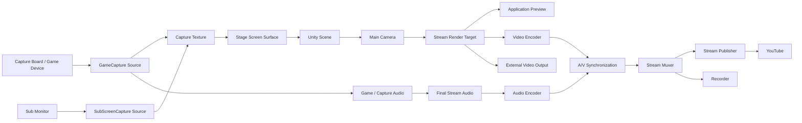
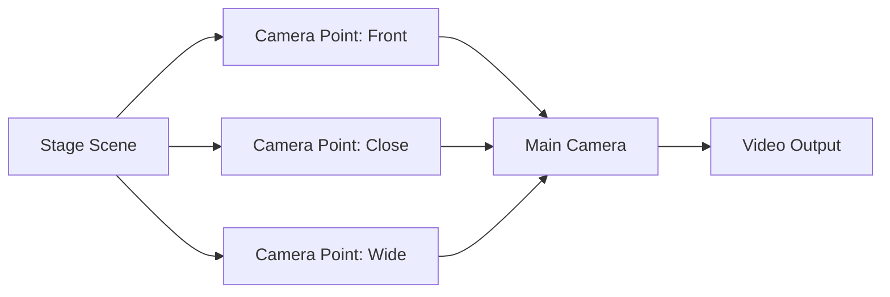

# 10. 映像入力・カメラ・映像出力方式

## 10.1 基本方針

映像入力・カメラ・映像出力機能では、GameCaptureやSubScreenCapture等から外部映像を取得し、Unity上に構築されたアバター、ステージ、各種映像要素と組み合わせた上で、アプリケーション内で配信用映像を生成する。

外部映像入力は共通のCapture Sourceとして扱い、Stage上のScreen Surface等へ割り当て可能とする。最終的に生成した映像は、以下の用途へ出力可能な構成とする。

- アプリケーション内プレビュー
- YouTube等へのライブ配信
- 動画ファイルへの録画
- 将来的な外部アプリケーションへの映像出力

本システムでは、OBS等の外部配信ソフトウェアを必須とせず、**映像入力、Unity上での映像合成、映像エンコード、音声との同期、ライブ配信までを本アプリケーション内で完結可能な構成**を基本とする。

### 採用理由

OBS等を必須とした場合、利用者は本アプリケーションとは別に、

- 映像キャプチャ設定
- 音声入力設定
- 解像度設定
- 配信先設定
- シーン設定

等を行う必要がある。

本システムはVTuber活動に必要な機能を統合することを目的としているため、通常の配信についてはアプリケーション単体で開始できる方が利用者の設定負担を小さくできる。

一方で、将来的に外部アプリケーションと連携したい利用者のため、Spout等による外部映像出力を追加可能な構成は維持する。

---

## 10.2 全体構成

映像出力処理は、概念的に以下の構成とする。



図中の矢印は、映像・音声データおよび制御情報の流れを示す。

映像入力、Stage上での表示、映像生成、エンコード、音声同期、配信先への送信をそれぞれ独立した責務として扱う。

GameCapture / SubScreenCaptureから取得した映像を直接Video Encoderへ送信することは基本とせず、Unity Scene上の表示要素として扱った後、Main Cameraから最終配信映像を生成する。

### 採用理由

カメラ制御とYouTube配信処理を直接結合すると、配信方式を変更した際にカメラ制御まで変更する必要が生じる。

そのため、

**映像を生成する処理**

と、

**生成された映像をどのように利用するか**

を分離する。

これにより、同一の映像を、

- プレビュー
- 配信
- 録画
- 外部出力

へ利用できる。

---

## 10.3 カメラ管理方式

VTuber映像を生成するための基準カメラとして、**Main Camera**を設ける。

Main Cameraはステージ切り替えによって破棄されない領域に配置し、原則としてアプリケーション実行中継続して使用する。

ステージ側にはカメラそのものではなく、カメラの配置候補を示す**Camera Point**を配置する。

Camera Pointは例えば以下の情報を持つ。

- Position
- Rotation
- Field of View
- Camera Point名
- 必要に応じた追加カメラ設定

Main Cameraを選択されたCamera Pointへ移動することで、ステージごとのカメラ位置を実現する。



### 採用理由

ステージごとにCameraコンポーネントを持たせると、

- カメラ設定がステージごとに異なる
- 出力対象カメラの切り替えが必要になる
- Post Processing等の設定が重複する
- 配信処理が現在有効なCameraを追跡する必要がある

といった問題が生じる。

Main Camera自体は共通化し、Stage SceneにはCamera Pointだけを持たせることで、

**「どのカメラを使うか」ではなく「カメラをどこへ置くか」**

という構成にする。

これにより、映像出力先は常に同じMain Cameraを参照できる。

---

## 10.4 カメラ切り替え方式

配信中であってもCamera Pointを変更可能とする。

カメラ切り替え方式として、少なくとも以下を扱える構成とする。

- 即時切り替え
- 補間による移動
- 将来的な演出付き切り替え

Camera Point切り替え処理と配信処理は独立させ、カメラ移動中であっても映像出力Pipeline自体は停止しない。

### 採用理由

カメラ切り替えのたびにRender TargetやVideo Encoderを再初期化すると、一時的な映像停止や配信切断につながる可能性がある。

Main Cameraを維持したままTransform等だけを変更することで、映像Pipelineを継続した状態でカメラ演出を行える。

---

## 10.5 映像生成方式

Main Cameraの描画結果は、直接画面表示のみに使用せず、配信用映像として利用可能なRender Targetへ出力する。

UnityではRenderTexture等を利用し、以下のような共通映像源として扱うことを想定する。

```text
Main Camera
     ↓
Render Target
     ├─ Application Preview
     ├─ Video Encoder
     ├─ Recorder
     └─ External Output
```

Render Targetの解像度は、配信設定から管理できる構成とする。

例えば、

- 1280 × 720
- 1920 × 1080
- 2560 × 1440

等を選択可能とする。

### 採用理由

Game Viewやディスプレイの解像度をそのまま配信映像として扱うと、アプリケーションウィンドウサイズによって配信解像度が変化する可能性がある。

配信用Render Targetを独立させることで、

**アプリケーションUIの表示サイズ**

と

**実際に配信する映像サイズ**

を分離する。

これにより、ユーザーがアプリケーションウィンドウをリサイズしても配信映像へ影響しない構成とする。

---

## 10.6 プレビュー表示方式

生成した配信用映像は、アプリケーション内でプレビュー可能とする。

プレビューには、原則として実際にVideo Encoderへ送信する映像と同じRender Targetを使用する。

### 採用理由

UnityのScene Viewや別Cameraをプレビューとして使用すると、

**利用者が見ている映像**

と

**実際に配信されている映像**

が異なる可能性がある。

実際の配信映像源と同じ映像をプレビューすることで、

「画面に表示されている内容がそのまま配信される」

という分かりやすい動作とする。

---

## 10.7 映像エンコード方式

配信用映像は、Video Encoderによってリアルタイムエンコードする。

初期実装では、YouTubeとの互換性を考慮し、H.264を基本映像コーデックとして想定する。

YouTube Liveは現在、RTMP/RTMPS配信においてH.264、H.265、AV1等をサポートしている。初期実装では対応環境が広いH.264を基本とし、将来的に他コーデックを追加可能な構成とする。

Video Encoderについては抽象化し、特定のEncoder実装を映像Pipeline全体へ露出させない。

概念的には以下の構成とする。

```text
IVideoEncoder
├─ HardwareVideoEncoder
└─ SoftwareVideoEncoder
```

利用可能な環境では、GPU等が提供するハードウェアエンコードを優先して利用できる構成とする。

Encoderの実装は、外部ライブラリをなるべく使わず、Windows標準の機能（Media Foundation等）を基本とする（利用者の決定、2026-10-22）。具体的な方式は、配信の実装に着手するときに決める。

### 採用理由

VTuberアプリケーションでは、

- Unityによる3D描画
- トラッキング
- 音声変換
- その他リアルタイム処理

を同時に実行する。

映像エンコードまでCPUのみで処理すると、他のリアルタイム処理へ影響する可能性がある。

そのため、利用可能な環境ではハードウェアエンコードを利用できるようにする。

一方、GPUや利用可能なEncoderはPCごとに異なるため、特定GPUベンダーの実装をシステム全体へ直接依存させない。

---

## 10.8 配信用音声入力方式

ライブ配信へ送信する音声は、音声変換機能で生成された**最終配信用音声**を使用する。

概念的には以下の流れとする。

```text
Microphone
    ↓
Voice Conversion
    ↓
Post Processing
    ↓
Final Stream Audio
    ↓
Audio Encoder
    ↓
Streaming
```

カメラ・映像出力機能側でRVC等の音声変換処理を行わない。

### 採用理由

音声変換方式と映像配信方式を分離することで、配信機能は、

**「最終的に配信すべき音声」**

だけを受け取ればよい。

これにより、RVCから別のVoice Conversion方式へ変更した場合でも、Streaming側を変更する必要がない。

---

## 10.9 音声・映像同期方式

ライブ配信では、映像と音声を共通の時間軸に基づいて同期させる。

特に、本システムではリアルタイム音声変換によって音声側に処理遅延が発生するため、必要に応じて映像側へ遅延を追加し、最終的な映像と音声の同期を調整可能とする。

概念的には以下の構成とする。

```text
Video
Camera
 ↓
Video Buffer ─────────┐
                      │
                      ├─ A/V Synchronization
                      │
Audio                 │
Voice Runtime         │
 ↓                    │
Audio Buffer ─────────┘
          ↓
      Stream Output
```

映像・音声にはTimestampを付与し、同期処理が両者の時間関係を管理する。

### 採用理由

RVC等のリアルタイム音声処理には一定の処理時間が必要である。

映像を即座に配信し、音声だけが遅れて配信されると、アバターの口の動きと実際の音声が一致しなくなる。

そのため、単純に映像と音声を別々に送信するのではなく、最終出力直前で同期を管理する。

また、音声処理方式を変更して遅延量が変わった場合にも対応できる構成とする。

---

## 10.10 ライブ配信方式

ライブ配信については、外部配信アプリケーションを経由せず、本システムから配信サービスへ直接送信可能とする。

初期対象サービスとしてYouTube Liveを想定する。

YouTubeへの送信にはRTMPSを基本とする。

YouTubeはRTMPSによるライブ入力をサポートしており、RTMPSはRTMP通信をTLSで暗号化した方式である。YouTubeも通常のライブ配信ではRTMPSの利用を推奨している。

概念的には以下の構成とする。

```text
Video Encoder
      \
       \
        → A/V Muxer
       /
      /
Audio Encoder
       ↓
Stream Publisher
       ↓
RTMPS
       ↓
YouTube Live
```

### 採用理由

配信サービスへの接続処理をVideo Encoderへ直接実装すると、YouTube以外の配信先を追加する場合にEncoderまで変更する必要がある。

そのため、

- Encode
- Multiplex
- Publish

を分離する。

これにより、映像・音声の生成方法を変えずに配信先を追加可能とする。

---

## 10.11 YouTube連携方式

初期段階では、YouTube側で作成した配信設定から、

- RTMPS Ingestion URL
- Stream Key

を取得し、本システムへ登録して配信する方式を基本とする。

YouTube Live Streaming APIからRTMPS Ingestion URL等を取得することも可能である。

将来的にはYouTube APIとの連携により、アプリケーション内から、

- YouTubeアカウント認証
- 配信枠作成
- タイトル設定
- 公開範囲設定
- 配信状態取得
- 配信開始・終了管理

等を行える構成への拡張を検討する。

### 採用理由

初期実装からYouTube API認証や配信枠管理まで実装すると、OAuth認証、API権限管理、配信状態管理等が必要となり、映像配信機能そのものとは別の複雑性が生じる。

まずはStream URLとStream Keyを利用した直接配信を成立させることで、

**映像生成 → エンコード → RTMPS送信**

という中核機能を先に完成させる。

その後、ユーザー操作をさらに簡略化するための機能としてYouTube API連携を追加する。

---

## 10.12 配信認証情報の管理方式

Stream Key等の配信認証情報は秘密情報として扱う。

以下を原則とする。

- ソースコードへ記載しない
- Gitリポジトリへ保存しない
- 通常ログへ出力しない
- Developer Diagnosticsでも値をそのまま表示しない
- UI上では原則としてマスク表示する
- 診断情報エクスポートへ含めない

### 採用理由

本システムはOSSとしてGitHub上で公開することを想定している。

Stream Keyがログ、設定サンプル、Issue添付ファイル等を通じて外部へ流出すると、第三者によって不正に配信される可能性がある。

そのため、

**開発者向けに十分な診断情報を提供すること**

と、

**秘密情報を出力すること**

を明確に区別する。

例えばログには、

```text
Publisher     : YouTube RTMPS
Server        : Connected
Authentication: Configured
Stream Key    : ********
```

等の状態情報のみを記録する。

---

## 10.13 録画方式

ライブ配信用に生成した映像・音声を利用して、ローカル動画ファイルへの録画を可能とする。

録画処理はライブ配信処理とは独立させ、

- 配信のみ
- 録画のみ
- 配信 + 録画

を選択可能な構成とする。

### 採用理由

映像・音声の生成処理自体は配信と録画で共通である。

一方で、ネットワーク障害によってライブ配信が停止しても、ローカル録画まで停止する必要はない。

そのため、共通のエンコード結果または映像・音声源を利用しつつ、出力先としてStreamingとRecordingを分離する。

---

## 10.14 外部映像出力方式

OBS等の外部ソフトウェアは本システムの必須構成とはしない。

ただし、他アプリケーションとの連携を目的として、将来的にSpout等による映像出力を利用可能な構成とする。

外部出力はMain CameraのRender Targetから分岐させ、ライブ配信機能とは独立させる。

### 採用理由

通常利用者については本システム内で配信を完結させることを目指す一方、高度な配信環境では外部ミキサー、特殊な配信ソフトウェア、別PCへの映像転送等が必要になる可能性がある。

そのため、

**外部連携を必須にはしないが、閉じたシステムにもならない**

構成とする。

---

## 10.15 配信中の設定変更方式

配信中であっても、安全に変更可能な設定については変更を許可する。

例えば、

- Camera Point
- カメラFOV
- 一部の画質設定
- 配信音量

等を想定する。

一方、

- 解像度
- Video Codec
- Encoder
- 一部の配信プロトコル設定

等、変更時にEncoderや通信接続の再初期化を必要とする設定については、配信中の変更を制限する。

### 採用理由

すべての設定を配信中に変更可能にすると、Encoder再生成やネットワーク再接続によって配信が意図せず切断される可能性がある。

そのため、設定を、

**Runtime中に安全に変更可能な設定**

と

**配信停止後にのみ変更可能な設定**

に分類する。

---

## 10.16 障害時の動作方式

映像出力・ライブ配信処理で障害が発生した場合でも、3Dアバター、トラッキング、音声変換等の他機能を可能な限り停止させない。

例えば、

- YouTube接続失敗
- ネットワーク切断
- Encoder初期化失敗
- Encoder処理異常
- 録画ファイル書き込み失敗

等を個別に検出する。

ライブ配信接続が失われた場合には、

- 再接続
- 利用者への通知
- ローカル録画の継続

等を可能な構成とする。

### 採用理由

ライブ配信機能の障害によってVTuberアプリケーション全体を停止すると、アバター状態やトラッキング状態まで失われる。

各出力機能の障害を他機能から隔離することで、問題解決後に配信のみ再開しやすい構成とする。

---

## 10.17 SetupとRuntimeの分離

カメラ・映像出力機能についても、事前設定と配信中処理を分離する。

### Setup

主に以下を扱う。

- 配信解像度
- Frame Rate
- Video Encoder
- Video Codec
- Bitrate
- Audio Codec
- Camera Point設定
- YouTube接続設定
- Stream Key登録
- 録画設定
- 配信テスト

### Runtime

主に以下を行う。

- Main Camera描画
- Render Target生成
- Video Encode
- Audio Encode
- A/V Synchronization
- Live Streaming
- Recording
- Preview

### 採用理由

配信開始時にEncoderや配信先設定を毎回構築するのではなく、Setup段階で設定と利用可否を確認しておくことで、Runtimeでは配信開始操作を簡潔にする。

また、設定画面とリアルタイム映像処理を分離することで、UI処理による配信処理への影響を抑える。

---

## 10.18 エラー処理・診断方式

通常利用者向けUIと、開発者向け診断情報を分離する。

利用者向けには例えば、

- 配信を開始できませんでした
- YouTubeへ接続できません
- 録画を開始できません
- 映像Encoderを利用できません

等の理解しやすいメッセージを表示する。

必要に応じて、設定変更や再接続等の利用者が取るべき行動を提示する。

開発者向けログには必要に応じて、

- Resolution
- Frame Rate
- Render Format
- Video Encoder
- Video Codec
- Video Bitrate
- Audio Codec
- Encode Time
- Dropped Frames
- A/V Sync Offset
- Publisher
- Connection State
- Reconnection Count
- Exception
- Stack Trace

等を記録する。

Stream Key等の秘密情報は出力しない。

### 採用理由

通常利用者にEncoder内部エラーやネットワークライブラリのStack Traceを表示しても問題解決にはつながりにくい。

一方、本システムはOSSとして公開するため、

- 映像がカクつく
- 音声と映像がずれる
- 特定GPUでEncoderが動作しない
- YouTubeへ接続できない

といった環境依存問題を調査できる情報が必要となる。

そのため、

**利用者向けには問題の概要と対処方法**

を、

**開発者向けには内部状態と原因解析情報**

を提供する。

---

## 10.19 内部責務分割

カメラ・映像出力機能は、カメラ制御、映像生成、エンコード、同期、配信等を責務単位で分離する。

概念的には以下の構成を想定する。

```text
Video/
├─ Camera/
│  ├─ CameraManager
│  ├─ MainCameraController
│  └─ CameraPoint
│
├─ RenderCapture/
│  └─ StreamRenderTarget
│
├─ Encoding/
│  ├─ IVideoEncoder
│  ├─ VideoEncoder
│  └─ AudioEncoder
│
├─ Synchronization/
│  └─ AvSynchronizer
│
├─ Streaming/
│  ├─ IStreamPublisher
│  ├─ RtmpsPublisher
│  └─ StreamMuxer
│
├─ Recording/
│  └─ VideoRecorder
│
├─ ExternalOutput/
│  └─ ExternalVideoOutput
│
├─ Runtime/
│  └─ VideoRuntime
│
└─ Setup/
   └─ VideoSetupController
```

### 採用理由

カメラ制御からYouTube通信までを単一のクラスへ集約すると、

- Camera方式変更
- Encoder変更
- YouTube以外への配信追加
- 録画機能追加
- 外部映像出力追加

等が相互に影響する。

それぞれを独立した責務として分離することで、機能の追加・変更による影響範囲を限定する。

GameCapture / SubScreenCapture等の映像・音声取得は、Video Moduleではなく、2.4で定義した独立した**Capture Module**が担当する。

Capture Moduleは概念的に以下の構成を想定する。

```text
Capture/
├─ Core/
│  ├─ IVideoCaptureSource
│  ├─ IAudioCaptureSource
│  ├─ CaptureSourceInfo
│  ├─ CaptureFrameInfo
│  └─ CaptureState
│
├─ Sources/
│  ├─ GameCaptureSource
│  └─ SubScreenCaptureSource
│
├─ Adapters/
│  ├─ GameCaptureAdapter
│  └─ DesktopDuplicationAdapter
│
├─ Runtime/
│  └─ CaptureSourceManager
│
├─ Diagnostics/
│  └─ CaptureDiagnostics
│
└─ Setup/
   └─ CaptureSetupController
```

Video ModuleはCapture Sourceを直接参照せず、Stage上のScreen Surfaceを含むUnity SceneをMain Cameraから描画した結果のみを扱う（10.23参照）。

なお、ここで示すクラス名やディレクトリ構造は責務分割の考え方を示すものであり、詳細な実装構造については後続の設計および実装時に決定する。

---

## 10.20 Capture Source共通方式

GameCaptureおよびSubScreenCapture等の外部映像入力は、上位機能から共通の**Capture Source**として扱う。

映像入力については概念的に`IVideoCaptureSource`を設け、少なくとも以下を扱える構成とする。

- Start / Stop
- Source情報取得
- Capture状態取得
- Input Resolution
- Frame Rate
- Unityで利用可能な映像Textureの取得

音声を提供するCapture Sourceについては、映像Interfaceへ音声責務を混在させず、別途`IAudioCaptureSource`等の境界を利用する。

```text
GameCaptureSource
├─ IVideoCaptureSource
└─ IAudioCaptureSource

SubScreenCaptureSource
└─ IVideoCaptureSource
```

### 採用理由

GameCaptureとSubScreenCaptureでは、入力DeviceやNative実装が異なる。

これらをStageやUIが直接扱うと、Capture方式を変更するたびに上位機能まで修正する必要がある。

Capture Sourceとして抽象化することで、Stage側は「どの映像Textureを表示するか」だけを扱える構成とする。

---

## 10.21 GameCapture方式

GameCaptureは、Capture Boardを利用してNintendo Switch等の外部ゲーム機器から映像・音声を取得し、Unity上で利用する機能とする。

初期実装には既存の`GameCaptureUnityPlugin`を利用する。

- Repository: https://github.com/Yupopyoi/GameCaptureUnityPlugin

概念的には以下の構成とする。

```text
Game Device
    ↓
Capture Board
    ↓
GameCaptureUnityPlugin
    ↓
GameCapture Adapter
    ├─ Video → Capture Texture
    └─ Audio → Audio Module
```

GameCaptureUnityPlugin固有のAPIをStage、Audio、UI等から直接利用せず、`GameCaptureAdapter`内部へ閉じ込める。

GameCapture映像は直接配信Encoderへ送らず、Capture TextureとしてUnity Sceneへ渡す。

GameCapture音声は12章で定義するAudio Mixerへ入力し、Voice、BGM、SE等と同様に最終配信音声へMixする。

### 採用理由

ゲーム映像をUnity Scene内へ取り込むことで、

- 3Dアバター
- Stage
- Game画面
- Overlay
- その他演出

をUnity上で一体として構成できる。

また、映像・音声取得Pluginへの依存をAdapter内部に限定することで、将来Plugin実装を変更した場合の影響を小さくする。

---

## 10.22 SubScreenCapture方式

SubScreenCaptureは、PCのサブモニタに表示されている映像を取得し、Unity Scene上で利用する機能とする。

初期実装ではWindowsのD3D11 / DXGI Desktop Duplicationを利用する。

現行実装では、概念的に以下の処理を行う。

```text
Selected Monitor
      ↓
DXGI Desktop Duplication
      ↓
D3D11 Texture
      ↓
Capture Backend
      ↓
Unity側Capture Adapter
      ↓
Capture Texture
```

現行Native実装では`monitorIndex`によって対象Outputを選択し、Desktop Duplication APIによってFrameを取得する。

Native側内部ではCPU ReadbackやShared Memory等を利用してもよいが、その具体方式を`SubScreenCaptureSource`より上位へ露出させない。

初期SubScreenCaptureでは**映像のみ**を対象とし、Desktop Audioの取得は必須機能としない。

### 採用理由

Native Capture方式は性能改善等によって変更される可能性がある。

例えば将来的にShared Memory方式からGPU Texture共有方式へ変更した場合でも、Capture Sourceの外部Interfaceを維持することでStageやUIを変更せずに済む。

---

## 10.23 Capture映像のStage連携方式

Capture Moduleは映像を取得する責務のみを持ち、取得した映像を画面上のどこへ配置するかはStage Moduleの責務とする。

```text
Capture Source
     ↓
Capture Texture
     ↓
Stage Screen Surface
     ↓
Main Camera
     ↓
Stream Render Target
```

Stage側では、Screen Surface等へ`CaptureSourceId`またはそれに相当する参照を設定可能とする。

これにより、同じGameCapture映像を、

- 背景全面
- Stage内の大型Monitor
- アバター横のScreen

等、Stageごとに異なる形で利用可能とする。

### 採用理由

映像取得処理に表示位置やStage構造を持たせると、Capture ModuleとStage Moduleが密結合になる。

**Capture = 映像を取得する**、**Stage = 取得映像をどこへ表示するか決める**、**Video = Scene全体から最終映像を生成する**という責務分離を維持する。

---

## 10.24 Capture状態管理方式

Capture Sourceは少なくとも以下の状態を持てる構成とする。

```text
Stopped
Starting
Ready
Capturing
Unavailable
Error
```

GameCaptureではCapture Boardの接続状態、SubScreenCaptureでは対象MonitorやDesktop Duplicationの利用可否等を確認する。

Capture Sourceの異常によって、Avatar、Tracking、Voice、Streaming等の他機能を停止させない。

### 採用理由

Capture Deviceの切断やDisplay構成変更は配信中にも発生し得る。

入力映像の障害をApplication全体の障害へ波及させない構成とする。

---

## 10.25 Capture Setup方式

Setupでは少なくとも以下を設定・確認可能とする。

### GameCapture

- Capture Device
- Video Input
- Input Resolution
- Frame Rate
- Audio Input状態
- Preview

### SubScreenCapture

- 対象Monitor
- Input Resolution
- Capture状態
- Preview

設定完了後はProject / Capture Profile等から復元可能とする。

### 採用理由

配信開始後に初めてCapture Deviceの誤選択や映像取得失敗へ気付くことを防ぐ。

---

## 10.26 Capture診断方式

Developer Diagnosticsでは、必要に応じて以下を確認可能とする。

- Capture Source種別
- Device / Monitor識別情報
- Backend
- Input Resolution
- Frame Rate
- Capture Frame Time
- Missed / Dropped Frame
- Native Plugin状態
- GameCapture Audio状態
- Exception

通常利用者には、

- 利用可能
- Device未接続
- Monitorが見つからない
- Capture開始失敗

等の理解しやすい状態へ変換して表示する。

### 採用理由

Capture処理はDevice、Driver、GPU、Display構成等の環境差の影響を受けるため、OSSとして障害を調査できる情報を保持する必要がある。

---

## 10.27 Capture方式の基本原則

Capture機能では以下を基本原則とする。

1. GameCaptureとSubScreenCaptureを共通のCapture Sourceとして扱う。
2. 映像と音声の責務を必要に応じて分離する。
3. GameCaptureは映像・音声、SubScreenCaptureは初期段階では映像を提供する。
4. Capture実装固有APIをAdapter内部へ閉じ込める。
5. Raw Capture映像を直接Streaming Encoderへ送らず、原則としてUnity Sceneを経由する。
6. Captureは映像取得、Stageは表示位置、Videoは最終映像生成を担当する。
7. Capture障害を他Runtime Moduleへ波及させない。
8. Capture Device / Monitorの選択とPreviewをSetupから行えるようにする。
9. Backend変更によって上位Moduleを変更しない構造を維持する。
10. Capture性能・状態をDeveloper Diagnosticsから確認可能とする。
