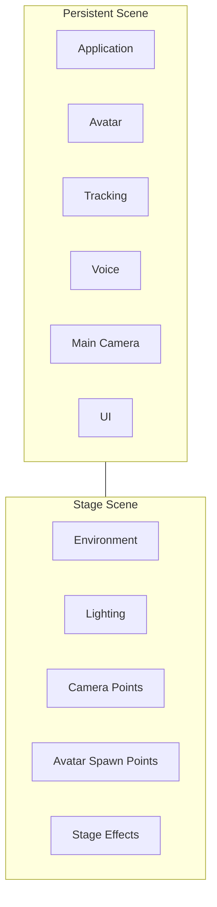

# 11. ステージ管理方式

## 11.1 基本方針

ステージ管理機能では、VTuber配信時に使用する3D背景、照明、カメラ配置情報、アバター配置位置等を管理する。

本システムでは、アバター、トラッキング、音声処理、UI等のシステム本体と、配信時に使用するステージ環境を分離する。

ステージはUnity Sceneとして管理し、必要に応じてAdditive Load / Unloadする。

### 採用理由

アバターやトラッキング等とステージを同一Sceneへ配置すると、ステージ変更時にシステム本体まで再生成される可能性がある。

そのため、

**VTuberシステム本体**

と

**配信時の舞台**

をScene単位で分離する。

これにより、アバターやトラッキング状態を維持したままステージのみを変更可能とする。

---

## 11.2 Scene構成方式

Unity Sceneを大きく以下の2種類に分類する。

### Persistent Scene

アプリケーション実行中、原則として読み込み状態を維持するScene。

以下のようなシステム本体を配置する。

- Application管理
- Avatar Manager
- Tracking
- Voice Runtime
- Camera
- UI
- Streaming
- Audio管理

### Stage Scene

配信時の舞台として使用するScene。

以下のようなステージ固有要素を配置する。

- 背景オブジェクト
- 建物
- 家具
- 小物
- Lighting
- Environment
- Camera Point
- Avatar Spawn Point
- ステージ固有演出



### 採用理由

Sceneの役割を明確に分けることで、

- ステージ変更
- アバター変更
- トラッキング再初期化
- UI状態
- 音声状態

等を互いに独立して扱いやすくする。

---

## 11.3 Stage Scene読み込み方式

Stage SceneはAdditive LoadによってPersistent Sceneへ追加する。

ステージ切り替え時には、原則として以下の処理を行う。

1. 新しいStage Sceneの読み込み
2. Stage情報の取得
3. Camera Point等の初期化
4. Avatar Spawn Pointの確認
5. 新しいStageの表示開始
6. 旧Stage SceneのUnload

必要に応じて、旧Stageを破棄する前に新Stageを読み込むことで、切り替え中の無表示時間を抑える。

### 採用理由

通常のScene切り替えによってPersistent Sceneまで破棄すると、アバターや音声等を再初期化する必要が生じる。

Additive Loadを使用することで、システム本体を維持したまま舞台だけを交換できる。

---

## 11.4 Stage定義方式

Stage Sceneには、そのSceneを本システム上でステージとして扱うための情報を持たせる。

概念的に以下の情報を管理する。

```text
Stage
├─ StageId
├─ DisplayName
├─ Version
├─ Camera Points
├─ Avatar Spawn Points
├─ Environment Settings
└─ Stage-specific Settings
```

ステージ管理機能はScene内部の任意GameObjectを直接探索するのではなく、Stage Root等の明示的な入口からステージ情報を取得する。

### 採用理由

Scene内を名前検索等によって探索すると、

- GameObject名変更
- 階層変更
- オブジェクト追加

によってステージ読み込み処理が壊れやすい。

Stageとして必要な情報を明示的に登録することで、Scene内部構造への依存を減らす。

---

## 11.5 Camera Point管理方式

Stage SceneにはMain Cameraの配置候補となるCamera Pointを配置する。

Camera Pointは少なくとも以下を保持可能とする。

- ID
- 表示名
- Position
- Rotation
- Field of View

必要に応じて追加のカメラ設定を保持可能とする。

Main Camera自体はPersistent Scene側に存在し、選択されたCamera Pointの情報を利用して配置する。

### 採用理由

Stage SceneごとにCameraを生成するのではなく、配置情報のみをStage側へ持たせることで、映像出力Pipelineは常に同一のMain Cameraを利用できる。

これにより、Camera切り替えとStreaming処理を分離できる。

---

## 11.6 Avatar Spawn Point管理方式

Stage Sceneには、アバターを配置する基準位置としてAvatar Spawn Pointを設定可能とする。

Spawn Pointは少なくとも以下を保持する。

- ID
- 表示名
- Position
- Rotation

将来的な複数人対応を考慮し、1つのStageに複数のSpawn Pointを配置可能とする。

例：

```text
Stage
├─ SpawnPoint_A
├─ SpawnPoint_B
└─ SpawnPoint_C
```

初期実装では1つのみ使用してもよい。

### 採用理由

アバター位置をStageごとの固定座標としてコードへ直接記述すると、ステージ追加のたびにプログラム修正が必要になる。

Spawn PointとしてStage側へ定義することで、ステージ制作者がUnity Editor上で配置を調整できる。

また、複数Spawn Pointを許容することで、将来的な複数アバター対応にも備える。

---

## 11.7 Lighting・Environment管理方式

照明や環境表現については、原則としてStage Scene側で管理する。

対象例：

- Directional Light
- Point Light
- Spot Light
- Environment Lighting
- Skybox
- Reflection Probe
- Fog
- Post Processing関連設定

ただし、アプリケーション全体で統一して管理すべき描画設定についてはPersistent側または共通Rendering設定で管理する。

### 採用理由

照明はステージの見た目そのものを構成する要素であり、ステージごとに異なる。

一方で、Render Pipeline設定等まで各Stageが自由に変更すると、Stage切り替え時に描画条件が大きく変化し、互換性問題が発生しやすい。

そのため、

**ステージ演出として変更すべきもの**

と

**システム全体で統一すべき描画設定**

を分離する。

---

## 11.8 ステージ固有演出

Stage Sceneには必要に応じてステージ固有演出を持たせることができる。

例：

- ライト点灯
- パーティクル
- 背景アニメーション
- オブジェクト移動
- 天候表現

ただし、ステージ固有スクリプトからAvatar Runtime、Tracking Runtime等を直接操作することは避ける。

必要な連携は、公開されたイベントや制御インターフェイスを介して行う。

### 採用理由

Stage固有スクリプトからシステム内部へ自由にアクセスできる構造にすると、Stage追加によってシステム本体が壊れる可能性がある。

特に将来的にユーザー作成Stage等を扱う場合、依存関係の制限が重要となる。

---

## 11.9 ステージ切り替え方式

配信中でもStageを切り替え可能とする。

Stage切り替え中も可能な限り以下を維持する。

- Avatar Runtime
- Tracking
- Voice Runtime
- Streaming
- Main Camera
- UI

必要に応じて画面フェード等の演出を利用可能とする。

### 採用理由

Stage切り替えを配信機能停止と結びつけると、背景変更だけのために音声やStreamingまで再初期化する必要が生じる。

Stageを独立した単位として扱うことで、配信を継続したまま舞台のみを変更できる。

---

## 11.10 ステージデータ管理方式

ユーザーが追加したStageについては、本システムが管理可能な単位で登録する。

概念的には以下のような情報を管理する。

```text
Stages/
└─ <StageId>/
    ├─ Stage Data
    ├─ stage-profile.json
    └─ thumbnail.png
```

具体的なUnity SceneやAssetBundle等の配布・読み込み方式については詳細設計で決定する。

### 採用理由

Stageを単なるUnity Sceneファイルとして扱うだけでは、

- 表示名
- バージョン
- サムネイル
- 対応アプリバージョン
- 作者情報

等の管理が難しい。

そのため、Stageを本システム上の管理対象として扱う。

---

## 11.11 SetupとRuntimeの分離

### Setup

主に以下を扱う。

- Stage登録
- Camera Point設定
- Spawn Point設定
- Lighting確認
- ステージ設定
- サムネイル設定
- 動作確認

### Runtime

主に以下を行う。

- Stage Scene読み込み
- Camera Point取得
- Spawn Point取得
- Stage切り替え
- Stage固有演出実行
- Stage Scene解放

### 採用理由

Stageの編集と、配信時のStage利用を分離することで、Runtimeでは登録済みStageを選択するだけで利用できる構成とする。

---

## 11.12 エラー処理・診断方式

通常利用者には以下のような理解しやすい情報を表示する。

- ステージを読み込めません
- ステージデータが壊れています
- Camera Pointが設定されていません
- 対応していないステージです

開発者向けログには必要に応じて以下を記録する。

- StageId
- Stage Version
- Scene
- Load Time
- Camera Point数
- Spawn Point数
- Missing Object
- Exception
- Stack Trace

### 採用理由

Stage追加やStage制作を将来的に外部へ開放した場合、環境依存やデータ不備による問題が発生しやすくなる。

利用者向けメッセージと開発者向け診断情報を分離することで、通常利用時の分かりやすさとOSS開発時の調査性を両立する。

---

## 11.13 内部責務分割

概念的には以下の構成を想定する。

```text
Stage/
├─ Core/
│  ├─ StageProfile
│  └─ StageState
│
├─ Loading/
│  └─ StageLoader
│
├─ Camera/
│  └─ CameraPoint
│
├─ Avatar/
│  └─ AvatarSpawnPoint
│
├─ Runtime/
│  └─ StageManager
│
└─ Setup/
   └─ StageSetupController
```

### 採用理由

Stage読み込み、Camera設定、Avatar配置等を単一クラスへ集約せず、責務単位で分離することで、Stage機能追加時の変更範囲を限定する。

---


## 11.14 Capture Screen Surface方式

Stage Sceneには、GameCaptureやSubScreenCapture等から取得したCapture Textureを表示するためのScreen Surfaceを配置可能とする。

Screen SurfaceはStage固有の表示要素であり、Capture処理そのものは行わない。

概念的には以下とする。

```text
Capture Module
    ↓
Capture Texture
    ↓
Stage Screen Surface
    ↓
Main Camera
```

Screen Surfaceは必要に応じて、表示対象となる`CaptureSourceId`等を指定可能とする。

これにより、Stageごとに、

- Game画面を背景全面へ表示する
- 大型Monitorへ表示する
- SubScreenを小型Screenへ表示する

等の構成を変更可能とする。

### 採用理由

Capture側へStage上の位置やMaterial構成を持たせると、映像入力とStage表現が密結合になる。

Capture Moduleは映像取得、Stage Moduleは映像配置という責務分離を維持する。
