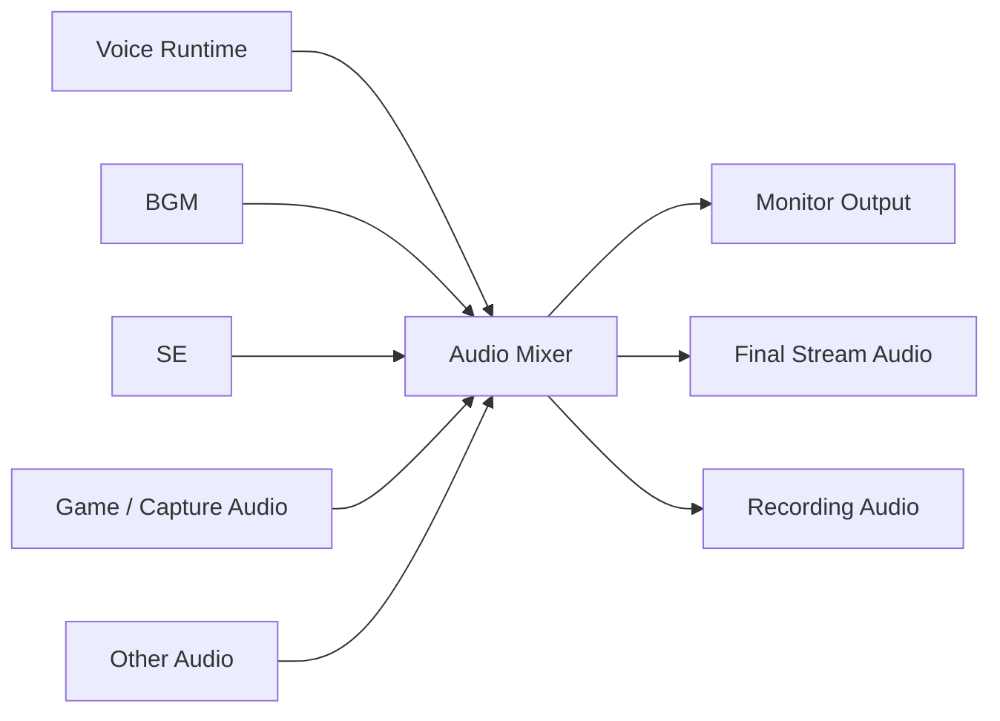

# 12. BGM・SE・音響管理方式

## 12.1 基本方針

BGM・SE・音響管理機能では、配信時に使用するBGM、SEおよびその他の音声素材を管理し、必要に応じて再生・停止・音量調整・配信音声への合成を行う。

音声素材の再生処理は、RVC等のVoice Conversionとは独立した機能として管理する。

最終的には、

- 変換済みマイク音声
- BGM
- SE
- Game / Capture Audio
- その他の音声源

を配信用音声へ合成する。

---

## 12.2 音声構成

概念的には以下のAudio Mixer構成とする。



### 採用理由

Voice、BGM、SEをそれぞれ直接配信出力へ送信すると、音量バランスやMute状態を一元管理できない。

最終的なAudio Mixerを設けることで、各音声源を統一的に管理する。

---

## 12.3 Audio Bus方式

音声源を用途別のAudio Busへ分類する。

初期構成では例えば以下を想定する。

```text
Master
├─ Voice
├─ Game / Capture
├─ BGM
├─ SE
└─ System
```

各Busについて以下を個別管理可能とする。

- Volume
- Mute
- 必要に応じたAudio Effect

### 採用理由

個々のAudioSourceごとに音量設定を管理すると、配信全体の音声バランス調整が困難になる。

用途単位のBusを設けることで、

「BGMだけ少し下げる」

「SEだけMuteする」

等を容易にする。

---

## 12.4 BGM管理方式

ユーザーは使用するBGMファイルを本システムへ登録できるものとする。

BGMについて少なくとも以下を管理する。

- ID
- 表示名
- 音声ファイル
- 音量
- Loop設定

必要に応じて将来的に以下を追加可能とする。

- Playlist
- Shuffle
- Fade In
- Fade Out
- Repeat

### 採用理由

音声ファイルのパスを直接指定して再生する構造では、ファイル移動等によって設定が壊れる可能性がある。

そのため、アプリケーション内で音声素材として登録・管理する。

---

## 12.5 SE管理方式

SEについても本システムへ登録し、配信中に即時再生可能とする。

SEは例えば以下から再生可能な構成を想定する。

- UIボタン
- Keyboard Shortcut
- 将来的な外部デバイス
- 将来的なイベント連携

複数SEの同時再生を許容する。

### 採用理由

SEはBGMと異なり、配信中の操作に対して低遅延で再生されることが重要である。

BGM再生処理と完全に同一の制御方式へ限定せず、短時間音声を即座に再生できる構成とする。

---

## 12.6 音声素材保存方式

登録したBGM・SEについては、元ファイルへの参照だけでなく、本システム管理領域へのコピーを基本とする。

概念例：

```text
Data/
└─ Audio/
    ├─ BGM/
    │  └─ <AudioId>/
    │      ├─ audio.*
    │      └─ audio-profile.json
    │
    └─ SE/
       └─ <AudioId>/
           ├─ audio.*
           └─ audio-profile.json
```

### 採用理由

アバターモデルと同様、元ファイルの移動・削除によって配信設定が壊れることを防止する。

また、Projectのバックアップや移行も行いやすくなる。

---

## 12.7 モニター音声と配信音声の分離

各Audio Busについて、必要に応じて、

- ユーザー自身へのモニター
- 配信音声への出力

を分離して制御可能とする。

例えば、

```text
BGM
├─ Monitor : OFF
└─ Stream  : ON
```

のような構成を可能とする。

### 採用理由

ユーザー自身が常にすべての音を聞く必要があるとは限らない。

例えばBGMを配信には流したいが、自分のヘッドホンでは聞きたくない場合がある。

そのため、音声源と物理出力先を直接結び付けず、Routingによって制御する。

---

## 12.8 配信用音声の生成方式

Audio Mixerで合成された最終配信用音声を、10章のカメラ・映像出力機能へ渡す。

```text
Voice
BGM
SE
 ↓
Audio Mixer
 ↓
Final Stream Audio
 ↓
Streaming Module
```

Streaming Module側では、Voice、BGM、SEそれぞれを認識せず、完成した`Final Stream Audio`のみを受け取る。

### 採用理由

Streaming Moduleが各音声源の構成を認識すると、BGMやSE追加時にStreaming側まで変更する必要がある。

そのため、音声構成の責務をAudio側へ集約する。

---

## 12.9 音量管理方式

音量は少なくとも以下の階層で管理する。

- Master Volume
- Voice Volume
- BGM Volume
- SE Volume
- Monitor Volume

必要に応じて個別音源単位のGainも設定可能とする。

### 採用理由

Master音量だけでは、声とBGMのバランス調整ができない。

一方で細かすぎる設定だけを提供すると操作が複雑になる。

そのため、用途別Busを基本単位とし、必要な場合のみ個別設定を行える構成とする。

---

## 12.10 音声エフェクト方式

BGM・SE・Voice等に対して必要に応じてAudio Effectを適用可能な構成とする。

例：

- Gain
- EQ
- Compressor
- Limiter

ただし、RVC推論等のVoice Conversion処理とは分離する。

### 採用理由

Audio Mixer上の音量・音質調整と、Voice Conversion自体は目的が異なる。

両者を分離することで、Voice Conversion方式変更時にも配信全体のAudio Mixing処理を維持できる。

---

## 12.11 配信中の操作方式

配信中に少なくとも以下を操作可能とする。

- BGM再生
- BGM停止
- BGM変更
- SE再生
- Bus音量変更
- Mute / Unmute

操作によってAudio Pipeline自体を再初期化しない構成とする。

### 採用理由

BGMやSEは配信中に頻繁に操作される機能であるため、再生操作によってVoice RuntimeやStreaming Audioが停止する構成は避ける。

---

## 12.12 音声クリッピング防止

複数音声源を同時に合成した場合でも、最終出力で極端なクリッピングが発生しにくい構成とする。

必要に応じてMaster BusにLimiter等を適用可能とする。

### 採用理由

Voice、BGM、SEが同時に大音量で再生されると、合成後の信号が許容範囲を超え、音割れが発生する可能性がある。

最終出力段階で保護処理を行える構成を用意する。

---

## 12.13 SetupとRuntimeの分離

### Setup

主に以下を扱う。

- BGM登録
- SE登録
- 音量設定
- Loop設定
- Audio Routing
- Audio Effect設定
- テスト再生

### Runtime

主に以下を行う。

- BGM再生
- SE再生
- Mixer処理
- 音量変更
- Mute
- Monitor Output
- Final Stream Audio生成

### 採用理由

音声素材登録やRouting設定を配信中の通常操作から分離し、Live UIを複雑化させないためである。

---

## 12.14 エラー処理・診断方式

通常利用者には以下のような理解しやすいエラーを表示する。

- 音声ファイルを読み込めません
- BGMを再生できません
- 出力デバイスを利用できません

開発者向けログには必要に応じて以下を記録する。

- AudioId
- Audio Format
- Sample Rate
- Channels
- Playback State
- Output Device
- Audio Bus
- Buffer状態
- Exception
- Stack Trace

### 採用理由

音声障害はファイル形式、Audio Device、Routing等の複数要因で発生する可能性がある。

通常利用者には対処可能な情報を表示し、開発者向けには原因調査に必要な内部情報を記録する。

---

## 12.15 内部責務分割

概念的には以下の構成を想定する。

```text
Audio/
├─ Core/
│  ├─ AudioProfile
│  └─ AudioState
│
├─ BGM/
│  └─ BgmPlayer
│
├─ SE/
│  └─ SePlayer
│
├─ Mixer/
│  ├─ AudioBus
│  └─ AudioMixerController
│
├─ Routing/
│  └─ AudioRouter
│
├─ Runtime/
│  └─ AudioRuntime
│
└─ Setup/
   └─ AudioSetupController
```

### 採用理由

BGM再生、SE再生、Mixing、Routing等を責務単位で分離することで、将来的な音響機能追加による影響範囲を限定する。

なお、本章で示すクラス名やディレクトリ構造は責務分割の考え方を示すものであり、実装時に詳細を調整する。

---

## 12.16 Game / Capture Audio方式

GameCaptureが提供するゲーム音声は、Capture Pluginから直接Streamingへ送信せず、Audio Moduleへ入力する。

概念的には以下とする。

```text
Capture Board
     ↓
GameCapture Source
     ↓
Game / Capture Audio Bus
     ↓
Audio Mixer
     ├─ Monitor Output
     ├─ Final Stream Audio
     └─ Recording Audio
```

Game / Capture Audioについて少なくとも以下を制御可能とする。

- Volume
- Mute
- Monitor Routing
- Stream Routing
- Recording Routing
- 必要に応じたEffect

SubScreenCaptureについては初期実装では映像のみを対象とし、Desktop Audioを自動的に取得する機能は必須としない。

### 採用理由

ゲーム音声を映像Capture機能から直接配信へ送ると、Voice、BGM、SEとの音量バランスやRoutingを一元管理できない。

Audio Mixerへ統合することで、ゲーム音声についても他の音声源と同じ方式で管理可能とする。
