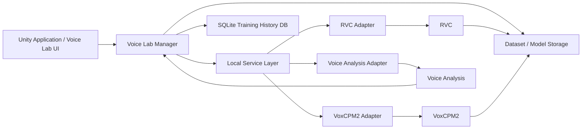

# 13. 音声モデル学習・Voice Lab方式

## 13.1 基本方針

音声モデル学習・Voice Lab機能では、VTuber配信で使用する音声変換モデルの作成、評価、調整、およびRuntime用モデルへの登録を行う。

本機能は、配信中のリアルタイム音声変換とは分離し、主としてSetup用途として提供する。

RVC学習、VoxCPM2による音声生成、音声解析等、Python環境を必要とする処理については、Unityアプリケーション内部へ直接組み込まず、必要に応じてローカルサービスまたは外部プロセスとして起動する。

配信時には、これらのPythonサービスを必要としない構成とする。

また、RVC、VoxCPM2等の外部OSSについては、**本システム固有のコードを可能な限り外部OSS本体へ追加しない**ことを基本方針とする。

学習履歴についてはMLflow等の外部実験管理システムを使用せず、本システム側のSQLiteデータベースで管理する。

### 採用理由

音声モデル学習環境は、

- Python
- PyTorch
- CUDA
- RVC
- VoxCPM2
- 各種音声処理ライブラリ

等、多数の外部依存を持つ。

これらをUnityアプリケーションへ直接組み込むと、学習環境の変更が配信Runtimeへ影響しやすくなる。

また、RVC等の外部OSS内部へ、

- 学習履歴保存
- DBアクセス
- UI連携
- 独自API
- モデル管理処理

等を直接追加すると、上流OSS更新時に独自変更との差分を解消する必要が生じる。

そのため、

**配信Runtimeと学習環境を分離すること**

および、

**外部OSSを変更するのではなく、その外側から利用すること**

を基本とする。

---

## 13.2 全体構成

音声モデル学習・Voice Lab機能は、概念的に以下の構成とする。



Unity側は、RVCやVoxCPM2等の内部実装を直接操作せず、Adapterまたはローカルサービスを介して利用する。

### 採用理由

Unity側が外部OSSのCLI、Python API、内部ディレクトリ構造等へ直接依存すると、外部OSS更新時の影響がUnity側まで波及する。

Adapter層を設けることで、

- コマンドライン引数変更
- Python API変更
- 出力先変更
- ファイル名変更
- バージョン差異

等を限定された箇所で吸収する。

---

## 13.3 外部OSS非改変方針

RVC、VoxCPM2等の外部OSSについては、原則として本体ソースコードを変更せず利用する。

本システム固有処理は、以下のような外部コンポーネントとして配置する。

- Wrapper
- Adapter
- Launcher
- API Server
- Post Processing
- 学習前後の管理処理
- ファイル監視
- 結果収集

やむを得ず外部OSSを変更する場合は、変更箇所を最小限とし、変更理由および上流との差分を明示する。

### 採用理由

外部OSS本体を直接改変すると、その時点では実装が容易でも、将来の上流更新への追従コストが高くなる。

特にRVCは、

- 前処理
- 学習
- F0処理
- Index生成
- 推論
- WebUI

等、複数機能が密接に関係している。

独自処理を内部へ追加すると、RVC側の構造変更によって本システム固有コードまで修正する必要が生じる。

そのため、外部OSSと自作コードの境界を明確に保つ。

---

## 13.4 外部OSS・学習環境の取得方式

声を作る機能は、利用者がアクティベーションするまで動かない。アクティベーションのときに、利用者のPCへ学習環境を構築する。インターネット接続を前提とする（利用者の決定、2026-11-01）。

RVC、VoxCPM2等のPythonを利用するExternal Componentについて、通常利用者へGit操作、Python導入、venv作成、pip操作等の手動セットアップを要求しない。構築はアプリが自動で行う。

開発時にはExternal OSSのSourceを取得し、固定したVersion / CommitおよびDependency Definition / Lockを用いて検証する。

通常利用者のPCでは、開発時に検証したものと同じものを、Hashを固定したManifestとLockから取得する。

- Pythonの実行環境
- Python Dependency（Lockのとおり）
- External OSS Code（固定のCommit）
- Model Weight
- 本システムのAdapter実装（アプリに同梱）

通常利用者向けの導入フローは概念的に以下とする。

```text
Voice Labを開く
        ↓
説明と利用規約の表示・同意
        ↓
PCの条件確認（GPU、空き容量、接続）
        ↓
Component Manifest確認
        ↓
取得（再開可能、Hash確認）
        ↓
Application管理領域へ構築
        ↓
短い学習を実際に動かして確認
        ↓
Voice Lab利用可能
```

通常利用者が、

```text
git clone ...
python -m venv ...
pip install ...
```

等を手動実行することを通常の利用手順とはしない。

取得元が消えた場合に備え、ライセンス上許されるModel WeightとExternal OSS Codeは本プロジェクトのGitHub Releaseにも控えを置き、配布元に無いときはそこから同じHashで取得する。取得先が生きていることは定期的なCIで確かめる。

### 採用理由

本システムの目的はVTuber統合環境（Virtual Vessel Studio）を提供することであり、一般利用者へGitやPython環境構築の知識を要求することは望ましくない。

環境をBuildして配布する方式は再現性に優れるが、PyTorchとCUDA関連Libraryの再配布が必要になる。声を作らない利用者には不要な容量でもある。アクティベーションのときに配布元から取得すれば、アプリの配布物を小さく保ち、それらを再配布せずに済む。

利用者の環境ごとの差異は、Python Version、Dependency、External OSS CommitをすべてHashで固定することで抑える。

配布元の変更や削除の影響は受けるが、登録済みの声での配信と、構築済みの環境には影響しない。Hashが合わないものは使わないので、改ざんされたものを動かすこともない。

---

## 13.5 外部OSSバージョン管理方式

外部OSSについて、GitHub上の最新コードを無条件に取得する方式とはしない。

本システム側で動作確認を行った、

- Release
- Tag
- Commit

等を明示的に指定して取得する。

外部コンポーネントの対応情報は、Manifest等によって管理する。

概念例（`RuntimePackageVersion`等の項目は、環境のVersionと読み替える）：

```text
External Components Manifest

RVC
  SourceVersion: <supported version>
  Commit: <commit>
  AdapterVersion: <version>
  RuntimePackageVersion: <version>
  PythonRuntimeVersion: <version>
  DependencyLockVersion: <version>
  BuildId: <build id>
  PackageHash: <hash>

VoxCPM2
  SourceVersion: <supported version>
  Commit: <commit>
  AdapterVersion: <version>
  RuntimePackageVersion: <version>
  PythonRuntimeVersion: <version>
  DependencyLockVersion: <version>
  BuildId: <build id>
  PackageHash: <hash>

VoiceAnalysis
  SourceVersion: <version>
  RuntimePackageVersion: <version>
  BuildId: <build id>
  PackageHash: <hash>
```

必要に応じて、取得ファイルのHash等を利用して内容を検証可能とする。

### 採用理由

外部OSSの最新版が、本システムと常に互換性を持つとは限らない。

利用者環境で自動的に最新版へ更新すると、外部OSS側の変更によって突然Voice Labが動作しなくなる可能性がある。

そのため、

**上流OSSの最新版**

と

**本システムが対応確認したバージョン**

を区別する。

---

## 13.6 Python開発・配布環境方式

Pythonを使用するExternal Componentについて、**開発者向け実行環境**と**通常利用者向け配布環境**を分離する。

### 開発者向け環境

開発者はNative Python + `venv`を用いて、Sourceから各Componentを直接実行・Test可能とする。

原則として、External Componentごと、かつVersionごとに環境を分離する。

概念的には以下の構成とする。

```text
Development/
├─ RVC/
│  └─ <Version>/
│     ├─ source/
│     └─ .venv/
│
├─ VoxCPM2/
│  └─ <Version>/
│     ├─ source/
│     └─ .venv/
│
└─ VoiceAnalysis/
   └─ <Version>/
      ├─ source/
      └─ .venv/
```

Dependencyは`pyproject.toml`、requirements系File、Lock File等の明示的な定義によって管理し、未固定のGlobal Environmentへ依存しない。

開発者はvenvを利用して、

- Debug
- Unit Test
- Integration Test
- Compatibility Test
- Build
- Benchmark

を実行可能とする。

標準の開発方式としてDockerを必須としない。

### 通常利用者向け環境

通常利用者にはPython本体やvenvを要求しない。

アクティベーションのときに、アプリがuvを使ってApplication管理領域へ環境を構築する。uvはHashを確かめて取得し、Python本体もuvが用意する。Unity Applicationは構築された環境の実行ファイルを明示的に起動する。

概念的には以下の構成を想定する。

```text
External/
└─ VoiceLab/
   └─ <ComponentsVersion>/
      ├─ uv.exe
      ├─ python/
      ├─ venv/
      ├─ rvc/
      ├─ models/
      └─ manifest.json
```

通常利用者がvenvをActivateしたり、`pip install`を実行したりする構成とはしない。

### 開発環境と配布環境の対応

開発用venvと利用者のPCの環境は別物とするが、同一の、

- Source Version / Commit
- Python Version
- Dependency Definition / Lock
- Adapter / Service Code
- Test

を基準として生成する。

これにより、

```text
Source + Dependency Lock
          ↓
   Developer venv
          ↓
         Test
          ↓
   Manifest / Lock
          ↓
 利用者のPCで構築
```

という関係を維持する。

### 採用理由

RVC、VoxCPM2、Voice Analysisでは、それぞれ要求するPython、PyTorch、CUDA関連Library、NumPy、Audio Library等のVersionが異なる可能性がある。

開発者にはSourceから検証可能な環境を提供しつつ、通常利用者には環境構築を要求しないことで、

- 開発時のDebug容易性
- 通常利用者の導入容易性
- Dependency再現性
- Component単位の更新・Rollback

を両立する。

---

## 13.7 Python Component Build・配布方式

本プロジェクトが配布するのは、環境そのものではなく、環境を作るための情報である。

- Component Manifest：取得するもの、Version、Hash
- Dependency Lock
- Adapter / Service Code
- Runtime用のひな形とモデル（`.sentis`）

これらは、開発用Sourceから次の流れで作る。

```text
Source
  +
External OSS Version / Commit
  +
Dependency Definition / Lock
        ↓
Developer venv
        ↓
Unit Test / Integration Test
        ↓
構築Test（空の環境でManifestから構築する）
        ↓
Health Check / Compatibility Test
        ↓
Manifest更新
        ↓
Release Artifact
```

方式設計として固定するのは特定Toolではなく、

1. 通常利用者へPython Installationを要求しない
2. 環境のVersionを識別できる
3. Source / Dependencyとの対応を追跡できる
4. Component単位で更新・Rollbackできる
5. DiagnosticsからVersionを確認できる

ことである。具体的なToolは詳細設計で決定する（Voice Lab詳細設計）。

### Model / Datasetとの分離

Dataset、Training Artifact等は環境と分離して管理する。環境を作り直しても、作った声と学習用の音声は残る。

### 採用理由

環境そのものの配布をやめても、Hashを固定した情報を配布すれば、Sourceとの対応と再現性は保てる。

---

## 13.8 External Component更新方式

環境を更新する場合、既存の環境へ直接上書きしない。アプリの更新で新しいManifestが届いたら、別のDirectoryへ新しい環境を構築する。

```text
External/VoiceLab/
├─ <ComponentsVersionA>/
└─ <ComponentsVersionB>/
```

更新時には概念的に以下を行う。

1. 新しいManifestを確認する
2. 取得し、Hashを確認する
3. 新Version用Directoryへ構築する
4. 短い学習を実際に動かして確認する
5. 利用Versionを切り替える
6. 古い環境を削除する

問題が発生した場合は、旧環境へ戻せる構成とする。

開発者向けのSource / venv更新は、通常利用者向けの更新とは別の開発作業として扱う。

### 採用理由

既存環境へ直接Updateを適用すると、更新失敗時にそれまで動作していたVoice Labまで利用不能になる可能性がある。

環境をVersion単位で分離することで、Update失敗の隔離とRollbackを行いやすくする。

---

## 13.9 RVC学習方式

RVC学習はPython環境で実行する。

Unityアプリケーション自身がRVC学習アルゴリズムを実装するのではなく、RVC学習環境をローカルサービスまたは外部プロセスとして起動し、学習要求を送信する。

概念的には以下の流れとする。

```text
Voice Lab UI
    ↓
Training Request
    ↓
RVC Adapter
    ↓
RVC Training Process
    ↓
Training Artifacts
    ↓
Result Collection
    ↓
Training History DB
```

RVC Adapterは、RVC本体のCLI、学習スクリプト、出力ファイル構造等と本システムとの境界を担当する。

### 採用理由

RVC学習ロジックをUnity側へ移植すると、RVC本体更新時に実装差異を追従する必要がある。

RVCをできる限りそのまま利用し、Adapter経由で起動することで、上流更新への追従を容易にする。

---

## 13.10 学習処理のオンデマンド起動

RVC学習サービス、VoxCPM2、Voice Analysis等のPythonサービスは常時起動せず、必要な機能を使用するときのみ起動する。

処理完了後は必要に応じて停止可能とする。

### 採用理由

これらの環境では、

- Python Process
- GPU Memory
- PyTorch
- CUDA
- 一時ファイル

等、多くのリソースを使用する可能性がある。

配信時には不要であるため、常時起動するメリットが少ない。

また、Python環境の障害をRuntimeから隔離できる。

---

## 13.11 Dataset管理方式

RVC学習に使用する音声Datasetは、本システム側で管理する。

概念的に以下のような情報を保持する。

```text
Dataset
├─ DatasetId
├─ Name
├─ CreatedAt
├─ Source
├─ Audio Files
├─ Preprocess Settings
└─ Metadata
```

DatasetはTraining Runとは別の管理単位とし、同一Datasetを複数の学習で再利用可能とする。

### 採用理由

Datasetと学習結果を一体化すると、同じDatasetで異なる学習条件を比較するたびに音声データが重複する。

Datasetを独立管理することで、

- 同一Datasetでの条件比較
- 再学習
- Dataset更新
- Dataset品質確認

を行いやすくする。

---

## 13.12 学習履歴DB方式

学習履歴管理には**SQLiteを採用する**。

学習1回を1つの`Training Run`として管理する。

最初の版はSQLiteを使わず、`run.json`で管理する。比較の画面を作るときにSQLiteを導入する（利用者の承認、2026-11-01）。

SQLiteには少なくとも以下を保存する。

- RunId
- 実行日時
- DatasetId
- 使用したRVCバージョン
- 使用したAdapterバージョン
- 学習設定
- Epoch数
- Batch Size
- Sample Rate
- F0方式
- 使用GPU等の実行環境
- Python Version
- PyTorch Version
- CUDA Version
- 学習開始時刻
- 学習終了時刻
- 学習状態
- 出力モデルへの参照
- Indexファイルへの参照
- Logファイルへの参照
- 評価結果
- エラー情報
- ユーザーコメント

Python側からSQLiteを直接操作することは原則として行わない。

学習結果を本システム側が受け取り、Repository等を介してSQLiteへ保存する。

### 採用理由

モデルが増えると、

**どのDataset、設定、外部OSSバージョンで作ったモデルなのか**

が分からなくなりやすい。

一方、MLflow等を使用するためにRVC内部へログ処理を追加すると、外部OSSへの独自変更が増え、更新追従が難しくなる。

SQLiteであれば、

- DBサーバが不要
- ローカルアプリで完結する
- 導入が容易
- バックアップが容易
- C#から扱いやすい

という利点がある。

そのため、必要十分な学習履歴管理を本システム側で実装する。

---

## 13.13 学習履歴DBと成果物の分離

モデル、Dataset、ログ等の大容量ファイルそのものはSQLiteへ格納しない。

SQLiteには、

- メタデータ
- 状態
- 設定
- 成果物への参照

を保存する。

実ファイルはファイルシステム上で管理する。

概念例：

```text
VoiceLab/
├─ voice-lab.db
│
├─ Datasets/
│
├─ TrainingRuns/
│
└─ Models/
```

### 採用理由

モデルやDataset等の大容量データをSQLiteへ格納すると、

- DBサイズ増大
- バックアップ負荷増加
- DB破損時の影響増大
- ファイル操作の複雑化

につながる。

そのため、SQLiteは管理情報に限定する。

---

## 13.14 Training Runディレクトリ方式

Training Runごとに専用の管理ディレクトリを作成する。

概念例：

```text
TrainingRuns/
└─ <RunId>/
    ├─ run.json
    ├─ logs/
    ├─ checkpoints/
    ├─ output/
    │  ├─ model.pth
    │  └─ model.index
    └─ diagnostics/
```

RVC本体の出力ディレクトリと異なる場合は、学習終了後に必要な成果物を本システム管理領域へ収集またはコピーする。

### 採用理由

RVCの内部ディレクトリ構造は将来変更される可能性がある。

外部OSSの内部構造をそのまま永続管理方式として採用せず、本システム側で安定した管理形式へ整理する。

---

## 13.15 学習状態管理方式

Training Runには、本システム共通の学習状態を持たせる。

例：

```text
Pending
Preparing
Preprocessing
Training
PostProcessing
Completed
Failed
Cancelled
```

Unity UIでは、RVC内部のログ文字列をそのまま状態表示へ使用せず、共通のTraining Stateへ変換する。

### 採用理由

外部OSSごとにログ形式や進捗表現が異なる。

外部OSSの生ログへUIを依存させると、バージョン変更によってUI側まで修正が必要になる。

そのため、外部状態を本システム共通状態へ変換する。

---

## 13.16 学習ログ取得方式

RVC学習プロセスの標準出力および標準エラーを取得し、Training Run単位でログとして保存する。

通常利用者向けUIでは、

- 前処理中
- 学習中
- モデル生成中
- 完了
- 失敗

等の簡潔な情報を表示する。

Developer Diagnosticsでは詳細なPythonおよびRVCログを確認可能とする。

### 採用理由

RVC学習失敗の原因調査には詳細なPythonログが必要である。

一方、通常利用者へすべてのログを表示すると、UIが複雑になり必要な情報が分かりにくくなる。

そのため、利用者向け状態表示と開発者向け生ログを分離する。

---

## 13.17 学習結果評価方式

Training Run完了後、必要に応じてモデル評価を実行可能とする。

評価処理はRVC学習本体へ埋め込まず、学習完了後の独立処理として実行する。

評価結果はTraining Runへ関連付けてSQLiteへ保存する。

評価対象として、将来的に以下を利用可能とする。

- Reference Similarity
- Pitch特性
- Silence Ratio
- ノイズ量
- 音声品質指標
- テストPromptによる比較
- ユーザーによる主観評価

### 採用理由

評価ロジックをRVC学習本体へ組み込むと、RVC更新への追従が難しくなる。

学習と評価を分離することで、

- 評価アルゴリズム変更
- 指標追加
- 過去モデル再評価

をRVC本体へ手を加えず実行できる。

---

## 13.18 VoxCPM2連携方式

VoxCPM2は、Voice Labにおける参照音声生成、音声クローン等の用途で利用する。

VoxCPM2はPythonローカルサービスとして起動し、UnityからAPI経由で利用する。

Unity側はVoxCPM2のPython内部実装へ直接依存しない。

### 採用理由

VoxCPM2も外部OSSであり、モデルや実装方式が将来変更される可能性がある。

Adapter / Service境界を設けることで、外部変更の影響を局所化する。

---

## 13.19 Voice Analysis方式

音声解析処理についても独立したローカルサービスとして扱う。

対象例：

- 音声長
- Silence Ratio
- Pitch
- 音量
- Reference Similarity
- その他品質評価

解析結果は、

- Dataset品質確認
- Voice Lab UI
- Training Run評価
- 生成音声比較

等へ利用する。

### 採用理由

解析ロジックとRVC学習ロジックを分離することで、評価方式の変更を学習コードへ影響させない。

また、学習前Datasetや過去モデル出力にも同じ解析機能を再利用できる。

---

## 13.20 Voice Lab方式

Voice Labは、音声モデル作成に必要な作業を統合的に行うSetup機能として提供する。

対象例：

- 音声Dataset準備
- 参照音声生成
- 音声候補比較
- Dataset品質確認
- RVC学習
- Training Run確認
- モデル評価
- モデル試聴
- Runtime用モデル登録

Voice Labは配信中のLive UIとは分離する。

### 採用理由

音声モデル作成には多数の設定や試行錯誤が必要である。

これらをLive UIへ含めると通常配信時の操作が複雑になるため、独立した作業領域として提供する。

---

## 13.21 Runtime用モデル登録方式

学習完了したRVCモデルを、そのままRuntimeから使用することは原則としない。

Voice Labから明示的に**Runtime用モデルとして登録**する。

登録時に必要に応じて以下を行う。

- モデル検証
- 必須ファイル確認
- Index確認
- Runtime用形式への変換
- Unity Inference Engine（旧Unity Sentis）用モデル変換
- メタデータ生成
- 推奨Pitch等の設定
- Runtime管理領域へのコピー

Unity Inference Engine用の変換はUnity Editorにしかないので、配布したアプリでは、開発者が作ったひな形へ学習した重みを書き込む（Voice Lab詳細設計8.4）。

概念的には以下の流れとする。

```text
Training Run
     ↓
Model Evaluation
     ↓
Register for Runtime
     ↓
Runtime Model Conversion
     ↓
Voice Model Library
     ↓
Voice Runtime
```

### 採用理由

学習環境上のモデルと配信Runtimeを直接結びつけると、RVC学習環境の更新、フォルダ変更、削除等によってRuntimeが動作しなくなる可能性がある。

Runtime用モデルを独立管理することで、学習環境と配信環境のライフサイクルを分離する。

---

## 13.22 学習キャンセル・異常終了方式

ユーザーは実行中のTraining Runをキャンセル可能とする。

キャンセルまたは異常終了した場合もRun情報を削除せず、

- Cancelled
- Failed

等の状態としてSQLiteへ残す。

必要に応じて途中生成されたログや成果物も保持可能とする。

### 採用理由

失敗した学習も、

- どの設定で失敗したか
- どこまで処理が進んだか
- 同じ失敗を繰り返していないか

を確認するための重要な履歴である。

成功Runだけを保存すると試行錯誤の履歴が失われる。

---

## 13.23 SetupとRuntimeの分離

### Setup / Voice Lab

以下を扱う。

- 外部OSSセットアップ
- Python環境構築
- Dataset管理
- RVC学習
- VoxCPM2
- Voice Analysis
- Training Run管理
- モデル比較
- モデル評価
- Runtimeモデル登録

### Runtime

RuntimeではVoice Lab用Pythonサービスを使用しない。

登録済みのVoice Modelのみを使用してリアルタイム音声変換を行う。

### 採用理由

学習環境は依存関係が多く、障害要因も多い。

これを配信Runtimeから分離することで、Python学習環境が壊れていても、既に登録済みのモデルを使用して配信できるようにする。

---

## 13.24 エラー処理・診断方式

通常利用者向けには、例えば以下のような情報を表示する。

- 必要なコンポーネントを取得できませんでした
- 必要なVoice Labコンポーネントを準備できませんでした
- Datasetに問題があります
- 学習を開始できませんでした
- 学習処理が失敗しました
- Runtimeモデルへの登録に失敗しました

Developer Diagnosticsでは、必要に応じて以下を確認可能とする。

- RunId
- 外部OSS名
- 外部OSS Version / Commit
- Adapter Version
- Execution Mode（Portable Runtime / Developer venv）
- 環境のVersion
- Python Version
- 環境のPath / venv Path
- PyTorch Version
- CUDA Version
- Package Version
- 実行コマンド
- Process ID
- Exit Code
- stdout
- stderr
- 学習時間
- 出力成果物
- Health Check結果
- Exception
- Stack Trace

### 採用理由

Python学習環境では、外部OSS、Python、GPU、依存ライブラリ等、多数の要因で障害が発生する。

一般利用者には復旧に必要な情報を提示し、OSS開発者には原因追跡に必要な情報を提供する。

---

## 13.25 内部責務分割

概念的には以下の構成を想定する。

```text
VoiceLab/
├─ Core/
│  ├─ TrainingRun
│  ├─ TrainingState
│  └─ DatasetProfile
│
├─ External/
│  ├─ ExternalComponentManager
│  ├─ ExternalComponentManifest
│  └─ PythonEnvironmentManager
│
├─ Dataset/
│  └─ DatasetManager
│
├─ Training/
│  ├─ TrainingManager
│  └─ RvcAdapter
│
├─ Generation/
│  └─ VoxCpmAdapter
│
├─ Analysis/
│  └─ VoiceAnalysisAdapter
│
├─ Evaluation/
│  └─ VoiceModelEvaluator
│
├─ History/
│  ├─ TrainingHistoryRepository
│  └─ SQLiteTrainingHistoryDatabase
│
├─ ModelRegistration/
│  └─ RuntimeModelRegistrar
│
├─ Services/
│  └─ VoiceLabServiceManager
│
└─ Setup/
   └─ VoiceLabSetupController
```

### 採用理由

外部OSS管理、Python環境管理、Dataset、学習、解析、評価、履歴管理、Runtime登録をそれぞれ分離することで、特定外部OSSの変更がシステム全体へ波及することを防ぐ。

特に、RVC等の外部OSSとSQLiteによる学習履歴管理を分離することで、外部OSSを更新しても過去のTraining Run情報を継続して管理できる。

---

## 13.26 外部OSS管理の基本原則

本システムでは、外部OSSおよびPython Componentについて以下を基本原則とする。

1. 外部OSS本体は可能な限り改変しない。
2. 本システム固有処理はAdapter / Wrapperとして外部へ配置する。
3. 一般利用者へGit操作を要求しない。
4. 一般利用者へPython Installation、venv作成・Activation、pip操作を要求しない。
5. 外部OSSは本システムが対応確認したVersion / Commitを使用する。
6. 開発者向けにはExternal Componentごと、かつVersionごとにNative Python + venvで検証可能な環境を用意する。
7. 通常利用者向けには、Hashを固定したManifestとLockから、アクティベーションのときに環境を構築する。
8. 開発用venvと利用者のPCの環境は、同一のSource Version、Python Version、Dependency Definition / Lockを基準とする。
9. 環境はVersion単位で管理する。
10. External Component更新時には既存の環境へ直接上書きしない。
11. 更新失敗時には旧環境へ戻せる構成とする。
12. Dataset、Training Artifact等のDataは環境と分離する。
13. 利用者向けUIにはPython、venv、Port、Process等の内部構造を必要以上に露出しない。
14. 開発者向けにはExternal OSS、環境、Python、Dependency、Process、Log等を十分に確認可能とする。
15. 学習履歴は外部OSS側ではなくSQLiteで管理する。
16. 大容量成果物はDBへ格納せず、File System上で管理する。
17. 学習環境と配信Runtimeを明確に分離する。
18. 標準の開発・配布方式としてDockerを必須依存としない。
