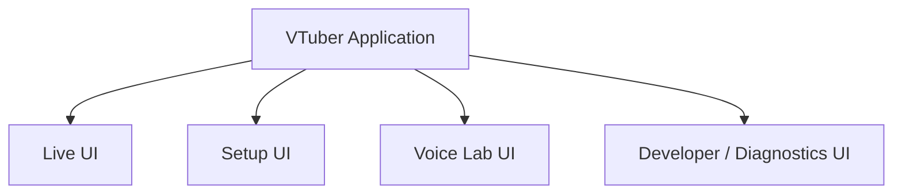

# 14. UI・操作方式

## 14.1 基本方針

本システムのUIは、利用目的に応じて大きく以下の領域へ分離する。

- Live UI
- Setup UI
- Voice Lab UI
- Developer / Diagnostics UI

通常の配信中に使用する操作と、事前設定、音声モデル作成、開発・診断操作を同一画面へ混在させない。

概念的には以下の構成とする。



### 採用理由

本システムは、

- Avatar
- Tracking
- Voice Conversion
- Streaming
- Stage
- Audio
- Voice Lab
- Developer Diagnostics

等、多数の機能を持つ。

すべてを1画面へ表示すると、通常配信時には不要な設定まで表示され、操作が複雑になる。

そのため、利用目的に応じて画面を分離し、必要な操作へ集中できる構成とする。

---

## 14.2 UIの基本分類

### Live UI

配信中に頻繁に使用する操作を扱う。

主な対象は以下とする。

- 配信開始・終了
- 録画開始・終了
- Avatar切り替え
- Stage切り替え
- Camera切り替え
- GameCapture / SubScreenCapture ON・OFF
- Capture Source状態確認
- Voice Model切り替え
- Voice Conversion ON / OFF
- BGM / SE操作
- 音量
- Mute
- Tracking状態
- Streaming状態

### Setup UI

配信前の設定や各機能の登録・調整を扱う。

主な対象は以下とする。

- Project
- Avatar
- Tracking
- Voice
- Stage
- Camera
- Capture
- Audio
- Streaming
- External Components
- Application
- Data Root

### Voice Lab UI

音声モデル作成に関する作業を扱う。

主な対象は以下とする。

- 音声生成
- Voice Clone
- Dataset
- Voice Analysis
- RVC学習
- Training Run
- Model Evaluation
- Runtime Model登録

### Developer / Diagnostics UI

開発者向けの診断・内部状態確認を扱う。

主な対象は以下とする。

- 詳細ログ
- Diagnostic Camera
- Tracking Overlay
- Skeleton表示
- Face Tracking値
- FPS
- Frame Time
- Audio Buffer
- RVC推論時間
- Streaming状態
- Python Service状態
- 外部OSS情報
- venv情報

### 採用理由

機能の種類ではなく、**どの場面で使用するか**によってUIを分けることで、操作体系を理解しやすくする。

---

## 14.3 UI実装方式

本システムの通常ランタイムUIには、原則として**Unity UI Toolkit**を使用する。

UIについて以下の責務を分離する。

```text
UXML
  └─ UI構造

USS / Theme Style Sheet
  └─ レイアウト・色・フォント等の見た目

C#
  └─ 状態管理・Command・Runtime連携
```

UI Builderについても、画面構造やレイアウト確認のために利用可能とする。

### 採用理由

画面構造、Visual Design、Runtime処理を分離することで、

- UIの見た目だけを変更する
- レイアウトを変更する
- Themeを変更する
- Runtime処理を変更する

といった作業を互いに独立して行いやすくする。

また、多数の設定画面で共通スタイルを利用しやすい。

---

## 14.4 Design System方式

各画面の実装時に、その画面だけの独自デザインを作成する方式とはしない。

アプリケーション共通の**Design System**を定義する。

Design Systemでは少なくとも以下を管理する。

### Color

- Background
- Surface
- Primary
- Secondary
- Text
- Disabled
- Success
- Warning
- Error

### Typography

- Heading
- Body
- Caption
- Button
- Numeric
- Monospace

### Spacing

- XS
- S
- M
- L
- XL

### Shape

- Corner Radius
- Border
- Divider

### UI Component

- Primary Button
- Secondary Button
- Icon Button
- Toggle
- Slider
- Dropdown
- Text Field
- Numeric Field
- Tab
- Card
- Dialog
- Notification
- Status Indicator
- Progress Bar
- Navigation Item
- Setting Row

概念的には以下とする。

```text
Design Tokens
      ↓
USS / Theme
      ↓
Common UI Components
      ↓
Application Screens
```

### 採用理由

画面単位でデザインを作成すると、

- Button形状が統一されない
- Marginが画面ごとに違う
- Font Sizeが不統一になる
- Status色の意味が変わる

等が発生しやすい。

Design Systemを共通化することで、アプリケーション全体のデザイン品質を一定に保つ。

---

## 14.5 共通UIコンポーネント方式

頻繁に使用するUIは、再利用可能な共通Componentとして実装する。

概念例：

```text
UI/
└─ Components/
   ├─ PrimaryButton
   ├─ SecondaryButton
   ├─ SettingRow
   ├─ SectionHeader
   ├─ StatusBadge
   ├─ DeviceSelector
   ├─ ModelSelector
   ├─ ProgressPanel
   ├─ ErrorPanel
   └─ ConfirmDialog
```

各画面は可能な限り共通Componentを組み合わせて構築する。

### 採用理由

画面ごとにButtonやSetting Row等を一から実装すると、見た目だけでなく動作にも差異が生じる。

共通Component化することで、Visual Design、操作性、保守性を統一する。

---

## 14.6 UI多言語対応方式

UIは初期対応言語として以下を提供する。

- 日本語
- English

多言語対応には、言語ごとの文字列表（JSON）を用いる**Project独自の軽量な仕組み**を使用する。Unity Localization packageは、Addressablesと追加のBuild手順を伴う一方、本Applicationに必要なのは文字列の取得、差し込み、実行中の言語切り替えのみであるため使用しない（UI基盤詳細設計12.1）。

実装上は日本語と英語のみを前提とはせず、将来新しいLocaleを追加可能な構成とする。

UI文字列をC#やUXMLへ直接記述することは原則として避け、Localization Keyを使用する。

概念的には以下とする。

```text
UI Element
    ↓
Localization Key
    ↓
String Table
    ├─ ja
    ├─ en
    └─ Future Locale
```

例：

```text
ui.streaming.start

ja:
配信開始

en:
Start Streaming
```

言語はアプリケーション実行中に切り替え可能とし、切り替え後はUIを対応Localeへ更新する。

### 採用理由

UIコード内部へ表示文字列を直接記述すると、言語追加のたびにプログラム変更が必要となる。

Localization Tableへ分離することで、翻訳追加と機能実装を分離する。

---

## 14.7 多言語を考慮したレイアウト方式

UIレイアウトは日本語だけを基準として作成しない。

以下を考慮する。

- 英語による文字列長の増加
- 将来追加する言語
- UI Scale
- Font変更
- OS表示スケール

固定幅Labelの多用を避け、可能な範囲で可変レイアウトを使用する。

### 採用理由

日本語では短く表示できるラベルでも、英語では大きく長くなる場合がある。

Locale追加のたびに画面を再設計することを避けるため、初期段階から文字列長の変化を考慮する。

---

## 14.8 フォント管理方式

UI要素へFontを直接個別指定しない。

UI ToolkitのFont Asset、およびUSS / Theme Style Sheetを用いて共通管理する。

概念的には以下とする。

```text
Theme
   ↓
Typography
   ├─ Heading
   ├─ Body
   ├─ Caption
   ├─ Button
   ├─ Numeric
   └─ Monospace
        ↓
     UI Elements
```

各UI要素は具体的なFont名ではなく、共通Typography Styleを使用する。

これによりThemeやTypography設定を変更することで、アプリケーション全体のFontを一括変更可能とする。

また、必要に応じてLocaleごとにFont AssetまたはTheme Style Sheetを切り替え可能とする。

### 採用理由

各UI要素にFontを直接指定すると、Font変更時に多数のUXML / USSを修正する必要がある。

共通Themeへ集約することで、

- Font変更
- Font Size変更
- Weight変更
- Locale別Font
- Theme変更

を一括して行えるようにする。

---

## 14.9 Font Fallback方式

使用Fontがすべての文字Glyphを持つことを前提としない。

必要に応じてFallback Fontを設定する。

概念例：

```text
Primary Font
      ↓
Japanese Fallback
      ↓
Symbol / Other Language Fallback
```

### 採用理由

将来的な言語追加や記号表示において、Fontが必要Glyphを持たない場合でも文字欠けを防止するためである。

---

## 14.10 Live UI方式

Live UIは、配信中に必要な操作を少ない手順で実行できることを優先する。

詳細設定を多数表示するのではなく、頻繁に変更する項目を中心とする。

主な対象は以下とする。

- Streaming State
- Recording State
- Avatar
- Stage
- Camera
- Voice
- BGM
- SE
- Volume
- Mute
- Tracking State

### 採用理由

配信中は、利用者が会話やゲーム等にも注意を向ける。

そのため、設定画面のような複雑な操作を要求せず、主要操作を即座に実行できる構成とする。

---

## 14.11 Live UIとSetup UIの分離

Live UIから詳細なパラメータを直接変更することは原則として避ける。

例えば以下はSetup UIで扱う。

- Tracking Filter係数
- Encoder詳細設定
- Audio Device設定
- External Component設定

Live UIでは主に以下を扱う。

- 選択
- 切り替え
- ON / OFF
- Volume
- Mute

### 採用理由

配信中に詳細設定を変更すると、機能の再初期化や予期しない停止につながる可能性がある。

そのため、通常操作と詳細設定を分離する。

---

## 14.12 Setup UI方式

Setup UIでは、配信前に各機能を設定・検証する。

概念例：

```text
Setup
├─ Project
├─ Avatar
├─ Tracking
├─ Voice
├─ Stage
├─ Camera
├─ Capture
├─ Audio
├─ Streaming
├─ External Components
└─ Application
```

各Setup画面には可能な範囲でテスト機能を用意する。

例：

- Avatar Preview
- Tracking Preview
- Microphone Test
- Voice Conversion Test
- Camera Preview
- Capture Preview
- Audio Test
- Streaming Connection Test

### 採用理由

設定値を入力しただけでは、実際に正常動作するか判断できない場合がある。

配信前に機能単位で確認可能とすることで、本番中のトラブルを減らす。

---

## 14.13 Voice Labの基本UI方式

Voice Labは、RVC学習機能だけを単独で表示するのではなく、**最終的なRuntime用Voice Modelを作成するまでの一連の流れ**を明確に表示する。

目玉は、利用者が自分好みの声を作り出せることである。一度の指定で理想に当てるのではなく、近い声を選び、少しずつ寄せ、自分の声で試して決める流れとする（利用者の方針と画面案の確認、2026-11-03。Voice Lab詳細設計8.3）。

基本フローを以下とする。UI上では「STEP 1」〜「STEP 5」の番号付きの段階として表示し、次へ進むボタンにも行き先の番号を付ける。終えた段階へは戻れる。

```text
Voice Lab ― 声を作る

[STEP 1 土台を選ぶ]
      ↓
[STEP 2 声色を寄せる]
      ↓
[STEP 3 作る]           学習用の音声の生成、加工、RVC学習
      ↓
[STEP 4 自分の声で試す] 気に入らなければSTEP 2へ
      ↓
[STEP 5 登録する]
```

自分の録音（本人の声、または権利を持つ声）から作る場合は、STEP 1とSTEP 2の代わりに録音を取り込み、STEP 3以降を共有する。

Dataset、Seed、Training Runなどの作業の内部は通常の画面に出さず、Developer Modeで見せる（14.22）。

### 採用理由

音声生成、Voice Clone、Dataset、RVCを独立した機能として並べるだけでは、利用者が次に何を行うべきか理解しにくい。

本システムでは、最終的なRuntime Voice Modelの作成までを一つの作業として扱う。

実験では、指示文のつまみだけでは理想の声に届かず（同じ指示でも乱数で声が大きく変わる）、選んだ声を波形の加工で寄せると、同じ人の声のまま変えられ、学習と変換を通っても残った（決定記録、2026-11-03「声を設計する実験」）。この結果に合わせ、生成と選定と調整を利用者の判断の順に並べる。

---

## 14.14 Voice Lab ― STEP 1 土台を選ぶ

主に以下を扱う。

- 始めるための例。それぞれ見本を聞ける
- 指示文を作る言葉の棚。言葉ごとに、その言葉だけを変えた見本を聞ける（主なグループを先に。残りは折りたたんで「もっと細かく」）
- 頼む声を、画面の言語の1文で読み返す
- ことばで足す指示（任意）
- VoxCPM2による複数候補の生成（1回に6個程度、「もっと作る」）
- 選んだ候補の近くの候補の生成。近い声のまわりを探す（「この声に近い候補を作る」）
- 候補の試聴
- 候補ごとの声の高さ（中央値）と高さの幅をHzで表示し、共通の目盛りの上に描く
- 高さの順の並べ替え
- 候補の選択

Seedは通常の画面に出さない。送った指示文は、読みたいユーザーのために、候補を作った後に折りたたんで見せる（ユーザーの決定、2026-11-07）。作った候補の条件は内部で残し、作り直せるようにする。

### 採用理由

同じ指示でも候補ごとに声が変わるので、複数を聞き比べて選ぶ形にする。耳だけでなく数値でも比べられると、候補を選びやすい（利用者の要望、2026-11-03）。

---

## 14.15 Voice Lab ― STEP 2 声色を寄せる

主に以下を扱う。

- 声色のつまみ：声の高さ、年齢（響き）、明るさ、やわらかさ、息っぽさ
- 元の声と調整後の聞き比べ（その場で加工して試聴）
- 声の高さの変化をHzで表示
- 大きく動かしたときの注意（別の人の声に聞こえることがある）
- 元に戻す

抑揚と話す速さのつまみは置かない。

### 採用理由

声色は学習したモデルから来るが、抑揚、速さ、発音の癖は話す本人から来る。抑揚を機械的に大きくすると不自然になった（利用者の判断、2026-11-03）。調整は学習の前にすばやく試聴できることが大切なので、学習を待たずに聞ける加工で行う。

---

## 14.16 Voice Lab ― STEP 3 作る

主に以下を扱う。

- 作業の段階の表示：学習用の音声を作る、声を覚える（RVC学習）、確認する
- Progressと残り時間の目安
- 取り消し
- 配信中は作れないことの案内（14.26）

Datasetの一覧、採用と除外、解析結果（Silence Ratio、Pitch、音声長）、Training Runの詳細は、Developer Modeで見せる。

通常利用者にはRVC内部のPython操作を要求しない。

### 採用理由

学習用の音声は選んだ声から作るので、利用者が一つずつ選び直す必要はない。RVCを直接操作するのではなく、本システム側のTraining Workflowとして提供することで、学習環境の内部構造を意識せず利用可能とする。

---

## 14.17 Voice Lab ― STEP 4 自分の声で試す

主に以下を扱う。

- 試す声：録音ファイル（WAV、M4A、MP3）か、マイク
- 声の高さ：利用者の声に合わせて自動で決め、必要なときだけ動かす
- 元の声と変換後の聞き比べ
- STEP 2へ戻って直す

変換は配信と同じリアルタイムの経路で行う（Voice Lab詳細設計8.3.4）。

### 採用理由

ファイル全体を一度に変換すると、リアルタイムの変換で起きる問題が隠れ、作った声を高く評価してしまう。配信で聞こえる声で判断できるようにする。

---

## 14.18 Voice Lab ― STEP 5 登録する

主に以下を扱う。

- 声の名前
- 作った内容のまとめ（土台、声色、声の高さ）
- 登録したらすぐ使うかの選択
- 登録済みの声の一覧、試聴、比較、作り直し

作った元のデータは残し、あとで作り直せるようにする。

### 採用理由

学習完了と実際のRuntime採用を分離することで、複数の結果を比較した上で採用する声を決定できる。

---

## 14.19 Project選択方式

アプリケーション起動後、利用するProjectを選択可能とする。

前回利用したProjectを初期候補として表示してもよい。

Project選択後、6章で定義した関連ProfileやAssetを読み込む。

### 採用理由

毎回すべての設定を個別に選択するのではなく、Projectを起点として配信環境を復元するためである。

---

## 14.20 状態表示方式

主要機能について、現在の状態を利用者が容易に確認できるようにする。

対象例：

- Tracking
- Microphone
- Voice Conversion
- Streaming
- Recording
- Python Service
- External Component

内部実装上の状態をそのまま表示するのではなく、利用者向け状態へ変換する。

例：

```text
Tracking
  Ready
  Tracking
  Person Lost
  Error
```

```text
Streaming
  Offline
  Connecting
  Live
  Reconnecting
  Error
```

### 採用理由

利用者が必要としているのは内部クラス名ではなく、現在機能を使用できるかどうかである。

---

## 14.21 エラー通知方式

エラーや通知は重要度によって分類する。

- Information
- Warning
- Error
- Critical

通常利用者向けエラーでは原則として以下を示す。

1. 何が起きたか
2. どの機能に影響するか
3. 何を試せるか

ExceptionやStack Trace等はDeveloper Diagnosticsへ記録する。

### 採用理由

利用者向け情報と開発者向け情報では必要な詳細度が異なる。

---

## 14.22 Developer Mode方式

通常利用では必要のない開発機能を表示するためDeveloper Modeを設ける。

Developer Modeを有効にすることでDeveloper / Diagnostics UIへアクセス可能とする。

Developer ModeのON / OFFはUI固有設定として保存する。

### 採用理由

OSSとしての開発・保守には詳細な内部状態確認が必要である一方、通常利用者には不要だからである。

---

## 14.23 Developer ModeによるRuntimeへの影響

Developer Modeを有効にしても、通常のRuntime Pipeline自体を変更しないことを基本とする。

例えばDiagnostic Cameraを表示しても、

- Stream Render Target
- Streaming Pipeline
- Voice Runtime
- Tracking Pipeline

の構造を変更しない。

### 採用理由

診断機能を有効化したこと自体によって、通常Runtimeと異なる挙動になることを避ける。

---

## 14.24 Diagnostic Camera UI

Diagnostic CameraはDeveloper / Diagnostics UIから利用する。

必要に応じて以下を同時表示可能とする。

- 実写Camera Input
- Avatar Preview
- Skeleton
- Tracking Overlay
- Face Landmarks
- Tracking Confidence

Diagnostic Cameraおよび実写Camera映像はStreaming Pipelineへ接続しない。

### 採用理由

入力映像とアバター出力を比較することで、

- Tracking
- Normalization
- Retargeting
- Avatar Control

のどこで問題が発生しているか確認しやすくする。

---

## 14.25 長時間処理のUI方式

以下のような長時間処理については、処理状態をUIへ表示する。

- 外部OSS取得
- Python環境構築
- Dataset前処理
- RVC学習
- Model Conversion
- Import / Export

必要に応じて以下を表示する。

- 現在の処理段階
- Progress
- 開始時刻
- キャンセル可否
- Error State

通常画面へ外部OSSの生ログを大量表示することは避ける。

### 採用理由

処理が正常に進行しているか利用者が判断できるようにするとともに、内部ログと利用者向け状態表示を分離する。

---

## 14.26 配信中の操作制御

配信中であることをUI全体で認識する。

Runtime中の変更が危険な設定については、

- 操作禁止
- Warning
- 配信終了後に適用

等を行う。

対象例：

- Encoder変更
- 配信解像度変更
- Audio Device再初期化
- Data Root変更

一方、Runtime中に安全な変更方式が用意されている以下についてはLive UIから操作可能とする。

- Avatar
- Stage
- Camera Point
- Voice Model
- BGM
- SE
- Volume
- Mute

### 採用理由

UIから操作できることと、Runtime中に安全に変更できることは別である。

各Moduleの設計上の制約をUI側でも守る。

---

## 14.27 操作ショートカット方式

配信中に頻繁に使用する操作について、Keyboard Shortcut等を割り当て可能な構成とする。

対象例：

- SE再生
- BGM操作
- Camera切り替え
- Stage切り替え
- Mute
- Expression Preset
- Avatar切り替え

将来的に外部入力デバイスからも同じ操作を実行可能な構成とする。

---

## 14.28 操作Commandの抽象化

UI ButtonやKeyboard ShortcutからRuntime処理を直接呼び出さず、操作をCommand等の共通表現へ変換する。

```text
UI Button
Keyboard Shortcut
External Device
       ↓
     Command
       ↓
Application Runtime
```

例：

```text
SwitchCameraCommand
PlaySeCommand
ToggleMuteCommand
SwitchAvatarCommand
```

### 採用理由

操作入力と実際の機能を分離することで、新しい入力方法を追加してもRuntime側を変更する必要を減らす。

---

## 14.29 UI状態とRuntime状態の分離

UI上の表示をシステム状態そのものとして扱わない。

Runtime側の状態を正とし、その状態をUIへ反映する。

```text
User Operation
     ↓
Command
     ↓
Runtime
     ↓
Runtime State
     ↓
UI Update
```

### 採用理由

UI上ではONになっているが、実際の機能起動には失敗している、といった状態不一致を防止する。

---

## 14.30 非同期UI方式

時間のかかる処理によってUI全体を停止させない。

対象例：

- Avatar読み込み
- Stage読み込み
- Project読み込み
- Python Service起動
- 外部OSS取得
- Training Run開始

UI自体は応答可能な状態を維持し、必要な機能のみ操作を制限する。

### 採用理由

UI処理によってTracking、Voice、Streaming等のRuntime処理へ影響することを避ける。

---

## 14.31 設定変更の適用方式

設定の性質に応じて以下を使い分ける。

### 即時反映

例：

- Volume
- Preview設定
- 一部Tracking Filter

### Apply操作で反映

複数設定をまとめて適用したい場合。

### 再初期化時に反映

例：

- Audio Device
- Encoder
- 一部External Component設定

### 採用理由

すべての設定変更を同じ方式で扱うと、操作性または安全性が低下するためである。

---

## 14.32 初回セットアップ方式

初回起動時には、通常利用に必要な最低限の設定を順番に案内可能とする。

概念例：

1. Data Root
2. Avatar登録
3. Camera / Tracking
4. Microphone
5. Voice
6. Streaming
7. Project作成

Optional機能についてはSkip可能とする。

### 採用理由

機能数が多いため、初回利用時に何から設定すればよいか分からない状態を防ぐ。

---

## 14.33 UIデザイン開発方式

UIの情報設計、Wireframe、Visual Design、Design System、共通ComponentおよびUnity UI実装については、**Claude Codeを主要な開発エージェントとして利用する**。

Claude CodeはUI要件を基に、以下を実施する。

- Information Architecture設計
- Navigation設計
- Wireframe作成
- Visual Design
- Design System整備
- 共通Component設計
- UXML実装
- USS実装
- C#連携
- Localization対応
- Font / Theme対応
- レスポンシブレイアウト調整
- Screenshotによるデザインレビュー
- UI改善

### 採用理由

UI作成を人手で一画面ずつ実装するより、Design Systemおよび画面仕様を明文化した上でClaude Codeによる実装・レビューを繰り返すことで、開発速度と一貫性の両立を図る。

ただし、Claude Codeが各画面を自由なデザインで実装することは認めず、共通Design SystemおよびUI Guidelinesへの準拠を必須とする。

---

## 14.34 UIデザイン仕様の管理

UIデザインルールはUnity実装だけに保持せず、リポジトリ内のドキュメントとして管理する。

概念例：

```text
docs/<lang>/
└─ ui/
   ├─ design-system.md
   ├─ ui-guidelines.md
   ├─ components.md
   │
   └─ screens/
      ├─ live-ui.md
      ├─ setup-ui.md
      ├─ voice-lab-ui.md
      └─ diagnostics-ui.md

docs/assets/ui/
└─ styleboard.html
```

`styleboard.html`は、Design SystemおよびComponentの見た目の基準となる見本ページ（ブラウザで開くページ）であり、言語に依存しない。ページ内で日本語と英語を切り替えられるため、言語ごとのDirectoryではなく`docs/assets/`に置く。

### design-system.md

主に以下を定義する。

- Color
- Typography
- Spacing
- Shape
- Theme
- Status Color
- Icon方針

### components.md

共通ComponentのVisual Designおよび使用方法を定義する。

### screens/

各画面について以下を管理する。

- 目的
- 表示内容
- 主要操作
- Navigation
- Layout
- 使用Component
- 状態変化
- Error表示

### 採用理由

UI仕様をUXML / USSのみで管理すると、画面の設計意図やDesign Ruleを把握しにくい。

ドキュメントとしてDesign Systemを保持することで、Claude Codeによる継続的な画面追加でも品質を維持しやすくする。

---

## 14.35 Claude CodeによるUIレビュー方式

UI実装後は、実際にUnity上で画面を表示し、Screenshot等を利用してVisual Reviewを行う。

概念的な開発サイクルを以下とする。

```text
UI Requirement
      ↓
Claude Codeによる設計
      ↓
UXML / USS / C#実装
      ↓
Unity上で表示
      ↓
Screenshot取得
      ↓
Claude CodeによるVisual Review
      ↓
UI修正
      ↓
再確認
```

Claude CodeによるReviewでは、例えば以下を確認する。

- Spacingの一貫性
- Visual Hierarchy
- Buttonの優先順位
- 情報量
- Alignment
- Font Size
- 日本語表示
- 英語表示
- 文字切れ
- Status表現
- Design System準拠
- 画面間の一貫性

### 採用理由

UIコード上では問題がなくても、実際に表示したときにレイアウトやデザイン上の問題が発生する場合がある。

実表示を確認するReview Cycleを設けることで、実際の見た目を基準に改善可能とする。

---

## 14.36 ユーザーによるUIレビュー

Claude Codeによる自動設計・実装・レビューだけでUIを最終確定しない。

主要画面および大きなUI変更については、**ユーザー自身が実際の画面を確認し、最終的なデザインおよび操作性をレビューする**。

ユーザーレビューでは、例えば以下を確認する。

- 見た目
- 情報の分かりやすさ
- 操作のしやすさ
- 配信中の使いやすさ
- 必要な情報が適切に表示されているか
- 不要な情報が多すぎないか
- 画面遷移が自然か
- Voice LabのWorkflowが理解しやすいか

必要に応じて修正要求を出し、Claude Codeが再実装する。

概念的には以下とする。

```text
Claude Code
  設計・実装・自己レビュー
          ↓
      UI Candidate
          ↓
      User Review
          ↓
   OK          修正
                ↓
           Claude Code
                ↓
            再レビュー
```

### 採用理由

デザイン品質や操作性には主観的な要素があり、最終的には実際に利用するユーザーの判断が重要となる。

そのため、Claude Codeによる高度な自動化を行いつつ、最終的なUI判断は人間によるレビューを経て確定する。

---

## 14.37 Claude CodeへのUI開発ルール

Claude Codeが新しい画面やComponentを追加する際には、少なくとも以下を遵守する。

1. 既存Design Systemを確認する。
2. 既存の共通Componentを優先して利用する。
3. UI文字列を直接埋め込まずLocalizationを使用する。
4. Fontを個別指定せず共通Typographyを使用する。
5. 日本語および英語双方で表示確認する。
6. Runtime StateとUI Stateを混同しない。
7. UIからRuntime機能を直接操作せずCommand等の境界を利用する。
8. Error表示は利用者向けとDeveloper向けを分離する。
9. 新しいDesign Patternを導入した場合はDesign Systemへ反映する。
10. 実装後はScreenshot等を用いてVisual Reviewを行う。

これらのルールは`CLAUDE.md`およびUI設計ドキュメントへ記載する。

### 採用理由

Claude Codeへデザインを任せる場合でも、画面ごとに独自判断を行わせるのではなく、システム共通の制約の中で設計させることで、長期的な一貫性を確保する。

---

## 14.38 UI固有設定の保存

UI自身に関する設定は、6章で定義したアプリケーション基本設定として保存する。

対象例：

- UI Language
- Window位置
- Windowサイズ
- UI Scale
- Developer Mode
- Theme
- Font設定
- 最後に開いていた画面

これらはProject設定とは分離する。

### 採用理由

UI LanguageやWindow Size等は配信Projectの内容ではなく、アプリケーションの利用環境に属する設定である。

---

## 14.39 アクセシビリティ方式

可能な範囲で以下を考慮する。

- UI Scale
- 十分な文字サイズ
- 色だけに依存しない状態表示
- Keyboard操作
- Tooltip
- 明確なLabel
- Localization時の文字切れ防止

### 採用理由

本システムは多数の情報を扱うため、視認性と操作性を確保する必要がある。

---

## 14.40 内部責務分割

概念的には以下の構成を想定する。

```text
UI/
├─ DesignSystem/
│  ├─ Theme/
│  ├─ Typography/
│  ├─ Colors/
│  ├─ Spacing/
│  └─ Components/
│
├─ Localization/
│  ├─ Japanese/
│  ├─ English/
│  └─ LocaleManager
│
├─ Screens/
│  ├─ Live/
│  ├─ Setup/
│  ├─ VoiceLab/
│  └─ Diagnostics/
│
├─ Commands/
│  ├─ CommandDispatcher
│  └─ ShortcutManager
│
├─ Notifications/
│  ├─ NotificationManager
│  └─ ErrorPresenter
│
├─ State/
│  └─ RuntimeStatePresenter
│
└─ Core/
   ├─ UiState
   └─ Navigation
```

### 採用理由

Visual Design、Localization、画面、Command、Runtime Stateを分離することで、

- デザイン変更
- Font変更
- 言語追加
- Component改善
- Runtime処理変更

を独立して行いやすくする。

---


## 14.41 Capture UI方式

Capture機能については、詳細設定をSetup UI、配信中に必要な操作をLive UIへ分離する。

### Capture Setup UI

GameCaptureでは主に以下を扱う。

- Capture Board / Device選択
- Video Input状態
- Input Resolution
- Frame Rate
- Game Audio状態
- Preview

SubScreenCaptureでは主に以下を扱う。

- 対象Monitor選択
- Input Resolution
- Capture状態
- Preview

通常利用者向けUIでは、DXGI、D3D11、Shared Memory等のBackend内部情報を表示しない。

### Live UI

配信中は主に以下を操作可能とする。

- Capture Source ON / OFF
- Capture状態確認
- Game / Capture Audio Volume
- Game / Capture Audio Mute

Capture Sourceの詳細なDevice設定やBackend設定はSetup UIへ分離する。

### 採用理由

Capture DeviceやMonitorの選択は配信前にPreviewしながら確認する必要がある一方、配信中は頻繁に変更するものではない。

SetupとLiveを分離することで、配信中の操作を簡潔に保つ。

---

## 14.42 UI・操作方式の基本原則

本システムでは、UI・操作について以下を基本原則とする。

1. Live、Setup、Voice Lab、Developer / Diagnosticsを分離する。
2. 通常配信時に必要な操作をLive UIへ集約する。
3. 詳細設定はSetup UIへ分離する。
4. Voice Labでは、音声生成からRuntime Voice Model登録までのWorkflowを明示する。
5. UI実装にはUnity UI Toolkitを基本として使用する。
6. Visual Designは共通Design Systemによって管理する。
7. 共通Componentを優先して再利用する。
8. 日本語および英語を初期対応言語とする。
9. 多言語対応にはProject独自の文字列表を利用する。
10. 将来のLocale追加を考慮した構造とする。
11. FontはUI ToolkitのFont AssetおよびUSS / Theme Style Sheetで一括管理する。
12. LocaleやThemeに応じてFontを切り替え可能とする。
13. UI表示ではなくRuntime Stateを正とする。
14. UI入力はCommand等を介してRuntimeへ渡す。
15. Developer Modeを有効化してもRuntime Pipeline自体は可能な限り変更しない。
16. 長時間処理によってUI全体を停止させない。
17. 配信中に危険な操作はUI側でも防止する。
18. 利用者向けErrorとDeveloper向け詳細情報を分離する。
19. UIの設計・Visual Design・実装・自己レビューにはClaude Codeを積極的に利用する。
20. Claude Codeは既存Design SystemおよびUI Guidelinesへ従う。
21. 実装後は実画面を用いたVisual Reviewを行う。
22. 主要UIは最終的にユーザー自身も確認・レビューする。
23. ユーザーのレビュー結果を反映してUIを確定する。
24. Capture Device / Monitor選択はSetup UIでPreview可能とする。
25. Capture Backendの内部技術を通常利用者へ露出しない。
