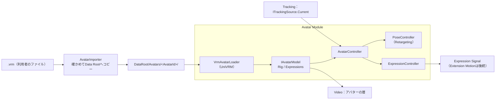

# Avatar 詳細設計

## 1. 目的

本書は、Avatar Moduleの詳細設計を定義する。Avatar Moduleは、3Dモデルを読み込み、Trackingの観測（`TrackingFrame`）をアバターの姿勢と表情へ適用する（方式設計7章）。

本書で作る範囲は以下とする（v0.1.0）。

- VRMの読み込み（UniVRM。VRM 0.xは読み込み時に1.0へ変換する、6.8）と、アバターの抽象（Avatar Runtime、Skeleton、Expression）
- アバターの登録：Data Rootへのコピー、Avatar Profile、サムネイル、モデルのライセンス情報の表示
- 使うアバターの選択と、起動時の読み込み、配信画面への配置
- 姿勢の適用（上半身、手指）と表情の適用（目、口、視線、眉）
- 見失ったときの扱い、鏡写し、観測の間の補間

次は本書の対象外とし、後続の設計で扱う。

- FBXの読み込み（方式設計7.3。Libraryの選択から）
- 拡張ボーンとExtension Motion（猫耳、尻尾等。方式設計7.8）。Expression Signalは出しておく（7.4）
- 全身（`BodyRange.FullBody`）の適用：腰の移動、脚、足の接地
- 複数アバターの同時表示（方式設計7.9。内部は1体専用にしない）
- 配信中のアバターの切り替えの演出（フェード等）
- Stage SceneのAvatar Spawn Point（方式設計11.6）。それまでは既定の位置を使う（6.5）

関連する方式設計：7章 3Dアバター制御方式、8章 トラッキング方式、6.9〜6.11 Data Root、11.6 Avatar Spawn Point、15.3 リアルタイム性

関連する詳細設計：Tracking詳細設計（`tracking.md`）、Video詳細設計（`video.md` 7.2 アバターの層）、Stage詳細設計（`stage.md`）

参照した試作（Repository外）：`E:\VirtualVessel\benchmarks\Voom`。VRM 1.0の読み込み（UniVRM 0.129.1の`Vrm10`）と、顔の動きの表情への変換の調整の知見を参考にする。体の適用（胸の傾き1か所、オイラー角の平均）は引き継がない（Tracking詳細設計1章）。

### 全体像



---

## 2. 責務

| 責務 | 担当 |
|---|---|
| モデルファイルを確かめ、Data Rootへコピーし、登録する | Avatar（`AvatarImporter`） |
| ファイルを選ぶ画面（OSのダイアログ） | UI（`IFileDialog`、6.7） |
| モデル形式の読み込みと、形式に依存しない表現への変換 | Avatar（形式ごとのLoader） |
| 観測した姿勢をアバターの骨格へ合わせる（体格差、骨の向き） | Avatar（`PoseController`） |
| 顔の動きをアバターの表情へ変換する | Avatar（`ExpressionController`） |
| 鏡写し、観測の間の補間、見失ったときの扱い | Avatar |
| 観測、平滑化、入力の補正 | Tracking |
| アバターを置く位置（Spawn Point） | Stage（v0.1.0は既定の位置、6.5） |
| アバターを描くカメラと層 | Video |
| アバターの選択と設定の画面 | UI（セットアップ画面） |

---

## 3. Module境界

- Avatarは、Core、Diagnostics、ProjectData、Trackingの公開Contract（`ITrackingSource`、`TrackingFrame`）を参照する。Capture、UI、Video、Stageは参照しない（Trackingの参照は段階4で加えた）。
- 置く場所（Videoのアバターの層と、StageのSpawn Point）は、Composition Rootが`AvatarPlacement`（層の番号と位置・向き）として渡す。UIがAvatarを参照し、VideoとStageがUIを参照するため、AvatarがVideoやStageを参照するとAssemblyの参照が循環するためである（「UI → Avatar → Video → UI」）。
- UniVRMの型（`UniVRM10.*`、`UniGLTF.*`）は、VRMのLoader（別のAssembly、16章）の中だけで使う。Avatarの他の部分は、`IAvatarRig`、`IAvatarExpressions`（5.2）だけを使う（方式設計7.2）。
- 他のModuleは`IAvatarService`（5.1）だけを使う。TransformやBlendShapeを直接操作しない（方式設計7.2 Avatar Controller）。
- Trackingの`MediaPipe`の型には依存しない。入力は`TrackingFrame`だけである。

---

## 4. 主要ClassとInterface

| 名前 | 種別 | 概要 |
|---|---|---|
| `IAvatarService` | Interface | 登録済みのアバターの一覧、登録、選択、現在のアバターの状態（5.1） |
| `AvatarService` | Class（`IApplicationService`） | 上の実装。読み込み、配置、毎Frameの適用の呼び出し |
| `AvatarPlacement` | Struct | 置く場所：Videoのアバターの層と、StageのSpawn Point（3章） |
| `AvatarEntry` | Class | 登録済みのアバター：Id、Profile（読めないときはnull）、サムネイルのPath |
| `AvatarStore` | Class | Data Rootのアバターのフォルダー：一覧、一時フォルダー、移動、削除（6.1） |
| `AvatarFileCheck` | Static Class | 解析の前の確認：拡張子、大きさ、glTFの印（純粋関数、6.2） |
| `AvatarImporter` | Class | ファイルを確かめ、Data Rootへコピーし、Profileを作る（6.2）。結果は`AvatarImportResult` |
| `IAvatarLoader` | Interface | 形式ごとの読み込み（方式設計7.3） |
| `VrmAvatarLoader` | Class | UniVRMによるVRMの読み込み。Composition Rootが作る、UniVRM側の唯一のClass |
| `IAvatarModel` | Interface | 読み込んだ1体：Root、Rig、表情、モデルの情報（`AvatarModelInfo`）、表示、毎Frameの反映、破棄（方式設計7.2） |
| `AvatarLicense` | Class | 作者が決めた利用条件。形式に依存しない（6.4） |
| `AvatarRestPose` | Static Class | 何も動かしていないときの姿勢：腕を下ろした基準の姿勢（7.2） |
| `IAvatarRig` | Interface | 形式に依存しない骨格。標準の骨（`AvatarBone`）の回転を、基準の姿勢を単位とした空間で設定する（7.1） |
| `IAvatarExpressions` | Interface | 形式に依存しない表情。標準の表情（`AvatarExpression`）の重みと視線を設定する |
| `IAvatarFaceShapes` | Interface | モデルが持つ顔の形（BlendShape）を名前で扱い、重みを設定する（7.4） |
| `FacePart` | Enum | 部位ごとに動かすときの部位：目（閉じる、笑い目、見開き、怒り目）、眉、口（あいうえお、閉じた笑顔、開いた笑顔、への字） |
| `FacePartProfile` | Class | 部位と、モデルの形の名前の対応（VRoid等）。モデルに合うかを決める（純粋関数） |
| `AvatarBone` | Enum | 標準の人体の骨（Unity Humanoidと同じ並び） |
| `AvatarExpression` | Enum | 標準の表情：`Blink`、`BlinkLeft`、`BlinkRight`、`Aa`、`Ih`、`Ou`、`Ee`、`Oh`、`Happy`、`Angry`、`Sad`、`Relaxed`、`Surprised`、`Neutral` |
| `AvatarController` | Class | 1体のアバターの制御の窓口。姿勢と表情へ振り分ける |
| `PoseRetargeting` | Static Class | 観測から骨の回転を求める（純粋関数、7章） |
| `PoseController` | Class | 補間、見失ったときの扱い、範囲（`BodyRange`）に応じた適用 |
| `ExpressionMapping` | Class | 表情の値（`FaceShape`）から表情への変換の設定（7.4） |
| `ExpressionController` | Class | 表情と視線の適用、Expression Signalの生成 |
| `FaceTarget` | Class | アバターの顔に出すもの：表情ごとの重み、視線、頭の向き。毎Frame使い回す |
| `FaceMotion` | Class | 顔の観測の間の補間と、見失ったときの扱い（7.3、8.4） |
| `HeadPose` | Static Class | 頭の向き：鏡写し、上限、首への配分（純粋関数、7.1） |
| `ExpressionCurve` | Struct | 値から表情の重みへの応答の曲線（7.4） |
| `FaceTuning` | Class | 利用者の表情の調整：部位ごとの感度（7.4） |
| `AvatarProfile` | Class | 保存する利用の設定（6.3） |
| `AvatarSettings` | Class | 使うアバターと表情の調整（10章） |

---

## 5. Public API

### 5.1 IAvatarService

```csharp
public interface IAvatarService
{
    IReadOnlyObservable<IReadOnlyList<AvatarEntry>> Avatars { get; }   // 登録済みの一覧
    IReadOnlyObservable<string> CurrentAvatarId { get; }                // 使うアバター。なければnull
    IReadOnlyObservable<AvatarState> State { get; }                     // None、Loading、Ready、Error
    IReadOnlyObservable<AvatarProblem> Problem { get; }                 // 利用者へ伝える問題（11章）

    IReadOnlyList<string> Extensions { get; }                           // 登録できる拡張子（ファイルを選ぶ画面用）

    // 登録（6.2）。confirmは登録の前にモデルの情報と利用条件を見せ、falseなら登録しない
    Task<AvatarImportResult> ImportAsync(string path, Func<AvatarModelInfo, Task<bool>> confirm, CancellationToken cancellationToken);
    Task SelectAsync(string avatarId, CancellationToken cancellationToken);   // 読み込んで差し替える。nullで外す
    Task RemoveAsync(string avatarId, CancellationToken cancellationToken);   // 登録を消す（確認はUI）

    IReadOnlyObservable<FaceTuning> FaceTuning { get; }                        // 表情の調整（7.4）
    void SetFaceTuning(FaceTuning tuning);                                     // すぐに反映して保存する
    FaceTarget Face { get; }                                                   // このFrameの顔。アバターがなければnull
}
```

- `AvatarImportResult`は、登録した（`Imported`）、利用者がやめた（`Declined`）、問題（`Problem`。`AlreadyImported`のときは登録済みのアバターを`Entry`に持つ）のどれかを表す。

- すべての操作と通知はMain Threadで行う。ファイルのコピーとHashの計算は別のThreadで行う。
- `SelectAsync`は、新しいアバターを読み込み終えてから、古いアバターと入れ替える。読み込みに失敗したら、古いアバターのままにする。

### 5.2 形式に依存しない骨格と表情

```csharp
public interface IAvatarRig
{
    bool Has(AvatarBone bone);
    float BoneLength(AvatarBone bone);                       // 子の骨までの長さ（メートル）
    void SetRotation(AvatarBone bone, Quaternion rotation);  // 基準の姿勢（7.1）からの回転。アバターのRoot空間
    void SetRootPosition(Vector3 position);                  // 全身のとき（後続）
    void ResetPose();                                        // 基準の姿勢へ戻す
}

public interface IAvatarExpressions
{
    bool Has(AvatarExpression expression);
    void SetWeight(AvatarExpression expression, float weight);   // 0〜1
    void SetLook(float yaw, float pitch);                         // モデルの目の可動域に対する割合（-1〜1）
    IReadOnlyList<string> CustomNames { get; }                   // モデル独自の表情の名前（Perfect Sync等、後続）
}

public interface IAvatarFaceShapes
{
    IReadOnlyList<string> Names { get; }                         // モデルが持つ顔の形（BlendShape）の名前
    void SetWeight(int index, float weight);                     // 0〜1。Applyで表情の後に反映する
}
```

- VRMでは、`IAvatarRig`をUniVRMのControl Rig（基準の姿勢でどの骨の回転も単位になる正規化した骨格）で実装する。モデルごとの骨の軸の違い（ある骨はX軸が前、別の骨はZ軸が前等）を、UniVRMが吸収する。FBXのLoaderを作るときは、同じ正規化をLoaderの中で行う。
- `SetRotation`の値は`IAvatarModel.Apply`でまとめて反映する。親の骨から順に反映するため、呼ぶ順序は問わない。
- VRMでは、`IAvatarExpressions`をVRM 1.0のExpression（Preset）とLookAtで実装する。
- `IAvatarModel.FaceShapes`は、モデルが持つ顔の形を返す（なければnull）。VRMでは、すべてのSkinnedMeshRendererのBlendShapeを名前でまとめ、UniVRMの処理の後に書き込む。UniVRMの表情が同じ形を動かしても、部位ごとの値が優先される。
- 視線は角度ではなく、モデルの目の可動域に対する割合で渡す。モデルごとに、視線の角度を目の動きへ対応させる範囲が違うためである（7.4）。VRMでは、割合にモデルのLookAtの入力の範囲（左右、上、下）を掛けて角度にする。

```csharp
public interface IAvatarModel : IDisposable
{
    Transform Root { get; }            // 基準の姿勢で+Zを向く
    IAvatarRig Rig { get; }
    IAvatarExpressions Expressions { get; }
    AvatarModelInfo Info { get; }      // 名前、形式、元の版、変換したか、利用条件、サムネイル
    void SetVisible(bool visible);
    void Apply();                      // そのFrameに設定した値を反映し、揺れもの（SpringBone）を動かす
}
```

---

## 6. Data Model

### 6.1 アバターの保存（方式設計7.11、6.10）

```text
DataRoot/Avatars/<AvatarId>/
├─ model.vrm               コピーしたモデル（元のファイルは変更しない）
├─ avatar-profile.json     利用の設定（6.3）
└─ thumbnail.png / .jpg    サムネイル（VRMのメタ情報の画像を、ファイルに入っている形式のまま保存する）
```

- `AvatarId`は登録時に作るGUID（`N`形式）。名前やファイル名を使わない（重複、使えない文字を避けるため）。
- 一覧は、起動時に`Avatars/`の下を読んで作る。`avatar-profile.json`が読めないもの（またはモデルのファイルがないもの）は一覧に「読み込めないアバター」として出し、消すかどうかは利用者が選ぶ（勝手に消さない、CLAUDE.md 25章）。
- AvatarIdの形をしたフォルダーだけを扱い、消す。利用者が置いた他のフォルダーには触れない。Profileの`format`と`thumbnail`は、小文字の英数字や決まった名前だけを受け付ける。Profileを書き換えて、フォルダーの外を指させないためである。
- 起動時に`Avatars/.importing/`を消す。中断した登録の残りである。

### 6.2 登録（AvatarImporter）

1. 利用者がファイルを選ぶ（UIの`IFileDialog`）。
2. 確かめる：拡張子`.vrm`、大きさの上限（既定1GB）、ファイルの先頭がglTFのBinary形式（`glTF`の印）であること。
3. 一時Folder（`Avatars/.importing/<AvatarId>/`）へコピーする（別のThread）。SHA-256を計算し、同じHashのアバターが登録済みなら、そのアバターを示して登録しない。
4. 一時Folderのコピーを、実際に読み込んで確かめる（`VrmAvatarLoader`、6.4）。必須の骨（8.2）がそろっていること、メタ情報を取り出す。確かめたら破棄する。
5. モデルの名前と利用条件（6.4）を確認のダイアログで見せる。利用者がやめたら登録しない。
6. `avatar-profile.json`とサムネイルを書き、一時Folderを`Avatars/<AvatarId>/`へ移す。途中で失敗したとき、取り消したときは一時Folderを消す。
7. 一覧に加える。使うアバターがまだなければ、使うアバターにする。

- 元のファイルのPathは、`avatar-profile.json`に参考として残すが、実行時には使わない（方式設計7.11）。

### 6.3 Avatar Profile

```json
{
  "schemaVersion": 1,
  "avatarId": "3f2c...",
  "displayName": "モデルの名前（メタ情報から。利用者が変えられる）",
  "format": "vrm",
  "formatVersion": "1.0",
  "converted": false,
  "sourceFileName": "original.vrm",
  "sha256": "...",
  "importedAt": "2026-10-20T12:00:00Z",
  "license": { "...": "VRMのメタ情報のライセンスの項目（6.4）" },
  "scale": 1.0,
  "pose": { "armDownAngle": 70 },
  "extensions": {}
}
```

- 知らない項目は消さずに残す（CLAUDE.md 25章）。`extensions`は、Extension Motion等の後続の設定を入れる場所とする。
- 既定値と同じ項目は書かない。既定を良くしたとき、変えていない利用者にも届くようにするため。
- 表情の調整は、アバターごとではなく利用者ごととし、`avatar-settings.json`に置く（7.4、10章。利用者の決定、2026-10-20）。

### 6.4 モデルのライセンス（VRMのメタ情報）

VRMには、作者がアバターの使い方の条件を書く（アバターとして使ってよい人、商用利用、暴力・性的表現、改変、再配布等）。

- 登録の確認のダイアログと、セットアップ画面のアバターのCardで、作者、条件、ライセンスのURLを利用者に表示する（`docs/ja/ui/screens/setup.md` 5章）。
- 条件を理由に登録や使用を止めることはしない（判断するのは利用者）。ただし、アバターとして使える人が「誰でも」でない場合（作者のみ、許可された人、記載なし）は、確認のダイアログに注意を表示する。
- ファイルに書かれていない条件は「記載なし」と表示する。表示しないと、許されていると読み違えるおそれがあるため。
- ライセンスのURLは、`https`のものだけを、利用者が押したときだけ外部のブラウザで開く。他の形式（`file:`等）は文字として見せるだけにする。
- `avatar-profile.json`の`license`には、形式に依存しない`AvatarLicense`を書く。

### 6.5 アバターの配置

- アバターは、アプリが持つPersistentな場所（Stage Sceneの外）に置く（方式設計7.10）。
- Stage SceneのSpawn Pointができるまでは、Stageが既定のSpawn Pointを1つ出す（`IAvatarSpawnPoints`、Stage詳細設計7.1）：原点、カメラの方（-Z）を向く。Main Cameraの既定の位置は、上半身が配信画面に収まるように合わせる（Video詳細設計7.5）。
- 置くときは、全部の部分の層を`Avatar`にし、Spawn Pointへ動かし、腕を下ろした姿勢（`AvatarRestPose`、既定70°）にしてから表示する。読み込みは非表示で行うため、原点や違う層に一瞬出ることはない。
- 描く層はUnityの層`Avatar`とし、VideoのAvatar Camera（Video詳細設計7.2、Main Cameraと同じ位置と画角、Overlay）が描く。平面の映像の前に出る（利用者の決定、2026-10-17）。

### 6.6 鏡写し

- 鏡写し（既定：オン）では、利用者が右手を上げると、アバターは左手を上げる。画面上では同じ側の手が上がり、鏡を見ているように動かせる。
- 設定は`ITrackingSource.Options`の`Mirror`を使う。セットアップ画面のカメラの映像の左右反転と同じ1つの設定で、Trackingが`tracking-settings.json`に保存する（Tracking詳細設計10章）。
- `TrackingFrame`は利用者自身の左右を持つ（Tracking詳細設計6.1）。鏡写しでは、左右を入れ替え、X軸を反転してから適用する（`PoseRetargeting`の入力の変換、純粋関数）。表情の左右（片目のまばたき等）も入れ替える。

### 6.7 ファイルを選ぶ画面

- UIに`IFileDialog`（`Task<string> OpenAsync(FileDialogOptions options)`。やめたらnull）を加える。Windowsでは`GetOpenFileNameW`（comdlg32）を専用のSTAのThreadで開く（`WindowsFileDialog`）。Main Threadで開くと、ダイアログを開いている間、描画と配信の映像が止まるためである。
- COMの`IFileOpenDialog`ではなく`GetOpenFileNameW`を使う。同じExplorer形式の画面が出て、MonoとIL2CPPで対応にばらつきのあるCOM Interopが要らないため。
- アプリのWindowを持ち主にするので、ダイアログは前に出たままになり、閉じるまでアプリのWindowは操作できない。同時に開けるのは1つだけ。
- 追加の依存（Libraryの導入）はしない。

### 6.8 VRM 0.x

- VRM 0.xのモデルも受け付ける（利用者の決定、2026-10-18。方式設計7.3）。UniVRMの読み込みで、VRM 0.xをVRM 1.0へ変換する（`Vrm10`の0.xの変換を有効にする）。
- 保存するのは元のファイル（`model.vrm`）のままとし、変換は読み込みのたびに行う。変換の結果をファイルとして保存しない。UniVRMの変換が良くなったとき、そのまま反映されるようにするため。
- Profileの`formatVersion`は元の版（`0.x`）とし、変換したことを`converted`で示す。
- ライセンス（6.4）は、変換する前の0.xのメタ情報から、0.xの項目を1.0の項目へ対応させて表示する（`VrmLicense`）。UniVRMの変換はライセンスのURLをVRM 1.0のライセンスに置き換えるため、その結果は使わない。0.xに項目のない条件（政治・宗教、再配布、改変等）は「記載なし」とし、0.xのライセンス名（`CC_BY`等）とその他の許可のURLは、元の値のまま表示する。商用利用の「可」は、UniVRMの変換と同じく「個人なら営利も可」とする。
- 0.xと1.0では、骨の基準の向きや表情の名前が違うが、変換の後は1.0として同じに扱う。違いが残る場合（視線の範囲等）は、Testで確かめる。

---

## 7. 姿勢と表情の計算

### 7.1 基準の姿勢と骨の回転

- UniVRMのControl Rigでは、基準の姿勢（T Pose）で、どの骨の回転も単位（回転なし）になる。`PoseRetargeting`は、各骨について「基準の姿勢での骨の向き（例：右の上腕は+X）」から「観測した向き」への回転を求める。
- 骨の向きだけでは、骨を軸にしたねじれが決まらない。ねじれは、もう1つの向きで決める：

| 骨 | 向き | ねじれを決める向き |
|---|---|---|
| 胴（Spine、Chest） | 腰から首へ | 左右の肩を結ぶ線 |
| 首、頭 | 顔の変換行列の回転（Tracking詳細設計6.3）を、首と頭へ配分する（既定：首40%、頭60%）。75°を超える回転は止める | 同じ |
| 上腕 | 肩から肘へ | 肘の曲がる面（上腕と前腕が作る面の法線） |
| 前腕 | 肘から手首へ | 手のひらの向き（Hand Landmarkerから。なければ上腕から引き継ぐ） |
| 手 | 手首から中指の付け根へ | 手のひらの法線 |
| 指 | 各関節の曲げの角度（7.5） | 手のひら |

- 首と頭（段階4、`HeadPose`）：本人の空間とアバターのRoot空間は向きが同じ（+Xが右、+Yが上、+Zが前）ため、回転をそのまま使う。鏡写しでは、X=0の面で写した回転にする（左右を向く向きと首をかしげる向きが逆になり、うなずきは同じ）。Root空間で、頭に全体の回転を、首にその40%を設定するため、頭は首に対して残りの60%だけ回る。75°を超える回転は、顔がカメラからほとんど外れて値が当てにならないため止める。
- 回転だけを適用し、位置は適用しない。そのため、アバターと利用者の体格（腕の長さ等）が違っても、骨の向きは同じになる（方式設計7.6の体格差の吸収）。手を顔に当てる等、位置が合うことが必要な動きは、全身の対応と合わせてIK（関節の位置から回転を解く）を後で検討する（17章）。
- 計算は`PoseRetargeting`（純粋関数）で行う：入力は`TrackingFrame`の体と手、鏡写し、Profileの補正。出力は骨ごとの回転の配列（呼び出し元が渡す、毎Frameの確保を避けるため）。

### 7.2 上半身（BodyRange.UpperBody）

- 腰（Hips）は動かさない。胴は、肩の線の傾きと、首の前後の傾きから、Spine、Chest、Upper Chestへ配分する（既定：30%、35%、35%）。座っていても胴の傾きが出るようにするため。
- 胴の回転には上限を付ける（左右の傾き±30°、前後±25°、ひねり±40°）。推論の誤りで胴が不自然に曲がるのを防ぐ。
- 肩（Shoulder）は、腕を上げたときだけ少し上げる（上腕の上げ角の一部を肩へ配分する）。
- 腕を見失ったときは、腕を下ろした姿勢（`pose.armDownAngle`、既定70°下げる）へ戻す。T Poseへは戻さない。
- 下半身は、腕を下ろした基準の姿勢のまま（座っていても立っていても違和感の少ない、真っすぐ立った姿勢）。

### 7.3 観測の間の補間

- 描画のFrameごとに、表示している値から最新の観測へ、観測の間隔をかけて移る（回転は球面補間）。新しい観測が届いた時点の表示から始めるため、描画は常に直前の表示と最新の観測の間にあり、途中で飛ばない。遅れは観測1回分（30回/秒で約33ms）増えるが、推論の回数より描画の回数が多いことによる段差が消える。
- 移る時間は2つの観測の時刻の差とし、1/120秒〜0.2秒に収める（遅れた観測で、ゆっくり引きずられないように）。
- 次の観測が遅れたときは、最新の観測で止める（先の予測はしない。外れたときに戻る動きが目立つため）。
- 段階4では顔（表情、視線、頭の向き）に使う（`FaceMotion`）。体と手は段階5、6で同じ考え方を使う。

### 7.4 表情（ExpressionMapping）

表情の値（`FaceShape`、0〜1）から、アバターの表情（`AvatarExpression`）と視線への変換（`ExpressionMapping`）。値ごとに応答の曲線（`ExpressionCurve`：下端以下は0、上端以上で最大、その間はなめらかに上がる）を持つ。MediaPipeの値は1に届きにくいため、上端は1より小さい。

| 表情 | 元の値 | 決め方（Voomの知見を含む） |
|---|---|---|
| `Blink`（両目）、`BlinkLeft`、`BlinkRight` | `EyeBlinkLeft/Right` | 両目をそろえる。曲線を通した後の両目の差が0.3以上のときだけ片目（ウインク）とする。片目を閉じると反対の目も少し細くなり、片目だけが閉じた値にはならないため |
| `Aa` | `JawOpen` | 口の開き。`MouthFunnel`の分だけ`Oh`へ回す |
| `Oh` | `JawOpen`と`MouthFunnel` | 丸く開く |
| `Ou` | `MouthPucker`、`MouthFunnel` | すぼめる。口が開いている分だけ |
| `Ee` | `MouthStretchLeft/Right` | 横に広げる。口が開いている分だけ |
| `Ih` | `MouthSmileLeft/Right` | 横に引いて少し開く（笑顔の半分）。口が開いている分だけ |
| `Happy` | `MouthSmileLeft/Right`から`MouthStretchLeft/Right`を引いた値、`CheekSquintLeft/Right` | 大きい方。最大0.8。口角が上がった分のうち、唇を横に引いた分を超えるものだけを笑顔とする |
| `Surprised` | `BrowInnerUp`、`EyeWideLeft/Right` | 眉を上げるだけで半分、目を見開くと残り。最大0.8 |
| `Angry` | `BrowDownLeft/Right` | 最大0.8 |
| `Sad` | `BrowInnerUp`と`MouthFrownLeft/Right` | 両方がそろったとき。最大0.8 |
| 視線 | `EyeLookIn/Out/Up/Down`（両目の平均） | モデルの目の可動域に対する割合（-1〜1）。値0.5で端まで。上下は、まぶたが閉じている分だけ弱める（閉じかけたまぶたは下を見た値になるため。Voomも上下の動きを既定で止めていた） |

- 口が開いているか（`JawOpen`の0.04〜0.12）を見て、閉じていれば`Ou`、`Ee`、`Ih`を出さない。唇を閉じて力を抜いているだけでも`MouthPucker`や`MouthSmile`が0.1〜0.3ほど出て、閉じた口に小さく開いた「う」が出たため（2026-10-21）。
- 「い」の口は唇を横に引き、口角も少し上がるため、そのままでは笑顔が出て、笑顔で目を閉じるモデル（VRoid等）では目も閉じた（2026-10-21）。そのため笑顔は、口角の値から横に引いた値を引いて求める。頬が上がっているとき（`CheekSquint`）は、それだけで笑顔とする。
- 口の5つの形は、合計が1を超えないよう比で配分する。
- VRMには眉の表情がないため、眉は感情の表情（驚き、怒り、悲しみ）を通して動く。
- 感情の表情とまばたき・口・視線の重なり（VRM 1.0の`overrideBlink`、`overrideMouth`、`overrideLookAt`）は、モデルの設定に従ってUniVRMが処理する。
- 視線は角度ではなく割合で渡す（5.2）。VRMは視線の角度を範囲（サンプルのモデルでは90°）で割って目の回転に対応させるため、角度（当初は±12°）を渡すと、目は可動域の約1/8しか動かなかった（2026-10-20）。
- 既定値は、カメラで試して決めた。最初の値（2026-10-20）では目、眉、口の動きが小さすぎたため強め、その後、利用者が調整した値を新しい既定（100%）とした（2026-10-21。目70%、眉120%、口70%の後、さらに目110%、視線70%）。
- 実際に設定した重み（まばたきの置き換えの後）を、Expression Signal（表情ごとの0〜1）とする（`ExpressionController.Signal`）。v0.1.0では使う側（Extension Motion）はまだない（方式設計7.7）。
- モデルが両目のまばたき（`Blink`）しか持たない場合は左右の値をそれに、片目ずつしか持たない場合は両目の値を左右に置き換える。片目しか閉じていないときに両目を閉じないよう、置き換えは小さい方の値を使う。

#### 部位ごとに動かす（FacePart）

VRMの標準の表情は顔全体の表情であり、モデルによっては笑顔（`happy`）で目を閉じ、口も開ける（VRoidの`Fcl_ALL_Joy`）。そのため、口を閉じたまま口角を上げるだけで口が開いた（2026-10-21）。部位ごとの形を持つモデルでは、目、眉、口を別々に動かす（利用者の決定、2026-10-21。Voomも、VRoidの部位ごとの形を動かしていた）。元の値は、標準の表情と同じMediaPipeの表情の値とする。

- モデルの形の名前が、知っている決まり（`FacePartProfile`。今はVRoidの`Fcl_EYE_*`、`Fcl_BRW_*`、`Fcl_MTH_*`）に合うときだけ部位ごとに動かす。両目の閉じる形と、口の5つの母音の形がそろわないモデルは、標準の表情を使う。
- 部位ごとに動かす間は、標準の表情を0にする（重なって形が崩れないように）。視線はどちらもLookAtで動かす。
- 決まりに合ったかは、読み込みのLogに出す。

| 部位 | VRoidの形 | 決め方 |
|---|---|---|
| 目を閉じる（左右） | `Fcl_EYE_Close_L/R` | 標準の表情のまばたきと同じ（両目をそろえる、ウインク）。笑い目の分だけ減らし、合わせて閉じきる以上にならないようにする |
| 笑い目（左右） | `Fcl_EYE_Joy_L/R` | 口角の上がり（`MouthSmile`、最大0.6）と頬の上がり（`CheekSquint`、最大0.8）の大きい方。笑うと目も笑う |
| 見開き | `Fcl_EYE_Spread` | `EyeWide` |
| 怒り目 | `Fcl_EYE_Angry` | 眉の下がりの半分 |
| 眉を上げる | `Fcl_BRW_Surprised` | `BrowInnerUp`と`BrowOuterUp`の大きい方から、困り眉の分を引く |
| 眉を下げる | `Fcl_BRW_Angry` | `BrowDown` |
| 困り眉 | `Fcl_BRW_Sorrow` | 眉の内側が上がり、口角が下がっているとき（`BrowInnerUp`と`MouthFrown`の小さい方） |
| あ、お、う | `Fcl_MTH_A/O/U` | 標準の表情と同じ。「あ」は口角が上がった分だけ開いた笑顔へ回す |
| い、え | `Fcl_MTH_I/E` | 唇を横に引き（`MouthStretch`）、少し開くと「い」、もっと開くと「え」 |
| 閉じた笑顔 | `Fcl_MTH_Fun` | 口角の上がり × 口が閉じている分。口を閉じたまま笑える |
| 開いた笑顔 | `Fcl_MTH_Joy` | 口角の上がり × 口の開き |
| への字 | `Fcl_MTH_Sorrow` | `MouthFrown` |

- 口の開いた形（あいうえお、開いた笑顔）は、合計が1を超えないよう比で配分する。
- 調整（下）の6つの部位は、部位ごとの値にも同じように効く。調整の画面の帯は、部位ごとの値から求める。
- 将来、ARKitの52個の形を持つモデル（Perfect Sync）は、同じ仕組みに決まりを1つ足して対応する（17章）。

#### 表情の調整（FaceTuning）

顔の動きの大きさは人によって違うため、利用者が部位ごとに感度を変えられる（利用者の要望、2026-10-20）。

| 部位 | 変えるもの |
|---|---|
| 目の閉じやすさ | まばたきの曲線 |
| ウインクのしやすさ | 片目とみなす両目の差 |
| 眉の動き | 眉、目の見開き、口角の下がり（驚き、怒り、悲しみ）の曲線 |
| 口の動き | 口の開きと形の曲線 |
| 視線の動き | 目が端まで動く値 |
| 笑顔の強さ | 笑顔の曲線 |

- 値は感度（0.5〜3、画面では50〜300%）で、曲線の両端を感度で割る。2なら半分の動きで同じ表情になる。範囲の外の値（手で書き換えたファイル等）は、近い端として読む。
- 調整は利用者のもので、アバターを替えても変わらない（利用者の決定、2026-10-20）。`avatar-settings.json`に保存する（10章）。
- 変えるとすぐに、使っているアバターに反映する（次の観測から）。調整の画面はUI `setup.md` 9章。
- モデルがARKitの52個の表情を独自に持つ場合（Perfect Sync）は、値をそのまま渡す方式を後で足せるよう、`IAvatarExpressions.CustomNames`を用意しておく（17章）。

### 7.5 手指

- 各指の関節の曲げを、隣り合う骨の間の角度から求める（Tracking詳細設計8.4）。曲げは0〜90°（親指は別の範囲）、横の開きは±15°に制限する。
- 手を見失ったときは、軽く握った自然な形へゆっくり戻す。
- 手を見失った状態から戻ったときは、急に形が変わらないよう、0.2秒かけて観測へ寄せる。

---

## 8. State / Lifecycle

### 8.1 AvatarService

- OptionalのApplication Serviceとし、Logging、Video、Stageの後に起動する（VideoとStageがないときは作らない）。Trackingがなくても、アバターは基準の姿勢で表示する。
- 起動時に一覧を作り、`avatar-settings.json`の使うアバターの読み込みを始める。読み込みの完了は待たずに起動を続ける（Main Threadを長く止めない、9章）。使うアバターが登録されていなければ、使うアバターをなしにする。
- 終了時に、アバターのGameObject、Texture、Mesh、Materialを破棄する（UniVRMの`RuntimeGltfInstance`の破棄を使う）。

### 8.2 読み込み

1. `Loading`。`VrmAvatarLoader`がファイルを読み、UniVRMで組み立てる。
2. Rigと表情を確かめる。必須の骨（Hips、Spine、Head、左右の上腕・前腕・手）がなければ`Error`（`MissingBones`）。VRM 1.0が必須とする上半身の骨に合わせた。Chest、Upper Chest、NeckはVRM 1.0では任意のため、ない場合はその回転を近い骨へ配る。
3. 層を`Avatar`にし、Spawn Pointに置く（6.5）。
4. `Ready`。古いアバターがあれば破棄する。

- 読み込み中に別のアバターが選ばれたら、前の読み込みを取り消す。差し替えに失敗したら、`Problem`を出したまま、古いアバターで`Ready`を保つ。

### 8.3 毎Frameの適用

- Avatar CameraがRenderingする前に、次の順で行う（`LateUpdate`相当、`IFrameLoop`の後段）：
  1. `ITrackingSource.Current`を読む。Trackingは、Avatarより先に毎Frameの処理（`IFrameLoop`）へ登録されるため、同じFrameに更新した観測を読める。
  2. `AvatarController`：顔（`FaceMotion`：観測の間の補間、見失ったときの扱い、`ExpressionMapping`）と、首と頭の向き。体と腕（`PoseController`：補間、見失った部位の戻し、`PoseRetargeting`）は段階5で加える。
  3. `ExpressionController`：表情と視線。
  4. UniVRMの処理（Control Rigの反映、Expression、LookAt、SpringBone）を明示的に1回呼ぶ。UniVRMの自動の更新は止め、順序をこちらで決める（SpringBoneが姿勢の後に動くようにするため）。
- 毎Frame確保しない。骨の回転の配列、表情の値の配列は使い回す。

### 8.4 見失ったとき

| 状態 | 扱い |
|---|---|
| `Tracked` | 観測を適用する |
| `LowConfidence` | 前の値と観測の間を、信頼度に応じて混ぜる |
| `Lost`（0.5秒以内） | 最後の値を保つ |
| `Lost`（0.5秒を超えた） | 1秒かけて、基準の姿勢（腕は下ろす、手は軽く握る、表情はなし）へ戻す |
| 戻ったとき | 0.2秒かけて観測へ寄せる |
| `Disabled`、`NotSupported` | 基準の姿勢 |

- 顔では次のように作った（段階4、`FaceMotion`）：見失ってからの時間は、最後に使えた観測の時刻から数える。表示の強さ（0〜1）を持ち、見つかっている間は0.2秒で1へ、見失って0.5秒を過ぎたら1秒で0へ動かし、その強さで、何もない顔（表情なし、目は正面、頭はまっすぐ）と混ぜる。`LowConfidence`では、新しい観測を、信頼度の分だけ前の観測から寄せる。Trackingがない、止まっているときは、何もない顔になる。

---

## 9. Thread / async

- アバターの組み立て（GameObject、Mesh、Texture）はUnityのAPIのためMain Threadで行う。ファイルの読み込みとglTFの解析は、UniVRMの非同期の読み込み（`Vrm10.LoadBytesAsync`等、`IAwaitCaller`で処理を複数Frameへ分ける）を使い、1Frameを長く止めない。読み込みにかかった時間と、最も長かったFrameを記録する。
- コピー、Hash、サムネイルの書き込みは別のThreadで行う。
- 姿勢と表情の適用はMain Threadで、毎Frame1回行う。

---

## 10. 設定

```csharp
public sealed class AvatarSettings
{
    public string CurrentAvatarId { get; set; }   // なければ、アバターを出さない
    public FaceTuning Face { get; set; }          // 表情の調整（7.4）。利用者のもの
}
```

- `avatar-settings.json`に保存する（設定のFolder、`ConfigFileStore`）。Project / Profileができたら移す。
- アバターごとの設定は`avatar-profile.json`（6.3）。
- `Face`がない古いファイルは、既定の調整として読む（項目を足しただけのため、版は変えない）。
- 鏡写しはTrackingの設定（6.6）。

---

## 11. ログ・診断

- 登録、読み込み、差し替え、失敗を、AvatarId、形式、版、読み込み時間とともにInformationで記録する。足りない骨や表情はWarningで記録する（方式設計7.13）。ファイルのフルパスはLogに書かない（利用者名を含むため）。ファイル名だけを書く。
- 性能計測：

| 計測 | 種類 | 内容 |
|---|---|---|
| `Avatar/Load` | Timer | 読み込みの時間 |
| `Avatar/LoadLongestFrame` | Timer | 読み込み中に最も長かったFrame |
| `Avatar/Apply` | Timer | 毎Frameの姿勢と表情の適用の時間 |

- 利用者へ伝える問題（`AvatarProblem`）：`NotVrm`（VRMのファイルではありません）、`TooLarge`、`MissingBones`（このモデルは人の形の骨がそろっていないため使えません）、`LoadFailed`（アバターを読み込めませんでした）、`AlreadyImported`、`StorageFailed`（保存できませんでした。保存先の空きを確認）。

---

## 12. エラー処理・復旧

| 事象 | 扱い |
|---|---|
| 登録の途中の失敗 | 一時Folderを消し、一覧は変えない |
| 使うアバターが読み込めない（起動時） | `Error`。アバターなしで続ける。他のアバターを選べる |
| 差し替えの読み込みの失敗 | 古いアバターのまま |
| 骨の欠け | 必須の骨（8.2）がなければ使えない。指等の任意の骨は、その骨の適用だけを止める |
| 表情の欠け | その表情の適用だけを止める |
| Trackingがない、止まっている | 基準の姿勢で表示する |
| UniVRMの例外 | Loaderの中で受け止め、`LoadFailed`にする。アプリは止めない |

---

## 13. セキュリティとプライバシー

- モデルのファイルは、外から持ち込まれた信頼できない入力である。拡張子、大きさの上限、形式の印を確かめてから解析する。解析はUniVRMで行い、モデルに含まれるScript等を実行する仕組みはない。
- 解析の例外はLoaderで受け止め、途中で作ったObjectを破棄する。
- 登録したモデルは、利用者のData Rootの中だけに置き、外へ送らない。
- モデルのライセンス（6.4）を利用者に見せる。条件の判断は利用者が行う。
- ライセンスのURLは、`https`のURLだけを、利用者の操作で開く。

---

## 14. テスト方針

| 種類 | 対象 |
|---|---|
| EditMode | `PoseRetargeting`：既知の姿勢（腕を横へ90°、前へ90°、肘を曲げる、手のひらを返す、胴を傾ける）の合成の観測から、期待する骨の回転になること。鏡写し。可動域の上限 |
| EditMode | 補間（7.3）、見失ったときの戻し（8.4）、`LowConfidence`の混ぜ方 |
| EditMode | `ExpressionMapping`：応答の曲線、左右をそろえる、口の形の配分、感情の表情との重なり |
| EditMode | `AvatarImporter`：拡張子・大きさ・形式の印の確認、一時Folderの後始末、同じHashの検出、Profileの読み書き（知らない項目を残す） |
| EditMode | 偽の`IAvatarRig`、`IAvatarExpressions`で`AvatarController`を動かす |
| PlayMode | 実際のVRMを読み込み、骨と表情がそろうこと、破棄で漏れがないこと。Repositoryに入れられる小さなTest用のモデルがあれば使い、なければ利用者から渡されたサンプル（Repository外）で`[Explicit]` |
| 実機 | カメラ、MediaPipe、アバターをつないで目視で確かめる（デモブランチ） |
| 性能 | 読み込みの時間と最も長いFrame、毎Frameの適用の時間 |

段階4で作ったTest：`AvatarFaceTests`（EditMode。応答の曲線、部位ごとの決まりの適用と部位ごとの値（閉じた笑顔、いとえ、笑い目、眉）、両目とウインク、口の配分と閉じた口、感情、視線、調整、頭の鏡写しと上限、補間と見失ったとき、まばたきの置き換え、`AvatarController`）、`AvatarServiceTests`（Trackingからの頭の向き、鏡写しの設定、調整の反映と保存）、`VrmLookTests`（視線の割合から角度）、`VrmLoaderTests.Face_TurnsTheHead_MovesTheFace_AndAppliesWithinItsBudget`（実際のモデルで頭、表情、視線、適用の時間）。UIは`AvatarCardPanelTests`（表情の調整のCard）、`LiveSetupPanelTests`（動きの速さ）。

段階3で作ったTest：`AvatarCoreTests`、`AvatarImportTests`、`AvatarServiceTests`（EditMode、偽のLoader）、`VrmLoaderTests`（PlayMode、`[Explicit]`。サンプルは環境変数`VV_SAMPLES_DIR`、なければRepositoryの隣の`samples`から読む）。セットアップ画面のCardは`AvatarCardPanelTests`（UIのPlayMode）。

---

## 15. 性能

- 毎Frameの適用（`Avatar/Apply`）は0.3ms以下を目標とする（開発用PCで計測し、本書に記録する）。
- 読み込み中の1Frameは50ms以下を目標とする。配信中にアバターを切り替えても、映像が目立って止まらないようにするため。
- SpringBoneの負荷はモデルに依存する。計測して記録する。
- 計測（2026-10-20、開発用PC、`VrmLoaderTests`）：サンプルのVRM 1.0の2体（14MB、17MB）で、読み込みは0.33〜0.37秒。VRM 0.xの1体（15MB）は、1.0への変換を含めて0.58秒。読み込み中の最も長いFrameは、どれも46〜47ms。毎Frameの適用（`Avatar/Apply`）は段階4で計測した。
- 計測（2026-10-20、開発用PC、`VrmLoaderTests`）：顔の計算とUniVRMの処理（SpringBoneを含む）を合わせた毎Frameの適用は、サンプルの3体で、中央値0.031〜0.033ms、95パーセンタイル0.035〜0.038ms、最大0.044〜0.146msだった。部位ごとに動かすようにした後（2026-10-21）は、中央値0.034〜0.035ms、95パーセンタイル0.038〜0.040ms、最大0.057〜0.130ms。目標の0.3msに収まる。

---

## 16. Directory / Namespace と依存

```text
Assets/VirtualVessel/Avatar/
├─ Runtime/                                   VirtualVessel.Avatar
│  ├─ IAvatarService.cs     IAvatarService, AvatarState, AvatarPlacement
│  ├─ AvatarService.cs      AvatarService
│  ├─ Core/                 IAvatarModel, IAvatarRig, IAvatarExpressions, AvatarBone, AvatarExpression,
│  │                        AvatarProfile, AvatarSettings, AvatarEntry, AvatarLicense, AvatarModelInfo
│  ├─ Loading/              IAvatarLoader, AvatarProblem, AvatarFileCheck, AvatarImporter, AvatarStore
│  ├─ Pose/                 AvatarRestPose, HeadPose（段階5でPoseRetargeting, PoseController）
│  ├─ Expression/           ExpressionCurve, ExpressionMapping, ExpressionController（Expression Signal）, FaceTarget, FaceTuning, FacePart, FacePartProfile
│  └─ Runtime/              AvatarController, FaceMotion
├─ Vrm/                                       VirtualVessel.Avatar.Vrm（UniVRMを参照する唯一のAssembly）
│  ├─ VrmAvatarLoader.cs
│  ├─ VrmAvatarModel.cs     IAvatarModel。UniVRMの自動の更新を止め、Applyで処理する
│  ├─ VrmAvatarRig.cs       Control RigによるIAvatarRig
│  ├─ VrmAvatarExpressions.cs
│  ├─ VrmAvatarFaceShapes.cs  IAvatarFaceShapes。BlendShapeを名前で扱い、UniVRMの処理の後に書き込む
│  └─ VrmLicense.cs         VRMのメタ情報からAvatarLicenseへ（純粋関数）
└─ Tests/
   ├─ EditMode/
   └─ PlayMode/
```

- 参照：Core、Diagnostics、ProjectData、Tracking（段階4から）。VRMのAssemblyは、Avatarと、UniVRM（`UniGLTF`、`UniGLTF.Utils`、`UniHumanoid`、`VRM10`、`VrmLib`）を参照する。Composition Root（Application）が`VrmAvatarLoader`を作る。
- UniVRMは、UPMのGitのURLで、版のTagを固定して導入した（v0.131.4。`https://github.com/vrm-c/UniVRM.git?path=/Packages/UniGLTF#v0.131.4`と`...?path=/Packages/VRM10#v0.131.4`）。`packages-lock.json`がCommit（`efd20f6`）を固定する。Unity 6.6で動くことを確かめた。ライセンスはMIT。SBOMに`com.vrmc.gltf`、`com.vrmc.vrm`と、依存する`com.unity.mathematics`を記録した。リポジトリのCheckは、GitのPackageの版をTagから読み、Tagのないものを誤りとする。
- 実行時に読み込むモデルのMaterialは、UniVRMがShaderを名前で探す。そのため、MToon 1.0（URP）、UniUnlit、URP Litを、Graphics Settingsの常に含めるShaderに入れた。配布物のライセンスには、UniVRMの`LICENSE.txt`（`tools/release/licenses`）とUniGLTFの`LICENSE.md`を入れる。

---

## 17. 未決事項

| 項目 | 対応予定 |
|---|---|
| VRM 0.xのモデルを受け付けるか | 決定：読み込み時に1.0へ変換して受け付ける（6.8、方式設計7.3。利用者の決定、2026-10-18） |
| Test用のVRMモデル | 利用者から受け取ったサンプル（Repository外の`E:\VirtualVessel\samples\`、VRM 1.0の2体と0.xの1体）で確かめた。0.xも、変換の後に骨、Root空間での回転、表情、破棄がTestを通った。Repositoryに入れられるライセンスの小さなモデルがあれば、自動のTestに使う |
| サムネイルのないモデル | 今は「画像なし」を表示する。読み込み時に撮るかは、要望に応じて検討する |
| 身長の違うモデルの写り方 | カメラの既定の位置は固定（Video詳細設計7.5）。身長の差が大きいモデルで上半身が収まらない場合は、Camera Pointの設計時に頭の高さへ合わせる方式を検討する |
| 手を顔に当てる等の位置合わせ（IK） | 全身の対応と合わせて検討する |
| Perfect Sync（ARKitの52個の表情を持つモデル） | v0.1.0の後 |
| 頬を膨らませる | MediaPipeの`CheekPuff`はほとんど反応せず、VRMの標準の表情にもない。サンプルの3体（VRoid）も、その表情や形（BlendShape）を持たない。Perfect Syncの対応と合わせて検討する（利用者の要望、2026-10-21） |
| 表情の調整の映像の切り抜き | 決定：利用者が上下の位置を変えられる（UI `setup.md` 9章。顔の位置はアバターの身長による）。保存はしない。頭の位置から自動で決める方式は、Camera Pointと合わせて検討する |
| 表情の既定値 | 決定：利用者がカメラで調整した値を既定とした（7.4、2026-10-21）。ほかの人の顔で合わない場合は、調整の画面で変える |
| FBX | Libraryの選択から。v0.1.0の後 |
| Spawn Point、カメラの位置の調整の画面 | Stage Scene、Camera Pointの設計時 |
| 設定をProject / Profileへ移す | Project / Profileの設計時 |

---

## 18. 実装の順序

TrackingとAvatarを合わせて、次の順で進める。各段階を1つのBranchとし、それぞれにTestと、試すためのデモブランチを付ける（CLAUDE.md 29.2）。段階7の後にv0.1.0をリリースする。

1. Trackingの土台（Tracking詳細設計18章の1）
2. MediaPipeとカメラ（Tracking詳細設計18章の2）
3. アバターの読み込み：UniVRMの導入（SBOM）、登録、Data Root、`IFileDialog`、Videoのアバターの層とAvatar Camera、既定のSpawn Point、セットアップ画面のアバターのCard
4. 顔：表情、視線、頭の向き。表情の調整の画面と、動きの速さの10段階（Tracking詳細設計8.2）を含む
5. 上半身：胴、肩、腕。奥行きの推定の比較（Tracking詳細設計8.4）
6. 手指
7. トラッキングの設定画面（範囲の選択と「全身：近日対応」、平滑化の段階、鏡写し、基準の姿勢）、診断の仕上げ
