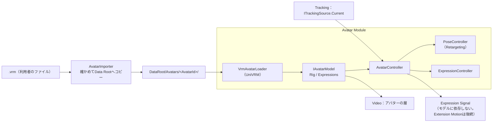
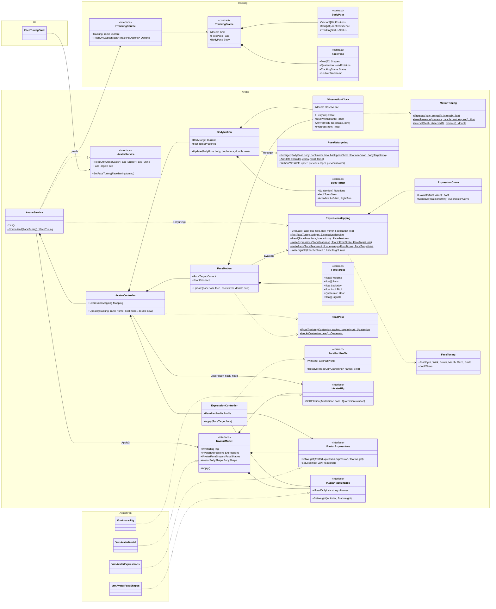

# Avatar 詳細設計

## 1. 目的

本書は、Avatar Moduleの詳細設計を定義する。Avatar Moduleは、3Dモデルを読み込み、Trackingの観測（`TrackingFrame`）をアバターの姿勢と表情へ適用する（方式設計7章）。

本書で作る範囲は以下とする（v0.1.0）。

- VRMの読み込み（UniVRM。VRM 0.xは読み込み時に1.0へ変換する、6.8）と、アバターの抽象（Avatar Runtime、Skeleton、Expression）
- アバターの登録：Data Rootへのコピー、Avatar Profile、サムネイル、モデルのライセンス情報の表示
- 使うアバターの選択と、起動時の読み込み、配信画面への配置
- 姿勢の適用（上半身、手指）と表情の適用（目、口、視線、眉）
- 見失ったときの扱い、鏡写し、観測の間の補間

次は本書の対象外とし、後続の設計で扱う。

- FBXの読み込み（方式設計7.3。Libraryの選択から）
- 拡張ボーンとExtension Motion（猫耳、尻尾等。方式設計7.8）。Expression Signalは出しておく（7.4）
- 全身（`BodyRange.FullBody`）の適用：腰の移動、脚、足の接地
- 複数アバターの同時表示（方式設計7.9。内部は1体専用にしない）
- 配信中のアバターの切り替えの演出（フェード等）
- Stage SceneのAvatar Spawn Point（方式設計11.6）。それまでは既定の位置を使う（6.5）

関連する方式設計：7章 3Dアバター制御方式、8章 トラッキング方式、6.9〜6.11 Data Root、11.6 Avatar Spawn Point、15.3 リアルタイム性

関連する詳細設計：Tracking詳細設計（`tracking.md`）、Video詳細設計（`video.md` 7.2 アバターの層）、Stage詳細設計（`stage.md`）

参照した試作（Repository外）：`E:\VirtualVessel\benchmarks\Voom`。VRM 1.0の読み込み（UniVRM 0.129.1の`Vrm10`）と、顔の動きの表情への変換の調整の知見を参考にする。体の適用（胸の傾き1か所、オイラー角の平均）は引き継がない（Tracking詳細設計1章）。

### 全体像



---

## 2. 責務

| 責務 | 担当 |
|---|---|
| モデルファイルを確かめ、Data Rootへコピーし、登録する | Avatar（`AvatarImporter`） |
| ファイルを選ぶ画面（OSのダイアログ） | UI（`IFileDialog`、6.7） |
| モデル形式の読み込みと、形式に依存しない表現への変換 | Avatar（形式ごとのLoader） |
| 観測した姿勢をアバターの骨格へ合わせる（体格差、骨の向き） | Avatar（`PoseController`） |
| 顔の動きをアバターの表情へ変換する | Avatar（`ExpressionController`） |
| 鏡写し、観測の間の補間、見失ったときの扱い | Avatar |
| 観測、平滑化、入力の補正 | Tracking |
| アバターを置く位置（Spawn Point） | Stage（v0.1.0は既定の位置、6.5） |
| アバターを描くカメラと層 | Video |
| アバターの選択と設定の画面 | UI（セットアップ画面） |

---

## 3. Module境界

- Avatarは、Core、Diagnostics、ProjectData、Trackingの公開Contract（`ITrackingSource`、`TrackingFrame`）を参照する。Capture、UI、Video、Stageは参照しない（Trackingの参照は段階4で加えた）。
- 置く場所（Videoのアバターの層と、StageのSpawn Point）は、Composition Rootが`AvatarPlacement`（層の番号と位置・向き）として渡す。UIがAvatarを参照し、VideoとStageがUIを参照するため、AvatarがVideoやStageを参照するとAssemblyの参照が循環するためである（「UI → Avatar → Video → UI」）。
- UniVRMの型（`UniVRM10.*`、`UniGLTF.*`）は、VRMのLoader（別のAssembly、16章）の中だけで使う。Avatarの他の部分は、`IAvatarRig`、`IAvatarExpressions`（5.2）だけを使う（方式設計7.2）。
- 他のModuleは`IAvatarService`（5.1）だけを使う。TransformやBlendShapeを直接操作しない（方式設計7.2 Avatar Controller）。
- Trackingの`MediaPipe`の型には依存しない。入力は`TrackingFrame`だけである。

---

## 4. 主要ClassとInterface

| 名前 | 種別 | 概要 |
|---|---|---|
| `IAvatarService` | Interface | 登録済みのアバターの一覧、登録、選択、現在のアバターの状態（5.1） |
| `AvatarService` | Class（`IApplicationService`） | 上の実装。読み込み、配置、毎Frameの適用の呼び出し |
| `AvatarPlacement` | Struct | 置く場所：Videoのアバターの層と、StageのSpawn Point（3章） |
| `AvatarEntry` | Class | 登録済みのアバター：Id、Profile（読めないときはnull）、サムネイルのPath |
| `AvatarStore` | Class | Data Rootのアバターのフォルダー：一覧、一時フォルダー、移動、削除（6.1） |
| `AvatarFileCheck` | Static Class | 解析の前の確認：拡張子、大きさ、glTFの印（純粋関数、6.2） |
| `AvatarImporter` | Class | ファイルを確かめ、Data Rootへコピーし、Profileを作る（6.2）。結果は`AvatarImportResult` |
| `IAvatarLoader` | Interface | 形式ごとの読み込み（方式設計7.3） |
| `VrmAvatarLoader` | Class | UniVRMによるVRMの読み込み。Composition Rootが作る、UniVRM側の唯一のClass |
| `IAvatarModel` | Interface | 読み込んだ1体：Root、Rig、表情、モデルの情報（`AvatarModelInfo`）、表示、毎Frameの反映、破棄（方式設計7.2） |
| `AvatarLicense` | Class | 作者が決めた利用条件。形式に依存しない（6.4） |
| `AvatarRestPose` | Static Class | 何も動かしていないときの姿勢：腕を下ろした基準の姿勢（7.2） |
| `IAvatarRig` | Interface | 形式に依存しない骨格。標準の骨（`AvatarBone`）の回転を、基準の姿勢を単位とした空間で設定する（7.1） |
| `IAvatarExpressions` | Interface | 形式に依存しない表情。標準の表情（`AvatarExpression`）の重みと視線を設定する |
| `IAvatarFaceShapes` | Interface | モデルが持つ顔の形（BlendShape）を名前で扱い、重みを設定する（7.4） |
| `FacePart` | Enum | 部位ごとに動かすときの部位：目（閉じる、見開き、怒り目）、眉、口（あいうえお、閉じた笑顔、開いた笑顔、への字） |
| `FacePartProfile` | Class | 部位と、モデルの形の名前の対応（VRoid等）。モデルに合うかを決める（純粋関数） |
| `AvatarBone` | Enum | 標準の人体の骨（Unity Humanoidと同じ並び） |
| `AvatarExpression` | Enum | 標準の表情：`Blink`、`BlinkLeft`、`BlinkRight`、`Aa`、`Ih`、`Ou`、`Ee`、`Oh`、`Happy`、`Angry`、`Sad`、`Relaxed`、`Surprised`、`Neutral` |
| `AvatarController` | Class | 1体のアバターの制御の窓口。姿勢と表情へ振り分ける |
| `PoseRetargeting` | Static Class | 観測から上半身の骨の回転を求める（純粋関数、7.2） |
| `BodyMotion` | Class | 上半身の観測の間の補間と、胴と左右の腕ごとの見失ったときの扱い（7.2、7.3、8.4）。設計の当初の名前は`PoseController`だったが、顔の`FaceMotion`とそろえた |
| `BodyTarget` | Class | アバターの上半身に出すもの：骨ごとの回転と、観測が見た部位。毎Frame使い回す |
| `MotionTiming` | Static Class | 顔、体、手が共有する時間の扱い：観測への移り方と、見失ったときの表示の強さ（純粋関数、7.3、8.4） |
| `ObservationClock` | Class | 1つの部位の観測の時間：最新の観測を撮った時刻と届いた時刻、その観測へどこまで移ったか（7.3）。顔、体、左右の手がそれぞれ持つ。`FrameClock`は前のFrameからの秒数だけで、その後の段階が使う |
| `ExpressionMapping` | Class | 表情の値（`FaceShape`）から表情への変換の設定（7.4） |
| `FaceFeatures` | Struct（internal） | 顔の値を曲線に1度だけ通した結果。顔全体の表情、部位ごとの値、Expression Signalは、すべてこれから求める（7.4） |
| `ExpressionController` | Class | 表情と視線の適用：部位ごと、または顔全体の表情。モデルにないまばたきの置き換え |
| `FaceTarget` | Class | アバターの顔に出すもの：表情ごとの重み、部位ごとの重み、Expression Signal、視線、頭の向き。毎Frame使い回す |
| `ExpressionSignal` | Enum | Expression Signalの値：笑顔、怒り、悲しみ、驚き、左右の目の開き、口の開き（7.4、方式設計7.7） |
| `FaceMotion` | Class | 顔の観測の間の補間と、見失ったときの扱い（7.3、8.4、時間の扱いは`ObservationClock`） |
| `HeadPose` | Static Class | 頭の向き：鏡写し、上限、首への配分（純粋関数、7.1） |
| `AvatarBodyShape` | Class | 基準の姿勢でのモデルの体：骨の位置、頭の楕円体、胴の部分、腕の太さ。読み込み時に測る（7.6） |
| `ArmClearance` | Static Class | 腕を頭と胴から奥行き方向に出す（純粋関数、7.6） |
| `HandRetargeting` | Static Class | 手のひらから、手の回転と前腕のねじれを求める（純粋関数、7.7） |
| `HandMotion` | Class | 手のひらと指の観測の間の補間と、見失ったときの扱い（7.5、7.7） |
| `FingerPose` | Class | 片手の指の角度：関節ごとの曲げと開き。毎Frame使い回す（7.5） |
| `FingerRetargeting` | Static Class | トラッキングの手から指の角度を求め、そこから指の骨の回転を求める（純粋関数、7.5）。`FingerRest`は基準の姿勢でのモデルの手を持つ |
| `SteadyMotion` | Class | 上半身の最後の段：腕の骨の回る速さの上限（7.8） |
| `ClearanceMotion` | Class | 腕を出す処理の時間の扱い：前後の側を覚え、回した分をなめらかに出し入れする（7.6） |
| `PlacedPart` | Struct | そのFrameの頭（楕円体）や胴の部分（楕円柱）と、腕のカプセルとの当たり（純粋関数、7.6） |
| `ArmSide` | Struct | アバターの左右の腕ごとの骨（`UpperBodyBone`、`AvatarBone`）と、同じ名前の観測の関節。左右で骨を選ぶ処理を1か所にまとめる |
| `ExpressionCurve` | Struct | 値から表情の重みへの応答の曲線（7.4） |
| `FaceTuning` | Class | 利用者の表情の調整：部位ごとの感度（7.4） |
| `AvatarProfile` | Class | 保存する利用の設定（6.3） |
| `AvatarSettings` | Class | 使うアバターと表情の調整（10章） |

### クラス図（顔と上半身、段階5時点）

トラッキングの観測から、アバターの上半身（胴、肩、腕）、頭、表情、視線を動かすまでのクラスの関係。手と指は段階6で加える。

- 抽象層は2種類あり、色と印で示す。**インターフェース**（`<<interface>>`、紫の実線の太枠）はモジュールの境目で具体的な実装を隠す。**データの契約**（`<<contract>>`、緑の破線の枠）は形式やライブラリに依存しない形で値を受け渡す。印のないクラスは、抽象の上で動く具体的な処理である。
- 依存はどれも「具体 → 抽象」の向きである。Avatarの計算はMediaPipeの型もUniVRMの型も知らず、UniVRMの型はAvatar.Vrmの中だけで使う（3章）。
- 関係の注記：`reads`は毎Frameの読み取り、`upper body, neck, head`は上半身、首、頭の回転の設定。毎Frameの順番は8.3。



---

## 5. Public API

### 5.1 IAvatarService

```csharp
public interface IAvatarService
{
    IReadOnlyObservable<IReadOnlyList<AvatarEntry>> Avatars { get; }   // 登録済みの一覧
    IReadOnlyObservable<string> CurrentAvatarId { get; }                // 使うアバター。なければnull
    IReadOnlyObservable<AvatarState> State { get; }                     // None、Loading、Ready、Error
    IReadOnlyObservable<AvatarProblem> Problem { get; }                 // 利用者へ伝える問題（11章）

    IReadOnlyList<string> Extensions { get; }                           // 登録できる拡張子（ファイルを選ぶ画面用）

    // 登録（6.2）。confirmは登録の前にモデルの情報と利用条件を見せ、falseなら登録しない
    Task<AvatarImportResult> ImportAsync(string path, Func<AvatarModelInfo, Task<bool>> confirm, CancellationToken cancellationToken);
    Task SelectAsync(string avatarId, CancellationToken cancellationToken);   // 読み込んで差し替える。nullで外す
    Task RemoveAsync(string avatarId, CancellationToken cancellationToken);   // 登録を消す（確認はUI）

    IReadOnlyObservable<FaceTuning> FaceTuning { get; }                        // 表情の調整（7.4）
    void SetFaceTuning(FaceTuning tuning);                                     // すぐに反映して保存する
    FaceTarget Face { get; }                                                   // このFrameの顔。アバターがなければnull
    BodyTarget Body { get; }                                                   // このFrameの上半身。診断画面の骨格の見比べ用。アバターがなければnull
}
```

- `AvatarImportResult`は、登録した（`Imported`）、利用者がやめた（`Declined`）、問題（`Problem`。`AlreadyImported`のときは登録済みのアバターを`Entry`に持つ）のどれかを表す。

- すべての操作と通知はMain Threadで行う。ファイルのコピーとHashの計算は別のThreadで行う。
- `SelectAsync`は、新しいアバターを読み込み終えてから、古いアバターと入れ替える。読み込みに失敗したら、古いアバターのままにする。

### 5.2 形式に依存しない骨格と表情

```csharp
public interface IAvatarRig
{
    bool Has(AvatarBone bone);
    float BoneLength(AvatarBone bone);                       // 子の骨までの長さ（メートル）
    void SetRotation(AvatarBone bone, Quaternion rotation);  // 基準の姿勢（7.1）からの回転。アバターのRoot空間
    void SetRootPosition(Vector3 position);                  // 全身のとき（後続）
    void ResetPose();                                        // 基準の姿勢へ戻す
}

public interface IAvatarExpressions
{
    bool Has(AvatarExpression expression);
    void SetWeight(AvatarExpression expression, float weight);   // 0〜1
    void SetLook(float yaw, float pitch);                         // モデルの目の可動域に対する割合（-1〜1）
    IReadOnlyList<string> CustomNames { get; }                   // モデル独自の表情の名前（Perfect Sync等、後続）
}

public interface IAvatarFaceShapes
{
    IReadOnlyList<string> Names { get; }                         // モデルが持つ顔の形（BlendShape）の名前
    void SetWeight(int index, float weight);                     // 0〜1。Applyで表情の後に反映する
}
```

- VRMでは、`IAvatarRig`をUniVRMのControl Rig（基準の姿勢でどの骨の回転も単位になる正規化した骨格）で実装する。モデルごとの骨の軸の違い（ある骨はX軸が前、別の骨はZ軸が前等）を、UniVRMが吸収する。FBXのLoaderを作るときは、同じ正規化をLoaderの中で行う。
- `SetRotation`の値は`IAvatarModel.Apply`でまとめて反映する。親の骨から順に反映するため、呼ぶ順序は問わない。
- VRMでは、`IAvatarExpressions`をVRM 1.0のExpression（Preset）とLookAtで実装する。
- `IAvatarModel.FaceShapes`は、モデルが持つ顔の形を返す（なければnull）。VRMでは、すべてのSkinnedMeshRendererのBlendShapeを名前でまとめ、UniVRMの処理の後に書き込む。UniVRMの表情が同じ形を動かしても、部位ごとの値が優先される。
- 視線は角度ではなく、モデルの目の可動域に対する割合で渡す。モデルごとに、視線の角度を目の動きへ対応させる範囲が違うためである（7.4）。VRMでは、割合にモデルのLookAtの入力の範囲（左右、上、下）を掛けて角度にする。

```csharp
public interface IAvatarModel : IDisposable
{
    Transform Root { get; }            // 基準の姿勢で+Zを向く
    IAvatarRig Rig { get; }
    IAvatarExpressions Expressions { get; }
    AvatarModelInfo Info { get; }      // 名前、形式、元の版、変換したか、利用条件、サムネイル
    AvatarBodyShape BodyShape { get; } // 読み込み時に測った体の形（7.6）。測れなければnull
    void SetVisible(bool visible);
    void Apply();                      // そのFrameに設定した値を反映し、揺れもの（SpringBone）を動かす
}
```

---

## 6. Data Model

### 6.1 アバターの保存（方式設計7.11、6.10）

```text
DataRoot/Avatars/<AvatarId>/
├─ model.vrm               コピーしたモデル（元のファイルは変更しない）
├─ avatar-profile.json     利用の設定（6.3）
└─ thumbnail.png / .jpg    サムネイル（VRMのメタ情報の画像を、ファイルに入っている形式のまま保存する）
```

- `AvatarId`は登録時に作るGUID（`N`形式）。名前やファイル名を使わない（重複、使えない文字を避けるため）。
- 一覧は、起動時に`Avatars/`の下を読んで作る。`avatar-profile.json`が読めないもの（またはモデルのファイルがないもの）は一覧に「読み込めないアバター」として出し、消すかどうかは利用者が選ぶ（勝手に消さない、CLAUDE.md 25章）。
- AvatarIdの形をしたフォルダーだけを扱い、消す。利用者が置いた他のフォルダーには触れない。Profileの`format`と`thumbnail`は、小文字の英数字や決まった名前だけを受け付ける。Profileを書き換えて、フォルダーの外を指させないためである。
- 起動時に`Avatars/.importing/`を消す。中断した登録の残りである。

### 6.2 登録（AvatarImporter）

1. 利用者がファイルを選ぶ（UIの`IFileDialog`）。
2. 確かめる：拡張子`.vrm`、大きさの上限（既定1GB）、ファイルの先頭がglTFのBinary形式（`glTF`の印）であること。
3. 一時Folder（`Avatars/.importing/<AvatarId>/`）へコピーする（別のThread）。SHA-256を計算し、同じHashのアバターが登録済みなら、そのアバターを示して登録しない。
4. 一時Folderのコピーを、実際に読み込んで確かめる（`VrmAvatarLoader`、6.4）。必須の骨（8.2）がそろっていること、メタ情報を取り出す。確かめたら破棄する。
5. モデルの名前と利用条件（6.4）を確認のダイアログで見せる。利用者がやめたら登録しない。
6. `avatar-profile.json`とサムネイルを書き、一時Folderを`Avatars/<AvatarId>/`へ移す。途中で失敗したとき、取り消したときは一時Folderを消す。
7. 一覧に加える。使うアバターがまだなければ、使うアバターにする。

- 元のファイルのPathは、`avatar-profile.json`に参考として残すが、実行時には使わない（方式設計7.11）。

### 6.3 Avatar Profile

```json
{
  "schemaVersion": 1,
  "avatarId": "3f2c...",
  "displayName": "モデルの名前（メタ情報から。利用者が変えられる）",
  "format": "vrm",
  "formatVersion": "1.0",
  "converted": false,
  "sourceFileName": "original.vrm",
  "sha256": "...",
  "importedAt": "2026-10-20T12:00:00Z",
  "license": { "...": "VRMのメタ情報のライセンスの項目（6.4）" },
  "scale": 1.0,
  "pose": { "armDownAngle": 70 },
  "extensions": {}
}
```

- 知らない項目は消さずに残す（CLAUDE.md 25章）。`extensions`は、Extension Motion等の後続の設定を入れる場所とする。
- 既定値と同じ項目は書かない。既定を良くしたとき、変えていない利用者にも届くようにするため。
- 表情の調整は、アバターごとではなく利用者ごととし、`avatar-settings.json`に置く（7.4、10章。利用者の決定、2026-10-20）。

### 6.4 モデルのライセンス（VRMのメタ情報）

VRMには、作者がアバターの使い方の条件を書く（アバターとして使ってよい人、商用利用、暴力・性的表現、改変、再配布等）。

- 登録の確認のダイアログと、セットアップ画面のアバターのCardで、作者、条件、ライセンスのURLを利用者に表示する（`docs/ja/ui/screens/setup.md` 5章）。
- 条件を理由に登録や使用を止めることはしない（判断するのは利用者）。ただし、アバターとして使える人が「誰でも」でない場合（作者のみ、許可された人、記載なし）は、確認のダイアログに注意を表示する。
- ファイルに書かれていない条件は「記載なし」と表示する。表示しないと、許されていると読み違えるおそれがあるため。
- ライセンスのURLは、`https`のものだけを、利用者が押したときだけ外部のブラウザで開く。他の形式（`file:`等）は文字として見せるだけにする。
- `avatar-profile.json`の`license`には、形式に依存しない`AvatarLicense`を書く。

### 6.5 アバターの配置

- アバターは、アプリが持つPersistentな場所（Stage Sceneの外）に置く（方式設計7.10）。
- Stage SceneのSpawn Pointができるまでは、Stageが既定のSpawn Pointを1つ出す（`IAvatarSpawnPoints`、Stage詳細設計7.1）：原点、カメラの方（-Z）を向く。Main Cameraの既定の位置は、上半身が配信画面に収まるように合わせる（Video詳細設計7.5）。
- 置くときは、全部の部分の層を`Avatar`にし、Spawn Pointへ動かし、腕を下ろした姿勢（`AvatarRestPose`、既定70°）にしてから表示する。読み込みは非表示で行うため、原点や違う層に一瞬出ることはない。
- 描く層はUnityの層`Avatar`とし、VideoのAvatar Camera（Video詳細設計7.2、Main Cameraと同じ位置と画角、Overlay）が描く。平面の映像の前に出る（利用者の決定、2026-10-17）。

### 6.6 鏡写し

- 鏡写し（既定：オン）では、利用者が右手を上げると、アバターは左手を上げる。画面上では同じ側の手が上がり、鏡を見ているように動かせる。
- 設定は`ITrackingSource.Options`の`Mirror`を使う。セットアップ画面のカメラの映像の左右反転と同じ1つの設定で、Trackingが`tracking-settings.json`に保存する（Tracking詳細設計10章）。
- `TrackingFrame`は利用者自身の左右を持つ（Tracking詳細設計6.1）。鏡写しでは、左右を入れ替え、X軸を反転してから適用する（`PoseRetargeting`の入力の変換、純粋関数）。表情の左右（片目のまばたき等）も入れ替える。

### 6.7 ファイルを選ぶ画面

- UIに`IFileDialog`（`Task<string> OpenAsync(FileDialogOptions options)`。やめたらnull）を加える。Windowsでは`GetOpenFileNameW`（comdlg32）を専用のSTAのThreadで開く（`WindowsFileDialog`）。Main Threadで開くと、ダイアログを開いている間、描画と配信の映像が止まるためである。
- COMの`IFileOpenDialog`ではなく`GetOpenFileNameW`を使う。同じExplorer形式の画面が出て、MonoとIL2CPPで対応にばらつきのあるCOM Interopが要らないため。
- アプリのWindowを持ち主にするので、ダイアログは前に出たままになり、閉じるまでアプリのWindowは操作できない。同時に開けるのは1つだけ。
- 追加の依存（Libraryの導入）はしない。

### 6.8 VRM 0.x

- VRM 0.xのモデルも受け付ける（利用者の決定、2026-10-18。方式設計7.3）。UniVRMの読み込みで、VRM 0.xをVRM 1.0へ変換する（`Vrm10`の0.xの変換を有効にする）。
- 保存するのは元のファイル（`model.vrm`）のままとし、変換は読み込みのたびに行う。変換の結果をファイルとして保存しない。UniVRMの変換が良くなったとき、そのまま反映されるようにするため。
- Profileの`formatVersion`は元の版（`0.x`）とし、変換したことを`converted`で示す。
- ライセンス（6.4）は、変換する前の0.xのメタ情報から、0.xの項目を1.0の項目へ対応させて表示する（`VrmLicense`）。UniVRMの変換はライセンスのURLをVRM 1.0のライセンスに置き換えるため、その結果は使わない。0.xに項目のない条件（政治・宗教、再配布、改変等）は「記載なし」とし、0.xのライセンス名（`CC_BY`等）とその他の許可のURLは、元の値のまま表示する。商用利用の「可」は、UniVRMの変換と同じく「個人なら営利も可」とする。
- 0.xと1.0では、骨の基準の向きや表情の名前が違うが、変換の後は1.0として同じに扱う。違いが残る場合（視線の範囲等）は、Testで確かめる。

---

## 7. 姿勢と表情の計算

### 7.1 基準の姿勢と骨の回転

- UniVRMのControl Rigでは、基準の姿勢（T Pose）で、どの骨の回転も単位（回転なし）になる。`PoseRetargeting`は、各骨について「基準の姿勢での骨の向き（例：右の上腕は+X）」から「観測した向き」への回転を求める。
- 骨の向きだけでは、骨を軸にしたねじれが決まらない。ねじれは、もう1つの向きで決める：

| 骨 | 向き | ねじれを決める向き |
|---|---|---|
| 胴（Spine、Chest） | 腰から首へ | 左右の肩を結ぶ線 |
| 首、頭 | 顔の変換行列の回転（Tracking詳細設計6.3）を、首と頭へ配分する（既定：首40%、頭60%）。75°を超える回転は止める | 同じ |
| 上腕 | 肩から肘へ | 肘の曲がる面（上腕と前腕が作る面の法線） |
| 前腕 | 肘から手首へ | 手のひらの向き（Hand Landmarkerから）の半分（7.7）。手が見えないときは上腕から引き継ぐ |
| 手 | 手首から中指の付け根へ | 手のひらの法線 |
| 指 | 各関節の曲げの角度（7.5） | 手のひら |

- 首と頭（段階4、`HeadPose`）：本人の空間とアバターのRoot空間は向きが同じ（+Xが右、+Yが上、+Zが前）ため、回転をそのまま使う。鏡写しでは、X=0の面で写した回転にする（左右を向く向きと首をかしげる向きが逆になり、うなずきは同じ）。Root空間で、頭に全体の回転を、首にその40%を設定するため、頭は首に対して残りの60%だけ回る。75°を超える回転は、顔がカメラからほとんど外れて値が当てにならないため止める。
- 回転だけを適用し、位置は適用しない。そのため、アバターと利用者の体格（腕の長さ等）が違っても、骨の向きは同じになる（方式設計7.6の体格差の吸収）。手を顔に当てる等、位置が合うことが必要な動きは、全身の対応と合わせてIK（関節の位置から回転を解く）を後で検討する（17章）。
- 計算は`PoseRetargeting`（純粋関数）で行う：入力は`TrackingFrame`の体と手、鏡写し、Profileの補正。出力は骨ごとの回転の配列（呼び出し元が渡す、毎Frameの確保を避けるため）。

### 7.2 上半身（BodyRange.UpperBody）

段階5で作った（`PoseRetargeting`、`BodyMotion`）。各骨の基準姿勢からの回転を、アバターのRoot空間で求め、骨ごとに設定する（`IAvatarRig.SetRotation`）。位置は使わず向きだけを使うため、体格の違う本人とアバターでも骨は同じ向きになる（方式設計7.6）。

- 腰は動かさない。胴の回転は、両肩を結ぶ線から右を、腰から首への線から上を取り、Spine、Chest、Upper Chestに分ける（30%、35%、35%）。Upper Chestのないモデルでは、Chestがすべてを受け持つ。
- 胴の回転には上限がある：左右の傾き±30°、前後±25°、ねじれ±40°。
- 首は、胴の上端から頭までの回転の40%を回す（7.1）。
- 上腕は肘を向く。ねじれは肘の曲がる面で決める。ほぼまっすぐな腕では曲がる面が分からないため、胴からの最短の振りのねじれを使い、その間はなめらかにつなぐ：上腕と前腕の間の正弦が0.25未満では胴から、0.50以上では曲がる面から。前腕は手首を向く。ねじれは7.7。
- 肩は、水平より上げた腕のときだけ、上げた分の25%（最大20°）上がる。
- 見えていない関節は使わない（`BodyPose.IsSeen`：Visibilityが0.5以上で、カメラの画像の中、Tracking詳細設計8.4）。両肩が見えれば胴を、肩と肘で上腕を動かす。手首は前腕の向きだけに使う。
- 手首が隠れている間（頭の後ろ等）は、上腕は肘を向いて前のねじれを保ち、前腕は最後に見えた曲がりを保つ（`PoseRetargeting.WithoutWrist`）。
- 肘が画像の中にあり、手首が画像の外にある間は、前腕は曲がりを0.5秒保ち、その後1秒かけて上腕に沿ってまっすぐに戻り、手首が画像に戻ると0.2秒で戻る（`BodyMotion.LeftArmPresence.Forearm`、`RightArmPresence.Forearm`、8.4）。
- 見失った腕（肩か肘が見えない）は、Tポーズではなく、胴から下ろした姿勢（既定で水平から70°下）に戻る。Profileの`pose.armDownAngle`はまだない（17章）。
- 鏡写しでは、計算の前に本人の左右を入れ替え、X = 0の面で反転する（`PoseRetargeting.Joint`）。見えているかは本人の側で読む。
- 下半身は、腕を下ろした基準姿勢のままとする。

理由と、その根拠の計測：[decisions/avatar-motion.md](../decisions/avatar-motion.md)（7.2）。

### 7.3 観測の間の補間

- 描画するFrameごとに、表示する値を、最新の観測へ1観測間隔かけて動かす（回転は球面補間）。動かし始めるのは、観測が届いたときに表示していた値からである。どのFrameも、前の表示と最新の観測の間にある。遅れは1観測間隔分増える（30回/秒で約33ms）。
- 動かす時間は2つの観測の間の時間とし、1/120秒〜0.2秒に収める。
- 次の観測が遅れたときは、最新の観測で止まる（先の予測はしない）。
- 顔（`FaceMotion`）、上半身（`BodyMotion`）、手のひらと指（`HandMotion`）に使う。時間の扱いは`MotionTiming`で共有し、各部位の観測の管理は`ObservationClock`で行う。毎Frameに従う腕の回避（7.6）と腕の回る速さの上限（7.8）は、`FrameClock`を使う。

### 7.4 表情（ExpressionMapping）

表情の値（`FaceShape`、0〜1）から、アバターの表情（`AvatarExpression`）と視線への変換。値ごとに応答曲線を持つ（`ExpressionCurve`：下端以下で0、上端以上で最大、その間はなめらかに上がる）。MediaPipeの値は1まで届くことが少ないため、上端は1より下とする。

- 毎回、顔の値を1度だけ曲線に通して`FaceFeatures`（アバター自身の左右）にする。顔全体の表情（`WriteExpressions`）、部位の値（`WriteParts`）、Expression Signal（`WriteSignals`）は、曲線を知らない純粋関数でそこから書く。

| 表情 | 元の値 | 方法 |
|---|---|---|
| `Blink`（両目）、`BlinkLeft`、`BlinkRight` | `EyeBlinkLeft/Right` | 両目を一緒に。ウインクを許すとき（表情の調整、既定はオフ）だけ、曲線の後で両目の差が0.3以上なら片目 |
| `Aa` | `JawOpen` | 口の開き。`MouthFunnel`の分は`Oh`へ |
| `Oh` | `JawOpen`と`MouthFunnel` | 丸く開く |
| `Ou` | `MouthPucker`、`MouthFunnel` | すぼめた唇。口が開いている分だけ |
| `Ee` | `MouthStretchLeft/Right` | 横に引く。口が開いている分だけ |
| `Ih` | `MouthSmileLeft/Right` | 横に引いて少し開く（笑みの半分）。口が開いている分だけ |
| `Happy` | `MouthSmileLeft/Right`から`MouthStretchLeft/Right`を引いた値、`CheekSquintLeft/Right` | 大きい方。最大0.8 |
| `Surprised` | `BrowInnerUp`、`EyeWideLeft/Right` | 眉を上げるだけで半分、目を見開くと残り。最大0.8 |
| `Angry` | `BrowDownLeft/Right` | 最大0.8 |
| `Sad` | `BrowInnerUp`と`MouthFrownLeft/Right` | 両方が出たとき。最大0.8 |
| 視線 | `EyeLookIn/Out/Up/Down`（両目の平均） | モデルの目の範囲に対する割合（-1〜1）。値0.5で端に届く。上下は、まぶたが閉じている分だけ弱める |

- 口が開いているか（`JawOpen`の0.04〜0.12）で`Ou`、`Ee`、`Ih`を出すかを決める。閉じた口ではどれも出さない。
- 笑みは、口角の値から横に引く値を引いたものとし、「い」と言っても笑わない。頬が上がる（`CheekSquint`）ことでも笑みになる。
- 5つの口の形は、合計が1を超えないよう比で分ける。
- VRMには眉の表情がないため、眉は感情（驚き、怒り、悲しみ）で見せる。
- 感情とまばたき、口、視線の重なり（VRM 1.0の`overrideBlink`、`overrideMouth`、`overrideLookAt`）は、モデルの設定に従う。
- 視線は角度ではなく、モデルの範囲に対する割合で渡す（5.2）。
- 既定の値は、利用者のカメラでの確認から決めた（100%は利用者が調整した値）。
- Expression Signal（`FaceTarget.Signals`、`ExpressionSignal`ごとに0〜1）は、ほかの制御（猫耳、しっぽ等のExtension Motion）が反応する値で、モデルの形式と顔の動かし方によらない（方式設計7.7、7.8）。値は、感情の重み（笑み、怒り、悲しみ、驚き）、目それぞれの開き（アバター自身の左右）、口の開きで、モデルに合わせる前に計算する。ほかの値と同じく補間し、顔を見失うと中立に戻る。v0.1.0では使う側はまだない。
- 両目のまばたきしかないモデルには、目ごとの値のうち小さい方を渡す。目ごとのまばたきしかないモデルには、両目の値をそれぞれへ渡す。

#### 顔を部位ごとに動かす（FacePart）

部位ごとの形を持つモデルでは、目、眉、口を別々に動かす。モデルによっては、VRMの顔全体の表情が、笑みで目を閉じて口を開けるためである（VRoidの`Fcl_ALL_Joy`）。

- 部位ごとに動かすのは、モデルの形の名前が既知の規則に合うときだけとする（`FacePartProfile`。今はVRoidの`Fcl_EYE_*`、`Fcl_BRW_*`、`Fcl_MTH_*`）。両目を閉じる形と5つの母音の形がないモデルは、標準の表情のままとする。
- 部位ごとに動かす間は、標準の表情を0のままにする。視線はどちらでもLookAtで動かす。
- 合うかどうかは、読み込むたびに形の名前から決め、ログに記録する。Setupの画面で表情の対応を選べるようになったら、Avatar Profileに保存する（17章）。

| 部位 | VRoidの形 | 方法 |
|---|---|---|
| 目を閉じる（左、右） | `Fcl_EYE_Close_L/R` | 標準のまばたきと同じ（両目を一緒に、ウインク）。笑みでは閉じない |
| 見開いた目 | `Fcl_EYE_Spread` | `EyeWide` |
| 怒った目 | `Fcl_EYE_Angry` | 下げた眉の半分 |
| 上げた眉 | `Fcl_BRW_Surprised` | `BrowInnerUp`と`BrowOuterUp`の大きい方から、悲しい眉を引く |
| 下げた眉 | `Fcl_BRW_Angry` | `BrowDown` |
| 悲しい眉 | `Fcl_BRW_Sorrow` | `BrowInnerUp`と`MouthFrown`の小さい方 |
| あ、お、う | `Fcl_MTH_A/O/U` | 標準の表情と同じ。「あ」は、口角が上がる分だけ開いた笑みに譲る |
| い、え | `Fcl_MTH_I/E` | 横に引いた唇（`MouthStretch`）：少し開けば「い」、大きく開けば「え」 |
| 閉じた笑み | `Fcl_MTH_Fun` | 口角 × 口の閉じ具合 |
| 開いた笑み | `Fcl_MTH_Joy` | 口角 × 口の開き |
| への字 | `Fcl_MTH_Sorrow` | `MouthFrown` |

- 開いた口の形（あ、い、う、え、お、開いた笑み）は、合計が1を超えないよう比で分ける。
- 笑った目（`Fcl_EYE_Joy`）は使わない。目は自分のまぶたでだけ動く。部位の形のないモデルは、標準の`Happy`を使う。
- 6つの調整（下記）は、部位の値にも同じく効く。調整の画面のバーは、部位の値から出す。
- 52のARKitの形を持つモデル（Perfect Sync）は、同じ仕組みに規則を1つ足して、後で加えられる（17章）。

#### 表情の調整（FaceTuning）

顔の動きの大きさは人によって違うため、利用者が部位ごとに感度を変えられる。

| 部位 | 変わるもの |
|---|---|
| 目の閉じやすさ | まばたきの曲線 |
| ウインク | 片目だけ閉じてよいか（オンかオフ、既定はオフ） |
| ウインクのしやすさ | ウインクとみなす両目の差（ウインクがオンのときだけ） |
| 眉 | 眉、見開いた目、への字の曲線（驚き、怒り、悲しみ） |
| 口 | 口の開きと形の曲線 |
| 視線 | 目が範囲の端に届く値 |
| 笑み | 笑みの曲線 |

- ウインクは見誤りやすいため、既定はオフで、両目はいつも一緒に閉じる。
- 値は感度（0.5〜3、50〜300%と表示）で、曲線の両端を割る。範囲の外の値は近い端として読む。
- 調整はモデルではなく利用者のもので、アバターを替えても残る。`avatar-settings.json`に保存する（10章）。
- 変えると、次の観測から使っているアバターに反映する。調整の画面はUIの`setup.md` 9章。
- `IAvatarExpressions.CustomNames`は、Perfect Syncのモデルに値をそのまま渡す方法を後で加えられるよう用意してある（17章）。

理由と、値の根拠になったカメラでの確認：[decisions/avatar-motion.md](../decisions/avatar-motion.md)（7.4）。

### 7.5 指

段階6の2つ目で作った。

- `FingerRetargeting.TryMeasure`（純粋）は、トラッキングした手の21点から、手自身の向きで角度を読む：手のひらの回転から取る手の甲と、小指の付け根から人差し指の付け根への親指の側。角度だけなので、手の大きさにも鏡写しにもよらない。
- 4本の指：
  - 付け根は手のひらの側へ0〜90°曲げる：読んだ曲がりの10°（`OpenBend`）を超えた分を1.5倍（`BaseGain`）にする。MediaPipeは曲げた指を小さく読むためである。
  - 中の関節は0〜100°曲げる：指ごとに、開いた手の読みをまっすぐ、握った手の読みを100°とし、その間は比例させる（`ShownMiddle`。人差し指から小指へ、開いた手18、36、25、23°、握った手85、90、84、72°）。
  - 中の関節が付け根より大きく曲がるときは、その差の35%を付け根へ移す（`Arc`、`ArcShare`）。指全体が弧を描くようにするためである。ハートの片手のように丸めた手では、付け根が5〜20°、中の関節が60〜88°と読まれ（利用者の記録、2026-10-30）、まっすぐな指の先だけが鉤のように曲がって見えた。開いた手とこぶしはほとんど変わらない。
  - 先の関節は、中の関節の3分の2曲げる（`EndShare`、最大80°）。
  - 付け根は親指の側へ±15°開き、指が曲がるほど小さくする。
- 親指は、先が人差し指の付け根から手のひらをどれだけ横切ったかで握り込む：手のひらの幅の-0.3（`TuckFrom`）から、0（`TuckFull`）で完全に。先の位置で、握り込んだ親指と、握った手から立てた親指を見分ける。
  - 握り込むと、親指の関節はすべて手のひらを横切る向き（小指の方）に曲がる：付け根で30°（`MaxThumbFold`）、中と先の関節で少なくとも85°と60°（`ThumbTuckBend`、`ThumbTuckEndBend`）。途中はその割合だけ動かす。親指は手のひらの上で、握った指の下に収まり、じゃんけんのグーでは隠れる。
  - それ以外のとき、親指の中（0〜60°）と先（0〜80°）の関節は、角度の20°（`ThumbOpenBend`）を超えた分を1.5倍（`ThumbGain`）にして曲げる。
- `FingerRest`は、読み込み時に測った骨の位置（`AvatarBodyShape`、7.6）から、指の骨ごとの向き、手の甲の向き、親指の側の向きを持つ。モデルにない骨では典型的な手を使う。`FingerRetargeting.Rotations`（純粋）は、各関節をモデル自身の軸で回し（4本の指は手のひらの側へ、親指は手のひらを横切る向きへ）、親の回転を引き継いで、手の最終の回転（7.6と7.8の後）に載せる。
- `HandMotion`は、手のひらと同じ観測の時計で指を動かす（7.3）。手を見失う間は保ち、その後1秒かけて軽く握った手（`FingerPose.Relaxed`：15°、20°、10°。親指は5°、10°、10°）へ戻す。手のトラッキングがないときも軽く握ったままにする。表示する角度は1秒に最大600°までしか変えない。
- 3つのサンプルのモデルで確かめ（`VrmLoaderTests.Fingers_CloseTheModelsOwnHand`）、描画の道具（14.1）で描いて確かめる。
- 値は1人の本人と1つのモデルで調整した。曲がり方は人とカメラで変わるので、利用者が4本の指と親指の強さを合わせられる（`FingerTuning`、それぞれ50〜200%、既定は100%）。読み取った曲がりから開いた手の分を引いた後で掛けるので、開いた手はどの値でも開いたままである。親指を握り込む動きは指先の位置で決めるので、変わらない。調整はモデルではなく利用者のもので、`avatar-settings.json`に保存する（10章）。モデルごとの調整は、必要になったときに加える（#67）。

理由と、値の根拠になった読み：[decisions/avatar-motion.md](../decisions/avatar-motion.md)（7.5）。

### 7.6 腕を頭と胴から避ける（ArmClearance）

向きだけを写す（7.1）ため、本人と体格の違うアバターでは、腕が頭や胴に埋まることがある（アニメ調のモデルの多くは、腕に対して頭が大きい）。腕が頭や胴に入るときだけ、外に出る最小の角度で回す（`ArmClearance`、純粋関数）。モデル固有の情報で体格の違いを吸収する方法の1つである（方式設計7.6）。

- 体の形（`AvatarBodyShape`）：読み込んだ直後、基準姿勢のときに1回測る（8.2）。上半身の骨の位置、頭の楕円体、胴の各部、上腕・前腕・手の太さ、手の長さを持つ。
  - Meshの各点は、それを最も動かす骨を、最初のHumanoidの骨までたどって分ける（袖は腕、髪と耳は頭）。
  - 頭は、頭の点を囲む楕円体とし、首より下へ垂れる髪は除く。
  - 胴は、Spine、Chest、Upper Chestそれぞれの点を囲む直立の楕円柱で、その骨とともに回る。点が20未満の骨は測らない。
  - 大きさは、各軸の両端それぞれ5%の点を除いて測る。
  - 腕の太さは、中ほどの点の骨からの距離の中央値とする。Meshのない腕は、上腕の長さの割合とする。
  - 測れないときは`null`とし、腕はトラッキングのままにする。
- 接触：腕は3つのCapsule（上腕、前腕、手）とし、それぞれを、その太さだけ大きくした頭か胴の各部と比べる。上腕は胴と比べない。
- 胴の各部は手足の太さの半分だけ大きくし（`TorsoContactShare`）、前（+Z）か中ほどを横切ったときだけ入ったとみなす。横や後ろに触れるだけでは数えない。
- 回すのは奥行きだけである：腕は、腕とカメラの軸を含む面の中で回り、カメラの画像の上での向きは保つ。トラッキングが最も不確かなのは奥行きだからである（Tracking詳細設計8.4）。
  1. 上腕が頭に入るか、肘が胴に入るとき、上腕を肩の周りに回す。
  2. それでも前腕か手が頭か胴に入るとき、前腕を肘の周りに回す。
- 前か後ろか：手足の先が入った部分の中心より前なら前へ、後ろなら後ろへ回す。選んだ側は、先が反対側へ5cmより大きく動くまで保つ（`ArmClearance.ClearanceSides`）。反対側を試すのは、最初の側で外に出られないときだけである。最小の角度は二分（12回）で求める。
- 2D（Tracking詳細設計8.6）では、腕はいつも体の前へ出す（`frontOnly`）。
- 上限：60°まで、カメラの軸に5°より近づけない。肩が入っている頭、肘が入っている部分は除く。
- 時間（`ClearanceMotion`）：足した回転は時定数0.08秒でなめらかに変える。トラッキングした動きそのものは遅らせない。
- 頭と胴の各部は、胴の回転と頭の向き（`FaceTarget.Head`）とともに動く。`AvatarController`が毎Frame`BodyMotion`の出力に適用する。`AvatarController.Body`はその後の姿勢である。
- 分かっている限界：奥行きだけでは外に出られない姿勢（頭の上を横切る前腕等）は中に残る。側が替わると、腕は0.1〜0.2秒かけて反対側へ動く。腕どうし、腰、脚からは避けない。

理由と、記録で比べた方法：[decisions/avatar-motion.md](../decisions/avatar-motion.md)（7.6）。

### 7.7 手と前腕のねじれ（HandRetargeting）

段階6の1つ目。

- 手のひら（`HandPose.PalmRotation`）を、アバターのRoot空間での手の回転にする。基準姿勢では、手のひらは下で、指は腕に沿う。鏡写しでは、本人の反対の手を使い、X = 0の面で反転する。
- 手は手のひらの回転をすべて受け持つ。手の奥行きは、Trackingで前腕のものから決める（Tracking詳細設計8.4）。
- ねじれは中立から測る：手の甲が肘の蝶番の軸に沿う向き。回外（手のひらを上）を正とし、回内へ150°を超える読みは回外として読む。
- 前腕と手首は、中立から±90°まで回す。それを超えるねじれは除く（肩は回さない）。
- 前腕の骨がねじれの半分（`ForearmTwistShare`）、手首が残りを受け持つ。
- 読みの折り返し（回外210°、回内150°）から30°以内では、ねじれをなめらかに中立へ戻す。
- 手の甲が前腕に沿うまで曲がった手は、ねじれを読めない：両者の間の正弦が0.2未満では読まず、0.5からは完全に読む。
- 表示する手のひらは、1秒に540°より速くは回らない（`HandMotion.MaxDegreesPerSecond`）。
- 手は体とは別に推論されるため、`HandMotion`は顔と同じ時間の扱いをする（7.3、8.4）：補間し、見失うと0.5秒保ち、1秒かけて前腕に従う向きへ戻り、見つかると0.2秒で戻る。
- `AvatarController`は、体の動きの後に手を回し、その後で腕を頭と胴から避ける（7.6）。

理由と、その根拠の計測：[decisions/avatar-motion.md](../decisions/avatar-motion.md)（7.7）。

### 7.8 腕の回る速さ（SteadyMotion）

上半身の最後の段で、腕の骨（上腕、前腕、手）は、向きを1秒に720°（60Frame/秒で1Frame 12°）、ねじれを1秒に360°（1Frame 6°）より速くは変えない。胴には上限を設けない。向きとねじれは別々に制限する（`SteadyMotion.Limit`、純粋）。ねじれの変化はほとんどがノイズなので、上限を低くする。すべての回転に追いつくことより、安定して自然な動きを優先する（利用者の決定）。

計測：[decisions/avatar-motion.md](../decisions/avatar-motion.md)（7.8）。

---

## 8. State / Lifecycle

### 8.1 AvatarService

- OptionalのApplication Serviceとし、Logging、Video、Stageの後に起動する（VideoとStageがないときは作らない）。Trackingがなくても、アバターは基準の姿勢で表示する。
- 起動時に一覧を作り、`avatar-settings.json`の使うアバターの読み込みを始める。読み込みの完了は待たずに起動を続ける（Main Threadを長く止めない、9章）。使うアバターが登録されていなければ、使うアバターをなしにする。
- 終了時に、アバターのGameObject、Texture、Mesh、Materialを破棄する（UniVRMの`RuntimeGltfInstance`の破棄を使う）。

### 8.2 読み込み

1. `Loading`。`VrmAvatarLoader`がファイルを読み、UniVRMで組み立てる。
2. Rigと表情を確かめる。必須の骨（Hips、Spine、Head、左右の上腕・前腕・手）がなければ`Error`（`MissingBones`）。VRM 1.0が必須とする上半身の骨に合わせた。Chest、Upper Chest、NeckはVRM 1.0では任意のため、ない場合はその回転を近い骨へ配る。基準の姿勢のうちに体の形（`AvatarBodyShape`、7.6）を測る。
3. 層を`Avatar`にし、Spawn Pointに置く（6.5）。
4. `Ready`。古いアバターがあれば破棄する。

- 読み込み中に別のアバターが選ばれたら、前の読み込みを取り消す。差し替えに失敗したら、`Problem`を出したまま、古いアバターで`Ready`を保つ。

### 8.3 毎Frameの適用

- Avatar CameraがRenderingする前に、次の順で行う（`LateUpdate`相当、`IFrameLoop`の後段）：
  1. `ITrackingSource.Current`を読む。Trackingは、Avatarより先に毎Frameの処理（`IFrameLoop`）へ登録されるため、同じFrameに更新した観測を読める。
  2. `AvatarController`：顔（`FaceMotion`：観測の間の補間、見失ったときの扱い、`ExpressionMapping`）と、首と頭の向き。上半身（`BodyMotion`：補間、見失った部位の戻し、`PoseRetargeting`）を骨へ設定し、首は胴の上端から頭へ回す（段階5）。骨へ設定する前に、腕を頭と胴から出す（`ArmClearance`、7.6）。
  3. `ExpressionController`：表情と視線。
  4. UniVRMの処理（Control Rigの反映、Expression、LookAt、SpringBone）を明示的に1回呼ぶ。UniVRMの自動の更新は止め、順序をこちらで決める（SpringBoneが姿勢の後に動くようにするため）。
- 毎Frame確保しない。骨の回転の配列、表情の値の配列は使い回す。

### 8.4 見失ったとき

| 状態 | 扱い |
|---|---|
| `Tracked` | 観測を適用する |
| `LowConfidence` | 前の値と観測の間を、信頼度に応じて混ぜる |
| `Lost`（0.5秒以内） | 最後の値を保つ |
| `Lost`（0.5秒を超えた） | 1秒かけて、基準の姿勢（腕は下ろす、手は軽く握る、表情はなし）へ戻す |
| 戻ったとき | 0.2秒かけて観測へ寄せる |
| `Disabled`、`NotSupported` | 基準の姿勢 |

- 顔では次のように作った（段階4、`FaceMotion`）：見失ってからの時間は、最後に使えた観測の時刻から数える。表示の強さ（0〜1）を持ち、見つかっている間は0.2秒で1へ、見失って0.5秒を過ぎたら1秒で0へ動かし、その強さで、何もない顔（表情なし、目は正面、頭はまっすぐ）と混ぜる。`LowConfidence`では、新しい観測を、信頼度の分だけ前の観測から寄せる。Trackingがない、止まっているときは、何もない顔になる。

---

## 9. Thread / async

- アバターの組み立て（GameObject、Mesh、Texture）はUnityのAPIのためMain Threadで行う。ファイルの読み込みとglTFの解析は、UniVRMの非同期の読み込み（`Vrm10.LoadBytesAsync`等、`IAwaitCaller`で処理を複数Frameへ分ける）を使い、1Frameを長く止めない。読み込みにかかった時間と、最も長かったFrameを記録する。
- コピー、Hash、サムネイルの書き込みは別のThreadで行う。
- 姿勢と表情の適用はMain Threadで、毎Frame1回行う。

---

## 10. 設定

```csharp
public sealed class AvatarSettings
{
    public string CurrentAvatarId { get; set; }   // なければ、アバターを出さない
    public FaceTuning Face { get; set; }          // 表情の調整（7.4）：部位ごとの感度とウインクを許すか。利用者のもの
}
```

- Projectのフォルダー（`Projects/<ProjectId>/`）の`avatar-settings.json`に保存する（`ConfigFileStore`、Project Data詳細設計6章）。段階7の後のリファクタリングまでは設定のFolderにあり、最初のProjectがその写しを取った（Project Data詳細設計8章）。
- アバターごとの設定は`avatar-profile.json`（6.3）。
- `Face`がない古いファイルは、既定の調整として読む（項目を足しただけのため、版は変えない）。
- 鏡写しはTrackingの設定（6.6）。

---

## 11. ログ・診断

- 登録、読み込み、差し替え、失敗を、AvatarId、形式、版、読み込み時間とともにInformationで記録する。足りない骨や表情はWarningで記録する（方式設計7.13）。ファイルのフルパスはLogに書かない（利用者名を含むため）。ファイル名だけを書く。
- 性能計測：

| 計測 | 種類 | 内容 |
|---|---|---|
| `Avatar/Load` | Timer | 読み込みの時間 |
| `Avatar/LoadLongestFrame` | Timer | 読み込み中に最も長かったFrame |
| `Avatar/Apply` | Timer | 毎Frameの姿勢と表情の適用の時間 |

- 利用者へ伝える問題（`AvatarProblem`）：`NotVrm`（VRMのファイルではありません）、`TooLarge`、`MissingBones`（このモデルは人の形の骨がそろっていないため使えません）、`LoadFailed`（アバターを読み込めませんでした）、`AlreadyImported`、`StorageFailed`（保存できませんでした。保存先の空きを確認）。

---

## 12. エラー処理・復旧

| 事象 | 扱い |
|---|---|
| 登録の途中の失敗 | 一時Folderを消し、一覧は変えない |
| 使うアバターが読み込めない（起動時） | `Error`。アバターなしで続ける。他のアバターを選べる |
| 差し替えの読み込みの失敗 | 古いアバターのまま |
| 骨の欠け | 必須の骨（8.2）がなければ使えない。指等の任意の骨は、その骨の適用だけを止める |
| 表情の欠け | その表情の適用だけを止める |
| Trackingがない、止まっている | 基準の姿勢で表示する |
| UniVRMの例外 | Loaderの中で受け止め、`LoadFailed`にする。アプリは止めない |

---

## 13. セキュリティとプライバシー

- モデルのファイルは、外から持ち込まれた信頼できない入力である。拡張子、大きさの上限、形式の印を確かめてから解析する。解析はUniVRMで行い、モデルに含まれるScript等を実行する仕組みはない。
- 解析の例外はLoaderで受け止め、途中で作ったObjectを破棄する。
- 登録したモデルは、利用者のData Rootの中だけに置き、外へ送らない。
- モデルのライセンス（6.4）を利用者に見せる。条件の判断は利用者が行う。
- ライセンスのURLは、`https`のURLだけを、利用者の操作で開く。

---

## 14. テスト方針

| 種類 | 対象 |
|---|---|
| EditMode | `PoseRetargeting`：既知の姿勢（腕を横へ、下へ、前へ、肘を前や上へ曲げる、胴を傾ける）の合成の観測から、期待する骨の回転になること。鏡写し。胴の上限、肩の上げ方、見えない腕。`BodyMotion`：見失った腕を保ってから下ろす、戻る、手首が隠れても前腕の曲がりを保つ。手のひらを返す動きは段階6 |
| EditMode（Explicit） | `AvatarRecordingTests`：開発者の記録（Repository外）で、回転に数でない値がないこと。腕が動いた割合、骨の長さの揺れ、跳びをLogへ出す |
| EditMode | 補間（7.3）、見失ったときの戻し（8.4）、`LowConfidence`の混ぜ方 |
| EditMode | `ExpressionMapping`：応答の曲線、左右をそろえる、口の形の配分、感情の表情との重なり |
| EditMode | `AvatarImporter`：拡張子・大きさ・形式の印の確認、一時Folderの後始末、同じHashの検出、Profileの読み書き（知らない項目を残す） |
| EditMode | 偽の`IAvatarRig`、`IAvatarExpressions`で`AvatarController`を動かす |
| PlayMode | 実際のVRMを読み込み、骨と表情がそろうこと、破棄で漏れがないこと。Repositoryに入れられる小さなTest用のモデルがあれば使い、なければ利用者から渡されたサンプル（Repository外）で`[Explicit]` |
| 実機 | カメラ、MediaPipe、アバターをつないで目視で確かめる（デモブランチ） |
| 性能 | 読み込みの時間と最も長いFrame、毎Frameの適用の時間 |

腕の回る速さの上限のTest（2026-10-24）：`SteadyMotionTests`（EditMode。上限内の回転はそのまま、向きとねじれをそれぞれの上限で止める、胴は止めない）、`VrmRecordingTests.Body_OnTheRecordings_MovesSteadily`（Explicit。開発者の記録で、骨ごとの1Frameの最大の回転、15°を超えた回数、揺れ、最悪の瞬間とトラッキングだけの回転）。

指のTest（2026-10-24）：`FingerTests`（EditMode。開いた手はまっすぐ、握りこぶしは関節ごとに上限内で曲がり親指を倒す、開きは左右の手とも親指の側で上限内、見えない手は測らない、指は左右の手とも手のひらの側へ・親指は手のひらを横切って曲がり、握り込んだ親指は手のひらの前へ出ず手首の方へも折れずに手のひらの上に収まり、関節は親の回転を引き継ぎ手とともに回る、見失った手は指を保ってから軽く握る）、`VrmLoaderTests.Fingers_CloseTheModelsOwnHand`（PlayMode、Explicit。握りこぶしでモデル自身の人差し指が手のひらへ向く）、`VrmRecordingTests.Body_OnTheRecordings_MovesSteadily`（指も測る）。

手と前腕のねじれのTest（2026-10-24）：`HandRetargetingTests`（EditMode。手のひらが下なら基準の姿勢、上へ返すと手は前腕の届く4分の1まで・前腕の骨はその半分で肩は回らない、曲げた腕で届く範囲を超えたねじれは除く、ほぼ真上の手のひらは回外の側に読み読みの境で跳ばない、見えている度合いで前腕に付いていく向きと混ぜる、鏡写しでは反対の手を写す、見失った手を保ってから前腕に付いていかせ戻す、`AvatarController`が手と前腕を設定する）。`ArmClearanceTests`で、前腕を肘で回すと手も回ること。`VrmLoaderTests.Body_PointsTheModelsOwnArms_AndAppliesWithinItsBudget`で、手のひらを上へ向けるとモデルの手の甲が下を向くこと。`AvatarRecordingTests.TheElbow_OnEachRecording_BendsWhereAnArmCan`（Explicit）で、肘の曲がる面と手のひらのねじれを記録で測る。

腕と頭・胴の当たりのTest（2026-10-24）：`ArmClearanceTests`（EditMode。顔を横切る前腕を肘で奥行き方向に回し、前にあれば前へ、後ろにあれば後ろへ出す、頭へ向いた上腕を肩で後ろへ回す、組んだ腕を前へ出す、胸に入った肘を肩で前へ出す、いずれもカメラから見た向きを保つ、前腕がはっきり反対側へ移るまで側を保つ、回した分をなめらかに出し入れする、当たらない腕と形がないときはそのまま、肩が頭に入るときは回さない、頭の向きで楕円体が動く、`AvatarController`が出した姿勢を骨へ設定する、メッシュの点から頭と胴の形を測り首より下の髪を除く）、`VrmLoaderTests.Body_KeepsTheArmsOutOfTheHeadAndTorso`（実際のモデル3体で形を測り、顔を横切る前腕がモデルの骨で頭から出ること、腕を下ろした姿勢は動かさないこと、組んだ腕が胸から出ること）、`VrmRecordingTests.Body_OnTheRecordings_ClearanceMovesTheArmsSmoothly`（開発者の記録で、腕を回した頻度と角度、映像の上でのずれ、残るめり込み、加わった跳び）。

段階5で作ったTest：`AvatarBodyTests`（EditMode。腕を横、下、前へ、肘を前や上へ曲げる、鏡写し、胴の傾きと上限、肩の上がり方、見えない腕、見失った腕を保ってから下ろす、手首が隠れても前腕の曲がりを保つ、Trackingがないときの基準の姿勢、`AvatarController`と首）、`AvatarRecordingTests`（EditMode、Explicit。開発者の記録で）、`VrmLoaderTests.Body_PointsTheModelsOwnArms_AndAppliesWithinItsBudget`（実際のモデルで、腕と前腕の骨が観測の向きを向くこと、適用の時間）。

段階4で作ったTest：`AvatarFaceTests`（EditMode。応答の曲線、部位ごとの決まりの適用と部位ごとの値（閉じた笑顔で目は閉じない、いとえ、眉）、Expression Signal（感情、目、口、左右、中立、部位ごとと顔全体で同じ値）、両目とウインク、口の配分と閉じた口、感情、視線、調整、頭の鏡写しと上限、補間と見失ったとき、まばたきの置き換え、`AvatarController`）、`AvatarServiceTests`（Trackingからの頭の向き、鏡写しの設定、調整の反映と保存）、`VrmLookTests`（視線の割合から角度）、`VrmLoaderTests.Face_TurnsTheHead_MovesTheFace_AndAppliesWithinItsBudget`（実際のモデルで頭、表情、視線、適用の時間）。UIは`AvatarCardPanelTests`（表情の調整のCard）、`LiveSetupPanelTests`（動きの速さ）。

段階3で作ったTest：`AvatarCoreTests`、`AvatarImportTests`、`AvatarServiceTests`（EditMode、偽のLoader）、`VrmLoaderTests`（PlayMode、`[Explicit]`。サンプルは環境変数`VV_SAMPLES_DIR`、なければRepositoryの隣の`samples`、それもなければRepositoryの`tests/samples`から読む。サンプルを使うTestが共有する`VrmSamples`が読む）。開発者の記録をサンプルで測るTestは`VrmRecordingTests`（PlayMode、`[Explicit]`）にあり、アプリと同じく、補正、指定があれば2Dの平らにする処理、平滑化を通して、60Frame/秒で記録を再生する。セットアップ画面のCardは`AvatarCardPanelTests`（UIのPlayMode）。

### 14.1 描画の道具（Render Probe）

動きの良し悪しはアバターの見た目で決まる。変更のたびに利用者が画面を録画するのは時間がかかった（握りこぶしの親指は何度も往復した）。そこで、描画の道具で代わりに描く（2026-10-27）。

```text
pwsh tools/unity/render-probe.ps1 -Recording 20261025-122051.vvtrack -Times "8,16.5,19.5"
```

- 開発者のトラッキングの記録（Tracking詳細設計12章）を、アプリと同じく、補正、指定があれば2D（`-TwoD`）、指定の段階の平滑化（`-Level`、既定は標準）を通して、1秒60Frameでサンプルのモデルに再生する（`RecordingReplay`、`VrmRecordingTests`と共有）。
- 指定の時刻ごとに、次を書き出す。
  - `<秒>-stream.png`：配信カメラから見たアバター
  - `<秒>-<side>-front.png`：アバターのそれぞれの手を正面から近くで
  - `<秒>-<side>-palm.png`：同じ手を手のひらの側から
  - `fingers.csv`：表示した指の角度
- ExplicitのPlayMode Test `AvatarRenderProbe`として、写したProjectで動く。そのためEditorは開いたままでよい。出力は`build/render-probe/`（Gitに入れない）。画像に写るのはアバターだけで、本人は写らない。
- 角度によっては袖で手が隠れる。握りこぶしの指は、手のひらの側から最もよく見える。
- オプションの読み方は`RenderProbeOptionsTests`で確かめる。

---

## 15. 性能

- 毎Frameの適用（`Avatar/Apply`）は0.3ms以下を目標とする（開発用PCで計測し、本書に記録する）。
- 読み込み中の1Frameは50ms以下を目標とする。配信中にアバターを切り替えても、映像が目立って止まらないようにするため。
- SpringBoneの負荷はモデルに依存する。計測して記録する。
- 計測（2026-10-20、開発用PC、`VrmLoaderTests`）：サンプルのVRM 1.0の2体（14MB、17MB）で、読み込みは0.33〜0.37秒。VRM 0.xの1体（15MB）は、1.0への変換を含めて0.58秒。読み込み中の最も長いFrameは、どれも46〜47ms。毎Frameの適用（`Avatar/Apply`）は段階4で計測した。
- 計測（2026-10-20、開発用PC、`VrmLoaderTests`）：顔の計算とUniVRMの処理（SpringBoneを含む）を合わせた毎Frameの適用は、サンプルの3体で、中央値0.031〜0.033ms、95パーセンタイル0.035〜0.038ms、最大0.044〜0.146msだった。部位ごとに動かすようにした後（2026-10-21）は、中央値0.034〜0.035ms、95パーセンタイル0.038〜0.040ms、最大0.057〜0.130ms。目標の0.3msに収まる。
- 計測（2026-10-22、段階5）：上半身を加えた後、顔だけの観測では中央値0.038〜0.039ms。体も動かした観測（腕を上げて振る合成の動き）では、中央値0.041ms、95パーセンタイル0.044〜0.049ms、最大0.062〜2.808ms（2.8msは1体の最初のFrameだけ）。目標に収まる。
- 計測（2026-10-24、腕の回る速さの上限まで）：体も動かした観測で毎Frameの適用は中央値0.065ms、95パーセンタイル0.075ms。
- 計測（2026-10-24、手と前腕のねじれ）：体も動かした観測で毎Frameの適用は中央値0.080〜0.093ms、95パーセンタイル0.114〜0.124ms。目標に収まる。
- 計測（2026-10-24、腕と頭・胴の当たり）：体の形を測るのは読み込み時の1回で、サンプルの3体で13.4〜30.8ms。読み込み中の最も長いFrameは47〜48msで、目標の50msに収まる。腕を頭と胴から出す計算を加えた毎Frameの適用は、体も動かした観測（腕を上げて振る合成の動き。腕が頭の近くを通る）で中央値0.084〜0.092ms、95パーセンタイル0.113〜0.121ms（加える前は中央値0.041ms）。5つの向きを同じ精度で探すと中央値0.146ms、95パーセンタイル0.24msだったため、それまでの最小の角度で抜けられない向きを1回の確かめで外した。
- 測った形（同日）：頭の楕円体の半径は、左右7.4〜10.2cm、上下9.0〜13.0cm、前後9.3〜10.7cm。胴の部分の半径は、左右6.8〜13.5cm、前後7.3〜10.6cm。上腕の太さ（半径）は3.7〜5.3cm。腕を下ろした姿勢（70°）は、3体とも胴に当たらず動かない。組んだ腕は、腕全体を23〜41°前へ回して胸から出た。

---

## 16. Directory / Namespace と依存

```text
Assets/VirtualVessel/Avatar/
├─ Runtime/                                   VirtualVessel.Avatar
│  ├─ IAvatarService.cs     IAvatarService, AvatarState, AvatarPlacement
│  ├─ AvatarService.cs      AvatarService
│  ├─ Core/                 IAvatarModel, IAvatarRig, IAvatarExpressions, AvatarBone, AvatarExpression,
│  │                        AvatarProfile, AvatarSettings, AvatarEntry, AvatarLicense, AvatarModelInfo
│  ├─ Loading/              IAvatarLoader, AvatarProblem, AvatarFileCheck, AvatarImporter, AvatarStore
│  ├─ Pose/                 AvatarRestPose, HeadPose, PoseRetargeting, BodyTarget, ArmSide, AvatarBodyShape, ArmClearance, PlacedPart, HandRetargeting,
│  │                        FingerPose, FingerRetargeting
│  ├─ Expression/           ExpressionCurve, ExpressionMapping, FaceFeatures, ExpressionController, ExpressionSignal, FaceTarget, FaceTuning, FacePart, FacePartProfile
│  └─ Runtime/              AvatarController, FaceMotion, BodyMotion, HandMotion, ClearanceMotion, SteadyMotion, MotionTiming,
│                           ObservationClock, FrameClock
├─ Vrm/                                       VirtualVessel.Avatar.Vrm（UniVRMを参照する唯一のAssembly）
│  ├─ VrmAvatarLoader.cs
│  ├─ VrmAvatarModel.cs     IAvatarModel。UniVRMの自動の更新を止め、Applyで処理する
│  ├─ VrmAvatarRig.cs       Control RigによるIAvatarRig
│  ├─ VrmBodyShape.cs       読み込み直後に体の形を測る（7.6）
│  ├─ VrmAvatarExpressions.cs
│  ├─ VrmAvatarFaceShapes.cs  IAvatarFaceShapes。BlendShapeを名前で扱い、UniVRMの処理の後に書き込む
│  └─ VrmLicense.cs         VRMのメタ情報からAvatarLicenseへ（純粋関数）
└─ Tests/
   ├─ EditMode/
   └─ PlayMode/
```

- 参照：Core、Diagnostics、ProjectData、Tracking（段階4から）。VRMのAssemblyは、Avatarと、UniVRM（`UniGLTF`、`UniGLTF.Utils`、`UniHumanoid`、`VRM10`、`VrmLib`）を参照する。Composition Root（Application）が`VrmAvatarLoader`を作る。
- UniVRMは、UPMのGitのURLで、版のTagを固定して導入した（v0.131.4。`https://github.com/vrm-c/UniVRM.git?path=/Packages/UniGLTF#v0.131.4`と`...?path=/Packages/VRM10#v0.131.4`）。`packages-lock.json`がCommit（`efd20f6`）を固定する。Unity 6.6で動くことを確かめた。ライセンスはMIT。SBOMに`com.vrmc.gltf`、`com.vrmc.vrm`と、依存する`com.unity.mathematics`を記録した。リポジトリのCheckは、GitのPackageの版をTagから読み、Tagのないものを誤りとする。
- 実行時に読み込むモデルのMaterialは、UniVRMがShaderを名前で探す。そのため、MToon 1.0（URP）、UniUnlit、URP Litを、Graphics Settingsの常に含めるShaderに入れた。配布物のライセンスには、UniVRMの`LICENSE.txt`（`tools/release/licenses`）とUniGLTFの`LICENSE.md`を入れる。

---

## 17. 未決事項

| 項目 | 対応予定 |
|---|---|
| VRM 0.xのモデルを受け付けるか | 決定：読み込み時に1.0へ変換して受け付ける（6.8、方式設計7.3。利用者の決定、2026-10-18） |
| Test用のVRMモデル | 利用者から受け取ったサンプル（Repository外の`E:\VirtualVessel\samples\`、VRM 1.0の2体と0.xの1体）で確かめた。0.xも、変換の後に骨、Root空間での回転、表情、破棄がTestを通った。決定（2026-10-25）：利用者自身のモデル`otoha-chan.vrm`を、再配布と改変を許すライセンスで書き出し直し、Git LFSでRepositoryの`tests/samples/`に入れた（`tests/samples/README.md`）。開発者自身のサンプルがないときは、VRMのTestがこれを使う。CIでUnityを動かせるまで、TestはExplicitのままとする |
| サムネイルのないモデル | 今は「画像なし」を表示する。読み込み時に撮るかは、要望に応じて検討する |
| 身長の違うモデルの写り方 | カメラの既定の位置は固定（Video詳細設計7.5）。身長の差が大きいモデルで上半身が収まらない場合は、Camera Pointの設計時に頭の高さへ合わせる方式を検討する |
| 手を顔に当てる等の位置合わせ（IK） | 全身の対応と合わせて検討する |
| 腕を下ろす角度をProfileで変える（`pose.armDownAngle`、6.3） | 未実装。今は既定の70°。モデルによって腕が体にめり込む等の要望が出たら、Profileの読み込みとアバターのCardに加える |
| 奥行きの推定（Tracking詳細設計8.4） | 決定：記録で4つの方法を比べ、カメラの方を向いた腕を伸ばす補正を入れた（Tracking詳細設計8.4）。「腕を前へ伸ばす」のアバターの肘の曲がりは中央値40°から6°になった。カメラでの確認を待つ。以前の**現状の問題**（利用者のカメラでの確認、2026-10-22）：腕を前へ突き出してもまっすぐにならない。記録「腕を前へ伸ばす」では、肘の曲がりが中央値33〜40°、手首は肩の36〜39cm前にしかなく（腕の長さは約43〜45cm）、MediaPipeが奥行きを少なく見積もっている。骨の長さから奥行きを求め直す方法（8.4）で直す |
| 前腕のねじれ（手のひらの向き） | 対応：手のひらから手と前腕を回す（7.7、段階6の1つ目、2026-10-24）。カメラでの確認を待つ。以前：段階6で手と合わせて加える。上腕のねじれを引き継いでいた。**現状の問題**（同上）：肘の曲がる向きがおかしく見える。前腕は手首へ向いているため、主に前腕と手のねじれ（手のひらの向き）が原因と見ている。ほぼまっすぐな腕では、奥行きの誤差による曲がりで上腕のねじれが不安定になることも重なるため、奥行きの推定でも減るはず。順序は、奥行きの推定、次に段階6（利用者の決定、2026-10-22） |
| 上半身の確認（2026-10-22、利用者のカメラ） | 鏡写しの左右は合っている。手を頭の後ろへ回したときの腕は及第点。腕の向きと曲がり方は上の2つの問題がある |
| 腕の頭へのめり込み（2026-10-24、利用者のカメラ） | 対応：腕を頭から出す（7.6）。利用者がカメラで確かめ、了承した（同日） |
| 腕の胴へのめり込み（胸の前で腕を組む等） | 対応：腕を胴からも出す（7.6、利用者の要望、2026-10-24）。カメラでの確認を待つ。左右の腕どうし、腰や脚との当たりは扱わない |
| Perfect Sync（ARKitの52個の表情を持つモデル） | v0.1.0の後 |
| 部位ごとの決まりをAvatar Profileへ保存する（方式設計7.12） | 今は読み込むたびに形の名前で決める（7.4）。利用者が表情の対応を選べるSetupの画面を作るときに、登録時に決めて保存する |
| 頬を膨らませる | MediaPipeの`CheekPuff`はほとんど反応せず、VRMの標準の表情にもない。サンプルの3体（VRoid）も、その表情や形（BlendShape）を持たない。Perfect Syncの対応と合わせて検討する（利用者の要望、2026-10-21） |
| 表情の調整の映像の切り抜き | 決定：利用者が上下の位置を変えられる（UI `setup.md` 9章。顔の位置はアバターの身長による）。保存はしない。頭の位置から自動で決める方式は、Camera Pointと合わせて検討する |
| 表情の既定値 | 決定：利用者がカメラで調整した値を既定とした（7.4、2026-10-21）。ほかの人の顔で合わない場合は、調整の画面で変える |
| FBX | Libraryの選択から。v0.1.0の後 |
| Spawn Point、カメラの位置の調整の画面 | Stage Scene、Camera Pointの設計時 |
| 設定をProject / Profileへ移す | 完了（2026-10-27）：`avatar-settings.json`はProjectのフォルダーにある（Project Data詳細設計） |

---

## 18. 実装の順序

TrackingとAvatarを合わせて、次の順で進める。各段階を1つのBranchとし、それぞれにTestと、試すためのデモブランチを付ける（CLAUDE.md 29.2）。段階7の後にv0.1.0をリリースする予定だったが、段階1〜6でリリースし（利用者の決定、2026-10-25）、その後に段階7を行った。

1. Trackingの土台（Tracking詳細設計18章の1）
2. MediaPipeとカメラ（Tracking詳細設計18章の2）
3. アバターの読み込み：UniVRMの導入（SBOM）、登録、Data Root、`IFileDialog`、Videoのアバターの層とAvatar Camera、既定のSpawn Point、セットアップ画面のアバターのCard
4. 顔：表情、視線、頭の向き。表情の調整の画面と、動きの速さの10段階（Tracking詳細設計8.2）を含む
5. 上半身：胴、肩、腕。奥行きの推定の比較（Tracking詳細設計8.4）
6. 手指：1つ目は手と前腕のねじれ（7.7）、2つ目は指（7.5）
7. トラッキングの設定画面（範囲の選択と「全身：近日対応」、平滑化の段階、鏡写し、基準の姿勢）、診断の仕上げ。完了（2026-10-26）：トラッキングのCardに、動かす範囲、使う部分、Poseのモデル（軽量か標準）を加え、Diagnostics画面に外れ値を出した。平滑化の段階と鏡写しは、すでにあった。基準の姿勢は、本人の正面として試したが採用しない（Tracking詳細設計8.5）
