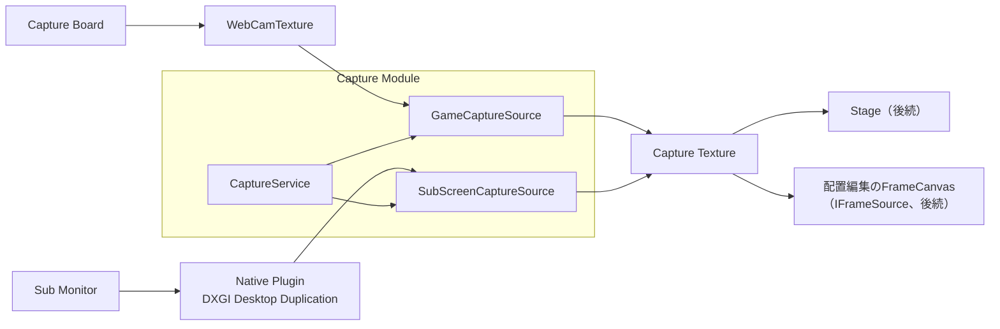

# Capture 詳細設計

## 1. 目的

本書は、Capture Moduleの詳細設計を定義する。Capture Moduleは、外部の映像（と音声）を取得し、Unityで使えるTextureとして他のModuleへ渡す。

対象は以下とする。

- Capture Sourceの共通の契約（`IVideoCaptureSource`）と状態
- GameCapture：Capture Board（Nintendo Switch等のゲーム機器）の映像
- SubScreenCapture：PCのサブモニターの映像（DXGI Desktop Duplication）
- Capture Sourceの起動・停止、異常時の縮退、診断
- Native Plugin（SubScreenCapture）の構成とビルド

次は本書の対象外とし、後続の設計で扱う。

- 取得した映像をどこへ表示するか（Stage Module、方式設計10.23、11.14）
- 最終映像の生成とプレビュー（Video Module、方式設計10.5、10.6）
- GameCaptureの音声（Audio Moduleと合わせて設計する。方式設計12.16）
- Capture Setup画面とLive画面の操作（各画面の仕様と合わせて設計する。方式設計14.41）
- 設定の保存先（Project / Profileの設計と合わせて決める）

関連する方式設計：

- 10.19 内部責務分割（Capture Module）
- 10.20〜10.27 Capture方式
- 11.14 Capture Screen Surface方式
- 12.16 Game / Capture Audio方式
- 14.41 Capture UI方式
- 15.5 映像リアルタイム性能
- 16.30 Capture Source・Capture Backend拡張

参照した試作（Repository外、CLAUDE.md 12章）：

- `E:\VirtualVessel\benchmarks\GameCaptureUnityPlugin`（`VideoDisplayer.cs`）
- `E:\VirtualVessel\benchmarks\SubScreenCapture`（`DDCapture.cpp`）

### 全体像



---

## 2. 責務

| 責務 | 担当 |
|---|---|
| 映像の取得、Unity Textureへの変換 | Capture |
| Capture Sourceの状態、異常の検出と縮退、再接続 | Capture |
| 機器（Capture Board、モニター）の一覧と選択 | Capture。選択の操作はUI（Setup画面、後続） |
| 取得した映像の表示位置と配置データ | Stage（後続） |
| 最終映像の生成 | Video（後続） |
| GameCaptureの音声のMixとRouting | Audio（後続） |
| Sourceの生成と起動・終了の順序 | Application（Composition） |

---

## 3. Module境界

- Capture Moduleは、Core、Diagnosticsだけを参照する。Stage、Video、UIは参照しない。
- 他のModuleは`IVideoCaptureSource`と`ICaptureSources`だけを使う。`WebCamTexture`、DXGI、Native Pluginの型やHandleはModuleの外へ出さない（方式設計10.27）。
- 映像はTexture（`UnityEngine.Texture`）として渡す。取得の方式（CPU経由のコピー、GPUでの共有等）は外から見えない（方式設計10.22）。
- Native Pluginは`native/capture/`に置き、Capture Moduleの内部（`SubScreen/`）からだけ呼ぶ。

---

## 4. 主要ClassとInterface

| 名前 | 種別 | 概要 |
|---|---|---|
| `IVideoCaptureSource` | Interface | 映像を提供するCapture Sourceの共通の契約 |
| `ICaptureDeviceSource` | Interface | 機器を選べるCapture Source（Board、モニター）。機器の一覧と選択 |
| `ICaptureSources` | Interface | Capture Sourceの一覧。他のModuleはここから取得する |
| `CaptureState` | Enum | `Stopped`、`Starting`、`Ready`、`Capturing`、`Unavailable`、`Error` |
| `CaptureProblem` | Enum | 利用者へ伝える問題の種類（機器が見つからない等） |
| `CaptureDevice` | Class | 機器の識別子と表示名 |
| `CaptureSourceInfo` | Struct | 実際の解像度、Frame Rate、機器の表示名 |
| `CaptureService` | Class（`IApplicationService`） | Sourceの生成・起動・停止・毎Frameの更新、計測 |
| `GameCaptureSource` | Class | `WebCamTexture`によるGameCapture |
| `SubScreenCaptureSource` | Class | Native PluginによるSubScreenCapture |
| `IDesktopDuplication` | Interface（internal） | Native Pluginの呼び出しの境界。Testでは偽物に差し替える |
| `ICameraDevices` | Interface（internal） | `WebCamTexture`の境界。Testでは偽物に差し替える |
| `CaptureStateMachine` | Static Class | 状態の遷移の判断（純粋関数） |
| `IFrameLoop` | Interface（Core） | 毎Frame、Main Threadで呼ぶ処理を登録する（Application基盤詳細設計に追加） |

---

## 5. Public API

```csharp
public interface IVideoCaptureSource
{
    string Id { get; }                                       // "game"、"subscreen"。Stageはこれで参照する
    CaptureSourceKind Kind { get; }                          // GameCapture、SubScreenCapture
    IReadOnlyObservable<CaptureState> State { get; }
    IReadOnlyObservable<CaptureProblem> Problem { get; }     // 利用者へ伝える問題。なければNone
    IReadOnlyObservable<CaptureSourceInfo> Info { get; }     // 実際の解像度、Frame Rate、機器名
    IReadOnlyObservable<Texture> Texture { get; }            // 映像。解像度が変わると別のTextureになる
    void Start();
    void Stop();
}

public interface ICaptureDeviceSource : IVideoCaptureSource
{
    IReadOnlyList<CaptureDevice> Devices { get; }            // 最後に調べた機器の一覧
    void RefreshDevices();                                   // 機器を調べ直す（Main Thread、数ms〜）
    string SelectedDeviceId { get; }
    void SelectDevice(string deviceId);                      // 動作中なら、選び直した機器で取得し直す
}

public interface ICaptureSources
{
    IReadOnlyList<IVideoCaptureSource> Sources { get; }
    IVideoCaptureSource Find(string id);
}
```

- すべての操作と状態の通知は、Main Threadで行う。
- `Texture`は、最初のFrameが届くまでと、機器を閉じた後（停止、機器が外れた、失敗）は`null`とする。開いたまま映像が止まった間（`Ready`、`NoSignal`）は、最後の映像を残す。使う側は`Texture`の変化を購読し、表示を差し替える。
- `Info`は、機器を閉じると既定値（0×0、0fps、機器名なし）に戻る。
- `Start()`は待たずに戻る。結果は`State`で知らせる（機器を開く処理に時間がかかる場合があるため）。

---

## 6. Data Model

### 6.1 状態（方式設計10.24）

| 状態 | 意味 |
|---|---|
| `Stopped` | 止まっている。利用者が止めた、または起動していない |
| `Starting` | 機器を開いている |
| `Ready` | 機器は開いたが、映像が届いていない。まだ届かない場合と、途中で止まった場合がある（Capture Boardに入力がない等） |
| `Capturing` | 映像が届いている |
| `Unavailable` | 選んだ機器やモニターが見つからない。一定の間隔で確かめ直し、見つかれば自動で開く |
| `Error` | 開けなかった、または取得中に回復できない失敗が起きた |

状態の遷移の判断は`CaptureStateMachine`（純粋関数）が行い、Sourceは結果に従って動く。

### 6.2 利用者へ伝える問題（方式設計10.26）

| `CaptureProblem` | 利用者向けの表示（例） |
|---|---|
| `None` | — |
| `DeviceNotFound` | Capture Boardが見つかりません |
| `MonitorNotFound` | モニターが見つかりません |
| `NoSignal` | 映像が届いていません（ゲーム機の電源や接続を確認） |
| `StartFailed` | 映像を取り込めませんでした |
| `PluginMissing` | 開発者向けの問題。利用者には`StartFailed`として見せる |

表示の文字は、UIの文字列表に置く（画面を作るときに追加する）。DXGI、HRESULT等の内部の情報は利用者へ出さない（方式設計14.41）。

### 6.3 機器

```csharp
public sealed class CaptureDevice
{
    public string Id { get; }            // 保存に使う識別子
    public string DisplayName { get; }   // 表示名
}
```

| Source | `Id` | `DisplayName` |
|---|---|---|
| GameCapture | `WebCamDevice.name` | 同じ |
| SubScreenCapture | モニターのDevice名（例：`\\.\DISPLAY2`） | 「モニター2（1920×1080）」のように、番号と解像度。主モニターには印を付ける |

SubScreenCaptureの既定は、主モニター以外で最初のモニターとする。モニターが1つしかなければ、そのモニターを選ぶ（動作確認用）。

---

## 7. State / Lifecycle

### 7.1 CaptureService

- `CaptureService`はOptionalのApplication Serviceとし、Logging、性能計測の後に起動する。失敗しても他の機能を止めない（方式設計10.24）。Compositionは、Service名`Capture`、Loggingに依存するものとして登録する。毎Frameの更新に`IFrameLoop`を使うため、Frame Loopがない場合（Frameを回さないテスト等）は登録しない。
- 起動時に`game`と`subscreen`の2つのSourceを作る。どちらも`Stopped`で始め、自動では開始しない。開始・停止はSetup画面、Live画面（後続）、またはデモから行う。
- 終了時は、すべてのSourceを止め、Texture、`WebCamTexture`、Native側のHandleを解放する。
- 毎Frameの更新は`IFrameLoop`で受け取る（7.3）。

### 7.2 Frame Loop（Application基盤への追加）

```csharp
// VirtualVessel.Core.Lifecycle
public interface IFrameLoop
{
    IDisposable Register(Action tick);   // Disposeで登録を外す
}
```

- `ApplicationBootstrap.Update`が、Main Threadへ渡された処理（`MainThreadDispatcher.Drain`）の後に、登録順に呼ぶ。
- 1つの処理が例外を投げても、他の処理は続ける。例外はErrorとして記録し、同じ処理の例外は繰り返し記録しない。
- Compositionが、必要なServiceへ明示的に渡す。Global Instanceにはしない。
- 毎Frameの処理はAllocationを避け、重い処理を置かない（CLAUDE.md 23章）。

### 7.3 毎Frameの処理

| Source | 処理 |
|---|---|
| GameCapture | `WebCamTexture`の更新を確かめ、状態（`Ready`／`Capturing`）と実際の解像度・Frame Rateを反映する。映像が1秒届かないときだけ、機器が一覧にあるかを確かめる（8.1） |
| SubScreenCapture | Native側に新しいFrameがあれば、Textureへ転送する（8.2）。Native側の状態を反映する |
| 共通 | `Unavailable`のSourceは、2秒ごとに機器を確かめ直す |

---

## 8. 主要Sequence

### 8.1 GameCapture

試作（`VideoDisplayer.cs`）と同じく、Capture BoardをUVCの映像機器として`WebCamTexture`で開く。Native Pluginは使わない。

1. `Start()`：選んだ機器が`WebCamTexture.devices`になければ`Unavailable`（`DeviceNotFound`）。
2. 機器名と希望の解像度・Frame Rate（既定：1920×1080、60fps）で`WebCamTexture`を作り、`Play()`する。`Starting`。
3. 最初のFrameが届くまで（`didUpdateThisFrame`、幅が16pxより大きい）`Ready`。
4. 届いたら`Capturing`。`Texture`に`WebCamTexture`を出す。実際の解像度と、実際に届くFrame Rate（約1秒ごとに数える）を`Info`へ反映する。
5. Frameが5秒届かなければ（開いてから、または最後のFrameから）、`Ready`（`Problem = NoSignal`）にする。`Texture`は最後の映像を残し、`Info`のFrame Rateは0にする。Frameが届けば`Capturing`に戻る。
6. Frameが1秒届かないときは、機器が一覧にあるかを確かめる（2秒に1回まで）。一覧から消えていたら`Unavailable`にし、戻れば自動で開き直す。`WebCamTexture`には機器が外れたことを知らせる仕組みがなく、映像が止まるだけのため。Frameが届いている間は一覧を確かめない。一覧の取得はOSへの問い合わせとメモリの確保を伴い、映像を送っている機器がそこにあるのは明らかなため。

試作では、機器を一覧の番号で選んでいた。番号は機器の抜き差しで変わるため、製品では機器名で選ぶ。

### 8.2 SubScreenCapture

Native Plugin（`VirtualVessel.Capture.Native.dll`）がDXGI Desktop DuplicationでFrameを取得し、CPUのメモリへ写す。Managed側は、新しいFrameがあるときだけUnityのTextureへ転送する。試作（`DDCapture.cpp`）の方式（CPU経由のコピー）を引き継ぎ、次の点を改める。

| 試作の問題 | 製品での対応 |
|---|---|
| 毎Frame、Staging Textureを作り直していた | 解像度が変わるまで使い回す |
| 書き込みと読み出しの間に排他がなく、画像が混ざり得た | 3つのBufferを順に使う（書き込み中、最新、読み出し中）。短い排他だけで、待たない |
| 新しいFrameかどうかを知る手段がなかった | Frameに連番を付ける。Managed側は番号が変わったときだけ転送する |
| 解像度の変更、UAC画面への切り替え（`DXGI_ERROR_ACCESS_LOST`）で止まったままになった | 複製を作り直す。失敗が続けば`Error` |
| 最初のGPUにつながったモニターしか選べなかった | すべてのGPUのモニターを列挙し、モニターがつながったGPUで複製する |
| 名前付きの共有メモリ（`Local\DDCaptureBuffer`）に画面を置いていた | 同じユーザーの別Programから読めてしまうため使わない。Process内のメモリだけを使う |
| 例外をSEHで握りつぶしていた | 範囲を確かめてから写し、失敗は状態として返す |

1. `Start()`：選んだモニターが見つからなければ`Unavailable`（`MonitorNotFound`）。
2. Native側で、モニターがつながったGPUにD3D11 Deviceを作り、`DuplicateOutput`する。取得用のThreadを始める。`Starting`→`Ready`。
3. Threadは`AcquireNextFrame`（100ms）で待ち、Frameが来たらStaging Textureへ写してMapし、空いているBufferへ行ごとに写す。写し終えたら連番を進め、そのBufferを最新にする。
4. Managed側は毎Frame、最新のBufferの連番を見る。変わっていれば、そのBufferを読み出し中にし、`Texture2D.LoadRawTextureData`と`Apply`でTextureへ転送する。最初のFrameで`Capturing`。
5. `ACCESS_LOST`等で複製が失われたら、Native側で作り直す（最大5回、間隔を空けて）。作り直せなければ`Error`（`StartFailed`）。
6. `Stop()`：Threadを止め、COMの参照、Buffer、Textureを解放する。

- 映像の形式は`B8G8R8A8`で、Unityの`TextureFormat.BGRA32`へそのまま転送する。
- Desktop Duplicationは、画面が変わったときだけFrameを返す。動かない画面ではFrameが届かないが、異常ではない。
- マウスカーソルは映像に含まれない（Desktop Duplicationの仕様）。描くかどうかは未決事項とする（17章）。
- 回転したモニター（縦置き）は、まず回転したままの映像を出す。正しい向きへの変換は未決事項とする。

### 8.3 機器の選び直し

- `SelectDevice`は、動作中であれば止めてから選んだ機器で開き直す。止まっていれば選ぶだけ。
- 選択は`CaptureSettings`に持つ。保存先は未決事項とする（17章）。それまでは起動のたびに既定に戻る。

---

## 9. Thread / async

- `IVideoCaptureSource`の操作、状態の変更、Textureの作成と転送は、すべてMain Threadで行う。
- SubScreenCaptureのFrameの取得はNative側のThreadで行う。Managed側との受け渡しは3つのBufferと連番による（8.2）。Native Threadは、Unityの関数を呼ばない。
- `WebCamTexture`はUnityが管理し、Main Threadから操作する。
- 毎Frameの処理は、転送が必要なときだけ重い（1920×1080で約8MB）。転送時間は計測する（11章）。

---

## 10. 設定

```csharp
public sealed class CaptureSettings
{
    public string GameDeviceId { get; set; }          // 未設定なら一覧の最初
    public int GameWidth { get; set; } = 1920;
    public int GameHeight { get; set; } = 1080;
    public int GameFrameRate { get; set; } = 60;
    public string SubScreenMonitorId { get; set; }    // 未設定なら主モニター以外の最初
}
```

- 値は`CaptureService`の生成時に渡す。保存と読み込みは、Project / Profileの設計と合わせて決める（17章）。
- 希望の解像度とFrame Rateは、機器が対応しなければ近い値になる。実際の値は`Info`で分かる。

---

## 11. ログ・診断（方式設計10.26）

- 状態の変化を、Source、機器名、理由とともにInformation（`Error`はWarning）で記録する。毎Frameの記録はしない。
- Native側の失敗は、HRESULTとともに開発者向けLogへ記録する。同じ失敗の繰り返しはまとめる。
- 性能計測（`IPerformanceMetrics`）へ、Sourceごとに次を記録する。Diagnostics画面の表に出る。

| 計測 | 種類 | 内容 |
|---|---|---|
| `Capture/<id>.FrameInterval` | Timer | 新しいFrameが届く間隔 |
| `Capture/<id>.Upload` | Timer | Textureへの転送時間（SubScreenCapture） |
| `Capture/<id>.Frames` | Counter | 届いたFrameの数 |
| `Capture/<id>.Skipped` | Counter | 転送する前に次のFrameで上書きされたFrameの数 |
| `Capture/<id>.Recovered` | Counter | 複製を作り直した回数（SubScreenCapture） |

- 取り込んだ映像の内容は、Logにも診断にも残さない（CLAUDE.md 20章）。

---

## 12. エラー処理・復旧

| 事象 | 扱い |
|---|---|
| 選んだ機器・モニターがない | `Unavailable`。2秒ごとに確かめ直し、見つかれば自動で開く |
| `WebCamTexture`が開けない | `Error`（`StartFailed`）。利用者が開始し直せる |
| Capture Boardに入力がない | `Ready`（`NoSignal`）。取得中に映像が止まった場合も同じ |
| Desktop Duplicationを失った | Native側で作り直す。失敗が続けば`Error` |
| Native Pluginがない・読み込めない | `Error`（`PluginMissing`）。開発者向けLogに理由を記録する |
| 1つのSourceの失敗 | そのSourceだけが止まる。他のSourceや機能は止めない（方式設計10.24） |

---

## 13. セキュリティとプライバシー

- 取り込む画面は利用者の画面であり、個人の情報を含み得る。利用者が開始したSourceだけを取り込み、選んだモニターだけを複製する。
- 取り込んだ映像は、Processの外へ出さない。試作の名前付き共有メモリは使わない（8.2）。
- 映像の内容をファイル、Log、診断へ残さない。
- Native Pluginへ渡す値（モニターの番号等）は、Native側でも範囲を確かめる。

---

## 14. テスト方針

| 種類 | 対象 |
|---|---|
| EditMode | `CaptureStateMachine`の遷移、機器の既定の選び方、モニターの表示名、Frameの連番による転送の判断（純粋関数） |
| EditMode | `GameCaptureSource`、`SubScreenCaptureSource`を偽の`ICameraDevices`、`IDesktopDuplication`で動かし、状態、`Unavailable`からの復帰、選び直し、停止時の解放を確かめる |
| EditMode | `FrameLoop`の順序、例外の分離、登録の解除 |
| PlayMode | 偽のFrameを`SubScreenCaptureSource`へ渡し、Textureへ転送されること（実際の`Texture2D`） |
| 実機 | 実際のモニターでSubScreenCaptureが映ること、`ACCESS_LOST`（解像度の変更）から戻ること。実際のCapture BoardでGameCaptureが映ること。`[Explicit]`を付け、名前を指定したときだけ動かす |
| 性能 | 1920×1080の転送時間（`Capture/subscreen.Upload`）を記録する |
| Native | `native/capture/`をビルドできること（`tools/native/build-capture.ps1`） |

---

## 15. 性能（方式設計15.5）

- 映像は、Main Threadでの転送（1920×1080、約8MB）が主な負荷となる。新しいFrameがあるときだけ転送し、1Frameに1回までとする。
- Native側の取得は別Threadで行い、Main Threadを待たせない。Bufferは使い回し、取得のたびにメモリを確保しない。
- 機器の一覧（`WebCamTexture.devices`）の取得は、開発用PCで4台のとき平均0.72ms、初回は3.86msだった（2026-10-17、`GameCaptureHardwareTests.ListingCameras_Timing`）。`Unavailable`のSourceは2秒ごとに一覧を取得する。取得中のSourceは、映像が1秒届かないときだけ取得する（8.1）。
- GPU間で直接共有する方式（CPUを経由しない）は、性能を測ってから検討する（17章）。試作で動いた方式を変える場合は、比較の計測を行う（CLAUDE.md 33章）。

---

## 16. Directory / Namespace

```text
Assets/VirtualVessel/Capture/
├─ Runtime/                                   VirtualVessel.Capture
│  ├─ IVideoCaptureSource.cs   IVideoCaptureSource, ICaptureDeviceSource, ICaptureSources
│  ├─ CaptureTypes.cs          CaptureSourceKind, CaptureState, CaptureProblem, CaptureDevice, CaptureSourceInfo
│  ├─ CaptureStateMachine.cs   CaptureEvent, CaptureStatus, CaptureStateMachine
│  ├─ CaptureSourceBase.cs     Sourceに共通の状態、機器の選択、再確認、計測
│  ├─ FrameRateMeter.cs        実際に届くFrame Rateを数える（純粋）
│  ├─ CaptureService.cs        CaptureService, CaptureSettings
│  ├─ Game/          GameCaptureSource, ICameraDevices, UnityCameraDevices     VirtualVessel.Capture.Game
│  └─ SubScreen/     SubScreenCaptureSource, IDesktopDuplication, DesktopDuplicationNative   VirtualVessel.Capture.SubScreen
├─ Plugins/x86_64/   VirtualVessel.Capture.Native.dll（17章）
└─ Tests/
   ├─ EditMode/
   └─ PlayMode/

native/capture/
├─ CMakeLists.txt
├─ include/vv_capture.h        C ABIの宣言
└─ src/desktop_duplication.cpp

tools/native/build-capture.ps1
```

---

## 17. 未決事項

| 項目 | 対応予定 |
|---|---|
| Native DLLをRepositoryへコミットするか、各自・CIがビルドするか | 利用者と相談して決める。決まるまで、DLLはGitの管理から外し、手元でビルドする |
| GameCaptureの音声（Libraryの選択：NAudio、UnityのMicrophone、Native WASAPI） | Audio Moduleの設計時。NAudioを使う場合は依存の追加として承認を得る |
| Capture設定の保存先 | Project / Profileの設計時 |
| SubScreenCaptureでマウスカーソルを描くか | 利用者の要望を確かめてから |
| 縦置きモニターの向きの補正 | 必要になった時点で |
| GPU間で直接共有する方式 | 転送時間の計測結果を見て判断する |
| Capture Setup画面、Live画面の操作 | 各画面の仕様の作成時 |

---

## 18. 実装の順序

各段階を1つのBranchとし、それぞれにTestを含める（CLAUDE.md 29.2）。

1. Core：`IFrameLoop`とApplicationでの実装。Capture：契約、状態の判断、`CaptureService`
2. GameCapture（`WebCamTexture`）
3. SubScreenCapture（Native Pluginと`SubScreenCaptureSource`）
4. デモ：取り込んだ映像を配置編集（`FrameCanvas`）に映し、実機で確かめる（デモ用Branch）

Stage（Screen Surface、配置データの保存、`IFrameSource`）とVideo（Main Camera、Stream Render Target、`IStreamPreviewSource`）は、それぞれの詳細設計の後に実装する。
