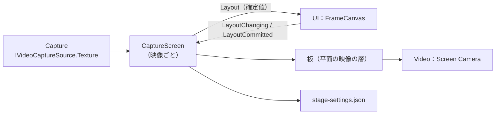

# Stage 詳細設計

## 1. 目的

本書は、Stage Moduleの詳細設計を定義する。Stage Moduleは、配信画面に何をどこへ出すかを決める（方式設計10.23）。

本書で作る範囲は以下とする。

- 舞台がないときの既定の背景
- Stream Screen：Capture映像（ゲーム画面、サブモニター）を、配置編集で決めた位置で配信画面へ平面に出す
- 配置編集との窓口（`IFrameSource`の実装、UI基盤詳細設計9.8）
- 配置の保存と読み込み（`stage-settings.json`）

次は本書の対象外とし、後続の設計で扱う。

- Stage Sceneの読み込みと切り替え（方式設計11.3、11.4）
- Camera Pointとカメラの切り替え（方式設計10.4、11.5）
- Avatar Spawn Point（方式設計11.6）
- 3Dの舞台の中に置くScreen Surface（方式設計11.14）。本書のStream Screenは、配信画面に平面で置くScreen Surfaceとして扱う
- 配置をProject / Profileへ移すこと（完了：Projectのフォルダー、Project Data詳細設計）

関連する方式設計：

- 10.23 Capture映像のStage連携方式
- 11.14 Capture Screen Surface方式
- 14.29 UI状態とRuntime状態の分離

### 全体像



---

## 2. 責務

| 責務 | 担当 |
|---|---|
| Capture映像ごとのStream Screenを作る | Stage |
| 配置（`FrameLayout`）を板の位置、大きさ、切り抜き、反転、重なりへ反映する | Stage |
| 編集中の配置を即座に反映し、確定した配置を保存する | Stage |
| 配置を編集する操作 | UI（`FrameCanvas`） |
| 映像の取得、反転（映像の向きの補正） | Capture |
| 描く層と配信映像の生成 | Video |

---

## 3. Module境界

- StageはCaptureの公開Contract（`ICaptureSources`、`IVideoCaptureSource`）、Videoの公開Contract（`IStreamScreenLayer`）、UIの公開Contract（`IFrameSource`、`IStageLighting`）を使う。
- 映像は`IVideoCaptureSource.Texture`をそのまま板に貼る。Captureの反転は映像そのものの向きの補正で、配置の左右反転（`FrameLayout.FlipHorizontal`）とは別に重なる。
- Stageは映像をCopyしない。板の材質へTextureを設定するだけである。

---

## 4. 主要ClassとInterface

| 名前 | 種類 | 概要 |
|---|---|---|
| `StageService` | Class（`IApplicationService`） | Stream Screenを作り、配置を読み込み、保存する |
| `CaptureScreen` | Class（UIの`IFrameSource`） | 1つのCapture Sourceの板と配置。編集を受け付ける |
| `StageSettings` | Class | 保存する内容（映像ごとの配置、ライト、環境光） |
| `ScreenPlacementMath` | Static Class | 配置から板の位置、大きさ、UVを求める（純粋関数） |
| `StageDefaults` | Static Class | 初めて使うときの配置、アバターの既定のSpawn Point、背景の位置と大きさ |
| `DefaultBackdrop` | Static Class | 仮の背景の画像をコードで描く（純粋関数、7.1） |
| `IAvatarSpawnPoints` | Interface | アバターの立つ位置（7.1） |
| `AvatarFrame` | Class（UIの`IFrameSource`） | アバターの枠。配置からAvatar Cameraの写し方を決める（7.2） |
| `AvatarFramingMath` | Static Class | アバターの枠から、カメラの位置と投影を求める（純粋関数、7.2） |
| `IStageLighting`（UI） | Interface | ライトと環境光。設定画面が変え、Stageが実装する（7.3） |
| `StageLight`、`StageLighting`（UI） | Class（不変） | 1つのライトと、ライトの一覧と環境光。範囲と既定、範囲に収める関数（純粋関数） |
| `StageLightColors`（UI） | Static Class | ライトの色の一覧と、色温度から色を求める関数（純粋関数） |
| `StageLightPlacement` | Static Class | ライトの位置、向き、Unityに渡す強さを求める（純粋関数、7.3） |
| `StageLightRig` | Class（internal） | Unityのライトを作り、消し、値を合わせる。環境光を変え、終了時に戻す |
| `StageView` | Class | ステージビュー（7.4）。`IStageView`（UI）を実装する。カメラと描画先、視点、案内の線、ドラッグ |
| `StageViewMath` | Static Class | 視点の位置と向き、画面の点からの光線、点の画面上の位置、球の上の取っ手（純粋関数） |
| `IStageViewItem` | Interface（internal） | ステージビューで編集できる物。印の位置、案内の線、取っ手の種類 |
| `IStageView`、`StageViewMarker`（UI） | Interface、Struct | ステージビューの窓口と、印の位置 |

---

## 5. Public API

```csharp
public sealed class StageService : IApplicationService, IAvatarSpawnPoints, IStageLighting
{
    public IReadOnlyList<IFrameSource> Screens { get; }   // 配置編集へ渡す。重なり順ではなくSourceの順
    public IAvatarSpawnPoints SpawnPoints { get; }        // アバターの立つ位置（7.1）
    public IReadOnlyObservable<StageLighting> Lighting { get; }  // ライトと環境光（7.3）
    public void SetLighting(StageLighting lighting);             // 範囲に収め、すぐに反映し、保存する。Main Threadから
}

// UI（VirtualVessel.UI.Lighting）。StageはUIを参照するため、窓口はUIに置く（IFrameSourceと同じ）
public interface IStageLighting
{
    IReadOnlyObservable<StageLighting> Lighting { get; }
    void SetLighting(StageLighting lighting);
}

public interface IAvatarSpawnPoints
{
    Pose Default { get; }   // 基準の姿勢で+Zを向くアバターの、Worldの位置と向き
}
```

- Compositionは`Screens`をUIへ渡す。UIは`IFrameSource`だけを見る。
- Compositionは`SpawnPoints.Default`を、`AvatarPlacement`の一部としてAvatarへ渡す（Avatar詳細設計3章）。
- Compositionは`StageService`を`IStageLighting`としてUIへ渡す。設定画面のアバターのページの照明のCardが変える（UI `setup.md` 15章）。

---

## 6. Data Model

### 6.1 Stream Screen

| 項目 | 値 |
|---|---|
| Id | Capture SourceのId（`game`、`subscreen`） |
| 名前 | 文字列表のKey（`stage.screen.game`、`stage.screen.subscreen`）。UIが利用者の言語で表示する（6.4） |
| 映像 | `IVideoCaptureSource.Texture` |
| 縦横比 | `IVideoCaptureSource.Info`の解像度。分からないときは16:9 |
| 配信に出ているか（`Visible`） | 映像（Texture）があるとき |
| 配置 | `FrameLayout`（Core）。編集中の値と確定値を分けて持つ |

### 6.2 板への反映

`ScreenPlacementMath`（純粋関数）が、配置と配信画面の座標（Video詳細設計7.3）から次を求める。

- 位置と大きさ：`FrameLayout.Placement`の矩形の中心と幅、高さ（配信画面の0〜1）。
- UV：`FrameLayout.Crop`の範囲。Unityのテクスチャは下が0のため、上下を入れ替える。左右反転（`FlipHorizontal`）では左右のUVを入れ替える。
- 重なり：`Order`が大きいほど手前（小さいz）にする。

### 6.3 保存（stage-settings.json）

```json
{
  "schemaVersion": 1,
  "screens": {
    "game": { "placement": [0, 0, 1, 1], "crop": [0, 0, 1, 1], "flipHorizontal": false, "locked": false, "allowOutside": false, "order": 0 },
    "subscreen": { "placement": [0.66, 0.04, 0.3, 0.3], "crop": [0, 0, 1, 1], "flipHorizontal": false, "locked": false, "allowOutside": false, "order": 1 }
  },
  "lightIntensity": null,
  "lights": [
    { "kind": "directional", "yaw": -15, "pitch": 35, "distance": 2, "intensity": 0.7, "color": "white", "temperature": 6500, "spotAngle": 50 },
    { "kind": "spot", "yaw": 45, "pitch": 15, "distance": 2, "intensity": 1, "color": "pink", "temperature": 6500, "spotAngle": 50 }
  ],
  "ambientLight": 1
}
```

- Projectのフォルダー（`Projects/<ProjectId>/`、Project Data詳細設計6章）に置き、`ConfigFileStore`（ProjectData）で読み書きする。壊れていたら退避して既定に戻す。段階7の後のリファクタリングまでは設定のFolderにあり、最初のProjectがその写しを取った。
- 知らないIdの配置は消さずに残す（CLAUDE.md 25章）。
- 確定（`LayoutCommitted`）のたびに、最後の確定から0.5秒後に保存する。終了時に未保存の分を保存する。
- `lights`はライトの一覧、`ambientLight`は環境光の倍率（7.3）。変えるまでは`null`で、既定を使う。既定を良くしたとき、変えていない利用者にも届くようにするため。範囲の外の値（手で書き換えたファイル等）は近い端として、数でない値、ない項目、知らない種類と色は既定のライトの値として読む。5つ目からのライトは読まない。Sliderで続けて変えている間は保存せず、最後の変更から0.5秒後に保存する。
- `lightIntensity`は、ライトが1つだった版（0.3まで）の強さである。`lights`がないときに、1つ目のライトの強さとして読む。ライトを保存するときは`null`にする。強さは`lights`に移っているため、値は失われない。
- 項目を足しただけで、古いファイルもそのまま読めるため、版（`schemaVersion`）は1のままとする。

### 6.4 名前の翻訳

`IFrameSource`に`NameKey`を加える（UI基盤詳細設計9.8を更新）。`NameKey`があれば、UIはそのKeyを利用者の言語で表示し、`DisplayName`は使わない。Stageは利用者の言語を知らずに済む。

### 6.5 既定の配置

| 映像 | 位置と大きさ | 重なり |
|---|---|---|
| ゲーム画面 | 配信画面全体（0, 0, 1, 1） | 0（奥） |
| サブモニター | 右上（0.66, 0.04, 0.3, 0.3） | 1 |
| アバター | 中央、高さいっぱい（7.2） | 常に一番手前 |

---

## 7. State / Lifecycle

- `StageService`はOptionalのApplication Serviceとし、Capture、Videoの後に起動する。どちらかがなければ登録しない（平面の映像を出す場所か、映像がないため）。
- 起動時に`stage-settings.json`を読み、Capture Sourceごとに`CaptureScreen`を作り、板を`IStreamScreenLayer.Root`の下に置く。種類が`Camera`のSource（トラッキング用カメラ）には作らない。利用者の顔や部屋を配信に出さないため（Tracking詳細設計5.4、`StageService.ShowsOnStream`）。
- 映像（`Texture`）の変化を購読し、板の材質へ設定する。映像がなければ板を隠す。
- 終了時に未保存の配置を保存し、板と材質と既定のライトを破棄する。

### 7.1 アバターのSpawn Pointとライト（Stage Sceneができるまで）

- Stage Sceneが自分のSpawn Pointを持つまでは（方式設計11.6）、Spawn Pointを1つだけ出す：原点で、-ZにあるMain Camera（Video詳細設計7.5）の方へ180°向ける。
- Persistent Sceneにはライトがなく、光を受けるアバターの材質（MToon）が暗くなる。そのため、Stageは起動時にライトを作る。既定は平行光の`StageDefaultLight`1つ：正面の高い所から（左右0°、上下75°。回転75°、0°、0°）、明るさ70%、影なし（試したあとの利用者の決定、2026-11-22。それまではカメラの上の少し左から、回転35°、15°、0°、100%）。利用者は、ライトを足し、向き、強さ、色を変えられる（7.3）。自分のライトを持つStage Sceneができたら、それに置き換える。
- 方式設計11.7では、照明はStageが管理する。ライトの設定もStageが持ち、`stage-settings.json`に保存する（6.3）。配信の映像も変わるため、表示を見るためだけの映像の高さや拡大（UI `setup.md` 9章）とは違い、保存する。
- Stage Sceneが自分の背景を持つまでは、Stageがアバターの後ろに仮の背景を置く（利用者の要望、2026-10-24）。画像は、紫から藍、紺への暗いグラデーションに、アバターの後ろのやわらかな明るさ、淡い水玉、アバターから離れた左右の帯のパステル色の星とハートを描く。最初にパステル調を試したが、利用者は暗いものを選んだ。`DefaultBackdrop`（純粋関数）がコードで1600×900に描くため、画像ファイルは同梱しない。描くのにEditorで起動時に1回、約0.37秒かかる。画像は、アバターの2m後ろ、カメラの高さに置いた板（`StageBackdrop`）に貼る。板は4.27×2.4mで、既定のカメラの視野（Video詳細設計7.5）に約15%の余裕を足した大きさとする。Main Cameraが、平面の映像とアバターの下に描く。光を受けず、Stream Screenと同じShaderを使う。既定のライトとともに破棄する。

### 7.2 アバターの枠（配置編集）

利用者の要望（2026-11-18）：アバターを画面の右寄りに置き、ゲーム画面を左に置く。座っているようにも見せたい。設定は増やしたくない。

- 配置編集に、アバターの枠を1つ加える（`AvatarFrame`、`IFrameSource`）。ゲーム画面と同じ操作で、位置と大きさ（`Placement`）と、写す範囲（`Crop`）を変える。Idは`avatar`、名前は`stage.avatar.name`（アバター / Avatar）。保存は`stage-settings.json`の`screens.avatar`（6.3と同じ形）。
- 枠の「映像全体」は、アバターの前に立てた正方形とする。一辺はS = 1.1 × H（Hは基準の姿勢での足元から頭の上までの高さ。Avatarが測る）。足元から上へS、左右はアバターの中心から±S/2。`SourceAspect`は1。範囲（`Crop`）はこの正方形の中の部分で、上が0、下が1。
- 範囲の部分が枠に収まるよう、Avatar Camera（Video詳細設計7.6）の位置と投影を決める（`AvatarFramingMath`、純粋関数）。
  - カメラはアバターの正面、距離D = 2.0 mに置き、高さは範囲の上下の中央とする。アバターの方を向く。正面から見るので、枠を画面の端に寄せても、アバターは斜めにならない。
  - 投影の中心をずらした透視投影（off-center）で、範囲の中心を枠の中心へ、範囲の高さを枠の高さへ合わせる。幅は高さから決まり、伸び縮みしない。
- 範囲は身長に対する割合なので、身長の違うモデルでも、同じ枠に同じ部分が収まる（Avatar詳細設計17章「身長の違うモデルの写り方」）。
- 枠はアバターを切り抜かない。枠の外へ出た手なども描く。URPのOverlayのカメラは、描く範囲を絞れないためである。腰から下を隠すには、枠の下端を配信画面の下端に合わせるか、はみ出しを許して下へ出す。
- アバターは平面の映像より常に手前に描く（Video詳細設計7.2）。そのため、枠は重なり順の一覧で常に一番上にあり、並べ替えられない（`IFrameSource.StaysInFront`）。`Order`はStageが固定の大きな値（`AvatarFrame.FrontOrder`）にする。左右反転はできない（`IFrameSource.CanFlip`がfalse）。ロックとはみ出しの許可は使える。
- 保存がないときの配置は、これまでの写り方に近い中央の上半身とする。範囲は(0.21, 0, 0.58, 0.58)、枠は配信画面の高さいっぱいで中央（16:9では(0.219, 0, 0.5625, 1)）。
- アバターがないとき（Avatarがない、選んでいない、読み込めない）は、枠を非表示にし（`Visible`がfalse）、Avatar Cameraの写し方を外す（Main Cameraに合わせる元の動き。Video詳細設計7.2）。
- アバターの高さは、Avatarが`IAvatarService.Height`で出し、CompositionがStageへ渡す（StageはAvatarを参照しない）。

### 7.3 ライトと環境光（利用者の要望、2026-11-22）

Stage Sceneができるまでの仮の照明を、利用者が組み立てられるようにする。強さだけを変えられた仮のSlider（2026-10-21）を置き換える。

- ライトは1〜4つ。URPは、1つの物体をメインのライトと追加のライト（物体ごとに4つまで）で照らすため、4つまでならすべてのライトがアバターに当たる。最後の1つは消せない。
- ライトの種類は「全体」（平行光）か「スポット」。スポットは常にアバターの顔（`StageLightPlacement.Target`、Spawn Pointの上1.3m）へ向ける。
- 位置は、顔を中心にした角度で決める。左右の向き（-180〜180°。0°がカメラの側、プラスが画面の右）、上下の向き（-30〜90°。0°が顔の高さ、90°が真上）、スポットは距離（0.5〜5m）も。真上と真下では、向きの基準をカメラの方向にする（Unityの`LookRotation`が決まらないため）。
- 強さは10〜200%。スポットは距離の2乗で暗くなるため、Unityへは強さ×距離²を渡す。同じ強さなら、平行光でもスポットでも、どの距離でも顔の明るさがそろう。スポットの届く範囲は距離の3倍とし、範囲の端の減り方が顔に出ないようにする。
- 色は、白と7つの舞台の色（ピンク、オレンジ、黄色、緑、水色、青、紫）。白は色温度（2700〜9000K、既定6500K）で決める。色温度からの色は、黒体の色の近似式（Tanner Helland）で求める（純粋関数）。舞台の色は、顔が見えなくならないよう淡くする。利用者の色は、カラーコード（`#RRGGBB`）かRGB（各0〜255）で決め、`color`にカラーコードのまま保存する（利用者の要望、2026-11-22）。読めないカラーコードは白として読む。
- スポットの光の広がりは10〜120°（既定50°）。内側の60%から外へなだらかに暗くし、光の縁を目立たせない。
- 環境光は、ライトが当たらない影の側の明るさ。Sceneの環境光（`RenderSettings.ambientProbe`）に掛ける倍率（0〜200%、既定100%）とする。既定では今までの見た目のまま変わらない。起動時のSceneの環境光を覚えておき、終了時に戻す。
- 影は付けない（7.1と同じ）。
- 値は`StageLighting.Normalized`（純粋関数）で範囲に収めてから反映する。UIから来た値も、保存から読んだ値も同じ規則で扱う。

### 7.4 ステージビュー（方式設計11.15）

Setupで舞台を見ながら組み立てる3Dの表示。UnityのScene Viewにあたる。最初はライトの配置に使い（利用者の要望、2026-11-22。数値だけでは、ライトがどこにあり、光がどちらへ向かうか分からなかった）、3Dの舞台を扱うときにCamera Point、Spawn Point、Screen Surface、小物にも使う。そのため、表示と操作の仕組みを、編集する物の種類から切り離して作る。

#### 7.4.1 構成

| 部分 | 持ち主 | 役割 |
|---|---|---|
| ステージビューのカメラ | Stage（`StageView`） | 舞台とアバターを、配信とは別の描画先へ描く |
| 視点 | Stage（`StageViewMath`、純粋関数） | 中心（Pivot）の周りを回る視点。回す、寄る・引く、中心を動かす、戻す |
| 編集できる物 | Stage（`IStageViewItem`、internal） | 種類ごとに、印の位置、案内の線（Guide）、取っ手（Handle）の種類を持つ。今はライト（`LightViewItem`）だけ |
| 案内の線 | Stage（`StageViewGuides`） | 光の向き、スポットの円錐、配信のカメラの形等を、ステージビューのカメラにだけ描く線 |
| 印 | UI（照明のCard） | 物の位置に置く番号の印。Stageが毎Frame出す画面上の位置に、UIの部品として置く |
| 操作 | UI | ポインターとキーボードを、視点の操作、選択、ドラッグの命令へ変える |

- 印をUIの部品にするのは、番号の文字を読みやすく描き、色だけに頼らない形（番号と枠）にし、Focusとツールチップを通常の部品と同じに扱うため。3Dの中に文字を描くより簡単で、トークンにも従える。
- 線と円錐は3Dの位置にあるため、Stageがステージビューのカメラに描く。

#### 7.4.2 窓口

```csharp
// UI（VirtualVessel.UI.StageEditing）。StageはUIを参照するため、窓口はUIに置く（IStageLightingと同じ）
public interface IStageView
{
    IReadOnlyObservable<Texture> Image { get; }             // 開いている間の描画先。閉じているとnull
    IReadOnlyObservable<IReadOnlyList<StageViewMarker>> Markers { get; }  // 印の位置。開いている間、毎Frame
    IDisposable Open(int width, int height);                  // 描き始める。最後の1つを閉じると止めて解放する
    void Orbit(Vector2 degrees);                              // x：左右、y：上下
    void Zoom(float steps);                                   // プラスで寄る
    void Pan(Vector2 viewFraction);                           // 中心を画面の割合だけ動かす
    void ResetView();
    void Frame(string itemId);                                // その物を中心にする
    void Select(string itemId);                               // 選んでいる物（太く描く）。nullで選ばない
    bool BeginDrag(string itemId, Vector2 uv);                // 取っ手のない物はfalse
    void DragTo(Vector2 uv);
    void EndDrag();
}

public readonly struct StageViewMarker
{
    public string ItemId { get; }      // "light:0"など。種類:番号
    public string Label { get; }       // 印の文字（"1"）
    public Vector2 Uv { get; }         // 画面上の位置（左上0、右下1）
    public bool Visible { get; }       // カメラの後ろ等で見えない
    public Color Color { get; }        // ライトなら光の色
}
```

- 選ぶこと自体はUIの状態とする（照明のCardの「ライト」の選択と同じもの）。Stageは、`Markers`と案内の線を描くために、選んでいる物を`Select(string itemId)`で受け取る。
- ドラッグの結果は、物の通常の窓口へ渡す。ライトは`StageService.SetLighting`を通り、範囲に収められ、保存される（7.3、6.3）。ステージビューは保存を持たない。

#### 7.4.3 カメラと描画先

- `Open`の最初の呼び出しで、カメラと描画先（`RenderTexture`、UIの表示の大きさ、最大960×540、MSAA 4×）を作る。最後の`Dispose`で破棄する。StageのDisposeでも破棄する。
- カメラはBaseのカメラとし、Main CameraのStack（Video詳細設計7.2）に入れない。`MainCamera`のTagも付けない。描く層は、平面の映像の層（`StreamScreens`）以外すべて（舞台、背景の板、アバターの層）。平面の映像は配信の画面に重ねる2Dのため、3Dの表示には出さない。
- 縦の画角は40°。背景は舞台の暗い色で消去する。
- 開いている間だけ`enabled`にする。配信だけしているときは描かない。開いている間は、舞台とアバターを2回描く（配信とステージビュー）ため、その分GPUを使う。

#### 7.4.4 視点

- 視点は中心の周りの球の上にあり、左右の角度、上下の角度（-10〜80°）、距離（1.5〜10m）で決める（`StageViewMath.Pose`、純粋関数）。既定は中心が顔（`StageLightPlacement.Target`）、左右-35°、上下22°、距離5.2m。
- 回す向きは、舞台がポインターについて回る向きとする（UnityのScene Viewと同じ）。右へドラッグすると舞台が右へ回る（視点は左へ回り込む）。上下は、視点がポインターについて動く（下へドラッグすると視点が上がる。試したあとの利用者の決定、2026-11-22）。見本で逆にしたとき、利用者の想像と逆だった（2026-11-22）。人によって自然に感じる向きが違うため、左右と上下をそれぞれ反転できる（UI `setup.md` 15.2。UIの設定で、Stageは知らない）。
- ホイール1段で距離を10%変える。中心の移動は、画面に平行な面の上で、ポインターと同じだけ動く。

#### 7.4.5 取っ手

| 取っ手 | 動き | 使う物 |
|---|---|---|
| 球の上（Orbit） | 中心からの距離を保ち、向きを中心へ向けたまま、球の上を動く。ポインターからの光線と球の交点で決め、当たらないときは光線の最も近い点を球へ写す（純粋関数） | ライト（今） |
| 移動（Move） | 3本の軸か、床の面の上を動く | Spawn Point、Camera Point、Screen Surface、小物（将来） |
| 回転（Rotate） | 軸の周りの輪で回す | Camera Point、Screen Surface、小物（将来） |
| 大きさ（Scale） | 枠の角で大きさを変える | Screen Surface、小物（将来） |

- 取っ手は`IStageViewItem`が種類を返し、`StageView`が共通に扱う。新しい物を足すときは、その物の`IStageViewItem`を足す。
- ライトのドラッグは、左右と上下の向きを1°単位で変える。距離はSliderで変える（球の大きさが変わると、ドラッグの手応えが変わるため）。

#### 7.4.6 案内の線

- 線のMeshを持つ物を置き、ステージビューのカメラが描く間だけ有効にする（`RenderPipelineManager.beginCameraRendering`で有効、`endCameraRendering`で無効）。そのカメラにだけ描かれ、Main Camera、Avatar Camera、Screen Cameraには描かれない。新しい層を足さずに済む。カメラを指定して描く方法（`Graphics.RenderMesh`の`RenderParams.camera`、`Graphics.DrawMesh`）は、URPのこのカメラでは描かれなかったため使わない（2026-11-22）。
- ライト：スポットは顔への線と、光の円錐（顔の位置の輪と、ライトから輪への4本の線）。全体のライトは、半径2.4mの位置から顔の方向へ5本の平行な矢印。色は光の色。選んでいるライトは太く、ほかは薄く描く。
- 配信のカメラの位置に、カメラの形の印を描く。見る方向の目安にするため。位置と画角はVideoの`IStreamOutput.Camera`から毎フレーム読む（Video詳細設計5章）。カメラから0.6 m先に、配信の映像と同じ縦横の比の枠を描き、カメラから枠の四隅へ線を引く。枠の上辺には、上の向きがわかるよう三角を描く。色はライトの色と紛れない淡い灰色で、奥行きに従う。動かせる物ではないため、番号の印は付けない。Videoが起動する前は描かない。
- 線は光を受けないShader（`StageGuide.shader`、Resources）で、奥行きの前後に従う。選んでいる物の線だけは、前に物があっても見えるよう、奥行きを比べずに描く。

#### 7.4.7 3Dの舞台を扱うとき

- Stage Sceneを読み込むと、ステージビューのカメラは同じSceneを写すため、その舞台がそのまま見える。
- Stage SceneのCamera Point、Spawn Point、Screen Surfaceは、それぞれの`IStageViewItem`として登録する。Camera Pointは視野の四角錐、Spawn Pointは足元の輪と向きの矢印、Screen Surfaceは枠で示す。
- Camera Pointを選ぶと、その視点から写した見え方を確かめられるようにする（配信のカメラを動かすのではなく、ステージビューのカメラをその位置へ移す）。
- 利用者が動かした位置の保存先（Projectの舞台の設定か、Stageの定義か）は、Stage Sceneの設計時に決める（17章）。

#### 7.4.8 配信に出ないことの確かめ

- PlayModeのテストで、案内の線をはっきりした色で描いた状態の配信の描画先（Stream Render Target）を読み戻し、線の位置の画素が線の色でないことを確かめる。
- EditModeのテストで、ステージビューのカメラの描画先がStream Render Targetでないこと、Main CameraのStackに入っていないこと、閉じると破棄されることを確かめる。

---

## 8. 主要Sequence

### 8.1 配置の編集（UI基盤詳細設計9.5）

1. ドラッグ中、UIは`PreviewLayout`を呼ぶ。`CaptureScreen`は板へ即座に反映する。保存しない。
2. ドラッグを終えると、UIは`CommitLayoutAsync`を呼ぶ。`CaptureScreen`は値を確かめて確定値とし、板へ反映し、保存を予約する。
3. 確定値は`Layout`で通知する。UIの枠はその値を表示する。
4. 確定を取り消す（元に戻す）とき、UIは以前の配置を確定として送る。Stageから見ると通常の確定と同じである。

### 8.2 値の確認

- 大きさが0以下、または数値でない配置は拒否し、`UserFacingException`（「この配置は使えません」）を返す。UIは元の配置へ戻す。
- `Order`は値のまま使う（大きいほど手前）。振り直さないため、UIが送った値と保存する値が一致する。

---

## 9. Thread / async

- すべてMain Threadで行う。`CommitLayoutAsync`は保存の予約だけを行い、すぐに完了する。保存の書き込みは`ConfigFileStore`が行う。

---

## 10. 設定

6.3の`stage-settings.json`。Capture Sourceの設定（選んだ機器、反転、開始していたか）は`capture-settings.json`へ保存する（Capture詳細設計10章）。

---

## 11. ログ・診断

- 起動時に、読み込んだ配置の件数と、既定に戻したかどうかをInformationで記録する。
- 保存の失敗はWarningで記録する（UIの設定と同じ扱い）。
- 配置の値は個人の情報を含まないため、Debugで記録してよい。

---

## 12. エラー処理・復旧

| 事象 | 扱い |
|---|---|
| `stage-settings.json`が壊れている | 退避して既定に戻し、Warningで記録する |
| 保存できない | Warningで記録する。配置は動作中は保たれる |
| 不正な配置の確定 | 拒否し、UIは元に戻す（8.2） |
| Capture SourceやVideoがない | StageServiceを登録しない。配置編集には何も出ない |

---

## 13. セキュリティとプライバシー

- 保存するのは配置の数値だけで、映像の内容は保存しない。
- 映像を出すかどうかはCapture Sourceの開始・停止に従う。Stageが勝手に映像を出すことはない。

---

## 14. テスト方針

| 種類 | 対象 |
|---|---|
| EditMode | `ScreenPlacementMath`（位置、大きさ、UV、上下の入れ替え、左右反転、重なり）、`StageSettings`の読み書きと既定（純粋関数と偽のStore） |
| EditMode | `CaptureScreen`：映像の変化で表示が切り替わる、確定で保存が予約される、不正な配置を拒否する |
| EditMode | ライト：既定、範囲に収める、0.3の強さの読み込み、保存したライトの読み込み（純粋関数）。位置と向き（既定のライトの向きと明るさ、顔へ向くこと、真上）、スポットの強さ。変えるとすぐにライトを作り直し、遅れて保存し、次の起動で読み戻す。環境光を掛け、終了時に戻す |
| EditMode | `AvatarFramingMath`：範囲の中心が枠の中心に、範囲の高さが枠の高さに写ること、身長によらないこと、既定の配置。`AvatarFrame`：アバターの有無で表示とカメラの写し方が切り替わる、確定で保存する、重なり順を固定する |
| PlayMode | 置いた映像が、Stream Render Targetの決めた位置に描かれること（画素を読み戻す） |
| EditMode | `StageViewMath`：視点の位置、回す向き、光線、画面上の位置、球の上の取っ手（当たる、外れる）。`StageView`：開くとカメラと描画先を作り、配信の描画先と別でStackに入らない、閉じると破棄する、ライトのドラッグが照明の設定を変える |
| PlayMode | ステージビューの案内の線が、配信の描画先に描かれないこと（画素を読み戻す、7.4.8） |

---

## 15. 性能

- 板1枚に材質1つ。映像の更新はTextureの差し替えだけで、毎Frameの処理はない。
- 編集中の反映は板の`Transform`と材質の値の変更だけである。

---

## 16. Directory / Namespace

```text
Assets/VirtualVessel/Stage/
├─ Runtime/                          VirtualVessel.Stage
│  ├─ StageService.cs
│  ├─ CaptureScreen.cs
│  ├─ StageSettings.cs               StageSettings, ScreenSettings, LightSettings
│  ├─ StageLightRig.cs               StageLightPlacement, StageLightRig（7.3）
│  ├─ StageView.cs                   StageView, StageViewMath, IStageViewItem, LightViewItem（7.4）
│  ├─ StageViewGuides.cs             案内の線のMesh
│  ├─ Resources/StageGuide.shader    案内の線のShader（光を受けない）
│  ├─ ScreenPlacementMath.cs        ScreenPlacementMath, StageDefaults
│  ├─ DefaultBackdrop.cs             仮の背景の画像
│  ├─ IAvatarSpawnPoints.cs
│  └─ Resources/StreamScreen.shader 光を受けない板のShader。切り抜きと反転を材質の値（_MainTex_ST）だけで表す。Buildに含めるためResourcesに置く
└─ Tests/
   ├─ EditMode/
   └─ PlayMode/
```

参照：Core、Diagnostics、ProjectData、Capture、Video、UI。

---

## 17. 未決事項

| 項目 | 対応予定 |
|---|---|
| Stage Scene、Camera Point、Avatar Spawn Point | Stage Sceneの設計時。アバターが舞台の中に立つときに、アバターの枠（7.2）とどう合わせるかも決める |
| アバターを枠で切り抜く | 要望が出た時点で。Avatar Cameraを別のRender Targetに描いて重ねる必要がある（7.2） |
| 3Dの舞台の中のScreen Surface | Stage Sceneの設計時 |
| 映像を配信に出さずに取り込みだけ続ける切り替え | 要望が出た時点で |
| 配置をProject / Profileへ移す | 完了（2026-10-27）：配置はProjectのものなので、`stage-settings.json`はProjectのフォルダーにある（Project Data詳細設計6章） |
| Stage Sceneの照明と利用者のライト | Stage Sceneの設計時。利用者のライト（7.3）を、Stage Sceneのライトに足すか、置き換えるかを決める |
| ステージビューで動かした位置の保存先 | Stage Sceneの設計時。Projectの舞台の設定か、Stageの定義か（7.4.7） |
| 移動、回転、大きさの取っ手 | Camera Point、Spawn Point、Screen Surfaceを編集するとき（7.4.5） |
| ステージビューに配信のカメラの印を描く | 完了（2026-11-23）：Videoの`IStreamOutput.Camera`から描く（7.4.6） |

---

## 18. 実装の順序

Capture → Stage → Video の流れの後半として、次の順に進める。各段階に、テストと、試すためのデモブランチを付ける。

1. Video：Main Camera、Stream Render Target、平面の映像の層、`IStreamPreviewSource`
2. Stage：Stream Screen、`IFrameSource`、`stage-settings.json`
3. Capture：`capture-settings.json`（選んだ機器、反転、開始していたか）
4. UI：ライブ画面（配信プレビューと配置編集）、セットアップ画面（Captureの設定）（`docs/<lang>/ui/screens/`）
