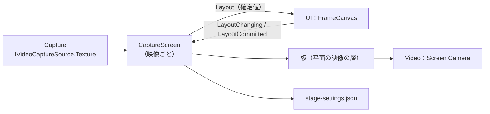

# Stage 詳細設計

## 1. 目的

本書は、Stage Moduleの詳細設計を定義する。Stage Moduleは、配信画面に何をどこへ出すかを決める（方式設計10.23）。

本書で作る範囲は以下とする。

- 舞台がないときの既定の背景
- Stream Screen：Capture映像（ゲーム画面、サブモニター）を、配置編集で決めた位置で配信画面へ平面に出す
- 配置編集との窓口（`IFrameSource`の実装、UI基盤詳細設計9.8）
- 配置の保存と読み込み（`stage-settings.json`）

次は本書の対象外とし、後続の設計で扱う。

- Stage Sceneの読み込みと切り替え（方式設計11.3、11.4）
- Camera Pointとカメラの切り替え（方式設計10.4、11.5）
- Avatar Spawn Point（方式設計11.6）
- 3Dの舞台の中に置くScreen Surface（方式設計11.14）。本書のStream Screenは、配信画面に平面で置くScreen Surfaceとして扱う
- 配置をProject / Profileへ移すこと（Project / Profileの設計時）

関連する方式設計：

- 10.23 Capture映像のStage連携方式
- 11.14 Capture Screen Surface方式
- 14.29 UI状態とRuntime状態の分離

### 全体像



---

## 2. 責務

| 責務 | 担当 |
|---|---|
| Capture映像ごとのStream Screenを作る | Stage |
| 配置（`FrameLayout`）を板の位置、大きさ、切り抜き、反転、重なりへ反映する | Stage |
| 編集中の配置を即座に反映し、確定した配置を保存する | Stage |
| 配置を編集する操作 | UI（`FrameCanvas`） |
| 映像の取得、反転（映像の向きの補正） | Capture |
| 描く層と配信映像の生成 | Video |

---

## 3. Module境界

- StageはCaptureの公開Contract（`ICaptureSources`、`IVideoCaptureSource`）、Videoの公開Contract（`IStreamScreenLayer`）、UIの公開Contract（`IFrameSource`）を使う。
- 映像は`IVideoCaptureSource.Texture`をそのまま板に貼る。Captureの反転は映像そのものの向きの補正で、配置の左右反転（`FrameLayout.FlipHorizontal`）とは別に重なる。
- Stageは映像をCopyしない。板の材質へTextureを設定するだけである。

---

## 4. 主要ClassとInterface

| 名前 | 種類 | 概要 |
|---|---|---|
| `StageService` | Class（`IApplicationService`） | Stream Screenを作り、配置を読み込み、保存する |
| `CaptureScreen` | Class（UIの`IFrameSource`） | 1つのCapture Sourceの板と配置。編集を受け付ける |
| `StageSettings` | Class | 保存する内容（映像ごとの配置） |
| `ScreenPlacementMath` | Static Class | 配置から板の位置、大きさ、UVを求める（純粋関数） |
| `StageDefaults` | Static Class | 初めて使うときの配置 |

---

## 5. Public API

```csharp
public sealed class StageService : IApplicationService
{
    public IReadOnlyList<IFrameSource> Screens { get; }   // 配置編集へ渡す。重なり順ではなくSourceの順
}
```

- Compositionは`Screens`をUIへ渡す。UIは`IFrameSource`だけを見る。

---

## 6. Data Model

### 6.1 Stream Screen

| 項目 | 値 |
|---|---|
| Id | Capture SourceのId（`game`、`subscreen`） |
| 名前 | 文字列表のKey（`stage.screen.game`、`stage.screen.subscreen`）。UIが利用者の言語で表示する（6.4） |
| 映像 | `IVideoCaptureSource.Texture` |
| 縦横比 | `IVideoCaptureSource.Info`の解像度。分からないときは16:9 |
| 配信に出ているか（`Visible`） | 映像（Texture）があるとき |
| 配置 | `FrameLayout`（Core）。編集中の値と確定値を分けて持つ |

### 6.2 板への反映

`ScreenPlacementMath`（純粋関数）が、配置と配信画面の座標（Video詳細設計7.3）から次を求める。

- 位置と大きさ：`FrameLayout.Placement`の矩形の中心と幅、高さ（配信画面の0〜1）。
- UV：`FrameLayout.Crop`の範囲。Unityのテクスチャは下が0のため、上下を入れ替える。左右反転（`FlipHorizontal`）では左右のUVを入れ替える。
- 重なり：`Order`が大きいほど手前（小さいz）にする。

### 6.3 保存（stage-settings.json）

```json
{
  "schemaVersion": 1,
  "screens": {
    "game": { "placement": [0, 0, 1, 1], "crop": [0, 0, 1, 1], "flipHorizontal": false, "locked": false, "allowOutside": false, "order": 0 },
    "subscreen": { "placement": [0.66, 0.04, 0.3, 0.3], "crop": [0, 0, 1, 1], "flipHorizontal": false, "locked": false, "allowOutside": false, "order": 1 }
  }
}
```

- 設定のFolder（UIの`ui-settings.json`と同じ、方式設計6.8）に置き、`ConfigFileStore`（ProjectData）で読み書きする。壊れていたら退避して既定に戻す。
- 知らないIdの配置は消さずに残す（CLAUDE.md 25章）。
- 確定（`LayoutCommitted`）のたびに、最後の確定から0.5秒後に保存する。終了時に未保存の分を保存する。
- Project / Profileができたら、そちらへ移す（17章）。

### 6.4 名前の翻訳

`IFrameSource`に`NameKey`を加える（UI基盤詳細設計9.8を更新）。`NameKey`があれば、UIはそのKeyを利用者の言語で表示し、`DisplayName`は使わない。Stageは利用者の言語を知らずに済む。

### 6.5 既定の配置

| 映像 | 位置と大きさ | 重なり |
|---|---|---|
| ゲーム画面 | 配信画面全体（0, 0, 1, 1） | 0（奥） |
| サブモニター | 右上（0.66, 0.04, 0.3, 0.3） | 1 |

---

## 7. State / Lifecycle

- `StageService`はOptionalのApplication Serviceとし、Capture、Videoの後に起動する。どちらかがなければ登録しない（平面の映像を出す場所か、映像がないため）。
- 起動時に`stage-settings.json`を読み、Capture Sourceごとに`CaptureScreen`を作り、板を`IStreamScreenLayer.Root`の下に置く。
- 映像（`Texture`）の変化を購読し、板の材質へ設定する。映像がなければ板を隠す。
- 終了時に未保存の配置を保存し、板と材質を破棄する。

---

## 8. 主要Sequence

### 8.1 配置の編集（UI基盤詳細設計9.5）

1. ドラッグ中、UIは`PreviewLayout`を呼ぶ。`CaptureScreen`は板へ即座に反映する。保存しない。
2. ドラッグを終えると、UIは`CommitLayoutAsync`を呼ぶ。`CaptureScreen`は値を確かめて確定値とし、板へ反映し、保存を予約する。
3. 確定値は`Layout`で通知する。UIの枠はその値を表示する。
4. 確定を取り消す（元に戻す）とき、UIは以前の配置を確定として送る。Stageから見ると通常の確定と同じである。

### 8.2 値の確認

- 大きさが0以下、または数値でない配置は拒否し、`UserFacingException`（「この配置は使えません」）を返す。UIは元の配置へ戻す。
- `Order`は値のまま使う（大きいほど手前）。振り直さないため、UIが送った値と保存する値が一致する。

---

## 9. Thread / async

- すべてMain Threadで行う。`CommitLayoutAsync`は保存の予約だけを行い、すぐに完了する。保存の書き込みは`ConfigFileStore`が行う。

---

## 10. 設定

6.3の`stage-settings.json`。Capture Sourceの設定（選んだ機器、反転、開始していたか）は`capture-settings.json`へ保存する（Capture詳細設計10章）。

---

## 11. ログ・診断

- 起動時に、読み込んだ配置の件数と、既定に戻したかどうかをInformationで記録する。
- 保存の失敗はWarningで記録する（UIの設定と同じ扱い）。
- 配置の値は個人の情報を含まないため、Debugで記録してよい。

---

## 12. エラー処理・復旧

| 事象 | 扱い |
|---|---|
| `stage-settings.json`が壊れている | 退避して既定に戻し、Warningで記録する |
| 保存できない | Warningで記録する。配置は動作中は保たれる |
| 不正な配置の確定 | 拒否し、UIは元に戻す（8.2） |
| Capture SourceやVideoがない | StageServiceを登録しない。配置編集には何も出ない |

---

## 13. セキュリティとプライバシー

- 保存するのは配置の数値だけで、映像の内容は保存しない。
- 映像を出すかどうかはCapture Sourceの開始・停止に従う。Stageが勝手に映像を出すことはない。

---

## 14. テスト方針

| 種類 | 対象 |
|---|---|
| EditMode | `ScreenPlacementMath`（位置、大きさ、UV、上下の入れ替え、左右反転、重なり）、`StageSettings`の読み書きと既定（純粋関数と偽のStore） |
| EditMode | `CaptureScreen`：映像の変化で表示が切り替わる、確定で保存が予約される、不正な配置を拒否する |
| PlayMode | 置いた映像が、Stream Render Targetの決めた位置に描かれること（画素を読み戻す） |

---

## 15. 性能

- 板1枚に材質1つ。映像の更新はTextureの差し替えだけで、毎Frameの処理はない。
- 編集中の反映は板の`Transform`と材質の値の変更だけである。

---

## 16. Directory / Namespace

```text
Assets/VirtualVessel/Stage/
├─ Runtime/                          VirtualVessel.Stage
│  ├─ StageService.cs
│  ├─ CaptureScreen.cs
│  ├─ StageSettings.cs
│  ├─ ScreenPlacementMath.cs
│  ├─ StageDefaults.cs
│  └─ Resources/StreamScreen.mat    URPのUnlit。Buildに含めるためResourcesに置く
└─ Tests/
   ├─ EditMode/
   └─ PlayMode/
```

参照：Core、Diagnostics、ProjectData、Capture、Video、UI。

---

## 17. 未決事項

| 項目 | 対応予定 |
|---|---|
| Stage Scene、Camera Point、Avatar Spawn Point | Stage Sceneの設計時 |
| 3Dの舞台の中のScreen Surface | Stage Sceneの設計時 |
| 映像を配信に出さずに取り込みだけ続ける切り替え | 要望が出た時点で |
| 配置をProject / Profileへ移す | Project / Profileの設計時 |

---

## 18. 実装の順序

Capture → Stage → Video の流れの後半として、次の順に進める。各段階に、テストと、試すためのデモブランチを付ける。

1. Video：Main Camera、Stream Render Target、平面の映像の層、`IStreamPreviewSource`
2. Stage：Stream Screen、`IFrameSource`、`stage-settings.json`
3. Capture：`capture-settings.json`（選んだ機器、反転、開始していたか）
4. UI：ライブ画面（配信プレビューと配置編集）、セットアップ画面（Captureの設定）（`docs/<lang>/ui/screens/`）
