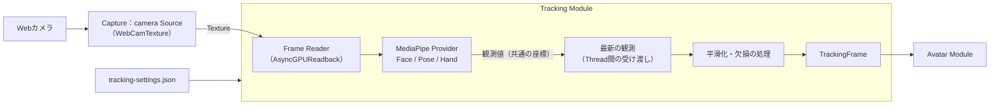
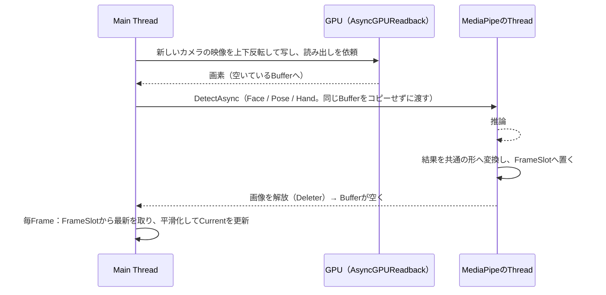

# Tracking 詳細設計

## 1. 目的

本書は、Tracking Moduleの詳細設計を定義する。Tracking Moduleは、カメラの映像から人の顔・体・手の動きを取り、特定のライブラリにもアバターにも依存しない`TrackingFrame`としてAvatar Moduleへ渡す（方式設計8章）。

本書で作る範囲は以下とする（v0.1.0）。

- 共通の契約：`TrackingFrame`、`ITrackingProvider`、追跡の状態
- MediaPipe Provider：MediaPipeUnityPluginのFace / Pose / Hand Landmarkerによるカメラからのトラッキング
- 共通処理：座標系の統一、信頼度と欠損の扱い、平滑化
- トラッキング用カメラ：Capture Moduleのカメラ入力の再利用
- 動かす範囲の選択（顔、上半身、手指。全身は「近日対応」）
- 調整と評価のための記録と再生（開発者向け）

次は本書の対象外とし、後続の設計で扱う。

- mocopi等の他のProvider（方式設計16.3）
- 複数人のトラッキング（方式設計8.12。設計上は1人専用にしない）
- 全身（下半身、腰の移動、足の接地）。範囲の選択肢としては先に用意する（6.5）
- トラッキング設定の画面の詳細（UIの画面仕様で扱う。10章は必要な項目だけを示す）

関連する方式設計：

- 7.6 姿勢適用・体格差吸収方式、7.7 表情制御方式
- 8章 トラッキング方式
- 15.3 リアルタイム性、15.7 Main Thread負荷抑制
- 16.3 新規Tracking Provider対応、16.4 複数Tracking Sourceの統合

関連する詳細設計：

- Avatar詳細設計（`avatar.md`）：`TrackingFrame`をアバターへ適用する側
- Capture詳細設計（`capture.md`）：トラッキング用カメラのSourceを追加する（5.4）

参照した試作（Repository外、CLAUDE.md 12章）：

- `E:\VirtualVessel\benchmarks\Voom`（MediaPipeUnityPlugin 0.16.0、UniVRM 0.129.1）

### 試作から引き継ぐことと、引き継がないこと

Voomは、MediaPipeUnityPluginのFace / Pose / Hand LandmarkerがWindowsのUnityで動き、VRM 1.0のアバターへ顔の動きを適用できることを示した。一方で、利用者の評価では、手指の動きと、3Dらしい動き（特にカメラに対する手前・奥の動き）は発展途上だった。製品では次のように扱う。

| 試作の内容 | 製品での扱い |
|---|---|
| MediaPipeUnityPluginのTask API（`LIVE_STREAM`）、`AsyncGPUReadback`による画像の読み出し | 引き継ぐ。動いた実績がある |
| 顔の点の位置関係から目・口・眉を求める計算 | 引き継がない。MediaPipeが出す表情の値（Blendshape）を使う（6.3）。試作の調整の知見（目の閉じやすさ、左右の目をそろえる等）は、Avatar側の変換の設定として残す（Avatar詳細設計7章） |
| 体は胸の傾き1か所。オイラー角を30Frame平均して滑らかにする | 引き継がない。平均は揺れを抑えたが、0.5〜1秒遅れた。揺れの原因を分けて、遅れの少ない方法で抑える（8章） |
| 手指、奥行きの扱い | 試作を正としない。評価の仕組み（12章）で数値と目視の両方で確かめながら作る |
| UIからMediaPipeの型を直接扱う、`Debug.Log`での設定の出力 | 引き継がない。MediaPipeの型はProviderの外へ出さない |

### 全体像



---

## 2. 責務

| 責務 | 担当 |
|---|---|
| カメラの機器の一覧、選択、開始・停止、映像のTexture | Capture（`camera` Source、5.4） |
| 映像の読み出しと、推論への受け渡し | Tracking（MediaPipe Provider） |
| 推論（顔・体・手の点と表情の値） | Tracking（MediaPipe Provider。MediaPipeUnityPluginを内部で使う） |
| 座標系の統一、左右の定義、信頼度と状態 | Tracking（Provider内の変換と共通処理） |
| 平滑化、外れ値の除去、欠損の保持 | Tracking（共通処理） |
| 入力機器の補正（8.5。正面の向きは試したが採用しない） | Tracking（方式設計8.11） |
| 観測した姿勢をアバターの骨格へ合わせる、表情への変換、鏡写し | Avatar |
| 動かす範囲の選択の保存 | Tracking（`tracking-settings.json`） |
| Serviceの生成と起動・終了の順序 | Application（Composition） |

---

## 3. Module境界

- Trackingは、Core、Diagnostics、ProjectData、Captureの公開Contract（`ICaptureSources`、`IVideoCaptureSource`）を参照する。Avatar、Stage、Video、UIは参照しない。
- MediaPipeUnityPluginの型（`Mediapipe.*`）は、MediaPipe Provider（別のAssembly、16章）の中だけで使う。`TrackingFrame`は、MediaPipeの点の番号、座標系、型を含まない（方式設計8.1）。
- 他のModuleは`ITrackingSource`（5.1）だけを使う。Providerを直接は使わない。
- 表情の値の名前（6.3）は、ARKitに由来する52個の名前を使う。特定のライブラリの型ではなく、顔の動きの名前として広く使われている一覧であり、Provider（MediaPipe、将来のiPhone等）からもアバター（Perfect Sync対応のモデル等）からも独立している。

---

## 4. 主要ClassとInterface

| 名前 | 種別 | 概要 |
|---|---|---|
| `TrackingFrame` | Class | 1回分の観測。体、左右の手、顔、それぞれの状態と時刻（6章） |
| `BodyJoint` | Enum | 体の関節（6.2） |
| `HandJoint` | Enum | 手の関節（21点、6.4） |
| `FaceShape` | Enum | 表情の値（52個、6.3） |
| `TrackingStatus` | Enum | `Tracked`、`LowConfidence`、`Lost`、`NotSupported`、`Disabled`（6.1） |
| `TrackingRegions` | Flags Enum | `Face`、`Body`、`LeftHand`、`RightHand`。Providerの能力と、有効にした部位を表す |
| `BodyRange` | Enum | 動かす範囲：`UpperBody`、`FullBody`（6.5） |
| `ITrackingProvider` | Interface | 観測を作る入力方式の契約（5.2） |
| `ObservationTraits` | Flags Enum | Providerの観測の性質。合う補正を選ぶ（8.4）。`MonocularDepth`、`None` |
| `IObservationCorrection` | Interface | 観測の補正の部品。効かせる性質（`Requires`）を持つ（8.4） |
| `ObservationCorrections` | Class | 補正の一覧（`Catalog`）から、Providerの性質に合うものを選び、観測の写しに適用する（8.4） |
| `CameraAxisArmStraightening` | Class | カメラの方を向いた腕を伸ばす補正（8.4のD。計算は純粋関数） |
| `ITrackingSource` | Interface | 他のModuleが使う窓口。平滑化した最新の`TrackingFrame`、状態（5.1） |
| `TrackingService` | Class（`IApplicationService`） | Providerの生成と起動、毎Frameの処理、設定、計測 |
| `TrackingSettings` | Class | 保存する設定（10章） |
| `FrameSlot<T>` | Class | Thread間で最新の値だけを受け渡す（9章） |
| `OneEuroFilter` | Struct | 速さに応じて強さを変える平滑化（8.2、純粋な計算） |
| `RotationFilter` | Struct | 回転（Quaternion）の平滑化（8.2） |
| `TrackingProcessor` | Class | 観測から`TrackingFrame`を作る共通処理（外れ値、平滑化、欠損） |
| `TrackingStateMachine` | Static Class | 部位ごとの状態の判断（純粋関数） |
| `MediaPipeTrackingProvider` | Class（internal） | MediaPipe Provider |
| `MediaPipeConversion` | Static Class（internal） | MediaPipeの点と座標から共通の形への変換（純粋関数） |
| `ITrackingRecordings` | Interface | 記録と再生の窓口（開発者向け、5.5） |
| `TrackingRecordings`、`TrackingRecorder`、`TrackingRecordingFile`、`TrackingRecordingFormat`、`TrackingReplayProvider` | Class | 観測の記録と再生（開発者向け、12章） |

---

## 5. Public API

### 5.1 ITrackingSource

```csharp
public interface ITrackingSource
{
    IReadOnlyObservable<TrackingState> State { get; }          // Stopped、Starting、Running、Unavailable、Error
    IReadOnlyObservable<TrackingProblem> Problem { get; }      // 利用者へ伝える問題（11章）
    TrackingRegions Supported { get; }                         // Providerが取れる部位
    IReadOnlyObservable<TrackingOptions> Options { get; }      // 利用者が選んだこと（10章）
    double ObservationsPerSecond { get; }                      // 直近1秒に推論した映像の数（セットアップ画面の表示用）

    // 平滑化した最新の観測。Main Threadで、毎Frame更新される。中身は次の更新で書き換わるため、
    // 使う側はそのFrameの間だけ読み、保持しない（Allocationを避けるため、毎回同じObjectを返す）。
    TrackingFrame Current { get; }

    void Start();
    void Stop();
    void SetOptions(TrackingOptions options);                  // 部位の変更はすぐに反映する

}
```

`TrackingOptions`は、利用者が選んだことを1つの値にまとめる（不変。`With…`で変えた値を作り、`SetOptions`で丸ごと渡す）。選択肢が増えても、Interfaceと保存の比較は変わらない。

```csharp
public readonly struct TrackingOptions
{
    TrackingRegions Regions;            // 推論する部位
    BodyRange BodyRange;                // 動かす範囲（全身は近日対応のため上半身に戻す、6.5）
    int Smoothing;                      // 平滑化の段階、1〜10（8.2）
    bool Mirror;                        // 鏡写し（10章）
    BodyDepth BodyDepth;                // 体の動きの3Dか2D（8.6）
    PoseModel PoseModel;                // Lite、Full、Heavy。変えると動作中のProviderを開始し直す（10章）
}
```

- すべての操作と通知はMain Threadで行う。
- `Current`は`TrackingService`が毎Frame（`IFrameLoop`）更新する。Avatarは`LateUpdate`相当の時点で読む（Avatar詳細設計8.3）。
- 1人分の`ITrackingSource`を1つ作る。複数人に広げるときは、Sourceを人数分にする（方式設計8.12）。Singletonにはしない。

### 5.2 ITrackingProvider

```csharp
public interface ITrackingProvider : IDisposable
{
    TrackingRegions Supported { get; }
    ObservationTraits Traits { get; }                          // 観測の性質。合う補正を選ぶため（8.4）。MediaPipeはMonocularDepth
    IReadOnlyObservable<TrackingState> State { get; }          // SourceとProviderで同じ状態を使う
    void Start(TrackingOptions options);                       // 待たずに戻る。結果はStateで知らせる
    void SetOptions(TrackingOptions options);                  // 動作中に変える。無効にした部位の推論は止まる
    void Stop();
    void Tick();                                               // Main Threadで毎Frame。入力の読み出しを進める

    // 最新の観測を、渡されたObjectへ写す。新しい観測がなければfalse。
    // 呼び出し元のObjectへ写すのは、毎Frameの確保を避けるため（CLAUDE.md 15.1の例外、23章）。
    bool TryTakeLatest(TrackingFrame into);
}
```

- Providerが出す観測は、平滑化する前の`TrackingFrame`である（6章。平滑化の前と後で同じ型を使い、写すだけで済むようにする）。Providerごとの違い（座標系、点の番号、左右）は、Providerの中で共通の形へ変換してから出す（方式設計8.8）。
- 新しいProvider（mocopi等）は、この契約を実装するだけで追加できる。観測の性質（`Traits`）を正しく申告すれば、合う補正（8.4）だけがかかる。

### 5.3 TrackingService

- OptionalのApplication Serviceとし、Logging、性能計測、Captureの後に起動する。Captureが動いていなければ作らない。
- 起動時に`tracking-settings.json`を読み、Providerを作る。MediaPipeのProviderは、Pluginが入っているときだけ作る（Compositionの`#if VV_MEDIAPIPE`、16.2）。Pluginがなければ、Projectはそのまま動き、トラッキングを始めると`Error`（`StartFailed`）になり、開発者向けLogに導入のScriptを示す。
- 前回動いていれば、次の起動で自動で開始する（Captureと同じ扱い）。

### 5.4 トラッキング用カメラ（Captureへの追加）

Captureに3つ目のSourceとして、トラッキング用のWebカメラ`camera`を加えた。GameCaptureと同じ`WebCamCaptureSource`（`WebCamTexture`）で開く（Capture詳細設計8.5）。

| 項目 | 値 |
|---|---|
| Id、種類 | `camera`（`CaptureService.TrackingCameraId`）、`CaptureSourceKind.Camera` |
| 機器を選ぶまで | 開かない（`DeviceNotChosen`）。Capture詳細設計6.3と同じ理由 |
| 希望の解像度、Frame Rate | 1280×720、30fps（推論の入力には十分で、読み出しの負荷が小さい）。`capture-settings.json`の`CameraWidth`等 |
| 同じ機器の重複 | `game`と`camera`は、互いが開いている機器を開かない（`WebCamTexture`は1つの機器を2回開けない）。`Error`（`DeviceInUse`）として示す |
| 新しい映像の判定 | `IVideoCaptureSource.FrameCount`と`LastFrameTimestamp`（Captureに追加）。同じ映像を2回推論せず、映像の時刻を観測の時刻にする |
| 配信画面への表示 | しない。Stageは`Camera`の種類のSourceに板を作らない。利用者の顔や部屋が意図せず配信に出ることを防ぐ（13章） |
| セットアップ画面 | 取り込みのCardは作らない。トラッキングのCardで機器を選ぶ（UI `setup.md` 4章） |
| 反転 | Captureの反転（`CaptureFlip`）は使わない。左右の扱いはTrackingの座標の定義（6.1）とAvatarの鏡写しで決める |

### 5.5 ITrackingRecordings（開発者向け）

記録と再生の窓口（12章）。診断の画面（Developer Modeのみ）が使う。すべてMain Threadで呼ぶ。

```csharp
public interface ITrackingRecordings
{
    IReadOnlyObservable<RecordingActivity> Activity { get; }                       // Idle、Recording、Replaying
    IReadOnlyObservable<IReadOnlyList<TrackingRecordingInfo>> Recordings { get; }  // 新しい順
    string ActiveId { get; }                       // 記録中または再生中の記録。なければnull
    double RecordedSeconds { get; }                // 記録中の長さ
    Task RefreshAsync(CancellationToken cancellationToken);
    void StartRecording(string description);       // トラッキングが動いていないときは例外
    void StopRecording();
    Task StartReplayAsync(string id, CancellationToken cancellationToken);
    void StopReplay();
    Task DeleteAsync(string id, CancellationToken cancellationToken);
    Task DeleteAllAsync(CancellationToken cancellationToken);
    void StopAll();                                // Developer Modeをオフにしたとき等
}

public sealed class TrackingRecordingInfo
{
    string Id;                 // ファイル名（12.3）
    string Description;
    DateTime StartedAtUtc;
    double Seconds;
    long Bytes;
    bool Readable;             // 知らない版、壊れたヘッダーではfalse
}
```

- 記録と再生のために、`TrackingService`は同じAssemblyの中だけで使う口を2つ持つ：観測を受け取る口（平滑化の前）と、Providerを再生へ一時的に替える口。他のModuleからは見えない。

---

## 6. Data Model

### 6.1 TrackingFrame

```text
TrackingFrame
├─ Sequence            観測ごとに増える番号
├─ Body                BodyPose（6.2）
├─ LeftHand            HandPose（6.4。利用者自身の左手）
├─ RightHand           HandPose
└─ Face                FacePose（6.3）

各部位に共通：
├─ Status              Tracked / LowConfidence / Lost / NotSupported / Disabled
├─ Confidence          0〜1
└─ Timestamp           その部位の元になった映像のFrameの時刻（秒、Application起動からの単調な時刻）
```

- 部位ごとに時刻と状態を持つ。顔・体・手は別の推論で求めるため、元の映像のFrameが部位ごとに違うことがある（9.2）。
- 左右は**利用者自身の**左右とする。映像の左右ではない。鏡写しにするかはAvatarが決める（Avatar詳細設計6.6）。
- 座標系は、Unityのアバターと同じ向きの「本人の空間」とする。原点は左右の腰の中点、+Yが上、+Zが本人の正面（カメラの方向）、+Xが本人の右。単位はメートル。カメラの位置や画角に依存しない。
- `Status`の意味：`Tracked`は値を使える。`LowConfidence`は値はあるが信頼度が低い（Avatarは弱めに使う）。`Lost`は見失った（値は最後に使えたもの）。`NotSupported`はProviderが取れない。`Disabled`は利用者が無効にした。

### 6.2 BodyPose

| 項目 | 内容 |
|---|---|
| 関節 | `BodyJoint`：`Head`（頭の中心）、`LeftEar`、`RightEar`、`Nose`、`Neck`（両肩の中点）、`LeftShoulder`、`RightShoulder`、`LeftElbow`、`RightElbow`、`LeftWrist`、`RightWrist`、`Hips`（原点）、`LeftHip`、`RightHip`、`LeftKnee`、`RightKnee`、`LeftAnkle`、`RightAnkle`、`LeftFoot`、`RightFoot` |
| 関節ごとの値 | 位置（本人の空間）、信頼度（0〜1）、`Tracked`/`LowConfidence`/`Lost` |
| 画像上の位置 | 関節ごとに、画像上の位置（0〜1）も持つ。奥行きの推定に使う（8.4） |

- 膝から下は、全身（`BodyRange.FullBody`）のときだけ使う。上半身のときも値は入るが、Avatarは使わない。
- MediaPipe Poseの33点のうち、手の指先の点（17〜22）は使わない。手指はHand Landmarkerから取る。

### 6.3 FacePose

| 項目 | 内容 |
|---|---|
| どの顔か | 顔は2つまで探し、鼻の先が体の鼻に最も近い顔を本人の顔とする。どれも離れていれば（画像の幅の12%を超える）見失ったとする。背景のポスター等の顔を拾わないため。体が見えないときは、最も確からしい顔を使う |
| 頭の向き | 回転（本人の空間）。MediaPipeの顔の変換行列（Facial Transformation Matrix）から求める。Poseの点から求めるより安定する |
| 頭の位置 | カメラからの相対位置（メートル）。前後左右の傾き・寄りの表現に使う |
| 表情の値 | `FaceShape`ごとに0〜1。ARKitに由来する52個（`EyeBlinkLeft`、`JawOpen`、`MouthSmileLeft`等）。取れない値（MediaPipeでは`TongueOut`）は`NotSupported` |
| 視線 | 表情の値（`EyeLookIn/Out/Up/Down`）から、左右の目の向き（角度）も出す |

- 表情の値の左右も利用者自身の左右とする。MediaPipeが出す名前の左右は、画像を基準にしている場合があり、Providerの変換で確かめて合わせる（実装の段階でTestにする）。

### 6.4 HandPose

| 項目 | 内容 |
|---|---|
| 関節 | `HandJoint`：手首、親指（CMC、MCP、IP、先端）、他の4本の指（MCP、PIP、DIP、先端）の21点 |
| 位置 | 本人の空間。手首を基準にした指の形（Hand Landmarkerの3Dの点）と、手首の位置（Poseの手首）を合わせる |
| 手のひらの向き | 手首、人差し指と小指の付け根の3点から求めた回転 |
| 画像上の位置 | 21点の画像上の位置（0〜1）。セットアップ画面で点を重ねて表示し、左右の割り当てにも使う |
| 左右の決め方 | MediaPipeの左右の判定（Handedness）は、画像の向きで変わり、Frameごとに揺れることがある。製品では、検出した手を**Poseの左右の手首に近い方**へ割り当てる（2つの手は、合計の距離が近い組み合わせにし、同じ側に重ならない）。体が見えないときだけ判定を使う。判定は鏡写しの画像を前提とするため、鏡写しでないカメラでは「Right」が本人の左手になる。体から離れた手を除くことはしない。手と体は別々の推論で、違う映像のFrameのことが多く、動いている手は体の手首から1Frame分離れて見えるため。除くと、動かした手がちらついた（段階2で試して戻した、2026-10-19） |

### 6.5 動かす範囲（BodyRange）

| 値 | 内容 | v0.1.0 |
|---|---|---|
| `UpperBody` | 頭、首、胴、肩、腕。腰から下は固定（座っての配信） | 既定。使える |
| `FullBody` | 加えて、腰の移動と回転、脚、足の接地 | 選択肢に「近日対応」として表示し、選べない |

- 顔（表情、視線）と手指は、範囲とは別に有効・無効を選ぶ（`TrackingRegions`）。無効にした部位の推論は動かさない（負荷を下げるため）。
- 範囲を増やすときは、`BodyRange`に値を足し、Avatarの適用を足す。`TrackingFrame`は始めから全身の関節を持つ。

---

## 7. State / Lifecycle

### 7.1 TrackingSourceの状態

| 状態 | 意味 |
|---|---|
| `Stopped` | 止まっている |
| `Starting` | カメラや推論の準備中（モデルの読み込みに数秒かかることがある） |
| `Running` | 観測を出している（人が映っていない間も`Running`。部位の状態が`Lost`になる） |
| `Unavailable` | カメラが選ばれていない、見つからない。Captureの状態に従い、戻れば自動で続ける |
| `Error` | 推論を始められない（モデルがない、Pluginを読み込めない等） |

### 7.2 開始と停止

1. `Start()`：Captureの`camera` Sourceを開始する。トラッキング用カメラはトラッキングだけが使うため、トラッキングと一緒に開始し、一緒に止める。
2. カメラの映像が届くと、Providerがモデルを読み込み（Main Threadを止めない、9章）、推論を始める。`Running`。
3. `Stop()`：推論を止め、未処理の読み出しを待たずに捨て、Bufferとモデルを解放する。

### 7.3 部位ごとの状態

`TrackingStateMachine`（純粋関数）が、観測の有無、信頼度、経過時間から部位ごとの状態を決める。

| 条件 | 状態 |
|---|---|
| 観測があり、信頼度がしきい値（既定0.5）以上 | `Tracked` |
| 観測があり、しきい値未満 | `LowConfidence` |
| 観測がない時間が0.2秒を超えた | `Lost`（値は最後の値を保持） |
| 利用者が無効にした | `Disabled` |

- 見失ったときに値をどう戻すか（保持、ゆっくり元の姿勢へ戻す）はAvatarが決める（Avatar詳細設計8.4）。Trackingは「いつから見失っているか」を渡す。
- 一瞬だけ見失う（1〜2Frame）たびに状態が揺れないよう、`Lost`へは時間で、`Tracked`へは連続2回の観測で移る。

---

## 8. 平滑化と精度

揺れの原因を分け、それぞれを遅れの少ない方法で抑える。方法を既定にするのは、記録した観測を再生して数値で比べ（12章）、Voomの30Frame平均より遅れが少なく、揺れが同じかそれ以下だと確かめてからである（CLAUDE.md 33章）。比べたこと、試して外したことは[decisions/tracking-processing.md](../decisions/tracking-processing.md)にある。

### 8.1 揺れの原因と対策

| 原因 | 対策 |
|---|---|
| 推論した値の小さな揺らぎ | One Euro Filter（8.2）：止まっているときは強く、速く動くときは弱く平滑化する |
| 推論は30回/秒、描画は60Frame/秒 | 描画するFrameごとに、最新の2つの観測の間を補間する（Avatar詳細設計7.3） |
| ときどき出る大きな外れ値 | 人が動ける速さを超えた値は捨て、前の値を使う（8.3） |
| 不安定な奥行き | 1台のカメラが最も苦手なところで観測を補正する（8.4）。または体の動きを2Dにする（8.6） |
| 回転の平均の誤り | 回転はQuaternionで扱い、Euler角を平均しない |

### 8.2 One Euro Filter

- 値の変わる速さから、Low-pass Filterの強さを毎回決める。Parameterは、最小のCutoff（`MinCutoff`）と、速さがそれをどれだけ緩めるか（`Beta`）の2つ。処理の時刻ではなく、映像のFrameの時刻を使う。
- 位置は軸ごと、表情の値は値ごとにかける。回転は、同じ考えを球面補間で使い、速さはベクトルとしての角速度とする（`RotationFilter`）。逆向きの揺れが打ち消し合うようにするためである。
- 体の関節、手の関節は、それぞれまとめて平滑化する（`LinkedPositionFilter`）：観測ごとに、すべての関節が同じ割合だけ動き、Cutoffは見えている関節のうち最も速いものに合わせる。まっすぐな腕は、動いてもまっすぐなままになる。見えていない関節（`BodyPose.IsSeen`、8.4）はCutoffを決めない。Betaは位置の半分とする（`SmoothingProfile.Joints`）。
- 手の関節は、止まっているときでも2Hzより強くは平滑化しない（`SmoothingProfile.Hands`、`MinHandCutoff`）。どの段階でも手の形が追いつくようにするためである。この位置から取るのは指の角度だけで、手のひらと腕には別のFilterがある。
- Parameterは部位ごとに持つ。利用者は「動きの速さ」を10段階から選ぶ（1：最も安定、10：最も速い。10章、UIの`setup.md` 4章）。段階ごとに、Parameterを標準の組からなめらかな組の方へ同じ比で変える。なめらかな組は段階9、標準の組は段階11にあたり、どの段階も安定な側にある。既定は5で、利用者の記録では遅れ約300msである。遅れより安定を重く見るためである（利用者の決定）。顔の値はなめらかな組より遅くはしない。まばたきと口が追いつくようにするためである。

| 段階 | 止まっているときの揺れ（合成の動き） | 遅れ（合成の動き） |
|---|---|---|
| 1 | 0.014° | 303ms |
| 3 | 0.021° | 233ms |
| 5（既定） | 0.029° | 177ms |
| 7 | 0.041° | 133ms |
| 9（なめらかな組） | 0.059° | 100ms |

- 計算は純粋関数（状態を受け取り、新しい状態を返す）で、入力と出力だけで確かめる（`FilterTests`、`RecordedSmoothingTests`）。
- 平滑化の遅れに上限の要件はない（15章の80msは、`Current`までの処理の遅れである）。

### 8.3 外れ値の除去

- 関節ごとに、前の値からの速さが上限（例：手首で8m/秒）を超えた値は、そのときは使わない。超え続けるとき（本当に速い動き）は、3回目から受け入れる。
- 手のひらの向きも同じく、1秒に1800°より速く回った値は使わず、続けて3回目は受け入れる（`TrackingProcessor.MaxPalmDegreesPerSecond`）。
- 確からしさが閾値より低い点は`LowConfidence`とし、平滑化を強める。
- 捨てた値は数える（`Tracking/Outliers`、11章）。

### 8.4 奥行き（カメラへ近づく・離れる方向）と観測の補正

1台のカメラでは、奥行きは画像の上の位置より不確かで、カメラの方を向いた手足で最も不確かになる。

- **カメラの方を向いた腕をまっすぐにする**（`CameraAxisArmStraightening`）：上腕と前腕の両方がカメラの方を向いているときだけ、肘を、肩から手首への線へ近づける。両方がカメラの方を向く度合い（カメラの軸との余弦の小さい方）が0.5で動かし始め、0.8で完全にまっすぐにし、その間はなめらかにつなぐ。肩と手首は動かさない。肩、肘、手首のどれかが見えていない間は補正しない。カメラの方へ本当に曲げた腕もまっすぐに見せる。その向きは1台のカメラが最も苦手とするためである（利用者の決定）。
- **手に前腕の奥行きを与える**（`HandDepthFromForearm`）：手は、正面から見た前腕からの曲がりを保ち、カメラへの傾きは前腕に合わせる。手の甲はそれに直角に保つ。正面から見た手の長さが0.1未満では、その曲がりを使わず、0.3からは完全に使う。肘、手首、手のどれかが見えていないときは補正しない。
- 指では、関節の角度（隣り合う骨の間の角度）を主とする。手の大きさにもカメラからの距離にもよらず、奥行きの誤差の影響も位置より小さい（Avatar詳細設計7.5）。

#### 観測の補正の仕方（拡張性）

補正は、入力方法ごとではなく、Trackingの共通の処理とする（方式設計8.10、8.11）。

- **Providerは、どんな観測をするか（`ObservationTraits`）を示し**、補正は持たない。MediaPipeは`MonocularDepth`である。体に付けたSensorで観測する入力（mocopi等）は`None`で、カメラの補正は受けない。
- **補正はそれぞれ`IObservationCorrection`とし**、当てはまる性質（`Requires`）を持つ。今は`CameraAxisArmStraightening`、続けて`HandDepthFromForearm`。
- **`ObservationCorrections`は、補正の一覧（`Catalog`）から、使っているProviderの性質に合うものを選ぶ。** `TrackingService`は観測の写しを補正し、平滑化へ渡す。Providerが替わると（再生の開始と終了）選び直す。
- **記録（12章）は補正の前の観測を残す。** 再生では、記録した性質から同じ補正を選び直すため、撮り直さずに補正を変えて比べられる。
- 新しい補正は、`IObservationCorrection`を実装して`Catalog`に加える。
- 関節が見えているかは、補正とAvatarが共に使う`BodyPose.IsSeen`の1か所で決める：Visibilityが0.5以上（`BodyPose.MinVisibility`）で、位置がカメラの画像の中（0〜1）。MediaPipeは画像の外の関節も推定し、見えているとすることがある。そうした関節は見えていないとする。

### 8.5 基準の姿勢（入力の補正、方式設計8.11）

採用しない（利用者の決定、2026-10-26）。段階7で、カメラが横にあるときに本人の正面を取る機能を試したが、本人が動くと体が傾いた。横にあるカメラは体をほとんど見られず、観測を回して戻すと、奥行きの誤差が傾きに入るためである。代わりに、カメラを本人の正面に置く（READMEに書く）。骨の長さと頭の基準の位置は、8.4には要らない。アバターの体格に合わせる補正はAvatarが行う（方式設計7.6）。

### 8.6 体の動きの2D（BodyDepth）

奥行きの誤差で腕の向きが不安定なときのために、正面から見た動きだけを使う2Dを選べる。

- `TrackingOptions.BodyDepth`：`Tracked`（3D、既定）か`Flat`（2D）。トラッキングのCard（UIの`setup.md` 4章）で切り替え、`bodyDepth`として保存する（0：3D、1：2D）。
- 2Dでは、補正（8.4）の後、平滑化の前に、体の関節をすべて腰の奥行き（本人の空間で0）に置く（`BodyFlattening`）。ただし、肘は10cm前（`ArmsForwardMeters`）、手首はさらに5cm前（`ForearmForwardMeters`）とする。腕はいつも体の前を通り、上から下へ振る前腕は、3Dと同じく途中で前へ曲がる。胴の傾きとねじれ、腕を前後へ伸ばす動きはなくなる。
- 2Dでは、Avatarも腕を胴から避けるときに前へだけ回す（Avatar詳細設計7.6）。
- 補正と同じく写しに対して行い、記録は観測のままとする。切り替えは平滑化を通してなめらかに移る。
- 顔と手は変えない。
- カメラの方を向いた腕は正面から見ると短く、向きが揺れで決まりやすい。2Dではこれは避けられない。

---

## 9. Thread / async

### 9.1 流れ



- 新しい映像（`FrameCount`が変わった）だけを読む。読み出しは1つずつとし、MediaPipeが持っている映像は2つまでとする。それを超える映像は待ち行列にためず、飛ばす（`Tracking/Dropped`）。遅れを増やさないため。
- 読み出しはGPUで上下反転して行う。Unityのテクスチャは下の行から、MediaPipeの画像は上の行から並ぶため。幅が1280pxを超える映像は縮める。
- Buffer（`ImageBufferPool`、3つ）は、取り出し（予約）→読み出し→MediaPipeの画像が参照、の順に使う。MediaPipeの画像は、Bufferをコピーせずに参照する。MediaPipeは`DetectAsync`から戻った後もBufferを読むため、そのBufferで作ったすべての画像が解放されたこと（PluginのDeleterの呼び出し）を数えてから使い直す。DeleterはPixelのPointerしか受け取らないため、PointerからBufferを引く表をPoolが持つ。2秒たっても返らないBufferがあれば、開発者向けLogに記録し、使い直さずに待つ（MediaPipeが読んでいるかもしれないメモリを書き換えないため）。
- MediaPipeの結果は、MediaPipeのThreadで呼ばれる。そこで共通の形へ変換し、`FrameSlot`へ置く。UnityのAPIは呼ばない。失敗は数えておき、Main Threadで、まとめて10秒に1回まで記録する。
- `FrameSlot<T>`は、3つのObjectを順に使う（書き込み中、最新、読み出し中）。短い排他だけで、待たない（Capture詳細設計8.2と同じ考え方）。Objectは使い回し、観測のたびに確保しない。顔、体、手（2つ分）で別々のSlotを使う。
- 手の左右の割り当てと、体から離れた顔を除くこと（6.3、6.4）は、最新の体と合わせてMain Threadで行う。
- 平滑化と状態の判断はMain Threadで、毎Frame1回行う。
- Pluginは、画像やPacketを毎回確保する。この確保はPluginの中のものとし、こちらの処理では毎Frameの確保をしない。

### 9.2 部位ごとの時刻

顔・体・手の推論は並行に動き、結果は別々に届く。`TrackingFrame`は部位ごとに最新の観測を持ち、それぞれの時刻（元の映像のFrameの時刻）を持つ。Avatarは補間に部位ごとの時刻を使う。

### 9.3 モデルの読み込み

- モデル（`.bytes`）をファイルから読み、Taskを作る処理は、Thread Poolで行う。モデルはバイト列でPluginへ渡し、PluginのAsset読み込みの仕組みは使わない。
- 読み込みの途中で止めた場合は、作り終えたときにTaskを閉じる。
- 開発用PCで、開始から最初の結果まで0.69秒だった（15章）。

### 9.4 背景の除去

使わない。推論の前に本人を背景から切り抜くことを試したが、実際のカメラでは誤りが増えたため外した（[decisions/tracking-processing.md](../decisions/tracking-processing.md)）。

---

## 10. 設定

```csharp
public sealed class TrackingSettings
{
    public string Provider { get; set; } = "mediapipe";
    public TrackingRegions Regions { get; set; } = TrackingRegions.All;   // 有効にした部位：顔、体、両手
    public BodyRange BodyRange { get; set; } = BodyRange.UpperBody;
    public int SmoothingLevel { get; set; } = 5;                          // 平滑化の段階、1〜10（8.2）。版4から5は版3の1
    public PoseModel PoseModel { get; set; } = PoseModel.Full;             // Lite、Full、Heavy（負荷と精度）。選択肢の1つ
    public bool Mirror { get; set; } = true;                              // 鏡写し
    public BodyDepth BodyDepth { get; set; } = BodyDepth.Tracked;          // 体の奥行き：3D（0）か2D（1）（8.6）。版3で手順なしに加えた
    public bool Running { get; set; }                                     // 開始していたか。次の起動で戻す
}
```

- 利用者が選んだことは`TrackingOptions`として読み書きする（`GetOptions`、`With`）。保存は、選んだことか開始していたかが変わったときだけ行う。
- ProjectのTracking Profileとして、Data Rootの`Profiles/Tracking/<ProfileId>.json`に保存する（`ConfigFileStore`、Project Data詳細設計6章）。形式は`tracking-settings.json`のままである。段階7の後のリファクタリングまでは設定のFolderの`tracking-settings.json`にあり、最初のProjectがその写しを取った（Project Data詳細設計8章）。
- カメラの機器の選択は`capture-settings.json`（`camera` Source）に保存する。
- 鏡写し（利用者の決定、2026-10-19）：オンでは、セットアップ画面のカメラの映像と点を左右反転して、鏡のように見せる。アバターも同じ設定に従い、利用者の右手でアバターの左手が動く（Avatar詳細設計6.6）。プレビューとアバターで向きが食い違わないよう、1つの設定としてTrackingが持つ。`Current`の左右は、設定に関わらず本人の左右のままとする。
- Poseのモデルは選択肢の1つとした（段階7）。LiteかFullとする。Heavyは出さない（`TrackingOptions.Available`）。利用者のカメラでは、遅いうえ、平滑化、外れ値の上限、奥行きの補正をすべてFullで調整しているため、Fullより悪くなった（2026-10-26）。保存されたHeavyはFullとして読む。Heavyのモデルのファイルは同梱しない（2026-10-27）。`tools/deps/mediapipe.json`から外し、取得のScriptは一覧にないモデルのファイルを消す。Providerは開始するときにモデルを読み込むため、トラッキング中に変えるとProviderを開始し直す。カメラは動かしたままにする。段階7より前はProviderを作るときに決まり、変えてもアプリを起動し直すまで反映されなかった。
- 版2（段階4）：3段階の`smoothing`（0〜2）を、10段階の`smoothingLevel`（1〜10）に変えた。版1のファイルは読み込むときに移す。版1には段階を選ぶ画面がなく、標準（1）は利用者が選んだ値ではないため、既定（5）にする。なめらか（0）ときびきび（2）はファイルを手で変えたときだけのため、計測した値のまま3と7にする。ほかの値と知らない項目は残す。
- 版4（2026-10-24）：段階をさらに4つずらした（8.2）。版3の段階は、4つ上の段階にして体の動きを保つ。版3の標準5は、既定のままの値として新しい標準5にする。版3の6〜10は、どれも10になる。
- 版3（2026-10-24）：段階を2つずらした（8.2）。版2の段階は、2つ上の段階にして同じ動きを保つ。ただし版2の標準5は、ほとんどの場合に既定のままの値で、利用者が旧3を標準とするよう求めたため、新しい標準5にする。版2の9と10は、どちらも10になる。版1のファイルは、版2を経て移す。

---

## 11. ログ・診断

- 状態の変化、Providerとモデルの種類と版、モデルの読み込み時間をInformationで記録する。毎Frameの記録はしない。
- 性能計測（`IPerformanceMetrics`）へ次を記録する。Diagnostics画面の表に出る。

| 計測 | 種類 | 内容 |
|---|---|---|
| `Tracking/face.Inference`、`body.Inference`、`hands.Inference` | Timer | 画像を渡してから結果が届くまで（待ち時間を含む） |
| `Tracking/Latency` | Timer | 映像のFrameの時刻から、`Current`の更新までの時間 |
| `Tracking/Readback` | Timer | 映像の読み出しの時間 |
| `Tracking/Dropped` | Counter | MediaPipeが前の画像を処理中のため推論しなかった映像の数 |
| `Tracking/Outliers` | Counter | 人が動ける速さを超えたとして捨てた関節の位置と手のひらの向きの数（8.3） |

- 外れ値として捨てた値（8.3）の数は`TrackingProcessor.Outliers`で数え、Counter `Tracking/Outliers`に記録する（段階7）。

- 利用者へ伝える問題（`TrackingProblem`）：`CameraNotChosen`（カメラを選んでください）、`CameraNotFound`、`CameraInUse`（ゲーム画面と同じカメラ）、`StartFailed`（トラッキングを始められませんでした）、`NoPerson`（人が映っていません。状態の表示だけ）。PluginやモデルのPath等は利用者へ出さない。
- セットアップ画面では、カメラの映像に点と骨を重ねて表示し、正しく取れているかを確かめられるようにする（配信には出さない）。

---

## 12. 記録と再生（開発者向け）

平滑化や奥行きの方法を、勘ではなく比べて決めるための仕組み。カメラで撮った動きを記録し、同じ動きを何度でも再生して、方法だけを変えて数値と目視で比べる。

### 12.1 部品

| 名前 | 概要 |
|---|---|
| `TrackingRecordingFormat` | 1回分の観測とファイルの先頭（ヘッダー）を、バイト列との間で変換する（純粋関数） |
| `TrackingRecordingFile` | 一覧のためにヘッダーと長さを読み、再生のために全体を読む |
| `TrackingRecorder` | 記録中のファイルへ観測を書く。書き込みは別のThreadで行う |
| `TrackingRecordings`（`ITrackingRecordings`、5.5） | 記録と再生の開始・停止、一覧、削除の窓口。診断の画面が使う |
| `TrackingReplayProvider` | 読んだ観測を`ITrackingProvider`として再生する（段階1） |
| `TrackingMetrics`、`SyntheticMotion` | 評価の値（12.6）と合成の動き（段階1） |

### 12.2 記録

- 記録するのは、Providerの観測（平滑化する前の`TrackingFrame`）だけとする。**映像は記録しない**。
- 開発者が診断の画面（Developer Modeのときだけ表示、UI基盤詳細設計7.7）から始めたときだけ記録する。詳細設計の当初の案は起動の引数で有効にする形だったが、普段はEditorで試すため（EditorはUnity Hubから起動する）、画面から操作する形にした（利用者の決定、2026-10-22）。通常の画面からは使えない。
- トラッキングが動いている間だけ記録できる。再生中は記録できない。
- 始める前に、任意で説明（例：「腕を前へ伸ばす」、最大100文字）を付けられる。説明はファイルの中に保存し、ファイル名には使わない。
- 1本の長さは最大5分（約15MB）とし、超えたら自動で止める。
- 次の場合も止める：トラッキングの停止、アプリの終了、Developer Modeをオフにしたとき。
- 観測は、Main Threadで毎回バイト列にして（1回約1.7KB、使い回すBuffer）書き込みのThreadへ渡す。Main Threadではファイルへ書かない。

### 12.3 ファイル

- 場所：Data Rootの`Cache/TrackingRecordings/`。方式設計6.24では、Cacheは作り直せる一時データの場所である。記録は作り直せない（撮り直すしかない）が、**いつ消えてもよい開発用のデータ**として扱い、ここに置く（利用者の決定、2026-10-22）。
- DBは使わない。1つのファイルに1本の記録を入れ、説明等はファイルの先頭に持つ。記録は多くても数十本で、問い合わせや他のデータとの関係がなく、DBとファイルの食い違いも避けられるため（2026-10-22）。
- 名前：記録を始めたUTCの日時から`yyyyMMdd-HHmmss.vvtrack`とする。同じ名前があれば`-2`、`-3`と付ける。
- 形式（Little Endian）：

```text
ヘッダー
├─ 識別子 "VVTR"（4バイト）
├─ 形式の版（int32。今は2）
├─ 1回分の観測の大きさ（int32、バイト）
├─ 記録を始めた日時（int64、UTCのTicks）
├─ Providerが取れる部位（TrackingRegions、int32）
├─ Providerの観測の性質（ObservationTraits、int32。版2から）
└─ 説明（int32のバイト数 + UTF-8）
観測 × 回数（どれも同じ大きさ）
├─ Sequence（int64）、Time（double）
├─ 体：状態、信頼度、時刻、20関節の位置・画像上の位置・信頼度
├─ 左手、右手：状態、信頼度、時刻、21点の位置・画像上の位置、手のひらの回転
└─ 顔：状態、信頼度、時刻、頭の回転と位置、52個の値、取れる値（ビット）、左右の目の向き
```

- 観測はどれも同じ大きさのため、回数はファイルの大きさから、長さは最初と最後の観測の時刻から分かる。一覧ではヘッダーと最初・最後の観測だけを読む。
- 途中で落ちる等で末尾が欠けたファイルは、最後まで書けた観測までを使う。
- 版2で観測の性質を加えた（8.4）。版1のファイルも読む。版1の記録はどれもMediaPipeで作ったため、`MonocularDepth`として読む。
- 知らない版や壊れたヘッダーのファイルも、消さずに一覧へ「読めません」と出す（CLAUDE.md 25章）。削除はできる。
- 形式を変えるときは版を上げ、古い版を読む処理を残すか、読めないと表示する。

### 12.4 再生

- 一覧から選んで再生する。再生中は、カメラとProviderを止め、記録を`TrackingReplayProvider`で繰り返し再生する。止めると、再生の前の状態（トラッキングが動いていればカメラとProvider）に戻る。
- トラッキングが止まっていても再生できる（カメラなしで動きを再現するため）。再生のために動かしたことは保存しない。再生中にトラッキングを止めると、再生も止まる。
- 再生中も、平滑化等の処理と設定は通常と同じに効く。比べたい方法だけを変えて、同じ動きで確かめられる。
- ファイルの読み込みは別のThreadで行う（5分で約15MB）。
- Developer Modeをオフにしたら、再生も止める。

### 12.5 保持と削除

- 自動では消さない。比較の基準として何日か使うためである。消すのは開発者の操作だけとする（利用者の決定、2026-10-22）。
- 1本ずつの削除と、すべての削除を置く。どちらも確認のDialog（Danger）を出す。
- 再生中と記録中の記録は消せない（先に止める）。
- 消すのは、記録のFolderの中で、12.3の名前の形に合う`.vvtrack`だけとする。一覧の名前からFolderの外のPathを作らない。

### 12.6 評価の値

EditModeで計算する純粋関数（`TrackingMetrics`）。

| 値 | 意味 |
|---|---|
| 揺れ | 静止している区間の、関節の角度の変化の大きさ（RMS） |
| 遅れ | 速い動きの区間で、平滑化後の値が元の値に追いつくまでの時間（相互相関で求める） |
| 骨の長さの一定さ | 骨の長さの変動。奥行きの推定の良さの目安 |
| 可動域の違反 | 関節の制限を越えた回数 |

### 12.7 Repositoryと開発者の記録

- Repositoryに入れる記録は、Testのために作った合成の動き（決まった動きに雑音を加えたもの）だけとする。開発者が自分を撮って作った記録は、顔の動きを含む個人の情報になり得るため、Repositoryに入れず、各自の手元に置く（13章）。
- Data Rootは通常Repositoryの外（`%LOCALAPPDATA%`）にある。起動の引数でRepositoryの中を指した場合に備え、`.gitignore`で`*.vvtrack`を除く。

---

## 13. セキュリティとプライバシー

- カメラの映像は、利用者の顔と部屋を映す。Processの外へ出さず、ファイル、Log、診断に残さない。推論のための読み出しは、使い回すBufferの中だけで行う。
- トラッキング用カメラの映像は配信に出さない（5.4）。
- 開発者向けの診断画面の骨格の見比べ（UI基盤詳細設計7.7）では、カメラの映像を顔を隠して出す。顔の位置が分からない間は映像全体を隠す。映像は記録にも残さない。
- 観測（顔の点、表情の値、体の点）も、個人の特徴を含み得る。記録（12章）は、開発者が診断の画面から始めたときだけ行い、Data Rootの`Cache/TrackingRecordings/`に置く。記録の中身は、Logにも、診断情報の書き出しにも含めず、PCの外へ送らない。記録している間は、診断の画面に「記録中」を、Iconと文字で示す。Logには、ファイル名、長さ、回数だけを書く。
- MediaPipeは推論をProcessの中で行い、通信しない。モデルのファイルは配布物に含め、実行時にダウンロードしない。モデルとPluginの版とHash（SHA-256）はSBOMと導入のScriptで固定する（16.2）。
- 推論の失敗（不正な入力、Pluginの例外）は、Providerの中で受け止めて`Error`にし、アプリを落とさない。

---

## 14. テスト方針

| 種類 | 対象 |
|---|---|
| EditMode | `OneEuroFilter`、`RotationFilter`：一定値で揺れが減る、段差の入力に追いつく時間、時刻の間隔の変化、±180°をまたぐ回転 |
| EditMode | `MediaPipeConversion`：座標系（本人の空間への変換、左右、上下、手前）、点の対応、Handednessによらない左右の割り当て。既知の姿勢の合成データで確かめる |
| EditMode | 奥行きの推定（8.4）：画像上の見かけの長さと骨の長さから奥行きを求める、符号のヒステリシス、可動域による選び直し |
| EditMode | `TrackingStateMachine`、外れ値の除去、`FrameSlot`（Threadをまたぐ受け渡しを含む） |
| EditMode | 評価の値（12章）：合成の動きで、平滑化の遅れと揺れが目標の範囲にあること。Voomの方法（30Frameのオイラー角の平均）を比較用に実装し、同じ入力で遅れが小さいこと |
| EditMode | `TrackingService`を再生のProviderで動かし、開始・停止、部位の有効・無効、範囲の切り替え、設定の保存 |
| PlayMode | Pluginのテスト用の画像（`lenna.png`、`thumb-up.jpg`、Repositoryにはコピーしない）を止まったカメラとして`MediaPipeTrackingProvider`へ渡し、顔が見つかる（上下の向きが正しいときだけ見つかる）、正面を向いている、手が見つかる、結果が届き続ける（Bufferが返っている）ことを確かめる。Pluginが入っているときだけCompileする |
| 実機 | 実際のカメラで、顔・体・手が取れること、左右（ウインクで確かめる）。デモブランチで目視する |
| 性能 | `MediaPipeProviderTests.AllTasks_Timing`（`[Explicit]`）：3つの推論を同時に動かしたときの観測の数と古さ（15章） |

- `tools/unity/run-tests.ps1`は、Projectの`Assets/VirtualVessel`のTest Assemblyだけを動かす。PluginはPackage自身のTestを持ち、Batch Modeで動かすとEditorが落ちるものがあるため。`[Explicit]`のTestは`Explicit`のCategoryを付け、名前を指定したときだけ動かす。

---

## 15. 性能

- 目標（開発用PCで確かめ、結果を本書に記録する）：
  - 顔・体・両手を同時に推論して、カメラと同じ30回/秒を保つ。
  - 映像のFrameから`Current`の更新までの遅れ（`Tracking/Latency`）の中央値が80ms以下。
  - Main Threadの処理（読み出しの依頼、受け取り、平滑化）は1Frameあたり0.5ms以下。毎Frameの確保をしない。
- WindowsではMediaPipeの推論はCPUで動く（GPUを使う経路はAndroid等に限られる）。目標に届かない場合の手段を、計測して選ぶ：
  - Poseのモデルを軽いもの（Lite）にする。
  - 手の推論を2回に1回にする（手は顔より動きの見え方への影響が小さい場合）。
  - 3つの推論を1つにまとめるHolistic Landmarker（Plugin 0.16で試験的に対応）と比べる。
  - 将来、Unity Inference Engine（旧Sentis）でGPUで推論するProviderを作る（方式設計16.3の範囲）。
- 推論はMediaPipeのThreadで行い、Main Threadを待たせない。

#### 計測した結果（段階2、2026-10-19、開発用PC）

`MediaPipeProviderTests.AllTasks_Timing`：静止画（512×512）を30fpsのカメラとして、Face、Pose（Full）、Handを同時に動かした。

| 値 | 結果 |
|---|---|
| 開始から最初の結果まで | 0.69秒 |
| 結果の数 | 90.3回/秒（30fpsの映像ごとに3つの部位の結果が届く） |
| 観測を受け取った時点の古さ | 平均13ms、最大92ms |

- 3つの推論を同時に動かしても、30fpsを保てた。Holistic Landmarkerへの切り替え、手の推論の間引きは、今は必要ない。

背景の除去（9.4、試して外した）を加えて測った記録（同じ条件、2026-10-19）。

| 背景の除去 | 開始から最初の結果まで | 結果の数 | 観測の古さ |
|---|---|---|---|
| なし | 0.24秒 | 89.8回/秒 | 平均15ms、最大57ms |
| あり | 0.23秒 | 90.1回/秒 | 平均30ms、最大65ms |

- 背景の除去で、遅れは平均で約15ms増えた。
- 実際のカメラ（1280×720）での値は、デモで`Tracking/Latency`等を見て記録する。

---

## 16. Directory / Namespace と依存

### 16.1 Directory

```text
Assets/VirtualVessel/Tracking/
├─ Runtime/                                    VirtualVessel.Tracking
│  ├─ TrackingFrame.cs        TrackingFrame, TrackedPart, BodyPose, HandPose, FacePose
│  ├─ TrackingTypes.cs        BodyJoint, HandJoint, FaceShape, TrackingStatus, TrackingRegions, BodyRange, TrackingState, TrackingProblem, SmoothingLevel
│  ├─ ITrackingSource.cs      ITrackingSource, ITrackingProvider
│  ├─ TrackingService.cs      TrackingService（再生はTrackingService.Replay.cs）
│  ├─ TrackingStatusRules.cs  利用者へ示す状態と問題
│  ├─ TrackingOptions.cs      TrackingOptions（利用者が選んだこと）
│  ├─ TrackingSettings.cs     TrackingSettings, PoseModel
│  ├─ Processing/             OneEuroFilter（PositionFilter、RotationFilterを含む）, SmoothingProfile, OutlierGate, TrackingProcessor, TrackingStateMachine, EventRate, ObservationCorrections（IObservationCorrectionを含む）, CameraAxisArmStraightening, HandDepthFromForearm, BodyFlattening
│  ├─ Threading/FrameSlot.cs
│  ├─ Recording/              ITrackingRecordings, TrackingRecordings, TrackingRecorder, TrackingRecordingFile, TrackingRecordingFormat（段階5）, TrackingReplayProvider, TrackingMetrics, SyntheticMotion
│  └─ MediaPipe/MediaPipeConversion.cs   MediaPipeの点から共通の形への変換（純粋関数。Pluginの型を使わないため本体に置き、Pluginなしでもテストできる）
├─ MediaPipe/                                  VirtualVessel.Tracking.MediaPipe（MediaPipeUnityPluginを参照する唯一のAssembly。Pluginがあるときだけ`VV_MEDIAPIPE`でCompileする）
│  ├─ MediaPipeTrackingProvider.cs   開始・停止と、映像から結果までの流れ
│  ├─ MediaPipeTasks.cs              Taskの作成、呼び出し、終了（PluginのTaskのAPIを使う部分）
│  ├─ MediaPipeResults.cs            Pluginの結果を配列へ写す。顔と手の候補から本人のものを選ぶ（FacesObservation、HandsObservation）
│  ├─ MediaPipeTracking.cs           Composition向けの生成
│  ├─ CameraFrameReader.cs           GPUでの上下反転とAsyncGPUReadback
│  └─ ImageBufferPool.cs             MediaPipeが解放するまで使い直さないBuffer
└─ Tests/
   ├─ EditMode/
   └─ PlayMode/                                Pluginがあるときだけ（`VV_MEDIAPIPE`）
```

参照：Core、Diagnostics、ProjectData、Capture。MediaPipeのAssemblyは、加えてMediaPipeUnityPlugin（`Mediapipe.Runtime`）を参照し、`allowUnsafeCode`を使う（BufferのPointerを取るため）。

### 16.2 MediaPipeUnityPluginの導入

- 版はv0.16.3（MediaPipe v0.10.22）に固定した。Unity 6.6でCompileでき、動くことを確かめた（2026-10-19）。
- PluginはGitHubのReleaseで配られる`.tgz`（約290MB）を使い、Repositoryには入れない。Gitの履歴を重くするため。
  - `tools/deps/fetch-mediapipe.ps1`が、固定した版の`.tgz`を`build/deps/`へダウンロードし、SHA-256を確かめ、`unity/VirtualVesselStudio/Packages/com.github.homuler.mediapipe/`へEmbedded Packageとして展開する（Gitの管理外）。Packagesの下に置いたPackageは`manifest.json`に書かなくてもUnityが見つけるため、Pluginがない作業Copyでも、Projectはそのまま開ける（MediaPipeのAssemblyがCompileされないだけ）。
  - `packages-lock.json`にはEmbedded Packageとして載る（版は`file:`）。Repositoryのチェックは、Embedded Packageの版を`tools/deps/mediapipe.json`の値で確かめる。
  - 手元とリリースのScript（`tools/release/build-release.ps1`）で同じScriptを使う。Native Pluginの扱い（DLLはGitに入れず、手順で作る）と同じ考え方である。
- モデル（`face_landmarker_v2_with_blendshapes`、`pose_landmarker_lite` / `full`、`hand_landmarker`）は、PluginのPackageに入っているものを使う。それぞれのSHA-256を`tools/deps/mediapipe.json`に固定し、Scriptが確かめてから`Assets/StreamingAssets/Tracking/MediaPipe/`へ写す（Gitの管理外。BuildのStreamingAssetsに入る）。
- 配布物には、Windows x64のNative Library（`mediapipe_c.dll`）だけが入る（PluginのImport設定による）。
- ライセンス：Pluginは MIT、MediaPipeとモデルはApache-2.0。PluginのNative Libraryに組み込まれたLibrary（Abseil、OpenCV、Protocol Buffers、TensorFlow Lite、XNNPACK等。すべてPermissive）は、Pluginの`Third Party Notices.md`にあり、リリースのPackageへ同梱する。SBOMへ記録した（CLAUDE.md 35章）。

#### 更新への備え

MediaPipeUnityPluginは更新が続いている（v0.16.0からv0.16.3まで約9か月）。更新に追随しやすいよう、次のように作る。

- 版、ダウンロード先、SHA-256は、`tools/deps/mediapipe.json`の1か所に書く。Script、CI、SBOMの確認は、この値を読む。更新は、この値とSBOMを変える1つの変更（`chore:`のBranch）とする。
- Pluginの型を使うのはMediaPipeのAssemblyだけで、その中でも、Pluginを呼ぶ部分（Taskの作成、`DetectAsync`、結果の受け取り）と、結果を共通の形へ変える部分（`MediaPipeConversion`）を分ける。PluginのAPIが変わったときに直す場所を、Taskを呼ぶ部分に限るため。
- `MediaPipeConversion`は、Pluginの型ではなく、点の配列（位置、信頼度）を受け取る純粋関数とする。PluginのAPIが変わっても、変換のTestはそのまま使える。
- モデルのファイルは、Pluginとは別にHashを持つ。Pluginを更新してモデルが変わった場合は、Scriptが止まって知らせるため、気づかずにモデルが変わることはない。
- 更新の確認：EditModeとPlayModeのTest（静止画で顔・体・手が取れること）、`AllTasks_Timing`の計測、実機での目視を、更新の前後で比べる。結果をPull Requestに書く。
- 更新の手順は、開発運用方針14.1に書いた。

---

## 17. 未決事項

| 項目 | 対応予定 |
|---|---|
| 奥行きの推定の方法（8.4）とWorld Landmarksの比較 | 決定：記録で4つの方法を比べ、カメラの方を向いた腕を伸ばす補正（D）にした（8.4、利用者の決定、2026-10-22） |
| 横へ出した腕を前と読む | 未対応。利用者の画面の録画（2026-10-23）を骨格の見比べ（UI基盤詳細設計7.7）で見ると、腕を真横へ出しても、前へ71〜72°と観測された。映像の上での腕の長さでは、前と横を見分けられない（遠近で短くなる分が打ち消される）ため、別の手がかりが要る。方法は後で検討する（利用者の決定、2026-10-24） |
| 平滑化の既定のパラメータ | 段階4で、利用者が10段階から選べるようにし、既定を5とした（8.2）。2026-10-24に段階を2つ、さらに4つずらし、遅れ300ms程度までの安定な段階を標準5とした（利用者の決定）。各部位のパラメータの比は、体の動きで見直す |
| Holistic Landmarkerへの切り替え | 不要と判断した（3つの推論を同時に動かして30fpsを保てた、15章）。実際のカメラで足りなければ見直す |
| MediaPipeの表情の値の左右（6.3） | 本人の左右と仮定した（`MediaPipeTracking.FaceSidesMirrored = false`）。デモでウインクして確かめる |
| 視線の角度の範囲（`MaxGazeDegrees`、25°） | Avatarは`FacePose`の視線の角度を使わず、表情の値（`EyeLook*`）から、モデルの目の可動域に対する割合を求める（Avatar詳細設計7.4）。そのため、この値はアバターに影響しない。角度が要る使い方ができたときに決める |
| 体から離れた顔とみなす距離（画像の幅の12%） | 仮の値。実際のカメラで誤りが残るときに見直す |
| 全身（`FullBody`）の追加 | v0.1.0の後 |
| 声による口の動き（リップシンク）と顔のトラッキングの組み合わせ | Voice / Audioの設計時 |
| トラッキング設定をProject / Profileへ移す | 完了（2026-10-27）：ProjectのTracking Profile（Project Data詳細設計） |

---

## 18. 実装の順序

各段階を1つのBranchとし、それぞれにTestと、試すためのデモブランチを付ける（CLAUDE.md 29.2）。Avatarと合わせた順序はAvatar詳細設計18章に示す。

1. Trackingの土台：`TrackingFrame`、契約、`OneEuroFilter`、`RotationFilter`、`FrameSlot`、状態の判断、評価の値と再生（合成の動き）
2. MediaPipe：Pluginとモデルの導入（SBOM）、Captureの`camera` Source、`TrackingService`、`MediaPipeTrackingProvider`、セットアップ画面のカメラと点の表示、負荷と遅れの計測（完了）
