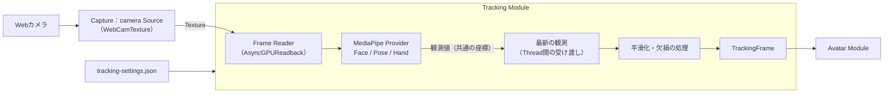
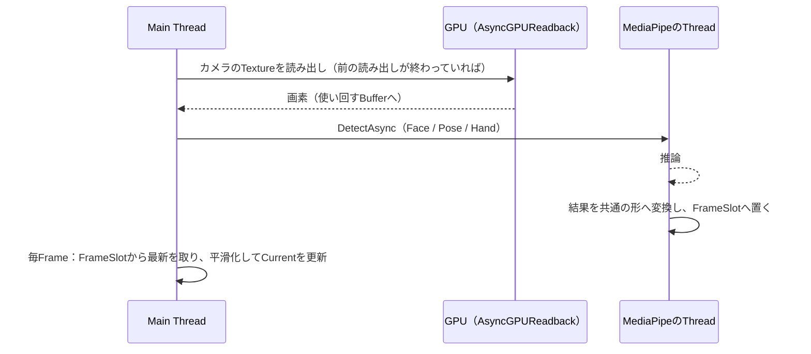

# Tracking 詳細設計

## 1. 目的

本書は、Tracking Moduleの詳細設計を定義する。Tracking Moduleは、カメラの映像から人の顔・体・手の動きを取り、特定のライブラリにもアバターにも依存しない`TrackingFrame`としてAvatar Moduleへ渡す（方式設計8章）。

本書で作る範囲は以下とする（v0.1.0）。

- 共通の契約：`TrackingFrame`、`ITrackingProvider`、追跡の状態
- MediaPipe Provider：MediaPipeUnityPluginのFace / Pose / Hand Landmarkerによるカメラからのトラッキング
- 共通処理：座標系の統一、信頼度と欠損の扱い、平滑化
- トラッキング用カメラ：Capture Moduleのカメラ入力の再利用
- 動かす範囲の選択（顔、上半身、手指。全身は「近日対応」）
- 調整と評価のための記録と再生（開発者向け）

次は本書の対象外とし、後続の設計で扱う。

- mocopi等の他のProvider（方式設計16.3）
- 複数人のトラッキング（方式設計8.12。設計上は1人専用にしない）
- 全身（下半身、腰の移動、足の接地）。範囲の選択肢としては先に用意する（6.5）
- トラッキング設定の画面の詳細（UIの画面仕様で扱う。10章は必要な項目だけを示す）

関連する方式設計：

- 7.6 姿勢適用・体格差吸収方式、7.7 表情制御方式
- 8章 トラッキング方式
- 15.3 リアルタイム性、15.7 Main Thread負荷抑制
- 16.3 新規Tracking Provider対応、16.4 複数Tracking Sourceの統合

関連する詳細設計：

- Avatar詳細設計（`avatar.md`）：`TrackingFrame`をアバターへ適用する側
- Capture詳細設計（`capture.md`）：トラッキング用カメラのSourceを追加する（5.4）

参照した試作（Repository外、CLAUDE.md 12章）：

- `E:\VirtualVessel\benchmarks\Voom`（MediaPipeUnityPlugin 0.16.0、UniVRM 0.129.1）

### 試作から引き継ぐことと、引き継がないこと

Voomは、MediaPipeUnityPluginのFace / Pose / Hand LandmarkerがWindowsのUnityで動き、VRM 1.0のアバターへ顔の動きを適用できることを示した。一方で、利用者の評価では、手指の動きと、3Dらしい動き（特にカメラに対する手前・奥の動き）は発展途上だった。製品では次のように扱う。

| 試作の内容 | 製品での扱い |
|---|---|
| MediaPipeUnityPluginのTask API（`LIVE_STREAM`）、`AsyncGPUReadback`による画像の読み出し | 引き継ぐ。動いた実績がある |
| 顔の点の位置関係から目・口・眉を求める計算 | 引き継がない。MediaPipeが出す表情の値（Blendshape）を使う（6.3）。試作の調整の知見（目の閉じやすさ、左右の目をそろえる等）は、Avatar側の変換の設定として残す（Avatar詳細設計7章） |
| 体は胸の傾き1か所。オイラー角を30Frame平均して滑らかにする | 引き継がない。平均は揺れを抑えたが、0.5〜1秒遅れた。揺れの原因を分けて、遅れの少ない方法で抑える（8章） |
| 手指、奥行きの扱い | 試作を正としない。評価の仕組み（12章）で数値と目視の両方で確かめながら作る |
| UIからMediaPipeの型を直接扱う、`Debug.Log`での設定の出力 | 引き継がない。MediaPipeの型はProviderの外へ出さない |

### 全体像



---

## 2. 責務

| 責務 | 担当 |
|---|---|
| カメラの機器の一覧、選択、開始・停止、映像のTexture | Capture（`camera` Source、5.4） |
| 映像の読み出しと、推論への受け渡し | Tracking（MediaPipe Provider） |
| 推論（顔・体・手の点と表情の値） | Tracking（MediaPipe Provider。MediaPipeUnityPluginを内部で使う） |
| 座標系の統一、左右の定義、信頼度と状態 | Tracking（Provider内の変換と共通処理） |
| 平滑化、外れ値の除去、欠損の保持 | Tracking（共通処理） |
| 入力機器の補正（正面の向き、基準の姿勢） | Tracking（方式設計8.11） |
| 観測した姿勢をアバターの骨格へ合わせる、表情への変換、鏡写し | Avatar |
| 動かす範囲の選択の保存 | Tracking（`tracking-settings.json`） |
| Serviceの生成と起動・終了の順序 | Application（Composition） |

---

## 3. Module境界

- Trackingは、Core、Diagnostics、ProjectData、Captureの公開Contract（`ICaptureSources`、`IVideoCaptureSource`）を参照する。Avatar、Stage、Video、UIは参照しない。
- MediaPipeUnityPluginの型（`Mediapipe.*`）は、MediaPipe Provider（別のAssembly、16章）の中だけで使う。`TrackingFrame`は、MediaPipeの点の番号、座標系、型を含まない（方式設計8.1）。
- 他のModuleは`ITrackingSource`（5.1）だけを使う。Providerを直接は使わない。
- 表情の値の名前（6.3）は、ARKitに由来する52個の名前を使う。特定のライブラリの型ではなく、顔の動きの名前として広く使われている一覧であり、Provider（MediaPipe、将来のiPhone等）からもアバター（Perfect Sync対応のモデル等）からも独立している。

---

## 4. 主要ClassとInterface

| 名前 | 種別 | 概要 |
|---|---|---|
| `TrackingFrame` | Class | 1回分の観測。体、左右の手、顔、それぞれの状態と時刻（6章） |
| `BodyJoint` | Enum | 体の関節（6.2） |
| `HandJoint` | Enum | 手の関節（21点、6.4） |
| `FaceShape` | Enum | 表情の値（52個、6.3） |
| `TrackingStatus` | Enum | `Tracked`、`LowConfidence`、`Lost`、`NotSupported`、`Disabled`（6.1） |
| `TrackingRegions` | Flags Enum | `Face`、`Body`、`LeftHand`、`RightHand`。Providerの能力と、有効にした部位を表す |
| `BodyRange` | Enum | 動かす範囲：`UpperBody`、`FullBody`（6.5） |
| `ITrackingProvider` | Interface | 観測を作る入力方式の契約（5.2） |
| `ITrackingSource` | Interface | 他のModuleが使う窓口。平滑化した最新の`TrackingFrame`、状態（5.1） |
| `TrackingService` | Class（`IApplicationService`） | Providerの生成と起動、毎Frameの処理、設定、計測 |
| `TrackingSettings` | Class | 保存する設定（10章） |
| `FrameSlot<T>` | Class | Thread間で最新の値だけを受け渡す（9章） |
| `OneEuroFilter` | Struct | 速さに応じて強さを変える平滑化（8.2、純粋な計算） |
| `RotationFilter` | Struct | 回転（Quaternion）の平滑化（8.2） |
| `TrackingProcessor` | Class | 観測から`TrackingFrame`を作る共通処理（外れ値、平滑化、欠損） |
| `TrackingStateMachine` | Static Class | 部位ごとの状態の判断（純粋関数） |
| `MediaPipeTrackingProvider` | Class（internal） | MediaPipe Provider |
| `MediaPipeConversion` | Static Class（internal） | MediaPipeの点と座標から共通の形への変換（純粋関数） |
| `TrackingRecorder` / `TrackingReplayProvider` | Class | 観測の記録と再生（開発者向け、12章） |

---

## 5. Public API

### 5.1 ITrackingSource

```csharp
public interface ITrackingSource
{
    IReadOnlyObservable<TrackingState> State { get; }          // Stopped、Starting、Running、Unavailable、Error
    IReadOnlyObservable<TrackingProblem> Problem { get; }      // 利用者へ伝える問題（11章）
    TrackingRegions Supported { get; }                         // Providerが取れる部位
    IReadOnlyObservable<TrackingRegions> Enabled { get; }      // 有効にした部位（設定）
    IReadOnlyObservable<BodyRange> BodyRange { get; }

    // 平滑化した最新の観測。Main Threadで、毎Frame更新される。中身は次の更新で書き換わるため、
    // 使う側はそのFrameの間だけ読み、保持しない（Allocationを避けるため、毎回同じObjectを返す）。
    TrackingFrame Current { get; }

    void Start();
    void Stop();
    void SetEnabled(TrackingRegions regions);
    void SetBodyRange(BodyRange range);
    void Recenter();                                           // 今の姿勢を正面・基準にする（8.5）
}
```

- すべての操作と通知はMain Threadで行う。
- `Current`は`TrackingService`が毎Frame（`IFrameLoop`）更新する。Avatarは`LateUpdate`相当の時点で読む（Avatar詳細設計8.3）。
- 1人分の`ITrackingSource`を1つ作る。複数人に広げるときは、Sourceを人数分にする（方式設計8.12）。Singletonにはしない。

### 5.2 ITrackingProvider

```csharp
public interface ITrackingProvider : IDisposable
{
    TrackingRegions Supported { get; }
    IReadOnlyObservable<TrackingState> State { get; }          // SourceとProviderで同じ状態を使う
    void Start(TrackingRegions regions);                       // 待たずに戻る。結果はStateで知らせる
    void Stop();
    void Tick();                                               // Main Threadで毎Frame。入力の読み出しを進める

    // 最新の観測を、渡されたObjectへ写す。新しい観測がなければfalse。
    // 呼び出し元のObjectへ写すのは、毎Frameの確保を避けるため（CLAUDE.md 15.1の例外、23章）。
    bool TryTakeLatest(TrackingFrame into);
}
```

- Providerが出す観測は、平滑化する前の`TrackingFrame`である（6章。平滑化の前と後で同じ型を使い、写すだけで済むようにする）。Providerごとの違い（座標系、点の番号、左右）は、Providerの中で共通の形へ変換してから出す（方式設計8.8）。
- 新しいProvider（mocopi等）は、この契約を実装するだけで追加できる。

### 5.3 TrackingService

- OptionalのApplication Serviceとし、Logging、性能計測、Captureの後に起動する。Captureがなければ、カメラのProviderは`Unavailable`になる（再生のProviderは使える）。
- 起動時に`tracking-settings.json`を読み、設定の`Provider`（既定`mediapipe`）を作る。
- 前回動いていれば、次の起動で自動で開始する（Captureと同じ扱い）。

### 5.4 トラッキング用カメラ（Captureへの追加）

Captureに3つ目のSourceとして、トラッキング用のWebカメラ`camera`を加える。GameCaptureと同じく`WebCamTexture`で開く。追加の内容は、実装の段階でCapture詳細設計に書く。

| 項目 | 値 |
|---|---|
| Id、種類 | `camera`、`CaptureSourceKind.Camera` |
| 機器を選ぶまで | 開かない（`DeviceNotChosen`）。Capture詳細設計6.3と同じ理由 |
| 希望の解像度、Frame Rate | 1280×720、30fps（推論の入力には十分で、読み出しの負荷が小さい）。設定で変えられる |
| 同じ機器の重複 | `game`と同じ機器は選べない（`WebCamTexture`は1つの機器を2回開けない）。選ぶと`DeviceInUse`の問題を示す |
| 配信画面への表示 | しない。Stageは`Camera`の種類のSourceに板を作らない。利用者の顔や部屋が意図せず配信に出ることを防ぐ（13章） |
| 反転 | Captureの反転（`CaptureFlip`）は使わない。左右の扱いはTrackingの座標の定義（6.1）とAvatarの鏡写しで決める |

---

## 6. Data Model

### 6.1 TrackingFrame

```text
TrackingFrame
├─ Sequence            観測ごとに増える番号
├─ Body                BodyPose（6.2）
├─ LeftHand            HandPose（6.4。利用者自身の左手）
├─ RightHand           HandPose
└─ Face                FacePose（6.3）

各部位に共通：
├─ Status              Tracked / LowConfidence / Lost / NotSupported / Disabled
├─ Confidence          0〜1
└─ Timestamp           その部位の元になった映像のFrameの時刻（秒、Application起動からの単調な時刻）
```

- 部位ごとに時刻と状態を持つ。顔・体・手は別の推論で求めるため、元の映像のFrameが部位ごとに違うことがある（9.2）。
- 左右は**利用者自身の**左右とする。映像の左右ではない。鏡写しにするかはAvatarが決める（Avatar詳細設計6.6）。
- 座標系は、Unityのアバターと同じ向きの「本人の空間」とする。原点は左右の腰の中点、+Yが上、+Zが本人の正面（カメラの方向）、+Xが本人の右。単位はメートル。カメラの位置や画角に依存しない。
- `Status`の意味：`Tracked`は値を使える。`LowConfidence`は値はあるが信頼度が低い（Avatarは弱めに使う）。`Lost`は見失った（値は最後に使えたもの）。`NotSupported`はProviderが取れない。`Disabled`は利用者が無効にした。

### 6.2 BodyPose

| 項目 | 内容 |
|---|---|
| 関節 | `BodyJoint`：`Head`（頭の中心）、`LeftEar`、`RightEar`、`Nose`、`Neck`（両肩の中点）、`LeftShoulder`、`RightShoulder`、`LeftElbow`、`RightElbow`、`LeftWrist`、`RightWrist`、`Hips`（原点）、`LeftHip`、`RightHip`、`LeftKnee`、`RightKnee`、`LeftAnkle`、`RightAnkle`、`LeftFoot`、`RightFoot` |
| 関節ごとの値 | 位置（本人の空間）、信頼度（0〜1）、`Tracked`/`LowConfidence`/`Lost` |
| 画像上の位置 | 関節ごとに、画像上の位置（0〜1）も持つ。奥行きの推定に使う（8.4） |

- 膝から下は、全身（`BodyRange.FullBody`）のときだけ使う。上半身のときも値は入るが、Avatarは使わない。
- MediaPipe Poseの33点のうち、手の指先の点（17〜22）は使わない。手指はHand Landmarkerから取る。

### 6.3 FacePose

| 項目 | 内容 |
|---|---|
| 頭の向き | 回転（本人の空間）。MediaPipeの顔の変換行列（Facial Transformation Matrix）から求める。Poseの点から求めるより安定する |
| 頭の位置 | カメラからの相対位置（メートル）。前後左右の傾き・寄りの表現に使う |
| 表情の値 | `FaceShape`ごとに0〜1。ARKitに由来する52個（`EyeBlinkLeft`、`JawOpen`、`MouthSmileLeft`等）。取れない値（MediaPipeでは`TongueOut`）は`NotSupported` |
| 視線 | 表情の値（`EyeLookIn/Out/Up/Down`）から、左右の目の向き（角度）も出す |

- 表情の値の左右も利用者自身の左右とする。MediaPipeが出す名前の左右は、画像を基準にしている場合があり、Providerの変換で確かめて合わせる（実装の段階でTestにする）。

### 6.4 HandPose

| 項目 | 内容 |
|---|---|
| 関節 | `HandJoint`：手首、親指（CMC、MCP、IP、先端）、他の4本の指（MCP、PIP、DIP、先端）の21点 |
| 位置 | 本人の空間。手首を基準にした指の形（Hand Landmarkerの3Dの点）と、手首の位置（Poseの手首）を合わせる |
| 手のひらの向き | 手首、人差し指と小指の付け根の3点から求めた回転 |
| 左右の決め方 | MediaPipeの左右の判定（Handedness）は、画像の向きで変わり、Frameごとに揺れることがある。製品では、検出した手を**Poseの左右の手首に近い方**へ割り当てる。判定は補助に使う |

### 6.5 動かす範囲（BodyRange）

| 値 | 内容 | v0.1.0 |
|---|---|---|
| `UpperBody` | 頭、首、胴、肩、腕。腰から下は固定（座っての配信） | 既定。使える |
| `FullBody` | 加えて、腰の移動と回転、脚、足の接地 | 選択肢に「近日対応」として表示し、選べない |

- 顔（表情、視線）と手指は、範囲とは別に有効・無効を選ぶ（`TrackingRegions`）。無効にした部位の推論は動かさない（負荷を下げるため）。
- 範囲を増やすときは、`BodyRange`に値を足し、Avatarの適用を足す。`TrackingFrame`は始めから全身の関節を持つ。

---

## 7. State / Lifecycle

### 7.1 TrackingSourceの状態

| 状態 | 意味 |
|---|---|
| `Stopped` | 止まっている |
| `Starting` | カメラや推論の準備中（モデルの読み込みに数秒かかることがある） |
| `Running` | 観測を出している（人が映っていない間も`Running`。部位の状態が`Lost`になる） |
| `Unavailable` | カメラが選ばれていない、見つからない。Captureの状態に従い、戻れば自動で続ける |
| `Error` | 推論を始められない（モデルがない、Pluginを読み込めない等） |

### 7.2 開始と停止

1. `Start()`：Captureの`camera` Sourceを開始する（Trackingが開始したことを覚え、停止のときに止める。利用者がCaptureの画面で開始していた場合は止めない）。
2. カメラの映像が届くと、Providerがモデルを読み込み（Main Threadを止めない、9章）、推論を始める。`Running`。
3. `Stop()`：推論を止め、未処理の読み出しを待たずに捨て、Bufferとモデルを解放する。

### 7.3 部位ごとの状態

`TrackingStateMachine`（純粋関数）が、観測の有無、信頼度、経過時間から部位ごとの状態を決める。

| 条件 | 状態 |
|---|---|
| 観測があり、信頼度がしきい値（既定0.5）以上 | `Tracked` |
| 観測があり、しきい値未満 | `LowConfidence` |
| 観測がない時間が0.2秒を超えた | `Lost`（値は最後の値を保持） |
| 利用者が無効にした | `Disabled` |

- 見失ったときに値をどう戻すか（保持、ゆっくり元の姿勢へ戻す）はAvatarが決める（Avatar詳細設計8.4）。Trackingは「いつから見失っているか」を渡す。
- 一瞬だけ見失う（1〜2Frame）たびに状態が揺れないよう、`Lost`へは時間で、`Tracked`へは連続2回の観測で移る。

---

## 8. 平滑化と精度

Voomの平均は、揺れを抑えるために必要だった。製品では、揺れの原因を分けて、それぞれ遅れの少ない方法で抑える。どの方法も、記録した観測を再生して数値で比べ（12章）、Voomの方法（30Frameの平均）より遅れが小さく、揺れが同程度以下であることを確かめてから既定にする（CLAUDE.md 33章）。

### 8.1 揺れの原因と対策

| 原因 | 対策 |
|---|---|
| 推論の値の細かい揺れ（止まっていても毎Frame少し動く） | One Euro Filter（8.2）。止まっているときは強く、速く動くときは弱く平滑化する |
| 推論が30回/秒、描画が60回/秒のため、2Frameに1回だけ動き、段差が見える | 描画のFrameごとに、直近2回の観測の間を補間する（Avatar詳細設計7.3）。遅れは最大で観測1回分（約33ms） |
| 時々の大きな外れ値（腕が一瞬飛ぶ） | 関節が人として不可能な速さで動いた値、信頼度が低い値を捨て、前の値を使う（8.3） |
| 奥行きの不安定さ（手前・奥の値が大きく揺れる） | 奥行きを画像上の位置と骨の長さから推定し直す（8.4） |
| 回転の平均の誤り（オイラー角の平均は±180°をまたぐと壊れる） | 回転はQuaternionで扱い、オイラー角で平均しない |

### 8.2 One Euro Filter

- 値の変化の速さから、ローパスフィルタの強さを毎回決める。ゆっくりの動きでは揺れを強く抑え、速い動きではすぐ追いつく。パラメータは、最小の強さ（`MinCutoff`）と、速さによる緩め方（`Beta`）の2つ。
- 位置は軸ごと、表情の値は値ごとに適用する。回転（頭の向き等）は、Quaternionの差の角度を速さとして、球面補間で同じ考え方を適用する（`RotationFilter`）。
- 時刻は映像のFrameの時刻を使う（処理した時刻ではない）。Frameの間隔が揺れても、平滑化の強さが変わらない。
- 部位ごとにパラメータを持つ（顔は速く、胴はゆっくり等）。利用者には「なめらか／標準／きびきび」の3段階で見せる（10章）。
- 計算は純粋関数（状態を引数で受け取り、新しい状態を返す）とし、EditModeで入力と出力だけで確かめる。
- 回転の速さは、向きを持った角速度（ベクトル）として平滑化する。角度の大きさ（常に正）だけを平滑化すると、逆向きの揺れが打ち消し合わず、静止していても動いているように見積もってしまう（最初の実装で、静止時の揺れが平均の約3倍になった）。

#### 計測した結果（段階1、2026-10-18）

合成の動き（2°の揺れを加えた角度、30回/秒。静止3秒、0.3秒で90°上げる、保持、0.5Hzで±30°振る）を、乱数を変えて20通り比べた（`OneEuroComparisonTests`、`SmoothingProfile`）。

| 方法 | 静止時の揺れ（1Frameの変化のRMS） | 遅れ | ゆっくり振る間の誤差 |
|---|---|---|---|
| Voomの方法（30Frameの平均） | 0.097° | 483ms | 23.2° |
| なめらか（MinCutoff 0.05Hz、Beta 0.003） | 0.057° | 99ms | 9.6° |
| 標準（0.1Hz、0.005） | 0.088° | 66ms | 7.5° |
| きびきび（0.2Hz、0.01） | 0.160° | 56ms | 5.2° |

- 標準は、静止時の揺れが平均と同程度以下で、遅れは約1/7になる。1つの乱数だけで比べると、どちらの方法も3割ほど有利・不利が出るため、Testは10通りの平均で比べる。
- 位置（関節）は、腕の長さで1cm≈2°としてBetaを換算した仮の値（標準：0.1Hz、1.0）。1cmの揺れを加えた腕の動きでは、角度の揺れが4.7°から0.13°になり、遅れは100msだった。顔の値も仮の値で、カメラで記録した動きで段階2〜5に調整する（17章）。

### 8.3 外れ値の除去

- 関節ごとに、前の値からの速さが上限（例：手首で毎秒8m）を超えた値は、その回は使わない。続けて超える場合（本当に速く動いた場合）は、3回目から受け入れる。
- 信頼度（MediaPipeのVisibility、Presence）がしきい値未満の点は`LowConfidence`とし、平滑化を強める。

### 8.4 奥行き（手前・奥）

単眼のカメラでは、奥行きは画像上の位置に比べて不確かである。MediaPipe PoseのWorld Landmarksの奥行き（z）は、腕を前に伸ばす等の動きで大きく揺れ、向きが反転することもある。製品では次のように扱う。

1. **画像上の位置を正とする**：画像上の位置（x、y）は奥行きより安定している。
2. **骨の長さから奥行きの大きさを求める**：上腕、前腕等の長さは変わらない。基準の姿勢（8.5）で測った長さ`L`と、画像上の見かけの長さ`d`から、奥行きの差の大きさを`√(L² − d²)`で求める（見かけが短いほど、手前か奥へ向いている）。
3. **向き（手前か奥か）はMediaPipeのzから決める**：大きさは2で決め、手前か奥かだけをzの符号から取る。符号が揺れないよう、切り替わりにはヒステリシス（一定量を超えて初めて反転）を付ける。
4. **関節の可動域で確かめる**：肘は一方向にしか曲がらない等の制約に反する結果は、もう一方の向きを選ぶ。

この方法がWorld Landmarksをそのまま使うより良いかは、記録した動き（腕を前へ伸ばす、手を胸の前で組む、手を頭の後ろへ回す等）を再生して比べ、目視でも確かめてから決める（12章）。比べた結果は本書に記録する。

手指は、指の関節の**角度**（隣り合う骨の間の角度）を主に使う。角度は手の大きさやカメラとの距離に依存せず、奥行きの誤りの影響も位置より小さい。指の曲げは0〜約90°、横の開きは小さい範囲に制限する（Avatar詳細設計7.5）。

### 8.5 基準の姿勢（入力の補正、方式設計8.11）

- `Recenter()`で、今の姿勢を基準にする：本人の正面の向き、骨の長さ（8.4）、頭の基準の位置。
- 基準の姿勢を取っていない間は、標準的な体格の長さを使う。初回の開始時に、正面を向いて腕を下ろした姿勢で自動で1回測る（数秒の観測の中央値）。
- アバターの体格に合わせる補正（腕の長さの違い等）はAvatarが行う（方式設計7.6）。

---

## 9. Thread / async

### 9.1 流れ



- 読み出しは、前の読み出しと推論が終わっていなければ行わない。古いFrameを待ち行列にためず、常に最新の映像だけを推論する（遅れを増やさないため）。
- MediaPipeの結果は、MediaPipeのThreadで呼ばれる。そこで共通の形へ変換し、`FrameSlot`へ置く。UnityのAPIは呼ばない。
- `FrameSlot<T>`は、3つのObjectを順に使う（書き込み中、最新、読み出し中）。短い排他だけで、待たない（Capture詳細設計8.2と同じ考え方）。Objectは使い回し、観測のたびに確保しない。
- 平滑化と状態の判断はMain Threadで、毎Frame1回行う。

### 9.2 部位ごとの時刻

顔・体・手の推論は並行に動き、結果は別々に届く。`TrackingFrame`は部位ごとに最新の観測を持ち、それぞれの時刻（元の映像のFrameの時刻）を持つ。Avatarは補間に部位ごとの時刻を使う。

### 9.3 モデルの読み込み

- モデル（`.bytes`）の読み込みと推論の準備は、Main Threadを止めないよう非同期に行う。かかった時間を計測する。

---

## 10. 設定

```csharp
public sealed class TrackingSettings
{
    public string Provider { get; set; } = "mediapipe";
    public TrackingRegions Regions { get; set; } = TrackingRegions.All;   // 有効にした部位：顔、体、両手
    public BodyRange BodyRange { get; set; } = BodyRange.UpperBody;
    public SmoothingPreset Smoothing { get; set; } = SmoothingPreset.Standard;  // Smooth、Standard、Responsive
    public PoseModel PoseModel { get; set; } = PoseModel.Full;             // Lite、Full、Heavy（負荷と精度）
    public TrackingCalibration Calibration { get; set; }                  // 基準の姿勢（8.5）。なければ未測定
    public bool Running { get; set; }                                     // 開始していたか。次の起動で戻す
}
```

- `tracking-settings.json`に保存する（設定のFolder、`ConfigFileStore`）。Capture、Stageと同じく、Project / Profileができたらそちらへ移す（方式設計6.10の`Profiles/Tracking/`）。
- カメラの機器の選択は`capture-settings.json`（`camera` Source）に保存する。
- 鏡写しはAvatarの設定とする（Avatar詳細設計10章）。

---

## 11. ログ・診断

- 状態の変化、Providerとモデルの種類と版、モデルの読み込み時間をInformationで記録する。毎Frameの記録はしない。
- 性能計測（`IPerformanceMetrics`）へ次を記録する。Diagnostics画面の表に出る。

| 計測 | 種類 | 内容 |
|---|---|---|
| `Tracking/<region>.Inference` | Timer | 推論の時間（顔、体、手） |
| `Tracking/<region>.Interval` | Timer | 新しい観測が届く間隔 |
| `Tracking/Latency` | Timer | 映像のFrameの時刻から、`Current`の更新までの時間 |
| `Tracking/Readback` | Timer | 映像の読み出しの時間 |
| `Tracking/Dropped` | Counter | 前の推論が終わっていないため推論しなかった映像の数 |
| `Tracking/Outliers` | Counter | 外れ値として捨てた値の数 |

- 利用者へ伝える問題（`TrackingProblem`）：`CameraNotChosen`（カメラを選んでください）、`CameraNotFound`、`CameraInUse`（ゲーム画面と同じカメラ）、`StartFailed`（トラッキングを始められませんでした）、`NoPerson`（人が映っていません。状態の表示だけ）。PluginやモデルのPath等は利用者へ出さない。
- セットアップ画面では、カメラの映像に点と骨を重ねて表示し、正しく取れているかを確かめられるようにする（配信には出さない）。

---

## 12. 記録と再生（開発者向け）

平滑化や奥行きの方法を、勘ではなく比べて決めるための仕組み。

- `TrackingRecorder`：Providerの観測（平滑化する前の`TrackingFrame`）を、時刻とともにファイルへ記録する。**映像は記録しない**。
- `TrackingReplayProvider`：記録を`ITrackingProvider`として再生する。カメラなしで、同じ動きを何度でも再現できる。
- 評価の値（EditModeで計算する純粋関数）：

| 値 | 意味 |
|---|---|
| 揺れ | 静止している区間の、関節の角度の変化の大きさ（RMS） |
| 遅れ | 速い動きの区間で、平滑化後の値が元の値に追いつくまでの時間（相互相関で求める） |
| 骨の長さの一定さ | 骨の長さの変動。奥行きの推定の良さの目安 |
| 可動域の違反 | 関節の制限を越えた回数 |

- Repositoryに入れる記録は、Testのために作った合成の動き（決まった動きに雑音を加えたもの）だけとする。開発者が自分を撮って作った記録は、顔の形を含む個人の情報になり得るため、Repositoryに入れず、各自の手元に置く（13章）。
- 記録は、開発者向けの設定（起動の引数）でだけ有効になる。通常の画面からは使えない。

---

## 13. セキュリティとプライバシー

- カメラの映像は、利用者の顔と部屋を映す。Processの外へ出さず、ファイル、Log、診断に残さない。推論のための読み出しは、使い回すBufferの中だけで行う。
- トラッキング用カメラの映像は配信に出さない（5.4）。
- 観測（顔の点、表情の値、体の点）も、個人の特徴を含み得る。記録（12章）は開発者が明示的に有効にしたときだけ行い、Data Rootの`Cache/TrackingRecordings/`に置く。Logには値を書かない。
- MediaPipeは推論をProcessの中で行い、通信しない。モデルのファイルは配布物に含め、実行時にダウンロードしない。モデルとPluginの版とHash（SHA-256）はSBOMと導入のScriptで固定する（16.2）。
- 推論の失敗（不正な入力、Pluginの例外）は、Providerの中で受け止めて`Error`にし、アプリを落とさない。

---

## 14. テスト方針

| 種類 | 対象 |
|---|---|
| EditMode | `OneEuroFilter`、`RotationFilter`：一定値で揺れが減る、段差の入力に追いつく時間、時刻の間隔の変化、±180°をまたぐ回転 |
| EditMode | `MediaPipeConversion`：座標系（本人の空間への変換、左右、上下、手前）、点の対応、Handednessによらない左右の割り当て。既知の姿勢の合成データで確かめる |
| EditMode | 奥行きの推定（8.4）：画像上の見かけの長さと骨の長さから奥行きを求める、符号のヒステリシス、可動域による選び直し |
| EditMode | `TrackingStateMachine`、外れ値の除去、`FrameSlot`（Threadをまたぐ受け渡しを含む） |
| EditMode | 評価の値（12章）：合成の動きで、平滑化の遅れと揺れが目標の範囲にあること。Voomの方法（30Frameのオイラー角の平均）を比較用に実装し、同じ入力で遅れが小さいこと |
| EditMode | `TrackingService`を再生のProviderで動かし、開始・停止、部位の有効・無効、範囲の切り替え、設定の保存 |
| 実機 | 実際のカメラとMediaPipeで、顔・体・手が取れること。`[Explicit]`を付ける |
| 性能 | 推論の時間（顔、体、手、同時）、読み出しの時間、遅れを、開発用PCで記録する（15章） |

---

## 15. 性能

- 目標（開発用PCで確かめ、結果を本書に記録する）：
  - 顔・体・両手を同時に推論して、カメラと同じ30回/秒を保つ。
  - 映像のFrameから`Current`の更新までの遅れ（`Tracking/Latency`）の中央値が80ms以下。
  - Main Threadの処理（読み出しの依頼、受け取り、平滑化）は1Frameあたり0.5ms以下。毎Frameの確保をしない。
- WindowsではMediaPipeの推論はCPUで動く（GPUを使う経路はAndroid等に限られる）。目標に届かない場合の手段を、計測して選ぶ：
  - Poseのモデルを軽いもの（Lite）にする。
  - 手の推論を2回に1回にする（手は顔より動きの見え方への影響が小さい場合）。
  - 3つの推論を1つにまとめるHolistic Landmarker（Plugin 0.16で試験的に対応）と比べる。
  - 将来、Unity Inference Engine（旧Sentis）でGPUで推論するProviderを作る（方式設計16.3の範囲）。
- 推論はMediaPipeのThreadで行い、Main Threadを待たせない。

---

## 16. Directory / Namespace と依存

### 16.1 Directory

```text
Assets/VirtualVessel/Tracking/
├─ Runtime/                                    VirtualVessel.Tracking
│  ├─ TrackingFrame.cs        TrackingFrame, TrackedPart, BodyPose, HandPose, FacePose
│  ├─ TrackingTypes.cs        BodyJoint, HandJoint, FaceShape, TrackingStatus, TrackingRegions, BodyRange
│  ├─ ITrackingSource.cs      ITrackingSource, ITrackingProvider
│  ├─ TrackingService.cs      TrackingService, TrackingSettings
│  ├─ Processing/             OneEuroFilter（PositionFilter、RotationFilterを含む）, SmoothingProfile, OutlierGate, TrackingProcessor, TrackingStateMachine, DepthEstimation（段階5）
│  ├─ Threading/FrameSlot.cs
│  └─ Recording/              TrackingRecorder（段階2）, TrackingReplayProvider, TrackingMetrics, SyntheticMotion
├─ MediaPipe/                                  VirtualVessel.Tracking.MediaPipe（MediaPipeUnityPluginを参照する唯一のAssembly）
│  ├─ MediaPipeTrackingProvider.cs   Taskの作成と呼び出し（PluginのAPIを使う部分）
│  ├─ MediaPipeConversion.cs
│  └─ CameraFrameReader.cs    AsyncGPUReadbackとBufferの使い回し
└─ Tests/
   ├─ EditMode/
   └─ PlayMode/
```

参照：Core、Diagnostics、ProjectData、Capture。MediaPipeのAssemblyは、加えてMediaPipeUnityPluginを参照する。

### 16.2 MediaPipeUnityPluginの導入

- 版は導入の時点の最新（現在v0.16.3、MediaPipe v0.10.22）に固定する。Unity 6.6で動くことを導入の段階で確かめる。
- PluginはGitHubのReleaseで配られる`.tgz`（UnityのPackage）を使う。Repositoryには入れない。大きく（Voomの展開後で約380MB、多くは他のPlatformのNative Library）、Gitの履歴を重くするため。
  - `tools/deps/fetch-mediapipe.ps1`が、固定した版の`.tgz`をダウンロードし、SHA-256を確かめて、Gitの管理外の場所に置く。`Packages/manifest.json`はそのファイルを参照する。
  - 手元とCIで同じScriptを使う。Native Pluginの扱い（DLLはGitに入れず、手順で作る）と同じ考え方である。
- モデル（Face Landmarker、Pose Landmarker、Hand Landmarker）も同じScriptで、固定した版とHashで取得し、配布物に含める。
- 配布物には、Windows x64のNative Libraryだけを含める。
- ライセンス：Pluginは MIT、MediaPipeとモデルはApache-2.0。同じ変更でSBOMへ記録する（CLAUDE.md 35章）。

#### 更新への備え

MediaPipeUnityPluginは更新が続いている（v0.16.0からv0.16.3まで約9か月）。更新に追随しやすいよう、次のように作る。

- 版、ダウンロード先、SHA-256は、`tools/deps/mediapipe.json`の1か所に書く。Script、CI、SBOMの確認は、この値を読む。更新は、この値とSBOMを変える1つの変更（`chore:`のBranch）とする。
- Pluginの型を使うのはMediaPipeのAssemblyだけで、その中でも、Pluginを呼ぶ部分（Taskの作成、`DetectAsync`、結果の受け取り）と、結果を共通の形へ変える部分（`MediaPipeConversion`）を分ける。PluginのAPIが変わったときに直す場所を、Taskを呼ぶ部分に限るため。
- `MediaPipeConversion`は、Pluginの型ではなく、点の配列（位置、信頼度）を受け取る純粋関数とする。PluginのAPIが変わっても、変換のTestはそのまま使える。
- モデルのファイルは、Pluginとは別に版とHashを持つ。Pluginを更新しても、モデルは変えずに済む（逆も同じ）。
- 更新の確認：EditModeのTest、`[Explicit]`の実機のTest（顔・体・手が取れること）、性能の計測（推論の時間、遅れ）を、更新の前後で比べる。結果をPull Requestに書く。
- 更新の手順は、開発運用方針の依存の更新の節に書く（導入の段階で加える）。

---

## 17. 未決事項

| 項目 | 対応予定 |
|---|---|
| 奥行きの推定の方法（8.4）とWorld Landmarksの比較 | 段階2〜5で、記録した動きを再生して比べて決める |
| 平滑化の既定のパラメータ | 段階2〜5で、評価の値と目視で決める |
| Holistic Landmarkerへの切り替え | 段階2で、3つの推論を同時に動かした負荷を測ってから |
| 全身（`FullBody`）の追加 | v0.1.0の後 |
| 声による口の動き（リップシンク）と顔のトラッキングの組み合わせ | Voice / Audioの設計時 |
| トラッキング設定をProject / Profileへ移す | Project / Profileの設計時 |

---

## 18. 実装の順序

各段階を1つのBranchとし、それぞれにTestと、試すためのデモブランチを付ける（CLAUDE.md 29.2）。Avatarと合わせた順序はAvatar詳細設計18章に示す。

1. Trackingの土台：`TrackingFrame`、契約、`OneEuroFilter`、`RotationFilter`、`FrameSlot`、状態の判断、評価の値と再生（合成の動き）
2. MediaPipe：Pluginとモデルの導入（SBOM）、Captureの`camera` Source、`MediaPipeTrackingProvider`、セットアップ画面のカメラと点の表示、負荷と遅れの計測
