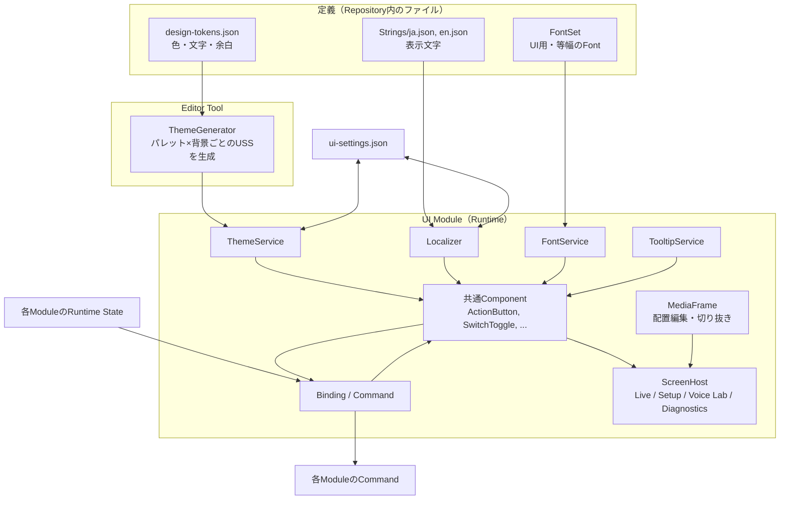
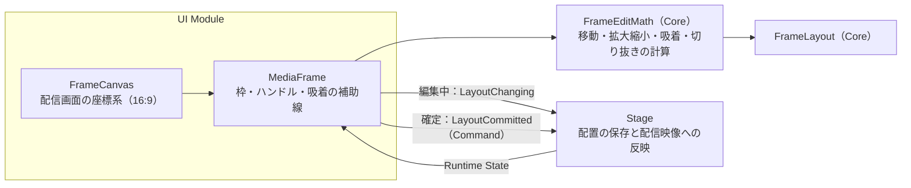

# UI基盤 詳細設計

## 1. 目的

本書は、UI Moduleの基盤部分の詳細設計を定める。

対象は次のとおりである。

- 使いやすい共通Component（UI Toolkitの上に作るProject独自の部品）
- Theme（パレット、ダーク／ライト、UIの拡大縮小、動きを減らす設定）
- Fontの一括管理と切り替え
- 多言語対応（Project独自の軽量な仕組み）
- Tooltip
- Runtime Stateの表示とCommandによる操作
- 配信画面上の配置編集と切り抜きを行うPanel（`MediaFrame`）
- 画面の切り替え、Developer Mode
- UI固有設定の保存
- スクリーンショットによる表示確認

見た目の値と部品の仕様は次の文書で定める。本書はそれをUnityでどう実現するかを定める。

- `docs/ja/ui/design-system.md`
- `docs/ja/ui/components.md`
- `docs/ja/ui/ui-guidelines.md`

関連する方式設計：14章（UI・操作方式）、6.8（基本設定の保存）、16.14（UI Locale拡張）、16.15（UI Theme拡張）

### 全体像



---

## 2. 責務

| 責務 | 担当 |
|---|---|
| 共通Component、Tooltip、Binding、Command実行の仕組み | UI |
| Theme、Font、多言語の切り替え | UI |
| 画面の切り替え、Developer Modeの切り替え | UI |
| UI固有設定（`ui-settings.json`）の内容 | UI |
| 設定ファイルの読み書き（Schema Version、Atomic Write、不明な項目の保持） | ProjectData |
| 配置編集の計算（移動、拡大縮小、吸着、切り抜き） | Core（`FrameEditMath`、Unityに依存しない） |
| 配置データ（`FrameLayout`）の保存と、配信映像への反映 | Stage（実装時）。UIはCommandで変更を依頼する |
| 各機能の状態と操作 | 各Module。UIは状態を表示し、Commandを呼ぶだけ |

---

## 3. Module境界

- UIは各ModuleのRuntime Stateを`IReadOnlyObservable<T>`で受け取り、表示する。UI上の状態をRuntimeの状態として扱わない（方式設計14.29）。
- UIからの操作は`IUiCommand`を通して各Moduleへ渡す。UIが各Moduleの内部Classを直接操作しない。
- `MediaFrame`は映像を描画しない。配信映像の合成はStageとVideoの責務であり（CLAUDE.md 6章）、`MediaFrame`は配置データの編集だけを行う。
- 依存方向は`Application → UI → 各Module → Diagnostics → Core`とする。UIの部品は各Moduleに依存しない。画面（Screens）は各Moduleの公開Interfaceにのみ依存する。

---

## 4. Unity標準UIの使いにくさと対策

UI Toolkitをそのまま使うと、次の問題がある。共通Componentと周辺の仕組みで解決する。

| 問題 | 対策 |
|---|---|
| Eventの登録と解除を手で書く必要があり、解除漏れでMemory Leakや破棄後の呼び出しが起きる | Bindingは画面から外れたときに自動で解除する（7.3） |
| 実行時にTooltipを出す仕組みがない（`tooltip`属性はEditor専用） | `TooltipService`（7.6） |
| 表示文字の多言語化を毎回コードで書く必要がある | UXMLで`text-key`を指定するだけで切り替わる（7.4） |
| 見た目の種類をClass名の文字列で指定し、誤字に気づけない | 種類はEnumのProperty（例：`variant="Primary"`）で指定する |
| プログラムから値を設定しても変更Eventが発生し、利用者の操作と区別しにくい | 表示の更新は`SetValueWithoutNotify`で行い、利用者の操作だけをCommandへ渡す（7.3） |
| 押せない理由を示す標準の方法がない | Commandが押せない理由を持ち、ボタンを無効にしてTooltipへ表示する（7.5） |
| ラベルの位置や余白が部品ごとに異なる | 共通Componentが`components.md`どおりの構造と余白を持つ |

---

## 5. 主要Classとインターフェース

| 名前 | 種別 | 概要 |
|---|---|---|
| `UiRoot` | MonoBehaviour | Persistent Sceneに置くUIの入口。`UIDocument`とUI用Assetを保持し、Serviceを接続する |
| `UiAssets` | ScriptableObject | PanelSettings、生成済みTheme、FontSet、文字列表、画面のUXMLへの参照 |
| `ThemeService` | Class | パレット、背景、拡大縮小、動きを減らす設定を適用する |
| `FontService` | Class | FontSetを切り替える |
| `FontSet` | ScriptableObject | UI用と等幅のFont Asset、Fallback |
| `Localizer` / `ILocalizer` | Class / Interface | 表示文字の取得と言語の切り替え |
| `TooltipService` | Class | Tooltipの表示 |
| `DialogService` / `IDialogService` | Class / Interface | 確認Dialogの表示 |
| `NotificationService` / `INotificationService` | Class / Interface | Notificationの表示 |
| `IUiCommand` | Interface | UIから実行する操作 |
| `IReadOnlyObservable<T>` / `ObservableValue<T>` | Interface / Class（Core） | 変化を通知する値 |
| 共通Component | VisualElement | `components.md`の各部品（6章） |
| `MediaFrame` / `FrameCanvas` | VisualElement | 配置編集と切り抜き（9章） |
| `FrameLayout` / `FrameEditMath` | Struct / Static Class（Core） | 配置データと編集の計算 |
| `ScreenHost` | VisualElement | 画面の切り替え |
| `DeveloperModeService` | Class | Developer Modeの切り替えと関連機能への反映 |
| `UiSettings` | Class | UI固有設定の内容 |
| `ConfigFileStore` | Class（ProjectData） | 設定ファイルの読み書き |
| `ThemeGenerator` | Editor | Tokenから各ThemeのUSSを生成する |
| `UiScreenshotCapture` | Editor | 画面をPNGへ書き出す |

---

## 6. 共通Component

### 6.1 一覧

`components.md`の各部品を、`VisualElement`を継承したClassとして実装する。UXMLでもC#でも使える。

| 部品 | Class | UXML例 |
|---|---|---|
| Button | `ActionButton` | `<vv:ActionButton variant="Primary" text-key="live.start" tooltip-key="tip.live.start" />` |
| Icon Button | `IconButton` | `<vv:IconButton icon="Mic" toggle="true" tooltip-key="tip.mute" shortcut="Ctrl+M" />` |
| Toggle | `SwitchToggle` | `<vv:SwitchToggle text-key="voice.convert" />` |
| Slider | `ValueSlider` | `<vv:ValueSlider low-value="-60" high-value="0" unit="dB" />` |
| Level Meter | `LevelMeter` | `<vv:LevelMeter segments="24" />` |
| Dropdown | `SelectField` | `<vv:SelectField label-key="audio.mic.device" />` |
| Text Field | `TextInput` | `<vv:TextInput label-key="stream.title" />` |
| Numeric Field | `NumberInput` | `<vv:NumberInput label-key="audio.sampleRate" unit="Hz" />` |
| Tab | `TabBar` | `<vv:TabBar />` |
| Setting Row | `SettingRow` | `<vv:SettingRow name-key="audio.noise" description-key="audio.noise.desc">…</vv:SettingRow>` |
| Card | `Card` | `<vv:Card title-key="voice.title">…</vv:Card>` |
| Dialog | `ConfirmDialog` | C#から`ConfirmAsync`で表示（6.4） |
| Status Indicator | `StatusChip` | `<vv:StatusChip status="Success" text-key="trk.good" />` |
| Notification | `Notice` | C#から`NotificationService`で表示 |
| Progress Bar | `ProgressMeter` | `<vv:ProgressMeter label-key="lab.training" />` |
| Navigation Item | `NavItem` | `<vv:NavItem icon="Live" text-key="nav.live" />` |
| Preview | `StreamPreview` | `<vv:StreamPreview />` |
| Segmented | `Segmented` | `<vv:Segmented item-keys="settings.dark,settings.light" />` |
| Key Hint | `KeyHint` | `<vv:KeyHint keys="Ctrl+M" />` |
| Icon | `Icon` | `<vv:Icon icon="Live" />`（6.6） |
| Panel | `MediaFrame` | 9章 |

UXMLの名前空間は`VirtualVessel.UI.Controls`、接頭辞は`vv`とする。Classは`[UxmlElement]`と`[UxmlAttribute]`（Unity 6）で定義する。

### 6.2 共通の属性

すべての共通Componentは次の属性を持つ。

| 属性 | 内容 |
|---|---|
| `text-key`等の`*-key` | 表示文字の文字列Key。言語が切り替わると自動で更新する |
| `tooltip-key` | Tooltipの文字列Key |
| `shortcut` | Tooltipに添えるショートカット表記 |

表示文字を直接指定する属性（`text`等）は、利用者向けの画面では使わない。

**Serviceの見つけ方**

- 部品は、自分より上にある最も近い`UiServicesScope`から`UiServices`（`ILocalizer`、`IMainThreadDispatcher`、`ILog`、失敗の通知先、確認Dialog）を受け取る。UiRoot（実装順序7）が画面の一番外側に`UiServicesScope`を置く。全体で1つのGlobal Instanceは使わない。
- `*-key`の文字は`KeyedText`が扱う。部品がPanelに追加されたときに文字を取得し、言語が変わるたびに更新する。Panelから外れると購読を解除する。
- Scopeの外（UI Builderでの編集中など）では、`[live.start]`のようにKeyを表示する。どこにどの文字が入るかを確かめられるようにするためである。

### 6.3 C#から組み立てる場合

UXMLを使わずに組み立てる場合のため、短く書けるFactory（`Ui`）を用意する。

```csharp
var start = Ui.Button("live.start", ButtonVariant.Primary)
    .WithTooltip("tip.live.start", "Ctrl+Enter")
    .Bind(_startStreaming);
```

- `Ui`には、各部品を作るメソッド（`Button`、`IconButton`、`Toggle`、`Segmented`、`Tabs`、`Card`、`SettingRow`、`Chip`、`NavItem`、`Slider`、`Select`、`TextField`、`NumberField`、`Progress`）と、言語に追従するラベルを作る`Text`がある。表示文字はすべて文字列Keyで渡す。
- ButtonとIcon Buttonは、`WithTooltip`と`Bind`をつなげて書ける。

### 6.4 Dialogと確認

取り消しにくい操作は、確認を経てから実行する。

```csharp
bool confirmed = await _dialogs.ConfirmAsync(
    titleKey: "live.end.confirm.title",
    bodyKey: "live.end.confirm.body",
    confirmKey: "live.end",
    style: ConfirmStyle.Danger);
```

`DangerCommand`として登録したCommandは、`ActionButton`から実行するときに自動で確認Dialogを出す。

- Dialogは、最も近い`vv-root`の要素に重ねて表示する。表示中は画面全体を覆う幕で後ろの操作を止める。
- 「大きな影」（`components.md` 3.11）は、USSでぼかした影を描けないため、画面全体を`Scrim`（`design-system.md` 3.5）で暗くする幕で代える。Scrimはダークで濃くし、もともと暗い画面でもDialogが浮いて見えるようにする。
- `ConfirmStyle.Danger`では、実行ボタンをDanger、もう一方をSecondaryの「キャンセル」とし、最初のFocusを「キャンセル」に置く。誤ってEnterを押しても実行されないようにするためである。`Normal`では実行ボタンにFocusを置く。どちらにするかは`DialogService.FocusCancelFirst`（純粋関数）で決める。
- 表示中は、Tabと矢印キーによるFocusの移動を2つのボタンの間に限る。EscとNavigationのCancelは「キャンセル」と同じ扱いとする。閉じたら、開く前にFocusしていた要素へFocusを戻す。
- 表示中に別の確認が求められた場合は、前のDialogが閉じてから順に表示する。`CancellationToken`が取り消された場合は「キャンセル」と同じ扱いとする。
- ボタンは押されるとすぐ実行中の表示になるため、確認を待つ間に2つ目のDialogは開かない。
- `UiServices`に確認Dialogがない場合、`DangerCommand`は実行せず、開発者向けLogにErrorを記録する。取り消しにくい操作を確認なしで実行しないためである。

### 6.5 Style

- 各部品のUSSは`Assets/VirtualVessel/UI/Styles/Components/`に置き、色・余白・角丸はすべてTokenの`var()`で参照する。
- 状態はUSSの擬似Class（`:hover`、`:active`、`:disabled`）と、部品が付けるClass（`vv-chip--success`、`vv-switch--on`等）で表す。
- 各部品のUSSは`Styles/components.uss`から`@import`でまとめる。`ThemeGenerator`が`ThemeAssets.Components`に登録し、`ThemeService.Attach`が共通Token、部品、Themeの順にRootへ追加する。
- Unity標準のButtonの見た目（`unity-button`）は外し、すべての状態をTokenで指定する。
- USSには`:focus-visible`がない。そのため`FocusRing`が、キーボードでFocusしたとき（Focusの移動方向がある場合）だけ`vv-focus-visible`を付け、2pxの枠を表示する。

### 6.6 アイコン

外部のIcon Setや、SVGを取り込むPackageは使わず、Project独自のアイコンを使う。

- 形は`IconLibrary`に、SVGのPath Data（例：`M4 7h10M18 7h2`）として書く。24×24の枠、線の太さ2、端と角を丸める。`styleboard.html`のアイコンと同じ規則である。SVGとして書くため、どのViewerでも形を確認できる。
- `IconGeometry.ParsePath`（純粋関数）が、Path Dataを折れ線に変える。対応する命令はM、L、H、V、C、Q、A、Zで、曲線は短い線分に分ける。
- `Icon`要素は、Painter2Dで折れ線を描く。色は要素の文字色を使うため、Hover、無効、Theme、ダーク・ライトに自動で追従する。拡大しても形は崩れない。
- アイコンを追加するときは、`IconName`と`IconLibrary`に追加する。Testが、すべてのアイコンを読み取れることと、枠の中に収まることを確認する。

### 6.7 入力・表示の部品の実装

| 部品 | 実装の要点 |
|---|---|
| `ValueSlider` | つかめる範囲は高さ24px（押せる部品は24px以上、`components.md` 2）、見た目の溝は6px。値は`step`に合わせて丸める（`step`が0なら範囲の1/100）。左右キーで1段ずつ動かす。値の表示は`ValueSlider.Format`（純粋関数）で、負の数は「−」（U+2212）、`signed`なら正の数に「+」を付ける |
| `SelectField` | 選択肢（`SelectChoice`）は、文字列KeyまたはData由来の文字（音声機器の名前など。翻訳しない）とする。値は選択肢のID。一覧は、最も近い`vv-root`の要素に重ねて開くため、Themeの色がそのまま使われる。上下キーで選択、Enterで決定、Escで閉じる。一覧の外を押すか、部品が画面から外れるか、言語が変わると閉じる |
| `TextInput` / `NumberInput` | Unity標準の`TextField`を中に使い、見た目をTokenで指定する。USSは外側の光（Glow）を描けないため、Focus中は枠を`Accent Line`にする。`NumberInput`は、Enterを押すかFocusが外れたときに確定する。範囲外の値は範囲内に収め、数として読めない文字はエラー（`field.number-invalid`）を表示して前の値を保つ。全角数字と「−」も受け付ける |
| `LevelMeter` | 24個の区切りを1回の描画でまとめて描く。区切りの範囲（通常・注意・最上部の赤）は`LevelMeter.KindOf`（純粋関数）で決める。`BindLevel`は、値の変化を購読せず、画面に表示されている間だけ一定間隔（既定33ms、約30Hz）で値を読む。音声Threadで表示の処理やAllocationが起きないようにするためである。`Level`の設定と、Bindingの更新はAllocationしない（`Tests/Performance`の`UiAllocationTests`で確認） |
| `ProgressMeter` | USSはGradientを描けないため、塗りを頂点色付きの四角形で描く。Gradientは溝全体にわたるため、途中までの進捗では塗りの終わりが2色の中間の色になる。「エポック 120 / 300」のような数を含む文（`Detail`）は、呼び出し側がLocalizerで作る |
| `NavItem` | どの項目を選択中にするかは`ScreenHost`（実装順序7）が決め、項目は表示だけを行う |
| `SettingRow` | 設定名は「太さ500」の指定だが、FontSetに中間の太さ（Medium）がないため、通常の太さ（Regular）で表示する |

- 文字列を値に持つ部品（`SelectField`、`TextInput`、`NumberInput`）は、中のラベルが出す文字の変更Eventを止める。Unityのラベルは文字が変わると`ChangeEvent<string>`を出し、それが親へ伝わって、部品の値の変更に見えてしまうためである。

---

## 7. 仕組み

### 7.1 Theme

**Tokenの定義元**

`Assets/VirtualVessel/UI/Theme/design-tokens.json`に、`design-system.md`の値（パレット、ニュートラルのS/L、状態色、派生色の割合、余白、角丸、文字の大きさと役割）を記述する。これがUnity側の唯一の定義元である。読み込みにはUnity標準の`JsonUtility`を使う（項目が固定であり、ProjectData以外でNewtonsoft.Jsonを使わないため）。

**USSの生成**

USSは`color-mix()`やHSLの計算に対応しない。そこで、Editor Toolの`ThemeGenerator`（メニュー：Virtual Vessel > UI > Generate Theme、Batch Mode：`-executeMethod VirtualVessel.UI.Editor.Theme.ThemeGenerator.Generate`）が、Tokenから次のUSSを生成する。

```text
Assets/VirtualVessel/UI/Theme/
├─ design-tokens.json
├─ ThemeAssets.asset                生成したUSSとFontSetへの参照（Runtimeが切り替えに使う）
└─ Generated/
   ├─ tokens-common.uss             --vv-space-*、--vv-radius-*、文字の大きさ（.vv-text-*）
   ├─ theme-lavender-dark.uss       --vv-color-*（計算済みの値）
   ├─ theme-lavender-light.uss
   ├─ …                             6パレット × 2背景 = 12ファイル
   └─ fonts-notosans.uss            FontSetごとのFont指定（7.2）
```

- 変数は`.vv-root`に定義し、名前は`--vv-color-*`、`--vv-space-*`、`--vv-radius-*`とする。Unity標準Themeの変数と区別するため、`vv-`を付ける。
- 色の計算（HSL、混色、コントラスト比）は`ThemeColor`、USSの文章化は`ThemeStyleSheetGenerator`が行う。どちらもファイルを触らない純粋な処理で、Testから直接使う。
- 生成したUSSと`ThemeAssets.asset`はRepositoryに含める。Build時に生成を必要としない。

**Themeの適用**

`ThemeService`は、Rootの`VisualElement`に`vv-root` Classと`tokens-common.uss`を付け、Theme用USSだけを差し替える。各部品は`var(--vv-color-primary)`等を参照しているため、差し替えるだけで全体の色が変わる。

| 設定 | 適用方法 |
|---|---|
| パレット、背景 | Theme用USSの差し替え。存在しないパレットは既定（Lavender）にしてWarningを記録する |
| UIの拡大縮小 | `PanelSettings`で行う。`UiRoot`（実装順序7）が担当する |
| 動きを減らす | Rootに`vv-reduced-motion` Classを付け、各部品のUSSで遷移と点滅を止める |

**Tokenに関するTest（`ThemeTokenTests`）**

- 生成済みUSSが`design-tokens.json`から再生成した結果と一致し、余分なファイルがないこと。
- `ThemeAssets.asset`がすべてのパレット、背景、既定のFontSetを参照していること。
- すべてのパレットと背景で、`design-system.md` 9.2のコントラスト比を満たすこと。対象は、Textの各段階と背景・面、`On Accent`とPrimary・Secondary、`Accent Line`と背景・面、状態の文字とその淡い背景（カードの上に重ねた色）、状態の色と面、Text 2とWash（カードの上に重ねた色）。
- `docs/assets/ui/styleboard.html`に書かれたパレットの値が`design-tokens.json`と一致すること。

最初の実装時、このTestにより、当初の状態色とライト背景の一部の色が基準に届かないことが分かった。そのため`design-system.md`の値を調整した（状態の淡い背景、Error、Live、ライトのSuccess・Warning、Text 3、Accent Line）。その後、サンドボックスで見た目を確認した結果、ニュートラルの彩度を下げて背景を無彩色に近づけ、代わりにWashとアクセントの装飾（`design-system.md` 3.6）を加えた。あわせて、Primary・Secondaryを背景ごとに調整するようにした（ライトは濃く、ダークは明るく。ライトの濃さは、On Accentとのコントラスト4.5:1を保てる範囲にとどめる。その後、部品のデモで地味に見えたため、MintとPeachの基準色を鮮やかにした。`design-tokens.json`の`accentShift`）。

### 7.2 Font

**FontSet**

Fontは`FontSet`（ScriptableObject、`Assets/VirtualVessel/UI/Fonts/`）で一組として扱う。

| 項目 | 内容 |
|---|---|
| Id | `ui-settings.json`に保存する識別子（例：`NotoSans`） |
| Regular | 本文、ラベル、注記 |
| Bold | 見出し、ボタン、太字 |
| Mono | 数値、ログ、識別子 |

既定のFontSetは`NotoSans`（Noto Sans JP Regular・Bold + Noto Sans Mono）とする。`ThemeGenerator`は、既定のFontSetがなければ作成する。

**一括変更の仕組み**

- すべての文字は、Typography Class（`vv-text-heading`、`vv-text-body`、`vv-text-mono`等）または`vv-bold`、`vv-mono`を通してFontを決める。Rootの文字はRegularになる。
- `ThemeGenerator`は、FontSetごとに`fonts-<id>.uss`を生成する。このUSSだけが、各Classと`.vv-root`をFontのファイルへ対応づける（`-unity-font: url("project://database/...")`）。Unity標準ThemeのFont指定より優先させるため、`-unity-font-definition`は`initial`に戻す。
- `FontService`はこのUSSを差し替える。差し替えるだけで、Application全体のFontが一度に変わる。存在しないFontSetは既定にしてWarningを記録する。
- Typography ClassとFontの対応（Regular、Bold、Mono）は`design-tokens.json`の`typography`で決める。

当初はFontをCustom Property（`var(--font-ui)`）で参照する案だったが、USS変数でFontを渡せることが確認できていないため、サンドボックスで動作を確認したClassの方式とした。差し替えるUSSが1つである点は変わらない。

これにより、次の2つの一括変更ができる。

| 場面 | 方法 |
|---|---|
| 開発時に既定のFontを変える | 既定のFontSetのFontを差し替えて`ThemeGenerator`を実行する。各画面のUXMLやUSSは変更しない |
| 利用者が設定で変える | `ui-settings.json`の`fontSet`を変える。実行中に切り替わる |

**言語とFont**

- 文字列表（7.4）の各言語は、推奨するFontSetを指定できる。将来、日本語Fontで表示できない言語を追加する場合に使う。
- FallbackはPanelSettingsのText Settingsに設定し、文字が欠けないようにする（方式設計14.9）。`UiRoot`（実装順序7）で行う。
- 日本語は文字数が多いため、FontはDynamic（必要な文字を実行時にAtlasへ追加）として扱う。TTFを`-unity-font`で指定すると、UnityがDynamicなFont Assetを作る。

**Fontファイル**

- Font本体は`Assets/ThirdParty/NotoSansJP/`、`Assets/ThirdParty/NotoSansMono/`に改変せずに置き、OFLのLicense文（`OFL.txt`）と入手元を書いた`README.md`を同梱する。
- `.gitattributes`に`*.ttf`、`*.otf`をBinaryとして追加する。

### 7.3 BindingとRuntime State

**Observable**

各Moduleは、UIへ見せる状態を`IReadOnlyObservable<T>`（Core）として公開する。

```csharp
public interface IReadOnlyObservable<T>
{
    T Value { get; }

    IDisposable Subscribe(Action<T> onChanged);
}
```

**Bindingの書き方**

```csharp
_voiceToggle.BindValue(_voice.ConversionEnabled, onUserChange: _setConversion);
_latencyChip.BindText(_voice.InferenceLatency, latency => $"{latency.TotalMilliseconds:F0} ms");
```

- `BindValue`は、Runtimeの値を`SetValueWithoutNotify`で表示し、利用者の操作だけを`onUserChange`のCommandへ渡す。Commandが失敗した場合や拒否された場合、表示はRuntimeの値に戻る。
- Bindingは、部品がPanelに追加されたときに購読し、外れたときに解除する（`AttachToPanelEvent`、`DetachFromPanelEvent`）。手で解除する必要はない。
- 状態がMain Thread以外で変化した場合は、`IMainThreadDispatcher`でMain Threadへ移してから表示を更新する。
- 音量Meterのように頻繁に変わる値は、変化のたびではなく一定間隔（既定30Hz）でまとめて表示を更新する。

### 7.4 多言語対応

方式設計14.6の目的（表示文字をコードから分離し、言語を追加しやすくする）を、Project独自の軽量な仕組みで実現する。Unity Localization packageは使わない（12.1）。

**文字列表**

```text
Assets/VirtualVessel/UI/Strings/
├─ ja.json
└─ en.json
```

```json
{
  "schemaVersion": 1,
  "locale": "ja",
  "displayName": "日本語",
  "fontSet": "NotoSans",
  "strings": {
    "live.start": "配信を開始",
    "live.elapsed": "配信中 {time}",
    "tip.live.start": "配信サイトへの送信を始めます"
  }
}
```

- Keyは`<領域>.<項目>`の形とし、小文字の英字・数字・ハイフンをドットで区切る。Tooltipは`tip.`で始める。
- 値の中の`{name}`は名前付きの差し込みとする。`{{`と`}}`は波かっこそのものを表す。対応する引数がない差し込みは、そのまま残す。数値は、その言語の書式で表示する。
- 単数と複数で表現が変わる場合は、`.one`と`.other`のKeyを用意し、`Localizer.Plural(key, count)`で選ぶ。`{count}`も差し込まれる。2つの形は同じ言語の表から取る。すべての言語でKeyをそろえるため、単数形のない言語では`.one`に`.other`と同じ文を書く。
- 文字列表は`StringTable.Parse`で読む。内部ではProjectDataの`ConfigDocument.Parse`（アプリケーション基盤詳細設計11.1）を使い、JSON Libraryを使うのはProjectDataだけとする。文字列表はApplicationに同梱するため、`schemaVersion`が異なる表はBuildの誤りとみなし、読み込みに失敗させる。

**取得と切り替え**

```csharp
string text = _localizer.Get("live.elapsed", ("time", elapsed));
```

- `ILocalizer.LocaleChanged`で言語の変更を通知する。`*-key`属性を持つ部品は自動で表示を更新する。
- Keyが見つからない場合は、英語の文字列を使う。英語にもない場合は`[live.start]`のようにKeyを表示し、開発者向けにKeyごとに1回だけWarningを記録する。
- 知らない言語コード（手で書き換えた設定ファイルなど）は、Warningを記録して英語にする。言語が未設定の場合の初期値は`Localizer.ChooseInitialLocale`で決める（8.1）。
- 差し込みのない取得ではAllocationしない。Main Threadから呼ぶ。
- C#から使うKeyの定数は、`[StringKeys]`を付けたstatic classの`const string`として定義する（例：`CommonStrings`）。

**言語の追加**

`<locale>.json`を追加するだけで、言語の選択肢に現れる。コードの変更は不要とする（方式設計16.14）。`Localizer`は文字列表を文字列として受け取る。`UiAssets`（実装順序7）が`Strings/*.json`をすべて集めることで、ファイルの追加だけで済むようにする。

**Test**

- `ja`と`en`があり、ファイル名と`locale`が一致すること。
- すべての言語で、Keyの集合が一致すること。Keyが上記の形式に従い、空の値がないこと。
- 同じKeyの差し込み（`{name}`）が、すべての言語で一致すること。
- UXMLの`*-key`属性とC#の文字列Key定数が、文字列表に存在すること。

### 7.5 Command

```csharp
public interface IUiCommand
{
    bool CanExecute { get; }

    /// <summary>押せない理由の文字列Key。押せる場合はnull。</summary>
    string DisabledReasonKey { get; }

    event Action CanExecuteChanged;

    Task ExecuteAsync(CancellationToken cancellationToken);
}
```

- `ActionButton.Bind(command)`で、押せる・押せないの表示、押せない理由のTooltip、実行中の二重押し防止をまとめて行う。
- 実行中は部品を無効にし、時間がかかる場合は読み込み中の表示を出す（方式設計14.30）。
- 例外は利用者向けのNotificationと開発者向けのLogに分けて扱う。Commandが利用者向けの文字列Keyを持つ例外（`UserFacingException`）を投げた場合はその文を表示し、それ以外は一般的な失敗の文（`error.unexpected`）を表示する。取り消し（`OperationCanceledException`）は失敗として扱わない。表示する文の選び方は`CommandRunner.MessageKeyFor`（純粋関数）で決める。
- `UiCommand`は、Delegateと「押せない理由」の`IReadOnlyObservable<string>`から作る。理由がnullのときに押せる。理由の変化は、`CanExecuteChanged`を購読している間だけ監視する。
- ボタンから実行するCommandには`CancellationToken.None`を渡す。画面は一度作ると保持されるため（7.7）、部品がPanelから外れても実行中の操作は止めない。

### 7.6 Tooltip

- Panelごとに1つのTooltip要素を持ち、すべての部品で共有する。`TooltipService`を、最も近い`vv-root`の要素に1回だけ取り付ける。
- `tooltip-key`を持つ部品にPointerが留まったとき（既定0.5秒）、またはキーボードでFocusしたときに表示する。Pointerが離れたとき、押したとき、Scrollしたときに消す。
- Tooltipを出す部品は`ITooltipSource`を実装する。Pointerの下の要素から上へたどり、最初に見つかった部品の文を表示する（`TooltipService.FindSource`、純粋関数）。アイコンの上でも、そのボタンのTooltipが出る。
- 表示位置は部品の上とし、上に余白がなければ下とする。画面の端からはみ出さない。位置は`TooltipPlacement.Place`（純粋関数）で決める。
- 部品が無効な場合は、`DisabledReasonKey`の文を表示する。無効な部品はEventを受け取らないため、RootでTrickleDownのEventを見て判定する。
- ショートカットがあれば、Key Hintで文の右に添える。

**変更しうる値**

表示までの時間と位置の数値は、現時点の既定値であり、今後変更しうる。数値は`TooltipOptions`だけに置き、部品や画面には書かない。

| 項目 | 既定値 | 置き場所 |
|---|---|---|
| 表示までの時間 | 0.5秒 | `TooltipOptions.ShowDelay` |
| 部品との間隔 | 6px | `TooltipOptions.Gap` |
| 画面の端との間隔 | 8px | `TooltipOptions.EdgeMargin` |
| 見た目（色、角丸、最大幅） | `components.md` 3.12 | `Styles/Components/tooltip.uss` |

### 7.7 画面とDeveloper Mode

- `ScreenHost`は、Live、Setup、Voice Lab、Diagnosticsの各画面を切り替える。画面は初めて開いたときに作り、以後は保持する。
- Diagnosticsのナビゲーション項目は、Developer Modeが有効なときだけ表示する（方式設計14.22）。
- `DeveloperModeService`は、Developer Modeの切り替えを`PerformanceMetricsService.SetDetailedEnabled`等の関連機能へ伝える。
- 言語、パレット、背景、UIの大きさ、動きを減らす設定は、Setup画面の「アプリの設定」に置く。Live画面には置かない。
- 最初に作る画面は次の2つとする。
  - Diagnostics：性能計測（`PerformanceSnapshot`）の表。
  - Component Gallery（Developer Modeのみ）：`styleboard.html`と同じ部品をUnity上で並べ、表示確認に使う。

### 7.8 Notification

- `NotificationService`を、最も近い`vv-root`の要素に1回だけ取り付ける。通知は画面の隅に縦に積む。
- `Show(kind, titleKey, bodyKey)`で表示する。種類（Info、Success、Warning、Error）ごとに形の異なるアイコンを付け、色だけで伝えない（`design-system.md` 9.1）。
- Commandの失敗（7.5）は`ShowFailure`で表示する。見出しは「操作を完了できませんでした」（`notice.failure.title`）、本文は失敗の文とする。UiRootが`UiServices`の失敗の通知先に`NotificationService.ShowFailure`をつなぐ。
- 閉じるボタンで、いつでも閉じられる。
- 通知は捨てない。表示しきれない通知は待ち行列に入れ、表示中の通知が消えるか閉じられたら表示する。待っている件数を、スタックの隅側の端に「ほかに N 件の通知」と表示する。
- 待ち行列は優先度の高い順（Error、Warning、Success、Info）、同じ優先度では来た順に表示する（`NotificationPolicy.NextToShow`）。
- 枠が埋まっているときに、表示中のどれかより優先度の高い通知が来た場合は、表示中で最も優先度の低い通知（同じなら古いもの）を待ち行列に戻し、新しい通知をすぐ表示する（`NotificationPolicy.ToMakeRoomFor`）。戻した通知は消さず、順番が来たら表示し直す。Errorが戻されることはない。
- 自動で消える通知は、Pointerが上にある間は時間を止め、離れたら最初から数え直す。
- 表示と消去は、短い透明度と位置の変化で行う。動きを減らす設定では変化させない。

**変更しうる値**

位置と時間は、現時点の既定値であり、今後変更しうる。値は`NotificationOptions`だけに置き、判断は`NotificationPolicy`（純粋関数）で行う。隅の位置はUSSのClass（`vv-notices--bottom-right`等）で表すため、位置を変えても画面のコードは変わらない。

| 項目 | 既定値 | 置き場所 |
|---|---|---|
| 位置 | 右下 | `NotificationOptions.Corner` |
| Info、Successが消えるまでの時間 | 5秒 | `InfoDuration`、`SuccessDuration` |
| Warningが消えるまでの時間 | 8秒 | `WarningDuration` |
| Error | 閉じるまで残す（見落とさないため） | `ErrorDuration`（nullで残す） |
| 同時に表示する数 | 3つ。超えた分は待ち行列に入れる | `MaxVisible` |
| 優先度 | Error、Warning、Success、Infoの順 | `NotificationPolicy.Priority` |
| Pointerが上にある間 | 時間を止める | `PauseOnHover` |
| 表示と消去の変化の長さ | 0.15秒（`design-system.md` 7） | `TransitionDuration` |

隅に近い側に新しい通知を置く。右下・左下では下、右上・左上では上に追加する（`NotificationPolicy.NewestFirst`）。

---

## 8. データモデル

### 8.1 UiSettings

`%LOCALAPPDATA%\VirtualVesselStudio\Config\ui-settings.json`（方式設計6.8）

```json
{
  "schemaVersion": 1,
  "language": "ja",
  "palette": "lavender",
  "background": "dark",
  "uiScale": 1.0,
  "reducedMotion": "system",
  "fontSet": "NotoSans",
  "developerMode": false,
  "lastScreen": "live"
}
```

| 項目 | 既定 | 備考 |
|---|---|---|
| `language` | OSの言語が日本語なら`ja`、それ以外は`en` | 文字列表が存在する言語のみ |
| `palette` | `lavender` | |
| `background` | `dark` | |
| `uiScale` | `1.0` | 1.0、1.1、1.25、1.5 |
| `reducedMotion` | `system` | `system`、`on`、`off` |
| `fontSet` | `NotoSans` | |
| `developerMode` | `false` | |
| `lastScreen` | `live` | |

- 読み書きはProjectDataの`ConfigFileStore`が行う（8.3）。
- 知らない値（存在しないパレット名等）は既定値として扱い、ファイルの値は上書きするまで残す。

### 8.2 FrameLayout

配信画面上の1つの映像（ゲーム画面、サブモニター等）の配置を表す。Unityに依存しない値としてCoreに置き、UIとStageの双方が使う。

| 項目 | 型 | 内容 |
|---|---|---|
| `Placement` | `NormalizedRect` | 配信画面上の位置と大きさ。配信画面全体を0〜1とする |
| `Crop` | `NormalizedRect` | 映像のうち表示する範囲。映像全体を0〜1とする。既定は全体 |
| `FlipHorizontal` | `bool` | 左右反転 |
| `Locked` | `bool` | 移動と拡大縮小を禁止する |
| `AllowOutside` | `bool` | 配信画面の外へはみ出すことを許す |
| `Order` | `int` | 重なりの順序。大きいほど手前 |

配信画面の解像度に依存しない値とするため、位置と大きさは比率で持つ。

### 8.3 ConfigFileStore（ProjectData）

- `schemaVersion`を必ず持ち、古いVersionは読み込み時に移行する（CLAUDE.md 25章）。
- 書き込みは一時ファイルへ書いてから置き換える（Atomic Write）。
- 現在のVersionが知らない項目は、読み込んだまま保持して書き戻す。
- 壊れたファイルは`<name>.broken-<日時>.json`へ退避し、既定値で起動する。退避したことはWarningで記録する。
- JSONの読み書きには`com.unity.nuget.newtonsoft-json` 3.2.2を使用する（利用者承認済み）。詳細はアプリケーション基盤詳細設計の11.1を参照する。

---

## 9. MediaFrame（配置編集と切り抜き）

### 9.1 目的

ゲーム画面やサブモニターの映像を、配信画面のどこに、どの大きさで、映像のどの部分を映すかを、マウスとキーボードで直感的に編集する。

過去の試作（`E:\VirtualVessel\benchmarks\GameCaptureUnityPlugin`の`ImageMover`、`Resize`、`RightClickMenu`）で使いやすさを確認した操作を引き継ぐ。

| 試作の操作 | 引き継ぎ方 |
|---|---|
| 中央付近をドラッグして移動 | 枠の内側をドラッグして移動 |
| 端をドラッグして縦横比を保って拡大縮小、反対側の角を固定 | 角と辺のハンドルで拡大縮小。既定で縦横比を保ち、反対側を固定 |
| 最小幅（200px） | 最小の幅と高さは配信画面の5%（解像度に依存しない） |
| 画面外へのはみ出しの可否（`CanStickOutScreen`） | `AllowOutside` |
| 左右反転 | `FlipHorizontal` |
| 操作のロック | `Locked` |
| 右クリックで設定Panel | 右クリックMenu（9.4） |
| 重なり順のSlider | 重なり順の一覧をドラッグして並べ替える（9.7）。最前面へ、最背面へ（9.4） |

試作はuGUIの`RectTransform`と`Input`で書かれており、毎フレームMouseを読んでいた。本設計では、UI ToolkitのPointer Eventで操作を受け、計算を`FrameEditMath`へ分離する。

### 9.2 構成



- `FrameCanvas`は、配信プレビュー（`StreamPreview`）の上に重ねる透明な層である。配信画面の座標と、画面上の座標を相互に変換する。
- `MediaFrame`は枠、ハンドル、補助線を描く。映像そのものは配信プレビューに映っているため、`MediaFrame`は映像を描かない。
- Setup画面などで単独で使う場合は、`MediaFrame`に`Texture`を渡して映像を表示できる。そのとき、切り抜きはUI Toolkitの`Image.uv`、左右反転は`scale`で表し、映像のCopyは行わない。

### 9.3 操作

**選択**

- クリックで選択する。選択した枠には、角と辺に8つのハンドルと外枠を表示する。
- 何もない場所をクリックすると選択を外す。`Tab`で次の枠を選択する。

**移動**

- 枠の内側をドラッグする。
- 矢印キーで1px、`Shift`+矢印キーで10px動かす（配信画面の解像度での1px）。

**拡大縮小**

- 角のハンドル：縦横比を保ち、反対側の角を固定する。
- 辺のハンドル：その辺だけを動かし、縦横比を保つ（反対側の辺の中央を固定する）。
- `Shift`を押しながら：縦横比を固定しない。
- `Alt`を押しながら：中心を固定して拡大縮小する。

**吸着**

- 配信画面の端と中央線、他の枠の端と中央線に、8px（画面上の距離）以内まで近づくと吸着する。
- 吸着している線を補助線として表示する。
- `Ctrl`を押している間は吸着しない。

**切り抜き（映像の一部を拡大）**

- 選択した枠の上でMouse Wheelを回すと、枠の大きさを変えずに中の映像を拡大・縮小する。Pointerの位置を中心に拡大する。
- 拡大している映像は、中ボタンでドラッグするか、`Space`を押しながらドラッグすると、見る位置を動かせる。
- 辺を切り取るときは「切り抜きモード」に切り替える。切り替えは、プレビュー左上のモード切り替え、`C`キー、枠のダブルクリック、右クリックMenuのいずれでも行える。
- 切り抜きモードでは、ハンドルのドラッグでその辺を切り取り、枠の内側のドラッグで見る位置を動かす。`Enter`、`Esc`、もう一度の切り替えで配置モードへ戻る。
- 切り抜きの範囲は映像の外へ出ない。

`Alt`は中心を固定した拡大縮小だけに使う。当初は`Alt`+辺のドラッグを切り抜きにも割り当てていたが、操作がぶつかるため、サンドボックスでの確認を経てモード切り替えに変更した。モードは常に画面上に表示し、ダブルクリックだけに頼らない。

**操作中の表示**

- ドラッグ中は、位置と大きさを配信画面の解像度で表示する（例：`1280 × 720 · 320, 180`）。
- 切り抜き中は、拡大率を表示する（例：`200%`）。

**元に戻す**

- 1回のドラッグやキー操作を1つの単位として記録し、`Ctrl+Z`で元に戻し、`Ctrl+Y`でやり直す。連続したMouse Wheelの操作は1つの単位にまとめる。
- 記録は配置編集の画面を開いている間だけ保持する。

**カーソル**

- ハンドルの上では ↔ ↕ ⤡ ⤢、枠の内側では移動、ロック中の枠では禁止の形にする（`components.md` 3.19）。
- USSの`cursor`プロパティはEditorのUIでのみ有効で、実行時のPanelでは効かない。そのため、`CursorService`がカーソルの画像を描いて`Cursor.SetCursor`で設定する。縦横の矢印は斜めの矢印より太く見えるため、軸と矢じりを細くする。

### 9.4 右クリックMenu

| 項目 | 内容 |
|---|---|
| 左右反転 | `FlipHorizontal`を切り替える |
| ロック | `Locked`を切り替える。ロック中は移動、拡大縮小、切り抜きを受け付けない |
| 画面の外へのはみ出しを許可 | `AllowOutside`を切り替える |
| 画面に合わせる | 縦横比を保って、配信画面に収まる最大の大きさにする |
| 画面いっぱいに広げる | 縦横比を保って、配信画面を覆う大きさにする |
| 中央に配置 | 配信画面の中央へ移動する |
| 切り抜きモード | 配置モードと切り抜きモードを切り替える |
| 切り抜きを元に戻す | `Crop`を映像全体に戻す。映像の画面上の大きさは保ち、枠を映像全体まで広げる |
| 最前面へ／最背面へ | `Order`を変える |

Menuの各項目にもTooltipとショートカットを表示する。

主なショートカットは次のとおりとする。`H`（左右反転）、`L`（ロック）、`O`（はみ出し許可）、`C`（切り抜きモード）、`R`（切り抜きを元に戻す）、`Shift+1`（画面に合わせる）、`Shift+2`（画面いっぱいに広げる）、`Shift+C`（中央に配置）、`]`（最前面へ）、`[`（最背面へ）、`F`（プレビューの全画面）。

### 9.5 確定とRuntime Stateの関係

- ドラッグ中は`LayoutChanging`を送り、Stageはそれを配信プレビューへ即座に反映する。これにより、操作と映像の動きがずれない。
- ドラッグを終えたときに`LayoutCommitted`をCommandとして送り、Stageが保存する。
- `MediaFrame`は最終的にStageのRuntime State（確定した`FrameLayout`）を表示する。Stageが変更を拒否した場合は、元の配置に戻る（方式設計14.29）。
- 配置編集の操作は、配信の出力先（Stream Render Target）の構造を変えない（方式設計14.23）。

### 9.6 計算の分離

`FrameEditMath`（Core）は、次の計算をUnityに依存しない純粋な関数として持つ。

- 移動（はみ出しの制限を含む）
- 角と辺による拡大縮小（縦横比の固定、反対側の固定、中心の固定、最小の大きさ）
- 吸着（候補の線と距離の計算）
- 切り抜きの拡大縮小と移動（Pointerの位置を中心とした拡大、範囲の制限）
- 画面に合わせる、画面いっぱいに広げる

これにより、操作の結果をEditMode Testで網羅的に確認できる。

### 9.7 重なり順の一覧

- 配置編集の画面に、配信画面上の映像を手前から順に並べた一覧を置く（`components.md` 3.20）。
- 行のドラッグで重なり順を変える。並べ替えた結果は、手前から順に`Order`を振り直す。1回の並べ替えを元に戻すの1単位とする。
- 一覧での選択とプレビュー上の選択は同じものを指す。

---

## 10. 状態とライフサイクル

1. `ApplicationBootstrap`がApplication Serviceを起動した後、`UiRoot`がUIを構築する。
2. `UiRoot`は`ui-settings.json`を読み、Theme、Font、言語を適用してから最初の画面を表示する。
3. 設定の変更は即座に反映し、0.5秒程度まとめてから`ui-settings.json`へ保存する。
4. 終了時は、未保存の設定を保存してからUIを破棄する。

UIの構築に失敗しても、Application Serviceの動作は止めない。開発者向けのLogへ記録し、最小限のエラー画面を表示する。

---

## 11. Thread / async

- UIの操作はすべてMain Threadで行う。
- 他のThreadからの状態変化は`IMainThreadDispatcher`でMain Threadへ移す。
- Commandの実行は`async`とし、UIを止めない。実行中のCommandは、画面を閉じたときに`CancellationToken`で取り消す。

---

## 12. 判断の記録

### 12.1 多言語対応にUnity Localization packageを使わない

方式設計14.6はUnity Localization packageの使用を定めていた。利用者の承認を得て、Project独自の仕組みへ変更する。

| 観点 | Unity Localization | Project独自 |
|---|---|---|
| 依存 | Addressables、Newtonsoft JSONを必要とする | 追加なし（JSONの読み込みは8.3と共通） |
| Build | Addressablesの設定とBuild手順が増える | 追加なし |
| 初期化 | 非同期 | 同期（起動時に読み込む） |
| 編集 | Editor上の表 | JSONファイルを直接編集（翻訳者も扱いやすい） |
| 機能 | 複数形、Smart String、擬似翻訳等が豊富 | 差し込み、単純な単数・複数のみ |

本Applicationで必要な機能は、文字列の取得、差し込み、実行中の言語切り替えであり、独自の仕組みで十分である。将来、高度な機能が必要になった場合は、`ILocalizer`の実装を差し替えて対応する。

方式設計3.4、14.6、14.42、16.14と、CLAUDE.md 19章を合わせて更新する。

### 12.2 TokenからUSSを生成する

USSは色の計算に対応しないため、パレット×背景の組み合わせごとに計算済みの値を生成する。実行時にC#から全要素の色を設定する方法は、要素数に比例して処理が増え、USSの`:hover`等の擬似Classと組み合わせにくいため採用しない。

---

## 13. エラー処理

| 状況 | 対応 |
|---|---|
| `ui-settings.json`が壊れている | 退避して既定値で起動する（8.3） |
| 文字列Keyが見つからない | 英語、Keyの順で代わりに表示し、1回だけWarningを記録する |
| Font Assetが読み込めない | 既定のFontSetへ戻し、Errorを記録する |
| Commandが失敗した | 利用者向けのNotificationを出し、詳細を開発者向けLogへ記録する |
| 画面の構築に失敗した | その画面の代わりにエラー表示を出し、他の画面は使えるようにする |

---

## 14. Logと診断

- Theme、Font、言語、Developer Modeの変更をInformationで記録する。
- 文字列Keyの不足、Fontの読み込み失敗をWarningまたはErrorで記録する。
- UIの描画や操作の度にLogを出さない（CLAUDE.md 20章）。

---

## 15. Test

| 種類 | 対象 |
|---|---|
| EditMode | Tokenの生成結果の一致、コントラスト比、`styleboard.html`との一致（7.1） |
| EditMode | 文字列表のKeyと差し込みの一致、Keyが見つからない場合の動作（7.4） |
| EditMode | Bindingの自動解除、Main Threadへの移動、`SetValueWithoutNotify`による表示（7.3） |
| EditMode | Commandの押せない理由、二重押しの防止、例外の扱い（7.5） |
| EditMode | `FrameEditMath`の各計算（9.6） |
| EditMode | `ConfigFileStore`の読み書き、移行、不明な項目の保持、壊れたファイルの退避（8.3） |
| PlayMode | `MediaFrame`のPointer操作（移動、拡大縮小、吸着、切り抜き、元に戻す）。Unity 6.6同梱のUI Test Frameworkで操作を再現する |
| EditMode | Tooltipの位置、Notificationの時間・数・優先度・待ち行列の順・位置・アイコン、確認DialogのFocus、`DangerCommand`の委譲（7.6、7.8、6.4） |
| PlayMode | Tooltipの表示までの時間、無効な理由の表示、部品のたどり方 |
| PlayMode | 確認Dialogの実行・キャンセル・Esc、Focusの移動と復帰、`DangerCommand`が確認後だけ実行されること |
| PlayMode | Notificationの自動消去、Errorが残ること、数の上限と待ち行列、優先度、待ち件数の表示、隅ごとの並び順、`ShowFailure` |
| 表示確認 | `UiScreenshotCapture`で、ダーク／ライト、日本語／英語、拡大率の組み合わせを画像に書き出し、確認する（方式設計14.35） |
| 性能 | Bindingの更新とLevel Meterの更新でAllocationが発生しないこと（Performance Test） |

`UiScreenshotCapture`は、画面をPanelSettingsの`targetTexture`へ描いてPNGに保存する。Batch Modeでも、`-nographics`を付けなければ実行できる。

---

## 16. 性能

- UIは配信の処理（音声、Tracking、映像）より優先度が低い。UIの更新が配信の処理を待たせない。
- 頻繁に変わる値の表示は一定間隔でまとめて更新する（既定30Hz）。
- Bindingと表示の更新では、毎回のAllocationを避ける。
- `MediaFrame`のドラッグ中は、枠の位置と大きさのStyleだけを更新する。映像のCopyは行わない。

---

## 17. Directory / Namespace

```text
Assets/VirtualVessel/
├─ Core/Runtime/
│  ├─ State/IReadOnlyObservable.cs, ObservableValue.cs          VirtualVessel.Core.State
│  └─ Geometry/NormalizedRect.cs, FrameLayout.cs, FrameEditTypes.cs, FrameEditMath.cs  VirtualVessel.Core.Geometry
├─ ProjectData/Runtime/
│  └─ Config/ConfigFileStore.cs                                  VirtualVessel.ProjectData.Config
└─ UI/
   ├─ Runtime/                                                    VirtualVessel.UI
   │  ├─ UiRoot.cs, UiAssets.cs
   │  ├─ Controls/          共通Component、UiServices、KeyedText、FocusRing、ReducedMotion   VirtualVessel.UI.Controls
   │  ├─ Icons/             IconName、IconLibrary、IconGeometry    VirtualVessel.UI.Icons
   │  ├─ Frames/            MediaFrame, FrameCanvas               VirtualVessel.UI.Frames
   │  ├─ Binding/, Commands/（IUiCommand、CommandRunner、DangerCommand）
   │  ├─ Tooltips/          TooltipService, TooltipOptions, TooltipPlacement   VirtualVessel.UI.Tooltips
   │  ├─ Dialogs/           DialogService, ConfirmDialog          VirtualVessel.UI.Dialogs
   │  ├─ Notifications/     NotificationService, Notice, WaitingCount, NotificationOptions, NotificationPolicy   VirtualVessel.UI.Notifications
   │  ├─ Theme/             ThemeService, FontService, FontSet, ThemeAssets, ThemeSettings
   │  ├─ Localization/      ILocalizer, Localizer, StringTemplate, StringTable, LocaleInfo, CommonStrings
   │  ├─ Screens/           ScreenHost, 各画面
   │  └─ Settings/          UiSettings, DeveloperModeService
   ├─ Styles/               components.uss（各部品のUSSを読み込む）、Components/各部品のUSS
   ├─ Theme/                design-tokens.json, ThemeAssets.asset, Generated/*.uss
   ├─ Fonts/                FontSet（NotoSans.asset）
   ├─ Strings/              ja.json, en.json
   ├─ Uxml/                 画面のUXML
   ├─ Editor/               ThemeGenerator, ThemeStyleSheetGenerator, ThemeColor, DesignTokens, UiScreenshotCapture   VirtualVessel.UI.Editor
   └─ Tests/
      ├─ EditMode/
      ├─ PlayMode/
      └─ Performance/

Assets/ThirdParty/
├─ NotoSansJP/              Font本体とOFL
└─ NotoSansMono/
```

---

## 18. 実装の順序

各段階を1つのBranchとし、それぞれにTestを含める（CLAUDE.md 29.2）。

1. Core：`IReadOnlyObservable<T>`、`NormalizedRect`、`FrameLayout`、`FrameEditMath`
2. ProjectData：`ConfigFileStore`（`com.unity.nuget.newtonsoft-json`を導入する）
3. UI：Assembly、Token、`ThemeGenerator`、`ThemeService`、Font、`FontService`
4. UI：`Localizer`と文字列表
5. UI：共通Component、Binding、Command、Tooltip、Dialog、Notification。次の3つに分ける。
   1. 部品の土台（`UiServices`、`KeyedText`、Binding、Command、アイコン）と基本の部品（Button、Icon Button、Toggle、Segmented、Card、Status Indicator、Key Hint）
   2. 残りの入力・表示の部品（Slider、Dropdown、Text Field、Numeric Field、Tab、Setting Row、Level Meter、Progress Bar、Navigation Item）
   3. Tooltip、Dialog、Notification
6. UI：`MediaFrame`と`FrameCanvas`
7. UI：`UiRoot`、`ScreenHost`、Developer Mode、Diagnostics画面、Component Gallery、`UiScreenshotCapture`

---

## 19. 未決事項

| 項目 | 対応予定 |
|---|---|
| `FrameLayout`をStageがどう保存し、配信映像へ反映するか | Stageの詳細設計 |
| 回転（`MediaFrame`の回転操作） | 必要になった時点で検討する |
| 各画面の仕様（`docs/<lang>/ui/screens/`） | 各画面の設計時 |
