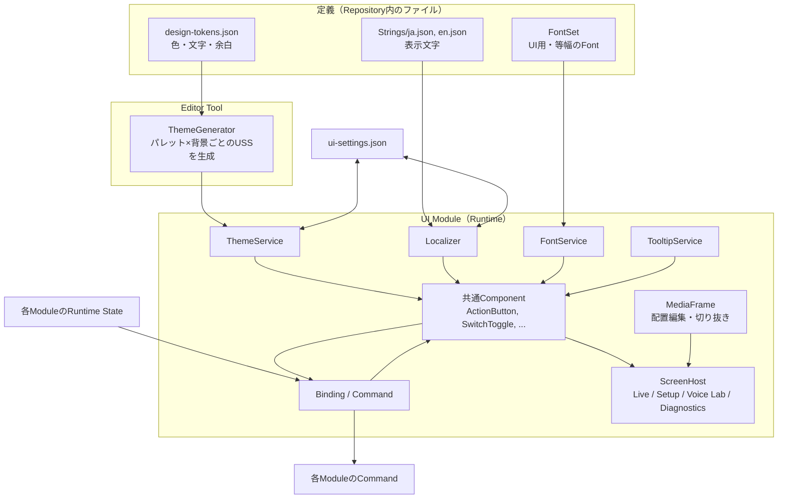
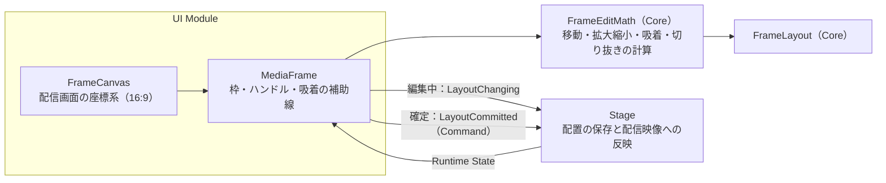

# UI基盤 詳細設計

## 1. 目的

本書は、UI Moduleの基盤部分の詳細設計を定める。

対象は次のとおりである。

- 使いやすい共通Component（UI Toolkitの上に作るProject独自の部品）
- Theme（パレット、ダーク／ライト、UIの拡大縮小、動きを減らす設定）
- Fontの一括管理と切り替え
- 多言語対応（Project独自の軽量な仕組み）
- Tooltip
- Runtime Stateの表示とCommandによる操作
- 配信画面上の配置編集と切り抜きを行うPanel（`MediaFrame`）
- 画面の切り替え、Developer Mode
- UI固有設定の保存
- スクリーンショットによる表示確認

見た目の値と部品の仕様は次の文書で定める。本書はそれをUnityでどう実現するかを定める。

- `docs/ja/ui/design-system.md`
- `docs/ja/ui/components.md`
- `docs/ja/ui/ui-guidelines.md`

関連する方式設計：14章（UI・操作方式）、6.8（基本設定の保存）、16.14（UI Locale拡張）、16.15（UI Theme拡張）

### 全体像



---

## 2. 責務

| 責務 | 担当 |
|---|---|
| 共通Component、Tooltip、Binding、Command実行の仕組み | UI |
| Theme、Font、多言語の切り替え | UI |
| 画面の切り替え、Developer Modeの切り替え | UI |
| UI固有設定（`ui-settings.json`）の内容 | UI |
| 設定ファイルの読み書き（Schema Version、Atomic Write、不明な項目の保持） | ProjectData |
| 配置編集の計算（移動、拡大縮小、吸着、切り抜き） | Core（`FrameEditMath`、Unityに依存しない） |
| 配置データ（`FrameLayout`）の保存と、配信映像への反映 | Stage（実装時）。UIはCommandで変更を依頼する |
| 各機能の状態と操作 | 各Module。UIは状態を表示し、Commandを呼ぶだけ |

---

## 3. Module境界

- UIは各ModuleのRuntime Stateを`IReadOnlyObservable<T>`で受け取り、表示する。UI上の状態をRuntimeの状態として扱わない（方式設計14.29）。
- UIからの操作は`IUiCommand`を通して各Moduleへ渡す。UIが各Moduleの内部Classを直接操作しない。
- `MediaFrame`は映像を描画しない。配信映像の合成はStageとVideoの責務であり（CLAUDE.md 6章）、`MediaFrame`は配置データの編集だけを行う。
- 依存方向は`Application → UI → 各Module → Diagnostics → Core`とする。UIの部品は各Moduleに依存しない。画面（Screens）は各Moduleの公開Interfaceにのみ依存する。

---

## 4. Unity標準UIの使いにくさと対策

UI Toolkitをそのまま使うと、次の問題がある。共通Componentと周辺の仕組みで解決する。

| 問題 | 対策 |
|---|---|
| Eventの登録と解除を手で書く必要があり、解除漏れでMemory Leakや破棄後の呼び出しが起きる | Bindingは画面から外れたときに自動で解除する（7.3） |
| 実行時にTooltipを出す仕組みがない（`tooltip`属性はEditor専用） | `TooltipService`（7.6） |
| 表示文字の多言語化を毎回コードで書く必要がある | UXMLで`text-key`を指定するだけで切り替わる（7.4） |
| 見た目の種類をClass名の文字列で指定し、誤字に気づけない | 種類はEnumのProperty（例：`variant="Primary"`）で指定する |
| プログラムから値を設定しても変更Eventが発生し、利用者の操作と区別しにくい | 表示の更新は`SetValueWithoutNotify`で行い、利用者の操作だけをCommandへ渡す（7.3） |
| 押せない理由を示す標準の方法がない | Commandが押せない理由を持ち、ボタンを無効にしてTooltipへ表示する（7.5） |
| ラベルの位置や余白が部品ごとに異なる | 共通Componentが`components.md`どおりの構造と余白を持つ |

---

## 5. 主要Classとインターフェース

| 名前 | 種別 | 概要 |
|---|---|---|
| `UiRoot` | MonoBehaviour | Persistent Sceneに置くUIの入口。`UIDocument`とUI用Assetを保持し、Serviceを接続する |
| `UiAssets` | ScriptableObject | PanelSettings、生成済みTheme、FontSet、文字列表、画面のUXMLへの参照 |
| `UiApplicationService` | Class | UIを1つのApplication Serviceとして起動・終了する（7.9） |
| `ThemeService` | Class | パレット、背景、拡大縮小、動きを減らす設定を適用する |
| `FontService` | Class | FontSetを切り替える |
| `FontSet` | ScriptableObject | UI用と等幅のFont Asset、Fallback |
| `Localizer` / `ILocalizer` | Class / Interface | 表示文字の取得と言語の切り替え |
| `TooltipService` | Class | Tooltipの表示 |
| `DialogService` / `IDialogService` | Class / Interface | 確認Dialogの表示 |
| `NotificationService` / `INotificationService` | Class / Interface | Notificationの表示 |
| `IUiCommand` | Interface | UIから実行する操作 |
| `IReadOnlyObservable<T>` / `ObservableValue<T>` | Interface / Class（Core） | 変化を通知する値 |
| 共通Component | VisualElement | `components.md`の各部品（6章） |
| `MediaFrame` / `FrameCanvas` | VisualElement | 配置編集と切り抜き（9章） |
| `FrameLayout` / `FrameEditMath` | Struct / Static Class（Core） | 配置データと編集の計算 |
| `AppShell` | VisualElement | ナビゲーションと画面の領域、版の表示（7.7） |
| `ScreenHost` | VisualElement | 画面の切り替え（7.7） |
| `ScreenDefinition` / `IScreen` | Class / Interface | 画面の登録内容と、表示・非表示の通知（7.7） |
| `DeveloperModeService` | Class | Developer Modeの切り替えと関連機能への反映 |
| `UiSettings` | Class | UI固有設定の内容（ファイルに書かれたままの値） |
| `UiSettingsResolver` / `ResolvedUiSettings` | Static Class / Struct | 設定の値を許可した一覧に照らして、使う値を決める（8.1） |
| `UiSettingsService` | Class | 設定の変更の通知と、まとめての保存（7.9） |
| `ConfigFileStore` | Class（ProjectData） | 設定ファイルの読み書き |
| `ThemeGenerator` | Editor | Tokenから各ThemeのUSSを生成する |
| `ComponentGalleryScreen` | VisualElement | 部品見本（7.7） |
| `UiScreenshotCapture` | Editor | 画面をPNGへ書き出すメニュー（7.10） |
| `UiShotPlan` / `UiScreenshotCaptureRun` | Static Class / PlayMode Test | 書き出す組み合わせと、書き出しの処理（7.10） |

---

## 6. 共通Component

### 6.1 一覧

`components.md`の各部品を、`VisualElement`を継承したClassとして実装する。UXMLでもC#でも使える。

| 部品 | Class | UXML例 |
|---|---|---|
| Button | `ActionButton` | `<vv:ActionButton variant="Primary" text-key="live.start" tooltip-key="tip.live.start" />` |
| Icon Button | `IconButton` | `<vv:IconButton icon="Mic" toggle="true" tooltip-key="tip.mute" shortcut="Ctrl+M" />` |
| Toggle | `SwitchToggle` | `<vv:SwitchToggle text-key="voice.convert" />` |
| Slider | `ValueSlider` | `<vv:ValueSlider low-value="-60" high-value="0" unit="dB" />` |
| Level Meter | `LevelMeter` | `<vv:LevelMeter segments="24" />` |
| Dropdown | `SelectField` | `<vv:SelectField label-key="audio.mic.device" />` |
| Text Field | `TextInput` | `<vv:TextInput label-key="stream.title" />` |
| Numeric Field | `NumberInput` | `<vv:NumberInput label-key="audio.sampleRate" unit="Hz" />` |
| Tab | `TabBar` | `<vv:TabBar />` |
| Setting Row | `SettingRow` | `<vv:SettingRow name-key="audio.noise" description-key="audio.noise.desc">…</vv:SettingRow>` |
| Card | `Card` | `<vv:Card title-key="voice.title">…</vv:Card>`。折りたためるCardは`collapsible="true" expanded="false"` |
| Dialog | `ConfirmDialog` | C#から`ConfirmAsync`で表示（6.4） |
| Status Indicator | `StatusChip` | `<vv:StatusChip status="Success" text-key="trk.good" />` |
| Notification | `Notice` | C#から`NotificationService`で表示 |
| Progress Bar | `ProgressMeter` | `<vv:ProgressMeter label-key="lab.training" />` |
| Navigation Item | `NavItem` | `<vv:NavItem icon="Live" text-key="nav.live" />` |
| Preview | `StreamPreview` | `<vv:StreamPreview />` |
| Segmented | `Segmented` | `<vv:Segmented item-keys="settings.dark,settings.light" />` |
| Key Hint | `KeyHint` | `<vv:KeyHint keys="Ctrl+M" />` |
| Icon | `Icon` | `<vv:Icon icon="Live" />`（6.6） |
| Popup Menu | `PopupMenu` | C#から`PopupMenu.Show`で表示（`components.md` 3.23） |
| Panel | `MediaFrame` | 9章 |
| Layer List | `LayerList` | C#から`new LayerList(canvas)`で作る（9.7） |
| Table | `DataTable` / `TableColumn` | C#から`Ui.Table(TableColumn.Number(...), ...)`で作る（`components.md` 3.24） |

UXMLの名前空間は`VirtualVessel.UI.Controls`、接頭辞は`vv`とする。Classは`[UxmlElement]`と`[UxmlAttribute]`（Unity 6）で定義する。

### 6.2 共通の属性

すべての共通Componentは次の属性を持つ。

| 属性 | 内容 |
|---|---|
| `text-key`等の`*-key` | 表示文字の文字列Key。言語が切り替わると自動で更新する |
| `tooltip-key` | Tooltipの文字列Key |
| `shortcut` | Tooltipに添えるショートカット表記 |

表示文字を直接指定する属性（`text`等）は、利用者向けの画面では使わない。

**Serviceの見つけ方**

- 部品は、自分より上にある最も近い`UiServicesScope`から`UiServices`（`ILocalizer`、`IMainThreadDispatcher`、`ILog`、失敗の通知先、確認Dialog）を受け取る。UiRoot（実装順序7）が画面の一番外側に`UiServicesScope`を置く。全体で1つのGlobal Instanceは使わない。
- `*-key`の文字は`KeyedText`が扱う。部品がPanelに追加されたときに文字を取得し、言語が変わるたびに更新する。Panelから外れると購読を解除する。
- Scopeの外（UI Builderでの編集中など）では、`[live.start]`のようにKeyを表示する。どこにどの文字が入るかを確かめられるようにするためである。

### 6.3 C#から組み立てる場合

UXMLを使わずに組み立てる場合のため、短く書けるFactory（`Ui`）を用意する。

```csharp
var start = Ui.Button("live.start", ButtonVariant.Primary)
    .WithTooltip("tip.live.start", "Ctrl+Enter")
    .Bind(_startStreaming);
```

- `Ui`には、各部品を作るメソッド（`Button`、`IconButton`、`Toggle`、`Segmented`、`Tabs`、`Card`、`SettingRow`、`Chip`、`NavItem`、`Slider`、`Select`、`TextField`、`NumberField`、`Progress`）と、言語に追従するラベルを作る`Text`がある。表示文字はすべて文字列Keyで渡す。
- ButtonとIcon Buttonは、`WithTooltip`と`Bind`をつなげて書ける。

### 6.4 Dialogと確認

取り消しにくい操作は、確認を経てから実行する。

```csharp
bool confirmed = await _dialogs.ConfirmAsync(
    titleKey: "live.end.confirm.title",
    bodyKey: "live.end.confirm.body",
    confirmKey: "live.end",
    style: ConfirmStyle.Danger);
```

`DangerCommand`として登録したCommandは、`ActionButton`から実行するときに自動で確認Dialogを出す。

- Dialogは、最も近い`vv-root`の要素に重ねて表示する。表示中は画面全体を覆う幕で後ろの操作を止める。
- 「大きな影」（`components.md` 3.11）は、USSでぼかした影を描けないため、画面全体を`Scrim`（`design-system.md` 3.5）で暗くする幕で代える。Scrimはダークで濃くし、もともと暗い画面でもDialogが浮いて見えるようにする。
- `ConfirmStyle.Danger`では、実行ボタンをDanger、もう一方をSecondaryの「キャンセル」とし、最初のFocusを「キャンセル」に置く。誤ってEnterを押しても実行されないようにするためである。`Normal`では実行ボタンにFocusを置く。どちらにするかは`DialogService.FocusCancelFirst`（純粋関数）で決める。
- 表示中は、Tabと矢印キーによるFocusの移動を2つのボタンの間に限る。EscとNavigationのCancelは「キャンセル」と同じ扱いとする。閉じたら、開く前にFocusしていた要素へFocusを戻す。
- 表示中に別の確認が求められた場合は、前のDialogが閉じてから順に表示する。`CancellationToken`が取り消された場合は「キャンセル」と同じ扱いとする。
- ボタンは押されるとすぐ実行中の表示になるため、確認を待つ間に2つ目のDialogは開かない。
- `UiServices`に確認Dialogがない場合、`DangerCommand`は実行せず、開発者向けLogにErrorを記録する。取り消しにくい操作を確認なしで実行しないためである。

### 6.5 Style

- 各部品のUSSは`Assets/VirtualVessel/UI/Styles/Components/`に置き、色・余白・角丸はすべてTokenの`var()`で参照する。
- 状態はUSSの擬似Class（`:hover`、`:active`、`:disabled`）と、部品が付けるClass（`vv-chip--success`、`vv-switch--on`等）で表す。
- 各部品のUSSは`Styles/components.uss`から`@import`でまとめる。`ThemeGenerator`が`ThemeAssets.Components`に登録し、`ThemeService.Attach`が共通Token、部品、Themeの順にRootへ追加する。
- Unity標準のButtonの見た目（`unity-button`）は外し、すべての状態をTokenで指定する。
- USSには`:focus-visible`がない。そのため`FocusRing`が、キーボードでFocusしたとき（Focusの移動方向がある場合）だけ`vv-focus-visible`を付け、2pxの枠を表示する。

### 6.6 アイコン

外部のIcon Setや、SVGを取り込むPackageは使わず、Project独自のアイコンを使う。

- 形は`IconLibrary`に、SVGのPath Data（例：`M4 7h10M18 7h2`）として書く。24×24の枠、線の太さ2、端と角を丸める。`styleboard.html`のアイコンと同じ規則である。SVGとして書くため、どのViewerでも形を確認できる。
- `IconGeometry.ParsePath`（純粋関数）が、Path Dataを折れ線に変える。対応する命令はM、L、H、V、C、Q、A、Zで、曲線は短い線分に分ける。
- `Icon`要素は、Painter2Dで折れ線を描く。色は要素の文字色を使うため、Hover、無効、Theme、ダーク・ライトに自動で追従する。拡大しても形は崩れない。
- アイコンを追加するときは、`IconName`と`IconLibrary`に追加する。Testが、すべてのアイコンを読み取れることと、枠の中に収まることを確認する。

### 6.7 入力・表示の部品の実装

| 部品 | 実装の要点 |
|---|---|
| `ValueSlider` | つかめる範囲は高さ24px（押せる部品は24px以上、`components.md` 2）、見た目の溝は6px。値は`step`に合わせて丸める（`step`が0なら範囲の1/100）。左右キーで1段ずつ動かす。値の表示は`ValueSlider.Format`（純粋関数）で、負の数は「−」（U+2212）、`signed`なら正の数に「+」を付ける |
| `SelectField` | 選択肢（`SelectChoice`）は、文字列KeyまたはData由来の文字（音声機器の名前など。翻訳しない）とする。値は選択肢のID。一覧は、最も近い`vv-root`の要素に重ねて開くため、Themeの色がそのまま使われる。上下キーで選択、Enterで決定、Escで閉じる。一覧の外を押すか、部品が画面から外れるか、言語が変わると閉じる |
| `TextInput` / `NumberInput` | Unity標準の`TextField`を中に使い、見た目をTokenで指定する。USSは外側の光（Glow）を描けないため、Focus中は枠を`Accent Line`にする。`NumberInput`は、Enterを押すかFocusが外れたときに確定する。範囲外の値は範囲内に収め、数として読めない文字はエラー（`field.number-invalid`）を表示して前の値を保つ。全角数字と「−」も受け付ける |
| `LevelMeter` | 24個の区切りを1回の描画でまとめて描く。区切りの範囲（通常・注意・最上部の赤）は`LevelMeter.KindOf`（純粋関数）で決める。`BindLevel`は、値の変化を購読せず、画面に表示されている間だけ一定間隔（既定33ms、約30Hz）で値を読む。音声Threadで表示の処理やAllocationが起きないようにするためである。`Level`の設定と、Bindingの更新はAllocationしない（`Tests/Performance`の`UiAllocationTests`で確認） |
| `ProgressMeter` | USSはGradientを描けないため、塗りを頂点色付きの四角形で描く。Gradientは溝全体にわたるため、途中までの進捗では塗りの終わりが2色の中間の色になる。「エポック 120 / 300」のような数を含む文（`Detail`）は、呼び出し側がLocalizerで作る |
| `NavItem` | どの項目を選択中にするかは`ScreenHost`（実装順序7）が決め、項目は表示だけを行う |
| `SettingRow` | 設定名は「太さ500」の指定だが、FontSetに中間の太さ（Medium）がないため、通常の太さ（Regular）で表示する |

- 文字列を値に持つ部品（`SelectField`、`TextInput`、`NumberInput`）は、中のラベルが出す文字の変更Eventを止める。Unityのラベルは文字が変わると`ChangeEvent<string>`を出し、それが親へ伝わって、部品の値の変更に見えてしまうためである。

---

## 7. 仕組み

### 7.1 Theme

**Tokenの定義元**

`Assets/VirtualVessel/UI/Theme/design-tokens.json`に、`design-system.md`の値（パレット、ニュートラルのS/L、状態色、派生色の割合、余白、角丸、文字の大きさと役割）を記述する。これがUnity側の唯一の定義元である。読み込みにはUnity標準の`JsonUtility`を使う（項目が固定であり、ProjectData以外でNewtonsoft.Jsonを使わないため）。

**USSの生成**

USSは`color-mix()`やHSLの計算に対応しない。そこで、Editor Toolの`ThemeGenerator`（メニュー：Virtual Vessel > UI > Generate Theme、Batch Mode：`-executeMethod VirtualVessel.UI.Editor.Theme.ThemeGenerator.Generate`）が、Tokenから次のUSSを生成する。

```text
Assets/VirtualVessel/UI/Theme/
├─ design-tokens.json
├─ ThemeAssets.asset                生成したUSSとFontSetへの参照（Runtimeが切り替えに使う）
└─ Generated/
   ├─ tokens-common.uss             --vv-space-*、--vv-radius-*、文字の大きさ（.vv-text-*）
   ├─ theme-lavender-dark.uss       --vv-color-*（計算済みの値）
   ├─ theme-lavender-light.uss
   ├─ …                             6パレット × 2背景 = 12ファイル
   └─ fonts-notosans.uss            FontSetごとのFont指定（7.2）
```

- 変数は`.vv-root`に定義し、名前は`--vv-color-*`、`--vv-space-*`、`--vv-radius-*`とする。Unity標準Themeの変数と区別するため、`vv-`を付ける。
- 色の計算（HSL、混色、コントラスト比）は`ThemeColor`、USSの文章化は`ThemeStyleSheetGenerator`が行う。どちらもファイルを触らない純粋な処理で、Testから直接使う。
- 生成したUSSと`ThemeAssets.asset`はRepositoryに含める。Build時に生成を必要としない。

**Themeの適用**

`ThemeService`は、Rootの`VisualElement`に`vv-root` Classと`tokens-common.uss`を付け、Theme用USSだけを差し替える。各部品は`var(--vv-color-primary)`等を参照しているため、差し替えるだけで全体の色が変わる。

| 設定 | 適用方法 |
|---|---|
| パレット、背景 | Theme用USSの差し替え。存在しないパレットは既定（Lavender）にしてWarningを記録する |
| UIの拡大縮小 | `PanelSettings`で行う。`UiRoot`（実装順序7）が担当する |
| 動きを減らす | Rootに`vv-reduced-motion` Classを付け、各部品のUSSで遷移と点滅を止める |

**Tokenに関するTest（`ThemeTokenTests`）**

- 生成済みUSSが`design-tokens.json`から再生成した結果と一致し、余分なファイルがないこと。
- `ThemeAssets.asset`がすべてのパレット、背景、既定のFontSetを参照していること。
- すべてのパレットと背景で、`design-system.md` 9.2のコントラスト比を満たすこと。対象は、Textの各段階と背景・面、`On Accent`とPrimary・Secondary、`Accent Line`と背景・面、状態の文字とその淡い背景（カードの上に重ねた色）、状態の色と面、Text 2とWash（カードの上に重ねた色）。
- `docs/assets/ui/styleboard.html`に書かれたパレットの値が`design-tokens.json`と一致すること。

最初の実装時、このTestにより、当初の状態色とライト背景の一部の色が基準に届かないことが分かった。そのため`design-system.md`の値を調整した（状態の淡い背景、Error、Live、ライトのSuccess・Warning、Text 3、Accent Line）。その後、サンドボックスで見た目を確認した結果、ニュートラルの彩度を下げて背景を無彩色に近づけ、代わりにWashとアクセントの装飾（`design-system.md` 3.6）を加えた。あわせて、Primary・Secondaryを背景ごとに調整するようにした（ライトは濃く、ダークは明るく。ライトの濃さは、On Accentとのコントラスト4.5:1を保てる範囲にとどめる。その後、部品のデモで地味に見えたため、MintとPeachの基準色を鮮やかにした。`design-tokens.json`の`accentShift`）。

### 7.2 Font

**FontSet**

Fontは`FontSet`（ScriptableObject、`Assets/VirtualVessel/UI/Fonts/`）で一組として扱う。

| 項目 | 内容 |
|---|---|
| Id | `ui-settings.json`に保存する識別子（例：`NotoSans`） |
| Regular | 本文、ラベル、注記 |
| Bold | 見出し、ボタン、太字 |
| Mono | 数値、ログ、識別子 |

既定のFontSetは`NotoSans`（Noto Sans JP Regular・Bold + Noto Sans Mono）とする。`ThemeGenerator`は、既定のFontSetがなければ作成する。

**一括変更の仕組み**

- すべての文字は、Typography Class（`vv-text-heading`、`vv-text-body`、`vv-text-mono`等）または`vv-bold`、`vv-mono`を通してFontを決める。Rootの文字はRegularになる。
- `ThemeGenerator`は、FontSetごとに`fonts-<id>.uss`を生成する。このUSSだけが、各Classと`.vv-root`をFontのファイルへ対応づける（`-unity-font: url("project://database/...")`）。Unity標準ThemeのFont指定より優先させるため、`-unity-font-definition`は`initial`に戻す。
- `FontService`はこのUSSを差し替える。差し替えるだけで、Application全体のFontが一度に変わる。存在しないFontSetは既定にしてWarningを記録する。
- Typography ClassとFontの対応（Regular、Bold、Mono）は`design-tokens.json`の`typography`で決める。

当初はFontをCustom Property（`var(--font-ui)`）で参照する案だったが、USS変数でFontを渡せることが確認できていないため、サンドボックスで動作を確認したClassの方式とした。差し替えるUSSが1つである点は変わらない。

これにより、次の2つの一括変更ができる。

| 場面 | 方法 |
|---|---|
| 開発時に既定のFontを変える | 既定のFontSetのFontを差し替えて`ThemeGenerator`を実行する。各画面のUXMLやUSSは変更しない |
| 利用者が設定で変える | `ui-settings.json`の`fontSet`を変える。実行中に切り替わる |

**言語とFont**

- 文字列表（7.4）の各言語は、推奨するFontSetを指定できる。将来、日本語Fontで表示できない言語を追加する場合に使う。
- FallbackはPanelSettingsのText Settingsに設定し、文字が欠けないようにする（方式設計14.9）。`UiRoot`で行う（7.9）。
- 日本語は文字数が多いため、FontはDynamic（必要な文字を実行時にAtlasへ追加）として扱う。TTFを`-unity-font`で指定すると、UnityがDynamicなFont Assetを作る。

**Fontファイル**

- Font本体は`Assets/ThirdParty/NotoSansJP/`、`Assets/ThirdParty/NotoSansMono/`に改変せずに置き、OFLのLicense文（`OFL.txt`）と入手元を書いた`README.md`を同梱する。
- `.gitattributes`に`*.ttf`、`*.otf`をBinaryとして追加する。

### 7.3 BindingとRuntime State

**Observable**

各Moduleは、UIへ見せる状態を`IReadOnlyObservable<T>`（Core）として公開する。

```csharp
public interface IReadOnlyObservable<T>
{
    T Value { get; }

    IDisposable Subscribe(Action<T> onChanged);
}
```

**Bindingの書き方**

```csharp
_voiceToggle.BindValue(_voice.ConversionEnabled, onUserChange: _setConversion);
_latencyChip.BindText(_voice.InferenceLatency, latency => $"{latency.TotalMilliseconds:F0} ms");
```

- `BindValue`は、Runtimeの値を`SetValueWithoutNotify`で表示し、利用者の操作だけを`onUserChange`のCommandへ渡す。Commandが失敗した場合や拒否された場合、表示はRuntimeの値に戻る。
- Bindingは、部品がPanelに追加されたときに購読し、外れたときに解除する（`AttachToPanelEvent`、`DetachFromPanelEvent`）。手で解除する必要はない。
- 状態がMain Thread以外で変化した場合は、`IMainThreadDispatcher`でMain Threadへ移してから表示を更新する。
- 音量Meterのように頻繁に変わる値は、変化のたびではなく一定間隔（既定30Hz）でまとめて表示を更新する。

### 7.4 多言語対応

方式設計14.6の目的（表示文字をコードから分離し、言語を追加しやすくする）を、Project独自の軽量な仕組みで実現する。Unity Localization packageは使わない（12.1）。

**文字列表**

```text
Assets/VirtualVessel/UI/Strings/
├─ ja.json
└─ en.json
```

```json
{
  "schemaVersion": 1,
  "locale": "ja",
  "displayName": "日本語",
  "fontSet": "NotoSans",
  "strings": {
    "live.start": "配信を開始",
    "live.elapsed": "配信中 {time}",
    "tip.live.start": "配信サイトへの送信を始めます"
  }
}
```

- Keyは`<領域>.<項目>`の形とし、小文字の英字・数字・ハイフンをドットで区切る。Tooltipは`tip.`で始める。
- 値の中の`{name}`は名前付きの差し込みとする。`{{`と`}}`は波かっこそのものを表す。対応する引数がない差し込みは、そのまま残す。数値は、その言語の書式で表示する。
- 単数と複数で表現が変わる場合は、`.one`と`.other`のKeyを用意し、`Localizer.Plural(key, count)`で選ぶ。`{count}`も差し込まれる。2つの形は同じ言語の表から取る。すべての言語でKeyをそろえるため、単数形のない言語では`.one`に`.other`と同じ文を書く。
- 文字列表は`StringTable.Parse`で読む。内部ではProjectDataの`ConfigDocument.Parse`（アプリケーション基盤詳細設計11.1）を使い、JSON Libraryを使うのはProjectDataだけとする。文字列表はApplicationに同梱するため、`schemaVersion`が異なる表はBuildの誤りとみなし、読み込みに失敗させる。

**取得と切り替え**

```csharp
string text = _localizer.Get("live.elapsed", ("time", elapsed));
```

- `ILocalizer.LocaleChanged`で言語の変更を通知する。`*-key`属性を持つ部品は自動で表示を更新する。
- Keyが見つからない場合は、英語の文字列を使う。英語にもない場合は`[live.start]`のようにKeyを表示し、開発者向けにKeyごとに1回だけWarningを記録する。
- 知らない言語コード（手で書き換えた設定ファイルなど）は、Warningを記録して英語にする。言語が未設定の場合の初期値は`Localizer.ChooseInitialLocale`で決める（8.1）。
- 差し込みのない取得ではAllocationしない。Main Threadから呼ぶ。
- C#から使うKeyの定数は、`[StringKeys]`を付けたstatic classの`const string`として定義する（例：`CommonStrings`）。

**言語の追加**

`<locale>.json`を追加するだけで、言語の選択肢に現れる。コードの変更は不要とする（方式設計16.14）。`Localizer`は文字列表を文字列として受け取る。`UiAssets`（実装順序7）が`Strings/*.json`をすべて集めることで、ファイルの追加だけで済むようにする。

**Test**

- `ja`と`en`があり、ファイル名と`locale`が一致すること。
- すべての言語で、Keyの集合が一致すること。Keyが上記の形式に従い、空の値がないこと。
- 同じKeyの差し込み（`{name}`）が、すべての言語で一致すること。
- UXMLの`*-key`属性とC#の文字列Key定数が、文字列表に存在すること。

### 7.5 Command

```csharp
public interface IUiCommand
{
    bool CanExecute { get; }

    /// <summary>押せない理由の文字列Key。押せる場合はnull。</summary>
    string DisabledReasonKey { get; }

    event Action CanExecuteChanged;

    Task ExecuteAsync(CancellationToken cancellationToken);
}
```

- `ActionButton.Bind(command)`で、押せる・押せないの表示、押せない理由のTooltip、実行中の二重押し防止をまとめて行う。
- 実行中は部品を無効にし、時間がかかる場合は読み込み中の表示を出す（方式設計14.30）。
- 例外は利用者向けのNotificationと開発者向けのLogに分けて扱う。Commandが利用者向けの文字列Keyを持つ例外（`UserFacingException`）を投げた場合はその文を表示し、それ以外は一般的な失敗の文（`error.unexpected`）を表示する。取り消し（`OperationCanceledException`）は失敗として扱わない。表示する文の選び方は`CommandRunner.MessageKeyFor`（純粋関数）で決める。
- `UiCommand`は、Delegateと「押せない理由」の`IReadOnlyObservable<string>`から作る。理由がnullのときに押せる。理由の変化は、`CanExecuteChanged`を購読している間だけ監視する。
- ボタンから実行するCommandには`CancellationToken.None`を渡す。画面は一度作ると保持されるため（7.7）、部品がPanelから外れても実行中の操作は止めない。

### 7.6 Tooltip

- Panelごとに1つのTooltip要素を持ち、すべての部品で共有する。`TooltipService`を、最も近い`vv-root`の要素に1回だけ取り付ける。
- `tooltip-key`を持つ部品にPointerが留まったとき（既定0.5秒）、またはキーボードでFocusしたときに表示する。Pointerが離れたとき、押したとき、Scrollしたときに消す。
- Tooltipを出す部品は`ITooltipSource`を実装する。Pointerの下の要素から上へたどり、最初に見つかった部品の文を表示する（`TooltipService.FindSource`、純粋関数）。アイコンの上でも、そのボタンのTooltipが出る。
- 表示位置は部品の上とし、上に余白がなければ下とする。画面の端からはみ出さない。位置は`TooltipPlacement.Place`（純粋関数）で決める。
- 部品が無効な場合は、`DisabledReasonKey`の文を表示する。無効な部品はEventを受け取らないため、RootでTrickleDownのEventを見て判定する。
- ショートカットがあれば、Key Hintで文の右に添える。

**変更しうる値**

表示までの時間と位置の数値は、現時点の既定値であり、今後変更しうる。数値は`TooltipOptions`だけに置き、部品や画面には書かない。

| 項目 | 既定値 | 置き場所 |
|---|---|---|
| 表示までの時間 | 0.5秒 | `TooltipOptions.ShowDelay` |
| 部品との間隔 | 6px | `TooltipOptions.Gap` |
| 画面の端との間隔 | 8px | `TooltipOptions.EdgeMargin` |
| 見た目（色、角丸、最大幅） | `components.md` 3.12 | `Styles/Components/tooltip.uss` |

### 7.7 画面とDeveloper Mode

**画面の構成**（`styleboard.html`の「画面の見本」）

- 左に幅200pxのナビゲーション（背景Bg、右端に1pxのBorder）、右に画面の領域を置く（`AppShell`）。
- ナビゲーションの項目は、ライブ、セットアップ、Voice Lab、診断の順とする。各項目のTooltipで、その画面の役割を示す。
- ナビゲーションの下端に、Applicationの版（例：`v0.1.0`、等幅、Text 3）を表示する。プロジェクト名は、Projectの機能を作るときに加える。
- 各画面の上端に、画面の名前を見出しとして置く。
- 画面の内側の余白はXL（40px）、中身の幅は最大960px（診断は1200px）とし、ナビゲーション側に寄せる（`design-system.md` 5章）。

**ScreenHost**

- 画面は`ScreenDefinition`（Id、アイコン、名前のKey、TooltipのKey、Developer Modeのときだけ表示するか、画面を作る処理）として登録する。Idは`live`、`setup`、`lab`、`diagnostics`とし、`lastScreen`に保存する。
- 画面は初めて開いたときに作り、以後は保持する。表示していない画面は`display: none`にする。
- 画面が`IScreen`を実装していれば、表示したときに`OnShown`、隠したときに`OnHidden`を呼ぶ。表示中だけ行う処理（Diagnosticsの更新など）に使う。
- 開いた画面を`lastScreen`へ保存し、次の起動ではその画面を開く。知らないIdや、Developer Modeがオフで表示できない画面の場合は、ライブを開く（`ScreenNavigation.Choose`、純粋関数）。
- 診断を開いている間にDeveloper Modeをオフにしたら、ライブへ移る。
- 画面を作る処理が失敗したら、その画面の領域に「この画面を表示できませんでした」と表示し、Errorを記録する。ほかの画面は使える（13章）。
- ナビゲーションの項目はButtonであり、TabとEnterで操作できる。項目の間は上下キーでも移れる（`components.md` 3.16）。

**Developer Mode**

- `DeveloperModeService`は、`UiSettingsService`の`developerMode`が変わるたびに、Compositionが登録した相手へ伝える。UIの構築時にも1回伝える。UIは`PerformanceMetricsService`の具体的なClassに依存せず、Compositionが`SetDetailedEnabled`を渡す。
- 詳細計測は、UIの構築後はDeveloper Modeに従う（性能計測詳細設計7.1）。
- Developer Modeの変更はInformationで記録する。
- Developer Modeは表示を増やすだけで、権限は与えない（7.9）。

**アプリの設定**（Setup画面に仮置き）

- 言語、パレット、背景、UIの大きさ、動きを減らす設定は、Setup画面の「アプリの設定」に置く。Live画面には置かない。
- Setup画面の仕様（`docs/<lang>/ui/screens/`）ができるまでは、Setup画面に「アプリの設定」のCardだけを置く。配置はSetup画面の仕様を決めるときに見直す。
- 項目はSetting Rowで並べる。

| 項目 | 部品 | 選択肢 |
|---|---|---|
| 言語 | Dropdown | 文字列表の`displayName`（日本語、English） |
| パレット | Dropdown | `ThemeAssets`のパレット名 |
| 背景 | Segmented | ダーク、ライト |
| UIの大きさ | Dropdown（選択肢が5個以上のため） | 100%、110%、125%、150%、175%、200% |
| 動きを減らす | Dropdown（選択肢の文字が長いため） | Windowsの設定に合わせる、オン、オフ。説明に、Windowsの「アニメーション効果」がオフのときに止まることを書く |
| Developer Mode | Toggle | 診断の画面を表示する |

- 選んだ値は`UiSettingsService`へ渡し、すぐに反映して保存する（7.9）。設定が別の場所で変わったときは、表示を`SetValueWithoutNotify`で合わせる。

**最初に作る画面**

ライブとセットアップは、画面の仕様（`docs/ja/ui/screens/live.md`、`setup.md`）に従う。ライブは配信プレビューと配置編集、セットアップは映像の取り込みのCardとアプリの設定を置く。Voice Labは、画面の仕様ができるまで、見出しと「この画面は準備中です」だけを表示する。

- 必要な相手は、Compositionが`UiRootContext.Screens`（`ScreenServices`）にまとめて渡す：`IStreamPreviewSource`（Video）、`IFrameSource`の一覧と`IStageLighting`（Stage）、`ICaptureSources`（Capture）、`ITrackingSource`と`ITrackingRecordings`（Tracking）、`IAvatarService`（Avatar）、`IFileDialog`、`ICreditFiles`。ないものは`null`のままにし、その部分は「使えません」と表示するか、置かない。
- 画面に新しい相手を足すときは、`ScreenServices`に1つ足し、使うCardへ渡すだけにする。以前は`UiRootContext`と`SetupScreen`の引数を順に足しており、相手を1つ足すたびに受け渡しだけの変更が4か所に出た（2026-10-21）。
- UIはCaptureの公開Contract（`ICaptureSources`、`ICaptureDeviceSource`、`IPointerOption`）を参照してよい（Captureの状態を表示する流れ）。CaptureはUIを参照しない。

このほか、次の2つの画面を最小限の内容で作る。後で見直す可能性がある。

- Diagnostics（診断、Developer Modeのみ）：性能計測の表と、トラッキングの記録（後述）。
- 性能計測（`PerformanceSnapshot`）の表は、共通部品の`DataTable`で作る。
  - 列は、Module、名前、種類、現在、平均、最大、P95、P99、件数、予算超過とする。数値は等幅で右に寄せ、単位を付ける。
  - 表示している間だけ、1秒ごとに`IPerformanceMetrics.GetSnapshot`で更新する。表示していない間は取得しない。Snapshotの作成はAllocationを伴うためである。
  - 表の上に、詳細計測が有効か無効かを表示する。無効の間は、TimerとGaugeの値が増えない理由が分かるようにする。
  - 性能計測のServiceがない場合は、「性能計測を使えません」と表示する。
  - 数値の文字は純粋関数（`DiagnosticsFormat`）で作る。Moduleと名前は識別子なので、翻訳せずにそのまま表示する。
- トラッキングの記録（`TrackingRecordingsCard`、Tracking詳細設計12章）：Trackingの`ITrackingRecordings`が使えるときだけ、性能計測の表の下に置く。

| 行 | 部品 | 内容 |
|---|---|---|
| 状態 | Status Chip | 停止中（Idle）、記録中（Recording、経過時間）、再生中（Running、記録の説明）。Iconと文字で示す |
| 説明 | Text Field | 記録の説明（任意、最大100文字）。記録中と再生中は変えられない |
| 記録 | Button（Primary）「記録を開始」／「記録を止める」 | トラッキングが動いていないとき、または再生中は押せない。理由をTooltipで示す |
| 記録の一覧 | `DataTable`（説明、日時、長さ、大きさ） | 新しい順。読めない記録は、説明の欄に「読めません」と出す。日時は利用者の地域の時刻で表示する |
| 選ぶ | Dropdown | 一覧の記録を1つ選ぶ。再生と削除の対象 |
| 再生 | Button「再生」／「再生を止める」 | 読めない記録と記録中は押せない |
| 削除 | Button（Danger）「削除」、「すべて削除」 | 確認のDialogを出す。記録中・再生中の記録は消せない |
| 注記 | Caption | 「記録は数値だけで、映像は含みません。このPCの外へは出しません。」と、記録の合計（件数と大きさ） |

  - 説明はデータの文字として表示し、Rich Textとして解釈しない。
  - 経過時間は、記録中だけ1秒ごとに描き直す。
  - Developer Modeをオフにしたら、記録と再生を止める（`DeveloperModeReceivers`）。
- 骨格の見比べ（`SkeletonCard`、2026-10-22）：トラッキングが観測した上半身と、アバターが出している上半身を並べて描き、腕の向きや高さのずれが、トラッキングの入力にあるのか、アバターへの移し方（Avatar詳細設計7.2）にあるのかを見分ける。Trackingの`ITrackingSource`が使えるときだけ、記録のCardの下に置く。
  - 正面（左右と上下）と横（アバターの右から見て、前が右）の2枚を描く（`SkeletonView`）。アバターは太い破線で下に、観測は細い実線で上に描き、重なっても両方が見え、色（観測は文字色、アバターは副色）だけでなく線の太さと形で見分ける。カメラの映像と2枚の図は同じ幅（300px）で1行に並べ、各枚の見出しは本文の大きさと文字色で読めるようにする。腰を通る水平の線を薄く引く。
  - アバターの腕は、観測した肩から、アバターの骨の向きに、観測した骨の長さで描く。向きが合っていれば観測と重なる。胴も、観測した腰から、アバターの胴の向きに描く。アバターの腕は頭と胴から出した後の姿勢（Avatar詳細設計7.6）のため、頭や胴の近くでは観測とずれることがある。
  - 観測は、アバターと同じく鏡写しの設定に従って左右を入れ替えて描く（`PoseRetargeting.Joint`）。
  - 下に表を置き、左右の上腕の上げ角（水平から上）と前への角（真横から）、肘の曲がり、胴の左右と前後の傾きを、観測とアバターで並べる（度、整数）。値は純粋関数（`SkeletonProjection`、`SkeletonCard.Rows`）で求める。
  - 表示している間だけ、約50msごとに描き直す。アバターがないときは観測だけを描き、体の観測がないときは「体の観測がありません」と出す。記録の再生でも使える。
  - 2枚の図の横に、トラッキング用カメラの映像を、観測した点を重ねて出す（利用者の要望、2026-10-23。実際の腕と見比べるため）。**顔は隠す**：両耳の中点（耳が見えなければ鼻）を中心に、肩幅から決めた大きめの不透明な楕円で塗りつぶす（`FaceCover`）。肩幅を使うのは、頭を横に向けても小さくならないため。大きめにするのは、頭の位置が映像より推論1回分（約80ms）遅れて届くため。鼻か両肩が見えないとき、体を見失ったときは、映像全体を隠す。ぼかしは使わない（強さによっては顔が分かるため）。画面を隠したら映像を外す。再生中はカメラが止まるため「映像なし」になる。
- Component Gallery（部品見本）：`styleboard.html`の「共通コンポーネント」と同じ部品をUnity上で並べ、見た目と動きを確認する（`ComponentGalleryScreen`）。
  - UIを作るための道具であり、アプリの一部ではないため、Unityエディタで実行したときだけ含める（`#if UNITY_EDITOR`）。配布するアプリ（開発用ビルドを含む）には、画面もコードも入らない。文字列表のKeyは残るが、表示されることはない。
  - エディタでも、Developer Modeのときだけ、ナビゲーションの診断の下に表示する。アイコンは`Gallery`（2×2の四角）。
  - 部品の種類ごとにCardにまとめ、幅に合わせて折り返して並べる。種類は、ボタン、Tooltip、トグルとIcon Button、状態の表示（Status Indicator、Level Meter、Key Hint）、入力欄（Text Field、Numeric Field、Dropdown、Slider）、タブと設定行（Segmented）、Notificationと進捗、確認Dialog、右クリックMenu、表とする。
  - 押せない理由のTooltipが付いた無効なボタン、入力のエラーなど、通常以外の状態も並べる。
  - Notification、確認Dialog、右クリックMenuは、ボタンを押すと実際に表示する。見本のため、操作しても設定や状態は変わらない。
  - 映像を必要とする部品（Media Frame、Layer List、Preview）は置かない。配置編集の画面で確認する。
  - 部品を追加したら、ここにも並べる（`components.md` 4章）。

### 7.8 Notification

- `NotificationService`を、最も近い`vv-root`の要素に1回だけ取り付ける。通知は画面の隅に縦に積む。
- `Show(kind, titleKey, bodyKey)`で表示する。種類（Info、Success、Warning、Error）ごとに形の異なるアイコンを付け、色だけで伝えない（`design-system.md` 9.1）。
- Commandの失敗（7.5）は`ShowFailure`で表示する。見出しは「操作を完了できませんでした」（`notice.failure.title`）、本文は失敗の文とする。UiRootが`UiServices`の失敗の通知先に`NotificationService.ShowFailure`をつなぐ。
- 閉じるボタンで、いつでも閉じられる。
- 通知は捨てない。表示しきれない通知は待ち行列に入れ、表示中の通知が消えるか閉じられたら表示する。待っている件数を、スタックの隅側の端に「ほかに N 件の通知」と表示する。
- 待ち行列は優先度の高い順（Error、Warning、Success、Info）、同じ優先度では来た順に表示する（`NotificationPolicy.NextToShow`）。
- 枠が埋まっているときに、表示中のどれかより優先度の高い通知が来た場合は、表示中で最も優先度の低い通知（同じなら古いもの）を待ち行列に戻し、新しい通知をすぐ表示する（`NotificationPolicy.ToMakeRoomFor`）。戻した通知は消さず、順番が来たら表示し直す。Errorが戻されることはない。
- 自動で消える通知は、Pointerが上にある間は時間を止め、離れたら最初から数え直す。
- 表示と消去は、短い透明度と位置の変化で行う。動きを減らす設定では変化させない。

**変更しうる値**

位置と時間は、現時点の既定値であり、今後変更しうる。値は`NotificationOptions`だけに置き、判断は`NotificationPolicy`（純粋関数）で行う。隅の位置はUSSのClass（`vv-notices--bottom-right`等）で表すため、位置を変えても画面のコードは変わらない。

| 項目 | 既定値 | 置き場所 |
|---|---|---|
| 位置 | 右下 | `NotificationOptions.Corner` |
| Info、Successが消えるまでの時間 | 5秒 | `InfoDuration`、`SuccessDuration` |
| Warningが消えるまでの時間 | 8秒 | `WarningDuration` |
| Error | 閉じるまで残す（見落とさないため） | `ErrorDuration`（nullで残す） |
| 同時に表示する数 | 3つ。超えた分は待ち行列に入れる | `MaxVisible` |
| 優先度 | Error、Warning、Success、Infoの順 | `NotificationPolicy.Priority` |
| Pointerが上にある間 | 時間を止める | `PauseOnHover` |
| 表示と消去の変化の長さ | 0.15秒（`design-system.md` 7） | `TransitionDuration` |

隅に近い側に新しい通知を置く。右下・左下では下、右上・左上では上に追加する（`NotificationPolicy.NewestFirst`）。

### 7.9 UiRoot（UIの入口）

**Applicationとの接続**

- `UiRoot`は、Persistent Sceneの`UIDocument`と同じGameObjectに置く。`ApplicationBootstrap`がSerializeFieldで参照し、Compositionへ渡す。Static Instanceは使わない（アプリケーション基盤詳細設計3章）。
- Compositionは、最後に`UiApplicationService`（Service名`UI`、Optional、Loggingに依存）を登録する。そのため、UIはほかのApplication Serviceがすべて起動した後に構築される（10章）。UIの構築に失敗しても、ほかのServiceは止まらない。
- `UiApplicationService`は、UIのLog、`IMainThreadDispatcher`、Monotonic Clock、System Clock、設定ファイルの場所（`DataRootResolver.ConfigDirectory`）をConstructorで受け取る。

**構築の順序**（`UiRoot.Build`）

1. `ui-settings.json`を読み、値を解決する（8.1）。
2. `UiAssets`のPanelSettingsを複製し、`UIDocument`に設定する。Asset本体を実行中に書き換えると、Editorではその変更がAssetに残ってしまうためである。複製はUIの破棄時に破棄する。
3. `Localizer`、`ThemeService`、`FontService`を作る。文字列表は`UiAssets`が持つ（7.4）。
4. Rootに`UiServicesScope`（`vv-root`）を置き、Theme、Font、Notification、Dialog、Tooltipを取り付ける。`UiServices`の失敗の通知先には`NotificationService.ShowFailure`、確認Dialogには`DialogService`を渡す。
5. 解決した設定（Theme、Font、言語、UIの大きさ）を適用する。
6. 画面の領域（`UiRoot.Content`）を置き、その中に`AppShell`（ナビゲーションと`ScreenHost`、7.7）を置く。
7. 設定ファイルを退避した場合は、Notification（Warning）で利用者に知らせる。

**UIの大きさ**

- PanelSettingsは`ConstantPhysicalSize`（基準96 DPI）とし、Windowsの表示スケール（125%、150%等）に従う。そのうえで`scale`に設定の`uiScale`を掛ける。
- 表示スケールに対して窓が小さいときは、窓の中に1280×720の広さが入るところまで表示スケールを下げる。ただし100%より下げない（`UiPanelScale`、純粋関数。2026-10-24）。利用者の`uiScale`は、読みやすくするために選ぶものなので、常にそのまま掛ける。4Kのモニターを225%で使うと、Full HDの窓には853×480の広さしかなく、設定の画面の列が押しつぶされて、文字が1行に1文字になった（利用者のスクリーンショット）。今は、その窓は150%で描き、1280×720の広さになる。`UiRoot`は毎Frame窓の大きさを確かめ、Logは下げ始めたときと戻したときだけ記録する。画面の書き出し（7.10）のように、Textureへ一定のPixelの大きさで描くパネルは、96 DPIとしてTextureに合わせるため、書き出す画像は変わらない。
- これで#35のうち、小さい窓の側を決めた。大きい窓に合わせてUIを大きくするかは、#35で引き続き検討する。

**動きを減らす設定の「system」**

- Windowsの「アニメーション効果」（`SystemParametersInfo`の`SPI_GETCLIENTAREAANIMATION`）を起動時に1回読む。オフなら動きを減らす。Windows以外と、読めなかった場合はオフ（動きを減らさない）とする。

**Font Fallback**（方式設計14.9）

- 既定のFontSetのRegular（Noto Sans JP）から実行時に動的なFont Assetを作り、PanelSettingsのText SettingsのFallbackに設定する。等幅のNoto Sans Monoや、今後追加するFontSetに日本語の文字がなくても、文字が欠けないようにするためである。Text Settingsの複製はUIの破棄時に破棄する。Font Assetはフォントごとに1つだけ作り、実行中は使い回して破棄しない。TextCoreは、パネルを破棄した後もFont Assetの画像を参照し続けるため、破棄すると次に作る画面（UIの構築に失敗した後の起動できなかったときの画面など）の文字の描画が壊れるためである。

**設定の変更と保存**（`UiSettingsService`）

- 設定を変える操作（`SetPalette`等）は、すぐに`Changed`で知らせ、`UiRoot`が画面へ反映する。
- 保存は、最後の変更から0.5秒後に1回だけ行う（`SaveDebounce`）。毎フレームの`UiRoot.Update`から`Tick`を呼んで判定する。
- 書き込みはWorker Threadで、1件ずつ順に行う。ファイルの書き込みでMain Threadを止めないためである（16章）。
- 終了時（`UiApplicationService.ShutdownAsync`）は、待っている保存を済ませる。
- 保存に失敗したら、Warningを記録し、Notification（Warning）「設定を保存できませんでした」を表示する。同じ失敗が続く間は繰り返し表示せず、保存に成功したら元に戻す。

**起動できなかったときの画面**（アプリケーション基盤詳細設計8.1、17章）

- `ApplicationBootstrap`は起動処理の後、Applicationが`Failed`になった場合、またはUIのServiceが動いていない場合に、`UiRoot.ShowStartupProblem`を呼ぶ。
- 表示する内容は次の2種類とする。

| 種類 | 見出し | 本文 |
|---|---|---|
| Data Rootを使えない | データの保存先を使えません | 保存先のフォルダーに書き込めません。フォルダーの場所と空き容量を確認してから、もう一度起動してください。（下に保存先のPathを表示） |
| その他 | Virtual Vessel Studioを起動できませんでした | もう一度起動してください。繰り返し起きる場合は、ログを添えて報告してください。 |

- 「終了」ボタンで、通常の終了処理（アプリケーション基盤詳細設計7.2）を行う。
- この画面は、既定のThemeと既定のFontSetで表示する。起動できない原因に関わるものへ、できるだけ依存しないためである。
- 言語は、直前まで表示していた画面の言語、`ui-settings.json`の`language`、OSの言語の順に、文字列表があるものを使う。設定ファイルは`UiSettingsPeek`で読み取るだけとし、壊れていても退避や書き込みはしない。利用者が選んだ言語で、何が起きたかを伝えるためである。

**セキュリティ上の考慮**

- `ui-settings.json`は、利用者や同じユーザー権限で動く別のProgramが書き換えられる。信頼しない入力として扱い、値は許可した一覧に照らして使う（8.1）。
- 設定ファイルには秘密情報（Stream Key等）を保存しない。秘密情報は方式設計6.13の方式で扱う。
- Developer Modeは表示を増やすだけで、権限は与えない。設定ファイルを書き換えれば誰でも有効にできるため、Developer Modeの裏に守るべき機能を置かない。Diagnosticsにも秘密情報を表示しない（7-2）。
- 起動できなかったときの画面とNotificationには、例外の文、Service名、Stack Traceなどの内部の情報を出さない。詳細は開発者向けのLogへ記録する。

### 7.10 画面の書き出し（UiScreenshotCapture）

方式設計14.35のVisual Reviewのため、実際のUIの画面をPNGに書き出す開発用のツールである。

- 書き出しはPlay Modeで行う。`UiRoot`を実際の`UiAssets`と一時的な設定フォルダで構築し、PanelSettingsの`targetTexture`へ描いて保存する。UI ToolkitのRuntime Panelは、Play Modeで描かれるためである。
- 処理はPlayModeのTest（`UiScreenshotCaptureRun.Capture`）として書き、Unity Test Frameworkで実行する。`[Explicit]`を付け、名前を指定したときだけ動かす。通常のTestの実行では動かない。Batch Modeでも、`-nographics`を付けなければ動く。
- 実行方法は次の2つとする。
  - Unityのメニュー「Virtual Vessel/UI/Capture Screenshots」（`UiScreenshotCapture`、Editor）。終わると保存先のフォルダを開く。
  - `tools/ui/capture-ui.ps1`。Unityを閉じた状態でBatch Modeで実行する。`-Screens`で画面を絞り、`-Quick`で組み合わせを減らせる。
- 書き出す組み合わせは`UiShotPlan.Create`（純粋関数）が決める。画面ごとに次を書き出す（`ui-guidelines.md` 5章）。
  - ダーク・ライト×日本語・英語（1600×900、UIの大きさ100%、Lavender）
  - 明るいアクセント色のパレット（Lemon、ライト、日本語）
  - 狭い窓（1024×768、ダーク、日本語）
  - UIの大きさ150%（ダーク、日本語）
  - `-Quick`のときは、ダーク・日本語とライト・英語だけとする。
- 縦に長い画面は、中身の高さに合わせて画像を縦に伸ばし、全体を1枚に収める。
- 画面は96 DPI（Windowsの拡大率100%）で描き、実行する環境によらず同じ大きさで書き出す。UIの大きさは組み合わせどおりに掛ける。
- 設定を切り替えた後は、数フレームに加えて0.3秒待ってから書き出す。Batch Modeではフレームがとても速く進むため、フレーム数だけでは、部品の色の切り替え（ボタンは0.12秒）が途中のまま写るためである。
- Developer Modeはオンにし、診断画面には見本の計測値を入れる。
- ファイル名は`<画面>-<背景>-<言語>-<パレット>-<幅>x<高さ>-<UIの大きさ%>.png`とする。一覧で見るための`index.html`も書き出す。
- 保存先は、既定でRepository直下の`screenshots/<日時>/`とし、Gitの管理から外す（`.gitignore`）。環境変数`VV_UI_CAPTURE`で変えられる。
- 色の見え方（赤緑、青黄、白黒）の模擬は含めない。書き出した画像を別のツールで確認する。

---

## 8. データモデル

### 8.1 UiSettings

`%LOCALAPPDATA%\VirtualVesselStudio\Config\ui-settings.json`（方式設計6.8）

```json
{
  "schemaVersion": 1,
  "language": "ja",
  "palette": "lavender",
  "background": "dark",
  "uiScale": 1.0,
  "reducedMotion": "system",
  "fontSet": "NotoSans",
  "developerMode": false,
  "lastScreen": "live",
  "lastSetupPage": "video"
}
```

| 項目 | 既定 | 備考 |
|---|---|---|
| `language` | OSの言語が日本語なら`ja`、それ以外は`en` | 文字列表が存在する言語のみ |
| `palette` | `lavender` | |
| `background` | `dark` | |
| `uiScale` | `1.0` | 1.0、1.1、1.25、1.5、1.75、2.0。175%と200%は、Windowsの拡大率を上げずに高い解像度のモニターを使う場合のため |
| `reducedMotion` | `system` | `system`、`on`、`off` |
| `fontSet` | `NotoSans` | |
| `developerMode` | `false` | |
| `lastScreen` | `live` | |
| `lastSetupPage` | なし（先頭のページ） | 設定画面で最後に開いたページ（`video`、`audio`、`avatar`、`output`、`app`） |

- 読み書きはProjectDataの`ConfigFileStore`が行う（8.3）。
- 知らない値（存在しないパレット名等）は既定値として扱い、ファイルの値は上書きするまで残す。
- 値は`UiSettingsResolver.Resolve`（純粋関数）で、許可した一覧に照らして解決する。外れた値は既定値を使い、Warningを記録する。
  - `language`：文字列表がある言語。知らない言語は英語にする（7.4）。
  - `palette`、`fontSet`：`ThemeAssets`にあるもの。
  - `background`：`dark`、`light`。`reducedMotion`：`system`、`on`、`off`。
  - `uiScale`：表の段階のみ。任意の値を許すと、極端な値で画面を操作できなくなるためである。
  - `lastScreen`：画面の一覧にあるもの（`ScreenHost`、実装順序7-2）。
  - `lastSetupPage`：ページの一覧にあるもの。外れた値は先頭のページを開く（`SetupScreen.PageOf`、純粋関数）。
- ファイルがないときの`language`は、OSの言語から決めて設定に入れる（`Localizer.ChooseInitialLocale`）。

### 8.2 FrameLayout

配信画面上の1つの映像（ゲーム画面、サブモニター等）の配置を表す。Unityに依存しない値としてCoreに置き、UIとStageの双方が使う。

| 項目 | 型 | 内容 |
|---|---|---|
| `Placement` | `NormalizedRect` | 配信画面上の位置と大きさ。配信画面全体を0〜1とする |
| `Crop` | `NormalizedRect` | 映像のうち表示する範囲。映像全体を0〜1とする。既定は全体 |
| `FlipHorizontal` | `bool` | 左右反転 |
| `Locked` | `bool` | 移動と拡大縮小を禁止する |
| `AllowOutside` | `bool` | 配信画面の外へはみ出すことを許す |
| `Order` | `int` | 重なりの順序。大きいほど手前 |

配信画面の解像度に依存しない値とするため、位置と大きさは比率で持つ。

### 8.3 ConfigFileStore（ProjectData）

- `schemaVersion`を必ず持ち、古いVersionは読み込み時に移行する（CLAUDE.md 25章）。
- 書き込みは一時ファイルへ書いてから置き換える（Atomic Write）。
- 現在のVersionが知らない項目は、読み込んだまま保持して書き戻す。
- 壊れたファイルは`<name>.broken-<日時>.json`へ退避し、既定値で起動する。退避したことはWarningで記録する。
- 1 MiBを超えるファイルは、設定ファイルとしてありえない大きさのため、読み込まずに壊れたファイルとして扱う。起動時に大きなファイルを読み込んで時間やMemoryを使わないためである。
- JSONの読み書きには`com.unity.nuget.newtonsoft-json` 3.2.2を使用する（利用者承認済み）。詳細はアプリケーション基盤詳細設計の11.1を参照する。

---

## 9. MediaFrame（配置編集と切り抜き）

### 9.1 目的

ゲーム画面やサブモニターの映像を、配信画面のどこに、どの大きさで、映像のどの部分を映すかを、マウスとキーボードで直感的に編集する。

過去の試作（`E:\VirtualVessel\benchmarks\GameCaptureUnityPlugin`の`ImageMover`、`Resize`、`RightClickMenu`）で使いやすさを確認した操作を引き継ぐ。

| 試作の操作 | 引き継ぎ方 |
|---|---|
| 中央付近をドラッグして移動 | 枠の内側をドラッグして移動 |
| 端をドラッグして縦横比を保って拡大縮小、反対側の角を固定 | 角と辺のハンドルで拡大縮小。既定で縦横比を保ち、反対側を固定 |
| 最小幅（200px） | 最小の幅と高さは配信画面の5%（解像度に依存しない） |
| 画面外へのはみ出しの可否（`CanStickOutScreen`） | `AllowOutside` |
| 左右反転 | `FlipHorizontal` |
| 操作のロック | `Locked` |
| 右クリックで設定Panel | 右クリックMenu（9.4） |
| 重なり順のSlider | 重なり順の一覧をドラッグして並べ替える（9.7）。最前面へ、最背面へ（9.4） |

試作はuGUIの`RectTransform`と`Input`で書かれており、毎フレームMouseを読んでいた。本設計では、UI ToolkitのPointer Eventで操作を受け、計算を`FrameEditMath`へ分離する。

### 9.2 構成



- `FrameCanvas`は、配信プレビュー（`StreamPreview`）の上に重ねる透明な層である。配信画面の座標と、画面上の座標を相互に変換する。
- `MediaFrame`は枠、ハンドル、補助線を描く。映像そのものは配信プレビューに映っているため、`MediaFrame`は映像を描かない。
- Setup画面など配信プレビューがない場所では、`FrameCanvas.ShowVideos`で各映像（`IFrameSource.Video`）をCanvas自身が描く。重なり順に並べ、配信画面の範囲で切り取る。切り抜きはUI Toolkitの`Image.uv`、左右反転は`scale`で表し、映像のCopyは行わない。映像は`MediaFrame`ではなくCanvasの映像の層に置く。選択中の枠を手前に出しても、映像の重なり順が変わらないようにするためである。

### 9.3 操作

**選択**

- クリックで選択する。選択した枠には、角と辺に8つのハンドルと外枠を表示する。
- 何もない場所をクリックすると選択を外す。`Tab`で次の枠を選択する。

**移動**

- 枠の内側をドラッグする。
- 矢印キーで1px、`Shift`+矢印キーで10px動かす（配信画面の解像度での1px）。
- 画面の外へのはみ出しを許可した枠でも、配信画面の10%（枠の半分のほうが小さければ枠の半分）は画面内に残す（`FrameEditMath.ReachableFraction`）。画面の外の部分はつかめないため、それ以上動かすと操作できなくなるからである。

**拡大縮小**

- 角のハンドル：縦横比を保ち、反対側の角を固定する。
- 辺のハンドル：その辺だけを動かし、縦横比を保つ（反対側の辺の中央を固定する）。
- `Shift`を押しながら：縦横比を固定しない。
- `Alt`を押しながら：中心を固定して拡大縮小する。

**吸着**

- 配信画面の端と中央線、他の枠の端と中央線に、8px（画面上の距離）以内まで近づくと吸着する。
- 吸着している線を補助線として表示する。
- `Ctrl`を押している間は吸着しない。

**切り抜き（映像の一部を拡大）**

- 選択した枠の上でMouse Wheelを回すと、枠の大きさを変えずに中の映像を拡大・縮小する。Pointerの位置を中心に拡大する。
- 拡大している映像は、中ボタンでドラッグするか、`Space`を押しながらドラッグすると、見る位置を動かせる。
- 辺を切り取るときは「切り抜きモード」に切り替える。切り替えは、プレビュー左上のモード切り替え、`C`キー、枠のダブルクリック、右クリックMenuのいずれでも行える。切り抜き中にダブルクリックすると配置モードに戻る（入り方と戻り方をそろえる）。ダブルクリックは、同じ枠の上を0.5秒以内・6px以内で2回押したときとする（`FrameCanvasMath.IsDoubleClick`）。OSのクリック回数は、モード切り替えなど別の場所を押した直後の1回も数えるため使わない。
- 切り抜きモードでは、切り抜き中の枠が手前の枠より優先され、薄く表示した映像全体の上を押しても切り抜きモードのままとする。意図せず配置モードに戻らないようにするためである（`FrameCanvasMath.CropPressAt`）。
- 切り抜きモードでは、ハンドルのドラッグでその辺を切り取る。枠の内側のドラッグでは、映像は動かさず、切り抜く範囲（枠）を映像の上で動かす（`FrameEditMath.MoveCropWindow`）。`Enter`、`Esc`、もう一度の切り替えで配置モードへ戻る。このとき選択は残す。映像の外を押した場合は、配置モードで外を押したときと同じく選択を外し、切り抜きモードも終える。
- 別の枠を選ぶと、必ず配置モードに戻る。クリックしたときに、ほかの枠のために選んだモードが続かないようにするためである。
- 切り抜きの範囲は映像の外へ出ない。

`Alt`は中心を固定した拡大縮小だけに使う。当初は`Alt`+辺のドラッグを切り抜きにも割り当てていたが、操作がぶつかるため、サンドボックスでの確認を経てモード切り替えに変更した。モードは常に画面上に表示し、ダブルクリックだけに頼らない。

**操作中の表示**

- ドラッグ中は、位置と大きさを配信画面の解像度で表示する（例：`1280 × 720 · 320, 180`）。
- 切り抜き中は、拡大率を表示する（例：`200%`）。

**元に戻す**

- 1回のドラッグやキー操作を1つの単位として記録し、`Ctrl+Z`で元に戻し、`Ctrl+Y`でやり直す。連続したMouse Wheelの操作は1つの単位にまとめる。
- 記録は配置編集の画面を開いている間だけ保持する。

**カーソル**

- ハンドルの上では ↔ ↕ ⤡ ⤢、枠の内側では移動、ロック中の枠では禁止の形にする（`components.md` 3.19）。
- USSの`cursor`プロパティはEditorのUIでのみ有効で、実行時のPanelでは効かない。そのため、`CursorService`がカーソルの画像を描いて`Cursor.SetCursor`で設定する。縦横の矢印は斜めの矢印より太く見えるため、軸と矢じりを細くする。

### 9.4 右クリックMenu

| 項目 | 内容 |
|---|---|
| 左右反転 | `FlipHorizontal`を切り替える |
| ロック | `Locked`を切り替える。ロック中は移動、拡大縮小、切り抜きを受け付けない |
| 画面の外へのはみ出しを許可 | `AllowOutside`を切り替える |
| 画面に合わせる | 縦横比を保って、配信画面に収まる最大の大きさにする |
| 画面いっぱいに広げる | 縦横比を保って、配信画面を覆う大きさにする |
| 中央に配置 | 配信画面の中央へ移動する |
| 切り抜きモード | 配置モードと切り抜きモードを切り替える |
| 切り抜きを元に戻す | `Crop`を映像全体に戻す。映像の画面上の大きさは保ち、枠を映像全体まで広げる |
| 一つ前へ／一つ後ろへ | すぐ手前（奥）の枠と順番を入れ替える |
| 最前面へ／最背面へ | いちばん手前（奥）に移す |

Menuの各項目にもTooltipとショートカットを表示する。

主なショートカットは次のとおりとする。`H`（左右反転）、`L`（ロック）、`O`（はみ出し許可）、`C`（切り抜きモード）、`R`（切り抜きを元に戻す）、`Shift+1`（画面に合わせる）、`Shift+2`（画面いっぱいに広げる）、`Shift+C`（中央に配置）、`]`（一つ前へ）、`[`（一つ後ろへ）、`Shift+]`（最前面へ）、`Shift+[`（最背面へ）、`F`（プレビューの全画面）。

### 9.5 確定とRuntime Stateの関係

- ドラッグ中は`LayoutChanging`を送り、Stageはそれを配信プレビューへ即座に反映する。これにより、操作と映像の動きがずれない。
- ドラッグを終えたときに`LayoutCommitted`をCommandとして送り、Stageが保存する。
- `MediaFrame`は最終的にStageのRuntime State（確定した`FrameLayout`）を表示する。Stageが変更を拒否した場合は、元の配置に戻る（方式設計14.29）。
- 配置編集の操作は、配信の出力先（Stream Render Target）の構造を変えない（方式設計14.23）。

### 9.6 計算の分離

`FrameEditMath`（Core）は、次の計算をUnityに依存しない純粋な関数として持つ。

- 移動（はみ出しの制限を含む）
- 角と辺による拡大縮小（縦横比の固定、反対側の固定、中心の固定、最小の大きさ）
- 吸着（候補の線と距離の計算）
- 切り抜きの拡大縮小と移動（Pointerの位置を中心とした拡大、範囲の制限）
- 画面に合わせる、画面いっぱいに広げる

これにより、操作の結果をEditMode Testで網羅的に確認できる。

### 9.7 重なり順の一覧

- 配置編集の画面に、配信画面上の映像を手前から順に並べた一覧を置く（`components.md` 3.20）。
- 行のドラッグで重なり順を変える。並べ替えた結果は、手前から順に`Order`を振り直す。1回の並べ替えを元に戻すの1単位とする。
- 一覧での選択とプレビュー上の選択は同じものを指す。
- 一覧は`LayerList`で、`FrameCanvas`と組にして使う。選択と元に戻すの記録はCanvasと共有する。並べ替えは`FrameCanvas.MoveInStack`（手前からの位置を指定）で行い、`FrameCommands.MoveTo`で`Order`を振り直す。メニューの重ね順の操作（9.4）と同じ計算である。
- 落ちる位置と移動先の計算は`LayerListMath`（純粋関数）で行う。押してから4px以上動かしたときにドラッグとし、それより短い操作はクリック（選択）とする。落ちる位置の線は行のあいだに挿入せず、行の上に重ねて描く。挿入すると行がずれて中心の位置が変わり、境目で落ちる位置が行ったり来たりするためである。行の位置はドラッグの開始時に1回だけ測る。
- キーボードでは、上下キーで選択を移し、`Ctrl`+上下キーで選択中の映像を1つ前（後ろ）へ動かす。プレビューの`]`・`[`と同じ動きとし、マウスとキーボードのどちらでも同じことができるようにする。
- ロック中の映像は並べ替えない（メニューと同じ）。非表示の映像は一覧に表示するが選べない。

### 9.8 実装（FrameCanvasとIFrameSource）

**Stageとの窓口**

UIとStageの間は`IFrameSource`（UI Module）でつなぐ。Stageが映像ごとに実装する。

```csharp
public interface IFrameSource
{
    string Id { get; }
    string NameKey { get; }                            // 名前の文字列表のKey。あればUIが翻訳して表示し、DisplayNameは使わない
    IReadOnlyObservable<string> DisplayName { get; }   // NameKeyがないときの名前（機器名等のデータ）
    IReadOnlyObservable<bool> Visible { get; }         // 配信に出ているか
    double SourceAspect { get; }                       // 映像全体の縦横比（画面に合わせる等で使う）
    Texture Video { get; }                             // 切り抜き中に映像全体を薄く表示するため。nullなら枠だけ
    IReadOnlyObservable<FrameLayout> Layout { get; }   // 確定した配置（Runtime State）
    void PreviewLayout(FrameLayout layout);            // LayoutChanging：ドラッグの各段階
    Task CommitLayoutAsync(FrameLayout layout, CancellationToken cancellationToken);  // LayoutCommitted
}
```

- 確定は`CommandRunner`で実行する。Stageが`UserFacingException`で拒否した場合は、その文をNotificationで表示する。確定の成否にかかわらず、終わったら`Layout`の値を表示する。拒否された場合は元の配置に戻る。
- 確定を待つ間は、操作した配置を表示し続ける。確定より後に新しい操作が始まった場合は、その操作の表示を優先する。

- Stageは名前を`NameKey`で渡す（Stage詳細設計6.4）。Stageが利用者の言語を知らずに済む。

**非表示の映像**

- `IFrameSource.Visible`がfalseの映像は、プレビューに枠を出さず、押しても選べない。Tabの順番にも入れない。選択中の映像が非表示になったら選択を外す。

**FrameCanvas**

- 配信画面を表す要素の中に置く。`FrameCanvas`は配信画面より上下左右に12px大きく、端のハンドルもつかめる。この大きさは見た目ではなく動作に関わるため、USSではなくコードで指定する。
- 出力の解像度（`OutputSize`、既定1920×1080）を持ち、縦横比、最小の大きさ、矢印キーの1pxはこれを基準にする。
- ハンドルは中心から12px以内でつかめる（24pxの的、`components.md` 2）。角と辺が近いときは角を優先する。
- 判定と表示の計算（ハンドルと枠の当たり判定、カーソルの形、位置と大きさの文字、Tabの順序）は`FrameCanvasMath`（純粋関数）で行う。

**キーボード**

- 矢印キーの連続入力は、各段階を`PreviewLayout`で表示し、キーを離したとき（またはFocusが外れたとき）に1回だけ確定する。
- `Tab`は手前の枠から順に選択する。最後の枠の次は選択を外してFocusをCanvasの外へ移す。キーボードを閉じ込めないためである。キーボードでCanvasに入ったときは、最も手前の枠を選択する。
- `Esc`はドラッグ中なら操作を取り消し（`PreviewLayout`で元の配置に戻す）、それ以外は選択を外す。

**切り抜き**

- 切り抜きモードは選択中の枠に対する状態で、`FrameCanvas.CropMode`で持つ。選択が変わるか、ロックすると配置モードに戻る。
- 切り抜きモードでは、映像全体の位置（`FrameEditMath.VideoPlacement`）に映像を薄く表示する。`IFrameSource.Video`がない場合は枠だけを表示する。拡大した映像は配信画面より大きくなるため、配信画面の範囲だけを表示し、ほかの画面を覆わない。
- 連続したMouse Wheelの操作は、各段階を`PreviewLayout`で表示し、0.4秒止まったときに1回だけ確定する。拡大の中心は`FrameCanvasMath.CropPivot`で求め、左右反転した枠では左右を入れ替える。
- 「切り抜きを元に戻す」は`FrameEditMath.Uncrop`で、映像の画面上の大きさを保ったまま枠を映像全体に広げる。

**元に戻す**

- `FrameHistory`が、編集前と編集後の`FrameLayout`を記録する（最大100件）。重ね順の変更のように、1回の操作で複数の枠が変わる場合は、まとめて1件とする。元に戻すとやり直しは、記録した配置を確定として`IFrameSource`に送る。
- 配置編集の画面がPanelから外れたときに記録を消す。

**右クリックMenuとショートカット**

- Menuは共通部品の`PopupMenu`（`components.md` 3.23）で表示する。
- Menuの各項目とショートカットは、同じ`FrameAction`を実行する。キーと`FrameAction`の対応は`FrameCanvasMath.ActionFor`（純粋関数）で決める。`[`と`]`はキーボードの配列によって位置が違うため、キーの位置ではなく入力された文字で判定する。
- 配置の変化は`FrameCommands`（純粋関数）で計算する。重ね順の変更（`FrameCommands.Restack`）は、手前からの並びの中で枠を動かし、奥から順に`Order`を0から振り直す。重なり順の一覧（9.7）の並べ替えも同じ考え方とする。
- ロック中の枠で使えるのは、ロックの解除と左右反転だけとする（`FrameCanvasMath.AllowedWhenLocked`）。
- はみ出しの許可を外すと、画面の外にある枠を画面内に戻す。

**カーソル**

- `CursorService`は、アプリ全体で1つのマウスカーソルを扱うため静的なクラスとする。カーソルの画像は`CursorShapes`（純粋関数）が描き、初回に作って保持する。白い形に暗い縁を付け、明るい背景でも暗い背景でも見えるようにする。

### 9.9 プレビュー（StreamPreview）

配信映像のプレビュー（`components.md` 3.17）は`StreamPreview`で表示する。配置編集の`FrameCanvas`は`StreamPreview.Overlay`に置き、映像の上で操作する。

```csharp
public interface IStreamPreviewSource
{
    IReadOnlyObservable<Texture> Video { get; }        // Stream Render Target（配信と同じ映像、方式設計10.6）
    IReadOnlyObservable<PreviewStats> Stats { get; }   // フレームレート、目標フレームレート、解像度、ビットレート
}
```

- Video Moduleが実装する。Video Moduleができるまでは、デモの仮の実装で確かめる。
- 映像は16:9を保って、与えられた場所に収まる最大の大きさで表示する（`PreviewMath.Fit`、純粋関数）。大きさと重ねる層の配置は動作に関わるため、コードで指定する。
- 映像は角丸の枠で切り取るが、`Overlay`は切り取らない。配置編集のハンドルが枠の外までつかめるようにするためである。
- 全画面表示では、映像の枠をUIの一番外側（最も近い`vv-root`）の層へ移し、終えたら元に戻す。配信出力には影響しない（方式設計14.23）。`F`と`Esc`は映像の枠で受けるため、全画面中も効く。
- `Esc`は配置編集が先に受け取る。ドラッグの取り消し、切り抜きモードの終了、選択の解除の順に1段ずつ戻り、どれもないときだけ`StreamPreview`へ渡り、全画面を終える。
- 数値の文字とフレームレートの状態（`PreviewMath.FrameRateText`、`FormatText`、`FrameRateStatus`）は純粋関数で作る。数値と単位だけなので、言語によらず同じ表記とする。

---

## 10. 状態とライフサイクル

1. `ApplicationBootstrap`がApplication Serviceを起動する。`UiApplicationService`は最後に起動し、`UiRoot`がUIを構築する（7.9）。
2. `UiRoot`は`ui-settings.json`を読み、Theme、Font、言語、UIの大きさを適用してから最初の画面を表示する。
3. 設定の変更は即座に反映し、最後の変更から0.5秒後に`ui-settings.json`へ保存する。
4. 終了時は、`UiApplicationService.ShutdownAsync`で未保存の設定を保存し、`Dispose`でUIを破棄する。UIのServiceはほかのServiceより後に起動するため、ほかのServiceより先に終了する。

UIの構築に失敗しても、Application Serviceの動作は止めない。開発者向けのLogへ記録し、最小限のエラー画面（7.9の起動できなかったときの画面）を表示する。

---

## 11. Thread / async

- UIの操作はすべてMain Threadで行う。
- 他のThreadからの状態変化は`IMainThreadDispatcher`でMain Threadへ移す。
- Commandの実行は`async`とし、UIを止めない。実行中のCommandは、画面を閉じたときに`CancellationToken`で取り消す。

---

## 12. 判断の記録

### 12.1 多言語対応にUnity Localization packageを使わない

方式設計14.6はUnity Localization packageの使用を定めていた。利用者の承認を得て、Project独自の仕組みへ変更する。

| 観点 | Unity Localization | Project独自 |
|---|---|---|
| 依存 | Addressables、Newtonsoft JSONを必要とする | 追加なし（JSONの読み込みは8.3と共通） |
| Build | Addressablesの設定とBuild手順が増える | 追加なし |
| 初期化 | 非同期 | 同期（起動時に読み込む） |
| 編集 | Editor上の表 | JSONファイルを直接編集（翻訳者も扱いやすい） |
| 機能 | 複数形、Smart String、擬似翻訳等が豊富 | 差し込み、単純な単数・複数のみ |

本Applicationで必要な機能は、文字列の取得、差し込み、実行中の言語切り替えであり、独自の仕組みで十分である。将来、高度な機能が必要になった場合は、`ILocalizer`の実装を差し替えて対応する。

方式設計3.4、14.6、14.42、16.14と、CLAUDE.md 19章を合わせて更新する。

### 12.2 TokenからUSSを生成する

USSは色の計算に対応しないため、パレット×背景の組み合わせごとに計算済みの値を生成する。実行時にC#から全要素の色を設定する方法は、要素数に比例して処理が増え、USSの`:hover`等の擬似Classと組み合わせにくいため採用しない。

---

## 13. エラー処理

| 状況 | 対応 |
|---|---|
| `ui-settings.json`が壊れている | 退避して既定値で起動し、Notification（Warning）で知らせる（7.9、8.3） |
| `ui-settings.json`を保存できない | Warningを記録し、Notification（Warning）で知らせる。同じ失敗が続く間は繰り返さない（7.9） |
| Applicationが起動できない、UIを構築できない | 起動できなかったときの画面を表示する（7.9） |
| 文字列Keyが見つからない | 英語、Keyの順で代わりに表示し、1回だけWarningを記録する |
| Font Assetが読み込めない | 既定のFontSetへ戻し、Errorを記録する |
| Commandが失敗した | 利用者向けのNotificationを出し、詳細を開発者向けLogへ記録する |
| 画面の構築に失敗した | その画面の代わりにエラー表示を出し、他の画面は使えるようにする |

---

## 14. Logと診断

- Theme、Font、言語、UIの大きさ、Developer Modeの変更をInformationで記録する。
- `ui-settings.json`の読み込み結果（新規、読み込み、移行、退避、新しいVersion）と、許可した一覧から外れた値を記録する。退避と外れた値はWarningとする。
- 文字列Keyの不足、Fontの読み込み失敗をWarningまたはErrorで記録する。
- UIの描画や操作の度にLogを出さない（CLAUDE.md 20章）。

---

## 15. Test

| 種類 | 対象 |
|---|---|
| EditMode | Tokenの生成結果の一致、コントラスト比、`styleboard.html`との一致（7.1） |
| EditMode | 文字列表のKeyと差し込みの一致、Keyが見つからない場合の動作（7.4） |
| EditMode | Bindingの自動解除、Main Threadへの移動、`SetValueWithoutNotify`による表示（7.3） |
| EditMode | Commandの押せない理由、二重押しの防止、例外の扱い（7.5） |
| EditMode | `FrameEditMath`の各計算（9.6） |
| EditMode | `ConfigFileStore`の読み書き、移行、不明な項目の保持、壊れたファイルの退避（8.3） |
| PlayMode | `MediaFrame`のPointer操作（移動、拡大縮小、吸着、切り抜き、元に戻す）。Unity 6.6同梱のUI Test Frameworkで操作を再現する |
| EditMode | Tooltipの位置、Notificationの時間・数・優先度・待ち行列の順・位置・アイコン、確認DialogのFocus、`DangerCommand`の委譲（7.6、7.8、6.4） |
| PlayMode | Tooltipの表示までの時間、無効な理由の表示、部品のたどり方 |
| EditMode | `FrameCanvasMath`の当たり判定、カーソルの形、位置と大きさの文字、Tabの順序、カーソルの画像（9.8） |
| PlayMode | `FrameCanvas`のドラッグ（移動、拡大縮小、Shift、吸着、Ctrl）、拒否された確定、ロック、矢印キー、Esc、Tab（9.8） |
| EditMode | `FrameHistory`、`FrameCommands`、ショートカットの対応、切り抜きの表示と中心、`PopupMenu`の位置、`FrameEditMath.Uncrop`（9.8） |
| EditMode | `FrameCommands.MoveTo`、`LayerListMath`（落ちる位置、移動先、キーでの移動、状態の表示）（9.7） |
| EditMode | `PreviewMath`（16:9の大きさ、数値の文字、フレームレートの状態）（9.9） |
| PlayMode | `StreamPreview`の16:9、映像と数値、映像がないときの表示、全画面の出入り（ボタン、`F`、`Esc`）、`Esc`が選択の解除を先にすること（9.9） |
| PlayMode | `LayerList`の並び・名前・状態・選択の共有、ドラッグでの並べ替えと元に戻す、キーボード操作、非表示の映像、`ShowVideos`の重なり順と切り抜き（9.7、9.8） |
| PlayMode | 切り抜きモードの切り替え、辺の切り取り、Wheelの拡大と確定のまとめ方、中ボタンでの移動、元に戻す・やり直す、右クリックMenu、ロック中のMenu、ショートカット（9.8） |
| PlayMode | 確認Dialogの実行・キャンセル・Esc、Focusの移動と復帰、`DangerCommand`が確認後だけ実行されること |
| PlayMode | Notificationの自動消去、Errorが残ること、数の上限と待ち行列、優先度、待ち件数の表示、隅ごとの並び順、`ShowFailure` |
| EditMode | `UiSettingsResolver`（許可した値、既定値、知らない値の保持、UIの大きさ、動きを減らす設定の解決）、`SaveDebounce`（7.9、8.1） |
| EditMode | `UiSettingsService`（変更の通知、最後の変更から0.5秒後の保存、終了時の保存、保存の失敗の通知が1回だけであること） |
| EditMode | `UiAssets`の文字列表が`Strings/*.json`と一致すること、Persistent Sceneに`UiRoot`が1つあり`ApplicationBootstrap`が参照していること、起動できなかったときの画面の種類の判定 |
| EditMode | `ConfigFileStore`が1 MiBを超えるファイルを退避すること（8.3） |
| PlayMode | 部品見本：すべての種類のCardがあること、Notification・確認Dialog・右クリックMenuがボタンで表示されること（7.7） |
| PlayMode | `UiShotPlan`（既定の組み合わせ、画面の絞り込み、Quick、ファイル名、保存先）（7.10） |
| PlayMode | 実際のStyleを使った配置：すべての画面でナビゲーションと上端から余白XLが空くこと、`DataTable`の見出しと値の列がそろうこと、狭いときは表の中で横にスクロールしてはみ出さないこと、縦のホイールが画面へ届くこと（7.7） |
| EditMode | `ScreenNavigation`（表示する画面の一覧、最初に開く画面、Developer Modeをオフにしたときの移動）、`DiagnosticsFormat`、`DeveloperModeService`（7.7） |
| PlayMode | `ScreenHost`（画面を初めて開いたときに作って保持すること、表示の切り替え、`OnShown`と`OnHidden`、`lastScreen`の保存、Developer Modeでの診断の表示と非表示、画面の作成の失敗、上下キー）、アプリの設定の操作と反映、Diagnosticsの表と表示中だけの更新（7.7） |
| PlayMode | `UiRoot`の構築（Theme、Font、言語、UIの大きさの適用、PanelSettingsのAssetが変わらないこと、Font Fallback、Notificationの接続）、設定の変更の反映、起動できなかったときの画面の文字、言語の選び方、設定ファイルを変えないこと、終了ボタン（7.9） |
| 表示確認 | `UiScreenshotCapture`で、ダーク／ライト、日本語／英語、拡大率の組み合わせを画像に書き出し、確認する（方式設計14.35） |
| 性能 | Bindingの更新とLevel Meterの更新でAllocationが発生しないこと（Performance Test） |

`UiScreenshotCapture`は、Play Modeで画面をPanelSettingsの`targetTexture`へ描いてPNGに保存する（7.10）。Batch Modeでも、`-nographics`を付けなければ実行できる。

---

## 16. 性能

- UIは配信の処理（音声、Tracking、映像）より優先度が低い。UIの更新が配信の処理を待たせない。
- 頻繁に変わる値の表示は一定間隔でまとめて更新する（既定30Hz）。
- Bindingと表示の更新では、毎回のAllocationを避ける。
- `MediaFrame`のドラッグ中は、枠の位置と大きさのStyleだけを更新する。映像のCopyは行わない。

---

## 17. Directory / Namespace

```text
Assets/VirtualVessel/
├─ Core/Runtime/
│  ├─ State/IReadOnlyObservable.cs, ObservableValue.cs          VirtualVessel.Core.State
│  └─ Geometry/NormalizedRect.cs, FrameLayout.cs, FrameEditTypes.cs, FrameEditMath.cs  VirtualVessel.Core.Geometry
├─ ProjectData/Runtime/
│  └─ Config/ConfigFileStore.cs                                  VirtualVessel.ProjectData.Config
└─ UI/
   ├─ Runtime/                                                    VirtualVessel.UI
   │  ├─ UiRoot.cs, UiAssets.cs, UiApplicationService.cs, StartupProblemView.cs
   │  ├─ Controls/          共通Component（PopupMenuを含む）、UiServices、KeyedText、FocusRing、ReducedMotion、Ui   VirtualVessel.UI.Controls
   │  ├─ Icons/             IconName、IconLibrary、IconGeometry    VirtualVessel.UI.Icons
   │  ├─ Frames/            IFrameSource, FrameCanvas, MediaFrame, FrameCanvasMath, FrameCommands, FrameHistory, LayerList, CursorService   VirtualVessel.UI.Frames
   │  ├─ Binding/, Commands/（IUiCommand、CommandRunner、DangerCommand）
   │  ├─ Preview/           StreamPreview, IStreamPreviewSource, PreviewMath   VirtualVessel.UI.Preview
   │  ├─ Lighting/          IStageLighting, StageLightIntensity（Stageが実装する窓口）   VirtualVessel.UI.Lighting
   │  ├─ Tooltips/          TooltipService, TooltipOptions, TooltipPlacement   VirtualVessel.UI.Tooltips
   │  ├─ Dialogs/           DialogService, ConfirmDialog          VirtualVessel.UI.Dialogs
   │  ├─ Notifications/     NotificationService, Notice, WaitingCount, NotificationOptions, NotificationPolicy   VirtualVessel.UI.Notifications
   │  ├─ Theme/             ThemeService, FontService, FontSet, ThemeAssets, ThemeSettings
   │  ├─ Localization/      ILocalizer, Localizer, StringTemplate, StringTable, LocaleInfo, CommonStrings
   │  ├─ Credits/           CreditCatalog, CreditEntry, ICreditFiles, CreditFiles, CreditText（setup.md 8章）   VirtualVessel.UI.Credits
   │  ├─ Screens/           AppShell, ScreenHost, ScreenDefinition, IScreen, ScreenNavigation, ScreenStrings, PlaceholderScreen, ScreenServices, AppSettingsCard, CreditsCard, FaceTuningCard, DiagnosticsScreen, TrackingRecordingsCard, SkeletonCard, SkeletonView, SkeletonProjection, FaceCover, DiagnosticsFormat, ComponentGalleryScreen   VirtualVessel.UI.Screens
   │  └─ Settings/          UiSettings, UiSettingsResolver, UiSettingsService, UiSettingsPeek, SaveDebounce, SystemMotionPreference, DeveloperModeService   VirtualVessel.UI.Settings
   ├─ Styles/               components.uss（各部品のUSSを読み込む）、Components/各部品のUSS
   ├─ Theme/                design-tokens.json, ThemeAssets.asset, Generated/*.uss
   ├─ Fonts/                FontSet（NotoSans.asset）
   ├─ Strings/              ja.json, en.json
   ├─ Uxml/                 画面のUXML
   ├─ Editor/               ThemeGenerator, ThemeStyleSheetGenerator, ThemeColor, DesignTokens, UiAssetsUpdater, UiScreenshotCapture   VirtualVessel.UI.Editor
   ├─ UiAssets.asset, PanelSettings.asset, RuntimeTheme.tss
   └─ Tests/
      ├─ EditMode/
      ├─ PlayMode/          UiScreenshotCaptureRun, UiShotPlan（7.10）
      └─ Performance/

Assets/ThirdParty/
├─ NotoSansJP/              Font本体とOFL
└─ NotoSansMono/
```

---

## 18. 実装の順序

各段階を1つのBranchとし、それぞれにTestを含める（CLAUDE.md 29.2）。

1. Core：`IReadOnlyObservable<T>`、`NormalizedRect`、`FrameLayout`、`FrameEditMath`
2. ProjectData：`ConfigFileStore`（`com.unity.nuget.newtonsoft-json`を導入する）
3. UI：Assembly、Token、`ThemeGenerator`、`ThemeService`、Font、`FontService`
4. UI：`Localizer`と文字列表
5. UI：共通Component、Binding、Command、Tooltip、Dialog、Notification。次の3つに分ける。
   1. 部品の土台（`UiServices`、`KeyedText`、Binding、Command、アイコン）と基本の部品（Button、Icon Button、Toggle、Segmented、Card、Status Indicator、Key Hint）
   2. 残りの入力・表示の部品（Slider、Dropdown、Text Field、Numeric Field、Tab、Setting Row、Level Meter、Progress Bar、Navigation Item）
   3. Tooltip、Dialog、Notification
6. UI：`MediaFrame`と`FrameCanvas`。次の4つに分ける。
   1. `FrameCanvas`、選択、移動、拡大縮小、吸着、キーボード操作、カーソル
   2. 切り抜き、右クリックMenuとショートカット、元に戻す
   3. 重なり順の一覧（`LayerList`）、非表示の映像、プレビューのない画面での表示
   4. プレビュー（`StreamPreview`）と全画面表示
7. UI：`UiRoot`、`ScreenHost`、Developer Mode、Diagnostics画面、Component Gallery、`UiScreenshotCapture`。次の3つに分ける。
   1. `UiRoot`、`UiAssets`、設定の読み込み・反映・保存、UIの大きさ、Font Fallback、起動できなかったときの画面
   2. `ScreenHost`、ナビゲーション、Developer Mode、Diagnostics画面
   3. Component Gallery、`UiScreenshotCapture`

   Diagnostics画面とComponent Galleryは、まず最小限の内容で作る。後で見直す可能性がある。

---

## 19. 未決事項

| 項目 | 対応予定 |
|---|---|
| `FrameLayout`をStageがどう保存し、配信映像へ反映するか | Stageの詳細設計 |
| 回転（`MediaFrame`の回転操作） | 必要になった時点で検討する |
| 各画面の仕様（`docs/<lang>/ui/screens/`） | 各画面の設計時 |
